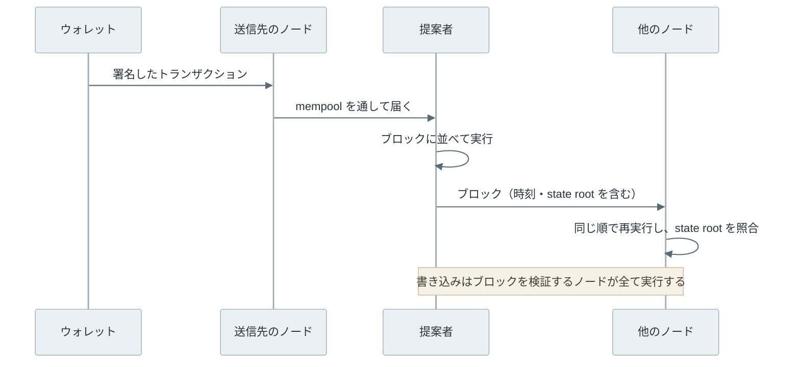
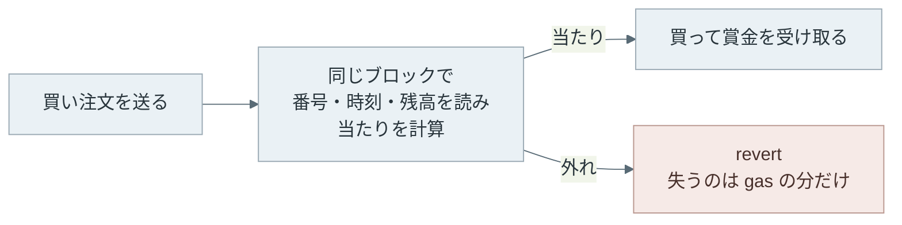
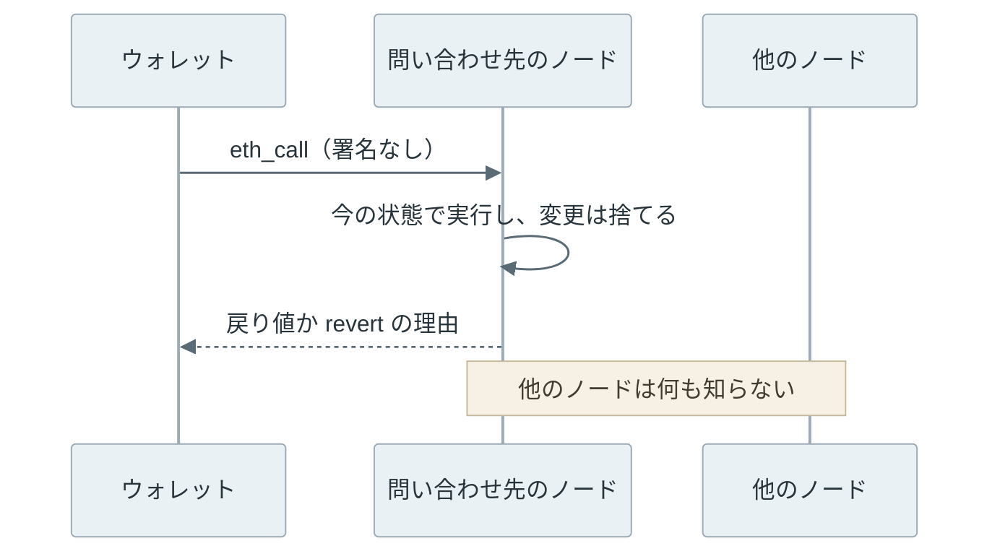
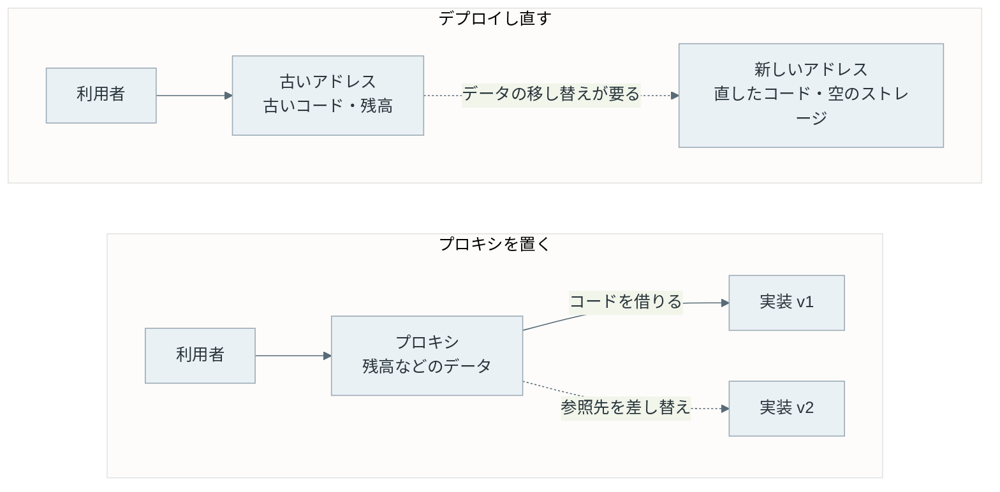

スマートコントラクト（smart contract）は、[Ethereum](https://ethereum.org/ja/developers/docs/smart-contracts/) などのブロックチェーンに置いて動かすプログラムです。コードとデータはチェーン上の 1 つのアドレスにまとまっていて、誰でもトランザクションを送って関数を呼べます。[ERC-20](../erc-20/) で作るトークンの残高表も、交換所の [AMM](../amm/) も、コントラクトとして書かれています。

Web のバックエンドを書いてきたエンジニアが、抽選の API を初めてコントラクトで書く場面を考えます。サーバーなら、当たり番号は乱数生成器で作り、正解は DB（データベース）に置いて外には出しません。コントラクトにはどちらも無いので、ブロックの時刻などを混ぜたハッシュ値から当たり番号を作り、正解は `private` を付けた変数に置きたくなります。手元に立てたチェーンで、そう書いた抽選に 2 通りの参加者を 100 回ずつ参加させました。



番号を適当に選んだ参加者の当たりは 11 回で、外れた 89 回にも手数料を払いました。もう一方の Predictor というコントラクトは、100 回全てで当たっています。抽選が当たり番号の計算に使った値は、同じトランザクションの中で動く別のコントラクトからも、そのまま読めるからです。

<br>

本記事では、Web の API とサーバーに慣れたエンジニアが、コントラクトを書く前や呼ぶ前に知っておきたい次の 5 つを説明します。最初の 4 つは手元に立てたチェーンで実験し、最後の 1 つは公式の文書と実際の事故で説明します。

- コントラクトのコードは、どこで誰が実行するのか。
- ブロックの値で作った当たり番号は、なぜ当てられるのか。
- `private` の変数は、誰から隠れるのか。
- 読み取りの呼び出しとトランザクションは、何が違うのか。
- 置いたコードの誤りは、後から直せるのか。

例には Ethereum を使い、コードは [Solidity](https://docs.soliditylang.org/) で書きます。コントラクトを動かした量は gas という単位で数え、手数料は使った gas に単価を掛けた額になります。命令ごとの動きや gas の細かい計算は、[EVM](../evm/) のノートで扱っています。

---

### コントラクトの置き場所

Ethereum の[アカウント](../ethereum-account-model/)には、秘密鍵で操作する EOA（Externally Owned Account）と、コードを持つコントラクトアカウントがあります。コントラクトを置くには、Solidity をコンパイルしたバイトコードを載せたトランザクションを送ります。この操作をデプロイと呼びます。

載せるのはソースではなく初期化用のコードです。通常のデプロイ（CREATE）では、アドレスは送信者のアドレスと、送信者の [nonce](/notes/security/nonce/) という通し番号で決まります。EOA の nonce は、そのアカウントが送ったトランザクションの数です。ブロックに入ると、ノードが初期化用のコードを実行し、その結果がそのアドレスで動くコードと、変数の値を保存するストレージの初期値になります。

<br>

関数を呼ぶ時も、宛先をコントラクトのアドレスにした[トランザクション](../ethereum-transaction/)を送ります。データの先頭 4 バイトが呼ぶ関数を表し、続くバイト列が引数です。この並べ方は ABI（Application Binary Interface）と呼ばれ、[Solidity の ABI 仕様](https://docs.soliditylang.org/en/latest/abi-spec.html)が定めています。[EVM のノート](../evm/#calldata-と-abi)では、実際のバイト列を読んでいます。

<br>

送ったトランザクションは、[mempool](../mempool/) で待った後、次のブロックを作る役に選ばれたノード（提案者）が、ブロックに並べて実行します。ブロックを受け取った他のノードも、同じトランザクションを同じ順に自分で再実行します。2026 年時点の Ethereum では、並べる作業の多くを builder という別の参加者が担っています。この分担は [PBS](../pbs/) のノートで扱っています。



state root は、全アカウントの残高やストレージをまとめて 1 つにしたハッシュ値です。提案者は実行した後の state root をブロックのヘッダーに書き、他のノードは自分で計算した値と比べます。一致しなければ、そのブロックは受け付けません。

つまり、コントラクトの関数は、どのノードで実行しても同じ結果になる必要があります。コントラクトを実行する仮想マシンの [EVM（Ethereum Virtual Machine）](https://ethereum.org/ja/developers/docs/evm/)に、乱数生成器やノードの時計、外部の API を読む命令が無いのはこのためです。関数が読めるのは、チェーンに記録された状態と、トランザクションの中身と、提案者がヘッダーに書いた時刻などのブロックの値だけです。

リーダーが決めた順の更新を全員が同じ初期状態から適用する点は、[Leader and Followers](/notes/distributed-systems/leader-and-followers/) の複製と同じ考え方です。ただし、[ライト・クライアント](https://ethereum.org/ja/developers/docs/nodes-and-clients/light-clients/)のように、全トランザクションを自分では実行しない参加方法もあります。

---

### ブロックの値を変えた再実行

手元で 3 台のノードを動かし、関数の結果がブロックの値で決まる様子を見ました。ノードには [Foundry](https://getfoundry.sh/anvil/overview/) の anvil 1.7.1 を使い、同じ初期状態で起動しています。

ノード A で冒頭の抽選に送ったトランザクション 202 件を実行し、その署名済みのバイト列を B と C に送り直して、それぞれにブロックを作り直させました。B ではブロックの時刻を A と同じ値に、C では 1 秒ずらした値にしています。



時刻を揃えた B は、202 件全ての成否が A と一致しました。C では適当に選んだ 100 回のうち 16 回で結果が変わり、当たりは 11 回から 9 回になっています。

実際のノードは、受け取ったブロックのヘッダーに書かれた時刻で実行するので、C のような食い違いは起きません。この実験で分かるのは、結果がブロックの値で決まり、値を揃えれば一致するところまでで、state root の照合は再現していません。

<br>

<details>
<summary>送り直したコードと実験の細部</summary>

送り直す部分のコードは次の通りです。コードの `rpc` は指定したノードに JSON-RPC（ノードに照会や送信を頼む HTTP の API）の要求を送る関数、`receipt` はトランザクションの実行結果を記したレシート（receipt）を待って返す関数です。

```python
def exp_replay():
    """A の 1 番目以降のブロックを、生のトランザクションのまま B と C に送り直す。"""
    head = int(rpc("A", "eth_blockNumber"), 16)
    status = {"A": {}, "B": {}, "C": {}}
    same_hash = True
    for n in range(1, head + 1):
        blk = rpc("A", "eth_getBlockByNumber", hex(n), False)
        ts = int(blk["timestamp"], 16)
        for h in blk["transactions"]:
            status["A"][h] = int(receipt("A", h)["status"], 16)
            raw = rpc("A", "eth_getRawTransactionByHash", h)
            for node, shift in (("B", 0), ("C", 1)):
                rpc(node, "evm_setNextBlockTimestamp", ts + shift)
                h2 = rpc(node, "eth_sendRawTransaction", raw)
                same_hash &= h2 == h
                status[node][h] = int(receipt(node, h2)["status"], 16)
    return status, same_hash
```

`status` は [EIP-658](https://eips.ethereum.org/EIPS/eip-658) が定めるトランザクション全体の成否で、1 は成功、0 は失敗です。送り直したトランザクションのハッシュ値は、B と C の 202 件全てで A と同じでした。

当たり番号には時刻の他に、次の節で説明する `prevrandao` というブロックの値も混ぜています。anvil はこの値を[1 つ前のブロックが持つハッシュ値とブロック番号から作る](https://github.com/foundry-rs/foundry/blob/4072e48705af9d93e3c0f6e29e93b5e9a40caed8/crates/anvil/src/eth/backend/mem/mod.rs#L2561-L2565)ので、時刻もトランザクションも A と同じ B では揃います。C では最初のブロックで時刻がずれてハッシュ値が変わるため、2 番目のブロックからはこの値も A と違います。

status が 1 でも、中の呼び出しが全て成功したとは限りません。コントラクトが別のコントラクトを呼んだ失敗を [try/catch](https://docs.soliditylang.org/en/latest/control-structures.html#try-catch) などで受け止めて処理を続ければ、外側の status は 1 になります。Predictor の `attack` は `play` の失敗を受け止めないので、`play` が revert すればトランザクション全体が失敗します。

本記事の実験は gas の上限を指定して送る前の見積もりを飛ばし、失敗するトランザクションもブロックに入れています。

</details>

<br>

検証するノードが全て再実行するという性質から、サーバーの API と次の違いが出てきます。

| 項目 | サーバーの API | コントラクト |
| --- | --- | --- |
| 実行する機械 | 運営者のサーバー | 書き込みは検証するノード全て、読み取りは問い合わせた 1 台 |
| 呼べる人 | 認証を通った利用者 | 誰でも。断る条件はコードに書く |
| 失敗した時 | エラーを返し、DB を巻き戻す | 状態は巻き戻るが、手数料は払う |
| 乱数・外部の API | 使える | 使えない。外の値は誰かが書き込む |
| データの見え方 | 運営者だけが読める | ストレージも引数も誰でも読める |
| コードの更新 | デプロイし直せば変わる | 置いたバイトコードは書き換えられない。直す手は後の節で扱う |

外の値は、誰かがトランザクションで書き込まない限りコントラクトに届きません。外の値を書き込む仕組みをオラクル（oracle）と呼び、価格を書き込む 3 通りを [Oracle](../oracle/) のノートで比べています。書き込まれた値が現実と合っているかは、コントラクトの実行とは別の問題として残ります。

コントラクトは自分から動き出すこともないので、締め切りの処理なども、誰かが関数を呼んだ時に初めて動きます。また、検証するノードが全て実行する分、1 ブロックで使える gas には[上限](../gas-eip-1559/)があり、大量のデータを 1 件のトランザクションで処理すると、上限に達して失敗することがあります。

---

### ブロックの値で作る当たり番号

以下は、冒頭で使った抽選のコードです。`draw` は、ブロックの `prevrandao` と時刻、参加者のアドレスを混ぜた [keccak256](../hash-function/) のハッシュ値から、0〜9 の当たり番号を作ります。`prevrandao` は、前のブロックまでに提案者たちが出し合った値を混ぜて作る乱数で、[EIP-4399](https://eips.ethereum.org/EIPS/eip-4399) でコントラクトから読めるようになりました。`play` は、渡された番号が外れていれば `require` で処理を取り消します。

この取り消しを revert と呼び、それまでのストレージの変更とログが全て消えます。ログは、コントラクトが処理の結果をアプリに知らせるために残す記録です。命令の定義は [EIP-140](https://eips.ethereum.org/EIPS/eip-140) にあります。

```solidity
// ブロックの値から 0〜9 の当たり番号を作る抽選。
// 外れた番号で play を呼ぶと取り消される（revert）。
contract Lottery {
    mapping(address => uint256) public winsOf;

    function draw(address player) public view returns (uint256) {
        return uint256(keccak256(abi.encodePacked(block.prevrandao, block.timestamp, player))) % 10;
    }

    function play(uint256 guess) external {
        require(guess == draw(msg.sender), "miss");
        winsOf[msg.sender] += 1;
    }
}

// 同じトランザクションの中で当たり番号を計算してから play を呼ぶ。
contract Predictor {
    function attack(Lottery lottery) external {
        lottery.play(lottery.draw(address(this)));
    }
}
```

Predictor は、自分のアドレスで当たり番号を計算し、その番号で `play` を呼びます。2 つの呼び出しは 1 つのトランザクションの中にあるので、同じブロックの値を読みます。`draw` が `public` でなくても、チェーン上のバイトコードを逆アセンブルすれば式は分かるので、同じ計算を Predictor の中に書けば済みます。

<br>

参加させた部分のコードは次の通りです。適当に選ぶ番号は、シードを 1 に固定した Python の乱数で選びました。ブロックの時刻は、Ethereum でブロックが作られる間隔と同じ 12 秒ずつ進め、何度実行しても同じ結果になるようにしています。

```python
rng = random.Random(1)
for i in range(ROUNDS):
    guess = rng.randrange(10)
    r1 = send("A", player, lot, calldata("play(uint256)", guess))
    r2 = send("A", attacker, pred, calldata("attack(address)", lot))
```

結果の要約を抜粋します。

```json
{
 "guess": {"plays": 100, "wins": 11, "fee_eth": 0.002334521337224081,
           "gas_miss": [21875, 21887]},
 "predictor": {"plays": 100, "wins": 100}
}
```

外れた `play` は revert したので、`winsOf` の更新は残りません。それでもトランザクションはブロックに入り、使った 21,875 か 21,887 gas に見合う手数料は払っています。送信者の nonce も 1 進みます。失敗した時に手数料がどう決まるかは、[Ethereum Transaction のノート](../ethereum-transaction/#実行が止まった時に消費する-gas)で扱っています。

<br>

外れた時に失うのが手数料だけなら、当たる時だけ参加する使い方もできます。実際のチェーンでも、この形の被害が出ています。[SolidityScan の解析](https://blog.solidityscan.com/roast-football-hack-analysis-e9316170c443)によると、BNB Smart Chain の Roast Football は 2022 年 12 月 5 日に攻撃されました。当たりの判定は、ブロックの番号と時刻、買い手のアドレス、プールの残高から作ったハッシュ値で、どれも呼び出す時点で攻撃者が読める値でした。外れた買い注文は revert して gas の分しか失わないので、攻撃者は当たる時だけ買い、12 BNB を得たと報告されています。



脆弱性の分類をまとめた [OWASP Smart Contract Top 10](https://owasp.org/www-project-smart-contract-top-10/) も、2025 年の一覧で SC09 Insecure Randomness として、ブロックの値を使う乱数を挙げています。

当たり番号を守るには、参加を締め切った後に作られるブロックの値で決めるか、外で作った乱数を検証できる形で書き込んでもらいます。前者の作り方と、`prevrandao` を最後の提案者がどこまで動かせるかは [Commit-Reveal](../commit-reveal/) のノートで扱っています。後者の例は、証明付きの乱数を書き込む [Chainlink VRF](https://docs.chain.link/vrf) です。

---

### `private` の変数

次は、正解を `private` の変数に置いたクイズです。`public` を付けた `owner` と `solved` には、同じ名前で値を返す関数をコンパイラが自動で作ります。`private` を付けた `answer` にはこの関数が作られず、このコントラクトを継承したコントラクトからも使えません。

```solidity
// 正解の言葉を private の変数に置いたクイズ。
contract Quiz {
    address public owner;          // slot 0
    string private answer;         // slot 1
    uint256 public solved;         // slot 2

    constructor(string memory _answer) {
        owner = msg.sender;
        answer = _answer;
    }

    function solve(string calldata word) external {
        require(keccak256(bytes(word)) == keccak256(bytes(answer)), "wrong");
        solved += 1;
    }

    function setAnswer(string calldata _answer) external {
        require(msg.sender == owner, "not owner");
        answer = _answer;
    }
}
```

ストレージは 32 バイトずつのスロット（slot）に分かれていて、変数は宣言の順に slot 0 から入ります。

ノードには、照会やトランザクションの送信を頼む JSON-RPC という HTTP の API があります。正解の `tsukimi` でデプロイし、slot 1 を JSON-RPC の `eth_getStorageAt` で読みました。コードの `rpc` は、指定したノードに JSON-RPC の要求を送る関数です。

```python
slot1 = rpc("A", "eth_getStorageAt", quiz, "0x1", "latest")
b = bytes.fromhex(slot1[2:])
length = b[-1] // 2  # 31 バイト以下の文字列は、末尾の 1 バイトに長さ × 2 が入る
decoded = b[:length].decode()
```

```text
slot1:   0x7473756b696d690000000000000000000000000000000000000000000000000e
decoded: tsukimi
```



先頭の 7 バイトが `tsukimi` の文字コードで、末尾の 0x0e（14）は長さ 7 の 2 倍です。31 バイト以下の文字列をこう詰める決まりは、Solidity の文書にある [Layout of State Variables in Storage](https://docs.soliditylang.org/en/latest/internals/layout_in_storage.html#bytes-and-string) にあります。フルノードは全アカウントのストレージを持っているので、RPC を開いているノードなら誰でもこの読み方ができます。

[Solidity で可視性を決める指定の説明](https://docs.soliditylang.org/en/latest/contracts.html#state-variable-visibility)でも、`private` や `internal` で防げるのは他のコントラクトからの読み書きだけで、チェーンの外からは誰にでも見えるとされています。さらに、デプロイしたトランザクションでは、データの末尾に constructor へ渡した `7473756b696d69` がそのまま入っていました。トランザクションの中身も全ノードに配られるからです。

<br>

隠したい値は、ストレージにも引数にも置けません。正解のハッシュ値だけを置く手もありますが、言葉のように候補を絞れる値は総当たりで当てられます。値に秘密の乱数を混ぜてハッシュ値を置き、締め切りの後に明かす手順も、[Commit-Reveal](../commit-reveal/) のノートで実験しています。

---

### 読み取りの呼び出し

ここまでの値の読み取りでは、トランザクションを送らずに、JSON-RPC でノードに直接照会しました。関数の呼び出しにも [eth_call](https://ethereum.org/ja/developers/docs/apis/json-rpc/#eth-call) という同じ種類の要求があり、問い合わせたノードが今の状態で関数を実行して、結果だけを返します。ブロックには入らず、チェーンの手数料も掛かりません。



eth_call には署名が要らないので、`from` に好きなアドレスを書けます。Quiz の `solve` は、鍵の持ち主が知られていない焼却用のアドレス `0x000000000000000000000000000000000000dEaD` を名乗って呼びました。`setAnswer` は、所有者と他人をそれぞれ名乗って呼んでいます。最後に、同じ `setAnswer` を他人のアカウントから本物のトランザクションで送っています。

```python
nobody = "0x000000000000000000000000000000000000dEaD"
block_before = int(rpc("A", "eth_blockNumber"), 16)
c_solve = call("A", nobody, quiz, calldata("solve(string)", word))
c_set_owner = call("A", owner, quiz, calldata("setAnswer(string)", "kaze"))
c_set_stranger = call("A", stranger, quiz, calldata("setAnswer(string)", "kaze"))
after = {"solved": uint("A", quiz, "solved()(uint256)"),
         "slot1": rpc("A", "eth_getStorageAt", quiz, "0x1", "latest"),
         "blocks_added": int(rpc("A", "eth_blockNumber"), 16) - block_before}
assert after["blocks_added"] == 0 and after["solved"] == 0

nonce0 = int(rpc("A", "eth_getTransactionCount", stranger, "latest"), 16)
bal0 = int(rpc("A", "eth_getBalance", stranger, "latest"), 16)
r_bad = send("A", stranger, quiz, calldata("setAnswer(string)", "kaze"))
nonce1 = int(rpc("A", "eth_getTransactionCount", stranger, "latest"), 16)
bal1 = int(rpc("A", "eth_getBalance", stranger, "latest"), 16)
fee = int(r_bad["gasUsed"], 16) * int(r_bad["effectiveGasPrice"], 16)
assert int(r_bad["status"], 16) == 0 and nonce1 == nonce0 + 1 and bal0 - bal1 == fee
```

```text
call_solve_as_dead:         ok
call_setAnswer_as_owner:    ok
call_setAnswer_as_stranger: execution reverted: not owner
after_calls:                solved=0, slot1 は tsukimi のまま, 増えたブロック 0
tx_setAnswer_as_stranger:   status=0, gasUsed=24119, logs=0, nonce 0 -> 1
                            残高の減少 24119000192952 wei = 手数料
```

所有者だけが呼べる `setAnswer` も、所有者を名乗るだけで成功しました。それでも `solved` は 0 で、slot 1 も `tsukimi` のままです。eth_call を 3 回呼ぶ間に、ブロックは 1 つも増えていません。eth_call の実行は問い合わせたノードの中で終わり、何も書き込まれません。

一方で、他人が本物のトランザクションで送った `setAnswer` は revert し、ログも残りませんでした。それでも nonce は 0 から 1 に進み、残高は使った 24,119 gas に単価を掛けた手数料と同じ額だけ減っています。

<br>

送る前に eth_call で試せば、revert するかどうかを手数料を払わずに知ることができます。gas の量を見積もる eth_estimateGas も、実行が revert すると[見積もりではなくエラーを返します](https://github.com/ethereum/go-ethereum/blob/4721b2cc765495073d9745995616b36b06480824/internal/ethapi/api.go#L971)。逆に、値を返すだけの `view` の関数でも、トランザクションとして送れば gas を使います。

ウォレットが送る前に結果を予想して見せるのも、同じ考え方です。[Wallet のノート](../wallet/)で紹介した、Rabby というウォレットの確認画面がその例です。ただし、eth_call の答えを出しているのは問い合わせた 1 台だけで、他のノードとは照合していません。また、送ったトランザクションがブロックに入るまでに他のトランザクションが状態を変えれば、結果も変わります。並び順で結果が変わる話は [MEV](../mev/) のノートで扱っています。

---

### 置いたコードの誤り

デプロイしたアドレスのコードは、後から書き換えられません。直したコードをデプロイし直すと別のアドレスになり、ストレージも空から始まります。利用者や他のコントラクトが覚えているのは古いアドレスなので、残高などのデータの移し替えと、参照先の切り替えが別に必要です。

コードを直せなかった例として知られるのが、2016 年の The DAO です。集めた ETH を流し出される[リエントランシー](../reentrancy/)の欠陥がありましたが、コントラクトは直せず、Ethereum はチェーンの規則を変える[ハードフォーク](../ethereum-hard-forks/)で ETH を回収用のコントラクトに移しました。この時に規則を変えずに続いたもう一方のチェーンが、[Ethereum Classic](https://ethereumclassic.org/knowledge/history) です。

送信者が選んだ値と初期化用のコードから計算したハッシュ値でアドレスを決める [CREATE2](https://eips.ethereum.org/EIPS/eip-1014) と、`SELFDESTRUCT` でコードを消す命令を組み合わせ、同じアドレスに別のコードを置き直す [Metamorphic Contract](../metamorphic-contract/) という手もありました。

2024 年 3 月の Cancun で有効になった [EIP-6780](https://eips.ethereum.org/EIPS/eip-6780) により、コードを消せるのは作ったのと同じトランザクションの中だけになり、この手は使えなくなっています。

<br>



直す手段を初めから組み込むのが [Upgradeable Proxy](../upgradeable-proxy/) です。プロキシはデータだけを持ち、処理は差し替えられる別のコントラクトからコードを借りて動きます。その代わり、参照先を書き換える操作が通れば、資産を扱うコードごと入れ替えられます。

2025 年に Bybit が使っていた Safe では、Web 画面の JavaScript が改竄され、承認者は中身を差し替えられたトランザクションと気付かずに署名しました。承認者の鍵は盗まれていません。

[Sygnia の調査](https://www.sygnia.co/blog/sygnia-investigation-bybit-hack/)によると、その実行は delegatecall で攻撃者のコントラクトを呼び、Safe の参照先をそのコントラクトに差し替えています。経緯は [Wallet のノート](../wallet/)で扱っています。

<br>

更新できるコントラクトの利用者は、開発者が勝手に書き換えないと信頼するしかありません。ethereum.org の [Upgrading smart contracts](https://ethereum.org/en/developers/docs/smart-contracts/upgrading/) も、この点を更新の欠点に挙げています。差し替えを複数の鍵で承認する[マルチシグ](../multisig/)や、変更が効くまで待つタイムロック（timelock）は、この信頼を減らすための工夫です。

更新の仕組みが無くても、管理者だけが残高を変えられる関数を書くことはできます。コードがチェーン上にあることと、管理者がいないことは別なので、どの関数を誰が呼べるかまでコードで読む必要があります。

---

### 移す前に見ること

乱数と秘密をサーバーに任せていた処理をコントラクトに移す時は、次の順で見ていきます。

1. 関数の結果を決める値を全て挙げ、同じブロックで誰が読めるかを見る。
2. 先に知られると困る値は、締め切った後のブロックか外の仕組みで決める。
3. 隠したい値は、ストレージにも引数にも置かない。
4. 送る前に eth_call で試し、revert した時の手数料も見込む。
5. 後から直す手段を用意するなら、差し替えの鍵を誰が持つかを決める。

冒頭の抽選は 1 と 2 を飛ばしていたので、Predictor に 100 回当てられました。参加した時点ではまだ決まっていない値で当たり番号を作れば、同じトランザクションの中で計算する手は使えなくなります。

実験の環境は [lab/README.txt](lab/README.txt)、Solidity のコードは [lab/Contracts.sol](lab/Contracts.sol)、実行の全体は [lab/run.sh](lab/run.sh) と [lab/experiment.py](lab/experiment.py) にあります。
