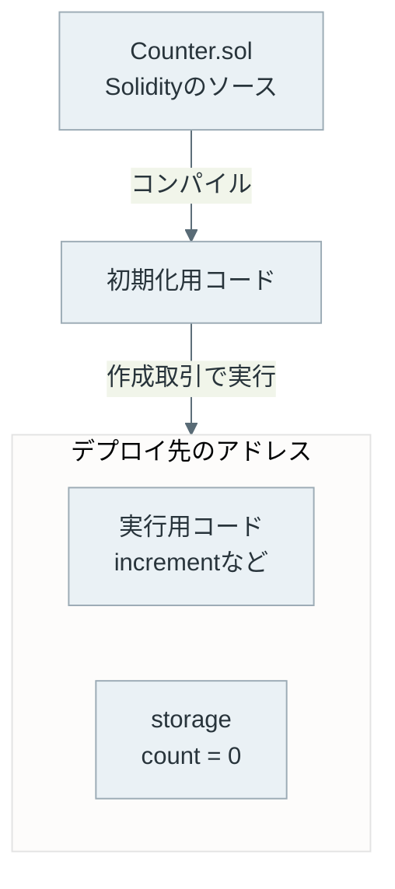
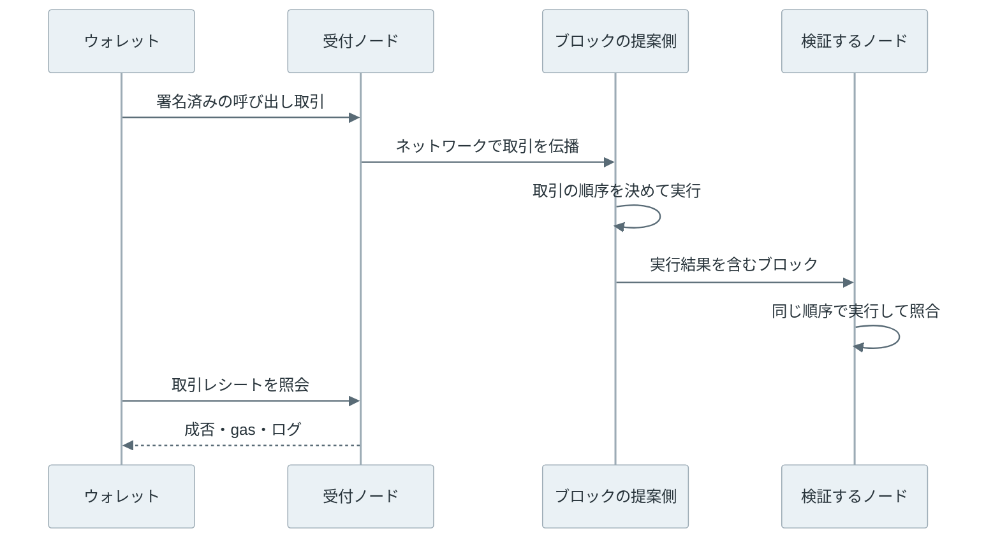
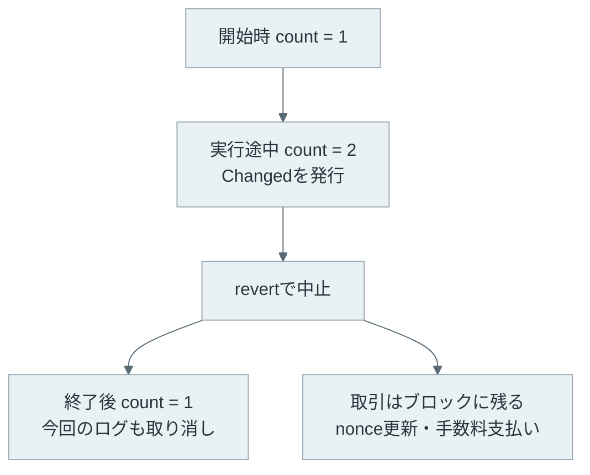

スマートコントラクト（smart contract）は、ブロックチェーン上に配置し、共通のルールに従って実行するプログラムです。Ethereum では、アドレスにコードと保存状態が紐づきます。例えば、トークンの残高を管理し、送金の条件を満たす場合だけ残高を更新できます。

通常の Web サービスでは、運営者のサーバーがプログラムを実行します。スマートコントラクトを利用する時も実行するコンピュータは必要ですが、結果の正しさを運営者だけに任せる構成ではありません。

以下は、運営者のサーバーだけが実行する構成と、検証するノードがそれぞれ同じ取引を実行する構成を比べた図です。


上記の図の各ノードは、他のノードの計算結果をそのまま信じず、自分で実行して手元の状態を更新します。

<br>

本記事では、[Ethereum Transaction](../ethereum-transaction/) で扱った「実行の依頼」が、どのようにプログラムの実行に繋がるのかを説明します。

- コードとデータはどこに保存されるのか。
- 誰がプログラムを動かし、結果を確かめるのか。
- 値を読む操作と、値を変える取引は何が違うのか。
- 実行に失敗すると、何が取り消され、何が残るのか。

後半では、ローカルノード上の小さなカウンターで実際の結果を確認します。Solidity の文法全体や、[EVM](../evm/) の命令一覧は扱いません。

---

### 共通のルールによる状態更新

例えば、ゲームのポイントをユーザー間で送る機能を考えます。サーバーに残高を保存する場合、運営者が送金条件の判定と残高の更新を行います。利用者は画面に表示された結果を受け取りますが、その画面だけからサーバー内部の処理を検証することはできません。

Ethereum のスマートコントラクトでは、送金条件をコードにし、残高をチェーン上の状態として管理します。ブロックを検証するノードは、直前の状態に取引を順番に適用し、計算結果がブロックの示す結果と一致するか確かめます。[Ethereum Virtual Machine（EVM）](https://ethereum.org/en/developers/docs/evm/)は、この実行規則を定める仮想マシンです。

開発者の PC が動き続ける必要はありません。コードが配置され、チェーンが動いていれば、別の利用者もそのアドレスに取引を送れます。一方で、コードは時間になっただけで自動的に起動するわけではありません。定期処理が必要なら、外部から取引を送る仕組みなどを用意します。

利用者やノードは、公開されたコードの通りに処理されたかを検証できます。ルール自体が適切かどうかは別の問題です。管理者だけが残高を変更できるコードも書けるため、「スマートコントラクトだから管理者がいない」とは限りません。

---

### コードと保存状態

Ethereum 向けの開発では、[Solidity](https://docs.soliditylang.org/en/v0.8.28/introduction-to-smart-contracts.html) などで書いたソースコードを EVM が実行するバイトコードにコンパイルします。コードをチェーン上に配置する操作がデプロイ（deploy）です。

コントラクト作成の取引では、初期化用のコードを実行します。その結果として実行用のコードを配置し、必要な初期状態を設定します。ソースファイルをそのままノードにアップロードして実行する仕組みではありません。

以下は、整数 `count` を保存し、`increment()` を呼ぶたびに 1 増やすカウンターをデプロイした直後の構成です。storage は、呼び出しが終わった後も保持する保存領域です。アカウントの状態全体は [Ethereum Account Model](../ethereum-account-model/) で説明しています。



同じコードを 2 回デプロイすると、通常は別々のアドレスに配置され、それぞれの保存状態を持ちます。一方を増やしても、もう一方のカウンターは増えません。呼び出す側は、チェーンとアドレスを指定して対象を選びます。

関数の呼び出しには、ABI（Application Binary Interface）というデータの取り決めを使います。ABI は、関数名や引数の型などを送信するバイト列に変換するための情報です。

例えば `increment()` を呼ぶ場合、その関数を識別する 4 バイトの値が取引の `data` に入ります。引数があれば、その後ろに符号化した値が続きます。[Solidity の ABI 仕様](https://docs.soliditylang.org/en/v0.8.28/abi-spec.html)がこの形を定めています。

ウォレットやライブラリは、この変換を代わりに行います。人が画面で見ている関数名と、ノードに送るデータは同じ表現ではありません。

---

### 実行するノードと取引の順序

Ethereum のノードは、実行を担当する実行クライアントと、ブロックの合意を担当する合意クライアントを組み合わせて動きます。[ノード構成の公式解説](https://ethereum.org/en/developers/docs/nodes-and-clients/node-architecture/)にあるように、取引の実行と、採用するチェーンを決める処理は役割が異なります。

取引の処理量を表す単位を gas と呼び、取引として実行する場合は gas に応じた手数料を払います。手数料の仕組みは [Ethereum Transaction](../ethereum-transaction/) で説明しています。

以下は、ウォレットから送った取引がブロックに入り、検証されるまでを簡略化した図です。



すべてのノードが、ウォレットから同時に呼び出されるわけではありません。受け取ったブロックを検証するノードが、[同じ初期状態と順序から結果を再計算します](/notes/distributed-systems/leader-and-followers/)。軽量クライアントなど、すべての取引を自分で実行しない参加方法もあります。

[実行順序は結果に影響します](../mev/)。トークン残高 10 から 8 枚ずつ送る呼び出しが 2 件あれば、先に実行された取引が残高を減らし、後の取引は残高不足になります。以下は、2 件の並びを入れ替えた時の結果です。


「同じコードなら常に同じ結果」ではなく、入力、直前の状態、ブロックの情報などの実行条件も揃えて初めて同じ結果になります。

外部の Web API に自由にアクセスできないのも、検証する側が同じ条件を再現する必要があるからです。外部の価格などを使う場合は、その情報をチェーンに渡す[オラクル（oracle）](../oracle/)が必要になります。渡された情報が現実と一致するかという問題は、コードの実行とは別に残ります。

---

### 値の照会と状態の変更

カウンターの値を確認するだけなら、取引をブロックに入れる必要はありません。ノードの API にある [`eth_call`](https://ethereum.org/en/developers/docs/apis/json-rpc/#eth_call)は、指定した状態で実行を試し、返り値を返します。試した結果をチェーンの状態として保存しません。

| 操作 | ノードでの処理 | チェーンへの反映 |
| --- | --- | --- |
| `eth_call`で値を読む | 指定した状態で実行 | なし |
| `eth_call`で更新を試す | 一時的に実行 | なし |
| 更新の取引を送る | ブロック内で実行 | 成功した変更を保存 |

`eth_call`は、読み取り専用の関数だけに使える API ではありません。状態を変える関数も試せますが、変更は残りません。ブロックに取引を送らないためチェーンの取引手数料は発生しませんが、ノード側の計算資源は使います。API サービス独自の利用料金や実行制限は別にあります。

逆に、値を返すだけの関数でも、取引として送れば gas を使います。Solidity の `view` は状態を変更しない関数の指定であって、あらゆる呼び出し方で手数料がなくなる指定ではありません。

試した時点と実際にブロックに入った時点で状態が違えば、結果も変わります。事前のシミュレーションが成功していても、その後の取引の成功は保証されません。

---

### ローカルのカウンター実験

実験では、[Foundry の Anvil](https://getfoundry.sh/anvil/overview) という開発用ノードをローカルに起動します。公開ネットワークには接続せず、Anvil のテスト用アカウントを利用します。使用したバージョンは Anvil 1.7.1、Solidity コンパイラ 0.8.28 で、EVM の規則は Cancun に固定しています。

デプロイするコードは次の通りです。[Counter.sol](lab/Counter.sol) にも保存しています。

```solidity
// SPDX-License-Identifier: MIT
pragma solidity 0.8.28;

contract Counter {
    uint256 public count;
    event Changed(uint256 value);

    function increment() external {
        count += 1;
        emit Changed(count);
    }

    function incrementAndFail() external {
        count += 1;
        emit Changed(count);
        revert("demonstration");
    }
}
```

`count` は保存する整数で、初期値は 0 です。`public` を付けると、Solidity が値を取得する `count()` を生成します。`increment()` は値を 1 増やし、`Changed` というイベントを出します。イベントはアプリが処理結果を追跡するためのログです。

`incrementAndFail()` は、値を増やしてイベントを出した後に、意図的に `revert` で実行を中止します。最後に失敗した場合、途中の変更が残るかどうかを確認するための関数です。利用者を制限するコードはないため、どのアカウントからも呼べます。



再現用の [run.py](lab/run.py) は、コンパイル、ノード起動、デプロイ、各操作、結果の検査を行います。`anvil`、`cast`、`solc`を PATH に置き、リポジトリのルートで次を実行します。必要なバージョンと実行条件は [README](lab/README.txt) にも記載しています。

以下は、実験コードの抜粋です。デプロイ後に `eth_call`・成功する取引・失敗する取引を比較します。コンパイルとノード起動を含む全体は [run.py](lab/run.py) にあります。

`rpc` はローカルノードへの呼び出し、`data` は関数呼び出しの符号化、`send` は取引送信と receipt の取得、`read` は `eth_call` による値の照会、`status` は receipt の成否を整数に直す関数です。`lines` は出力をためるリストです。`owner` はテスト用アカウント、`address` はデプロイ済みの `Counter` のアドレスです。

```python
assert read('count()') == 0
before_block = rpc('eth_blockNumber')
rpc('eth_call', {'from': owner, 'to': address, 'data': data('increment()')}, 'latest')
assert read('count()') == 0 and rpc('eth_blockNumber') == before_block
lines.append('eth_call increment: count=0; block unchanged')
for label, signature, expected in [
    ('increment', 'increment()', 1),
    ('revert', 'incrementAndFail()', 0),
]:
    nonce = int(rpc('eth_getTransactionCount', owner, 'latest'), 16)
    balance = int(rpc('eth_getBalance', owner, 'latest'), 16)
    receipt = send(label, owner, data(signature), address)
    fee = int(receipt['gasUsed'], 16) * int(receipt['effectiveGasPrice'], 16)
    assert status(receipt) == expected and read('count()') == 1
    assert int(rpc('eth_getTransactionCount', owner, 'latest'), 16) == nonce + 1
    assert balance - int(rpc('eth_getBalance', owner, 'latest'), 16) == fee
    assert len(receipt['logs']) == expected
    lines.append(
        f'{label}: status={status(receipt)}; count=1; logs={len(receipt["logs"])}; nonce_delta=1; fee_wei={fee}'
    )
```

```bash
python3 content/notes/blockchain-systems/smart-contract/lab/run.py
```

以下は、実際に実行した[出力](lab/output/summary.txt)です。

```text
eth_call increment: count=0; block unchanged
increment: status=1; count=1; logs=1; nonce_delta=1; fee_wei=89652000000000
revert: status=0; count=1; logs=0; nonce_delta=1; fee_wei=55922000000000
Assertions: PASS
```

最初の行では、`eth_call` で `increment()` を試しています。関数は実行されますが、保存されている `count` は 0 のままで、ブロックも増えません。

次の行では、同じ関数を取引として送っています。`count` が 1 になり、レシートの `status` は成功を表す 1、ログは 1 件になりました。

最後は、`count` を増やした後に失敗する `incrementAndFail()` を取引として実行した結果です。`count` は 1 のままで、ログも 0 件です。[REVERT の仕様](https://eips.ethereum.org/EIPS/eip-140)に従い、実行中の変更とログが取り消されました。一方で、取引の通し番号である nonce は 1 進み、手数料も払っています。表示した金額は wei 単位で、1 ETH は 10 の 18 乗 wei です。

この実験は gas の上限を明示し、失敗する取引も意図的に送っています。通常のウォレットでは、事前の gas 見積もりで失敗を検出すると送信前に止まる場合があります。その場合と、ブロック内で実行して失敗した場合を混同しないことが大切です。

---

### 実行結果の確認と制約

[EIP-658](https://eips.ethereum.org/EIPS/eip-658) で定められたレシートの `status` は、取引全体の実行が成功したかを表します。コントラクトが内部で別のコントラクトを呼び、その失敗を受け止めて処理を続けた場合、外側の取引は成功することがあります。本実験では失敗を受け止める処理がないため、`revert` が取引全体の失敗になります。

スマートコントラクトは、同じコードを他のアプリから呼び出せる点でも便利です。例えば、トークンの管理と決済処理を別のコントラクトに分け、組み合わせて使えます。トークンの残高と利用承認を管理するコントラクトの例は、[ERC-20](../erc-20/) で扱います。

一方で、設計時には次の制約があります。

- 公開チェーンの storage は秘密の保管場所にはなりません。Solidity の `private` は他のコントラクトからのアクセス制限であり、データを暗号化する指定ではありません。
- 実行量には [gas の上限](../gas-eip-1559/)があります。大量のデータを 1 件の取引で処理する設計は、上限に達して失敗する可能性があります。
- デプロイ済みコードの修正は通常のサーバー更新のようには行えません。別のアドレスへの移行や、[あらかじめ用意した更新機構](../upgradeable-proxy/)が必要です。
- 外部情報の正しさ、管理者権限、アプリ画面の表示内容まで、EVM が保証するわけではありません。

更新機構がある場合は、誰が実装を差し替えられるかも利用者の判断材料になります。[コントラクト更新の公式解説](https://ethereum.org/en/developers/docs/smart-contracts/upgrading/)では、更新可能にする設計と、その複雑さを説明しています。コードがチェーン上にあるという事実だけでなく、実際の処理と権限を確かめる必要があります。
