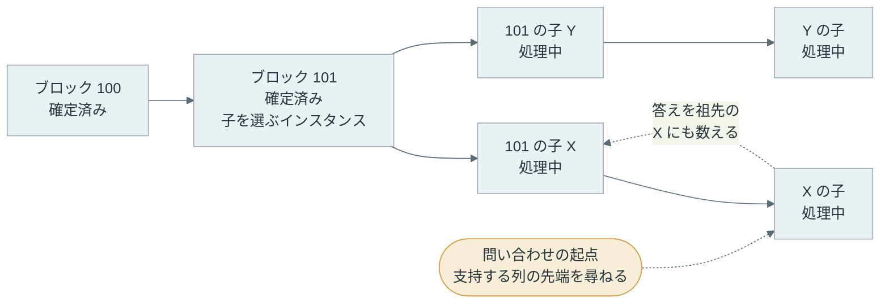

Snowman は、[Avalanche](https://www.avax.network/) というブロックチェーンが使う合意プロトコルです。ブロックチェーンでは、多数のノード（チェーンのデータを持つコンピュータ）が、トランザクションをまとめたブロックを同じ順に繋いだ列を持ちます（[Blockchain Basics](../blockchain-basics/)）。

合意プロトコルは、次にどのブロックを繋ぐかで、ノード全員が同じ答えに揃うための手順です。合意に参加するノードは、バリデータ（validator）と呼ばれます。

ノードの中には、壊れて止まるだけでなく、わざと嘘を答える不正なノードが混じる場合があります。不正なノードがいても合意できる方式を BFT（Byzantine Fault Tolerance）と呼び、[PBFT](https://www.usenix.org/conference/osdi-99/practical-byzantine-fault-tolerance)（Practical Byzantine Fault Tolerance）や [CometBFT](https://github.com/cometbft/cometbft) がその例です。

これらは全員の票を集め、全体の 2/3 を超える票が揃ったら確定します。確定は、そのブロックを後から覆らないものとして扱う、という決定です。

Snowman は票を数えません。各ノードは、無作為に選んだ少数のバリデータに「どのブロックを支持しているか」を尋ね、同じ答えが続いたら確定します。



上記の図の左では、全員が全員と通信します。右では、1 回の問い合わせを受けるのは全体の一部だけです。それでも問い合わせを何度も繰り返すと、正しく動くノードの意見は 1 つに寄っていきます。Snowman はこの性質を使い、ノードが増えても 1 回の問い合わせの通信量が増えないようにしています。

図の中の n はノードの数です。k・α・β は、1 回に尋ねる台数、一致に要る台数、一致が続くべき回数で、次の節から順に説明します。

<br>

本記事では、Snowman がどのような手順で確定し、その確定が何を保証しているのかを説明します。扱う疑問は次の通りです。

- 全員の票を集めずに、なぜ合意できるのか。
- 確定の条件を決める 3 つの値 k・α・β は、それぞれ何を決めるのか。
- 「確率的な確定」とは、何の確率なのか。
- 全員と通信する方式と比べて、通信量はどれだけ違うのか。

Snowman には、元になった 2019 年の論文の方式、それを確認する本記事の実験、Avalanche のノードの実装（avalanchego というソフトウェア）という 3 つの層があります。本記事の軸は論文の方式で、実験と実装は以下の節に分けています。


- title: 論文の方式（主軸）
  items:
  - Slush で多い方に乗り換える
  - Snowflake と Snowball で確定の条件を足す
  - Snowman でブロックの列に当てはめる
  - 確率的な確定の意味
- title: 本記事の実験
  items:
  - Python で書いた単純なモデル
  - k・α・β と不正なノードの割合を変える
  - 全員と通信する方式との通信量
- title: 実装（Avalanche のノード avalanchego）
  items:
  - 既定のパラメータ
  - 論文との違いと安全性の目安
  - Avalanche のチェーンと確定
  - ブロックを作る順番の決め方


バリデータが受け取る報酬や、Avalanche に独自のチェーンを作る方法は説明しません。

---

### Slush - 多い方に乗り換える

Snowman の土台は、2019 年に公開された論文 [Scalable and Probabilistic Leaderless BFT Consensus through Metastability](https://arxiv.org/abs/1906.08936) です。論文は、Slush → Snowflake → Snowball の順に、1 つずつ仕組みを足して説明しています。Snowman は論文には出てこない名前で、Avalanche を開発する [Ava Labs](https://www.avalabs.org/) が、Snowball をブロックの列に当てはめたものです（現在の実装が Snowflake を使う点は、実装の節で触れます）。

この節から「確率的な確定の意味」の節までは、論文の方式の説明です。

一番単純な Slush は、赤と青のように 2 つの候補から 1 つを選ぶ手順です。ブロックで言えば、同じ位置に作られた 2 つのブロックのどちらを繋ぐか、に当たります。複数のノードが同時にブロックを作ると、このような候補が並びます。各ノードは、次の手順を繰り返します。

1. 他のノードから無作為に k 台を選び、今どちらの色を支持しているかを尋ねる
2. k 台の答えのうち α 台以上が同じ色なら、自分の支持をその色に変える（α は k の半分より大きい）
3. 1 と 2 を決められた回数だけ繰り返す

例えば k = 20、α = 15 なら、20 台中 15 台以上が青と答えた時だけ青に乗り換えます。以下は、全体のうち青を支持するノードの割合に対して、1 回の問い合わせで乗り換えが起きる確率を[二項分布](/ml/math/probability-distributions/)で計算した図です。



半々の時は、どちらへの乗り換えも 0.02 しか起きません。しかし青が 60% になると、青への乗り換えは 0.13、70% では 0.42 と、多い方の色ほど乗り換えを集めます。問い合わせの偶然で片方がわずかに多くなると、その差が広がっていくわけです。論文は、このように一度傾くと戻りにくい状態を metastability（準安定）と呼び、合意の根拠にしています。

<br>

この様子は、本記事の Python のシミュレーションでも確認できます。論文の方式の節ですが、ここだけ先に実験の結果を借ります。全てのノードが同時に 1 回ずつ問い合わせる単位が、ラウンドです（モデルの詳細は「シミュレーションで見る k・α・β」の節）。

以下は、500 台のノードが半々に割れた状態から Slush を 60 ラウンド動かし、青を支持する正しいノードの割合を追った結果です。乱数の種（seed）を 1〜5 に変えた 5 回分を重ねています（[生成コード](https://github.com/nao1215/debimate/blob/main/content/notes/blockchain-systems/snowman/figures.py)）。



左（不正なノードなし）では、10 ラウンドほど半々のまま揺れた後、20 ラウンドまでに全員が赤に揃いました。どちらの色に揃うかは偶然で、この 5 回はたまたま全て赤でした。

しかし右（不正なノード 20%）のように、不正なノードが毎回少ない方の色を答えると、偏りが育たずに半々のまま続きます。この実験では、不正なノードが正しいノード全体の支持の割合を知っているという、攻撃者に有利な前提を置いています。

Slush には「いつ決めて良いか」を判断する仕組みがありません。決められた回数が終わった時点の色で決めるので、この状態で終われば正しいノードの決定が割れます。Slush は止まる故障だけを想定した手順です。論文は、嘘をつくノードに備えて、各ノードが自分の観測から「十分に揃った」と判断して確定する条件を次の Snowflake で足しています。

---

### Snowflake と Snowball - 確定の条件

Snowflake は、Slush に「同じ色の成功が何回続いたか」を数えるカウンタを足します。成功は、k 台の答えのうち α 台以上が同じ色だった問い合わせです。色が変わるか、成功しなかった問い合わせがあると、カウンタはやり直しになります。カウンタが β に届いたら、ノードはその色で確定します。Slush と違い、確定するかどうかを各ノードが自分の観測から判断します。

Snowball は、さらに色ごとの成功の累計を持ち、累計の多い方を支持します。Snowflake は、反対の色の成功が 1 回あるだけで支持を変えます。Snowball は累計で支持を決めるので、偶然の 1 回で支持が入れ替わりにくくなります。

以下は、1 台のノードが 8 回問い合わせる間に、2 つのカウンタがどう動くかを示した例です。図を小さくするため、β は 4 にしています。



4 回目は、20 台中 15 台が赤と答えたので、赤の成功です。連続の回数は 1 に戻り、Snowflake の支持は赤に変わります。一方で、色ごとの累計は青 2・赤 1 なので、Snowball の支持は青のままです。その後に青の成功が 4 回続き、8 回目で β に届いて青で確定しました。

<br>

#### k・α・β の役割

3 つの値は、安全性（正しいノード同士の確定が食い違わないこと）、止まりにくさ、速さを引き換えにして選びます。

| 値 | 意味 | 大きくすると |
|---|---|---|
| k | 問い合わせごとに尋ねるノードの数 | 問い合わせごとの偶然の偏りが減るが、通信が増える |
| α | 成功と数える、同じ答えの最小数（k/2 より大きい） | 不正なノードが成功を作りにくくなるが、答えないノードが多いと成功が出にくい |
| β | 確定に必要な、連続した成功の回数 | 偶然の連続で確定しにくくなるが、確定までの問い合わせが増える |

α の欠点は、割合で考えると分かりやすくなります。逆を答えるノードや、答えないノード（故障や通信の遅れで答えが届かないノード）が (k − α)/k を超える割合でいると、α 台の一致が揃いにくくなり、確定が遅れます。論文の評価では k = 10、α = 8 を使っています。

---

### Snowman - ブロックの列に当てはめる

論文は最後に、トランザクションを DAG（Directed Acyclic Graph、有向非巡回グラフ）で繋ぐ方式を説明しています（論文の中での名前はチェーンと同じ Avalanche なので、以下では DAG 方式と呼びます）。DAG 方式は、同じ資金を二重に使おうとするトランザクションの組（どちらか一方しか有効にできない組）ごとに Snowball を 1 つ持ちます。

送金だけなら、衝突しないトランザクション同士は順序を決めなくても結果が変わりません。しかし、[スマートコントラクト](../smart-contract/)のようにトランザクションの順序で結果が変わるチェーンでは、全てのトランザクションを 1 列に並べる必要があります。

Snowman は、この並びをブロックの列で作ります。同じ親を持つ子のブロックが赤と青の候補に当たり、親ごとに 1 つの Snowball（以下、インスタンス）が、どの子を次に繋ぐかを決めます。



上記の図では、ブロック 101 のインスタンスが X と Y のどちらを繋ぐかを決めます。ノードは、自分が支持する列の先端（X の子）について問い合わせ、その答えは X と、さらに祖先の処理中のブロックへの支持としても数えます。101 のインスタンスが X で確定すると X が確定し、Y と Y の子孫は捨てられます。

Snowman の問い合わせには、PBFT の primary（そのラウンドで何を決めるかを主導する役）のようなリーダーがいません。[リーダーを置く方式では、リーダーが止まると交代の手順が動くまで合意が進みません](/notes/distributed-systems/leader-and-followers/)。Snowman では、どのノードも同じ手順で問い合わせて、同じ手順で確定します。では誰がブロックを作るのかは、実装の節の「ブロックを作る順番」で扱います。

---

### 確率的な確定の意味

Snowman のノードが確定する時に見ているのは、自分が尋ねた k 台の答えが α 台以上同じだった、という観測の連続だけです。PBFT のように 2/3 の署名を集めた証明書（全体の票を数えた記録）はありません。確定は各ノードが個別に判断し、正しいノード同士の判断が食い違う確率は、パラメータの選び方で十分に小さくします。

同じ「確率的」でも、[Proof of Work（PoW）](../proof-of-work/)と Snowman では確率が掛かる場所が違います。



上記の図の左の PoW では、[Finality](../finality/) のノートで説明した通り、後ろに積まれたブロックの数（承認数）を待つほど覆る確率が下がります。それでも、より重い列が届けばノード自身が列を組み替えます。右の Snowman のノードは、一度確定したブロックを後から外す手順を持ちません。

<br>

では、確率的とは何の確率でしょうか。図の右下の ε（イプシロン）は、想定した割合の不正なノードがいる時に、2 つの正しいノードが矛盾するブロックをそれぞれ確定してしまう確率です。起きた場合、プロトコルの中で自動的には直りません。この点は、想定を超える不正に出会った PBFT と同じです。

違うのは崩れ方です。PBFT は、不正なノードが閾値（全体の 1/3）を 1 台超えた所で保証を失います。Snowflake・Snowball では、不正なノードの割合が想定を超えて増えるにつれて、食い違う確率が少しずつ上がります。

ある 1 台を境に、保証が全て消えるわけではありません（論文の Figure 1 は、k = 10・β = 150 の Snowflake と古典的な BFT・Bitcoin を曲線で比べています）。

---

### シミュレーションで見る k・α・β

ここからは本記事の実験です。Snowball を [Python](https://www.python.org/) で書き、不正なノードの割合と α・β を変えて、確定までのラウンド数、意見が割れた回数、1 ノードあたりのメッセージ数を数えました。Avalanche のノードは動かしておらず、以下は全てシミュレーションの結果です。モデルは論文の方式を次のように単純化しています。

- 全ノードが同時にラウンドを進め、未確定の正しいノードは毎ラウンド 1 回問い合わせる
- 問い合わせ先は自分以外から重複を許して k 台選び、全員が答える。票の重みは全員同じ（実際の Avalanche は、預けた通貨の量で重みを付けます）
- 1 回の問い合わせは、要求と応答で 2k 通と数える
- 基準の値は k = 20、α = 15、β = 20（後述の avalanchego の既定値と同じ）

条件は 2 つ用意しました。agree は、正しいノードが全員同じブロック（青）を支持し、不正なノードが別のブロック（赤）を答え続ける条件です。split は、正しいノードが半々に割れた所から始め、不正なノードは尋ねてきたノードが最初に支持していた色を答えて、割れたまま確定させようとする条件です。

以下は、1 回の問い合わせを処理する部分の抜粋で、agree の場合だけを残しています。ノードには 0 から番号を振り、番号が `nb` 未満のノードを不正なノードにしています。`active` は未確定の正しいノード、`peers` はそれぞれが選んだ k 台の番号です。`strength` と `ball` は Snowball の色ごとの累計と支持、`conf` と `last` は Snowflake の連続の回数と最後に成功した色です。

```python
answers = answer_of[peers]                 # 正しいノードは今の支持（確定済みなら確定値）
answers[peers < nb] = RED                  # 不正なノードは赤を答える
blue = answers.sum(axis=1)
ok = (blue >= alpha) | (k - blue >= alpha) # α 以上が同じなら成功
choice = np.where(blue >= alpha, BLUE, RED)[ok]
win = active[ok]
strength[win, choice] += 1                 # Snowball: 色ごとの成功の累計
more = strength[win, choice] > strength[win, 1 - choice]
ball[win[more]] = choice[more]
conf[win[last[win] != choice]] = 0         # 色が変わったら連続の回数を 0 に
last[win] = choice
conf[win] += 1
conf[active[~ok]] = 0                      # 失敗したら連続の回数を 0 に
done = win[conf[win] >= beta]              # β 回続いたら確定
decided[done] = last[done]
```

<br>

<details>
<summary>snow_sim.py の全体（Slush・Snowflake・Snowball と集計、186 行）</summary>

```python
"""Simulate Slush, Snowflake and Snowball on two conflicting values (red=0, blue=1).

Model (a simplification, not avalanchego itself):
- Synchronous rounds. Every undecided correct node sends one query per round.
- A query picks k other nodes at random with replacement, and every one answers.
- Correct nodes answer with their current preference (or the decided value).
- Byzantine nodes are the first nb node IDs and use one of these strategies:
    "push"    always answer red, the value correct nodes do not start with
    "split"   answer each querier with the color its half started with,
              trying to make the two halves decide different values
    "balance" (Slush only) answer with the color fewer correct nodes hold
- One query costs 2k messages (k requests + k responses).
- A run stops when every correct node decides, when nobody decided for
  STALL rounds in a row, or at MAX_ROUNDS.
"""

from concurrent.futures import ProcessPoolExecutor
from functools import partial

import numpy as np

RED, BLUE, UNDECIDED = 0, 1, -1
MAX_ROUNDS, STALL = 5000, 1000


def sample(rng, n, queriers, k):
    """k peers for each querier, chosen with replacement, never the querier."""
    peers = rng.integers(0, n - 1, size=(len(queriers), k))
    return peers + (peers >= queriers[:, None])


def slush(n, k, alpha, rounds, byz=0.0, seed=1):
    """Return the share of correct nodes preferring blue after every round."""
    rng = np.random.default_rng(seed)
    nb = int(n * byz)
    correct = np.arange(nb, n)
    color = np.zeros(n, dtype=np.int8)
    color[nb + (n - nb) // 2:] = BLUE  # correct nodes start 50/50
    trace = [color[correct].mean()]
    for _ in range(rounds):
        peers = sample(rng, n, correct, k)
        answers = color[peers]
        if nb:  # "balance": Byzantine nodes back the minority color
            minority = BLUE if color[correct].mean() < 0.5 else RED
            answers[peers < nb] = minority
        blue = answers.sum(axis=1)
        color[correct[blue >= alpha]] = BLUE
        color[correct[k - blue >= alpha]] = RED
        trace.append(color[correct].mean())
    return trace


def snow(n, byz, k, alpha, beta, start="agree", protocol="snowball", seed=1):
    """Run Snowflake or Snowball once.

    start="agree": every correct node prefers blue, Byzantine nodes push red.
    start="split": correct nodes are 50/50, Byzantine nodes play "split".
    """
    rng = np.random.default_rng(seed)
    nb = int(n * byz)
    group = np.full(n, BLUE, dtype=np.int8)  # the color each correct node starts with
    if start == "split":
        group[nb:nb + (n - nb) // 2] = RED
    last = group.copy()  # Snowflake preference (last successful color)
    ball = group.copy()  # Snowball preference (more successful polls)
    strength = np.zeros((n, 2), dtype=np.int32)
    conf = np.zeros(n, dtype=np.int32)  # consecutive successful polls
    decided = np.full(n, UNDECIDED, dtype=np.int8)
    queries = np.zeros(n, dtype=np.int64)

    rounds = idle = 0
    while rounds < MAX_ROUNDS and idle < STALL:
        active = np.flatnonzero(decided[nb:] == UNDECIDED) + nb
        if active.size == 0:
            break
        rounds += 1
        public = ball if protocol == "snowball" else last
        answer_of = np.where(decided == UNDECIDED, public, decided)
        peers = sample(rng, n, active, k)
        answers = answer_of[peers]
        lie = peers < nb
        if start == "split":
            answers[lie] = np.broadcast_to(group[active][:, None], answers.shape)[lie]
        else:
            answers[lie] = RED
        blue = answers.sum(axis=1)
        ok = (blue >= alpha) | (k - blue >= alpha)
        choice = np.where(blue >= alpha, BLUE, RED)[ok]
        queries[active] += 1

        win = active[ok]
        # Snowball: count successful polls per color, prefer the larger count.
        strength[win, choice] += 1
        more = strength[win, choice] > strength[win, 1 - choice]
        ball[win[more]] = choice[more]
        # Snowflake: count consecutive successes for the same color.
        conf[win[last[win] != choice]] = 0
        last[win] = choice
        conf[win] += 1
        conf[active[~ok]] = 0
        done = win[conf[win] >= beta]
        decided[done] = last[done]
        idle = 0 if done.size else idle + 1

    final = decided[nb:]
    return {
        "rounds": rounds,
        "split": bool((final == RED).any() and (final == BLUE).any()),
        "red": bool((final == RED).any()),
        "undecided": int((final == UNDECIDED).sum()),
        "msgs_per_node": 2 * k * queries[nb:].mean(),
    }


def pbft_messages(n):
    """Messages for one request in PBFT normal case: pre-prepare, prepare, commit."""
    return (n - 1) + (n - 1) * (n - 1) + n * (n - 1)


def sweep(n, byz, k, alpha, beta, start="agree", protocol="snowball", trials=100):
    run = partial(snow, n, byz, k, alpha, beta, start, protocol)
    with ProcessPoolExecutor(max_workers=8) as pool:  # one seed per run
        runs = list(pool.map(run, range(trials)))
    finished = sorted(r["rounds"] for r in runs if r["undecided"] == 0)
    return {
        "median_rounds": finished[len(finished) // 2] if finished else None,
        "splits": sum(r["split"] for r in runs),
        "red": sum(r["red"] for r in runs),
        "unfinished": sum(r["undecided"] > 0 for r in runs),
        "msgs_per_node": float(np.median([r["msgs_per_node"] for r in runs])),
        "trials": trials,
    }


def row(label, r):
    rounds = "-" if r["median_rounds"] is None else r["median_rounds"]
    return (f"{label} {rounds:>6} {r['splits']:>6} {r['unfinished']:>10} "
            f"{r['msgs_per_node']:>9.0f}")


def main():
    head = "rounds splits unfinished msgs/node"
    print("== 1. agree start, Byzantine push red (n=500, k=20, alpha=15, beta=20, 100 seeds)")
    print(f"byz  red  {head}")
    for byz in (0.0, 0.1, 0.2, 0.25, 0.3):
        r = sweep(500, byz, 20, 15, 20, "agree")
        print(row(f"{byz:4.2f} {r['red']:4}", r))

    print("== 2. split start (n=500, k=20, alpha=15, snowball, 100 seeds)")
    print(f"byz  beta {head}")
    for byz in (0.0, 0.05, 0.1, 0.2):
        for beta in (1, 2, 4, 8, 20):
            print(row(f"{byz:4.2f} {beta:4}", sweep(500, byz, 20, 15, beta, "split")))

    print("== 3. snowflake vs snowball, split start (n=500, byz=0.05, alpha=15, 100 seeds)")
    print(f"protocol  beta {head}")
    for protocol in ("snowflake", "snowball"):
        for beta in (2, 4, 8):
            r = sweep(500, 0.05, 20, 15, beta, "split", protocol)
            print(row(f"{protocol:9} {beta:4}", r))

    print("== 4. alpha (n=500, k=20, beta=4 for split / beta=20 for agree, 100 seeds)")
    print("alpha  split_byz0.05:splits  agree_byz0.3:unfinished  agree_byz0.3:rounds")
    for alpha in (11, 13, 15, 17):
        s = sweep(500, 0.05, 20, alpha, 4, "split")
        a = sweep(500, 0.3, 20, alpha, 20, "agree")
        rounds = "-" if a["median_rounds"] is None else a["median_rounds"]
        print(f"{alpha:5} {s['splits']:21} {a['unfinished']:24} {rounds:>20}")

    print("== 5. total messages for one decision (agree start, byz=0, k=20, alpha=15, beta=20)")
    print("    n  snowball_total  per_node  rounds  pbft_total")
    for n in (50, 100, 200, 500, 1000, 2000, 5000):
        r = sweep(n, 0.0, 20, 15, 20, "agree", trials=20)
        print(f"{n:5} {r['msgs_per_node'] * n:15.0f} {r['msgs_per_node']:9.0f} "
              f"{r['median_rounds']:7} {pbft_messages(n):11}")

    print("== 6. same, split start (byz=0)")
    print("    n  snowball_total  per_node  rounds")
    for n in (50, 100, 200, 500, 1000, 2000, 5000):
        r = sweep(n, 0.0, 20, 15, 20, "split", trials=20)
        print(f"{n:5} {r['msgs_per_node'] * n:15.0f} {r['msgs_per_node']:9.0f} "
              f"{r['median_rounds']:7}")


if __name__ == "__main__":
    main()
```

</details>

<br>

以下が実験 1（agree）の実行結果です。実験 2〜6 は下に畳み、全ての出力と README は [lab/](https://github.com/nao1215/debimate/tree/main/content/notes/blockchain-systems/snowman/lab) に置いています。出力の `== 1.` などの番号が実験の番号です。

`rounds` は全員が確定した試行のラウンド数の中央値、`red` は赤を確定した正しいノードがいた試行の数、`splits` は正しいノードが赤と青の両方を確定した試行の数です。`unfinished` は、全員が確定しないまま打ち切った試行の数で、5000 ラウンドに達するか、1000 ラウンド続けて誰も確定しなかった時に打ち切ります。`msgs/node` は、正しいノード 1 台あたりのメッセージ数の中央値です。

```text
== 1. agree start, Byzantine push red (n=500, k=20, alpha=15, beta=20, 100 seeds)
byz  red  rounds splits unfinished msgs/node
0.00    0     20      0          0       800
0.10    0     65      0          0       905
0.20    0   2487      0          5     16160
0.25    0      -      0        100    189191
0.30    0      -      0        100     40000
```

<br>

<details>
<summary>実験 2〜6 の出力（β・α・ノード数を変えた結果）</summary>

```text
== 2. split start (n=500, k=20, alpha=15, snowball, 100 seeds)
byz  beta rounds splits unfinished msgs/node
0.00    1     16    100          0       400
0.00    2     16     59          0       562
0.00    4     18      1          0       649
0.00    8     22      0          0       809
0.00   20     34      0          0      1289
0.05    1     28    100          0       529
0.05    2     27     89          0       952
0.05    4     29      0          0      1010
0.05    8     33      0          0      1173
0.05   20     54      0          0      1655
0.10    1     95    100          0       635
0.10    2     56    100          2      1797
0.10    4     55     17         18      2171
0.10    8     63      0         20      2417
0.10   20    106      0         20      2948
0.20    1     49    100          0       320
0.20    2    462    100          0      2922
0.20    4      -    100        100    124327
0.20    8      -      0        100     40000
0.20   20      -      0        100     40000
== 3. snowflake vs snowball, split start (n=500, byz=0.05, alpha=15, 100 seeds)
protocol  beta rounds splits unfinished msgs/node
snowflake    2     21     86          0       743
snowflake    4     23      0          0       845
snowflake    8     30      0          0      1011
snowball     2     27     89          0       952
snowball     4     29      0          0      1010
snowball     8     33      0          0      1173
== 4. alpha (n=500, k=20, beta=4 for split / beta=20 for agree, 100 seeds)
alpha  split_byz0.05:splits  agree_byz0.3:unfinished  agree_byz0.3:rounds
   11                    95                        0                  143
   13                    25                       50                 4349
   15                     0                      100                    -
   17                     0                      100                    -
== 5. total messages for one decision (agree start, byz=0, k=20, alpha=15, beta=20)
    n  snowball_total  per_node  rounds  pbft_total
   50           40000       800      20        4900
  100           80000       800      20       19800
  200          160000       800      20       79600
  500          400000       800      20      499000
 1000          800000       800      20     1998000
 2000         1600000       800      20     7996000
 5000         4000000       800      20    49990000
== 6. same, split start (byz=0)
    n  snowball_total  per_node  rounds
   50           58420      1168      31
  100          118600      1186      31
  200          239300      1196      32
  500          657400      1315      35
 1000         1374640      1375      36
 2000         2895440      1448      39
 5000         7359240      1472      39
```

</details>

<br>

#### 不正なノードの割合

実験 1 では、不正なノードが 25% になると、どの試行でも 5000 ラウンドまでに確定しないノードが残りました。30% では、最初の 1000 ラウンドで誰も確定せず、そこで打ち切りました。30% の `msgs/node` が 25% より少ないのは、この早い打ち切りのためです。一方で、赤を確定した正しいノードは 1 台もいません（`red` が全て 0）。

理由は、1 回の成功の起きやすさにあります。不正なノードが 20 台中 6 台以上に入ると、青が 15 台に届きません。以下は、不正なノードの割合に対して、1 回の問い合わせが成功する確率と、20 回続けて成功する確率を二項分布で計算した図です。



1 回の成功の確率（実線）は緩やかにしか下がりませんが、20 回の連続（破線）はその 20 乗なので急に起きなくなります。そのため、α/k = 75% では、25% 以上の不正は分岐を起こすより先に、確定をほぼ進まなくします。20% でもラウンド数の中央値は 2487 まで伸びており、不正なノードは赤を確定させられなくても、確定を大きく遅らせています。

<br>

#### 確定を遅らせる攻撃

確定が遅れる現象は、この実験に限りません。[Amores-Sesar 氏らの分析](https://arxiv.org/abs/2401.02811)は、全員が足並みを揃えてラウンドを進める同期のモデルで、Snowflake と Snowball の弱点を示しました。割れる確率を β に対して十分に小さくすることと、確定までの問い合わせを β の多項式に収めることは両立しない、というものです。ごく少数のノードを操る攻撃者でも、確定を β の多項式を超える回数まで遅らせられます。

分析はあわせて、この弱点を避ける改良した手順も提案しています。つまり、攻撃者は安全性を破れなくても、確定を遅らせることはできます。

<br>

#### β と意見の割れ

実験 2（split）で目を引くのは、不正なノードがいなくても、β = 1 では 100 回全てで意見が割れたことです。最初の成功 1 回で確定するので、半々の状態では両方の色に確定するノードが出ます。以下は、実験 2 の結果を β ごとに並べた図です。



左の「意見が割れた試行」は、不正が 0% なら β = 4 で 1 回、8 以上で 0 回に下がりました。不正が 10% では、β = 4 で 17 回割れ、β = 8 以上では割れない代わりに、右の「確定しないノードが残った試行」が 20 回になりました。β を上げると、割れる代わりに止まる側へ寄ります。

実験 4（畳んだ出力の `== 4.`）では、α を 11 に下げると 30% の不正の下でも確定できる一方で、split の割れが 95 回に増えています。α は、安全性と止まりにくさのどちらに寄せるかを選ぶ値です。

---

### 全員と通信する方式との通信量

続けて、実験 5・6 で通信量を比べます。[Byzantine Fault Tolerance](/notes/distributed-systems/byzantine-fault-tolerance/) のノートで説明した PBFT は、2 つの段階（prepare と commit）で各ノードが全員に送るので、1 回の決定に約 2n² 通（n はノード数）を使います。[CometBFT](../cometbft/) もゴシップ（隣のノード同士で中継する配り方）を使う点は違いますが、全員の票を全員に届ける点は同じです。

Snowball では、1 ノードの問い合わせ 1 回は 2k 通で、n に依存しません。

以下は、実験 5・6 の総数と、PBFT の式で計算した数を並べた図です。



この比較で見落としやすいのは、少ないノード数では Snowball の方がメッセージが多いことです。全員が同じ値から始める条件でも、1 ノードは 2k × β = 800 通を使います。PBFT の 1 ノードあたりは約 2n 通なので、全員が同じ値から始める条件では、PBFT が Snowball を追い抜くのは n が 400 前後を超えてからです。

半々に割れて始める条件では 1 ノードあたりのメッセージが増えるので、追い抜くのは 500 台と 1000 台の間です。ラウンド数は、50 台の 31 から 5000 台の 39 へ緩やかに増えました。論文は、不正なノードが少ない場合（√n 程度以下）のラウンド数を O(log n) としています。

なお、図の数はブロックを選ぶための問い合わせだけです。ブロックの中身そのものは、全バリデータに届ける必要があります。

---

### avalanchego の実装

ここからは、Avalanche のノードの実装 [avalanchego](https://github.com/ava-labs/avalanchego) が、論文の方式とどこが違うかをまとめます。内容は 2026 年 11 月時点の v1.15.3 に合わせています。

#### 既定のパラメータ

既定値は [`snowball/parameters.go`](https://github.com/ava-labs/avalanchego/blob/v1.15.3/snow/consensus/snowball/parameters.go) の `DefaultParameters` にあり、本記事の実験の基準と同じです。

| 値 | 論文の評価 | avalanchego の既定値 |
|---|---|---|
| k | 10 | 20 |
| α | 8 | 15（`alphaPreference` と `alphaConfidence` の 2 つ） |
| β | 150（DAG 方式の評価の値。早く確定させる条件用の 11 もある） | 20 |

avalanchego は α を 2 つに分けており、`alphaPreference` は支持を変える条件、`alphaConfidence` は連続の回数を 1 つ増やす条件です。既定値では、どちらも 15 です。

[Avalanche の開発者向けドキュメント](https://build.avax.network/docs/nodes/architecture/consensus)によると、確定が進む条件は、ステーク（預けた通貨の量で決まる票の重み、[Proof of Stake](../proof-of-stake/)）の 75% を超えるバリデータが正しく答えることです。実験 1 で 25% の不正の下で確定が止まったのと同じ境目です。ただし、実装の 75% はステークの重みでの割合で、実験の 25% は台数での割合です（実験では重みが全員同じなので、2 つは一致します）。

<br>

#### 論文との違いと安全性の目安

親ごとのインスタンスには、v1.12.2（2025 年 1 月）から Snowball ではなく Snowflake を使っています（[RELEASES.md](https://github.com/ava-labs/avalanchego/blob/v1.15.3/RELEASES.md) の v1.12.2 の項）。また、既定で 4 つの問い合わせを並行させ（`ConcurrentRepolls`）、1 回の答えを処理中の祖先にも数えるので、実験のラウンド数はそのまま待ち時間になりません。

本記事の実験は論文の Snowball で書きましたが、実装の Snowflake と比べても結論は変わりません。実験 3（畳んだ出力の `== 3.`）で同じ条件の 2 つを比べると、β = 2 で割れた試行は Snowflake が 86 回、Snowball が 89 回で、β = 4 以上ではどちらも 0 回でした。ラウンド数は、Snowflake の方がわずかに少なくなりました。

<br>

前述の開発者向けドキュメントは、安全性が破れる確率の目安として `(1 − α / k)^β` を挙げ、既定値（k = 20、α = 15、β = 20）で約 10⁻¹² としています（計算すると約 9 × 10⁻¹³）。以下は、この式を α と β を変えて計算した図です。



β を 1 増やすごとに目安は一定の比で小さくなり、α が大きいほどその比が強く効きます。ただし、これは論文の ε を厳密に計算した値ではなく、不正なノードの戦略やノード数を含まない簡易な見積もりです。

<br>

#### Avalanche のチェーンと確定

Avalanche には役割の違う 3 つのチェーンがあり、ドキュメントによると全て Snowman で動いています。P-Chain はバリデータとステークを管理し、C-Chain は [EVM](https://ethereum.org/developers/docs/evm/)（Ethereum のスマートコントラクトの実行環境）互換のスマートコントラクトを動かし、X-Chain は資産を送受信します。

X-Chain は元々論文の DAG 方式で動いており、2023 年 4 月のアップグレード（ネットワーク全体の規則の更新。メインネットでは [2023-04-25](https://github.com/ava-labs/avalanchego/blob/v1.15.3/upgrade/upgrade.go)）で線形のチェーンに移りました。各チェーンの役割は [Wallet](../wallet/) のノートでも触れています。

C-Chain の仕様の提案 [ACP-194](https://github.com/avalanche-foundation/ACPs/blob/main/ACPs/194-continuous-execution/README.md)（ACP は Avalanche Community Proposal の略）も、Snowman で確定したブロックには reorg（列の組み替え）の恐れが無いとしています。「確率的な確定の意味」の節で見た、確定を後から外さない性質です。

<br>

#### ブロックを作る順番

Snowman の確定にはリーダーがいませんが、誰がブロックを作るかは別の問題です。全員が同時にブロックを作ると、同じ位置に候補のブロックが並び、Snowman で 1 つに絞る手間が増えます。この混雑を抑えるのが [Snowman++](https://github.com/ava-labs/avalanchego/blob/v1.15.3/vms/proposervm/README.md)（実装上の名前は ProposerVM）です。P-Chain のバリデータからステークに比例してブロックの提案者を選び、時間の枠を割り当てます。

2024 年 3 月 6 日のアップグレードの後は、親ブロックの時刻から 5 秒ごとの枠に 1 人ずつ提案者を割り当て、その枠では割り当てられた提案者のブロックだけが有効です（[`proposer/windower.go`](https://github.com/ava-labs/avalanchego/blob/v1.15.3/vms/proposervm/proposer/windower.go)。リンクした README はアップグレード前の方式を説明しています）。

提案者は、PBFT の primary と同じ役割を持つのでしょうか。Snowman++ の提案者が決めるのはブロックを作る順番だけで、そのブロックを確定するかどうかは、全員が同じ Snowman の問い合わせで判断します。提案者が応答しなくても、次の枠の提案者が作るまで遅れるだけです。

---

### PoW・PoS・BFT との比較

PoW、Proof of Stake（PoS。Ethereum の確定の部分は [Casper FFG](https://arxiv.org/abs/1710.09437)）、PBFT・CometBFT と並べると、以下の通りです。耐える割合は各方式の論文・仕様が置く前提です。Snowman の行は層が混ざるので、括弧で出どころを示しています。ETH と AVAX は、それぞれ Ethereum と Avalanche の通貨です。

| 方式 | 何を担保に誰がブロックを作るか | いつ確定するか | 耐える不正の割合 | 前提を超えた時 |
|---|---|---|---|---|
| PoW（Bitcoin） | 計算作業。誰でも | 宣言は無い。後ろに積まれるほど覆りにくい | 計算能力の過半未満 | 分岐し、重い方の列に組み替わる |
| PoS（Ethereum） | 預けた ETH。選ばれたバリデータ | 2/3 の投票が 2 回揃った区切り（checkpoint）で確定 | 預け入れの 1/3 未満 | 止まるか、割れる。割れた時は、原則として 1/3 以上の預け入れがスラッシングの対象になる |
| PBFT・CometBFT | 投票権（CometBFT はステークの重み）。primary・proposer | 2/3 を超える票が集まった時点 | 投票権の 1/3 未満 | 止まるか、割れる |
| Snowman | 預けた AVAX。Snowman++ の提案者（実装） | β 回連続の成功で、各ノードが個別に確定（論文） | 固定の値は無く、ε と想定する割合から k・α・β を選ぶ（論文） | 確率 ε で割れる（論文）。既定値では 25% 以上で確定がほぼ進まなくなる（実験） |

Snowman の列で固定の閾値を書けないのは、安全性が「何割まで」ではなく「想定した割合の下で、割れる確率が ε 以下」という形で表されるからです。

---

### 利点

- 1 ノードが 1 回の決定に使うメッセージ数が、全体のノード数に依存しない
- 確定の判断を主導するリーダーがいないので、リーダーの交代の手順が無い
- 不正が想定を少し超えても、安全性が一度に崩れず、割れる確率が上がっていく
- 一度確定したブロックは、ノード自身が後から外すことが無い

### 欠点

- 安全性は確率で表され、ε の大きさはパラメータと想定する不正の割合に依存する
- 既定値では、25% 以上のステークが応答しないか逆を答えると、確定がほぼ進まなくなる
- 攻撃者は安全性を破れなくても、問い合わせの答え方で確定を大きく遅らせられる
- ノード数が少ないと、全員と通信する BFT よりメッセージが多くなる
