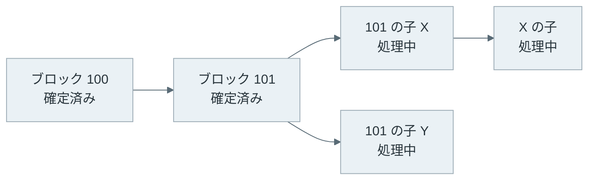

Snowman は、[Avalanche](https://www.avax.network/) のチェーンが次に繋ぐブロックを決める合意プロトコルです。各ノードは、無作為に選んだ少数のバリデータ（validator、合意に参加するノード）に「どのブロックを支持しているか」を尋ね、同じ答えが規定の回数だけ続いたらブロックを確定します。[PBFT](https://www.usenix.org/conference/osdi-99/practical-byzantine-fault-tolerance)（Practical Byzantine Fault Tolerance）や [CometBFT](https://github.com/cometbft/cometbft)（Cosmos 系のチェーンが使う合意エンジン）のように、全員の票を集めて 2/3 を数えることはしません。

以下は、全員と通信する BFT と、Snowman の問い合わせの違いです。



上記の図の右側では、問い合わせを受けたのは全体の一部だけです。それでも、問い合わせを何度も繰り返すと、正しいノードの意見は 1 つに寄っていきます。この性質を利用して、Snowman は通信の量を抑えています。

<br>

本記事では、Snowman がどのような手順で確定し、その確定が何を保証しているのかを説明します。扱う疑問は次の通りです。

- 全員の票を集めずに、なぜ合意できるのか。Slush・Snowflake・Snowball は何が違うのか。
- パラメータの k・α・β は、それぞれ何を決めるのか。
- 「確率的な確定」は、PoW の巻き戻りと何が違うのか。
- 全員と通信する BFT と比べて、通信量はどれだけ違うのか。
- 2026 年 11 月時点の実装（[avalanchego](https://github.com/ava-labs/avalanchego)）は、どのパラメータで動いているのか。

ステーキングの報酬や、Avalanche の L1（独自のバリデータを持つチェーン）の作り方は説明しません。

---

### 少数への問い合わせで合意する理由

Snowman の土台は、2019 年に公開された論文 [Scalable and Probabilistic Leaderless BFT Consensus through Metastability](https://arxiv.org/abs/1906.08936) です。論文は、Slush → Snowflake → Snowball → Avalanche の順に、1 つずつ仕組みを足して説明しています。Snowman は論文には登場せず、[Ava Labs](https://www.avalabs.org/) が Snowball を線形のチェーンに当てはめた実装の名前です。

一番単純な Slush は、赤と青のような 2 つの値から 1 つを選ぶ手順です。

1. ノードは、他のノードから無作為に k 個を選び、今どちらの値を支持しているかを尋ねる
2. k 個の答えのうち α 個以上が同じ値なら、自分の支持をその値に変える（α は k の半分より大きい）
3. 1 と 2 を決められた回数だけ繰り返す

例えば k = 20、α = 15 なら、20 個中 15 個以上が青と答えた時だけ青に乗り換えます。赤と青が半々の状態から始めても、問い合わせの偶然で片方がわずかに多くなると、多い方の値が α に届きやすくなり、差が広がっていきます。論文は、このように一度傾くと戻りにくい状態を metastability（準安定）と呼び、合意の根拠にしています。

以下は、500 台のノードが半々に割れた状態から Slush を 60 ラウンド動かし、青を支持するノードの割合を追った結果です（seed 1〜5、[生成コード](https://github.com/nao1215/debimate/blob/main/content/notes/blockchain-systems/snowman/figures.py)）。



左では、10 ラウンドほど半々のまま揺れた後、20 ラウンド前後で全員が赤に揃いました。しかし右のように、不正なノードが毎回少ない方の色を答えると、偏りが育たずに半々のまま続きます。

Slush には「いつ決めて良いか」を判断する仕組みが無く、決められた回数が終わった時点の色で決めるので、この状態で終われば正しいノードの決定が割れます。Slush は止まる故障だけを想定した手順で、嘘をつくノードがいる場合は次の Snowflake が必要です。

---

### Snowflake と Snowball - 確定の条件

Snowflake は、Slush に「同じ値の成功が何回続いたか」を数えるカウンタを足します。成功は、k 個の答えのうち α 個以上が同じ値だった問い合わせです。値が変わるか、成功しなかった問い合わせがあると、カウンタは 0 に戻ります。カウンタが β に届いたら、ノードはその値で確定します。Slush と違い、確定するかどうかを各ノードが自分の観測から判断します。

Snowball は、さらに値ごとの成功の累計を持ち、累計の多い方を支持します。Snowflake は、反対の値で α に届いた問い合わせが 1 回あるだけで支持を変えます。Snowball は累計で支持を決めるので、偶然の 1 回で支持が入れ替わりにくくなります。

| パラメータ | 意味 | 論文の評価の値 | avalanchego v1.15.3 の既定値 |
|---|---|---|---|
| k | 1 回の問い合わせで尋ねるノードの数 | 10 | 20 |
| α | 成功と数える、同じ答えの最小数（k/2 より大きい） | 8（k の 0.8） | 15（`alphaPreference` と `alphaConfidence` の 2 つ） |
| β | 確定に必要な、連続した成功の回数 | 150（衝突の無い取引は confidence が 11 で確定） | 20 |

avalanchego の値は、[`snowball/parameters.go`](https://github.com/ava-labs/avalanchego/blob/v1.15.3/snow/consensus/snowball/parameters.go) の `DefaultParameters` です。avalanchego は α を 2 つに分けており、`alphaPreference` は支持を変える条件、`alphaConfidence` は連続の回数を 1 つ増やす条件です。既定値では、どちらも 15 です。

k・α・β は、安全性と止まりにくさと速さを引き換えにして選びます。α を k に近づけるほど、不正なノードが成功を作りにくくなります。その代わり、応答しないノードや逆を答えるノードが (k − α)/k を超える割合でいると、成功が出にくくなり確定が遅れます。β を大きくするほど、偶然の連続で確定する確率は下がりますが、確定までの問い合わせの回数は増えます。

---

### Avalanche（DAG）から Snowman へ

論文の後半にある Avalanche は、取引を DAG（Directed Acyclic Graph、有向非巡回グラフ）で繋ぎ、Snowball のインスタンス（意見を数える単位）を取引の衝突ごとに 1 つ持つ手順です。同じ資金を使う取引同士が衝突の組になり、組の中から 1 つだけが確定します。ある取引への支持は、その取引から辿れる祖先の取引への支持も兼ねるので、1 回の問い合わせで多くの取引を同時に進められます。

しかし、スマートコントラクトのように取引の順序が結果を変えるチェーンでは、全ての取引を 1 列に並べる必要があります。Snowman は、この並びをブロックの列で作ります。同じ親を持つ子のブロックが衝突の組で、親ごとに 1 つのインスタンスが、どの子を次に繋ぐかを決めます。



上記の図では、ブロック 101 のインスタンスが X と Y のどちらを繋ぐかを決めます。ノードは、自分が支持する列の先端（X の子）について問い合わせ、その票は X と、さらに祖先の処理中のブロックへの票としても数えます。101 のインスタンスが X で確定すると X が確定し、Y と Y の子孫は捨てられます。

avalanchego では、親ごとのインスタンスに v1.12.2（2025 年 1 月）から Snowflake を使っています（[RELEASES.md](https://github.com/ava-labs/avalanchego/blob/v1.15.3/RELEASES.md) の v1.12.2 の項）。

[Avalanche の開発者向けドキュメント](https://build.avax.network/docs/nodes/architecture/consensus)によると、P-Chain（バリデータとステーキングを管理するチェーン）、C-Chain（[EVM](https://ethereum.org/developers/docs/evm/) 互換のスマートコントラクトのチェーン）、X-Chain（資産を送受信するチェーン）は全て Snowman で動いています。X-Chain は元々 DAG の Avalanche で動いており、2023 年 4 月の Cortina アップグレード（ネットワーク全体の規則の更新。メインネットでは [2023-04-25](https://github.com/ava-labs/avalanchego/blob/v1.15.3/upgrade/upgrade.go)）で線形のチェーンに移りました。各チェーンの役割は [Wallet](../wallet/) のノートでも触れています。

---

### 確率的な確定の意味

Avalanche は全員で投票して 2/3 で確定する BFT だ、と考える方がいるかもしれません。しかし、Snowman のノードが確定する時に見ているのは、自分が尋ねた 20 個の答えが 15 個以上同じだった、という観測の連続だけです。2/3 の署名を集めた証明書のような、全体の票を数えた記録はありません。確定は各ノードが個別に判断します。正しいノード同士の判断が食い違う確率は、パラメータの選び方で十分に小さくします。

同じ「確率的」でも、PoW と Snowman では確率が掛かる場所が違います。[Finality](../finality/) のノートで説明した PoW の確認数は、待つほど覆る確率が下がり、ノード自身も重い列が届けば列を組み替えます。一方で、Snowman のノードは、一度確定したブロックを後から外す手順を持ちません。

C-Chain の実行方式を変えた [ACP-194](https://github.com/avalanche-foundation/ACPs/blob/main/ACPs/194-continuous-execution/README.md)（Avalanche Community Proposal、仕様変更の提案の 194 番）も、Snowman の確定では Ethereum の `safe` と `finalized` の区別が無く、`latest` のブロックにも reorg（列の組み替え）の恐れは無いとしています。

それでは、確率的とは何の確率でしょうか。ε（イプシロン）は、想定した割合の不正なノードがいる時に、2 つの正しいノードが矛盾するブロックをそれぞれ確定してしまう確率です。起きた場合、プロトコルの中で自動的には直りません。この点は、閾値を超えた不正に出会った PBFT と同じです。

違うのは、PBFT が閾値を 1 台超えた所で保証を失うのに対して、Snow 系の安全性は閾値を超えても徐々に悪化する点で、論文の Figure 1 はこの違いを曲線で示しています。

Avalanche のドキュメントは、安全性が破れる確率の目安として `(1 − alphaConfidence / k)^β` を挙げ、既定値で約 10⁻¹² としています。ただし、これは不正なノードの戦略やノード数を含まない目安です。

[Amores-Sesar 氏らの分析](https://arxiv.org/abs/2401.02811)は、同期したラウンドのモデルで、Snowflake と Snowball では β に対して失敗の確率を無視できるほど小さくすることと、確定までの問い合わせの回数を β の多項式に抑えることを両立できないと示し、改良した手順を提案しています。つまり、攻撃者は安全性を破れなくても、確定を遅らせることはできます。次の実験でも、その様子が見えます。

---

### シミュレーションで見る k・α・β

Snowball を [Python](https://www.python.org/) で書き、不正なノードの割合と α・β を変えて、確定までのラウンド数、意見が割れた回数、1 ノードあたりのメッセージ数を数えました。avalanchego のローカルネットワークは動かしておらず、以下は全てシミュレーションの結果です。モデルの単純化は次の通りです。

- 全ノードが同時にラウンドを進め、未確定の正しいノードは毎ラウンド 1 回問い合わせる
- 問い合わせ先は自分以外から復元抽出で k 個選び、全員が答える。ステークは全員同じ
- 1 回の問い合わせは、要求と応答で 2k 通と数える

条件は 2 つ用意しました。agree は、正しいノードが全員同じブロック（青）を支持し、不正なノードが別のブロック（赤）を答え続ける条件です。split は、正しいノードが半々に割れた所から始め、不正なノードは尋ねてきたノードが最初に支持していた色を答えて、割れたまま確定させようとする条件です。以下は、1 回の問い合わせを処理する部分の抜粋で、agree の場合だけを残しています。

```python
answers = answer_of[peers]                 # 正しいノードは今の支持（確定済みなら確定値）
answers[peers < nb] = RED                  # 不正なノードは赤を答える
blue = answers.sum(axis=1)
ok = (blue >= alpha) | (k - blue >= alpha) # α 以上が同じなら成功
choice = np.where(blue >= alpha, BLUE, RED)[ok]
win = active[ok]
strength[win, choice] += 1                 # Snowball: 色ごとの成功の累計
more = strength[win, choice] > strength[win, 1 - choice]
ball[win[more]] = choice[more]
conf[win[last[win] != choice]] = 0         # 色が変わったら連続の回数を 0 に
last[win] = choice
conf[win] += 1
conf[active[~ok]] = 0                      # 失敗したら連続の回数を 0 に
done = win[conf[win] >= beta]              # β 回続いたら確定
decided[done] = last[done]
```

<details>
<summary>snow_sim.py の全体（Slush・Snowflake・Snowball と集計、186 行）</summary>

```python
"""Simulate Slush, Snowflake and Snowball on two conflicting values (red=0, blue=1).

Model (a simplification, not avalanchego itself):
- Synchronous rounds. Every undecided correct node sends one query per round.
- A query picks k other nodes at random with replacement, and every one answers.
- Correct nodes answer with their current preference (or the decided value).
- Byzantine nodes are the first nb node IDs and use one of these strategies:
    "push"    always answer red, the value correct nodes do not start with
    "split"   answer each querier with the color its half started with,
              trying to make the two halves decide different values
    "balance" (Slush only) answer with the color fewer correct nodes hold
- One query costs 2k messages (k requests + k responses).
- A run stops when every correct node decides, when nobody decided for
  STALL rounds in a row, or at MAX_ROUNDS.
"""

from concurrent.futures import ProcessPoolExecutor
from functools import partial

import numpy as np

RED, BLUE, UNDECIDED = 0, 1, -1
MAX_ROUNDS, STALL = 5000, 1000


def sample(rng, n, queriers, k):
    """k peers for each querier, chosen with replacement, never the querier."""
    peers = rng.integers(0, n - 1, size=(len(queriers), k))
    return peers + (peers >= queriers[:, None])


def slush(n, k, alpha, rounds, byz=0.0, seed=1):
    """Return the share of correct nodes preferring blue after every round."""
    rng = np.random.default_rng(seed)
    nb = int(n * byz)
    correct = np.arange(nb, n)
    color = np.zeros(n, dtype=np.int8)
    color[nb + (n - nb) // 2:] = BLUE  # correct nodes start 50/50
    trace = [color[correct].mean()]
    for _ in range(rounds):
        peers = sample(rng, n, correct, k)
        answers = color[peers]
        if nb:  # "balance": Byzantine nodes back the minority color
            minority = BLUE if color[correct].mean() < 0.5 else RED
            answers[peers < nb] = minority
        blue = answers.sum(axis=1)
        color[correct[blue >= alpha]] = BLUE
        color[correct[k - blue >= alpha]] = RED
        trace.append(color[correct].mean())
    return trace


def snow(n, byz, k, alpha, beta, start="agree", protocol="snowball", seed=1):
    """Run Snowflake or Snowball once.

    start="agree": every correct node prefers blue, Byzantine nodes push red.
    start="split": correct nodes are 50/50, Byzantine nodes play "split".
    """
    rng = np.random.default_rng(seed)
    nb = int(n * byz)
    group = np.full(n, BLUE, dtype=np.int8)  # the color each correct node starts with
    if start == "split":
        group[nb:nb + (n - nb) // 2] = RED
    last = group.copy()  # Snowflake preference (last successful color)
    ball = group.copy()  # Snowball preference (more successful polls)
    strength = np.zeros((n, 2), dtype=np.int32)
    conf = np.zeros(n, dtype=np.int32)  # consecutive successful polls
    decided = np.full(n, UNDECIDED, dtype=np.int8)
    queries = np.zeros(n, dtype=np.int64)

    rounds = idle = 0
    while rounds < MAX_ROUNDS and idle < STALL:
        active = np.flatnonzero(decided[nb:] == UNDECIDED) + nb
        if active.size == 0:
            break
        rounds += 1
        public = ball if protocol == "snowball" else last
        answer_of = np.where(decided == UNDECIDED, public, decided)
        peers = sample(rng, n, active, k)
        answers = answer_of[peers]
        lie = peers < nb
        if start == "split":
            answers[lie] = np.broadcast_to(group[active][:, None], answers.shape)[lie]
        else:
            answers[lie] = RED
        blue = answers.sum(axis=1)
        ok = (blue >= alpha) | (k - blue >= alpha)
        choice = np.where(blue >= alpha, BLUE, RED)[ok]
        queries[active] += 1

        win = active[ok]
        # Snowball: count successful polls per color, prefer the larger count.
        strength[win, choice] += 1
        more = strength[win, choice] > strength[win, 1 - choice]
        ball[win[more]] = choice[more]
        # Snowflake: count consecutive successes for the same color.
        conf[win[last[win] != choice]] = 0
        last[win] = choice
        conf[win] += 1
        conf[active[~ok]] = 0
        done = win[conf[win] >= beta]
        decided[done] = last[done]
        idle = 0 if done.size else idle + 1

    final = decided[nb:]
    return {
        "rounds": rounds,
        "split": bool((final == RED).any() and (final == BLUE).any()),
        "red": bool((final == RED).any()),
        "undecided": int((final == UNDECIDED).sum()),
        "msgs_per_node": 2 * k * queries[nb:].mean(),
    }


def pbft_messages(n):
    """Messages for one request in PBFT normal case: pre-prepare, prepare, commit."""
    return (n - 1) + (n - 1) * (n - 1) + n * (n - 1)


def sweep(n, byz, k, alpha, beta, start="agree", protocol="snowball", trials=100):
    run = partial(snow, n, byz, k, alpha, beta, start, protocol)
    with ProcessPoolExecutor(max_workers=8) as pool:  # one seed per run
        runs = list(pool.map(run, range(trials)))
    finished = sorted(r["rounds"] for r in runs if r["undecided"] == 0)
    return {
        "median_rounds": finished[len(finished) // 2] if finished else None,
        "splits": sum(r["split"] for r in runs),
        "red": sum(r["red"] for r in runs),
        "unfinished": sum(r["undecided"] > 0 for r in runs),
        "msgs_per_node": float(np.median([r["msgs_per_node"] for r in runs])),
        "trials": trials,
    }


def row(label, r):
    rounds = "-" if r["median_rounds"] is None else r["median_rounds"]
    return (f"{label} {rounds:>6} {r['splits']:>6} {r['unfinished']:>10} "
            f"{r['msgs_per_node']:>9.0f}")


def main():
    head = "rounds splits unfinished msgs/node"
    print("== 1. agree start, Byzantine push red (n=500, k=20, alpha=15, beta=20, 100 seeds)")
    print(f"byz  red  {head}")
    for byz in (0.0, 0.1, 0.2, 0.25, 0.3):
        r = sweep(500, byz, 20, 15, 20, "agree")
        print(row(f"{byz:4.2f} {r['red']:4}", r))

    print("== 2. split start (n=500, k=20, alpha=15, snowball, 100 seeds)")
    print(f"byz  beta {head}")
    for byz in (0.0, 0.05, 0.1, 0.2):
        for beta in (1, 2, 4, 8, 20):
            print(row(f"{byz:4.2f} {beta:4}", sweep(500, byz, 20, 15, beta, "split")))

    print("== 3. snowflake vs snowball, split start (n=500, byz=0.05, alpha=15, 100 seeds)")
    print(f"protocol  beta {head}")
    for protocol in ("snowflake", "snowball"):
        for beta in (2, 4, 8):
            r = sweep(500, 0.05, 20, 15, beta, "split", protocol)
            print(row(f"{protocol:9} {beta:4}", r))

    print("== 4. alpha (n=500, k=20, beta=4 for split / beta=20 for agree, 100 seeds)")
    print("alpha  split_byz0.05:splits  agree_byz0.3:unfinished  agree_byz0.3:rounds")
    for alpha in (11, 13, 15, 17):
        s = sweep(500, 0.05, 20, alpha, 4, "split")
        a = sweep(500, 0.3, 20, alpha, 20, "agree")
        rounds = "-" if a["median_rounds"] is None else a["median_rounds"]
        print(f"{alpha:5} {s['splits']:21} {a['unfinished']:24} {rounds:>20}")

    print("== 5. total messages for one decision (agree start, byz=0, k=20, alpha=15, beta=20)")
    print("    n  snowball_total  per_node  rounds  pbft_total")
    for n in (50, 100, 200, 500, 1000, 2000, 5000):
        r = sweep(n, 0.0, 20, 15, 20, "agree", trials=20)
        print(f"{n:5} {r['msgs_per_node'] * n:15.0f} {r['msgs_per_node']:9.0f} "
              f"{r['median_rounds']:7} {pbft_messages(n):11}")

    print("== 6. same, split start (byz=0)")
    print("    n  snowball_total  per_node  rounds")
    for n in (50, 100, 200, 500, 1000, 2000, 5000):
        r = sweep(n, 0.0, 20, 15, 20, "split", trials=20)
        print(f"{n:5} {r['msgs_per_node'] * n:15.0f} {r['msgs_per_node']:9.0f} "
              f"{r['median_rounds']:7}")


if __name__ == "__main__":
    main()
```

</details>

以下が節 1 の実行結果です。節 2〜6 は下に畳み、全ての出力と README は [lab/](https://github.com/nao1215/debimate/tree/main/content/notes/blockchain-systems/snowman/lab) に置いています。`rounds` は全員が確定した試行のラウンド数の中央値、`splits` は正しいノードが赤と青の両方を確定した試行の数、`unfinished` は 5000 ラウンド以内、または 1000 ラウンド続けて誰も確定しない間に、全員が確定しなかった試行の数です。

```text
== 1. agree start, Byzantine push red (n=500, k=20, alpha=15, beta=20, 100 seeds)
byz  red  rounds splits unfinished msgs/node
0.00    0     20      0          0       800
0.10    0     65      0          0       905
0.20    0   2487      0          5     16160
0.25    0      -      0        100    189191
0.30    0      -      0        100     40000
```

<details>
<summary>節 2〜6 の出力（β・α・ノード数を変えた結果）</summary>

```text
== 2. split start (n=500, k=20, alpha=15, snowball, 100 seeds)
byz  beta rounds splits unfinished msgs/node
0.00    1     16    100          0       400
0.00    2     16     59          0       562
0.00    4     18      1          0       649
0.00    8     22      0          0       809
0.00   20     34      0          0      1289
0.05    1     28    100          0       529
0.05    2     27     89          0       952
0.05    4     29      0          0      1010
0.05    8     33      0          0      1173
0.05   20     54      0          0      1655
0.10    1     95    100          0       635
0.10    2     56    100          2      1797
0.10    4     55     17         18      2171
0.10    8     63      0         20      2417
0.10   20    106      0         20      2948
0.20    1     49    100          0       320
0.20    2    462    100          0      2922
0.20    4      -    100        100    124327
0.20    8      -      0        100     40000
0.20   20      -      0        100     40000
== 3. snowflake vs snowball, split start (n=500, byz=0.05, alpha=15, 100 seeds)
protocol  beta rounds splits unfinished msgs/node
snowflake    2     21     86          0       743
snowflake    4     23      0          0       845
snowflake    8     30      0          0      1011
snowball     2     27     89          0       952
snowball     4     29      0          0      1010
snowball     8     33      0          0      1173
== 4. alpha (n=500, k=20, beta=4 for split / beta=20 for agree, 100 seeds)
alpha  split_byz0.05:splits  agree_byz0.3:unfinished  agree_byz0.3:rounds
   11                    95                        0                  143
   13                    25                       50                 4349
   15                     0                      100                    -
   17                     0                      100                    -
== 5. total messages for one decision (agree start, byz=0, k=20, alpha=15, beta=20)
    n  snowball_total  per_node  rounds  pbft_total
   50           40000       800      20        4900
  100           80000       800      20       19800
  200          160000       800      20       79600
  500          400000       800      20      499000
 1000          800000       800      20     1998000
 2000         1600000       800      20     7996000
 5000         4000000       800      20    49990000
== 6. same, split start (byz=0)
    n  snowball_total  per_node  rounds
   50           58420      1168      31
  100          118600      1186      31
  200          239300      1196      32
  500          657400      1315      35
 1000         1374640      1375      36
 2000         2895440      1448      39
 5000         7359240      1472      39
```

</details>

節 1 では、不正なノードが 25% になると、どの試行でも正しいノードの大半が 5000 ラウンド以内に確定せず、30% では誰も確定しませんでした。一方で、赤を確定した正しいノードは 1 台もいません。不正なノードが 20 個中 6 個以上に入ると青が 15 個に届かず、25% では 1 回の成功の確率が約 0.62 まで下がり、20 回の連続がほとんど起きないからです。

以下は、不正なノードの割合に対して、1 回の問い合わせが成功する確率と、20 回続けて成功する確率を二項分布で計算した図です。



1 回の成功の確率は緩やかにしか下がりませんが、20 回の連続はその 20 乗なので急に起きなくなります。そのため、既定値の α/k = 75% では、25% 以上の不正は Snowman を分岐させるより先に、確定をほぼ進まなくします。ドキュメントも、進行の条件を 75% を超える正直なステークとしています。20% でもラウンド数の中央値は 2487 まで伸びており、前の節で触れた「確定を遅らせる攻撃」が数字に出ています。

節 2 で目を引くのは、不正なノードがいなくても、β = 1 では 100 回全てで意見が割れたことです。最初の成功 1 回で確定するので、半々の状態では両方の色に確定するノードが出ます。β を 4 にすると 1 回、8 以上では 0 回になりました。

以下は、節 2 の結果を β ごとに並べた図です。左が意見の割れた試行、右が確定しないノードが残った試行で、どちらも 100 回中の回数です。



不正が 10% の split では、β = 4 で 17 回割れ、β = 8 以上では割れない代わりに 20 回が確定しませんでした。

節 4 では、α を 11 に下げると 30% の不正の下でも確定できる一方で、split の割れが 95 回に増えています。α は、安全性と止まりにくさのどちらに寄せるかを選ぶ値です。

---

### 全員と通信する BFT との通信量

[Byzantine Fault Tolerance](/notes/distributed-systems/byzantine-fault-tolerance/) のノートで説明した PBFT は、prepare と commit の段階で各ノードが全員に送るので、1 回の決定に約 2n² 通を使います。[CometBFT](/notes/blockchain-systems/cometbft/) もゴシップで配る点は違いますが、全員の票を全員に届ける点は同じです。Snowball では、1 ノードが送受信する数は 1 ラウンドあたり 2k 通で、n に依存しません。

以下は、上記の節 5・6 の総数と、PBFT の式で計算した数を並べた図です。



この比較で見落としやすいのは、少ないノード数では Snowball の方がメッセージが多いことです。全員が同じ値を支持する条件でも、1 ノードは 2k × β = 800 通を使います。PBFT の 1 ノードあたりは約 2n 通なので、追い抜くのは n が 400 前後を超えてからです。半々から始めた条件では、ラウンド数が 50 台の 31 から 5000 台の 39 へ緩やかに増えました。論文は、不正なノードが少ない場合のラウンド数を O(log n) としています。

ただし、図の数はブロックを選ぶための問い合わせだけです。ブロックの中身は全バリデータに届ける必要があります。また、avalanchego は既定で 4 つの問い合わせを並行させ（`ConcurrentRepolls`）、1 回の票を処理中の祖先にも数えるので、ラウンド数はそのまま待ち時間になりません。

---

### リーダーを置かない合意と Snowman++

PBFT の primary や CometBFT の proposer は、そのラウンドで何を決めるかを主導する役（リーダー）です。リーダーが止まると、交代の手順が動くまで合意が進みません。Snowman の投票にはこの役が無く、どのノードも同じ手順で問い合わせて、同じ手順で確定します。

一方で、誰がブロックを作るかは別の問題です。全員が同時にブロックを作ると、同じ高さに衝突するブロックが並び、Snowman で 1 つに絞る手間が増えます。この混雑を抑えるのが [Snowman++](https://github.com/ava-labs/avalanchego/blob/v1.15.3/vms/proposervm/README.md)（実装上の名前は ProposerVM）で、P-Chain のバリデータからステークに比例してブロックの提案者を選び、時間の枠を割り当てます。

前述の開発者向けドキュメントによると、Durango アップグレード（メインネットでは 2024-03-06）の後は、親ブロックの時刻から 5 秒ごとの枠に 1 人ずつ提案者を割り当て、その枠では割り当てられた提案者のブロックだけが有効です。

提案者は、PBFT の primary と同じ役割を持つのでしょうか。Snowman++ の提案者が決めるのはブロックを作る順番だけで、そのブロックを確定するかどうかは、全員が同じ Snowman の問い合わせで判断します。提案者が応答しなくても、次の枠の提案者が作るまで遅れるだけです。

---

### PoW・PoS・BFT との比較

[Proof of Work](../proof-of-work/)、[Proof of Stake](../proof-of-stake/)（Ethereum の [Casper FFG](https://arxiv.org/abs/1710.09437)）、PBFT・CometBFT と並べると、以下の通りです。耐える割合は各方式の論文・仕様が置く前提で、Snowman の列は 2026 年 11 月時点の avalanchego の既定値と、本記事のシミュレーションに基づきます。ETH と AVAX は、それぞれ Ethereum と Avalanche の通貨です。

| 方式 | 何を担保に誰がブロックを作るか | いつ確定するか | 耐える不正の割合 | 前提を超えた時 |
|---|---|---|---|---|
| PoW（Bitcoin） | 計算作業。誰でも | 宣言は無い。後ろに積まれるほど覆りにくい | 計算能力の過半未満 | 分岐し、重い方の列に組み替わる |
| PoS（Ethereum） | 預けた ETH。選ばれたバリデータ | 2/3 の投票が 2 段階揃った checkpoint が finalized | 預け入れの 1/3 未満 | 止まるか、割れる。割れた時は、原則として 1/3 以上の預け入れが処罰の対象になる |
| PBFT・CometBFT | 投票権（CometBFT はステークの重み）。primary・proposer | 2/3 を超える票が集まった時点 | 投票権の 1/3 未満 | 止まるか、割れる |
| Snowman | 預けた AVAX。Snowman++ の提案者 | β 回連続の成功で、各ノードが個別に確定 | 固定の値は無く、ε と想定する割合から k・α・β を選ぶ | 既定値では 25% 以上で確定がほぼ進まなくなる。確率 ε で割れる |

Snowman の列で固定の閾値を書けないのは、安全性が「何割まで」ではなく「想定した割合の下で、割れる確率が ε 以下」という形で表されるからです。

---

### 計画中の変更

Snowman の実装は、アップグレードのたびに周辺が変わっています。2026 年 11 月時点で確認できた変更は次の通りです。

- 2026-09-22 にメインネットで有効になった Helicon アップグレードでは、[ACP-194](https://github.com/avalanche-foundation/ACPs/blob/main/ACPs/194-continuous-execution/README.md) により C-Chain の合意と取引の実行が分かれました。合意したブロックを列に積み、実行は後から進めます。ACP-194 は、合意で並べたブロックを Snowman の確定のまま扱う前提で書かれています。
- avalanchego v1.14.2（2026-03-30）で、[Simplex](https://eprint.iacr.org/2023/463) という合意エンジンが実験的に入り、サブネットの設定に `simplexParameters` が加わりました。avalanchego の [Simplex の設計文書](https://github.com/ava-labs/avalanchego/blob/v1.15.3/simplex/docs/reconfiguration.md)によると、Simplex はラウンドごとに提案者が変わり、票の quorum（定足数）で確定する BFT で、不正が 1/3 未満なら安全性と進行を保ちます。実装は [ava-labs/simplex](https://github.com/ava-labs/simplex) にあります。v1.15.3 では、チェーンを作るコード（[`chains/manager.go`](https://github.com/ava-labs/avalanchego/blob/v1.15.3/chains/manager.go)）は Snowman と Avalanche のエンジンしか作らず、Simplex のエンジンのパッケージはどこからも呼ばれていません（使うのは自身のテストだけです）。

---

### 利点

- 1 ノードが 1 回の決定に使うメッセージ数が、全体のノード数に依存しない
- 投票を主導するリーダーがいないので、リーダーの交代の手順が無い
- 不正が想定を少し超えても、安全性が一度に崩れず、割れる確率が上がっていく
- 一度確定したブロックは、ノード自身が後から外すことが無い

### 欠点

- 安全性は確率で表され、ε の大きさはパラメータと想定する不正の割合に依存する
- 既定値では、25% 以上のステークが応答しないか逆を答えると、確定がほぼ進まなくなる
- 攻撃者は安全性を破れなくても、問い合わせの答え方で確定を大きく遅らせられる
- ノード数が少ないと、全員と通信する BFT よりメッセージが多くなる
