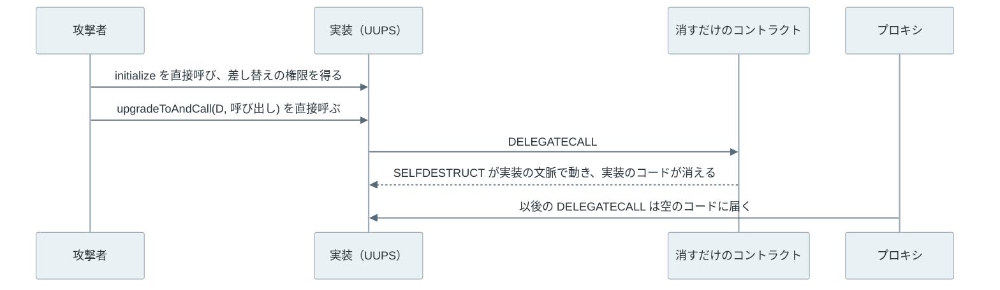

アップグレード可能なプロキシ（upgradeable proxy）は、[スマートコントラクト](../smart-contract/)（チェーン上で動くプログラム）について、アドレスとデータを変えずに処理だけを後から差し替えるための構成です。

Ethereum では、一度置いたコントラクトのコードを書き換えられません。そこで、利用者が呼ぶ入口のコントラクト（プロキシ）と、処理のコードを持つ別のコントラクト（実装）に分け、プロキシが覚えている「実装のアドレス」だけを書き換えます。

Web の開発に置き換えると、URL を固定したリバースプロキシの裏で、アプリケーションサーバーを新しい版に入れ替える運用に近い形です。ただし、データの置き場所が異なります。コントラクトは、次の取引（トランザクション）にも残る値を storage という自分専用の保存領域に持ちます。Web ではデータは DB（データベース）にありますが、プロキシの構成ではデータもプロキシの storage にあり、実装はコードだけを貸します。

この構成は、複数人の承認で送金する [Safe](../safe-multisig/) や、コントラクトで作るアカウント（[スマートアカウント](../erc-4337/)）でも使われています。以下は、プロキシと 2 つの実装の関係を示した図です。



上記の図のように、利用者が呼ぶのは常にプロキシです。owner や balance などのデータはプロキシの storage にあり、実装 V1・V2 はコードだけを提供します。差し替えで変わるのは、黄土色の欄にある実装のアドレスだけです。

<br>

本記事では、プロキシが他のコントラクトのコードをどう借りるのか（`DELEGATECALL`）と、その借り方のせいで何が壊れ得るのかを中心に説明します。

- なぜ実装のコードがプロキシのデータの上で動くのか。
- 実装を差し替えた時に、保存されたデータはどう読まれるのか。
- 壊れないように、値の置き場所をどう決めるのか。
- 初期化の処理を constructor に書けない理由と、初期化を忘れた事故。

後半では、ローカルの開発用ノードで各現象を再現します。

---

### プロキシが必要な理由

Ethereum には、コントラクトのアドレスに置いたコードを後から書き換える命令がありません。以前は同じアドレスにコードを置き直す抜け道がありましたが、2024 年 3 月の仕様の更新で塞がれました（経緯は [Metamorphic Contract](../metamorphic-contract/) と [Ethereum Hard Forks](../ethereum-hard-forks/#selfdestruct-の意味) で説明しています）。

不具合を直すために、新しいアドレスへ移る方法もあります。しかし、残高や設定は古いアドレスの storage にあり、他のコントラクトや取引所も古いアドレスを登録しています。移行には、データの移し替えと、すべての参照先の変更が必要です。

そこで、アドレスとデータを持つプロキシと、コードを持つ実装に分けます。入口を固定したまま裏を入れ替える考え方は、Web のシステムを段階的に置き換える [Strangler Fig](../../software-architecture/strangler-fig/) に近いものです。

一方で、変わらないのはアドレスに置かれたコードのバイト列だけで、プロキシの振る舞いは参照先の差し替えで変わります。利用者が確認するべきなのは、誰が参照先を差し替えられるのか、差し替えに待ち時間や複数人の承認があるのか、です。2025 年 2 月の Bybit の事故では、Safe のプロキシの参照先が攻撃者の実装に差し替えられました（[Wallet の過去のセキュリティ事件](../wallet/#bybitsafe-の承認処理の乗っ取り)）。

---

### DELEGATECALL でコードを借りる

コントラクトが別のコントラクトを呼ぶ命令は、Ethereum の取引を実行する仮想マシン [EVM](../evm/#呼び出しの文脈) に複数あります。普通の呼び出しである `CALL` では、呼び先のコードが呼び先の storage を読み書きします。一方で、`DELEGATECALL` では、呼び先のコードが呼び出し元の storage を読み書きします。



上記の図の右側では、B の `increment()` が動いたのに、増えたのは A の `count` です。A は B のコードを借りて、自分のデータに適用したことになります。また、`DELEGATECALL` の実行中の `msg.sender`（今の処理を呼んだアカウント）は、A を呼んだアカウントのままです。そのため、実装の中の「呼んだ人は所有者か」という検査は、プロキシを呼んだ利用者に対して働きます。

プロキシは、この図の A の役です。プロキシに定義の無い関数が呼ばれると、コントラクトの言語 [Solidity](https://www.soliditylang.org/) の [`fallback` 関数](https://docs.soliditylang.org/en/v0.8.28/contracts.html#fallback-function)が受け取り、同じ入力のまま実装へ `DELEGATECALL` します。以下は、後述の実験で使った最も単純なプロキシです。

```solidity
contract NaiveProxy is Delegate { // Delegate は DELEGATECALL して結果を返す部品（Study.sol）
    address implementation; // 実装のアドレス

    constructor(address impl) {
        implementation = impl;
    }

    fallback() external payable {
        // 受け取った入力のまま実装へ DELEGATECALL し、結果をそのまま返す
        _delegate(implementation);
    }
}
```

つまり、実装はコードの置き場所で、データの置き場所はプロキシです。実装のアドレス自身の storage は、通常は使われません。この分担から、2 つの問題が生まれます。プロキシと実装が同じ storage を別々の並びで解釈すること（次の節）と、実装のデプロイ時に動く処理がプロキシに届かないこと（[初期化の節](#初期化関数と初期化を忘れた事故)）です。

---

### storage の衝突

storage は、2 の 256 乗個の番号付きの場所に 32 バイトずつ値を置ける、キーと値の表です。

この場所の番号を slot と呼びます。Solidity は、状態変数（コントラクトが storage に持つ変数）を宣言した順に slot 0、1、2 と並べます（[Layout of State Variables in Storage](https://docs.soliditylang.org/en/v0.8.28/internals/layout_in_storage.html)）。32 バイトに満たない型は同じ slot に詰め、親コントラクトの変数は継承の順に前から並べます。

`DELEGATECALL` では、プロキシの変数と実装の変数が、同じ storage の同じ番号を指します。どちらも自分の宣言の順で番号を決めるので、両者の宣言が食い違うと、同じ slot を別の変数として読み書きします。この衝突には 2 種類あります。

<br>

#### プロキシと実装の衝突

前の節の NaiveProxy は、唯一の変数 `implementation`（実装のアドレス）を slot 0 に置きます。実装がカウンター（`uint256 public count;` だけを持つ CounterV1）なら、`count` も slot 0 です。利用者が `increment()` を呼ぶと、`count += 1` はプロキシの slot 0、つまり実装のアドレスに 1 を足します。後述の実験では、slot 0 の値が次のように変わりました。

```text
slot 0 before increment(): 0x0000000000000000000000005fbdb2315678afecb367f032d93f642f64180aa3
slot 0 after  increment(): 0x0000000000000000000000005fbdb2315678afecb367f032d93f642f64180aa4
```

末尾が `aa3` から `aa4` に増えたアドレスには、コードがありません。コードの無いアドレスへの `DELEGATECALL` は失敗せず、何も返さずに成功します。以後、プロキシ経由の `count()` は空の返り値（`0x`）で成功し、プロキシ自身はエラーを出さないまま壊れます（呼び出し側が数値として読もうとして、初めて失敗します）。

ちなみに、Safe は現在の [v1.5.0](https://github.com/safe-fndn/safe-smart-account/blob/v1.5.0/contracts/common/Singleton.sol) でも実装のアドレスを slot 0 に置いています。実装側の先頭に同じ変数を宣言させ、両者の意味を揃えることで衝突を避けています（[Safe Multisig](../safe-multisig/)）。

<br>

#### 更新で並びがずれる衝突

2 つ目は、実装を更新した時に変数の並びがずれる衝突です。例えば、V1 が `owner`、`balance` の順に宣言し、V2 で先頭に `fee` を足すと、V2 は slot 0 を `fee`、slot 1 を `owner` と読みます。以下は、後述の実験で、先頭に `fee` を足した V2（VaultV2Bad）に差し替えた直後の値です。



上記の図の中央にあるプロキシの storage の値は、差し替えの前後で同じです。変わったのは、実装がそれぞれの slot に付ける意味だけです。つまり、実装を更新してもデータは新しい実装に移りません。データはプロキシに残ったまま、新しい実装の並びで読まれます。図の `fee` の値は、slot 0 のアドレスを 1 つの整数として読んだものです。

この状態で V2Bad の `setFee(5)` を呼ぶと slot 0 が 5 になり、末尾に `fee` を足した正しい V2 に差し替え直しても、`owner` は 0x…05 のままでした。読み方を直しても、壊れた間に書き込まれた値は戻りません。

Solidity の部品を集めたライブラリ [OpenZeppelin Contracts](https://github.com/OpenZeppelin/openzeppelin-contracts) の[ガイド](https://docs.openzeppelin.com/upgrades-plugins/writing-upgradeable)も、状態変数の順序と型を変えず、新しい変数は末尾に足すよう求めています。

---

### 衝突を避ける置き場所

1 つ目の衝突は、プロキシが使う値と実装の変数が離れていれば起きません。実装の変数は 0 の近くに並ぶので、プロキシの値は遠い slot に置けば避けられます。2 つ目の衝突は、後で見るように継承でも起きます。継承で親の変数が増えて子の変数がずれる場合は、変数のまとまりごとに名前で決めた場所に置けば避けられます。ただし、まとまりの中の並びは、これまで通り宣言の順で決まります。

Ethereum には、こうした置き場所を決めた規格があります。Ethereum の仕様の改善案は EIP（Ethereum Improvement Proposal）と呼ばれ、そのうちコントラクトどうしの約束事を決めるものを ERC（Ethereum Request for Comments）と呼びます（[EVM Opcode History の EIP と ERC](../evm-opcode-history/#eip-と-erc)）。

本節では、置き場所を決めた 2 つの ERC を必要な範囲で紹介します。以下は、2 つの規格が使う slot の位置を示した図です。



上記の図の帯は、slot の番号の全体です。Solidity が宣言の順に並べる変数は、左端の 0 の近くに集まります。2 つの規格は、文字列のハッシュから番号を決めるので、その範囲から遠く離れます。ERC-7201 の名前空間の中では、構造体のメンバーが起点から宣言の順に並びます。図の起点の値と owner・balance は、後述の実験で使う名前空間 `debimate.vault` のものです。

<br>

#### ERC-1967：プロキシの値の置き場所

[ERC-1967](https://eips.ethereum.org/EIPS/eip-1967) は、プロキシが使う値（実装のアドレス、差し替えの権限を持つ管理者のアドレスなど）を置く slot を決めています。実装のアドレスの slot は、次の式で決まります。

```solidity
bytes32(uint256(keccak256("eip1967.proxy.implementation")) - 1)
```

Keccak-256（Ethereum が使う[ハッシュ関数](../hash-function/)）の出力は 2 の 256 乗通りの値に散らばるので、0 から数えた小さい番号と重なる確率は無視できます。管理者のアドレスは、`eip1967.proxy.admin` から同じ式で決めた slot に置きます。

<br>

<details>
<summary>ハッシュから 1 を引く理由</summary>

Solidity は、mapping（キーと値の表）の値を `keccak256(キーと slot 番号)` の場所に置きます。ハッシュの値をそのまま slot にすると、ハッシュの入力（原像）が分かっているので、細工したキーを使った mapping の値と同じ場所になる余地が残ります。仕様は、1 を引いて原像の知られていない場所にすることで、この可能性を減らしたと説明しています。

</details>

<br>

置き場所が決まっているので、ブロックエクスプローラー（チェーンの中身を見せる Web サービス）などのツールは、コードを解析しなくても、この slot を読むだけで今の実装を見つけられます。開発ツール群 [Foundry](https://getfoundry.sh/) の `cast implementation` も、この slot を読むコマンドです。

また、仕様は実装を差し替えた時に `Upgraded(address)` というイベント（取引の記録に残るログ）を出すよう求めている（SHOULD）ので、多くの実装では差し替えの履歴も追えます。

<br>

#### ERC-7201：実装の変数の置き場所

2 つ目の衝突は、継承を使うとさらに起きやすくなります。親コントラクトの変数は子より前に並ぶので、ライブラリの親が新しい版で変数を 1 つ足すと、子の変数が全部ずれます。

以前の [OpenZeppelin Contracts Upgradeable](https://github.com/OpenZeppelin/openzeppelin-contracts-upgradeable/tree/v4.9.6)（プロキシ向けの版）4.x は、親ごとに [`uint256[49] private __gap;`](https://github.com/OpenZeppelin/openzeppelin-contracts-upgradeable/blob/v4.9.6/contracts/access/OwnableUpgradeable.sol) という未使用の配列を置いて、場所を予約していました。親に変数を 1 つ足す時は、配列を 49 個から 48 個に縮め、子の変数の位置を保ちます。この数合わせは人の手で行うので、間違えると子の変数がずれます。

[ERC-7201](https://eips.ethereum.org/EIPS/eip-7201) は、変数を構造体にまとめ、名前から計算した slot を起点に置く規格です。この名前ごとの置き場所を名前空間（namespace）と呼びます。構造体のメンバーは、起点から通常の変数と同じ規則（宣言の順に並べ、32 バイトに満たない型は詰める）で並びます。名前は、次のように構造体の注記で示します。

```solidity
/// @custom:storage-location erc7201:openzeppelin.storage.Ownable
struct OwnableStorage {
    address _owner;
}
```

起点は、`openzeppelin.storage.Ownable` という名前のハッシュから計算します（式は下の details）。起点は名前だけで決まるので、継承の順を入れ替えても、親が自分の構造体の末尾に変数を足しても、各名前空間の場所は動きません。OpenZeppelin Contracts Upgradeable は、5.0 からこの形に移りました。

ただし、ERC-7201 が固定するのは構造体の起点だけです。構造体の中のメンバーは起点から宣言の順に並ぶので、メンバーの順序や型を変えたり、途中にメンバーを挟んだりすると、[更新で並びがずれる衝突](#更新で並びがずれる衝突)と同じことが名前空間の中で起きます。

新しいメンバーは構造体の末尾に足します。前述の OpenZeppelin のガイドも、同社の更新用ツール（Upgrades Plugins）は名前空間の中の変更を、通常の変数と同じ規則で検査すると説明しています。

<br>

<details>
<summary>ERC-7201 の計算式</summary>

```solidity
keccak256(abi.encode(uint256(keccak256(id)) - 1)) & ~bytes32(uint256(0xff))
```

`id` は注記の `erc7201:` の後の名前です。ERC-1967 と同じく 1 を引いた後、構造体が複数の slot に広がっても Solidity の使う場所と重ならないように、もう一度ハッシュを取ります。最後の `& ~0xff` は下位 8 bit を 0 にし、起点を 256 の倍数に揃えます。仕様は、将来の状態の木の移行（Verkle）後に 256 slot がまとめて安く読める可能性を見込んだ揃えとしています。

</details>

<br>

---

### プロキシの型

ERC-1967 は値の置き場所だけを決め、誰がどの関数で実装を差し替えるかは決めていません。その違いで、主に次の 3 つの型があります。

| 型 | 差し替えの関数の場所 | 特徴 |
| --- | --- | --- |
| Transparent | プロキシ | 管理者の呼び出しはプロキシの管理機能、それ以外は実装に回す |
| UUPS（Universal Upgradeable Proxy Standard。名前は [ERC-1822](https://eips.ethereum.org/EIPS/eip-1822) から。OpenZeppelin の実装は ERC-1967 の slot を使う） | 実装 | プロキシが小さい。誰が差し替えられるかも実装のコードが決める。差し替えの関数を持たない実装に更新すると、以後は差し替えられない |
| Beacon | beacon という別のコントラクト | 多数のプロキシが 1 つの beacon から実装のアドレスを読み、まとめて差し替わる |

Transparent が管理者とそれ以外を分けるのは、プロキシの管理用の関数と実装の関数で、関数セレクタ（呼び出しの先頭 4 バイトで関数を識別する値）が重なると、利用者が呼んだつもりの実装の関数ではなく管理機能が動いてしまうからです（[OpenZeppelin の解説](https://www.openzeppelin.com/news/the-transparent-proxy-pattern)）。

OpenZeppelin Contracts 5.x の[文書](https://docs.openzeppelin.com/contracts/5.x/api/proxy)は、軽く柔軟な UUPS を推奨する方向に移っているとしています。

---

### 初期化関数と、初期化を忘れた事故

通常のコントラクトは、デプロイ時に 1 回だけ動く constructor で、所有者などの初期値を設定します。しかし、constructor は実装をデプロイする取引の中で、実装のアドレスの storage に対して動きます。プロキシの storage には何も書かれません。後述の実験では、constructor で `value = 42` とした実装を直接読むと 42、プロキシ経由で読むと 0 でした（次の図の ①）。

そこで、初期化を普通の関数（initializer）にして、プロキシ経由で 1 回だけ呼びます。OpenZeppelin の `ERC1967Proxy`（差し替えの関数を持たない器のプロキシで、UUPS の実装と組み合わせる）は、作成時に実装のアドレスと初期化関数の呼び出しを受け取り、同じ取引の中で実行します。2 回目以降の呼び出しは、`initializer` 修飾子（関数の実行前に条件を検査する仕組み）が拒否します。

問題は、実装のアドレス自身の storage も初期化されていない点です。以下は、3 つの操作で、実装とプロキシのどちらの storage に何が書かれるかを並べた図です。① は前の段落の `value = 42` の例で、② と ③ は所有者（owner）を初期化関数で設定する実装の例です。



上記の図の ③ のように、実装の初期化関数を第三者が直接呼ぶと、その人が実装の所有者になります。実装の storage は普段使われないので無害に見えます。しかし、所有者の権限で実装のコードを消せる場合、その実装を借りているすべてのプロキシが止まります。初期化を忘れるのではなく、更新の時の初期化で渡す値を誤った事故には、bridge の [Nomad](../bridge-incidents/#nomad) があります。

以下の 2 件は、`SELFDESTRUCT`（コントラクトのコードを消す命令）がまだコードを消せた、2024 年 3 月より前の規則の下で起きた事故です。今の規則は事故の後で説明します。

<br>

#### Parity のライブラリ（2017 年）

2017 年 11 月 6 日、Ethereum のクライアント（ノードのソフトウェア）を開発していた [Parity](https://www.parity.io/) の [multisig](../multisig/) ウォレット（複数の鍵の承認で送金するウォレット）が共有していたライブラリが消され、それに頼るウォレットの資金が動かせなくなりました。ウォレットは処理をライブラリに `DELEGATECALL` で任せており、プロキシと実装と同じ関係でした。

1. ライブラリの [`initWallet`](https://github.com/openethereum/parity-ethereum/blob/v1.8.2/js/src/contracts/snippets/enhanced-wallet.sol#L215-L226) は、所有者の数が 0 の時だけ呼べる初期化関数でした。ライブラリ自身の storage では、所有者は 0 人のままでした。
2. ある利用者が、ライブラリの `initWallet` を直接呼んで、ライブラリの所有者になりました。
3. 続けて `kill` を呼びました。中身は Solidity の `suicide`（`selfdestruct` の旧名で、EVM の命令 `SELFDESTRUCT` を実行する）で、ライブラリのコードが消えました。

当事者は [GitHub の Issue](https://github.com/openethereum/parity-ethereum/issues/6995) に「I accidentally killed it.（うっかり消してしまった）」と書いています。

<br>

#### OpenZeppelin の UUPS（2021 年）

2021 年 9 月には、OpenZeppelin Contracts 4.1.0〜4.3.1 の `UUPSUpgradeable` に同じ種類の脆弱性が報告されました（[GHSA-5vp3-v4hc-gx76](https://github.com/OpenZeppelin/openzeppelin-contracts/security/advisories/GHSA-5vp3-v4hc-gx76)）。

[事後報告](https://forum.openzeppelin.com/t/uupsupgradeable-vulnerability-post-mortem/15680)によると、攻撃の手順は次の通りです。攻撃者は、初期化されていない実装を初期化して、差し替えの権限を持つ管理者（図の ③ と同じく、多くの実装では所有者）になります。

次に、`SELFDESTRUCT` を実行するだけのコントラクトを新しい実装に指定して、実装の `upgradeToAndCall`（差し替えと同時に新しい実装の関数を呼ぶ関数）を直接呼びます。新しい実装は `DELEGATECALL` で呼ばれるので、`SELFDESTRUCT` は呼び出し元である実装自身の文脈で動き、実装のコードが消えます。以下は、この手順を時間の順に並べた図です。



上記の図の 3 本目の矢印が、[DELEGATECALL の節](#delegatecall-でコードを借りる)の図の右側（借りたコードは呼び出し元のデータと文脈で動く）と同じ形です。UUPS では差し替えの関数も実装にあるので、プロキシは直せなくなります。OpenZeppelin は、資金を失ったプロジェクトは把握していないとしています。

対策は 2 つあります。4.3.2 から、差し替えの関数はプロキシ経由の呼び出しだけを受け付けます（`onlyProxy`）。また、[OpenZeppelin のガイド](https://docs.openzeppelin.com/upgrades-plugins/writing-upgradeable)は、実装の constructor で `_disableInitializers()` を呼び、実装の初期化を塞ぐよう勧めています。

なお、2024 年 3 月の Ethereum の仕様の更新（ハードフォーク Cancun）以降の [`SELFDESTRUCT`](https://eips.ethereum.org/EIPS/eip-6780) は、作成と同じ取引の中でなければコードを消しません。そのため、今の Ethereum では、上記の 2 つの事故と同じ経路で実装を消すことはできません。それでも、第三者が実装の所有者になれる状態は残り、その権限で何ができるかは実装のコード次第です。また、Ethereum と同じ仮想マシンで動く別のチェーンが、同じ規則を採り入れているとは限りません。初期化を塞ぐ対策は、今も勧められています。

---

### Anvil での再現

ここまでの現象は、Foundry に含まれる開発用ノード [Anvil](https://getfoundry.sh/anvil/overview) で確認しました。公開ネットワークには接続せず、Anvil が用意する公開のテスト用アカウントだけを使います。使用したツールのバージョンと実行条件は、[README](lab/README.txt) に記載しています。

コントラクトは 2 つのファイルに分けています。[Study.sol](lab/Study.sol) は本記事のために書いた学習用のコードで、監査していません。[Box.sol](lab/Box.sol) は OpenZeppelin Contracts と Contracts Upgradeable の [v5.7.0](https://github.com/OpenZeppelin/openzeppelin-contracts/tree/v5.7.0)（どちらも MIT ライセンス）を使います。

OpenZeppelin のソースはリポジトリに含めず、[run.sh](lab/run.sh) がタグとコミットを確認して取得します。

以下は、更新で並びがずれる実装と、名前空間を使う実装の抜粋です。

```solidity
contract VaultV1 {
    address public owner;  // slot 0
    uint256 public balance; // slot 1
}

contract VaultV2Bad {
    uint256 public fee;     // slot 0 (was owner)
    address public owner;   // slot 1 (was balance)
    uint256 public balance; // slot 2 (empty)
}

contract NamespacedVault {
    /// @custom:storage-location erc7201:debimate.vault
    struct VaultStorage { address owner; uint256 balance; }
    bytes32 private constant VAULT_LOCATION =
        0xae0e5a2ac921da8c4f0db7a6df576631c5d91fc4de80e3189b369f9d39c30700;
}
```

slot の計算は、Python の標準ライブラリだけで書いた [slots.py](lab/slots.py) が行います。

[run.py](lab/run.py) は、計算した slot を `cast storage`（指定した slot の値を読むコマンド）で読んだ値と照合します。以下は、run.py の検査の抜粋です。

```python
# 2 段目: Python で計算した ERC-1967 の slot に、プロキシ（proxy）の実装 v1 のアドレスがあるか
impl_slot = erc1967('eip1967.proxy.implementation')
assert storage(proxy, impl_slot) == word(v1.lower())        # storage(): cast storage で slot を読む
assert cast('implementation', '--rpc-url', URL, proxy).lower() == v1.lower()

# 5 段目: 名前空間を使う実装のプロキシ p3 で、起点に owner、次の slot に balance があるか
loc = erc7201('debimate.vault')
tx(alice, p3, 'setUp(address,uint256)', alice, 100)       # tx(): 取引を送る
assert storage(p3, loc) == word(alice.lower())              # word(): 32 バイトの値に揃える
assert int(storage(p3, hex(int(loc, 16) + 1)), 16) == 100

# 6 段目: 第三者（mallory）が実装 impl を直接初期化すると、実装の所有者の slot が mallory になるか
tx(mallory, impl, 'initialize(address)', mallory)
assert storage(impl, own_slot) == word(mallory.lower())     # own_slot: Ownable の名前空間の起点
```

<br>

<details>
<summary>run.py の全体（ノードの起動、6 つの検査、後始末）</summary>

```python
#!/usr/bin/env python3
"""Local-only upgradeable proxy experiment. Run through run.sh.

Starts its own loopback-only Anvil (Prague) and stops it on exit.
Accounts are Anvil's public test accounts only. No external RPC is used.
"""
import json
import os
from pathlib import Path
import shutil
import socket
import subprocess
import time
import urllib.request

from slots import erc1967, erc7201

HERE = Path(__file__).resolve().parent
OUT = HERE / 'output'
OUT.mkdir(exist_ok=True)
TOOLS = {n: os.environ.get(n.upper(), shutil.which(n)) for n in ('anvil', 'cast')}
if not all(TOOLS.values()):
    raise SystemExit('Put anvil and cast on PATH (or set ANVIL, CAST).')
BUILD = json.loads(Path(os.environ['BUILD']).read_text())['contracts']
lines = []


def log(s=''):
    print(s)
    lines.append(s)


def cast(*args, check=True):
    p = subprocess.run([TOOLS['cast'], *map(str, args)], text=True, capture_output=True)
    if check and p.returncode:
        raise RuntimeError(p.stderr)
    return p.stdout.strip() if not p.returncode else 'REVERT ' + p.stderr.strip().splitlines()[-1]


def artifact(name):
    return next(v for k, v in BUILD.items() if k.endswith(':' + name))


with socket.socket() as s:
    s.bind(('127.0.0.1', 0))
    port = s.getsockname()[1]
URL = f'http://127.0.0.1:{port}'


def rpc(method, *params):
    body = json.dumps({'jsonrpc': '2.0', 'id': 1, 'method': method, 'params': params}).encode()
    req = urllib.request.Request(URL, body, {'Content-Type': 'application/json'})
    with urllib.request.urlopen(req, timeout=10) as r:
        res = json.load(r)
    if 'error' in res:
        raise RuntimeError(res['error'])
    return res['result']


def send(sender, data, to=None, ok=True):
    tx = {'from': sender, 'data': data, 'gas': hex(3_000_000)}
    if to:
        tx['to'] = to
    h = rpc('eth_sendTransaction', tx)
    for _ in range(200):
        r = rpc('eth_getTransactionReceipt', h)
        if r:
            assert (int(r['status'], 16) == 1) == ok, r
            return r
        time.sleep(0.05)
    raise TimeoutError(h)


def deploy(sender, name, ctor_sig=None, *args):
    code = '0x' + artifact(name)['bin']
    if ctor_sig:
        code += cast('abi-encode', ctor_sig, *args)[2:]
    return send(sender, code)['contractAddress']


def tx(sender, to, sig, *args, ok=True):
    return send(sender, cast('calldata', sig, *args), to, ok)


ERRORS = ('UUPSUnauthorizedCallContext()', 'InvalidInitialization()')


def call(to, sig, *args):
    out = cast('call', '--rpc-url', URL, to, sig, *args, check=False)
    for e in ERRORS:
        if out.startswith('REVERT') and cast('sig', e) in out:
            return 'revert ' + e
    return out


def storage(addr, slot):
    return cast('storage', '--rpc-url', URL, addr, slot)


def word(v):
    return '0x' + v[2:].rjust(64, '0') if isinstance(v, str) else '0x' + f'{v:064x}'


anvil = subprocess.Popen([TOOLS['anvil'], '--host', '127.0.0.1', '--port', str(port),
                          '--hardfork', 'prague', '--silent'])
try:
    for _ in range(100):
        try:
            rpc('eth_chainId')
            break
        except OSError:
            time.sleep(0.1)
    admin, alice, mallory = rpc('eth_accounts')[:3]   # Anvil test accounts 0, 1, 2

    log('== 1. naive proxy: implementation address in slot 0 ==')
    counter = deploy(admin, 'CounterV1')
    naive = deploy(admin, 'NaiveProxy', 'f(address)', counter)
    before = storage(naive, 0)
    assert before == word(counter.lower())
    tx(alice, naive, 'increment()')
    after = storage(naive, 0)
    assert int(after, 16) == int(counter, 16) + 1
    log(f'slot 0 before increment(): {before}')
    log(f'slot 0 after  increment(): {after}')
    raw = rpc('eth_call', {'to': naive, 'data': cast('sig', 'count()')}, 'latest')
    log(f'count() through the proxy now returns: {raw!r} (delegates to an address without code)')
    assert raw == '0x'

    log()
    log('== 2. ERC-1967 slots: Python vs constants in the spec and OpenZeppelin ==')
    impl_slot, admin_slot = erc1967('eip1967.proxy.implementation'), erc1967('eip1967.proxy.admin')
    log(f'implementation  {impl_slot}')
    log(f'admin           {admin_slot}')
    assert impl_slot == '0x360894a13ba1a3210667c828492db98dca3e2076cc3735a920a3ca505d382bbc'
    assert admin_slot == '0xb53127684a568b3173ae13b9f8a6016e243e63b6e8ee1178d6a717850b5d6103'
    v1 = deploy(admin, 'VaultV1')
    proxy = deploy(admin, 'StudyProxy', 'f(address)', v1)
    assert storage(proxy, impl_slot) == word(v1.lower())
    assert storage(proxy, admin_slot) == word(admin.lower())
    assert cast('implementation', '--rpc-url', URL, proxy).lower() == v1.lower()
    assert cast('admin', '--rpc-url', URL, proxy).lower() == admin.lower()
    log('cast storage / cast implementation / cast admin agree with the computed slots')

    log()
    log('== 3. layout shift on upgrade ==')
    tx(alice, proxy, 'setUp(address,uint256)', alice, 100)
    s0, s1 = storage(proxy, 0), storage(proxy, 1)
    log(f'V1      owner()={call(proxy, "owner()(address)")} balance()={call(proxy, "balance()(uint256)")}')
    log(f'        slot 0={s0}')
    log(f'        slot 1={s1}')
    bad, good = deploy(admin, 'VaultV2Bad'), deploy(admin, 'VaultV2Good')
    r = tx(admin, proxy, 'upgradeTo(address)', bad)
    upgraded = cast('keccak', 'Upgraded(address)')
    assert r['logs'][0]['topics'] == [upgraded, word(bad.lower())]
    log(f'Upgraded(address) topic0={upgraded}')
    log(f'V2Bad   owner()={call(proxy, "owner()(address)")} balance()={call(proxy, "balance()(uint256)")}')
    log(f'        fee()={call(proxy, "fee()(uint256)")}')
    assert storage(proxy, 0) == s0 and storage(proxy, 1) == s1
    log('        slot 0 and slot 1 are unchanged; only the meaning of each slot changed')
    tx(alice, proxy, 'setFee(uint256)', 5)
    tx(admin, proxy, 'upgradeTo(address)', good)
    log(f'V2Good  owner()={call(proxy, "owner()(address)")} balance()={call(proxy, "balance()(uint256)")}'
        ' (after setFee(5) under V2Bad)')
    assert int(storage(proxy, 0), 16) == 5

    log()
    log('== 4. constructor writes to the implementation, not the proxy ==')
    box = deploy(admin, 'CtorBox')
    p2 = deploy(admin, 'StudyProxy', 'f(address)', box)
    log(f'implementation value()={call(box, "value()(uint256)")}  proxy value()={call(p2, "value()(uint256)")}')

    log()
    log('== 5. ERC-7201 namespace ==')
    loc = erc7201('debimate.vault')
    log(f'erc7201:debimate.vault  {loc}')
    ns = deploy(admin, 'NamespacedVault')
    p3 = deploy(admin, 'StudyProxy', 'f(address)', ns)
    tx(alice, p3, 'setUp(address,uint256)', alice, 100)
    assert storage(p3, loc) == word(alice.lower())
    assert int(storage(p3, hex(int(loc, 16) + 1)), 16) == 100
    assert int(storage(p3, 0), 16) == 0
    log(f'slot {loc[:10]}..00 = owner, ..01 = balance 100, slot 0 = 0')
    layout = {n: [(v['label'], int(v['slot'])) for v in artifact(n)['storage-layout']['storage']]
              for n in ('PlainAB', 'PlainBA', 'BoxOpen')}
    for n, v in layout.items():
        log(f'solc storage layout {n:<8} {v}')

    log()
    log('== 6. uninitialized implementation (OpenZeppelin v5.7.0) ==')
    own_slot = erc7201('openzeppelin.storage.Ownable')
    init_slot = erc7201('openzeppelin.storage.Initializable')
    impl = deploy(admin, 'BoxOpen')
    init = cast('calldata', 'initialize(address)', alice)
    oz_proxy = deploy(admin, 'ERC1967Proxy', 'f(address,bytes)', impl, init)
    assert storage(oz_proxy, own_slot) == word(alice.lower())
    log(f'proxy owner()={call(oz_proxy, "owner()(address)")} (alice); impl owner()={call(impl, "owner()(address)")}')
    tx(mallory, impl, 'initialize(address)', mallory)
    log(f'mallory calls impl.initialize(mallory): impl owner()={call(impl, "owner()(address)")}')
    assert storage(impl, own_slot) == word(mallory.lower())
    r = tx(mallory, impl, 'upgradeToAndCall(address,bytes)', impl, '0x', ok=False)
    reason = call(impl, 'upgradeToAndCall(address,bytes)', impl, '0x', '--from', mallory)
    log(f'mallory calls impl.upgradeToAndCall directly: status={int(r["status"], 16)} {reason}')
    log(f'proxy owner() is still {call(oz_proxy, "owner()(address)")}')
    locked = deploy(admin, 'BoxLocked')
    r = tx(mallory, locked, 'initialize(address)', mallory, ok=False)
    log(f'BoxLocked.initialize by mallory: status={int(r["status"], 16)} {call(locked, "initialize(address)", mallory, "--from", mallory)}')
    log(f'BoxLocked Initializable slot = {storage(locked, init_slot)}')
    assert int(storage(locked, init_slot), 16) == 2**64 - 1

    log()
    log('Assertions: PASS')
    (OUT / 'summary.txt').write_text('\n'.join(lines) + '\n')
    (OUT / 'versions.txt').write_text(
        subprocess.check_output([TOOLS['anvil'], '--version'], text=True).splitlines()[0] + '\n')
finally:
    anvil.terminate()
    anvil.wait()
```

</details>

<br>

anvil・cast・solc を PATH に置き、次のコマンドで実行します。

```bash
bash content/notes/blockchain-systems/upgradeable-proxy/lab/run.sh
```

検査は 6 段あり、全て通りました（[出力](lab/output/summary.txt)の末尾が `Assertions: PASS`）。1 段目（slot 0 の衝突）、3 段目（並びのずれ）、4 段目（constructor）の結果は、前の節で示した通りです。

<br>

<details>
<summary>6 段の出力の全体</summary>

```text
== 1. naive proxy: implementation address in slot 0 ==
slot 0 before increment(): 0x0000000000000000000000005fbdb2315678afecb367f032d93f642f64180aa3
slot 0 after  increment(): 0x0000000000000000000000005fbdb2315678afecb367f032d93f642f64180aa4
count() through the proxy now returns: '0x' (delegates to an address without code)

== 2. ERC-1967 slots: Python vs constants in the spec and OpenZeppelin ==
implementation  0x360894a13ba1a3210667c828492db98dca3e2076cc3735a920a3ca505d382bbc
admin           0xb53127684a568b3173ae13b9f8a6016e243e63b6e8ee1178d6a717850b5d6103
cast storage / cast implementation / cast admin agree with the computed slots

== 3. layout shift on upgrade ==
V1      owner()=0x70997970C51812dc3A010C7d01b50e0d17dc79C8 balance()=100
        slot 0=0x00000000000000000000000070997970c51812dc3a010c7d01b50e0d17dc79c8
        slot 1=0x0000000000000000000000000000000000000000000000000000000000000064
Upgraded(address) topic0=0xbc7cd75a20ee27fd9adebab32041f755214dbc6bffa90cc0225b39da2e5c2d3b
V2Bad   owner()=0x0000000000000000000000000000000000000064 balance()=0
        fee()=642829559307850963015472508762062935916233390536 [6.428e47]
        slot 0 and slot 1 are unchanged; only the meaning of each slot changed
V2Good  owner()=0x0000000000000000000000000000000000000005 balance()=100 (after setFee(5) under V2Bad)

== 4. constructor writes to the implementation, not the proxy ==
implementation value()=42  proxy value()=0

== 5. ERC-7201 namespace ==
erc7201:debimate.vault  0xae0e5a2ac921da8c4f0db7a6df576631c5d91fc4de80e3189b369f9d39c30700
slot 0xae0e5a2a..00 = owner, ..01 = balance 100, slot 0 = 0
solc storage layout PlainAB  [('a', 0), ('b', 1)]
solc storage layout PlainBA  [('b', 0), ('a', 1)]
solc storage layout BoxOpen  []

== 6. uninitialized implementation (OpenZeppelin v5.7.0) ==
proxy owner()=0x70997970C51812dc3A010C7d01b50e0d17dc79C8 (alice); impl owner()=0x0000000000000000000000000000000000000000
mallory calls impl.initialize(mallory): impl owner()=0x3C44CdDdB6a900fa2b585dd299e03d12FA4293BC
mallory calls impl.upgradeToAndCall directly: status=0 revert UUPSUnauthorizedCallContext()
proxy owner() is still 0x70997970C51812dc3A010C7d01b50e0d17dc79C8
BoxLocked.initialize by mallory: status=0 revert InvalidInitialization()
BoxLocked Initializable slot = 0x000000000000000000000000000000000000000000000000ffffffffffffffff

Assertions: PASS
```

</details>

<br>

2 段目では、Python で計算した ERC-1967 の 2 つの slot が仕様の値と一致し、プロキシの storage・`cast implementation`・`cast admin` の結果とも一致しました。3 段目で V2Bad に差し替えた時の `Upgraded` のログには、新しい実装のアドレスが入っていました。

5 段目は、ERC-7201 の名前空間です。

```text
erc7201:debimate.vault  0xae0e5a2ac921da8c4f0db7a6df576631c5d91fc4de80e3189b369f9d39c30700
slot 0xae0e5a2a..00 = owner, ..01 = balance 100, slot 0 = 0
solc storage layout PlainAB  [('a', 0), ('b', 1)]
solc storage layout PlainBA  [('b', 0), ('a', 1)]
solc storage layout BoxOpen  []
```

名前空間の起点 `0xae0e…0700` に `owner`、その次の slot に `balance` の 100 があり、slot 0 は 0 のままでした。

コンパイラ solc が出力した変数の配置を見ると、変数 `a` と `b` を持つ 2 つの親の継承の順だけを変えた `PlainAB` と `PlainBA` では、`a` と `b` の slot が入れ替わりました。一方で、OpenZeppelin の名前空間の部品だけで作った `BoxOpen` は、宣言の順に並ぶ変数が 0 個でした。全ての変数が名前空間にあるので、継承の順や親の変数の追加で slot が動く変数がありません。

ただし、上記の通り名前空間の中は宣言の順に並ぶので、構造体のメンバーの並びは更新の後も保つ必要があります。

<br>

6 段目は、OpenZeppelin v5.7.0 で初期化を塞がなかった実装（`BoxOpen`）と、塞いだ実装（`BoxLocked`）です。

```text
mallory calls impl.initialize(mallory): impl owner()=0x3C44CdDdB6a900fa2b585dd299e03d12FA4293BC
mallory calls impl.upgradeToAndCall directly: status=0 revert UUPSUnauthorizedCallContext()
proxy owner() is still 0x70997970C51812dc3A010C7d01b50e0d17dc79C8
BoxLocked.initialize by mallory: status=0 revert InvalidInitialization()
```

テスト用アカウント 2（mallory）が実装の `initialize` を直接呼ぶと、図の ③ の通り実装の所有者になりました。一方で、実装を直接 `upgradeToAndCall` で呼ぶと `onlyProxy` の検査で拒否され、プロキシの所有者も alice のままでした。

constructor で `_disableInitializers()` を呼んだ `BoxLocked` は `initialize` を拒否し、初期化の状態を表す slot には `uint64` の最大値が入っていました。`_disableInitializers()` は、初期化済みの版数を最大値にして、以後の `initialize` をすべて拒否させます。

---

### 利点

- 利用者や他のコントラクトが登録したアドレスを変えずに、不具合を直せる
- 残高などのデータを移し替えずに、処理だけを更新できる
- ERC-1967 の slot を読めば、ツールや利用者が今の実装を確認できる（Transparent 型のように管理者の slot を使う型では管理者も）
- ERC-7201 で、継承の順や親の変数の追加に左右されない配置にできる（名前空間の中のメンバーは末尾に足す）

### 欠点

プロキシは、コードを変えられない環境で、差し替えの権限を誰かに持たせることで更新を可能にします。その代わりに、次の制約があります。

- 管理者の鍵や承認の仕組みが破られると、資産を扱うコードごと差し替えられる
- storage の並びを壊す更新でも、コンパイラは誤りを報告しない
- 実装の初期化を忘れると、第三者が実装の所有者になれる
- 呼び出しごとに `DELEGATECALL` が 1 段増え、その分の gas（実行の手数料）が掛かる
- 利用者は、今のコードだけでなく、将来差し替えられる範囲まで信頼する必要がある

### 適さないケース

- 誰にも変更できないことを利用者に約束したいコントラクト（差し替えの権限を後で放棄する設計を除く）
- 一度だけ使う小さなコントラクトや、アドレスの移行で困る利用者がいない場合
- 管理者の鍵を複数人の承認や待ち時間で守る運用を用意できない場合
