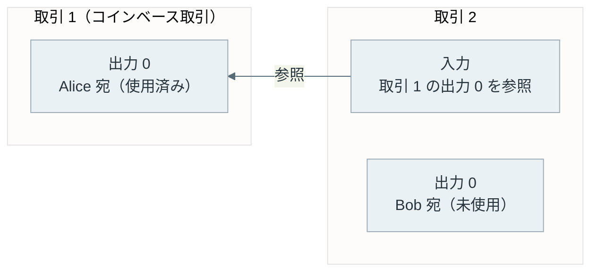
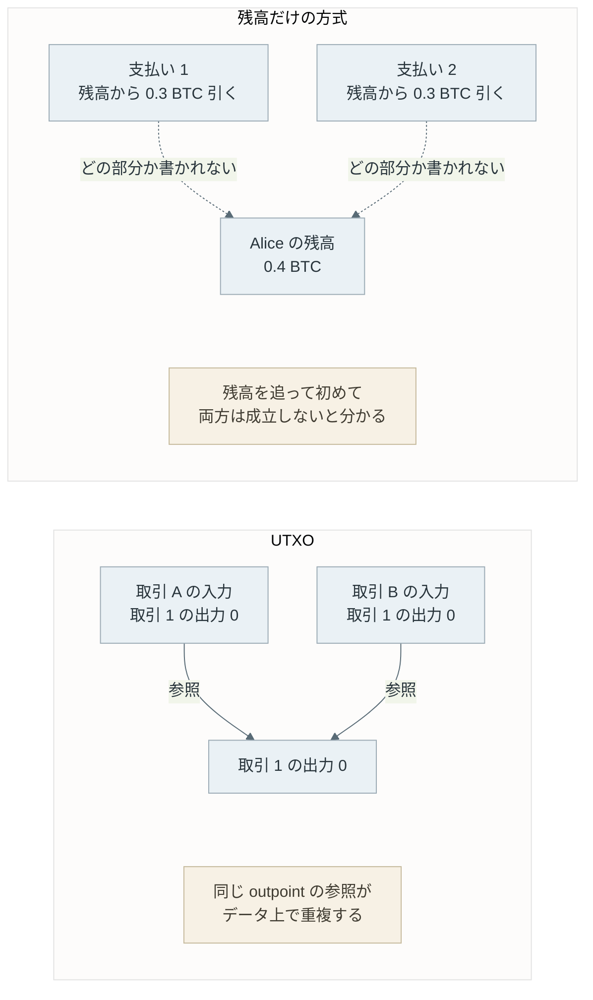
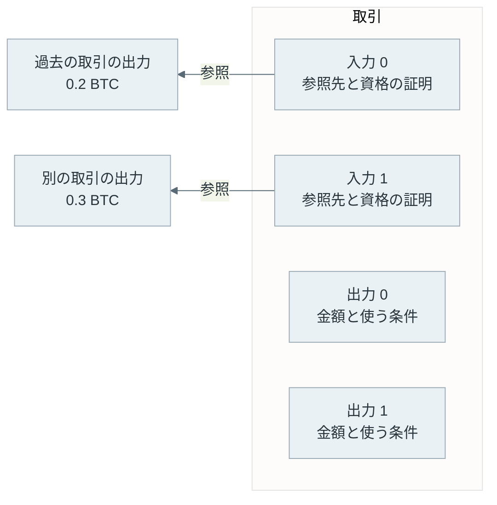
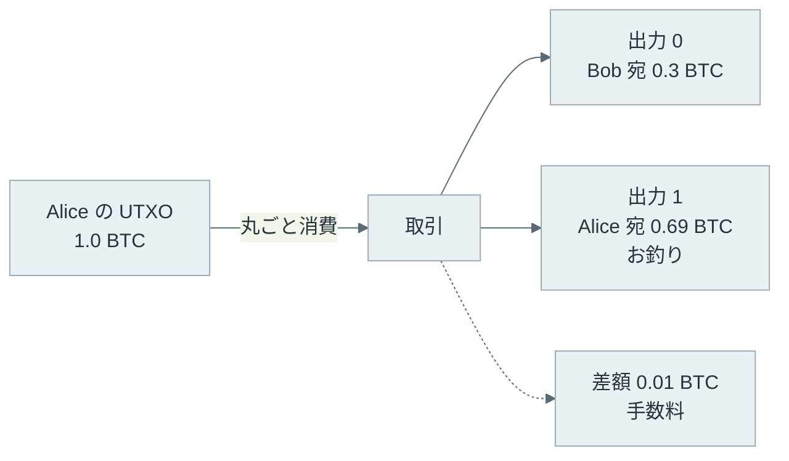
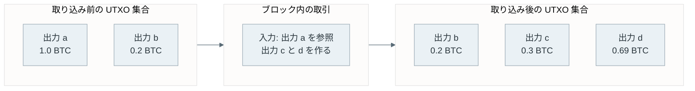

UTXO（Unspent Transaction Output、未使用の取引出力）は、取引（transaction）の出力（金額と使う条件が書かれた、コインの置き場）のうち、まだ別の取引に消費されていないものです。Bitcoin には口座という仕組みも、残高という 1 つの値を直接更新する場所もありません。支払いは、過去の取引が作った出力を丸ごと消費し、新しい出力を作ることで表されます。まだ消費されていない出力を集めたものは、UTXO 集合（UTXO set）と呼ばれます。

この表し方を知りたくなる場面の代表は、ウォレットが表示する残高の正体を知りたい時です。画面に出る「0.5 BTC」のような数は、どこかに保存された値ではなく、自分宛、つまり自分の鍵で使う条件を満たせる UTXO を集めて合計した結果です。支払いの余りがお釣りの出力になることも、手数料が入力と出力の差として決まることも、この表し方から導かれます。

コインが取引から取引に渡っていく様子を以下に示します。図の矢印は、入力が持つ参照の向きです。

上記の図で、取引 1 の出力は、それを消費する取引 2 がブロックに取り込まれた時点で使用済みになり、コインは Bob 宛の出力に移ります。まだ消費されていない Bob 宛の出力が UTXO で、Bob はこれを参照し、使う資格を証明する取引を作ればコインを使えます。図の取引 1 はコインベース取引（[Bitcoin Block](../bitcoin-block/) で説明した、ブロックの先頭に置かれる報酬の取引）で、出力の参照をどこまでも遡ると、コインベース取引に行き着きます。

コインの実体は口座に記録された数値ではなく、取引から取引に連なる出力と、それを使う資格の証明です。前の持ち主が署名して次の持ち主宛の出力を作るため、Bitcoin の白書はコインを「[a chain of digital signatures](https://bitcoin.org/bitcoin.pdf)」（電子署名のチェーン）と定義しています。ただし、取引は複数の入力と複数の出力を持てるため、実際の連なりは 1 本の鎖ではなく、合流と分岐を持つグラフになります。

本記事では、取引の構造と、UTXO で残高と支払いがどう表されるかを説明します。UTXO の性質と制約に進む前に、次の疑問に答えます。

- UTXO では、同じコインを 2 回使おうとする取引の競合をどう表すのか。
- 取引の入力と出力には、何が書かれるのか。
- 出力の金額を足す時の桁あふれは、合計の検査をどうすり抜けたのか。
- お釣りと手数料は、どのように決まるのか。
- 残高は、UTXO 集合からどのように計算されるのか。

取引がブロックに取り込まれて履歴に載るまでの流れは [Bitcoin Block](../bitcoin-block/) で説明しています。使う資格を確かめる署名の計算と、出力に書く条件の言語（Script）の中身は本記事では扱いません。

---

### UTXO での競合の表し方

Bitcoin には履歴を管理する中央のサーバーが無く、取引が有効かどうかは世界中の参加者がそれぞれ検証します。この環境で問題になるのが、同じコインを 2 回使おうとすること（二重使用、double spending）で生じる取引の競合の表し方です。比較のために、残高だけで状態を表し、「Alice の残高から 0.3 BTC 引いて Bob の残高に 0.3 BTC 足す」という素朴な方式を考えます。

この方式の取引が消費するのは Alice の残高で、取引のデータには「残高から引く」としか書かれていません。例えば、残高 0.4 BTC の Alice が 0.3 BTC の支払いを 2 つ作ると、2 つは同じ残高を取り合っています。しかし、この方式の取引には、Alice の残高のうちどの部分を取るのかを名指しする識別子がありません。

UTXO では、入力が「どの取引の何番目の出力を消費するか」の指定（outpoint）を取引の中に持ちます。入力に書かれるのは参照で、その入力を含む取引がブロックに取り込まれると、参照先の出力が使用済みになります。

以下は、2 つの方式で同じコインを 2 回使おうとした時に、取引のデータに何が残るかの比較です。

上記の図の UTXO では、2 つの取引を見比べるだけで、1 本の有効な履歴の中で両方は成り立たないと分かります。ノードは、2 つの取引の入力に同じ outpoint があるかを調べるだけで、残高を計算し直さずに衝突を見つけられます。

ただし、検証に現在の状態が必要なことは、UTXO でも素朴な方式と変わりません。参照先の出力が消費されずに残っているか、金額はいくらか、使う条件を満たしているかの確認が必要です。違いは、どの出力を消費するかが取引の中に名指しされている点です。

同じ outpoint を参照する 2 つの取引のうち、どちらを残すかは UTXO だけでは決まりません。決めるには取引の順序についての合意が別に必要で、その順序を作る仕組みがブロックのチェーンです（[Bitcoin Block](../bitcoin-block/)）。

なお、口座ごとに残高を保存する実際の方式はアカウントモデルと呼ばれ、Ethereum が採用しています（[Ethereum Account Model](../ethereum-account-model/)）。

---

### 取引の入力と出力

取引は、入力（input）の並びと出力（output）の並びを持つデータです。入力は過去の出力を消費し、出力は新しいコインの置き場になります。例えば、入力 2 つと出力 2 つを持つ取引は、次の形になります。図の矢印は、入力が持つ参照の向きです。

上記の図の取引が使えるのは、0.2 BTC と 0.3 BTC を合わせた 0.5 BTC です。出力 2 つの金額の合計は、この 0.5 BTC 以下にする必要があります。合計が 0.5 BTC を下回った場合の差の行き先は、後述の手数料です。以下が入力と出力の主な項目です。

| 項目 | 置き場所 | 何を表すか |
| --- | --- | --- |
| 参照先（outpoint） | 入力 | どの取引（txid）の何番目の出力を消費するか |
| 使う資格の証明 | 入力 | 参照先の条件を満たす署名などのデータ |
| 金額 | 出力 | satoshi 単位の整数 |
| 使う条件 | 出力 | この出力を使うために満たすべき条件 |

txid は取引の識別子です。出力には 0 から始まる番号が付き、入力は txid とこの番号の組（outpoint）で参照先を指します。satoshi は Bitcoin の最小の通貨単位で、金額は全て satoshi 単位の整数として記録されます。1 BTC は 1 億 satoshi です。

txid の計算方法は、[Bitcoin Merkle Tree](../bitcoin-merkle-tree/) の「葉になる txid」で説明しています。

表の 4 行目の「使う条件」は、Script という条件を書くための小さな言語で表現されます。代表的な条件は「この公開鍵に対応する署名を添えた者だけが使える」で、支払いの宛先に使うアドレスは、この条件を組み立てるための情報を符号化した文字列です。条件式の書き方は、本記事では扱いません。

手数料の項目は、取引のどこにもありません。出力の金額の合計が入力の合計より少なければ、差額が手数料となり、取引を含むブロックの報酬に加わります（[白書](https://bitcoin.org/bitcoin.pdf)）。この報酬は、新しく発行される BTC と手数料の合計で、そのブロックを作ったマイナー（ブロックを作って取引を取り込む参加者）がコインベース取引の出力として受け取ります。

手数料の欄が無いので、出力の合計が入力の合計を超えないかという比較が、コインの水増しを防ぐ検査を兼ねています。2010 年 8 月 15 日、0.5 BTC を入力に取り、2 つの出力に約 922 億 BTC ずつ書いた取引が、この検査をすり抜けて[ブロック 74638](https://en.bitcoin.it/wiki/Value_overflow_incident) に入りました。各出力は satoshi 単位の 64 ビット符号付き整数の上限ぎりぎりでした。当時の実装は 2 つを足した時の桁あふれを考えておらず、合計が負の値に回り込んで、入力の 0.5 BTC 以下という比較を通りました。

同じ日に出た[修正](https://github.com/bitcoin/bitcoin/commit/d4c6b90ca3f9b47adb1b2724a0c3514f80635c84)は、1 つの出力にも出力の合計にも 2,100 万 BTC の上限を設けました。翌日には、この取引を含まないチェーンの方が長くなり、取引は履歴から消えました。

---

### お釣りと自分宛の出力

入力は出力を丸ごと消費します。出力の一部だけを使う書き方は、取引の形式に存在しません。出力は使用済みか未使用かのどちらかで、金額が減っていく途中の段階はありません。そのため二重使用かどうかは、参照先の出力が UTXO 集合にまだ残っているかで判定できます。

手元の UTXO の金額が支払いたい額と一致することは稀なので、多くの取引は、余った分を自分宛の出力として戻します。この自分宛の出力がお釣り（change）です。例えば、1.0 BTC の UTXO を 1 つ持つ Alice が、Bob に 0.3 BTC 払う取引は以下の通りです。この図の矢印は、これまでの参照の向きとは逆で、コインが移る向きです。

上記の図の金額は一例で、手数料をいくら残すかは取引を作る人が決めます。[白書](https://bitcoin.org/bitcoin.pdf)が挙げる典型的な取引では、入力は 1 つの大きな入力か、小さな金額の入力を複数組み合わせたものです。出力は支払い先と、あればお釣り先の最大 2 つですが、出力を 3 つ以上持つ取引も作れます。

金額が足りない時は、複数の UTXO を入力に並べて合算します。入力が増えるほど取引のデータは大きくなります。マイナーは通常、仮想サイズあたりの手数料率（feerate）が高い取引を優先して取り込みます（[Bitcoin Block](../bitcoin-block/)）。仮想サイズは、SegWit（Segregated Witness）で追加された、署名などを入れる witness という領域を割り引いて数えた取引の大きさです。大きい取引が同じ優先度を得るには多くの手数料が必要なので、細かい UTXO ばかり持っている人は、同じ金額の支払いでも手数料がかさみやすいと考えられます。

---

### UTXO 集合と残高の計算

フルノード（[Bitcoin Merkle Tree](../bitcoin-merkle-tree/) で説明した、ブロックと取引を自力で検証する参加者）は、冒頭で定義した UTXO 集合を保ちます。ブロックを 1 つ受け入れるたびに、中の各取引について、入力が消費した出力を集合から消し、新しくできた出力を集合に足します。

以下は、ブロックの取り込みで集合が入れ替わる様子です。

上記の図の入れ替えを続けると、集合にはまだ消費されていない出力だけが残り続けます。入力が集合に無い出力を参照する取引は無効です。使用済みの出力への参照も、初めから存在しない出力への参照も、同じ「集合に無い」という判定で弾かれます。

どの参加者も同じチェーンから同じ規則で集合を組み立てるため、中央のサーバーが残高を配らなくても、全参加者が同じ判定基準を持てます。なお、ほぼ同時に作られたブロックでチェーンの末尾が分かれ、片方が捨てられることがあります（[Bitcoin Block](../bitcoin-block/) で説明した分岐の解消）。その時は、捨てられたブロックで使用済みになった出力が集合に戻り、作られた出力は消えます。

残高は、この集合から計算します。「Alice の残高」という記録はどこにも無く、ウォレットは、保管する秘密鍵で「使う条件」を満たせる UTXO を拾い出し、金額を合計して残高として表示します。冒頭の「0.5 BTC」という表示の正体はこの合計です。例えば、0.3 BTC と 0.2 BTC の UTXO を 2 つ持つ状態と、0.5 BTC の UTXO を 1 つ持つ状態は、画面の上ではどちらも同じ 0.5 BTC になります。

---

### UTXO モデルの性質

コインを使い切りの出力の連なりで表すと、次の性質が得られます。

- どのコインが誰の条件で使えるかは取引の連なりから分かり、UTXO 集合はそこから組み立て直せる
- 二重使用の競合が、同じ outpoint への参照の重複として構造に表れる
- 出力の参照を遡れば、その出力に繋がる過去の取引を誰でも辿れる

---

### UTXO モデルの制約

UTXO は口座の残高を持たないため、支払いを組み立てる側に次の手間が残ります。

- 支払いのたびに金額に見合う UTXO の組を選び、入力の合計が支払い額と手数料に一致しなければ余りをお釣りの出力として作る必要がある
- 細かい UTXO が溜まると、支払いに多くの入力が必要で、取引が大きくなって手数料がかさむ

細かい UTXO は、自分宛にまとめて送る取引で 1 つの出力に統合できます。ただし、その統合の取引にも手数料が掛かります。
