ウォレット（wallet）は、Bitcoin などの暗号資産を受け取り、残高を確認し、他の相手に送るためのソフトウェアです。PC やスマートフォンの画面で操作するタイプと、コマンドを入力して操作するタイプがあります。



送受信という目的は共通しているのに、ウォレットには多くの種類があります。対応する暗号資産だけでなく、取引を確認する機能や、資産を動かすための秘密情報の保管方法も異なります。資産の取引記録は、複数のコンピュータで共有する「ブロックチェーン」にあります。以下では、これをチェーンとも呼びます。ウォレットの違いを理解するには、画面に表示される残高と、この共通の記録の関係から知る必要があります。

本記事では、ウォレットを初めて学ぶ人に向けて、OSS（Open Source Software）の実例から、機能の違いとその理由を説明します。基本機能と操作画面を確認した後、次の疑問を順に扱います。

- 資産はどこに記録され、送金すると何が起きるのか。
- 秘密鍵・復元フレーズ・アプリのパスワードは、それぞれ何を守るのか。
- [Bitcoin](https://bitcoin.org/)・[Ethereum](https://ethereum.org/)・[Solana](https://solana.com/)・[Avalanche](https://www.avalanche.com/)・[BNB Smart Chain](https://www.bnbchain.org/) で、なぜ同じウォレットを使える場合と使えない場合があるのか。
- OSS と商用製品はどう違い、有償の機器やサービスで何が変わるのか。
- 秘密鍵を盗まれなくても、なぜ資産を失う事故が起きるのか。

送金の流れは、ローカル環境で実例を示します。後半では OSS の実装と過去のセキュリティ事故を紹介し、ウォレットを選ぶ時や取引を承認する時に、何を確認すべきかまで説明します。

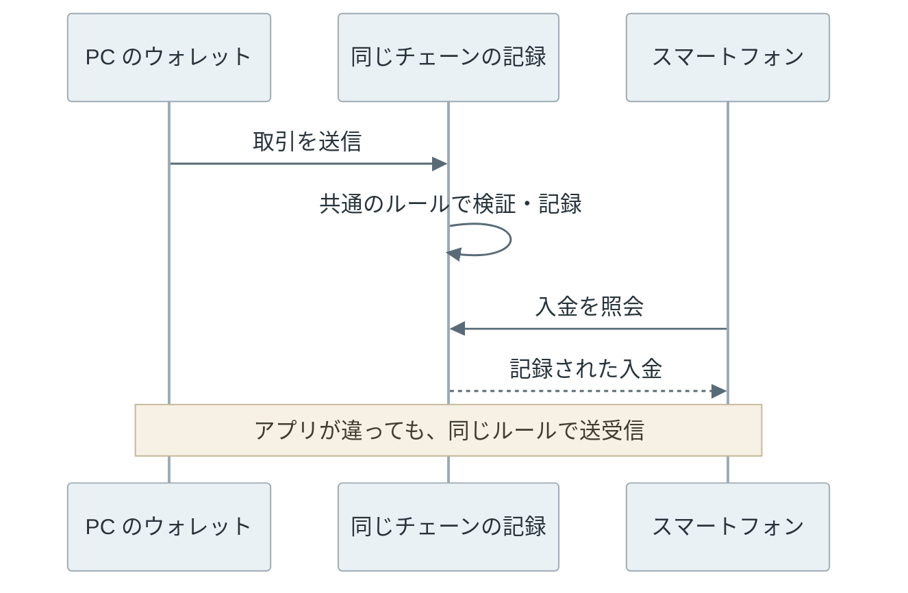

---

### 基本機能と製品ごとの特徴

まず、ウォレットで何ができるかを整理します。自分で資産を管理して送受信するウォレットの基本機能は、次の四つです。

- 受け取り：送金先を表す「アドレス」を表示し、相手に伝える。
- 残高・履歴の確認：保有量、過去の取引、送金の進み具合を確認する。
- 送金：送金先と数量から取引を作り、手数料と内容を確認して送信する。
- 鍵の管理：資産を動かすための秘密情報を管理し、端末の故障や紛失からの復元に備える。

上記に加えて、何を細かく操作したいか、誰と資産を管理するかによって、必要な機能が変わります。例えば、次の OSS にはそれぞれ特徴があります。取り上げた機能は、その製品だけにあるとは限りません。

| OSS | 基本機能に加えた特徴 | 利用する場面 |
| --- | --- | --- |
| [Sparrow](https://sparrowwallet.com/features/) | Bitcoin のどの入金分を送金に使うか、手動で選べる | 入金をまとめて使うか、分けて残すかまで管理する |
| [BlueWallet](https://bluewallet.io/features/) | 送金に使う秘密情報を入れずに、残高を見るだけの設定ができる | スマートフォンでは入金確認だけを行う |
| [Rabby](https://github.com/RabbyHub/Rabby) | Ethereum 系の取引で、実行後の残高変化の予測や警告を表示する | チェーン上のアプリを操作する前に、資産の変化を確認する |
| [Safe のコントラクト](https://github.com/safe-global/safe-smart-account)（チェーン上で動くプログラム） | 資産を動かす条件として、複数人の承認を設定できる | 一人の判断だけでは送れないように、共同で資産を管理する |

ほかにも、暗号資産の交換・購入サービスとの連携や、複数チェーンへの対応があります。専用機器（例：[Trezor](https://trezor.io/)）に秘密情報を保管し、PC やスマートフォンのアプリと組み合わせる製品もあります。「対応通貨が多いか」だけでは、こうした用途の違いまでは分かりません。

---

### ウォレットの基本操作例

送金では、送金先と数量を指定し、手数料を含む内容を確認してから承認します。まず、デスクトップアプリの送金画面を見てみます。

デスクトップアプリの Sparrow では、`Pay to` に送金先、`Amount` に数量を入力し、`Fee` で手数料を確認します。



<br>

同じ送金先と数量は、CLI でも指定できます。GUI は一件ずつ内容を確認する用途に、CLI は送金テストや残高照会の自動化に向いています。






<br>

ブラウザ拡張の Rabby は、Web サイトから届いた操作要求を別の確認画面で承認します。画面には残高変化の予測や、初めて送る相手への警告も表示されます。予測はその時点のデータに基づくため、実際の結果や操作先の安全性を保証する物ではありません。



<br>

「ブラウザ版」には、拡張機能と、URL を開いて使う Web アプリがあります。Web アプリから、鍵を持つ拡張機能や専用機器に署名を依頼する構成もあります。ここでいう署名は、取引を承認した証拠となるデータです。仕組みは送金処理と合わせて説明します。

画面を開く場所と、秘密情報を保管する場所は、同じとは限りません。画面に表示する残高は、チェーン上の記録から確認します。この関係を理解するために、暗号資産が使われる理由と、取引の記録方法から見ていきます。

---

### 暗号資産の用途

ウォレットで暗号資産を操作するのは、支払いに使ったり、チェーン上のアプリに資産を預けたりするためです。その前提として、暗号資産がどのような目的で使われているかを整理します。

暗号資産が選ばれる理由には、自分で資産を管理して送る事、チェーン上のアプリを利用する事、投資として保有する事があります。これらは別の動機です。英国 FCA の[消費者調査](https://www.fca.org.uk/publication/research-notes/cryptoasset-consumer-research-2025-wave-6.pdf)でも、投資の一部、短期的な利益への期待、商品やサービスの支払いなどが購入理由として挙がっています。

技術面では、特定のウォレット事業者に送金を承認してもらわずに、自分で取引を作れる点が特徴です。相手と同じアプリの会員になる必要もありません。[Bitcoin の原論文](https://bitcoin.org/bitcoin.pdf)は、金融機関を仲介せずに当事者間で電子的な支払いを行う仕組みを目的としています。

[Ethereum](https://ethereum.org/en/what-is-ethereum/) などでは、資産の交換やゲーム内の資産管理をチェーン上のプログラムで行えます。ウォレットでは、そのプログラムに対する操作も承認できます。

例えば、カードゲームの [Gods Unchained](https://portal.godsunchained.com/getting-started) では、ウォレットを連携し、[NFT（Non-Fungible Token）として扱われるカード](https://immutable.zendesk.com/hc/en-us/articles/15427608928399-Do-I-have-to-understand-blockchain-or-the-Ethereum-network)を売買できます。以下は、公式ガイドのデッキ選択画面です。



ただし、直接送れる事と、安く安全に支払える事は別です。価格変動やネットワーク手数料があり、取引所や交換サービスを使う場合は、その事業者にも依存します。通常の送金を一律に取り消す窓口もありません。自分で操作できる範囲が広がる分、何を承認したか、復元に必要な情報を保管しているかが重要になります。

---

### 資産の記録とウォレット

[ブロックチェーン](../blockchain-basics/)は、複数のコンピュータが共通の規則で取引を検証し、履歴を共有する仕組みです。参加するコンピュータを「ノード」、送金などの変更要求を「取引（トランザクション）」と呼びます。取引をまとめて履歴に追加する単位が「ブロック」です。Bitcoin と Ethereum は、それぞれ異なる規則と履歴を持つネットワークです。

資産の記録を共有するチェーンと、ユーザが操作するアプリを分けるのは、特定のアプリに資産の記録を閉じ込めず、同じ規則に従う別の製品からも操作できるようにするためです。例えば、Sparrow を使う人が、Electrum を使う人の Bitcoin アドレスへ送金すると、Bitcoin ネットワーク上の共通の記録が更新されます。開発者は、この共通の規則に従いながら、画面や追加機能を工夫できます。

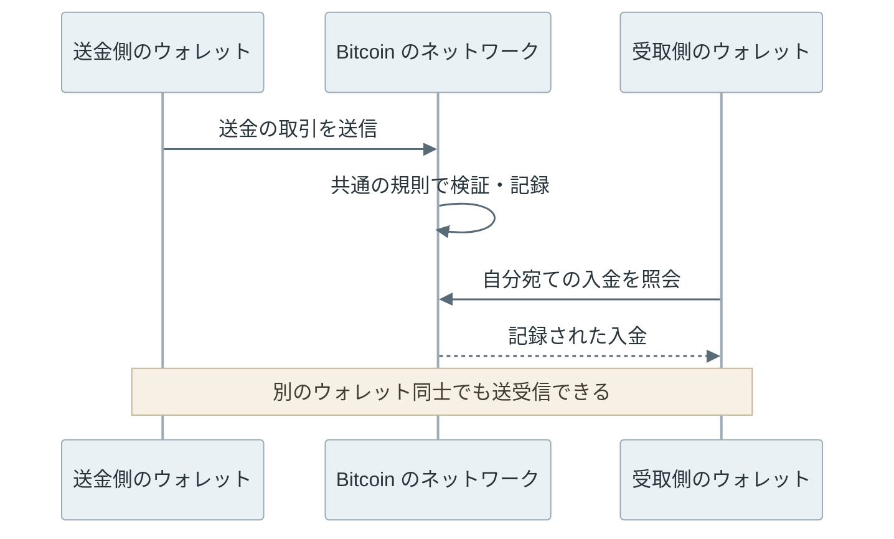

実際にアプリが全履歴を自分で検証するか、検索サービスに問い合わせるかは製品と設定によって異なります。通常のチェーン上の送金では、受取人がアプリを終了していても入金できます。後から記録を読めば確認できるからです。アプリを再インストールした後に以前の資産を動かすには、送金に使う鍵も必要です。残高を読める事と、送金の権限を持つ事は別です。

---

### 送金の権限と処理

誰でも参加できるネットワークでは、「このアドレスから送ります」という申告だけで送金を認めると、他人の資産も使えてしまいます。一方、ノードに秘密情報を渡して本人確認をすると、受け取ったノードも同じ操作ができるようになります。必要なのは、次の条件を満たす承認方法です。

- 資産を使う権限に対応した証拠を提示できる事。
- 証拠が、今回の送金先や数量などの内容に結び付いている事。
- 承認に必要な秘密情報を渡さずに、他の参加者が検証できる事。

このために使うのが、秘密鍵と[デジタル署名](../digital-signature/)です。秘密鍵は署名を作るための秘密の数値であり、対応する公開鍵を使うと、その署名が正しいか検証できます。秘密鍵から公開鍵は容易に計算できます。一方、公開鍵から秘密鍵を求めるには、現在知られている計算方法では膨大な計算量が必要となり、現在の計算機で現実的な時間内に求める事は困難です。

| 情報 | 役割 | 取り扱い |
| --- | --- | --- |
| 秘密鍵 | 取引の署名を作る | 他人に渡さない |
| 公開鍵 | 対応する鍵による署名か検証する | 公開できる |
| アドレス | 送金先などを表す | 相手に伝える。公開履歴との関連は推測され得る |
| デジタル署名 | 指定した内容をその鍵で承認した証拠 | 取引とともに公開する |

ノードは、署名の正しさに加えて、その鍵が対象の資産を使う条件を満たすかも検証します。攻撃者が自分の鍵で正しい署名を作っても、他人の資産を使う権限にはなりません。また、承認の対象となった内容を変更すれば、その署名の検証に失敗します。アドレスは公開鍵そのものとは限らず、複数人の署名を要求する条件などに対応する場合もあります。

署名は内容を隠す暗号化ではありません。Bitcoin や Ethereum では、送金先や金額などを他の参加者も確認できます。また、署名が正しくても、送金先が信頼できるとは限りません。ユーザが意図した操作かどうかは、署名する前に確認する必要があります。

<br>

ウォレットは、秘密鍵を保管するだけでは送金できません。現在の記録を読み、送金額と手数料を計算し、チェーンの規則に合う取引を組み立てる必要があります。

送金処理をユーザ・ウォレット・ネットワークに分けると以下のようになります。

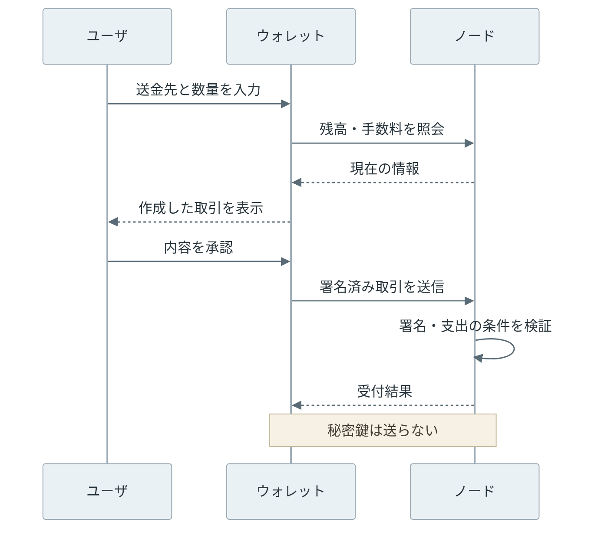

また、ノードが取引を受け付けても、その時点で送金が確定した訳ではありません。取引がブロックに入るまで待つ必要があり、ブロックに入った後も、その履歴が後から別の履歴に置き換わる可能性を考慮します。どの段階で確定したと扱うかは、チェーンの規則によって異なります。ウォレットの「送信済み」「確認中」「完了」は、この途中経過を表しています。[Bitcoin の取引の流れ](../bitcoin-transaction-lifecycle/)と [Finality](../finality/)で扱っている区別です。

手数料が不足している時やネットワークが混雑している時は、確認が進まない場合があります。そこで、手数料を上げて取引を置き換える機能などが必要になります。置き換え操作の可否や方法は、チェーンごとに異なります。

---

### ローカル送金例

自分の PC 内に Ethereum 互換チェーンを作り、1 ETH を送って残高の変化を確認します。ETH は Ethereum の通貨単位です。ここでは開発用の残高を使い、実資産や普段使うウォレットの秘密鍵は使いません。

[Foundry](https://getfoundry.sh/anvil/overview/) に含まれる Anvil でチェーンを起動し、cast コマンドで送金します。独立したチェーン A・B を用意し、A だけで送金して、B の残高も確認しました。接続先はどちらも自分の PC を表す `127.0.0.1` です。


各アカウントには、初期残高として 10,000 ETH を設定しました。送金前後の残高は次の通りです。

```text
Chain | Role | Before (ETH) | After (ETH)
A (31337) | sender | 10000 | 9998.999979
A (31337) | receiver | 10000 | 10001
B (31338) | sender | 10000 | 10000
B (31338) | receiver | 10000 | 10000
```

送金者から減ったのは、送金額の 1 ETH と手数料の 0.000021 ETH です。B の残高は変わりません。同じアドレスでも、残高はチェーンごとに記録されます。

<br>

送金に使ったコマンドは次の通りです。`receiver` は受取人、`sender` は送金者のアドレス、`rpc_a` はチェーン A の接続先です。RPC は、残高照会や取引送信をノードに依頼するための API です。

```shell
cast send "$receiver" --value 1ether \
  --from "$sender" --unlocked --legacy \
  --gas-price 1gwei --gas-limit 21000 --rpc-url "$rpc_a" --json
```

`--unlocked` は、開発用ノードの Anvil に署名を依頼する指定です。今回は Anvil が用意した開発用アカウントを使い、cast に秘密鍵を渡さずに送金しています。

保存した receipt（取引の実行結果）から、主な項目を抜粋します。

```json
{
  "status": "0x1",
  "blockNumber": "0x1",
  "gasUsed": "0x5208",
  "effectiveGasPrice": "0x3b9aca00",
  "transactionHash": "0x83013928e84493ed2eed3b3dcadf95896c85dcb68b9c661fec7f54d77ca31b1b"
}
```

数値は 16 進数です。`status: "0x1"` は実行成功、`blockNumber: "0x1"` はブロック番号 1 を表します。`gasUsed: "0x5208"` は 21,000、`effectiveGasPrice: "0x3b9aca00"` は 1,000,000,000 wei です。

gas は処理量、wei と gwei は ETH の小さな金額を表す単位です。1 gwei は 10 億 wei、1 ETH は 10 の 18 乗 wei です。今回は `--legacy` で従来形式の取引を使い、単価を 1 gwei に固定したため、手数料は `21,000 × 1 gwei = 0.000021 ETH` となりました。

取引には `transactionHash` という識別子も付きます。今回の記録は手元の Anvil にだけ存在し、公開チェーンの取引検索サイトでは見つかりません。また、この実験では公開ネットワークの混雑や、確定までの待ち時間は再現していません。

---

### 鍵の復元とパスワード

端末の故障や紛失に備え、多くのウォレットは作成時に 12 語や 24 語の「復元フレーズ」を表示します。これは秘密鍵を再生成するための情報であり、アプリを開くパスワードとは役割が異なります。

英語の復元フレーズは、次のように単語が並ぶ形式です。以下は見た目を示す架空の例であり、実際の復元には使えません。

```text
sunrise meadow lantern acorn velvet pebble
starlight willow drizzle sailboat seashell moonbeam
```

一つの元データから複数の鍵を階層的に生成する方式をHD（Hierarchical Deterministic）ウォレットと呼びます。[BIP39](https://github.com/bitcoin/bips/blob/master/bip-0039.mediawiki) は復元フレーズとシードという計算用の値、[BIP32](https://github.com/bitcoin/bips/blob/master/bip-0032.mediawiki)は階層的な鍵生成を定める仕様です。生成する鍵の位置は、導出パスという番号の列で指定します。

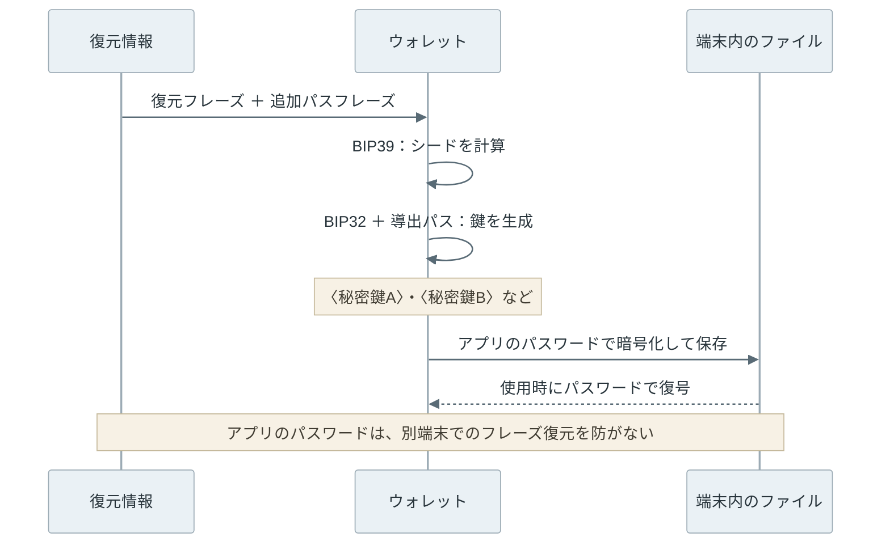

図中の `〈秘密鍵A〉` などは説明用の記号であり、実際の鍵ではありません。導出パスの例として、`m/84'/0'/0'/0/0` と `m/84'/0'/0'/0/1` は Bitcoin の受取用の鍵を二つ選ぶ指定です。導出パス自体は秘密情報ではありません。

アプリのパスワードで守れるのは、手元に保存した秘密情報です。復元フレーズと必要な追加情報を盗まれると、攻撃者は元のアプリのパスワードを知らなくても、別の端末で同じ鍵を生成できます。

<br>

図の追加パスフレーズは任意です。設定しない場合は空文字を使います。復元には元と同じ方式が必要であり、BIP39 の追加パスフレーズは、アプリのパスワードと違い、変えると別のシードを作ります。入力ミスも別のウォレットとして成立するので、エラーで気付けるとは限りません。導出パスや対象チェーンが違う場合も、残高がゼロに見える事があります。

また、[Electrum が新規生成するフレーズ](https://electrum.readthedocs.io/en/latest/seedphrase.html)は独自方式です。単語数だけでアプリ間の互換性を判断できません。送金先の名前、取引のメモ、複数人で承認する設定なども鍵だけからは再現できない場合があり、製品が案内するバックアップを残す必要があります。

---

### チェーンごとの取引構造

同じ送金なのに、Bitcoin 用のウォレットで Ethereum を扱えないのはなぜでしょうか。対応チェーンを増やすには、通貨名とロゴを追加するだけでは足りません。署名方式、資産の記録方法、手数料、取引の有効期限が異なるからです。この違いは、ウォレットの画面に必要な機能にも表れます。

#### Bitcoin の入出力

Bitcoin の取引には、金額と、その金額を次に使える条件を記録する「出力」があります。まだ使われていない出力を [UTXO（Unspent Transaction Output）](../utxo/)と呼びます。ウォレットに表示する残高は、自分が使える UTXO を集計した値です。送金時には UTXO を入力として選び、送金先への出力と、自分に戻すお釣りの出力などを作ります。

例えば、0.3 BTC（Bitcoin の通貨単位）の UTXO から 0.1 BTC を送ると、元の UTXO は使い切られ、新しい出力が作られます。以下は、手数料を説明用に 0.0001 BTC と置いた例です。

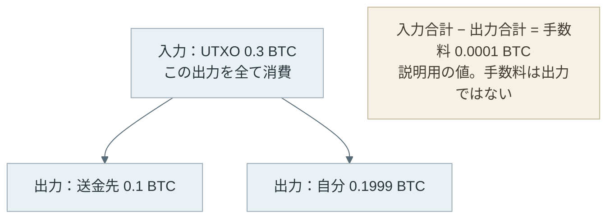

手数料に相当する UTXO を作る訳ではなく、入力の合計と出力の合計の差が手数料です。同じ送金額でも、細かい UTXO を多数使うと取引のデータ量が増え、必要な手数料が高くなる場合があります。

使う UTXO をユーザが選ぶ機能を「coin control」と呼びます。どの入金同士を一つの取引にまとめるかによって、手数料や、公開履歴から推測されるアドレス同士の関係が変わります。Bitcoin 専用ウォレットが UTXO の一覧や取引の入出力図を持つのは、この判断を支援するためです。

取引を組み立てる端末と署名する端末を分けるために、[PSBT（Partially Signed Bitcoin Transaction）](https://github.com/bitcoin/bips/blob/master/bip-0174.mediawiki)という交換形式もあります。署名前の取引、署名に必要な情報、集めた署名をやり取りする形式であり、完成した取引をチェーンに送る形式とは区別されます。複数人の署名や、ネットワークから切り離した端末での署名にも利用できます。

<br>

Bitcoin には、Lightning Network を使った支払いもあります。これは通常の送金を短い間隔で繰り返すだけの仕組みではなく、二者間で残高を更新するためのチャネルを作り、個々の支払いを毎回チェーンに記録せずに処理する方式です。そのため、Bitcoin の秘密鍵が復元できても、チャネルの状態を同じように復元できるとは限りません。例えば [Core Lightning のバックアップ](https://docs.corelightning.org/docs/backup)は、鍵のファイルに加えて取引やチャネルの状態も対象です。Lightning の対応有無と、そのウォレットが要求するバックアップ方式は別に確認します。

---

#### Ethereum の残高と実行処理

[Ethereum のアカウント](../ethereum-account-model/)は、ローカル送金の例と同じく、アドレスに対応する残高などの状態を持つ単位です。ウォレット内の鍵の整理とは異なり、チェーン上に記録されます。秘密鍵で操作する通常のアカウントを EOA（Externally Owned Account）と呼び、送信する取引には nonce という通し番号を付けます。nonce の小さい取引が処理されずにいると、後続の取引も進まない場合があります。

Ethereum の取引は、ETH の送金に加えて、スマートコントラクトというチェーン上のプログラムを呼び出せます。その実行に必要な計算量を gas と呼び、通常は ETH で手数料を支払います。ウォレットには、送信先と金額だけでなく、どのプログラムに何を実行させるかを表示する機能が必要です。

チェーン上のプログラムなどで管理する資産の単位を「トークン」と呼びます。Ethereum では、ETH 以外のトークンをコントラクトが管理する残高として表現できます。広く使われる [ERC-20](https://eips.ethereum.org/EIPS/eip-20) には、他のアドレスにトークンを使用する権限を与える `approve` があります。例えば交換サービスを利用する際、送金する前に使用許可を求められるのは、この仕組みによります。ETH の送金額がゼロでも、トークンの使用権限を変更する取引かもしれません。

<br>

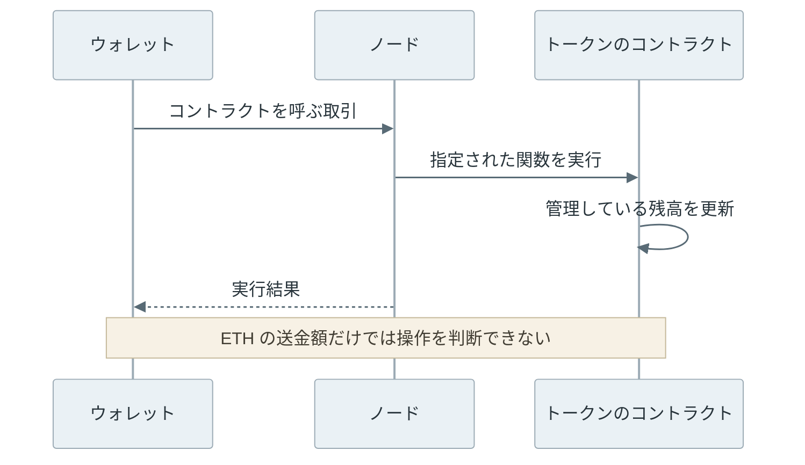

EVM（Ethereum Virtual Machine）は Ethereum のプログラムを実行する仕組みであり、EVM と互換性のあるチェーンでは取引処理を共通化しやすくなります。しかし、Ethereum と別のチェーンは、資産の記録も別です。同じアドレスが表示されても、片方の ETH やトークンが自動で他方に現れる訳ではありません。

Ethereum の外で取引を処理し、その結果の検証などを Ethereum に依存する仕組みは、[L2（Layer 2）](https://ethereum.org/en/layer-2/)と呼ばれます。ウォレットでは別のネットワークとして扱うため、ネットワークの表示を切り替えても資産は移動しません。資産を移すには、チェーン間の移転を仲介する[ブリッジ](https://ethereum.org/en/developers/docs/bridges/)などが必要です。ブリッジのコントラクトや運営方式に由来するリスクは、ウォレットを変更するだけでは取り除けません。

---

#### Avalanche・BNB Smart Chain の互換性

Avalanche は、一つのチェーンだけを指す名前ではありません。基本となるネットワークには、スマートコントラクトを実行する C-Chain、資産の送受信を扱う X-Chain、検証者や、資産を預けて検証に参加するステーキングを管理する P-Chain があります。

このうち [C-Chain は EVM と互換性があり](https://docs.core.app/docs/connect-your-dapp/avalanche-chains/)、Ethereum 系ウォレットの取引構築や接続方式を利用できます。通常の手数料は AVAX で支払います。一方、[X-Chain と P-Chain](https://build.avax.network/docs/avalanche-l1s) は取引形式が異なり、専用の対応が必要です。「Avalanche 対応」とだけ書かれたウォレットが、P-Chain の操作にも対応するとは限りません。

もう一つの例が、[BNB Smart Chain（BSC）](https://docs.bnbchain.org/bnb-smart-chain/developers/wallet-configuration/)です。これも EVM と互換性があり、手数料は通常 BNB で支払います。残高の独立性は、ローカル実験の A・B と同じです。BNB Smart Chain と Ethereum で同じアドレスが表示されても、残高や取引履歴は共有しません。

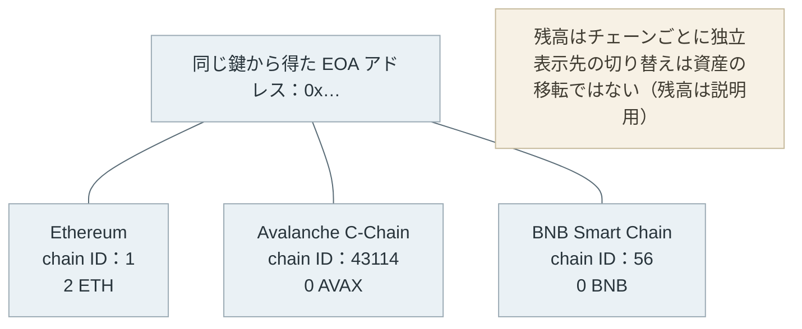

図の chain ID は、取引の対象ネットワークを区別する番号です。EVM 系への対応は共通化しやすい一方、接続先、手数料の通貨、利用できるコントラクト、送信後の状態確認は、対象チェーンに合わせる必要があります。アプリが対応する範囲と、規格上互換性がある範囲も同じではありません。

---

#### Solana の実行指示

Solana の基本通貨は SOL です。Solana では、取引の中に instruction というプログラムへの実行指示を一つ以上まとめます。取引には、プログラムが読み書きするアカウントも指定します。Solana のアカウントは、残高やプログラムのデータなどを保存する単位です。

署名には Ed25519 という方式を使い、Ethereum の通常の取引署名とは異なります。また、通常の取引は最近のブロックを示す blockhash を含むため、長時間放置した署名済み取引をそのまま送れるとは限りません。長期間有効な取引を作る仕組みは、別に用意されています。[取引の仕様](https://solana.com/docs/core/transactions)に対応する処理が、ウォレットにも必要です。

トークンの持ち方にも違いがあります。[Solana の token account](https://solana.com/docs/tokens/basics/create-token-account) は、一つのトークンについて、保有量と操作権限を保存するアカウントです。ウォレットのアドレスと token account は役割が異なり、送金時に必要な token account を作る処理が加わる場合があります。

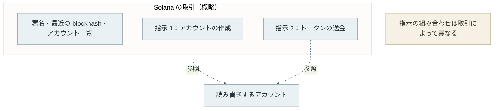

この例では、必要なアカウントの作成と送金を一つの取引にまとめています。ウォレットには、個々の指示だけでなく、まとめて何を行う取引なのかを表示する役割があります。

<br>

対象とした 5 種類を整理すると、以下の通りです。

| 対象 | 資産・取引の特徴 | ウォレットに必要な対応 |
| --- | --- | --- |
| Bitcoin | 未使用の出力（UTXO）を消費して新しい出力を作る | UTXO の選択、手数料の計算、入出力の表示、PSBT |
| Ethereum | アカウントの残高と nonce、コントラクトの実行 | gas、トークン使用許可、実行結果の予測 |
| Solana | instruction と参照先のアカウント、blockhash | 複数の実行指示、token account、取引の有効性 |
| Avalanche | C-Chain は EVM。X/P-Chain は別の形式 | C-Chain の送金と X/P-Chain の操作を分けた対応 |
| BNB Smart Chain | EVM 互換。Ethereum とは独立した履歴 | BSC の接続先・chain ID、BNB での手数料 |

---

### 鍵の管理主体

チェーンへの対応と、鍵の管理方法は独立しています。同じ Bitcoin のウォレットでも、自分で鍵を管理するタイプと、事業者に預けるタイプでは、失敗した時の対処が違います。

「セルフカストディ型（self-custody）」は、ユーザが資産を操作する鍵を自分で管理するタイプです。事業者の出金承認を待たずに取引を作れますが、鍵を失った時に、本人確認だけで取り戻せるとは限りません。

「カストディ型（custodial）」は、事業者などが鍵を管理するタイプです。ユーザはサービスにログインして送金を依頼し、事業者が取引に署名します。パスワードの再設定は容易でも、出金可否や事業継続に依存します。

<br>

例えば、Sparrow では、画面の `New or Imported Software Wallet` から自分で鍵を管理するウォレットを作れます。一方、Lightning 向けの OSS である [LNbits](https://github.com/lnbits/lnbits) を他者のサーバで使う場合は、[運営者が資金を操作できる構成](https://docs.lnbits.com/guide/faq/general#is-lnbits-custodial)になります。






LNbits も、自分のサーバと自分の Lightning ノードで運用すれば、自分で管理できます。鍵の管理主体は、画面の見た目や OSS かどうかでは判断できません。誰が資金を操作できるかを確認する必要があります。

---

### 鍵の保管場所

自分で鍵を管理する場合も、普段使う PC に置くか、ネットワークから切り離した環境に置くかで、鍵を盗まれる危険や操作の手間が変わります。

この保管環境の違いを表すのが、ホットウォレットとコールドウォレットです。普段使う PC やスマートフォンで署名するホットウォレットは操作しやすい一方、その端末が侵害されると鍵も危険にさらされます。ネットワークから切り離した環境で鍵を保管・使用するコールドウォレットは、取引データを安全に受け渡す手順が必要です。

ハードウェアウォレットは、専用端末の中で鍵を保管し、署名する製品です。ネットワークに接続した PC と通信していても、通常の操作では秘密鍵を PC に渡しません。「インターネットに繋がった PC を使うから、全てホット」という単純な区別より、署名する場所と秘密鍵が外に出る経路を見る方が正確です。

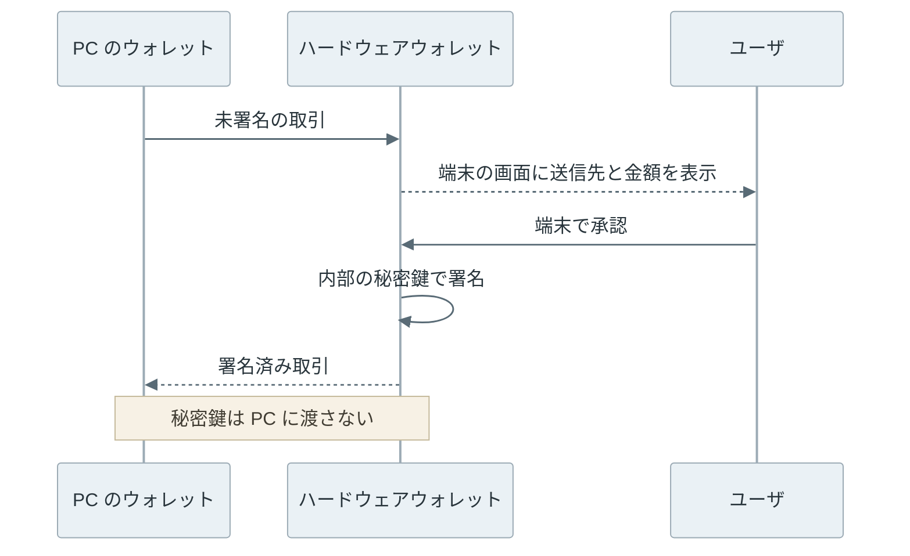

専用端末の画面で確認する理由は、PC の表示だけが改竄されている可能性があるからです。PC に正しい送信先が表示されていても、署名対象が違う場合があります。端末が確認対象の情報を表示し、ユーザが照合して初めて、この分離が役に立ちます。[Trezor の Trusted Display](https://trezor.io/guides/trezor-devices/trezor-fundamentals/trezor-s-trusted-display-verify-every-address-on-your-device)も、この確認を目的としています。

<br>

なお、残高を見るだけなら秘密鍵は不要です。アドレスや、複数の公開鍵を生成できる拡張公開鍵（xpub）を登録する「watch-only ウォレット」は、入金と残高を確認できますが、単独では署名できません。xpub は支払い権限を与えない一方、関連する多数のアドレスを追跡する手掛かりになるため、公開情報だから無制限に共有して良いという訳でもありません。

---

### 承認権限の分散

一つの鍵に送金の権限が集中すると、その鍵を盗まれた時に資産を動かされてしまいます。複数の鍵や参加者の協力を必要とする構成で、この集中を避けられます。

「マルチシグ（multisig）」は、例えば 3 個の鍵のうち 2 個の署名を要求する方式です。「スマートアカウント」は、操作を認める条件をコントラクトのコードとして定義するアカウントであり、[Safe](https://docs.safe.global/advanced/smart-account-overview)では複数人の承認などを構成できます。例えば、所有者として登録した EOA のウォレットで署名し、Safe のコントラクトが必要数の署名を検証する構成があります。画面を操作するウォレットと、資産を管理するスマートアカウントを組み合わせて使うのです。

以下は、Safe で必要な署名数を変更する画面です。`2 out of 2 signers` は、登録した2人の署名者の両方が承認する設定を表します。



[MPC（Multi-Party Computation）](https://www.fireblocks.com/report/what-is-mpc)を使う方式では、秘密情報を分散して持つ複数の参加者が、協力して計算する事で署名を作ります。複数の署名を提示するマルチシグと、分散した秘密情報から協力して一つの署名を作る方式の違いです。ただし、MPC という名前だけでセルフカストディ型と判断する事はできません。どの参加者が揃えば署名できるか、事業者が停止した時に復旧できるかを確認する必要があります。

---

### 製品ごとの対応範囲と制約

チェーンの取引構造と鍵の管理方法が分かると、冒頭で紹介した機能の違いを、対応範囲や制約まで含めて比較できます。Bitcoin の入金を選ぶ機能は UTXO の管理に、Rabby の実行結果の予測はコントラクト操作の確認に対応します。

以下は、2026 年 10 月時点の公式ドキュメントと公開リポジトリを元にした比較です。アプリの種類やバージョンによって対応範囲が異なるため、ここでは設計上の違いに絞って比較します。

| ウォレット | 主な対象と使う場所 | 特徴 | 確認する制約 |
| --- | --- | --- | --- |
| [Sparrow](https://sparrowwallet.com/features/) | Bitcoin、デスクトップ | UTXO、取引の入出力、PSBT、複数署名、ハードウェア連携を詳しく確認できる | Bitcoin 専用。設定や取引構造の理解が必要 |
| [Electrum](https://github.com/spesmilo/electrum) | Bitcoin、デスクトップ・Android | 軽量クライアント、複数署名、ハードウェア連携、Lightning | 新規作成する復元フレーズは独自方式。Lightning は別の状態管理が必要 |
| [BlueWallet](https://bluewallet.io/features/) | Bitcoin、iOS・Android | スマートフォンでの送受信、watch-only、複数署名、coin control | Lightning の接続構成と鍵の管理主体は、通常の Bitcoin ウォレットと分けて確認 |
| [Rabby](https://github.com/RabbyHub/Rabby) | Ethereum と EVM 系、ブラウザ拡張など | 複数ネットワークでの操作、署名前の実行結果の予測、リスクの表示 | 対応するチェーンと外部の解析サービスに依存する部分を確認 |
| [Safe](https://docs.safe.global/advanced/smart-account-overview) | EVM 系、スマートアカウント | 複数の所有者と承認数、コントラクトによる操作条件 | 所有者の承認方法と構成を確認。コントラクトと設定の安全性も関わる |
| [Trezor Suite](https://github.com/trezor/trezor-suite) | 複数チェーン、Trezor 端末と組み合わせるアプリ | 残高確認・送受信と、専用端末での確認・署名を連携 | 対応資産は端末とアプリの組み合わせによる。端末は有償 |

[MetaMask](https://github.com/MetaMask/metamask-extension) と [Phantom](https://help.phantom.com/articles/41372840389651)も、複数チェーンで使われる代表的なウォレットです。MetaMask は Ethereum 系のアプリとの接続、Phantom は Solana を含む複数チェーンの操作を考える際の比較対象となります。

---

### ウォレットの内部構成

多くのウォレットは、ローカル送金の例で使った RPC（Remote Procedure Call）を通してノードに問い合わせます。履歴検索には、取引を検索しやすいように整理する「インデクサ」を使う事もあります。全履歴を自分で検証するノードと、必要な情報を検索して返すサービスは、同じ役割ではありません。

ウォレットは、秘密鍵を使う小さなプログラムだけで完結しません。画面、取引を組み立てる処理、鍵の保管、チェーンとの通信、履歴の保存などを組み合わせます。価格表示やトークンの画像には、チェーンの外にある API も使われます。例えば、「日本円換算だけ表示されない」と「取引に署名できない」では、調べるべき処理が異なります。

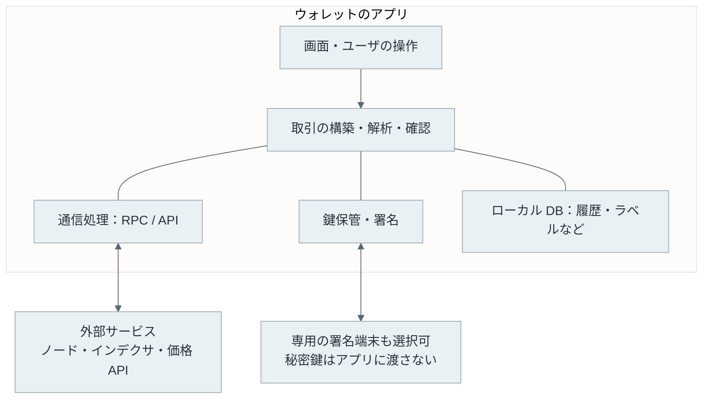

履歴を保存する DB（データベース）は、ネットワークの履歴を検索しやすくするためのローカルデータです。鍵のバックアップ、ローカル履歴の再同期、価格 API の復旧は、それぞれ別の処理となります。価格 API が止まって日本円換算が表示されなくても、チェーン上の資産が失われた訳ではありません。

<br>

ブラウザ拡張のウォレットには、さらに Web サイトとの接続が加わります。チェーン上のプログラムを利用する Web アプリを dApp（Decentralized Application）と呼び、Ethereum 系では [EIP-1193](https://eips.ethereum.org/EIPS/eip-1193) の Provider API が接続の基礎となります。dApp はウォレットにアカウントの公開や取引を要求し、ウォレットはユーザに確認を求めます。

Web サイトから取引を受け取ったウォレットは、署名対象のデータを検証する必要があります。サイトの説明文と、実際のデータが一致しているとは限らないからです。拡張機能の画面やバックグラウンド処理を分離するだけでなく、どのサイトから来た要求かを管理し、署名対象をウォレット自身が解析・表示する必要があります。

---

### OSS・商用・有償の違い

ウォレットによって、アプリ・ファームウェア・コントラクトの公開範囲やライセンスが異なります。代表例は次の通りです。

| 確認した部分 | ライセンスと公開範囲 |
| --- | --- |
| [Sparrow アプリ](https://github.com/sparrowwallet/sparrow/blob/master/LICENSE) | Apache-2.0 |
| [Electrum アプリ](https://github.com/spesmilo/electrum/blob/fc31115ef76b7a8969cf5292bfe3440e5e67a2c0/LICENCE) | MIT |
| [BlueWallet アプリ](https://github.com/BlueWallet/BlueWallet/blob/master/LICENSE) | MIT |
| [Rabby ブラウザ拡張](https://github.com/RabbyHub/Rabby/blob/develop/LICENSE) | MIT とブランド名・ロゴの再利用に関する留保 |
| [Safe のコントラクト](https://github.com/safe-fndn/safe-smart-account/blob/main/LICENSE) | LGPL-3.0。Web 画面やサービスとは別のコンポーネント |
| [Trezor のファームウェア](https://github.com/trezor/trezor-firmware/blob/main/COPYING) / [Trezor Suite](https://github.com/trezor/trezor-suite/blob/develop/LICENSE.md) | ファームウェアは GPL-3.0、Suite は参照用途に制限のある T-RSL |
| [MetaMask ブラウザ拡張](https://github.com/MetaMask/metamask-extension/blob/main/LICENSE) | 独自の利用条件を持つソース公開 |

<br>

有償の製品・サービスでは、専用端末による鍵の保護や、法人向けの承認管理などが提供されます。

| 製品・サービス | 有償の対象 | 主な機能 |
| --- | --- | --- |
| [Trezor Safe 3](https://trezor.io/trezor-safe-3) | ハードウェア端末の購入 | 端末内での鍵保管・署名、端末の画面での取引確認。Trezor Suite と連携して送受信する |
| [Fireblocks](https://www.fireblocks.com/platforms/governance-and-policies) | 法人向けプラットフォームの利用 | Policy Engine で取引の許可条件や担当者の承認手順を設定する |
| [MetaMask Swaps](https://support.metamask.io/token-swaps/user-guide-swaps) | トークン交換時のサービス手数料 | ウォレット内で交換先の見積もりを比較し、トークンを交換する |

ネットワーク手数料は、これらの端末代やサービス料金とは別に発生します。

---

### 過去のセキュリティ事件

ウォレットの安全性は、暗号方式と鍵の保管だけでは決まりません。外部から届いた情報を画面に出す処理、アプリが読み込むライブラリ、署名対象を組み立てる Web 画面も攻撃の対象になります。次の 3 件は、それぞれ異なる部分が攻撃された事例です。

#### Electrum の偽更新誘導

[2018 年 12 月の Electrum](https://github.com/spesmilo/electrum/issues/4968) では、悪意あるサーバが取引送信時のエラーに偽更新の案内を混ぜ、ユーザを偽ソフトウェアの導入に誘導しました。旧クライアントは、サーバから届いた任意の文章を HTML の装飾を含むリッチテキストとして表示していました。

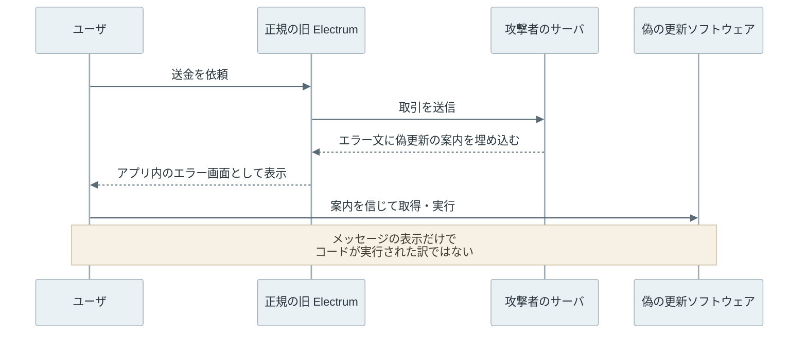

問題は、「取引を中継するサーバが返した文章」が「ウォレットの開発元による更新指示」のように読めた事です。開発者は 3.3.3 より前の表示を問題として説明し、更新は公式サイトから行うよう案内しています。

この原因から考えると、通信エラーの表示と、アプリが判断した更新案内は分ける必要があります。利用者も、エラー画面内のリンクを配布元の確認なしに信用しない必要があります。

---

#### Ledger Connect Kit の改竄

2023 年 12 月 14 日には、Ledger Connect Kit の改竄が起きました。Connect Kit は dApp とウォレットを接続する JavaScript ライブラリです。公開には、JavaScript のパッケージ配布サービスである npm を使っていました。

[Ledger の事故報告](https://www.ledger.com/blog/security-incident-report)では、元従業員に残っていた公開権限が、認証情報をだまし取るフィッシング攻撃で悪用されたとしています。

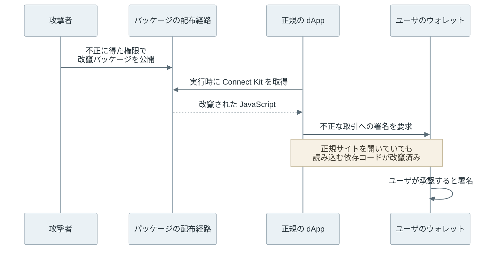

当時の読み込み用コンポーネントは、配布サーバから実行時にライブラリを取得する仕組みでした。そのため、dApp 自体を攻撃者が書き換えなくても、依存ライブラリを通じて不正なコードが動きました。製品が依存する配布経路を攻撃する「サプライチェーン攻撃」の例です。[検知に関わった Blockaid の解析](https://blockaid.io/blog/attack-report-ledger-connect-kit)でも、この経路が説明されています。

<br>

Ledger は、この事件でハードウェアや管理アプリの Ledger Live は[改竄されていないと報告しています](https://www.ledger.com/blog/a-letter-from-ledger-chairman-ceo-pascal-gauthier-regarding-ledger-connect-kit-exploit)。機器から秘密鍵を抜き取る代わりに、ユーザに不正な取引を承認させたのです。

この攻撃経路からは、不要になった配布権限の失効、依存バージョンの固定、読み込むファイルの改竄を検知する仕組みが対策として考えられます。ただし、どの経路を信頼して検証するかも必要であり、特定の対策一つで防げたと断定する物ではありません。

---

#### Bybit／Safe の承認処理の乗っ取り

2025 年 2 月 21 日、暗号資産取引所 Bybit が使っていた Safe で資産が盗まれました。攻撃者は、資産を管理するコードの参照先を変更し、元のマルチシグの追加承認なしで資産を移転しました。

Safe は、資産や設定を持つ「プロキシ」と、署名検証や送金のコードを持つ「実装コントラクト」を組み合わせて動きます。プロキシに保存された参照先を変えると、以後の処理に使われるコードも変わります。攻撃は、次の順序で進みました。

1. Web 画面を改竄し、署名する取引を変更する。
   [Sygnia の調査](https://www.sygnia.co/blog/sygnia-investigation-bybit-hack/)では、Safe の Web 画面に配信された JavaScript の改竄が確認されています。このコードが、署名前の取引に攻撃者のコードを実行する指示を入れました。

2. 変更後の取引に、必要数の署名を集める。
   Bybit の承認者は、変更後のデータに署名しました。その署名を付けた取引が送信され、Safe の正規の実装は署名を検証して処理を進めました。

3. プロキシが参照する実装を、攻撃者の実装に変更する。
   取引には、攻撃者の書き換え用コントラクトを [`delegatecall`](https://docs.soliditylang.org/en/latest/introduction-to-smart-contracts.html#delegatecall-and-libraries) で実行する指示がありました。これは外部のコードを呼び出し元の保存領域で実行する機能です。この経路ではプロキシの保存領域を使うため、[正規の実装が指示を実行](https://github.com/safe-global/safe-contracts/blob/v1.1.1/contracts/base/Executor.sol)すると、攻撃者のコードがプロキシの設定を書き換えられました。

   [当時のプロキシ](https://github.com/safe-global/safe-contracts/blob/v1.1.1/contracts/proxies/Proxy.sol)は、実装の参照先を `slot 0` に保存していました。[NCC Group の解析](https://www.nccgroup.com/research/in-depth-technical-analysis-of-the-bybit-hack/)によると、攻撃用の `transfer(address,uint256)` は、送金を思わせる名前でこの値を変更していました。

   ```mermaid
   %%{init: {"theme":"base","themeVariables":{"primaryColor":"#eaf1f5","primaryTextColor":"#28343b","primaryBorderColor":"#9cabb5","lineColor":"#596b76","textColor":"#28343b","actorBkg":"#eaf1f5","actorBorder":"#9cabb5","actorTextColor":"#28343b","actorLineColor":"#9cabb5","signalColor":"#596b76","signalTextColor":"#28343b","noteBkgColor":"#f7f1e5","noteBorderColor":"#c5b99b","noteTextColor":"#403c32","activationBkgColor":"#edf3ef","activationBorderColor":"#9aafa1"}}}%%
   flowchart TB
       P["Bybit のプロキシ<br/>資産・設定を保持"]
       P -->|変更前の参照先| G["正規の実装<br/>必要数の署名を検証"]
       P -->|変更後の参照先| M["攻撃者の実装<br/>元の署名条件によらず資産を移転"]
       classDef default fill:#eaf1f5,stroke:#9cabb5,color:#28343b;
       classDef attack fill:#f6eae7,stroke:#bb9991,color:#48302b;
       class M attack;
   ```

4. 差し替えた実装で資産を移転する。
   以後、プロキシは攻撃者の実装を使います。元のマルチシグの署名条件が適用されなくなり、追加承認なしで資産が移転されました。この実装は、手順3の書き換え用コントラクトとは別です。

この事件では、署名の検証は通っていました。複数人の承認があっても、署名する取引の内容が不正なら実行される、という問題が表れています。

---

### 鍵の保護と誤承認への対策

鍵を盗まれなくても、不正な取引に署名すれば資産を失います。鍵の保管と、承認する内容の確認は、両方が必要です。

例えば、MetaMask の[トークン使用上限の設定](https://support.metamask.io/configure/tokens/how-to-customize-token-approvals-with-a-spending-cap/)では、相手に使わせる数量を編集できます。画面の `Spending cap` が上限、`Spender` が使用を許可する相手です。送金額を入力する操作とは異なり、相手が後からトークンを移転できる権限を与えます。



サイトとの接続を解除しても、チェーン上の使用許可は残ります。不要な許可は、取り消す取引を別に送ります。

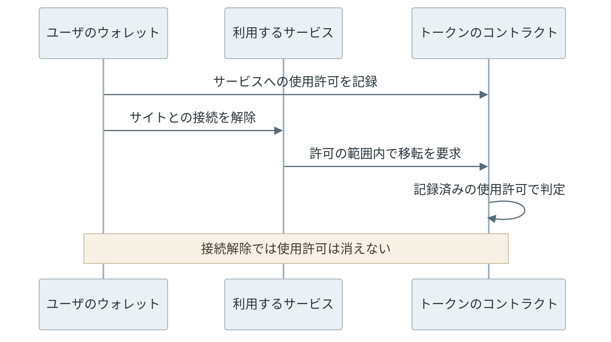

[ERC-2612 の `permit`](https://eips.ethereum.org/EIPS/eip-2612)のように、メッセージへの署名で使用許可を与える仕組みもあります。手数料の支払いがなくても、許可する相手・上限・期限・対象ネットワークを確認します。[EIP-712](https://eips.ethereum.org/EIPS/eip-712) による項目表示やシミュレーションは確認の助けになりますが、未対応の処理や将来使われる権限までは判断できない場合があります。

<br>

そのほかの対策は、次の通りです。

- アプリは公式の配布元から取得し、署名・チェックサムを確認して更新する。
- 復元フレーズをサイトや問い合わせ先に渡さない。追加パスフレーズなども含めてバックアップし、復元を確認する。
- 鍵ファイルを暗号化し、必要に応じてハードウェアウォレットを使う。送信先と金額は端末の画面でも照合する。
- 内容を読み取れない署名要求（blind signing）は、そのまま承認しない。
- 長期保管用とアプリを試す資産を分ける。フレーズ流出の被害も分けるには、別の復元フレーズで管理する。
- 保有履歴のプライバシーも考慮し、必要なら自分のノードを使う。チェーン上に公開済みの履歴は消えない。
