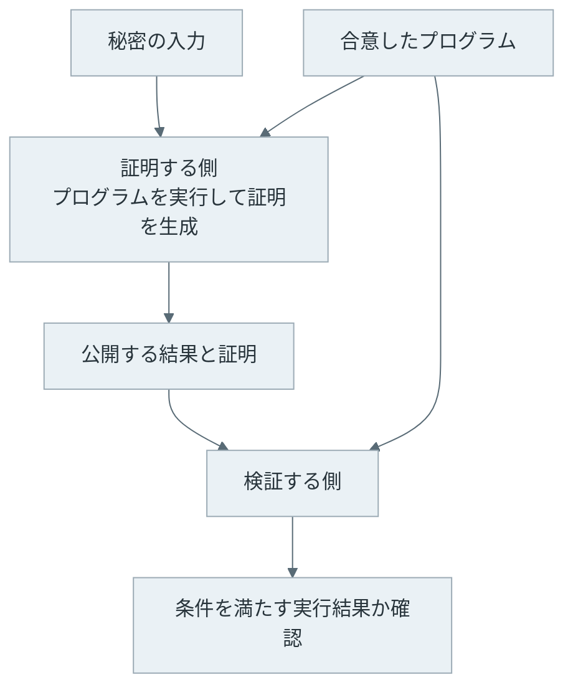
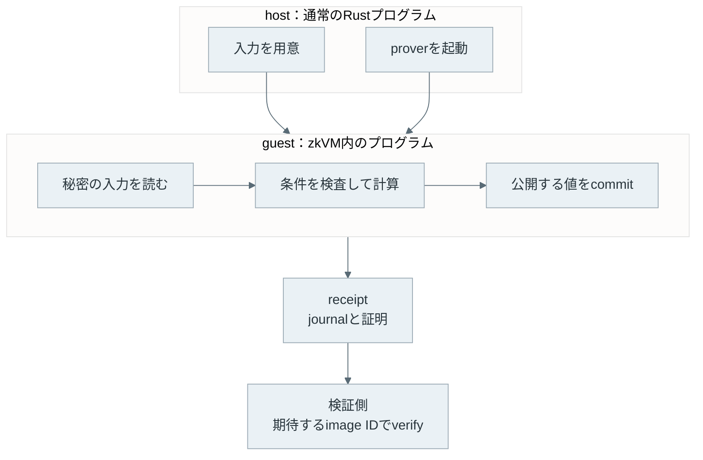
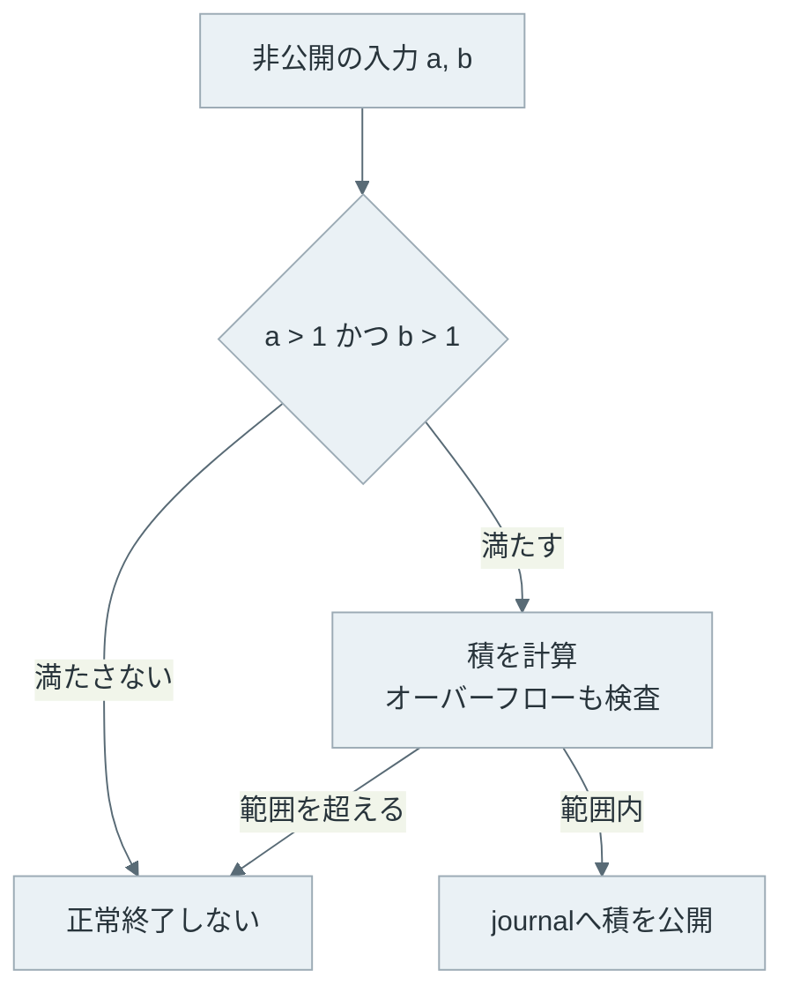
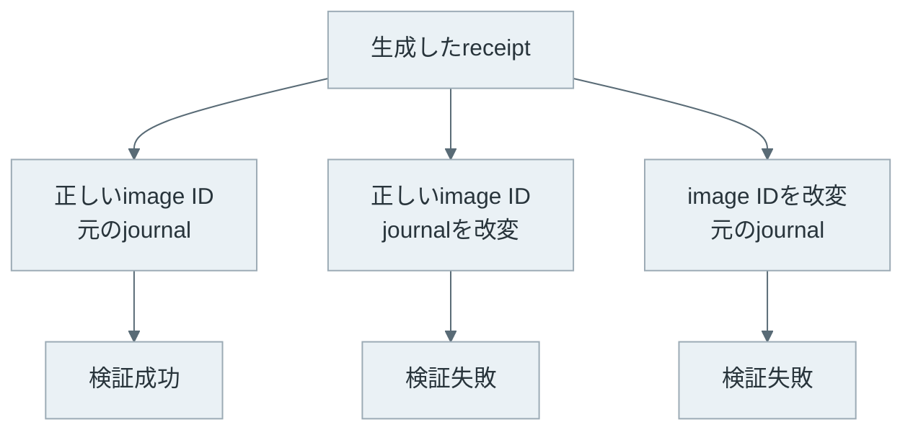

ゼロ知識証明（Zero-Knowledge Proof）は、ある主張が正しいことをその主張の成立以外の知識を相手に与えずに確かめてもらうための技術です。例えば、秘密の入力を使った計算について、入力そのものを渡さずに、公開した結果が計算の条件を満たすことを示せます。

[Smart Contract](../smart-contract/) では、ノードがコードを実行して結果を確かめました。入力を公開したくない場合や、別の場所で行った計算を検証したい場合には、証明を作って渡す方法が使えます。後者を L1 で利用する構成の一つが [Rollup](../rollup/) です。



<br>

本記事では、Rust で書いたプログラムの実行を証明できる [RISC Zero](https://dev.risczero.com/api/zkvm) を使い、次の点を確認します。

- 秘密の入力を隠すことと、結果を検証することはどう両立するのか。
- 何を証明するかは、どこで決まるのか。
- RISC Zero の guest、host、receipt は何を担当するのか。
- 公開した結果や、検証対象のプログラムを変えるとどうなるのか。

サンプルはローカル CPU で証明を生成します。チェーン上への提出や、証明方式の数式による導出は扱いません。

---

### 公開する主張と秘密の入力

「391 は、1 より大きい 2 つの整数の積で表せる」という主張を考えます。391 は公開し、2 つの整数を秘密の入力にします。

この場合、証明する側（prover）は条件を満たす整数を知っています。検証する側（verifier）が知りたいのは、そのような整数の存在であって、必ずしも整数の値そのものではありません。条件を満たす根拠になる秘密のデータを witness と呼びます。

| 要素 | 今回の例 |
| --- | --- |
| 公開する主張 | 391 を 1 より大きい 2 つの整数の積で表せる |
| witness | 積が 391 になる 2 つの整数 |
| 検査する条件 | 両方が 1 より大きく、整数の範囲で積が 391 になる |
| 検証者が受け取る情報 | 公開値 391 と証明 |

重要なのは、公開する主張から分かることまで隠す技術ではないという点です。391 のように小さい数なら、検証者自身が試し割りをして因数を求められます。本記事の小さな数は処理を追うための教材で、因数を秘密に保つ用途の例ではありません。

また、秘密の入力を受け取って計算するだけでは、ゼロ知識証明にはなりません。結果が正しいと相手が信じる理由が必要です。RISC Zero では、指定したプログラムの実行と公開した結果を結び付ける暗号学的な証明を生成します。

---

### 証明に求める性質

ゼロ知識証明では、[完全性・健全性・ゼロ知識性](https://ethereum.org/en/zero-knowledge-proofs/)という 3 つの性質を区別します。

| 性質 | 確かめたいこと |
| --- | --- |
| 完全性 | 正しい主張を正しく証明すれば、検証が通る |
| 健全性 | 誤った主張を受理される証明にできない |
| ゼロ知識性 | 証明を見ることで、主張の成立を超える知識を得ない |

実際の暗号システムでは、攻撃者の計算能力や安全性の仮定、無視できるほど小さい失敗確率などを含めて性質を定義します。RISC Zero が使うような計算能力を制限した安全性の議論では、厳密には argument という呼び方も使います。本記事では、API や開発資料に合わせて「証明」と呼びます。

暗号化との違いもあります。暗号化は、情報を読める相手を鍵で制御します。ゼロ知識証明では、秘密を復号して見せる代わりに、条件を満たしていることを検証させます。公開結果まで暗号化されるわけではありません。

---

### RISC Zero の実行環境

RISC Zero は、RISC-V という命令セットに対応したプログラムの実行を証明する zkVM（zero-knowledge virtual machine）です。開発者は Rust などで条件を書き、対応する実行形式にコンパイルします。[公式のシステム解説](https://dev.risczero.com/proof-system/)は、実行を記録し、その正しさの証明を生成する構成を説明しています。

アプリは、host と guest に分かれます。host は通常のコンピュータで動き、入力の準備や証明の生成を管理します。guest は zkVM 内で実行するプログラムで、証明したい条件をここに書きます。



guest の実行から得られる receipt は、公開出力を収める journal と、実行の正しさを検証するための証明を含みます。Ethereum の取引レシートと同じ単語ですが、役割もデータ形式も異なります。

journal に値を追加する操作が `commit` です。Git のコミットでも、値を隠すための暗号学的コミットメントでもなく、公開出力に書く操作です。秘密にしたい値をここに書けば、その値は公開されます。

検証者は、どのプログラムについて証明されたかも確認します。その識別に使う値が image ID です。RISC Zero では、プログラムの初期メモリイメージに基づいて求まります。証明を送った相手が指定した ID を無条件に採用せず、検証者自身が期待するプログラムの ID を使います。[用語集](https://dev.risczero.com/terminology)には、image ID、journal、receipt の関係が整理されています。

---

### 証明する条件を guest に記述

サンプルでは、1 より大きい 2 つの `u32` 整数を受け取り、積だけを公開します。`u32` は 32 ビットの符号なし整数です。[guest の全コード](lab/methods/guest/src/main.rs)は次の通りです。

```rust
#![no_main]
#![no_std]

risc0_zkvm::guest::entry!(main);

fn main() {
    let (a, b): (u32, u32) = risc0_zkvm::guest::env::read();
    assert!(a > 1 && b > 1);
    let product = a.checked_mul(b).expect("u32 overflow");
    risc0_zkvm::guest::env::commit(&product);
}
```

`env::read()` で host が渡した入力を読みます。入力値は、この操作だけでは journal に入りません。`assert!` で両方が 1 より大きいことを確かめ、`checked_mul` で積が `u32` の範囲を超えないことも確認します。どちらかを満たさなければ、正常終了しません。

最後の `commit` が公開するのは積だけです。正しい image ID を指定した通常の receipt 検証と、公開結果が 391 であることの確認を組み合わせると、「このプログラムの条件を満たし、391 を出力した実行がある」という主張を確認できます。



`assert!` を消してしまうと、1 と 391 という自明な入力も受け入れます。`checked_mul` を使わずに整数の桁あふれを許すと、意図した整数の積とは違う条件を証明してしまう可能性があります。証明システムが保証するのは書いたプログラムの条件であり、開発者が意図した条件を補ってくれるわけではありません。

---

### host からの証明生成と検証

[host のコード](lab/host/src/main.rs)は入力を用意し、ローカルの prover を呼び出します。以下が全体です。`FACTOR_GUEST_ELF` はコンパイルした guest、`FACTOR_GUEST_ID` は対応する image ID で、ビルド時に生成します。

```rust
use methods::{FACTOR_GUEST_ELF, FACTOR_GUEST_ID};
use risc0_zkvm::{ExecutorEnv, InnerReceipt, Prover, ProverOpts};
use risc0_zkvm::LocalProver;

fn main() {
    // Tiny, intentionally guessable teaching inputs, not a privacy demonstration.
    let env = ExecutorEnv::builder()
        .write(&(17_u32, 23_u32)).unwrap()
        .build().unwrap();
    let start = std::time::Instant::now();
    // Explicit local CPU prover: no remote proving service or dev-mode fallback.
    let info = LocalProver::new("local")
        .prove_with_opts(env, FACTOR_GUEST_ELF, &ProverOpts::succinct()).unwrap();
    let receipt = info.receipt;
    assert!(!matches!(receipt.inner, InnerReceipt::Fake(_)));
    receipt.verify(FACTOR_GUEST_ID).unwrap();
    let product: u32 = receipt.journal.decode().unwrap();
    assert_eq!(product, 391);
    println!("receipt_kind=succinct; dev_mode=disabled");
    println!("verify_expected_image=PASS; public_product={product}");

    let mut tampered = receipt.clone();
    tampered.journal.bytes[0] ^= 1;
    assert!(tampered.verify(FACTOR_GUEST_ID).is_err());
    println!("tampered_journal=REJECTED");

    let mut wrong_id = FACTOR_GUEST_ID;
    wrong_id[0] ^= 1;
    assert!(receipt.verify(wrong_id).is_err());
    println!("wrong_image_id=REJECTED");
    println!("elapsed_seconds={:.2}", start.elapsed().as_secs_f64());
    println!("Assertions: PASS");
}
```

入力は説明用に 17 と 23 をコードに直接書いています。検証処理の引数には、この 2 つの値は入りません。検証するのは receipt と、期待するプログラムの image ID です。その後、journal から取得した積をアプリが求める値 391 と照合します。

`verify` が成功しただけでは、アプリが欲しかった出力かどうかまでは決まりません。同じプログラムで別の積を計算した receipt も、プログラムの実行としては正しいからです。アプリ側で公開値を確認する処理が必要です。

<br>

本サンプルでは、実行区間の証明を再帰的にまとめた succinct receipt を生成します。再帰的にまとめる前の形式は composite receipt です。さらに Groth16 という別の証明形式に変換する経路もありますが、今回はローカルでの生成と検証に絞ります。これらの種類は[証明システムの構成図](https://dev.risczero.com/proof-system/)で確認できます。

[公式の Security Model](https://dev.risczero.com/api/security-model#zero-knowledge-proving) では、再帰証明を通す前は実行長の情報が漏れ、再帰証明を通すとこの漏れを解消すると説明しています。本サンプルでは、実行長の情報を隠すために succinct receipt を生成します。同資料は、目標とする完全なゼロ知識性について数学的な証明をまだ提示していないことも明記しています。一般的なゼロ知識性の定義と、この実装について示されている保証範囲は区別する必要があります。

---

### ローカルサンプルの実行

サンプルは RISC Zero の Rust クレートを 3.0.6 に固定しています。[lab/README.txt](lab/README.txt) にツールチェーンの準備と実行手順を記載し、依存関係の解決結果も Cargo.lock に保存しています。

公式の[インストール手順](https://dev.risczero.com/zkvm/quickstart)で RISC Zero 用 Rust ツールチェーンを用意した後、リポジトリのルートから次を実行します。初回は依存関係の取得とコンパイルが入ります。

```bash
cargo run --release --locked \
  --manifest-path content/notes/blockchain-systems/zero-knowledge-proof/lab/Cargo.toml \
  -p zk-note
```

RISC Zero には、証明生成を省略する [dev-mode](https://dev.risczero.com/api/generating-proofs/dev-mode) があります。これは開発中の動作確認には便利ですが、暗号学的な証明を作ったことにはなりません。本サンプルは `disable-dev-mode` を有効にし、`LocalProver` で実際の証明を作ります。外部の証明生成サービスは使いません。

以下は、実際に実行した[出力](lab/output/summary.txt)のうち、経過時間を除いた部分です。

```text
receipt_kind=succinct; dev_mode=disabled
verify_expected_image=PASS; public_product=391
tampered_journal=REJECTED
wrong_image_id=REJECTED
Assertions: PASS
```

サンプルは、正常な receipt の検証に加えて、次の 2 つの失敗も検査します。

1. journal の先頭 1 バイトを変え、公開結果と証明が一致しなくなった receipt を拒否すること。
2. 期待する image ID の 1 ビットを変え、元の ID と一致しない値で検証すると失敗すること。



この 2 つの試験は、出力とプログラムが証明に結び付いていることを確かめる動作確認です。試験が通っただけで、証明方式の健全性やゼロ知識性を数学的に証明したことにはなりません。

---

### 秘密にできる範囲と用途

入力を journal に書かなくても、公開結果から入力が推測できる場合はあります。本サンプルの 391 はその例です。ゼロ知識性が守るのは、公開した主張から得られる情報に加えて、証明が秘密について余分な知識を与えないことです。

また、host は入力を扱います。証明生成を他者に委託し、その相手に入力を渡せば、その相手から入力が隠れるわけではありません。デバッグログに秘密を書いた場合も同様です。サンプルで入力をコードに直接書くのは説明のためで、秘密の保管方法を示すものではありません。

ゼロ知識証明は、入力の出所の正しさも自動的には保証しません。例えば、自己申告した生年月日を使って年齢条件を証明しても、実際の年齢の証明にはなりません。信頼する発行者の署名付きデータを検査するなど、入力と現実を結び付ける条件もプログラムに含める必要があります。

<br>

ブロックチェーンで利用する場合は、チェーンの外で計算し、その結果と証明をチェーン上で検証する構成が考えられます。ただし、検証コスト、対応する証明形式、公開するデータ、同じ証明の再利用を許すかなどはアプリごとの設計です。今回のサンプルは、Ethereum にそのまま提出できるトランザクションを生成するものではありません。

計算の正しさを証明することと、入力を隠すことは関連しますが、用途としては分けて考えられます。公開データの計算を証明する場合もあり、「ZK を使うシステムだから取引内容も非公開」とは限りません。アプリに組み込む場合は、公開するデータと、検証するプログラムを先に決めます。
