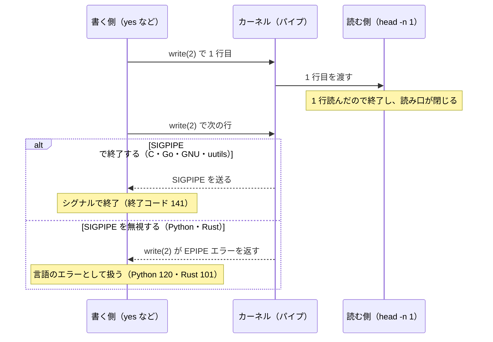

stdio のバッファリング（buffering）は、C の標準入出力ライブラリ（stdio）や各言語の標準ライブラリが、プログラムが書いた出力をすぐには OS へ渡さず、プロセスのメモリに溜めてからまとめて書き出す仕組みです。書き出しの回数が減るので速くなる一方で、出力先によって「いつ読む側に届くか」が変わります。

以下は、0.5 秒ごとに 1 行を出す C のプログラムを 3 通りの出力先で動かし、読む側に各行が届いた時刻を記録した結果です。端末に出すと 1 行ずつ届くのに、パイプにつなぐと 5 行が終了時にまとめて届きます。3 つ目の `stdbuf -oL` は、後ろに書いたコマンドに 1 行ずつ書き出させるコマンドです（仕組みは後の節で説明します）。



`tail -f app.log | grep ERROR | cut -d' ' -f1` のようなパイプラインで何も出てこない、CI のログが最後にまとめて流れる、といった経験があれば、原因の多くはこの仕組みです。途中のコマンドが出力を溜めているので、エラーではなく単に届いていないだけです。

<br>

本記事では、バッファリングが起きる場所と、端末とパイプで振る舞いが変わる理由を説明します。さらに、C・Python・Go・Rust と、`cat`・`cut`・`sort` などの基本コマンド群（coreutils）の [GNU 版](https://www.gnu.org/software/coreutils/)と Rust 製の [uutils](https://github.com/uutils/coreutils) 版を同じ機械（Ubuntu 26.04）で動かし、違いを実測します。uutils は、Ubuntu 25.10 から既定の coreutils になりました。扱う疑問は以下の通りです。

- なぜ端末では 1 行ずつ出るのに、パイプでは最後にまとめて出るのか。
- `stdbuf -oL` は、なぜ効くプログラムと効かないプログラムがあるのか。
- Ubuntu 25.10 以降で、昔から使っていたパイプラインの振る舞いが変わるのはなぜか。
- 読む側が先に終わった時や、書き込みに失敗した時、プログラムは気付けるのか。

カーネルの中にあるパイプの容量（Linux の既定は 64KiB）や、標準入力のバッファリングは扱いません。

---

### バッファが置かれる場所

最初に、出力がどこに溜まるのかを押さえます。C の `printf` は、文字列をすぐにカーネルへ渡すわけではありません。stdio が持つバッファ、つまり書く側のプロセスのメモリに一度置かれ、後で [`write(2)`](https://man7.org/linux/man-pages/man2/write.2.html) システムコールでまとめてカーネルへ渡されます。`(2)` は man ページの章番号で、2 章はシステムコール（プログラムがカーネルに処理を頼む入口）を表します。



上記の図の下段の通り、バッファリングには 3 つのモードがあります。バッファ無し（unbuffered）は書くたびに、行バッファ（line buffered）は改行を書いた時に、全バッファ（fully buffered）はバッファが満杯になった時かプロセスの終了時に `write(2)` を呼びます。どのモードでも、読む側から見えるのは `write(2)` された後のデータだけです。

C の標準出力が使うモードは、出力先で決まります。C 規格は「対話的な装置（端末のこと）ではないと判定できる場合に限り、標準出力は全バッファにする」と定めており、Linux で標準の C ライブラリである [glibc](https://www.gnu.org/software/libc/) は、出力先が端末なら行バッファ、パイプやファイルなら全バッファを選びます（[glibc の文書](https://sourceware.org/glibc/manual/latest/html_node/Buffering-Concepts.html)）。

端末かどうかは、出力先のファイル記述子（OS が開いたファイルやパイプに振る番号で、標準出力は 1）を [`isatty`](https://man7.org/linux/man-pages/man3/isatty.3.html) で調べて判定します。

<br>

冒頭の実験で使ったプログラムは、次の通りです。

```c
#include <stdio.h>
#include <unistd.h>

int main(void) {
    for (int i = 1; i <= 5; i++) {
        printf("line %d\n", i);
        usleep(500000); /* 0.5 秒 */
    }
    return 0;
}
```

プログラムが呼んだシステムコールを表示する [strace](https://strace.io/) で `write(2)` の呼び出しを数えると、モードの違いがそのまま見えます。端末では改行ごとに 5 回呼ばれ、パイプでは終了時に 1 回だけ、35 バイトがまとめて渡されています。

`write(1, ...)` の 1 は、標準出力のファイル記述子です。端末の条件は、プログラムに端末として振る舞う仮想の装置（疑似端末、pty）を渡す [`script`](https://man7.org/linux/man-pages/man1/script.1.html) コマンドで作りました。

```console
$ strace -e trace=write ./slow_c        # 端末（script コマンドで作った疑似端末）
write(1, "line 1\n", 7)                 = 7
write(1, "line 2\n", 7)                 = 7
write(1, "line 3\n", 7)                 = 7
write(1, "line 4\n", 7)                 = 7
write(1, "line 5\n", 7)                 = 7
$ strace -e trace=write ./slow_c | cat  # パイプ
write(1, "line 1\nline 2\nline 3\nline 4\nline"..., 35) = 35
```

冒頭の動画で、パイプの行が届いたのが最後の行を書いた 2.0 秒ではなく 2.5 秒だった理由も、ここから分かります。プログラムは最後の行を書いた後に 0.5 秒眠り、`return 0` で終了する時に初めてバッファを書き出したからです。

終わらないプログラムなら、バッファが満杯になるまで何も届きません。著者の環境では、満杯の基準になるバッファの大きさは 4096 バイトでした（終わらずに書き続けるプログラムを strace で見ると、4096 バイトずつ `write(2)` していました）。

---

### Ctrl-C で消える行

バッファがプロセスのメモリにあることは、遅れるだけでは済まない場面を生みます。プロセスが[シグナル](https://man7.org/linux/man-pages/man7/signal.7.html)（OS がプロセスに送る通知で、Ctrl-C もその 1 つ）で強制終了すると、バッファの中身は書き出されずに消えます。正常に終了する時の書き出し（`exit` の後処理）が走らないからです。メモリ不足で [OOM killer](../oom-killer/) に止められた時も同じです。

以下は、同じ C のプログラムをパイプにつなぎ、1.2 秒後に Ctrl-C と同じ `SIGINT` をパイプライン全体へ送った結果です。



全バッファの場合、プログラムは 3 行を書いたつもりでいます。しかし、3 行はプロセスのメモリから出ないまま消えました。`tail -f app.log | grep ERROR | cut -d' ' -f1` を眺めていて Ctrl-C を押すと、途中の `grep` が溜めていた行は `cut` に渡らないまま消えます。最後の数行が画面に出なかった、という現象の正体はこれです。

実験のスクリプトは、Python から起動して、プロセスグループ（パイプラインに並んだプロセスのまとまり）全体にシグナルを送っています（`stamp.py` は、読んだ行に起動からの秒を付けて出す小さなスクリプトで、[lab](https://github.com/nao1215/debimate/tree/main/content/notes/computer-systems/stdout-buffering/lab) にあります）。

```python
import os
import signal
import subprocess
import time

for cmd in ["bin/slow_c | python3 stamp.py", "stdbuf -oL bin/slow_c | python3 stamp.py"]:
    os.environ["T0"] = str(time.time())
    p = subprocess.Popen(["bash", "-c", cmd], stdout=subprocess.PIPE, stderr=subprocess.DEVNULL,
                         start_new_session=True)
    time.sleep(1.2)
    os.killpg(p.pid, signal.SIGINT)  # 端末の Ctrl-C と同じく、グループ全体に送る
    out = p.stdout.read().decode()
    p.wait()
    print(f"== {cmd}\n届いた行数={out.count(chr(10))}")
    print(out, end="")
```

```text
== bin/slow_c | python3 stamp.py
届いた行数=0
== stdbuf -oL bin/slow_c | python3 stamp.py
届いた行数=3
0.02 line 1
0.51 line 2
1.01 line 3
```

---

### 言語ごとの既定

ここまでは C の話でした。バッファを持つのは C の stdio だけではなく、各言語の標準ライブラリがそれぞれのバッファを持ち、既定のモードも違います。同じ実験を Python・Go・Rust でも行いました（各言語のバージョンは [lab の README](https://github.com/nao1215/debimate/tree/main/content/notes/computer-systems/stdout-buffering/lab) にあります）。



4 つの言語のプログラムは、どれも冒頭の C と同じく 0.5 秒ごとに `line 1`〜`line 5` を出します。動かし方は次の通りで、端末の条件では `script` コマンドで疑似端末を渡しています。

```bash
declare -A CMD=([C]="bin/slow_c" [Python]="python3 src/slow.py" [Go]="bin/slow_go" [Rust]="bin/slow_rs")
run() { # $1=言語 $2=出力先 $3=コマンド
  export T0
  T0=$(date +%s.%N)
  bash -c "$3" | python3 stamp.py | sed "s/^/$1\t$2\t/"
}
for lang in C Python Go Rust; do
  c=${CMD[$lang]}
  run "$lang" "端末" "script -qfec '$c' /dev/null"
  run "$lang" "パイプ" "$c"
  run "$lang" "パイプ+stdbuf -oL" "stdbuf -oL $c"
done
```

上記の動画を見て分かる通り、C と Python はパイプにつなぐとまとめて届き、Go と Rust はパイプでも 1 行ずつ届きます。ただし、Go と Rust が 1 行ずつ届く理由は違います。

C と Python は、端末なら行バッファ、パイプなら全バッファです。Python の `sys.stdout` は、対話的な時は行バッファ、それ以外は通常のファイルと同じブロック単位のバッファ（つまり全バッファ）になると[公式の文書](https://docs.python.org/3/library/sys.html#sys.stdout)に書かれています。著者の環境の Python 3.14 では、パイプへの書き出しは 1 回あたり約 120KB でした。

Go は、バッファを持ちません。`os.Stdout` は、ファイル記述子をそのまま包んだ [`*os.File`](https://pkg.go.dev/os#pkg-variables) で、`fmt.Println` は呼ぶたびに `write(2)` まで進みます。速さが必要な時は、利用者が `bufio.Writer` で包み、自分で `Flush` を呼びます。

Rust の標準出力は、改行で書き出す `LineWriter` です。[公式の文書](https://doc.rust-lang.org/std/io/struct.Stdout.html)は「端末につながっている時は行バッファ」と書いていますが、実装は出力先を見ずに常に `LineWriter` を使うので、パイプでも 1 行ずつ届きます。出力先で全バッファへ切り替える案は [rust-lang/rust#60673](https://github.com/rust-lang/rust/issues/60673) で議論が続いています。

<br>

モードを変えたい時の手段は、言語ごとに次の通りです。

| 言語 | パイプへの既定 | すぐ届けたい時 | まとめて書きたい時 |
|---|---|---|---|
| C | 全バッファ | `fflush(stdout)`、`setvbuf` | 既定のまま |
| Python | 全バッファ | `python3 -u`、`PYTHONUNBUFFERED=1`、`print(..., flush=True)` | 既定のまま |
| Go | バッファ無し | 既定のまま | `bufio.NewWriter(os.Stdout)` と `Flush` |
| Rust | 行バッファ | `stdout().flush()` | `BufWriter::new(stdout().lock())` |

Python の `-u` は、[コマンドラインの文書](https://docs.python.org/3/using/cmdline.html#cmdoption-u)にある通り、標準出力と標準エラーのバッファを無くすオプションです。図で Python に `stdbuf -oL` が効かなかった理由は、次の節で説明します。

---

### stdbuf が効く仕組み

[`stdbuf`](https://www.gnu.org/software/coreutils/manual/html_node/stdbuf-invocation.html) は、他のコマンドを起動する時にバッファのモードを変える coreutils のコマンドです。`stdbuf -oL` で標準出力を行バッファに、`stdbuf -o0` でバッファ無しにできます。

仕組みは、プログラムの中身を書き換えるのではなく、共有ライブラリを差し込むものです。[`LD_PRELOAD`](https://man7.org/linux/man-pages/man8/ld.so.8.html) は、起動するプログラムに、指定した共有ライブラリを先に読み込ませる環境変数です。

`stdbuf` は `LD_PRELOAD` に `libstdbuf.so` を指定し、希望のモードを `_STDBUF_O` などの環境変数に入れてからコマンドを起動します。

Ubuntu 26.04 では、何も付けない `stdbuf` は uutils 版で、GNU 版は `gnustdbuf` という名前で入っています（詳しくは後の節で説明します）。

```console
$ stdbuf -oL env | grep -E '^(LD_PRELOAD|_STDBUF)'      # uutils の stdbuf
LD_PRELOAD=/usr/libexec/rust-coreutils/libstdbuf.so
_STDBUF_O=L
$ gnustdbuf -oL env | grep -E '^(LD_PRELOAD|_STDBUF)'   # GNU の stdbuf
_STDBUF_O=L
LD_PRELOAD=/usr/libexec/coreutils/libstdbuf.so
```

上記の通り、GNU 版と uutils 版の `stdbuf` は、差し込むライブラリの場所が違うだけで同じ方式です。

起動したプログラムが動き出す前に `libstdbuf.so` が読み込まれ、環境変数を見て C の [`setvbuf`](https://man7.org/linux/man-pages/man3/setvbuf.3.html) で標準出力のモードを変えます。そのため、効くのは次の条件を全て満たすプログラムだけです。

- 動的リンクされている（実行時に共有ライブラリを読み込む形。必要なものを全て実行ファイルに埋め込む静的リンクのプログラムには `LD_PRELOAD` が効かない）。
- 出力に C の stdio（`printf`、`fwrite` など）を使っている。
- 起動後に自分でモードを設定し直さない。

Python は C で書かれていますが、`print` は C の stdio ではなく Python 自身の `io` モジュールのバッファを通ります。Go は（C のコードを呼ぶ仕組みである cgo を使わない既定のビルドでは）静的リンクで、C の stdio を使いません。Rust も標準ライブラリが自前のバッファを持ちます。どれも、`libstdbuf.so` が C の stdio の設定を変えても出力の経路に関係しないので、`stdbuf` は効きません。

<br>

`stdbuf` が効かない時の手段は、主に 2 つです。1 つ目は、コマンド自身のオプションを使うことです。よく使うコマンドでは、次のオプションで行ごとに書き出せます。

| コマンド | 行ごとに書き出すオプション |
|---|---|
| GNU の grep | [`--line-buffered`](https://www.gnu.org/software/grep/manual/grep.html#Other-Options) |
| GNU の sed | `-u` |
| Ubuntu の既定の `awk`（mawk という実装） | `-W interactive` |

2 つ目は、出力先を端末に見せかけることです。`script` や、expect パッケージに入っている `unbuffer` コマンドは、プログラムに疑似端末（pty）を渡すので、端末なら行バッファにするプログラムには効きます。ただし、色を付けるなど端末向けの振る舞いも一緒に有効になります。

---

### Ubuntu 26.04 の Rust 製 coreutils

ここまでの話は、昔から変わらない仕組みです。しかし、Ubuntu では身近なコマンドの実装が変わりました。Ubuntu は 25.10 から、coreutils の既定を GNU から Rust 製の [uutils](https://github.com/uutils/coreutils) に切り替えています（[Ubuntu Discourse の報告](https://discourse.ubuntu.com/t/an-update-on-rust-coreutils/80773)）。

著者の Ubuntu 26.04.1 では、`cat`・`cut`・`sort`・`stdbuf` などが uutils 0.8.0 で、`cp`・`mv`・`rm` は GNU のままでした。GNU 版も `gnucat`・`gnucut` のように `gnu` を頭に付けた名前で入っているので、同じ機械で 2 つの実装を比べられます。2 つの実装に同じ入力を渡して比べるテストは、[Differential Testing のノート](/notes/software-testing/differential-testing/)で扱っています。

```console
$ cat --version | head -1
cat (uutils coreutils) 0.8.0
$ readlink -f /usr/bin/cut /usr/bin/cp
/usr/lib/cargo/bin/coreutils/cut
/usr/bin/gnucp
```

そこで、0.5 秒ごとに 1 行を流す上流と下流の間にフィルタを 1 つ挟み、GNU 版と uutils 版、`stdbuf -oL` の有無で、最初の行が下流に届いた時刻を比べました。結果は、上流が書いた直後（0.02 秒前後）に届く「1 行ずつ」か、上流が終わる 2.5 秒まで届かない「最後にまとめて」のどちらかに分かれました。

実験のスクリプトは次の通りです。`gnu` を頭に付けた名前が GNU 版、`/usr/lib/cargo/bin/coreutils/` の下が uutils 版です。

```bash
FILTERS=("cat" "tee /dev/null" "head -n 10" "tr a-z A-Z" "cut -c1-" "fold -w 80" "uniq" "nl")
UU=/usr/lib/cargo/bin/coreutils
run() { # $1=実装 $2=条件 $3=フィルタ $4=コマンド
  export T0
  T0=$(date +%s.%N)
  python3 -u src/slow.py | bash -c "$4" | python3 stamp.py | sed "s|^|$1\t$2\t$3\t|"
}
for f in "${FILTERS[@]}"; do
  run GNU    "そのまま"   "${f%% *}" "gnu$f"
  run GNU    "stdbuf -oL" "${f%% *}" "gnustdbuf -oL gnu$f"
  run uutils "そのまま"   "${f%% *}" "$UU/$f"
  run uutils "stdbuf -oL" "${f%% *}" "$UU/stdbuf -oL $UU/$f"
done
```



GNU 版は、`stdbuf -oL` を付けると 8 つ全てが 1 行ずつになりました。uutils 版は、`head`・`cut`・`fold`・`uniq`・`nl` の 5 つで `stdbuf -oL` が効かず、最後にまとめて届いたままです。逆に `tr` は、uutils では何も付けなくても 1 行ずつ届き、GNU とは反対の振る舞いでした。

何も付けなくても 1 行ずつ届いたコマンドは、出力を溜めていません。strace で数えると、GNU の `cat`・`tee` と uutils の `tr` は、上流から 1 行を読むたびに `write(2)` していました。GNU の `tr` は、終了時に 1 回だけです（lab の `output/exp2_strace_rw.txt`）。

効かない原因が `stdbuf` とフィルタのどちらにあるかを確認するため、組み合わせを入れ替えました。GNU の `stdbuf` は uutils の `cut` に効かず、uutils の `stdbuf` は GNU の `cut` に効きます。原因はフィルタです。uutils のコマンドは Rust で書かれているので、前の節の Rust と同じく C の stdio を通らず、`libstdbuf.so` が変える `setvbuf` は出力に関係しません。

```console
$ # GNU の stdbuf + uutils の cut
$ python3 -u src/slow.py | gnustdbuf -oL cut -c1- | python3 stamp.py
2.51 line 1
2.51 line 2
$ # uutils の stdbuf + GNU の cut
$ python3 -u src/slow.py | stdbuf -oL gnucut -c1- | python3 stamp.py
0.01 line 1
0.51 line 2
```

1 つ目は最後にまとめて届き、2 つ目は 1 行ずつ届いています（どちらも 3 行目以降は省略。全体は lab の `output/exp2_cross.txt`）。

この違いは、uutils の中でも認識されています。`stdbuf` に従うべきかを議論した [uutils/coreutils#7967](https://github.com/uutils/coreutils/issues/7967) では、メンテナーが「GNU と同じにしたいが、とても難しいかもしれない」と返し、Issue は起票者が閉じました。

起票者は後に、Rust の標準ライブラリ（[rust-lang/rust#60673](https://github.com/rust-lang/rust/issues/60673)）が変わるまで打つ手は少ない、と補足しています。一方で、`stdbuf -oL cut` が効かないという Ubuntu からの報告 [uutils/coreutils#11581](https://github.com/uutils/coreutils/issues/11581) は、2026 年 11 月時点で未解決です。

<br>

GNU coreutils を前提に書いたシェルスクリプトや、手に馴染んだ `tail -f ... | stdbuf -oL cut ...` のようなパイプラインは、Ubuntu 26.04 では振る舞いが変わります。エラーは出ず、出力が遅れるだけなので、気付きにくい変化です。

行ごとの出力が必要な所では、`gnucut` のように GNU 版を明示するか、GNU の grep の `--line-buffered` や、Ubuntu の既定の `awk`（mawk）の `-W interactive` のように、行単位で書き出すオプションを持つコマンドに寄せる方が確実です。

---

### 書けなかった時の終わり方

バッファリングは、出力が届く時刻だけでなく、書き込みの失敗に気付く時刻も遅らせます。全バッファのプログラムは、バッファが満杯になるか終了する時に `write(2)` を呼ぶまで、読む側がもういないことも、書き込み先が満杯なことも知りません。ここでは、書けない状況を 3 つ作り、各プログラムがどう終わるかを比べます。

1. 読む側が先に終わる（`| head -n 1`）。
2. 書き込み先が満杯（`> /dev/full`。[`/dev/full`](https://man7.org/linux/man-pages/man4/full.4.html) は書くと必ず「空き領域が無い」エラーを返す装置）。
3. 標準出力が閉じている（`>&-` はシェルで標準出力を閉じて起動する書き方。デーモンや cron から起動された時に起こり得る）。

{{< figure src="images/failures.webp" alt="縦に C、Python、Go、Rust、GNU yes / cat、uutils yes / cat、横に読む側が先に終わる、書き込み先が満杯、標準出力が閉じている。読む側が先に終わると、C、Go、GNU、uutils は終了コード 141 で SIGPIPE により終了、Python は 120 で例外を表示、Rust は 101 で panic。満杯では C と Go が終了コード 0 で失敗を報告せず、Python は 120、Rust は 101、GNU と uutils は 1 でエラーを表示。閉じた標準出力では GNU だけが 1 でエラーを表示し、他は全て 0。C は書けないまま終了、Python は何も書かない、Go・Rust・uutils は /dev/null に書く" caption="書けない状況での終わり方。GNU と uutils の行は、1 列目が yes、2・3 列目が cat の結果。赤は、出力が行き先に届かなかったのに、終了コード 0 で何も言わなかった組み合わせ" align="center" >}}

実験は、言語ごとに無限に `line N` を出すプログラムと、`hello` を 1 行だけ出すプログラムを用意し、終了コードと標準エラーを記録しました。以下は要点だけを抜き出したもので、完全版は lab の `exp3_sigpipe.sh` と `exp4_write_error.sh` です。

```bash
for c in "bin/loop_c" "python3 src/loop.py" "bin/loop_go" "bin/loop_rs" "gnuyes" "yes"; do
  $c 2>err.txt | head -n 1 >/dev/null
  echo "== $c exit=${PIPESTATUS[0]}"; cat err.txt
done
for c in "bin/hello_c" "python3 src/hello.py" "bin/hello_go" "bin/hello_rs" "gnucat hello.txt" "cat hello.txt"; do
  $c 2>err.txt >/dev/full; echo "== $c > /dev/full exit=$?"; cat err.txt
  $c 2>err.txt >&-;        echo "== $c > closed exit=$?";    cat err.txt
done
```

上記の図の赤いマスが、出力が行き先に届かなかったのに、終了コード 0 で終わり、何も表示しなかった組み合わせです。言語の既定のまま書いたプログラムの多くが、少なくとも 1 つの状況で、出力が失われたことを報告しません。

<br>

#### 読む側が先に終わる

`yes | head -n 1` では、`head` が 1 行を読んで終了し、パイプの読み口が閉じます。その後に `yes` がパイプへ書くと、カーネルは書いたプロセスに `SIGPIPE` を送ります。プロセスがこのシグナルを無視している場合は、代わりに `write(2)` が `EPIPE` エラーを返します（[pipe(7)](https://man7.org/linux/man-pages/man7/pipe.7.html)）。



上記の図の上の分岐の通り、`SIGPIPE` の既定の動作はプロセスの終了で、シェルは「シグナルで終わった」ことを 128 + シグナル番号 13 で 141 として表します。C・Go・GNU・uutils がこの形で、`head` のように後ろで打ち切るのが普通のコマンドラインでは、静かに止まるのが望ましい振る舞いです。

Go のランタイムは `SIGPIPE` を自分で受け取りますが、標準出力と標準エラーへの書き込みでは C と同じく終了します。[os/signal の文書](https://pkg.go.dev/os/signal#hdr-SIGPIPE)によると、標準出力と標準エラー（ファイル記述子 1 と 2）への書き込みで `EPIPE` になった時だけ `SIGPIPE` で終了し、それ以外のファイル記述子では `EPIPE` のエラーを返すだけです。

下の分岐の Python と Rust は、起動時に `SIGPIPE` を無視する設定にしています（[Python の文書](https://docs.python.org/3/library/signal.html#general-rules)、[Rust の文書](https://doc.rust-lang.org/beta/unstable-book/compiler-flags/on-broken-pipe.html)）。そのため `EPIPE` が普通のエラーとして返り、Python は `BrokenPipeError` の例外を表示し、Rust の `println!` は panic して 101 で終わります。

Python の終了コードが 120 なのは、Python が終了時に標準出力の書き出しに失敗すると、終了コードを 120 にするからです（[sys.exit の文書](https://docs.python.org/3/library/sys.html#sys.exit)）。下の出力の `Exception ignored while flushing sys.stdout` が、その終了時の失敗です。

```text
== python3 src/loop.py
exit=120
Traceback (most recent call last):
  File ".../src/loop.py", line 3, in <module>
    print(f"line {i}")
BrokenPipeError: [Errno 32] Broken pipe
Exception ignored while flushing sys.stdout:
BrokenPipeError: [Errno 32] Broken pipe
== bin/loop_rs
exit=101
thread 'main' panicked at .../library/std/src/io/stdio.rs:1166:9:
failed printing to stdout: Broken pipe (os error 32)
```

上記の出力は、パス・スレッド番号・エラー箇所を示す記号の行・末尾の案内の行を省いた抜粋です。

<br>

この違いは、[bash の `set -o pipefail`](https://www.gnu.org/software/bash/manual/html_node/The-Set-Builtin.html) を有効にした CI で表に出ます。`pipefail` はパイプラインの途中のコマンドの失敗も全体の失敗として扱うので、`some-command | head -n 1` は、`head` が正しく 1 行を取れても、上流の 141 や 101 で失敗になります。

<br>

#### 書き込み先が満杯・標準出力が閉じている

`/dev/full` への書き込みは、C と Go で終了コード 0 になりました。理由は 2 つの言語で違います。

C の `printf` は、文字列をバッファに置いた時点で成功を返します。実際の `write(2)` は終了時の後処理で行われ、そこで失敗しても、`main` から `return 0` した後なので誰も気付きません。

Go の `fmt.Println` はバッファを持たないので、失敗はその場で戻り値の `error` として返ります。しかし、`fmt.Println` の戻り値を確認するコードはほとんど書かれないので、エラーは捨てられます。

GNU coreutils は、書き込みの失敗を自分で確認します。`cat` は `write(2)` のたびに結果を見て、起動時には標準出力が開いているかも確認します（[cat.c](https://github.com/coreutils/coreutils/blob/v9.7/src/cat.c)）。

さらに多くのコマンドは、終了時に gnulib（GNU のプログラムが共有する部品集）の [`close_stdout`](https://git.savannah.gnu.org/cgit/gnulib.git/tree/lib/closeout.c) で標準出力を閉じ、その結果も確認します。そのため、満杯でも閉じた標準出力でも 1 で終わり、エラーを表示します。

```text
== gnucat hello.txt > /dev/full
exit=1
gnucat: 書き込みエラー: デバイスに空き領域がありません
== gnucat hello.txt > closed
exit=1
gnucat: 標準出力: 不正なファイル記述子です
```

<br>

閉じた標準出力では、GNU 以外の全てが 0 でした。ただし、0 になった理由はプログラムごとに違います。意外だったのは、Go・Rust・uutils の 0 が「失敗を見逃した」のではなく「`/dev/null` への書き込みが成功した」結果だったことです。strace で見ると、Go と Rust のランタイムは `main` より前に標準入出力が開いているかを調べ、閉じていれば `/dev/null` を開き直して、そこへ書いています。

```text
== bin/hello_rs >&- exit=0
poll([{fd=0, events=0}, {fd=1, events=0}, {fd=2, events=0}], 3, 0) = 1 ([{fd=1, revents=POLLNVAL}])
openat(AT_FDCWD, "/dev/null", O_RDWR)   = 1
write(1, "hello\n", 6)                  = 6
== bin/hello_go >&- exit=0
fcntl(1, F_GETFD)                       = -1 EBADF (不正なファイル記述子です)
openat(AT_FDCWD, "/dev/null", O_RDWR)   = 1
write(1, "hello\n", 6)                  = 6
== bin/hello_c >&- exit=0
write(1, "hello\n", 6)                  = -1 EBADF (不正なファイル記述子です)
```

上記の出力の通り、Rust は [`poll`](https://man7.org/linux/man-pages/man2/poll.2.html) で、Go は [`fcntl`](https://man7.org/linux/man-pages/man2/fcntl.2.html) で閉じたファイル記述子を見つけ（`POLLNVAL` と `EBADF` が閉じていた印）、[`openat`](https://man7.org/linux/man-pages/man2/openat.2.html)（ファイルを開くシステムコール）で `/dev/null` を 1 番に開いています（Rust の [`sanitize_standard_fds`](https://github.com/rust-lang/rust/blob/1.98.0/library/std/src/sys/pal/unix/mod.rs#L52)、Go の [`checkfds`](https://github.com/golang/go/blob/go1.26.4/src/runtime/fds_unix.go)）。

以下は、閉じた標準出力で 3 通りの 0 がどう生まれるかを並べた図です。



`/dev/null` を開き直すのは、Rust のソースのコメントによると、閉じた番号を放っておくと後で開いた無関係のファイルがその番号を受け取り、標準出力への書き込みがそこへ向かってしまうので、それを防ぐためです。上記の図の通り、C は終了時の `write(2)` の失敗を見逃し、Python は起動時に `sys.stdout` が `None` になるので何も書きません。どの経路でも、出力が誰にも届かない点は同じです。`/dev/null` に書けたとしても、ログとして残したかった行は捨てられています。そのため、前の図では閉じた標準出力の 0 も赤にしています。

<br>

uutils の `cat` も Rust 製なので、同じ仕組みで `/dev/null` へ書いて 0 で終わります。GNU と違ってエラーにならない点は、多くの uutils のコマンドに共通するものとして [uutils/coreutils#9795](https://github.com/uutils/coreutils/issues/9795) で報告されており、2026 年 11 月時点で未解決です。

<br>

自分の CLI で書き込みの失敗を報告したい場合は、終了の直前にバッファを書き出し、その結果を確認します。C なら `fflush(stdout)` と `fclose(stdout)` の戻り値、Go なら `bufio.Writer` の `Flush` と `os.Stdout.Close` の戻り値です。書き込みのたびに確認しなくても、最後に 1 回確認すれば、それまでの失敗も拾えます。

以下は、Go で `bufio.Writer` を使い、終了の直前に確認する例です。`Close` も確認するのは、ファイルなど、閉じる時に初めて失敗が分かる出力先があるからです。

```go
w := bufio.NewWriter(os.Stdout)
fmt.Fprintln(w, "hello") // 書いた内容はバッファに溜まり、書き込みの失敗は Flush の戻り値で分かる

if err := w.Flush(); err != nil {
	fmt.Fprintln(os.Stderr, "write error:", err)
	os.Exit(1)
}
if err := os.Stdout.Close(); err != nil {
	fmt.Fprintln(os.Stderr, "close error:", err)
	os.Exit(1)
}
```

```text
$ ./hello_checked_go > /dev/full; echo "exit=$?"
write error: write /dev/stdout: no space left on device
exit=1
$ ./hello_checked_go >&-; echo "exit=$?"
exit=0
```

満杯は 1 で報告できました。ただし、閉じた標準出力は Go と Rust ではランタイムが先に `/dev/null` へ付け替えるので、上記の 2 つ目の通り、この方法では見つかりません。

---

### 出力が来ない時に確認する順

パイプラインの出力が来ない時、あるいは自分のプログラムの出力がパイプの先で遅れる時は、次の順に確認すると原因に辿り着きやすくなります。

1. パイプラインの途中のコマンドを後ろから 1 つずつ外し、どれが溜めているかを確認する。
2. 溜めているコマンドが C で書かれていれば `stdbuf -oL`、Python なら `-u`、grep・sed・awk なら行ごとに書き出すオプションを使う。
3. Ubuntu 25.10 以降で `stdbuf` が効かない coreutils のコマンドなら、`gnucut` のように GNU 版を明示する。
4. どれも使えなければ、`script` や `unbuffer` で出力先を端末に見せかける。

自分でコマンドを書く側なら、パイプの先に何が来るかで既定を選びます。人が `tail -f` の後ろにつなぐコマンドなら行ごとに書き出し、大量の出力を流すコマンドならまとめて書いて、終了時に書き出しの失敗を確認します。

どちらを選んでも、`| head -n 1` と `> /dev/full` の 2 つを一度試しておけば、書けない状況での終わり方の図の 1・2 列目の赤いマスに入っていないかが分かります。3 列目は、Go と Rust ではランタイムが先に処理するので、自分のコードでは見つけられません。

実験に使ったプログラムとスクリプト、出力は [lab](https://github.com/nao1215/debimate/tree/main/content/notes/computer-systems/stdout-buffering/lab)、図の生成コードは [figures.py](https://github.com/nao1215/debimate/blob/main/content/notes/computer-systems/stdout-buffering/figures.py) にあります。
