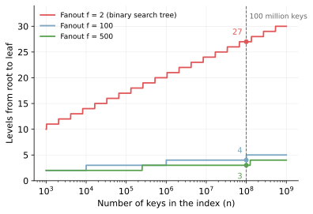
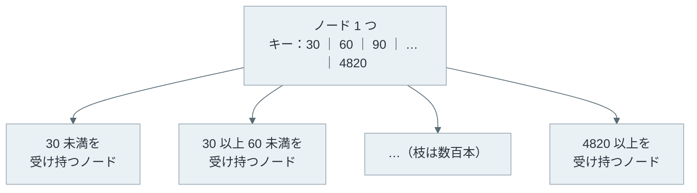
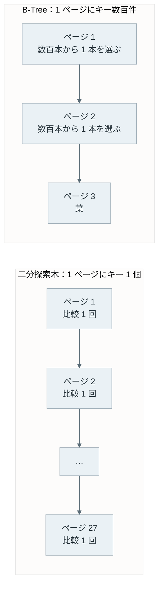
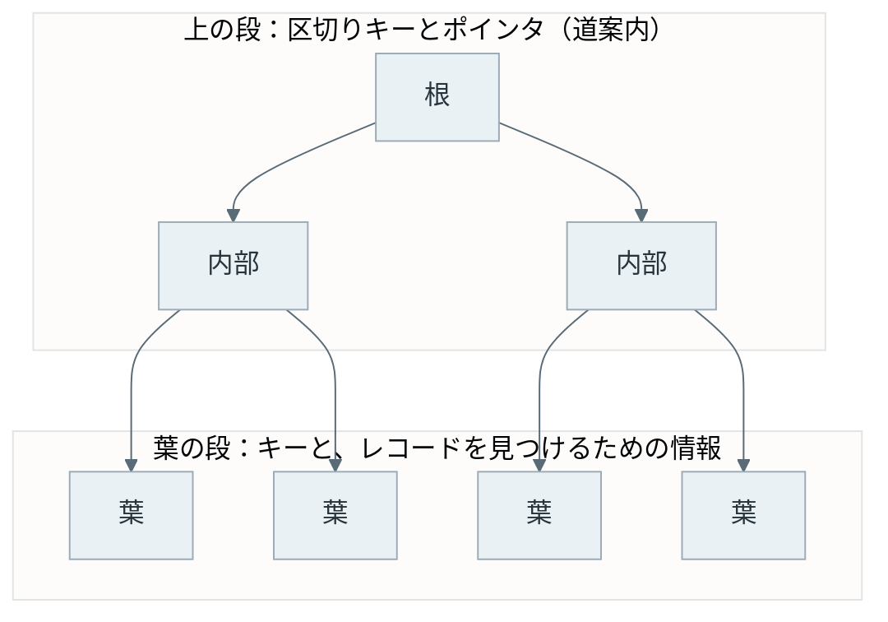
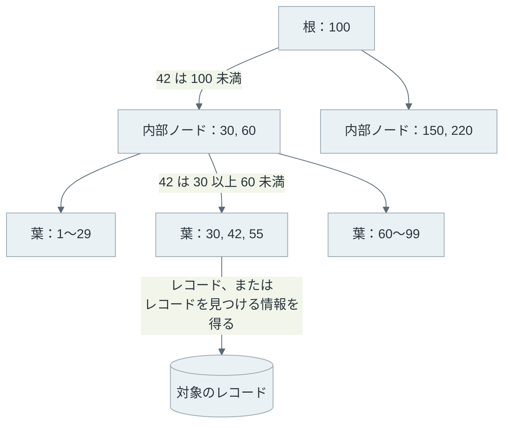
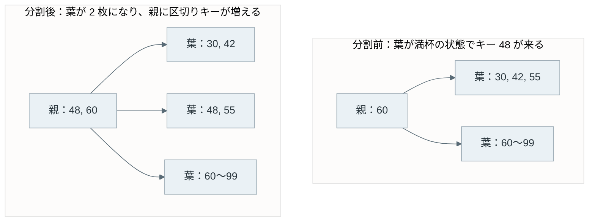
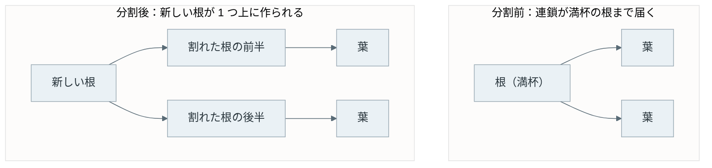
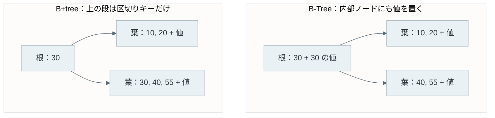
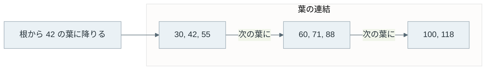

B-Tree は、1 つのノードに数百件のキーを並べることで、木の段数を数段に抑えた探索木です。ノードとは木を構成する 1 つの箱を指します。この構造が最もよく使われるのは、RDB（リレーショナルデータベース）の索引（インデックス）の実装です。`CREATE INDEX` で作る一般的な索引も、主キーや一意制約を支える索引も、多くは B-Tree 系の構造です。

1 つのノードから伸びる枝の本数を分岐数（fanout）と呼びます。分岐数を増やすと、キーが 1 億件あっても根から葉まで数段しか降りずに済みます。



上記の図の縦軸は、根から葉まで通過するノードの個数です。

段数が少ないことに加えて、キーが大小の順に並んでいるため、`WHERE user_id = 42` のような等値の絞り込み、`WHERE created_at BETWEEN ... AND ...` のような範囲の絞り込み、`ORDER BY created_at` のような並べ替えの多くは、この構造の上で効率よく処理されます。

ただし、全ての DB の全ての索引が B-Tree だという意味ではありません。ハッシュ索引や全文検索用の索引など別系統の構造を持つ DBMS（Database Management System）もあり、同じ DBMS の中でも用途で使い分けられます。

<br>

本記事では、1 台の DB が 1 本の索引を引く場合を例に、B-Tree 系の索引がなぜ DB にとって都合の良い構造なのかを説明します。扱う疑問は次の通りです。

- 索引はなぜ必要で、なぜ二分探索木では足りないのか。
- 数百件のキーを詰めたノードから、どうやって目的のキーに辿り着くのか。
- キーを挿入し続けても、なぜ全ての葉が同じ深さに揃うのか。
- 同じ 100 万件でも、挿入する順序で索引の大きさが変わるのはなぜか。
- B-Tree と、DB が実際に使う B+tree は何が違うのか。
- B-Tree 索引の効果が小さくなるのは、どんな場合なのか。

複数の処理が同時に木を書き換える時の排他制御と、削除で空いたページの回収は、本記事では扱いません。

---

### 前提

DB は表や索引をページという固定長の単位で管理し、ストレージとバッファキャッシュ（メモリ上に置くページの控え）の間でもページ単位で扱います。DB の B-Tree 系索引では、このページ 1 枚をそのまま 1 ノードとして構成する実装が一般的です。ノードをページに合わせるのは B-Tree というデータ構造そのものの定義ではなく、ページ単位の入出力に構造を寄せるための実装上の選択になります。

以下は、1 つのノードとその下の段を示した図です。



上記の図の一番上にある箱 1 個がノードです。中にはキーが小さい順に数百件並び、それぞれが区間の境目になります。この境目のキーを区切りキーと呼び、区切られた区間ごとに 1 つ下のノードへの枝が伸びます。

以降の図と説明は、値を葉に集めた B+tree という形で描きます。ここで言う値は、キーからレコードを見つけるための情報（レコードデータそのもの、またはレコードへの参照）です。B-Tree と B+tree の違いは「葉に値を集める B+tree」の節で扱います。

---

### 索引が必要な理由

この構造が必要になる場面の代表は、レコード数が増え続ける表からの絞り込みです。例えば、1,000 万件の注文が入った表から `user_id = 42` の注文だけを取り出すとします。ほかに使える手段が無ければ、DB は表の全てのレコードを読み、条件に合うかを 1 件ずつ確かめます。読む量が表の大きさに比例するため、注文が積み上がるほど同じ問い合わせの応答時間が伸びます。

索引は、この読み取りを必要なページだけに絞ります。ただし、索引もディスク上のデータ構造なので、索引を引くこと自体にも読み出しが発生します。条件に一致したレコードを集めるためのページの読み出しは、索引があっても無くなりません。B-Tree が減らすのは、その手前で索引の木を降りる時に読むページの枚数です。

---

### 二分探索木で足りない理由

キーの順に並んだ探索木という点では、二分探索木も同じです。しかし、二分探索木をディスク上の索引に使うと、最悪の場合は木の段数と同じ回数だけページの読み出しが発生します。

DB がストレージとやり取りする単位はページなので、1 バイトだけ必要な場合もページ 1 枚をまるごと読み込みます。ページの大きさは DBMS で違い、MySQL の InnoDB では[索引ページの既定の大きさが 16KB](https://dev.mysql.com/doc/refman/8.4/en/innodb-physical-structure.html) です。

二分探索木のノードはキー 1 個とポインタ 2 本しか持ちません。ポインタとは、別のページの位置を指す数バイトの値です。ノードをページに 1 個ずつ置くと、16KB を読んでも得られるのは比較 1 回分の情報になります。

そこで、1 ページに入るだけキーを詰め、1 回の読み出しで、数百本の枝から進む先を 1 本に絞ります。分岐数を `f`、索引に入っているキーの件数を `n` とすると、根から葉まで通過するノードの個数はおよそ `log(n) / log(f)` になります。この個数が、ここで言う段数です。冒頭の図で 27 段と 3 段を分けていたのは、この式の `f` です。

以下は、キー 1 億件で根から葉までに読むページの枚数を分岐数 2 と 500 で比べた図です。



`log(n) / log(f)` は、全てのノードが十分に埋まっていて、内部ノードの分岐数がどこでも一定だとみなした概算です。実際の段数は、キーの長さやページヘッダの大きさ、ページがどこまで埋まっているか、葉と内部ノードで 1 ページに入る件数が違うことなどで変わります。

それでも、分岐数を増やすほど段数が縮むという傾向は動きません。比較の総回数で見れば、二分探索木も B-Tree もどちらも `log(n)` に比例します。差が付くのは、その比較がページをまたぐかどうかで、B-Tree はノードの中の比較をページ 1 枚の内側に閉じ込めています。

ここまでの段数は、木を降りる時に通るページの枚数です。毎回その枚数だけディスクから読むわけではありません。根や上位の内部ページは全ての探索が通るためアクセス頻度が高く、バッファキャッシュに残りやすいからです。ストレージから実際に読む回数（物理 I/O）は、索引の大きさや割り当てられたメモリ量、アクセスの偏り方で変わります。

---

### ノードに詰め込むキーとポインタ

B-Tree のノードは、木の中の位置によって 3 種類に分かれます。一番上にある 1 つが根ノード、一番下に並ぶのが葉ノード、その間にあるのが内部ノードです。実装の一例として、[PostgreSQL のドキュメント](https://www.postgresql.org/docs/current/btree.html)には、葉が表のレコードを指す項目を持ち、内部ノードが 1 つ下の段を指す項目を持つと説明されています。

同じ箇所には「Typically, over 99% of all pages are leaf pages.」（通常、全ページの 99% 超が葉ページになる）とあります。

前提の節の図に並んでいた 30 や 60 が区切りキーで、根と内部ノードに並び、下の段のどのページに進むかを分けます。区切りキーが 30 と 60 の 2 個なら、30 未満・30 以上 60 未満・60 以上の 3 つの区間に割れ、ポインタが 3 本伸びます。探している値がどの区間に入るかを決めれば、次に読むページが 1 枚に定まります。

以下は、3 種類のノードが持つものを示した図です。



上記の図の葉に置く、レコードを見つけるための情報は実装で分かれます。例えば PostgreSQL の通常の B-tree index は、表の本体（ヒープ）に置かれたレコードへの参照を葉に持ちます。InnoDB では、主キーの順にレコードを並べたクラスタ化索引の葉にレコードデータが入り、それ以外のカラムに張るセカンダリ索引の葉には主キーの値が入ります。どの形でも、葉まで降りればその先で目的のレコードに辿り着けます。

1 ノードに何件入るかは、ページの大きさとキーの長さで決まります。例えば、ページを 8KB、1 件あたりキー 8 バイトとポインタ 8 バイトの合計 16 バイトとして単純に割ると、1 ノードにおよそ 500 件が入ります。実際にはページのヘッダや 1 件ごとの管理用の領域も必要になるため、入る件数はこれより少なくなります。

キーが長い文字列であれば件数はさらに減り、段数が増えやすくなります。カラムの型は、この件数と段数を通して探索の速さに効きます。

---

### 根から葉に降りる探索

探索は根から始まり、区間の判定を段ごとに 1 回ずつ行いながら葉まで降ります。降りている間に木が書き換わらない限り、経路は 1 本に定まります。

例えば、キー 42 を探す経路は次の図のようになります。区切りキーが 150, 220 の内部ノードより下は省いています。



上記の図では、そのページに載っている区切りキーだけを材料に、索引のページを 3 枚たどって目的のキーに辿り着いています。葉から先で追加のページを読むかどうかは実装と問い合わせで変わり、葉にレコードデータがある場合や必要なカラムが索引だけで揃う場合は、そこで読み取りが終わります。

同じ形の探索は、範囲を指定した問い合わせにも使えます。`user_id` が 42 以上 90 以下という条件なら、42 が入った葉まで 1 度降りて、そこから条件を外れるまでキーを順に読み進めます。次の葉への移り方は B+tree の節で扱います。

冒頭で触れたハッシュ索引は、キーから計算したハッシュ値で置き場所を決めます。木を降りずに置き場所が分かる代わりに、ハッシュ値はキーの大小関係を保たないので、42 以上 90 以下のような範囲の検索には使えません。

---

### 満杯のノードの分割による段数の維持

キーを挿入していくと、いずれかの葉が満杯になります。B-Tree は、満杯になったノードを 2 つに分割して空きを作ります。

以下は、葉が 1 枚割れた時に親が何を受け取るのかを示した図です。分割に関係する枝だけを抜き出した図で、親はほかにも枝を持ちます。



上記の図で動いているのは、元の葉に入っていたキーの後半です。48 と 55 が新しい葉に移り、その新しい葉の先頭になる 48 が、親の区切りキーとしてコピーされます。60 以上の範囲を受け持つ隣の葉は、この分割では変更されません。

境目の 48 が右側の葉にも残るのは、値を葉に集めた形だからです。値を内部ノードにも置く古典的な B-Tree では、境目のキーは上の段に移り、下からは取り除かれます。

親も満杯だった場合は、親も 2 枚に割り、2 枚の境目になるキーをさらに上の段に渡します。連鎖が根まで届いた時は、以下のように根も割れます。



段数が増えるのは、上記の図の新しい根が作られる時だけです。どの葉への経路も新しい根を通るので、全ての葉が同時に 1 段深くなります。平衡を取らない二分探索木は、昇順にキーを入れると片側にだけ枝が伸びて深くなります。B-Tree では、どの順でキーを入れてもこの状態は生まれません。

1 回の分割では、割れた 2 枚と区切りキーを受け取る親をはじめ、複数のページが書き換わります。そのため実際の DB では、分割の途中でクラッシュしても索引を復旧できる仕組みが別に必要です。[WAL](/notes/distributed-systems/write-ahead-log/) や、実装ごとに定められたページ分割の手順がその役割を担います。

---

### 挿入の順序とページの埋まり方

分割した 2 枚がどこまで埋まるかは、挿入の順序で変わります。InnoDB では、昇順か降順に挿入したページが[およそ 15/16 まで、ランダムな順なら 1/2 から 15/16 まで](https://dev.mysql.com/doc/refman/8.4/en/innodb-physical-structure.html)埋まります。順序に沿った挿入はページを高い充填率で使いやすい一方、ランダムな位置への挿入では途中のページで分割が起こりやすく、同じ件数でも索引が大きくなる場合があります。

連番のように末尾に追加していく場合は、右端のページの分割だけ別の扱いになります。通常の分割はキーをおおむね半分ずつに分けますが、末尾にしかキーが来ないなら、左のページを詰めたまま残しても後から挿入されません。PostgreSQL が葉ページを fillfactor という割合まで詰めるのは、索引を作り直す時と[索引を右端に伸ばす時](https://www.postgresql.org/docs/current/sql-createindex.html)です。B-tree の fillfactor の既定値は 90 で、右端を割る時は左のページを 90% まで埋めて残すので、索引は小さく収まります。

PostgreSQL 17.10 で、同じ 100 万件の整数を昇順とランダムな順で、索引を先に作った表に挿入して比べた結果は以下の通りです。`seq_ins_k` が昇順、`rnd_ins_k` がランダムな順で入れた索引で、`avg_leaf_density` は葉ページの平均の充填率（%）です。

```text
   index   | size  | avg_leaf_density
-----------+-------+------------------
 seq_ins_k | 21 MB |            90.06
 rnd_ins_k | 29 MB |            66.62
```

昇順の索引は葉が fillfactor どおり 90% まで埋まり、ランダムな順の索引は 3 分の 2 ほどしか埋まらずに 4 割近く大きくなりました。入っているキーは同じなので、差を生んだのは分割の仕方です。昇順では右端だけが割れて左を 90% で残し、ランダムな順では途中のページが半分ずつに割れます。

---

### 葉に値を集める B+tree

DB が実際に使う索引の多くは、B-Tree そのものではなく B+tree と呼ばれる変種です。2 つの違いは、葉より上のノードに何を置くかにあります。2 つを並べると、以下の通りです。



上記の図の B-Tree では根に 30 の値そのものが載るので、探索が途中で終わる場合があります。B+tree の根が持つのは区切りキーだけで、30 の値は葉に置かれます。値を上の段から追い出すと、1 ページに入る区切りキーの数が増えて分岐数が上がりやすくなります。加えて、どのキーの探索も葉で終わり、全ての葉は同じ深さにあるので、木を降りる回数はどのキーでも同じです。

値の置き方は、同じ DBMS の中でも用途で分かれます。SQLite のファイルフォーマットの説明には、表を格納する木が「[store all data in the leaves](https://sqlite.org/fileformat2.html)」（全てのデータを葉に格納する）、索引の木が「[store no data at all](https://sqlite.org/fileformat2.html)」（データを一切格納しない）だと書かれています。表を格納する木は値を葉に集めた B+tree の形です。索引の木は内部ノードにもキーを置く古典的な B-Tree の形で、キーと別に持つ値はありません。

<br>

もう 1 つ、DB の B+tree 実装でよく見られる工夫として、範囲の走査を速くするために同じ段のページを横に繋ぐ形があります。例えば [PostgreSQL](https://www.postgresql.org/docs/current/btree.html) では、葉に限らず各段のページが、前後に辿れる双方向のリストとして繋がっています。

範囲を取り出す時に、この横の繋がりがどう働くかを以下の図に示します。



上記の図で根から降りているのは 1 度だけです。42 以上 90 以下を取り出す条件なら、最初の葉に着いた後は横の繋がりを辿るだけで済み、上の段に戻る動きは必要ありません。`ORDER BY` の並べ方が索引の並び順と一致していれば、整列の処理も省けます。

一方、SQLite の葉ページは兄弟へのポインタを持たないため、隣の葉へ移る時は親のページに戻ってから次の子に降ります。

DBMS のドキュメントに出てくる「B-tree」は、[MySQL の用語集](https://dev.mysql.com/doc/refman/8.4/en/glossary.html)のように、多くの場合この系統の総称です。

名前で構造を判断せず、値がどこにあるかと、同じ段が繋がっているかを見る方が確実だと考えられます。

---

### 利点

- 分岐数を上げることで段数が縮み、1 件の探索で辿る索引ページを数枚に抑えられる
- キーをどの順で挿入しても全ての葉が同じ深さに並び、どのキーでも索引を降りる回数が揃う
- キーが順序で並ぶので、等値の検索と範囲の検索を同じ索引で処理できる
- 索引の並び順と一致する並べ替えなら、整列の処理を省ける

---

### 欠点

B-Tree は、キーの順序を保ったまま、ページ単位で木を書き換えます。そのため、次の制約があります。

- 挿入のたびに木を降りる必要があり、書き込みが読み出しを伴う
- ランダムな順の挿入では途中のページが割れ、同じ件数でも索引が大きくなる（実測で 4 割近く）
- 表の更新に加えて索引の更新も必要なため、索引を増やすほど書き込みが遅くなる
- 削除で空いたページを詰め直す仕組みは実装ごとに違い、索引が膨らんだままになることがある

---

### B-Tree 索引の効果が小さくなりやすいケース

- 書き込みが非常に多く、索引を維持するコストが読み取りの短縮で得られる利益を上回る場合
- 条件に合うレコードが表の大部分を占める、選択性の低い条件で絞り込む場合
- 大量のレコードを読む問い合わせが処理の中心で、表を順に走査する方法の方が有利になる場合

2 つ目の選択性は、条件がどれだけレコードを絞り込めるかを指し、条件に合うレコードの割合が小さいほど高いと言います。ただし、値の種類が数種類しかないから索引が役に立たない、とは限りません。値が 2 種類でも、一方が全体の 0.01% しか無ければ、その値で絞り込む問い合わせでは索引で読む量を減らせる場合があります。

3 つ目も同様で、大量のレコードを読むからといって索引が常に無駄になるわけではありません。必要なカラムが索引だけで揃えば、レコードの本体を読まずに索引の走査だけで答えを返せる場合もあります。どちらが速いかは、問い合わせの実行方法を選ぶ DB の部品（プランナ）が、カラムの値の分布などを集めた統計情報から見積もります。

索引から表のレコードを取り出す手順と、索引だけで読み取りが済む条件は [Index Scan](/notes/database-systems/index-scan/) で説明しています。プランナが複数の実行方法を比較する流れは [Query Processing](/notes/database-systems/query-processing/) で扱っています。
