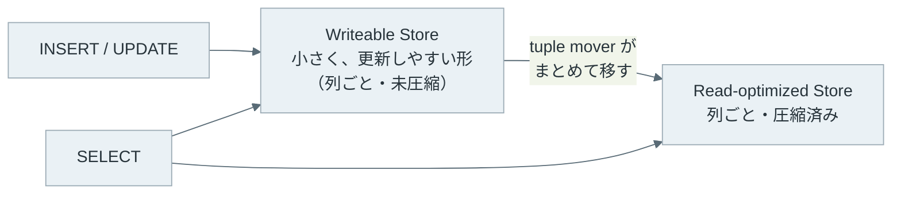

Columnar Storage（列指向ストレージ）は、表のデータを行（レコード）ごとではなく列（カラム）ごとに連続して格納する方式です。この方式で格納する DB（データベース）を Column Store、行ごとに格納する一般的な RDB（リレーショナル DB）を Row Store と呼びます。分析用の DB や、[Apache Parquet](https://parquet.apache.org/) のようなファイル形式がこの方式を使っています。

例えば、売上の表から `SELECT sum(amount) FROM sales` を実行する場合、必要なのは `amount` 列だけです。同じ表の 3 行を 2 つの方式で並べると、以下のようになります。



Row Store では、`amount` を集めるために、間に挟まる `id` と `region` も一緒に読みます。Column Store では `amount` 列の範囲だけを先頭から続けて読みます。

<br>

本記事では、Column Store が分析の処理で速い理由と、その代わりに苦手になる処理を説明します。実験には、分析向けの組み込み DB である [DuckDB](https://duckdb.org/) v1.5.5 の CLI（コマンドラインのツール）と、400 万行の合成データを使い、次の疑問に答えます。

- Row Store と Column Store は、それぞれどんな処理が得意なのか。
- 同じ表を CSV と Parquet で保存すると、大きさは何倍違うのか。
- 範囲条件の付いた集計で、DB はファイルのどこを読まないのか。
- 1 行ずつではなく、値の塊をまとめて処理すると何が速くなるのか。
- 1 行を探す処理や更新では、なぜ不利になるのか。

複数のノードにデータを分けて並列に処理する構成には触れません。表を値の範囲で分割する方法は、[Partitioning](/notes/database-systems/partitioning/) のノートで説明しています。

---

### Row Store と Column Store が得意な処理

Row Store と Column Store は、1 回の処理で触る行と列の形が違います。注文を 1 件登録する、会員番号で 1 人の情報を表示する、といった処理は、少数の行の全ての列を読み書きします。このような処理を OLTP（Online Transaction Processing）と呼びます。

一方で、過去 1 年の売上を地域ごとに合計する処理は、大量の行の少数の列だけを読みます。この処理は OLAP（Online Analytical Processing）と呼びます。

| 処理の形 | Row Store | Column Store |
|---|---|---|
| 1 行の全ての列を読む・書く（OLTP） | 1 行が 1 か所にまとまっていて速い | 列の数だけ別の場所を読み書きする |
| 大量の行の数列だけを読む（OLAP） | 使わない列も同じブロックに載ってくる | 使う列だけを読める |

Row Store も [B-Tree](/notes/database-systems/b-tree/) の索引があれば、条件に合う少数の行を素早く探せます。しかし、表の大部分を読む集計では索引が役に立ちにくく、表を全部読むことになります（[Index Scan](/notes/database-systems/index-scan/) の「見積もりでシーケンシャルスキャンに負ける条件」）。

---

### 似た値が並ぶ列の圧縮

列ごとに並べると、同じ型で似た値が隣り合います。都市名の列には数種類の文字列が繰り返し現れ、時刻の列は少しずつ増えていきます。行ごとの並びでは数値と文字列が交互に現れるので、この性質を使えません。Parquet の[エンコードの仕様](https://parquet.apache.org/docs/file-format/data-pages/encodings/)には、次のような方法が定められています。

| エンコード | やり方 | 効く列の例 |
|---|---|---|
| Dictionary（`RLE_DICTIONARY`） | 異なる値の辞書を作り、各行には辞書の番号だけを書く | 都市名・状態のように種類が少ない列 |
| RLE と bit packing | 同じ番号の連続を「値と回数」で書く。連続しない所は、番号を必要なビット数だけで詰める | 辞書の番号、真偽値 |
| Delta（`DELTA_BINARY_PACKED`） | 隣の値との差を取り、塊の中の最小の差を引いた残りを少ないビット数で詰める。差が一定なら残りは全て 0 になる | 連番、時刻のように単調に増える整数 |

例えば、8 種類の都市名なら辞書の番号は 0〜7 で、3 ビットあれば表せます。`tokyo` という 5 文字を毎行書く代わりに、数ビットの番号だけを書きます。エンコードの後に、[Snappy](https://github.com/google/snappy) や [Zstandard](https://github.com/facebook/zstd) のような汎用の圧縮をさらに掛けることもできます。

圧縮には、ファイルが小さくなる以上の効果があります。読むバイト数が減るので、ディスクやネットワークから運ぶ時間も減ります。列指向 DB の研究試作である C-Store の論文（Stonebraker 氏ら、[C-Store: A Column-oriented DBMS](https://www.vldb.org/archives/website/2005/program/paper/thu/p553-stonebraker.pdf)、VLDB 2005）は、展開のコストを避けるために、できる限り圧縮した表現のままクエリを処理する設計を挙げています。

---

### CSV と Parquet で読む量を数える実験

[Parquet のファイル](https://parquet.apache.org/docs/file-format/)は、行をいくつかの塊に分けて格納します。この塊を row group と呼び、row group の中では列ごとに値を並べます（1 つの row group の 1 列分を column chunk と呼びます）。

ファイルの末尾にはメタデータがあり、column chunk ごとの位置・エンコードと、書き手が統計を書いた場合は最小値と最大値が書かれています（統計は[メタデータ](https://parquet.apache.org/docs/file-format/metadata/)の任意の項目です）。読む側は、先にこのメタデータを読んで、どの column chunk を読むかを選べます。

以下が、実験の SQL の抜粋です。400 万行の売上の表を作り、同じ表を [CSV](https://www.rfc-editor.org/rfc/rfc4180) と Parquet に書き出します。

読んだバイト数は、DuckDB の [FileSystem ログ](https://duckdb.org/docs/1.5/operations_manual/logging/overview)に記録された `READ` の `bytes` を合計して数えます。v1.5 は読んだファイルを既定でキャッシュし、キャッシュから返った分はログに出ないので、計測の前にキャッシュを無効にしています。

SQL の全体は [lab/columnar.sql](lab/columnar.sql)、出力は [lab/output.txt](lab/output.txt) です。本記事の DuckDB のドキュメントへのリンクは、実験と同じ v1.5 系のものです。

```sql
-- 400 万行。ts は 6 秒ずつ増え、region は 8 種類、amount は 1〜10000
CREATE TABLE sales AS
SELECT
  i AS id,
  TIMESTAMP '2026-01-01' + to_seconds(i * 6) AS ts,
  (['tokyo','osaka','nagoya','fukuoka','sapporo','sendai','hiroshima','naha'])[1 + (hash(i) % 8)::INT] AS region,
  (['paid','paid','paid','refunded','cancelled'])[1 + (hash(i * 7) % 5)::INT] AS status,
  (1 + hash(i * 13) % 10000)::INTEGER AS amount
FROM range(4000000) t(i);

COPY sales TO 'sales.csv' (HEADER);
COPY sales TO 'sales.parquet' (FORMAT parquet, PARQUET_VERSION v2);
COPY sales TO 'sales_v1.parquet' (FORMAT parquet);  -- 既定の設定（V1）との比較用
COPY (FROM sales ORDER BY hash(id)) TO 'sales_shuffled.parquet' (FORMAT parquet, PARQUET_VERSION v2);

-- 列ごとのエンコードと大きさ
SELECT path_in_schema AS col, encodings, sum(total_compressed_size) AS bytes
FROM parquet_metadata('sales.parquet') GROUP BY ALL ORDER BY bytes DESC;

-- 1 つのクエリが読んだバイト数（クエリごとに繰り返す）
SET enable_external_file_cache = false;  -- キャッシュから返った分もログに出す
CALL enable_logging('FileSystem', storage = 'memory');
CALL truncate_duckdb_logs();
SELECT sum(amount) FROM 'sales.parquet'
WHERE ts >= TIMESTAMP '2026-03-01' AND ts < TIMESTAMP '2026-03-02';
SELECT sum((message::JSON->>'bytes')::BIGINT) FROM duckdb_logs
WHERE message::JSON->>'op' = 'READ';
```

`PARQUET_VERSION v2` は、Parquet の新しいバージョンの形式で書く指定です。v1.5.5 の実験では、V2 を指定した時だけ `id` と `ts` が `DELTA_BINARY_PACKED` になりました。V2 を読めない古い読み手もあります。

どのファイルも DuckDB の既定の Snappy で圧縮されていて（`compression` 列が `SNAPPY`）、下のサイズの比にはエンコードと Snappy の両方の効果が入っています。`sales_shuffled.parquet` は、行の順序だけを崩したファイルです。

書き出した 400 万行の大きさは、以下の通りです。

| ファイル | バイト数 | CSV との比 |
|---|---:|---:|
| `sales.csv` | 186,140,615 | 1 |
| `sales_v1.parquet`（既定の設定） | 53,098,986 | 1/3.5 |
| `sales_shuffled.parquet` | 46,495,391 | 1/4.0 |
| `sales.parquet` | 11,943,009 | 1/15.6 |

CSV と比べて、`sales.parquet` は 15.6 分の 1 です。同じ Parquet でも、既定の設定のままでは 4.4 倍、行の順序を崩すと 3.9 倍に膨らみます。理由は、列ごとのエンコードを見ると分かります。

```text
┌─────────┬─────────────────────┬─────────┐
│   col   │      encodings      │  bytes  │
├─────────┼─────────────────────┼─────────┤
│ amount  │ RLE_DICTIONARY      │ 8337955 │
│ region  │ RLE_DICTIONARY      │ 2020048 │
│ status  │ RLE_DICTIONARY      │ 1020373 │
│ ts      │ DELTA_BINARY_PACKED │    2889 │
│ id      │ DELTA_BINARY_PACKED │    2353 │
└─────────┴─────────────────────┴─────────┘
```

以下は、同じ 400 万行を 3 つの行の順序で書いた時の、列ごとのバイト数を積み上げた図です。上の表に無い region の順のファイルは、後で触れる比較のために書いたものです。



400 万個の `id` と `ts` が、それぞれ 3 KB 足らずに収まっています。隣との差が常に 1 と 6 秒なので、Delta で引いた後の残りが全て 0 になり、ほとんど何も書かないからです。

既定の設定（V1）では、この 2 列が `PLAIN`（値をそのまま並べる）になり、ファイルは 53 MB でした。行の順序を崩したファイルでは、差が大きくばらつくので、`ts` は 23,031,839 バイト、`id` は 11,525,343 バイトに膨らみました。

`region` は 8 種類の都市名で、1 値あたり約 4 ビットでした。理論上の 3 ビットより大きいのは、DuckDB の書き手が番号の幅を最大の番号 7 ではなく辞書の大きさ 8 から決め、4 ビットにするからです。v1.5.5 の[書き手の実装](https://github.com/duckdb/duckdb/blob/v1.5.5/extension/parquet/include/writer/templated_column_writer.hpp#L97)が、[幅を求める関数](https://github.com/duckdb/duckdb/blob/v1.5.5/extension/parquet/include/parquet_rle_bp_decoder.hpp#L87-L96)に辞書の大きさを渡しています。値がランダムな `amount` は、他の列ほどは縮まず（そのまま並べた 16 MB の約半分）、ファイルの 7 割を占めています。

ちなみに、`region` の順に並べ替えて書くと、`region` は同じ値の連続になり 2,049 バイトまで縮みます。しかし、その代わりに `ts` が 7,252,651 バイトに膨らみました。どの列の順に並べるかは、どの列を縮めるかの選択でもあります。

---

### 統計で読まない塊を決める Predicate Pushdown

Predicate Pushdown は、`WHERE` の条件をファイルを読む処理（スキャン）まで下ろし、条件に合わない行を早い段階で捨てる最適化です。

さらに、塊ごとの最小値と最大値を記録しておけば、条件に合う行が 1 行も無い塊は、中身を読まずに飛ばせます。この最小値と最大値の一覧を zone map と呼びます。Parquet ではメタデータの統計がこの役割を持ち、[DuckDB の Parquet の説明](https://duckdb.org/docs/1.5/data/parquet/overview)にも、条件の pushdown で zone map を使ってファイルの一部を飛ばせるとあります。

実験の `sales.parquet` には 33 個の row group があり、最後の 1 個を除いて 122,880 行（約 8.5 日分）ずつ入っています。`ts` の統計の先頭は、以下の通りです。

```text
┌──────────────┬──────────┬─────────────────────┬─────────────────────┐
│ row_group_id │ num_rows │      stats_min      │      stats_max      │
├──────────────┼──────────┼─────────────────────┼─────────────────────┤
│            0 │   122880 │ 2026-01-01 00:00:00 │ 2026-01-09 12:47:54 │
│            1 │   122880 │ 2026-01-09 12:48:00 │ 2026-01-18 01:35:54 │
│            2 │   122880 │ 2026-01-18 01:36:00 │ 2026-01-26 14:23:54 │
└──────────────┴──────────┴─────────────────────┴─────────────────────┘
```

3 月 1 日の 1 日分（14,400 行）の `amount` を合計するクエリで、どの row group を読んだかを数えると、以下のようになります。読んだ位置はメタデータにある column chunk の範囲に当てはめて数えています。



`ts` の順に書いたファイルでは、3 月 1 日を範囲に含む row group は 6 と 7 の 2 個だけで、残りの 31 個は統計を見ただけで飛ばしました。順序を崩したファイルでは、どの row group にも 1 月から 10 月までの行が混ざっていて、最小値と最大値の範囲が全て 3 月 1 日を含みます。そのため、統計では 1 個も飛ばせません。同じ行・同じクエリで、読んだ量は 60 倍違いました。

実験で計測した全てのクエリの結果は、以下の通りです。

| クエリ | 読んだバイト数 | 触れた row group | 読んだ列 |
|---|---:|---:|---|
| A. CSV で `sum(amount)` | 186,140,615 | （行の塊が無い） | 全て |
| B. Parquet で `sum(amount)` | 8,368,525 | 33 | amount |
| C. Parquet で 1 日分の `sum(amount)` | 527,830 | 2 | amount, ts |
| D. 順序を崩した Parquet で C と同じ | 31,408,300 | 33 | amount, ts |
| E. Parquet で `id = 2000000` の 1 行 | 366,106 | 1 | 5 列全て |

B は列を選んだ効果で、CSV の 22 分の 1 です。C はさらに row group を飛ばした効果で、B の 16 分の 1 になりました。`EXPLAIN ANALYZE` で見ると、列の絞り込み（`Projections`）と条件（`Filters`）が、Parquet を読む演算子 `PARQUET_SCAN` に入っています（抜粋）。

```text
│         TABLE_SCAN        │
│         Function:         │
│        PARQUET_SCAN       │
│    Projections: amount    │
│          Filters:         │
│ ts>='2026-03-01 00:00:00':│
│ :TIMESTAMP AND ts<'2026-03│
│  -02 00:00:00'::TIMESTAMP │
│        14,400 rows        │
```

経過時間は、実験した環境（Linux、32 スレッド、ページキャッシュ上）の 2 回目で、A が 0.165 秒、B が 0.003 秒でした。環境で大きく変わる値です。

zone map が効くのは、条件に使う列の値が塊ごとにまとまっている時です。[DuckDB の索引の説明](https://duckdb.org/docs/1.5/guides/performance/indexing)も、列の値が整列しているほど zone map の価値が上がるとしています。時刻のように追記の順に増える列は自然にまとまりますが、ランダムな ID やハッシュ値の列では、どの塊も範囲が広くなり飛ばせません。

---

### 値の塊をまとめて処理する Vectorized Execution

読む量を減らしても、読んだ値を CPU で計算する時間は掛かります。多くの RDB で、エグゼキュータ（executor）は、上の演算子が下の演算子に次の 1 行を要求する形で動きます（[Query Processing](/notes/database-systems/query-processing/#実行計画から行を引き出す実行器)）。1 行ごとに関数を呼ぶので、400 万行の合計なら、足し算 1 回のために関数呼び出しが 400 万回起きます。

Boncz 氏らの論文 [MonetDB/X100: Hyper-Pipelining Query Execution](https://www.cidrdb.org/cidr2005/papers/P19.pdf)（CIDR 2005）は、[MySQL](https://www.mysql.com/) で [TPC-H](https://www.tpc.org/tpch/)（分析処理のベンチマーク）の Query 1 を実行し、1 行ずつの処理のコストを計測しています。

足し算 1 回に約 20 サイクルの呼び出しのコストが掛かり、1 回分の計算では呼び出しのコストを薄められません。また、1 回の呼び出しで依存し合う命令しか実行しないので、CPU のパイプラインに空きが出ます。

X100 は、1 行ではなく、約 1000 個の値を並べた配列（vector）を単位にして演算子間で受け渡す方式を取りました。この処理を Vectorized Execution と呼びます。vector は、CPU のキャッシュに収まる大きさの配列です。

以下は、400 万行の合計で、演算子の間の呼び出しが何回起きるかを 2 つの形で比べた図です。



配列を回すループでは、各要素の計算が前後の要素に依存しません。そのため、コンパイラが命令を詰めて並べたり、1 命令で複数の値を計算する SIMD（Single Instruction, Multiple Data）命令を使ったりしやすくなります。

Column Store は列の値を最初から配列として持つので、この処理の形と相性が良いです。DuckDB の [vector の説明](https://duckdb.org/docs/1.5/internals/vector)では、既定の vector の大きさは 2048 件です。

---

### 1 行を探す処理と更新が不利な理由

Column Store が苦手なのは、OLTP の形の処理です。上記の表の E は、`id = 2000000` の 1 行を返すクエリでした。

`id` の統計で row group 16 の 1 個に絞れましたが、1 行を組み立てるには 5 列それぞれの column chunk を読む必要があり、366,106 バイトを読みました。返す 1 行は、CSV にすると 47 バイト程度の大きさです。B-Tree の索引を持つ Row Store なら、数ページを読めば 1 行に届きます。

更新はさらに不利です。1 行の `amount` を書き換えるとしても、その値は辞書の番号として bit packing で詰められ、圧縮された塊の中にあります。1 か所だけを書き換えるには、塊を展開して作り直すことになります。Parquet のファイルはメタデータを末尾にまとめて書く形式で、一部だけを書き換える手順はありません。変更するなら新しいファイルを書きます。

そのため、更新を受け付ける Column Store は、更新を別の場所に貯めて、後でまとめて列の形に移す設計を取ります。C-Store は、挿入と更新を受け付ける小さな Writeable Store と、読むことに最適化した大きな Read-optimized Store を持ち、tuple mover が前者から後者にまとめて移します。



上記の図のように、読む側は両方を合わせて結果を作ります。更新を追記で受けて後でまとめる考え方は、[LSM-Tree](/notes/database-systems/lsm-tree/) と同じです。

---

### 利点

- 集計で使う列だけを読むので、列の多い表ほど読む量が減る
- 同じ型の似た値が並び、Dictionary や Delta で大きく縮む
- row group ごとの最小値と最大値で、条件に合わない塊を読まずに飛ばせる
- 列の値を配列のまま処理でき、Vectorized Execution と組み合わせやすい

---

### 欠点

Column Store は、大量の行の少数の列を読む処理に合わせて、値を列ごとに詰めて格納します。その代わりに、次の制約があります。

- 1 行を組み立てるのに、列の数だけ別の場所を読む
- 圧縮した塊の一部を書き換えられず、更新は別の場所に貯めてまとめる仕組みが必要になる
- zone map の効き方が行の順序に左右され、並べ替える列の選び方で他の列の圧縮率も変わる
- 1 行ずつの小さな挿入が続くと、小さな塊やファイルが増えて読む効率が落ちる

---

### Columnar Storage の効果が小さくなりやすいケース

- 1 回の処理で少数の行の全ての列を読み書きする、注文登録のような OLTP の処理
- 主キーで 1 行を引く処理が中心で、表を広く読む集計がほとんど無い場合
- 表の列が少なく、ほとんどのクエリが全ての列を使う場合
- 絞り込みに使う列の値がランダムで、どの塊にも全範囲の値が混ざる場合

最後の項目は、Column Store が使えないという意味ではありません。列を選ぶ効果は残り、実験の D でも CSV の 6 分の 1 しか読んでいません。飛ばせなくなるのは row group の単位で、その列の順に並べて書き直せば効果は戻ります。
