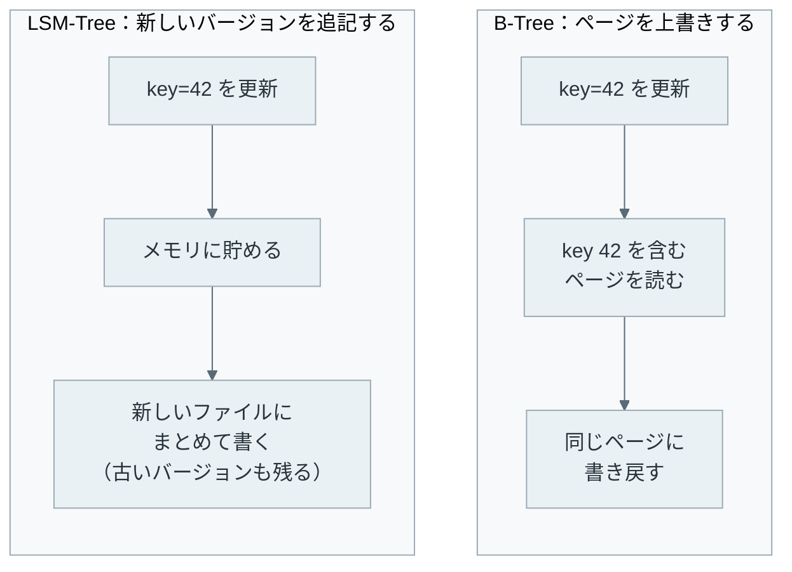
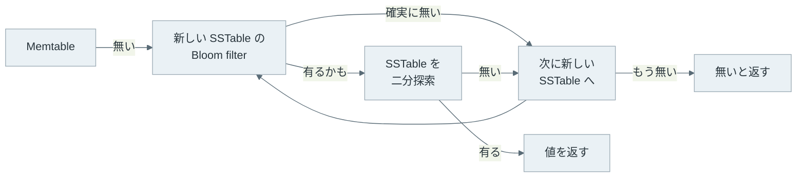

LSM-Tree（Log-Structured Merge-Tree）は、更新をメモリに貯めてから、キーの順に並べたファイルとしてディスクにまとめて書く索引です。同じキーを更新すると新しいバージョンを別のファイルに足し、古いバージョンは後から行うコンパクション（compaction）で捨てます。

キーと値を保存する組み込みの KVS（Key-Value Store）である [RocksDB](https://rocksdb.org/) や [LevelDB](https://github.com/google/leveldb)、分散 DB（データベース）の [Apache Cassandra](https://cassandra.apache.org/) が、この考え方でデータを保存しています。

上書きしない設計なので、直感に反する現象が起きます。例えば、本記事の実験では、1 万件のキーを削除すると、ディスク上に保存している件数が約 1 万件増えました。書き込みが速いはずの DB が、ある時点から書き込みを絞り、最後には止めることもあります。どちらも、後回しにしたコンパクションの作業が溜まった結果です。

[B-Tree](/notes/database-systems/b-tree/) との違いは、更新したキーをどこに書くかです。以下は、同じキーを更新する時の 2 つの書き方です。



LSM-Tree は書く位置を探さず、どのバージョンが新しいかは読む時とコンパクションの時に判断します。

<br>

本記事では、1 台のサーバーで動く LSM-Tree を例に、次の疑問を説明します。

- 更新・削除をどこに書き、読む時に最新の値をどう見つけるのか。
- size-tiered と leveled の 2 つのコンパクションは何が違うのか。
- 書き込み・読み取り・容量の増幅は、コンパクションのやり方でどう変わるのか。
- コンパクションが遅れると、なぜ書き込みが止まるのか。
- B-Tree とどう使い分けるのか。

トランザクションと並行制御、[複数のサーバーへの複製](/notes/distributed-systems/leader-and-followers/)は、本記事では扱いません。

---

### LSM-Tree が必要な理由

B-Tree の更新は、ディスク上の決まった位置にあるページを読み、書き換えて戻す処理です。キーがランダムに届くと、書き換えるページもランダムな位置に散らばります。HDD ではヘッドの移動が、SSD でも小さな書き換えが積み重なります。

LSM-Tree を示した [O'Neil 氏らの論文（1996 年）](https://www.cs.umb.edu/~poneil/lsmtree.pdf)は、取引の履歴表のように挿入が絶えず続く表を題材にしています。論文の見積もりでは、こうした表に B-tree の索引をリアルタイムに保つと、取引 1 件あたりの I/O コストが実質的に 2 倍になります。

なお、論文の LSM-Tree はメモリ上の木 C0 とディスク上の木 C1 を少しずつ併合（rolling merge）する形で、本記事で説明する Memtable・SSTable・flush の形は Bigtable や LevelDB の系統です。

そこで LSM-Tree は、索引の変更を後回しにして束ねます。メモリに貯めた変更をキーの順に並べ、大きな塊としてディスクに順に書くので、書く位置を 1 件ごとに探しません。その代わりに、同じキーの新旧のバージョンがディスク上に複数並び、読む処理とコンパクションの処理が増えます。

---

### 書き込みの経路

LSM-Tree の書き込みは、ログへの追記とメモリ上の表への挿入で完了し、ディスク上のファイルを書くのを待ちません。メモリ上で更新を受け取る表を Memtable と呼び、RocksDB では [Memtable の既定の実装はスキップリスト](https://github.com/facebook/rocksdb/wiki/MemTable)です。スキップリストは、キーの順を保ったまま挿入と探索ができるデータ構造です。

メモリの内容は停止で消えます。そこで多くの実装は、Memtable に入れる前に同じ更新を [WAL（Write-Ahead Log、ログ先行書き込み）](/notes/distributed-systems/write-ahead-log/)に追記し、停止後はログから Memtable を作り直します。

ディスクに書き出すファイルは、キーの順に並び、書いた後は変更しない SSTable です。SSTable という名前は Google の分散ストレージである [Bigtable の論文](https://research.google/pubs/pub27898/)で使われ、Sorted String Table の略として広く呼ばれます。更新を受け取ってから SSTable になるまでの流れは以下の通りです。


- title: WAL に追記
  body: 停止後に Memtable を作り直せるよう、更新をログの末尾に足します。
- title: Memtable に挿入
  body: キーの順に並ぶメモリ上の表に入れます。同じキーは上書きします。
- title: 読み取り専用に切り替え
  body: 満杯になった Memtable を immutable（変更不可）にし、新しい Memtable で受け付けを続けます。
- title: SSTable に flush
  body: immutable Memtable をキーの順に書き出し、最上段のレベル（L0）に置きます。flush が済んだ分の WAL は不要になります。


満杯の目安は、LevelDB では[ログが約 4MB に達した時](https://github.com/google/leveldb/blob/main/doc/impl.md)、RocksDB では `write_buffer_size`（[options.h](https://github.com/facebook/rocksdb/blob/main/include/rocksdb/options.h) で既定 64MB）に達した時に切り替えます。flush は裏のスレッドで行うので、通常は書き込みの応答を待たせません。

---

### 読み取りの経路

LSM-Tree では、同じキーのバージョンがいくつもの場所にあるので、Memtable、新しい SSTable、古い SSTable の順に探します。最初に見つかったバージョンが最新で、それより古い SSTable は読みません。



上記の図で、SSTable を開く前に確認している Bloom filter は、「このキーは確実に無い」か「有るかもしれない」かを答える小さなビット列です。SSTable ごとに 1 つ持たせ、「確実に無い」なら、その SSTable はディスクを読まずに飛ばします。

[RocksDB の Bloom filter](https://github.com/facebook/rocksdb/wiki/RocksDB-Bloom-Filter) では、キー 1 件あたり約 10 bit で、誤って「有るかもしれない」と答える割合（偽陽性率）が約 1% です。

しかし、キー全体で作った Bloom filter は、キー 1 つを指定した読み取りにしか効きません。RocksDB には、キーの先頭部分で作る [prefix Bloom filter](https://github.com/facebook/rocksdb/wiki/Prefix-Seek) もあり、先頭が揃った範囲の検索に限って SSTable を飛ばせます。

`user100` から `user199` までのような範囲の読み取りでは、範囲に掛かる全ての SSTable を開き、キーの順に突き合わせながら最新のバージョンを選びます。SSTable の数が増えるほど、範囲の読み取りは重くなります。

---

### 削除と tombstone

LSM-Tree の削除は、「このキーは削除した」という印の追記です。この印を tombstone（墓石）と呼びます。古い SSTable にある値は書き換えられないので、印で隠すしかありません。O'Neil 氏らの論文では delete node entry と呼ばれます。

そのため、削除しても保存している件数は減らず、印の分だけ増えます。印と古い値が消えるのは、両者が同じコンパクションに入った時です。

LevelDB の実装メモには、[コンパクションは上書きされた値を捨て、tombstone は、より古いレベルに同じキーの範囲を持つファイルが無い時だけ捨てる](https://github.com/google/leveldb/blob/main/doc/impl.md)とあります。古い値がどこかに残っているうちに印を捨てると、削除したはずの値が読めるようになるからです。

---

### コンパクションの 2 つのやり方

コンパクションは、複数の SSTable を読んで 1 つの並びに併合し、古いバージョンと不要な tombstone を落として書き直す処理です。キーの順に並び、同じキーが 1 回しか現れない 1 本の並びを sorted run と呼びます。どの SSTable をいつ併合するかで、大きく 2 つのやり方に分かれます。

- size-tiered: 大きさが近い sorted run が一定数揃ったら、まとめて 1 本にする。[Cassandra の STCS](https://cassandra.apache.org/doc/latest/cassandra/managing/operating/compaction/stcs.html) は既定で 4 本
- leveled: レベルごとに上限の大きさを決め、各レベルを重なりの無い 1 本の sorted run に保つ。上限を超えたら、溢れた分を次のレベルの重なる範囲と併合する

2 つのやり方で、ディスク上の並びは以下のようになります。横軸はキーの範囲で、1 行が 1 本の sorted run です。



size-tiered は、同じキーのバージョンが複数の sorted run に散らばったまま残ります。読む時に確認する本数が多く、容量も多く使います。leveled は L1 以降の各レベルでキーが 1 回しか現れないので、読む本数と容量は抑えられます。しかし、上のレベルから 1 本降ろすたびに次のレベルの重なる部分を書き直すため、同じデータを何度も書きます。

[LevelDB](https://github.com/google/leveldb/blob/main/doc/impl.md) は leveled で、L1 の上限を 10MB、L2 を 100MB と 10 倍ずつ大きくします。RocksDB は [Compaction の wiki](https://github.com/facebook/rocksdb/wiki/Compaction) で、size-tiered に当たる方式を Universal と呼びます。既定の Level は、小さいレベル（L0）を tiered、大きいレベルを leveled にした混合の方式です。

---

### 3 つの増幅

コンパクションのやり方で変わるコストは、3 種類の増幅で比べます。[RocksDB のチューニングガイド](https://github.com/facebook/rocksdb/wiki/RocksDB-Tuning-Guide)の定義は以下の通りです。

| 増幅 | 定義 | 主に増やす要因 |
|---|---|---|
| Write Amplification | ストレージに書いたバイト数 ÷ DB に書いたバイト数 | コンパクションで同じデータを書き直す回数 |
| Read Amplification | 1 回の問い合わせで読むディスクの回数 | 確認する sorted run の本数 |
| Space Amplification | ディスク上のファイルの大きさ ÷ データの大きさ | 残っている古いバージョンと tombstone |

前節の size-tiered と leveled は、3 つのうち抑えるものが逆になっており、3 つを同時に小さくすることは難しいと考えられます。

この関係は、[Athanassoulis 氏らの論文（EDBT 2016）](https://openproceedings.org/2016/conf/edbt/paper-12.pdf)で索引全般の性質として整理され、RUM 予想と名付けられました。

R・U・M は読み取り（Read）、更新（Update）、メモリ・記憶領域（Memory）の頭文字で、論文は RUM 予想を「Read, Update, Memory – Optimize Two at the Expense of the Third」（2 つを最適化すると、残りの 1 つが犠牲になる）とまとめています。証明された定理ではなく、予想です。

---

### 最小の LSM-Tree で測る

Python 標準ライブラリだけで書いた[最小の LSM-Tree](lab/lsm.py) で、3 つの増幅がコンパクションのやり方でどう変わるかを測ります。以下は、書き込みとコンパクションを抜き出したコードです。読み取りの経路と同じ順で探す `get`、Bloom filter（キー 1 件あたり 10 bit）、SSTable のクラスは `lab/lsm.py` の全体にあります。

```python
TOMBSTONE = None       # a delete is stored as this marker
MEMTABLE_LIMIT = 1000  # entries per flush
FANIN = 4              # tiered: runs merged at once / leveled: L0 files before compaction
RATIO = 10             # leveled: each level holds 10 times more than the previous one

class LSM:
    def __init__(self, style):
        self.style = style        # "leveled", "tiered" or "none"
        self.memtable = {}
        self.levels = [[]]        # levels[i] = SSTables, newest first
        self.user_writes = 0      # entries written by the user
        self.disk_writes = 0      # entries written by flush and compaction

    def put(self, key, value):
        self.user_writes += 1
        self.memtable[key] = value
        if len(self.memtable) >= MEMTABLE_LIMIT:
            self.flush()

    def delete(self, key):
        self.put(key, TOMBSTONE)  # deleting is appending a marker

    def flush(self):
        self.levels[0].insert(0, self._write(self.memtable.items()))
        self.memtable = {}
        self.compact()

    def _write(self, items):
        self.disk_writes += len(items)
        return SSTable(sorted(items))

    def _merge(self, runs, bottom):
        merged = {}
        for run in reversed(runs):  # oldest first, newer values overwrite
            merged.update(zip(run.keys, run.values))
        if bottom:  # nothing older remains below, so markers can go
            merged = {k: v for k, v in merged.items() if v is not TOMBSTONE}
        return self._write(merged.items())

    def _target(self, level):
        if self.style == "tiered" or level == 0:
            return len(self.levels[level]) >= FANIN
        size = sum(len(r.keys) for r in self.levels[level])
        return size > MEMTABLE_LIMIT * RATIO ** level

    def compact(self):
        if self.style == "none":
            return
        level = 0
        while level < len(self.levels):
            if not self._target(level):
                level += 1
                continue
            if level + 1 == len(self.levels):
                self.levels.append([])
            bottom = not any(self.levels[level + 2:])
            if self.style == "tiered":  # merge runs of one tier, push down
                bottom = bottom and not self.levels[level + 1]
                out = self._merge(self.levels[level], bottom)
                self.levels[level + 1].insert(0, out)
            else:                       # merge into the single run below
                runs = self.levels[level] + self.levels[level + 1]
                self.levels[level + 1] = [self._merge(runs, bottom)]
            self.levels[level] = []
```

`none` はコンパクションを一切行わない設定で、コンパクションが追い付かない状態の極端な例です。負荷は 3 つとも同じで、2 万種類のキーにランダムに 10 万回 `put` した後、半分の 1 万キーを `delete` します。最後に、ランダムなキーを 2 万回 `get` します。

このコードでは、量をバイトではなく件数で数え、WAL への追記は含めません（含めると書き込みの増幅は 1 増えます）。また、レベルを丸ごと書き直しており、ファイルの一部だけを併合する LevelDB や RocksDB より単純です。

```sh
$ python3 lab/lsm.py
style   write visited read space(load) space(end) runs stored  live full
leveled  3.70    4.05 1.00        1.05       3.05    5  30333  9932  9932
tiered   2.64    4.96 1.01        2.15       5.27    8  52387  9932  9932
none     0.97   17.05 1.10        4.88      10.77  107 107000  9932  9932
```

出力の列と 3 つの増幅の対応は以下の通りです。

| 列 | 意味 |
|---|---|
| write | ディスクに書いた件数 ÷ ユーザーが書いた件数（Write Amplification） |
| visited / read | `get` 1 回で確認した SSTable / Bloom filter を通過して読んだ SSTable（Read Amplification） |
| space(load) / space(end) | 保存件数 ÷ 生きているキーの数（Space Amplification）。左は `put` の終わり、右は `delete` の終わり |
| full | 全ての SSTable を 1 本に併合した後の件数 |

以下は、3 つの増幅をコンパクションのやり方ごとに並べた図です。容量の増幅は `delete` の後の値です。



書き込みの増幅は leveled が最も大きく、容量の増幅は size-tiered が leveled の約 2 倍です。[Compaction の wiki](https://github.com/facebook/rocksdb/wiki/Compaction) にも、書き込みの増幅は通常 leveled の方が tiered より悪いとあります。

レベルが増えるほど差は開き、[チューニングガイド](https://github.com/facebook/rocksdb/wiki/RocksDB-Tuning-Guide)の 500GB・5 レベルの例では leveled が約 33 です。この実験の差が小さいのは、データが L2 までしか育たないからです。`none` の書き込みが 1 を下回るのは、Memtable 上で上書きされた分と、最後に Memtable に残った分をディスクに書いていないからです。

Bloom filter を通すと、中まで読む SSTable は 3 つとも 1 本前後です。しかし `none` は `get` 1 回ごとに平均 17 本の Bloom filter を確認し、偽陽性の分だけ無駄な読み出しも増えています。

下記の図は、保存している件数（entries on disk、実線）と生きているキーの数（Live keys、破線）の推移です。



上記の図の右端では、生きているキーが 1 万件に減ったのに、leveled の保存件数は約 3 万件まで増えています。最下段に削除前の約 2 万件（うち約 1 万件は削除済みキーの古い値）が残り、その上に約 1 万件の tombstone が積まれたからです。

全てを 1 本に併合すると、`full` の列の通り 9,932 件まで減ります。削除した容量は、コンパクションが最下段まで届いた時に初めて戻ります。図の生成コードは [figures.py](https://github.com/nao1215/debimate/blob/main/content/notes/database-systems/lsm-tree/figures.py) です。

---

### コンパクションが遅れた時

コンパクションは flush と同じく裏のスレッドで動きます。書き込みの量がコンパクションの処理能力を上回ると、コンパクションされない SSTable が L0 に溜まっていきます。L0 の SSTable は互いにキーの範囲が重なるので、読む時は 1 本ずつ確認するしかありません。下記の図は、コンパクションを止めた `none`（図の No compaction）と、他の 2 つの SSTable の本数の推移です。



本数は flush の回数に比例して増え、前節の通り `get` 1 回で確認する SSTable は 4〜5 本から 17 本に、容量の増幅は 10 倍を超えました。このまま書き込みを受け付け続けると、読み取りは遅くなり続け、ディスクも溢れます。

そこで RocksDB は、溜まった量に応じて[書き込みの速度を落とし](/notes/distributed-systems/backpressure/)（slowdown）、それでも追い付かなければ止めます（stop）。仕組みは [Write Stalls の wiki](https://github.com/facebook/rocksdb/wiki/Write-Stalls) にあります。発動の条件は以下の通りで、既定値は RocksDB の [advanced_options.h](https://github.com/facebook/rocksdb/blob/main/include/rocksdb/advanced_options.h) にある値です。

| 溜まるもの | 速度を落とす条件 | 書き込みを止める条件 |
|---|---|---|
| L0 の SSTable の本数 | `level0_slowdown_writes_trigger`（既定 20） | `level0_stop_writes_trigger`（既定 36） |
| コンパクション待ちと見積もったバイト数 | `soft_pending_compaction_bytes_limit`（既定 64GB） | `hard_pending_compaction_bytes_limit`（既定 256GB） |
| flush 待ちの Memtable | `max_write_buffer_number` が 3 より大きい時、待ちが `max_write_buffer_number - 1` に達した時 | 待ちが `max_write_buffer_number`（既定 2）に達した時 |

速度を落とす間は、書き込みが `delayed_write_rate` の速度に制限されます。[options.h](https://github.com/facebook/rocksdb/blob/main/include/rocksdb/options.h) では既定が 0 で、レート制限の設定が無ければ毎秒 16MB を使います。L0 のコンパクションを始める本数 `level0_file_num_compaction_trigger` も options.h にあり、既定は 4 本です。

LSM-Tree の書き込みが速いのは、コンパクションの作業を後回しにしているからです。後回しにできる量には上限があり、上限に達すると書き込みがコンパクションを待ちます。

---

### 利点

- 書く位置を探さずに Memtable に入れるので、ランダムなキーの書き込みでも応答が速い
- ディスクには大きな塊を順に書くので、小さなランダム書き込みが減る
- SSTable を書き換えないので、ファイルの複製を取りやすい（RocksDB の [Checkpoint](https://github.com/facebook/rocksdb/wiki/Checkpoints) はハードリンクを使える）
- コンパクションのやり方を変えるだけで、書き込み・読み取り・容量のどれを優先するかを選べる

---

### 欠点

LSM-Tree は、書き込みの時に済ませるはずの整理をコンパクションに後回しにします。その代わりに、次の制約があります。

- 1 つのキーを読む時に、複数の SSTable を確認する場合がある
- 範囲の読み取りではキー全体で作った Bloom filter が効かず、範囲に掛かる全ての sorted run を突き合わせる
- 削除しても、コンパクションが最下段に届くまで容量が減らない
- コンパクションの I/O が通常の読み書きと競合し、追い付かなければ書き込みが絞られる

---

### LSM-Tree の効果が小さくなりやすいケース

- 書き込みが少なく、1 件を指定する読み取りが大部分を占める場合
- 範囲の読み取りが中心で、応答時間のばらつきを小さく保つ必要がある場合
- 削除と挿入を短い間隔で繰り返し、tombstone が溜まり続ける場合

書き込みが少ないなら、B-Tree の方が素直です。[B-Tree](/notes/database-systems/b-tree/) なら、根から葉まで数ページを降りれば値に届きます。LSM-Tree は Bloom filter で読む SSTable を絞れても、各レベルを確認する処理が残ります。

範囲の読み取りが中心の場合は、平均の速さより、コンパクションの I/O が重なった時の遅れが問題になります。大きなコンパクションの I/O は、範囲の読み取りとディスクを奪い合います。どちらが有利かは、書き込みの比率、キーの分布、ストレージの性能で変わります。なお、大量のレコードを集計する分析が中心なら、列ごとに保存する [Columnar Storage](/notes/database-systems/columnar-storage/) の方が効く場合があります。

削除と挿入の繰り返しで典型的なのは、先頭から順に取り出して消すキューのような使い方です。消したキーの tombstone が最下段に届くまで残るので、先頭を範囲で読むたびに、既に消した分の印を読み飛ばすことになります。
