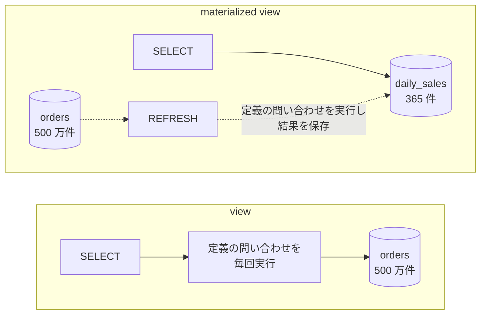

Materialized View（マテリアライズドビュー）は、問い合わせの結果を表として DB（データベース）に保存し、読む時には保存した結果を返す仕組みです。普通の view（ビュー）は `SELECT` の定義だけを持ち、参照される度に元の表から計算し直します。materialized view は計算済みの結果を持つので、読む時は計算しません。

保存するのは問い合わせの結果で、同じ形の SQL の実行計画を使い回す [Query Plan Cache](../query-plan-cache/) とは別の仕組みです。

その代わりに、元の表を更新しても保存した結果は自動では変わりません。売上の集計が 1 秒前後から 1 ミリ秒未満に縮んだ代わりに、ダッシュボードが昨日の数字を出し続ける、という状態が起こります。以下は、普通の view と materialized view で、`SELECT` がどこまで読みに行くかを並べた図です。



上記の図の materialized view では、`SELECT` が 365 件の集計結果だけを読みます。500 万件の注文表を読むのは `REFRESH`（保存した結果の作り直し）の時だけで、`REFRESH` と `REFRESH` の間に入った注文は、`SELECT` の結果に出ません。

<br>

本記事では、[PostgreSQL](https://www.postgresql.org/) 17 の materialized view を中心に、事前に計算した結果を読む時の速さと古さの関係を説明します。以下の疑問を扱います。

- 元の表と materialized view は、それぞれ何を受け持つのか。
- 結果を作り直す方法には、どんな種類があるのか。
- `REFRESH` の実行中に、別の接続の `SELECT` は止まるのか。
- 古い結果は、どこまで許容できるのか。
- materialized view に索引を張ると、何が速くなり、何が遅くなるのか。

実験は、コンテナを動かす [Docker](https://www.docker.com/) 上の PostgreSQL 17.11 で行いました。変更分だけを反映する方法は、[Oracle Database](https://docs.oracle.com/en/database/oracle/oracle-database/19/dwhsg/refreshing-materialized-views.html) と PostgreSQL の拡張 [pg_ivm](https://github.com/sraoss/pg_ivm) を例に、比較に必要な範囲で触れます。

---

### Materialized View が必要な理由

集計を含む問い合わせは、結果が小さくても、読む量は元の表の大きさで決まります。日別の売上を 1 か月分だけ表示する場合でも、注文表の全件を日付でまとめてから 31 日分を取り出すなら、500 万件を読みます。後の実験では、この問い合わせに 1 秒前後かかりました。

1 秒弱の問い合わせでも、ダッシュボードを開く度に実行されると DB の負荷になります。10 人が 1 分ごとに画面を更新すれば、同じ 500 万件を 1 分に 10 回読みます。しかも、過去の日付の売上は、注文の取り消しなどが無い限り変わりません。毎回同じ手順で、変わらない結果を計算し直していることになります。

materialized view は、この計算を `REFRESH` の時に 1 回だけ行い、結果を残します。[PostgreSQL のドキュメント](https://www.postgresql.org/docs/17/rules-materializedviews.html)にも、過去の売上をグラフにしたい場合に、当日の不完全なデータを除いて日別に集計し、夜間に `REFRESH` する例があります。

---

### 元の表と写しの役割

materialized view では、元の表が唯一の書き込み先で、materialized view は読むためだけの写しです。PostgreSQL の materialized view には `INSERT` も `UPDATE` もできず、中身を変える方法は `REFRESH MATERIALIZED VIEW` だけです。

`REFRESH` は、作成時に保存した定義の問い合わせを実行し直し、その結果で中身を置き換えます。

そのため、2 つの値が食い違った時に正しいのは、常に元の表です。materialized view は消しても、定義さえあれば `REFRESH` で作り直せます。逆に、materialized view にしか無い情報を持たせることはできません。

更新を受ける側と、画面や集計に合わせた形で読む側を分ける構図は、[CQRS](/notes/software-architecture/cqrs/) の読み取りモデルと同じです。CQRS は読み取りモデルへの反映をアプリケーションで行うこともありますが、materialized view では DB が定義の問い合わせから結果を作るので、反映の処理を自分で書かずに済みます。

---

### REFRESH の 3 つの方法

結果を作り直す方法は、何を入力にして作り直すかと、作り直している間に読み手を止めるかで分かれます。以下は、本記事で取り上げる 3 つの方法について、元の表から読む量（reads from orders）・materialized view に書く量（writes to the view）・実行中の読み手（readers）を並べた図です。



full refresh は、元の表を全て読み直して結果を作り、中身を丸ごと入れ替えます。PostgreSQL の `REFRESH MATERIALIZED VIEW` は、開始からコミットまで、materialized view に対して全てのロックと衝突する `ACCESS EXCLUSIVE` ロックを取ります（[ロックモードの一覧](https://www.postgresql.org/docs/17/explicit-locking.html)）。

一方で、Oracle の complete refresh は、[DBMS_MVIEW.REFRESH](https://docs.oracle.com/en/database/oracle/oracle-database/19/arpls/DBMS_MVIEW.html) の既定（`atomic_refresh => true`）では 1 つのトランザクションで中身を入れ替えます。

Oracle は[読み手と書き手が互いを待たない](https://docs.oracle.com/en/database/oracle/oracle-database/19/cncpt/data-concurrency-and-consistency.html)作りなので、読み手は止まらず、コミットするまで古い結果を読みます。`atomic_refresh` を `false` にすると、中身を `TRUNCATE` で消してから入れ直します。

incremental refresh は、元の表に入った変更から、結果のどこが変わるかを計算して反映します。Oracle Database の fast refresh は、元の表の変更を materialized view log という表に記録しておき、それを使って反映します。

PostgreSQL 17 の標準機能には incremental refresh がありません。拡張の pg_ivm は、`pgivm.create_immv()` で作った IMMV という表について、元の表に文単位の `AFTER` トリガー（変更の文が終わった後に自動で動く処理）を作り、元の表を更新した同じトランザクションの中で IMMV も更新してくれます。

その代わり、元の表への書き込みは遅くなり、使える集約関数も `count`・`sum`・`avg`・`min`・`max` に限られます。

<br>

変更分だけの反映は、常に速いわけではありません。

view の保守を整理した Gupta 氏と Mumick 氏の論文「[Maintenance of Materialized Views: Problems, Techniques, and Applications](http://sites.computer.org/debull/95JUN-CD.pdf)」（IEEE Data Engineering Bulletin, Vol. 18, No. 2, 1995）は、変更分だけを計算する方が安いという考えは経験則に過ぎず、元の表を全件消した場合のように、作り直した方が安い場合もあると指摘しています。

concurrent refresh は名前が紛らわしいのですが、PostgreSQL の `CONCURRENTLY` は incremental refresh ではありません。[PostgreSQL の実装](https://github.com/postgres/postgres/blob/REL_17_STABLE/src/backend/commands/matview.c)では、定義の問い合わせを全て実行して一時的な表に新しい結果を作り、今の中身と全カラムで突き合わせて、変わったレコードだけを `DELETE` と `INSERT` で書きます。

元の表を読む量は full refresh と同じで、変わるのは置き換え方です。この間のロックは `EXCLUSIVE` で、`SELECT` が取る `ACCESS SHARE` ロックとは衝突しません。

突き合わせにはレコードを一意に特定できるカラムが必要なので、`CONCURRENTLY` を使うには、式や `WHERE` 句を含まない [UNIQUE](../unique-constraint/) 索引が materialized view に 1 つ以上必要です（[REFRESH MATERIALIZED VIEW](https://www.postgresql.org/docs/17/sql-refreshmaterializedview.html)）。

---

### REFRESH 中の読み手の実験

PostgreSQL 17.11 のコンテナで、500 万件の注文表と、日別の件数と売上を集計した materialized view を作りました。手順と実行結果の全体は [lab/](https://github.com/nao1215/debimate/blob/main/content/notes/database-systems/materialized-view/lab/) にあります。以下が `setup.sql` の materialized view の定義です。

```sql
CREATE MATERIALIZED VIEW daily_sales AS
SELECT (ordered_at AT TIME ZONE 'Asia/Tokyo')::date AS day,
       count(*)    AS orders,
       sum(amount) AS total
FROM orders
GROUP BY 1;
```

<br>

<details>
<summary>setup.sql の全体（注文表の作成と 500 万件の投入を含む）</summary>

```sql
-- 注文表と、日別の売上を事前に集計した materialized view を作る
DROP MATERIALIZED VIEW IF EXISTS daily_sales;
DROP TABLE IF EXISTS orders;

CREATE TABLE orders (
    id         bigint GENERATED ALWAYS AS IDENTITY PRIMARY KEY,
    ordered_at timestamptz NOT NULL,
    amount     integer     NOT NULL
);

-- 2026-01-01 から 365 日に 500 万件を散らす（乱数の種を固定する）
SELECT setseed(0.42);
INSERT INTO orders (ordered_at, amount)
SELECT timestamptz '2026-01-01 00:00:00+09' + random() * interval '365 days',
       (random() * 9000)::int + 100
FROM generate_series(1, 5000000);
ANALYZE orders;

CREATE MATERIALIZED VIEW daily_sales AS
SELECT (ordered_at AT TIME ZONE 'Asia/Tokyo')::date AS day,
       count(*)    AS orders,
       sum(amount) AS total
FROM orders
GROUP BY 1;
```

</details>

<br>

注文表は 249 MB、`daily_sales` は 365 件で 32 kB になりました。注文表から集計した場合と `daily_sales` から読んだ場合で、3 月の売上合計を 3 回ずつ測った時間は、以下の通りです（[run.sh の出力](https://github.com/nao1215/debimate/blob/main/content/notes/database-systems/materialized-view/lab/output.txt)の (c-1)・(c-2)）。



1〜1.2 秒かかっていた集計が、1 ミリ秒を切り、およそ 1,800 分の 1 になりました。次に、3 月 1 日に 100 万円の注文を 1 件足し、同じ日の売上を注文表と `daily_sales` の両方から読みました（`run.sh` の (b)）。

```text
   source    |  total
-------------+----------
 orders      | 63629336
 daily_sales | 62629336
```

`daily_sales` は 100 万円少ないままで、エラーも警告も出ません。`REFRESH MATERIALIZED VIEW daily_sales;` を実行した後は、`daily_sales` も 63629336 になりました。

<br>

`REFRESH` の実行中に読み手が止まるかは、3 本の接続で確認しました。`observer` が `daily_sales` に対するロックを [pg_locks](https://www.postgresql.org/docs/17/view-pg-locks.html) で繰り返し読み、`refresher` の `REFRESH` がロックを取ったのを見てから、`reader` が 3 月 1 日の売上を読みます。

`observer` は、`reader` がロック待ちになるか読み終わるまで読み続けるので、`REFRESH` の所要時間に頼らずに途中の状態を残せます。直前に 3 月 1 日の注文を 1 円分足しておき、`reader` が新旧どちらの値を読んだかも見ます。

<br>

<details>
<summary>run.sh の抜粋（3 本の接続の動かし方）</summary>

`psql_` は接続名を付けて `docker exec` で `psql` を呼ぶ関数、`show_locks` は `daily_sales` に対するロックを `pg_locks` と `pg_stat_activity` から接続名・モード・付与済みかで並べて表示する関数です。

```bash
blocking_test() {
  local stmt=$1
  psql_ writer -c "INSERT INTO orders (ordered_at, amount) VALUES ('2026-03-01 13:00:00+09', 1);"
  psql_ refresher -c '\timing on' -c "$stmt" > "$TMP/refresh.out" 2>&1 &
  local bg=$!
  local i
  for i in $(seq 200); do        # refresher がロックを取るまで待つ
    show_locks > "$TMP/locks.out"
    grep -q 'refresher .*| t' "$TMP/locks.out" && break
  done
  psql_ reader -c '\timing on' -c "SELECT total FROM daily_sales WHERE day = '2026-03-01';" > "$TMP/reader.out" 2>&1 &
  local rd=$!
  for i in $(seq 200); do        # reader がロック待ちになるか、終わるまで読む
    show_locks > "$TMP/locks.out"
    grep -q 'reader .*| f' "$TMP/locks.out" && break
    kill -0 "$rd" 2>/dev/null || { show_locks > "$TMP/locks.out"; break; }
  done
  wait $bg $rd
  # 以降で pg_locks・refresher・reader の出力と、完了後の値を表示する
}

blocking_test 'REFRESH MATERIALIZED VIEW daily_sales;'
psql_ refresher -c 'REFRESH MATERIALIZED VIEW CONCURRENTLY daily_sales;'
psql_ admin -c 'CREATE UNIQUE INDEX daily_sales_day ON daily_sales (day);'
blocking_test 'REFRESH MATERIALIZED VIEW CONCURRENTLY daily_sales;'
```

</details>

<br>

`CONCURRENTLY` を付けない `REFRESH` の結果は以下の通りです（抜粋）。

```text
 application_name |        mode         | granted
------------------+---------------------+---------
 reader           | AccessShareLock     | f
 refresher        | AccessExclusiveLock | t
 refresher        | ExclusiveLock       | t
-- refresher
Time: 2961.600 ms
-- reader
 63629337
Time: 2824.188 ms
```

`reader` の `AccessShareLock` は `granted` が `f`、つまりまだ与えられていません。`refresher` の `AccessExclusiveLock` と衝突して、`REFRESH` が終わるまで待っています。

`refresher` が持つもう 1 つの `ExclusiveLock` は、新しい結果を入れる表を作る時（matview.c の `make_new_heap`）に取るもので、読み手を止めているのは `AccessExclusiveLock` の方です。

UNIQUE 索引が無い状態で `CONCURRENTLY` を付けると、次のエラーで止まりました。

```text
ERROR:  cannot refresh materialized view "public.daily_sales" concurrently
HINT:  Create a unique index with no WHERE clause on one or more columns of the materialized view.
```

`day` に UNIQUE 索引を作ってから `CONCURRENTLY` で実行した結果は、以下の通りです（抜粋）。

```text
 application_name |     mode      | granted
------------------+---------------+---------
 refresher        | ExclusiveLock | t
-- refresher
Time: 2663.952 ms
-- reader
 63629337
Time: 1.077 ms
-- refresh の完了後
 63629338
```

2 つの実行を時間軸に並べると、以下のようになります。



上記の図の下段では、`reader` は待たずに返りましたが、読んだのは直前に足した 1 円を含まない 63629337 です。`CONCURRENTLY` は読み手を止めない代わりに、`REFRESH` がコミットするまで古い結果を返します。上段の `reader` は待たされた分、コミット後の新しい値を読んでいます。

どちらも `REFRESH` の所要時間は 2.7〜3 秒で、`CONCURRENTLY` だから速くなるわけではありません。

読み手が古い結果を読み続けられるのは、PostgreSQL がレコードの古いバージョンを残しておく仕組み（MVCC、Multi-Version Concurrency Control）の働きで、詳しくは [Snapshot Isolation](../snapshot-isolation/) で扱っています。

---

### 古い結果の許容範囲

materialized view は、前回の `REFRESH` の時点の結果を返します。どこまで古くて良いかは、その数字を見て何を決めるかで変わります。


- title: 売上のダッシュボード
  body: 直近の数時間分が欠けます。
  items:
  - 傾向を見るだけなら、夜間の `REFRESH` で足りる
- title: 請求額の計算
  body: 請求漏れや二重請求になります。
  items:
  - 締めの後に `REFRESH` し、確定した期間だけを読む
  - 請求の確定は元の表で行う
- title: 在庫の引き当て
  body: 売り切れた商品を売ります。
  items:
  - 引き当ての判定には使わない
  - 一覧画面の目安の表示に留める


古さを読み手に伝えるには、結果と一緒に最終更新時刻を出します。PostgreSQL 17 の [`pg_matviews`](https://www.postgresql.org/docs/17/view-pg-matviews.html) には最終更新時刻のカラムがありません。そこで、`REFRESH` と時刻の記録を同じトランザクションに入れると、記録だけが先に進む状態を避けられます。`CONCURRENTLY` もトランザクションの中で実行できました（`run.sh` の (e)）。

```sql
CREATE TABLE IF NOT EXISTS mv_refresh_log (
  name         text PRIMARY KEY,
  refreshed_at timestamptz NOT NULL
);
BEGIN;
REFRESH MATERIALIZED VIEW CONCURRENTLY daily_sales;
INSERT INTO mv_refresh_log VALUES ('daily_sales', now())
ON CONFLICT (name) DO UPDATE SET refreshed_at = EXCLUDED.refreshed_at;
COMMIT;
```

`now()` はトランザクションの開始時刻を返すので、記録されるのは `REFRESH` を始めた時刻です。画面には「2026-11-10 08:10 時点の集計」のように出せます。PostgreSQL のドキュメントの売上の例が当日の分を `WHERE invoice_date < CURRENT_DATE` で除いているのも、途中までの数字を確定した数字と並べないための工夫と読めます。

---

### 索引と組み合わせる条件

materialized view は中身を表として持つので、普通の表と同じく索引を張れます。索引が効くのは、materialized view のレコードが多く、その一部だけを条件で取り出す場合です。例えば、顧客ごと・日ごとに集計した数百万件の materialized view から 1 人分を読むなら、索引でレコードの在り処を直接求められます（[Index Scan](../index-scan/)）。

今回の 365 件の `daily_sales` なら、全件を読んでも 1 ミリ秒を切ります。

その代わり、索引も `REFRESH` の度に作り直しのコストがかかります。`REFRESH` の前後で、`daily_sales` と UNIQUE 索引の格納先ファイルの番号（`relfilenode`）を比べた結果が以下です（抜粋）。

```text
         at         |     relname     | relfilenode
--------------------+-----------------+-------------
 before             | daily_sales     |       16465
 before             | daily_sales_day |       16468
 after CONCURRENTLY | daily_sales     |       16465
 after CONCURRENTLY | daily_sales_day |       16468
 after plain        | daily_sales     |       16506
 after plain        | daily_sales_day |       16509
```

`CONCURRENTLY` を付けない `REFRESH` では、表と索引の両方が新しいファイルに変わりました。新しい結果を別のファイルに作って差し替え、索引も全て作り直すので、索引が多いほど `REFRESH` は長くなります。`CONCURRENTLY` ではファイルは同じままで、変わったレコードを書く度に索引も更新されます。変わるレコードが少なければ索引の更新も少なく済みます。

しかし、変わるレコードが多い場合は、`CONCURRENTLY` を付けない方が速く、使う資源も少ない傾向があります（[REFRESH MATERIALIZED VIEW](https://www.postgresql.org/docs/17/sql-refreshmaterializedview.html)）。実装の作りからすると、差分を求める突き合わせとレコードの削除・挿入が重くなるからです。

---

### 利点

- 重い集計や結合を `REFRESH` の時に 1 回だけ実行し、読み手は小さな結果を読むだけで済む
- 定義が DB に残るので、反映の処理を自分で書かずに `REFRESH` 1 文で作り直せる
- 普通の表と同じく索引を張れ、読み方に合わせて速くできる
- 元の表を変えずに足せるので、既存の書き込みの処理に手を入れずに済む

---

### 欠点

materialized view は、計算を読む時から `REFRESH` の時に移して、読む時の処理を軽くします。そのため、次の制約があります。

- 前回の `REFRESH` 以降の変更は結果に出ず、古さを示す仕組みも自分で用意する必要がある
- PostgreSQL 17 の標準機能では、`REFRESH` の度に定義の問い合わせを全て実行し直す。`CONCURRENTLY` でも元の表を読む量は減らない
- `CONCURRENTLY` を付けないと、`REFRESH` の間は読み手が止まる。付けるには UNIQUE 索引が必要になる
- 結果と索引の分だけ、ディスクを余分に使う

---

### Materialized View の効果が小さくなりやすいケース

- 元の表を毎回の問い合わせで読んでも十分に速い場合
- 結果に直前の書き込みまで含める必要がある判定（在庫の引き当て、残高の確認など）
- 元の表の変更が頻繁で、読む頻度より `REFRESH` すべき頻度の方が高い場合
- 定義の問い合わせが重く、`REFRESH` が次の `REFRESH` の予定時刻までに終わらない場合

直前の書き込みまで反映した集計が必要なら、集計用の表を自分で作り、元の表のトリガーかアプリケーションの書き込みと同じトランザクションで更新する方法があります。この場合は結果が古くなりませんが、書き込みの度に集計のレコードを更新するので、同じ日のレコードに更新が集中し、行ロックの待ちが起きやすくなります。

古さを許容できず、元の表から毎回集計する場合は、集計に必要なカラムだけを読める [Columnar Storage](../columnar-storage/) も候補です。逆に、数秒から数分の古さが許容でき、同じ結果を何度も読むだけなら、アプリケーション側のキャッシュでも足ります。

materialized view が向いているのは、その中間で、結果が DB の中で `JOIN` や索引の対象になり、古さを `REFRESH` の時刻で説明できる場合です。
