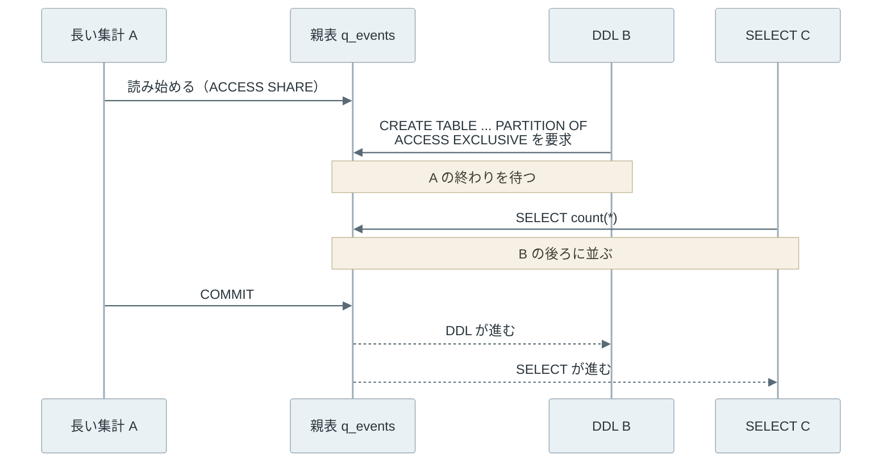

Partitioning（パーティショニング）は、あるカラムの値によって、1 つの論理的な表を複数の物理的な表に分けて保存する技術です。分ける基準にするカラムをパーティションキー、分けた先の 1 つ 1 つの表をパーティションと呼びます。アプリケーションは今まで通り親の表に SQL を発行し、DB（データベース）がキーの値からレコードの行き先や、読む先のパーティションを選びます。

例えば、アクセスログの表を `created_at` の月ごとに分けると、以下のようになります。



上記の図の親表 `events` は、どのキーの値がどのパーティションに入るかという定義だけを持ちます。3 月の条件で絞る問い合わせは 3 月のパーティションだけを読み、古い月はパーティションごと捨てられます。

本記事のパーティションは、1 台の DB の中で表を分ける宣言的パーティショニングを指します。分散システムでは、データを複数台のサーバーに振り分ける sharding（シャーディング）の意味で同じ語を使うことがあり、振り分け方の一例は [Consistent Hashing](/notes/distributed-systems/consistent-hashing/) のノートにあります。

<br>

本記事では、[PostgreSQL](https://www.postgresql.org/) 17 の宣言的パーティショニング（declarative partitioning）を例に、表を分けると何が変わり、どこで失敗するかを説明します。扱う疑問は次の通りです。

- 表を分けると、何が楽になるのか。
- Range・List・Hash の分け方は、何が違うのか。
- 同じ条件なのに、書き方 1 つで 1 つだけ読むか全部読むかが変わるのはなぜか。
- 主キーにパーティションキーを含めないと、何が起きるのか。
- 動いている表に、止めずにパーティションを足したり外したりするにはどうするのか。

実験は [Docker](https://www.docker.com/) 上の PostgreSQL 17.11 で行い、[Oracle Database](https://docs.oracle.com/en/database/oracle/oracle-database/23/vldbg/partition-concepts.html) と [MySQL](https://dev.mysql.com/doc/refman/8.4/en/partitioning.html) は違いが出る所だけを取り上げます。

---

### パーティションに分ける理由

表を分ける理由は、大きく以下の 3 つです。

- 問い合わせが読む範囲を減らせる。直近 1 か月のレコードしか見ない画面なら、残りの月のパーティションは開く必要がない
- 古いレコードは `DELETE` ではなく、パーティションごと `DROP TABLE` や `DETACH PARTITION`（親表から外す操作）で消せる
- `VACUUM`（削除済みのレコードが占める領域を回収する処理）や索引の作り直しが、パーティション単位の小さな作業で済む

古いレコードを消す時の差は、数字にすると分かりやすいです。以下は、1 か月 500 万件のパーティションを 2 つ作り、片方を `DELETE`、もう片方を `DROP TABLE` で消した結果です（[01_delete_vs_drop.sql](lab/01_delete_vs_drop.sql) の出力の抜粋）。

```text
-- DELETE FROM access_log WHERE created_at >= '2026-09-01' AND created_at < '2026-10-01';
Time: 2128.682 ms (00:02.129)
-- DROP TABLE access_log_2026_10;
Time: 29.028 ms
-- DELETE の後に残った、回収待ちのレコード
      relname       | n_live_tup | n_dead_tup |  size
--------------------+------------+------------+--------
 access_log_2026_09 |          0 |    5000000 | 211 MB
```

`DELETE` は 2.1 秒、`DROP TABLE` は 29 ミリ秒でした。時間はマシンで変わりますが、差の理由は変わりません。

`DELETE` は 1 件ずつ削除の印を付けるので、印の付いたレコード（`n_dead_tup`）が 500 万件残り、表の大きさも 211 MB のままです。

これを回収するのは後で動く `VACUUM` です（[MVCC と VACUUM](/notes/database-systems/mvcc-vacuum/) のノート）。`DROP TABLE` はファイルごと捨てるので、回収するものがありません。一括の `DELETE` が生む `VACUUM` の負担を避けられる点は、[PostgreSQL のドキュメント](https://www.postgresql.org/docs/17/ddl-partitioning.html)でも利点に挙げられています。

---

### Range・List・Hash の分け方

PostgreSQL が組み込みで持つ分け方は、Range・List・Hash の 3 つです。違いは、キーの値から行き先を選ぶ規則にあります。


- title: Range（範囲）
  body: 値の範囲ごとに分ける。下限を含み、上限を含まない。
  items:
  - 例：created_at の月ごと
  - 期間で絞る検索と、古い範囲の削除に向く
- title: List（列挙）
  body: 値を列挙して分ける。
  items:
  - 例：region が 'jp' か、'us' と 'ca' か
  - 値の種類が少なく、種類ごとに扱いを変えたい時に向く
- title: Hash（ハッシュ）
  body: キーのハッシュ値を MODULUS（割る数）で割った余りで分ける。
  items:
  - 例：id を 3 で割った余り
  - 決まった順序の無いキーを均等に散らしたい時に向く


どのパーティションにも当てはまらない値を `INSERT` するとエラーになります。Range と List では、受け皿として、どこにも当てはまらない値を入れる DEFAULT パーティションを作れます（Hash では作れません）。しかし、後でパーティションを足す時に、DEFAULT パーティションが落とし穴になります（後述）。

---

### Partition Pruning

Partition Pruning（パーティションの刈り込み）は、問い合わせの条件から、該当するレコードを持ち得ないパーティションを読む対象から外す処理です。PostgreSQL のプランナ（実行計画を選ぶ段階。[Query Processing](/notes/database-systems/query-processing/) のノートで説明しています）は、各パーティションの範囲の定義と `WHERE` 句を突き合わせ、条件を満たせないことを証明できたパーティションを外します。

証明できるかどうかは、条件の書き方で変わります。以下は、2026 年 1〜6 月の 6 つのパーティションに約 26 万件を入れ、3 月分を 3 通りに数える SQL の抜粋です（[02_pruning.sql](lab/02_pruning.sql)）。(3) では、値を埋めずに作る汎用のプラン（generic plan）で `PREPARE` した文を実行させます。プランを使い回す仕組みは [Query Plan Cache](/notes/database-systems/query-plan-cache/) のノートにあります。

```sql
-- 並列実行の行を出さないため max_parallel_workers_per_gather = 0。
-- EXPLAIN のオプションは全て (ANALYZE, COSTS OFF, TIMING OFF, SUMMARY OFF)
-- (1) 範囲で書いた条件
EXPLAIN (...) SELECT count(*) FROM events
WHERE created_at >= '2026-03-01' AND created_at < '2026-04-01';
-- (2) 関数で包んだ条件
EXPLAIN (...) SELECT count(*) FROM events
WHERE date_trunc('month', created_at) = '2026-03-01';
-- (3) パラメータを後から渡す generic plan
PREPARE q(timestamp, timestamp) AS
  SELECT count(*) FROM events WHERE created_at >= $1 AND created_at < $2;
SET plan_cache_mode = force_generic_plan;
EXPLAIN (...) EXECUTE q('2026-03-01', '2026-04-01');
```

出力から、3 つの文がそれぞれ読んだパーティションを月ごとに並べると以下のようになります。



<br>

<details><summary>EXPLAIN の出力の抜粋（Filter の行は省き、(2) は 4〜6 月も同じ形で続きます）</summary>

```text
== (1) 範囲で書いた条件
 Aggregate (actual rows=1 loops=1)
   ->  Seq Scan on events_2026_03 events (actual rows=44640 loops=1)
== (2) 関数で包んだ条件
 Aggregate (actual rows=1 loops=1)
   ->  Append (actual rows=44640 loops=1)
         ->  Seq Scan on events_2026_01 events_1 (actual rows=0 loops=1)
               Rows Removed by Filter: 44640
         ->  Seq Scan on events_2026_02 events_2 (actual rows=0 loops=1)
               Rows Removed by Filter: 40320
         ->  Seq Scan on events_2026_03 events_3 (actual rows=44640 loops=1)
         ...
== (3) パラメータを後から渡す generic plan
 Aggregate (actual rows=1 loops=1)
   ->  Append (actual rows=44640 loops=1)
         Subplans Removed: 5
         ->  Seq Scan on events_2026_03 events_1 (actual rows=44640 loops=1)
```

</details>

<br>

どれも結果は 44,640 件で同じです。しかし、(1) は `events_2026_03` だけを読み、(2) は 6 つ全てを読んで、3 月以外の約 21 万件を `Rows Removed by Filter` で捨てています。

プランナが知っているのは「`created_at` が 3/1 以上 4/1 未満」というパーティションの範囲で、`date_trunc('month', created_at)` の値から `created_at` の範囲を逆算しません。そのため、どのパーティションも外せません。

<br>

[Index Scan](/notes/database-systems/index-scan/#索引があっても絞り込みに使いにくい条件) のノートで扱った「カラムを関数で包むと索引を使いにくい」と同じ形の落とし穴です。つまり、パーティションキーは関数で包まず、範囲の比較で書くのが基本です。[PostgreSQL のドキュメント](https://www.postgresql.org/docs/17/ddl-partitioning.html#DDL-PARTITIONING-DECLARATIVE-BEST-PRACTICES)も、`WHERE` 句に最もよく現れるカラムをキーに選ぶよう勧めています。

(3) は、プランを作る時点では値が分かりません。そのため、プランには 6 つのパーティションが入っていますが、実行を始める時に `$1` と `$2` の値で 5 つを外しました（`Subplans Removed: 5`）。実行時の刈り込みには、この初期化時の段階と、ネストループ結合の内側のように実行中に値が分かる段階の 2 つがあります。

---

### Hot Partition

Hot Partition（ホットパーティション）は、書き込みや読み出しが 1 つのパーティションに集中する状態です。時刻の Range で分けた表では、新しいレコードは全て最新の月に入るので、この状態が自然に起きます。

以下は、2026-11-10 の 1 日分（1 秒 1 件、86,400 件）の行き先を比べた結果です（[03_hot_partition.sql](lab/03_hot_partition.sql)）。同じレコードを月ごとの Range で分けた表と `id` の Hash で 3 つに分けた表の両方に入れ、パーティションごとの `INSERT` 件数と、刈り込みの効き方を比べました。



Range は 11 月の 1 つに全件が入り、Hash は 3 つにほぼ均等に散りました。1 台の DB の中なら、1 つに集まる状態は表を分けない場合と同じで、分けたことで悪くなるわけではありません。問題になるのは、パーティションごとに別のディスク（tablespace）に置き、負荷を分けるつもりだった場合です。

次は、Hash で分けた表を 2 通りの条件で読んだ実行計画です（[出力](lab/output.txt)の抜粋）。

```text
== (2) hash で分けた表を時刻の範囲で読む（Filter の行は省略）
 Aggregate
   ->  Append
         ->  Seq Scan on logs_hash_0 logs_hash_1
         ->  Seq Scan on logs_hash_1 logs_hash_2
         ->  Seq Scan on logs_hash_2 logs_hash_3
== (3) hash で分けた表をキーの等値で読む
 Seq Scan on logs_hash_0 logs_hash
   Filter: (id = 42)
```

(2) の通り、Hash で散らすと時刻の範囲で絞る問い合わせが刈り込めません。Hash の値は時刻と無関係なので、9 時台のレコードはどのパーティションにもあり得ます。刈り込めるのは `id = 42` のように、キーの等値で探す場合です。

つまり、書き込みを散らすことと、範囲で絞って読む範囲を減らすことは、1 つのキーでは両立しにくいのです。どちらを優先するかは、その表に来る問い合わせで決めます。

---

### Local Index と Global Index

パーティションを分けた表の索引には、2 つのタイプがあります。Local Index は、パーティションごとに別々の索引を持つタイプです。Global Index は、全てのパーティションにまたがる 1 つの索引を持つタイプです。



PostgreSQL の索引は、左側の Local Index のタイプだけです。親表に `CREATE INDEX` や `PRIMARY KEY` を付けると、各パーティションに同じ定義の索引が作られます。パーティションを `DROP` すれば索引も消え、`DETACH` すれば索引は外した表に残ります。

[B-Tree](/notes/database-systems/b-tree/) の索引は 1 つのパーティションの中のレコードしか知らないので、主キーや [UNIQUE 制約](/notes/database-systems/unique-constraint/) にはパーティションキーを含める必要があります。以下は、その制約を確認した SQL と出力です（[04_unique.sql](lab/04_unique.sql)）。

```sql
-- orders を created_at で 10 月・11 月の 2 つに分けた状態で（抜粋）
ALTER TABLE orders ADD PRIMARY KEY (id);
-- ERROR:  unique constraint on partitioned table must include all partitioning columns
-- DETAIL:  PRIMARY KEY constraint on table "orders" lacks column "created_at" which is part of the partition key.
ALTER TABLE orders ADD PRIMARY KEY (id, created_at);  -- 成功する
INSERT INTO orders VALUES (1, '2026-10-31 23:59'), (1, '2026-11-01 00:00');
SELECT tableoid::regclass AS partition, id, created_at FROM orders ORDER BY created_at;
--    partition    | id |     created_at
-- ----------------+----+---------------------
--  orders_2026_10 |  1 | 2026-10-31 23:59:00
--  orders_2026_11 |  1 | 2026-11-01 00:00:00
```

`id` だけの主キーは作れず、`(id, created_at)` なら作れました。しかし、後者が保証するのは組の一意性で、同じ `id = 1` が 10 月と 11 月に 1 件ずつ入ってもエラーになりません。

分ける前の表で `id` に主キーを付けていた場合、パーティション化した瞬間に `id` の重複を止める仕組みが消えます。`id` を採番する側で重複しない値を作るか、`id` だけを持つ別の表で一意性を守る必要があります。[MySQL](https://dev.mysql.com/doc/refman/8.4/en/partitioning-limitations-partitioning-keys-unique-keys.html) も、全ての一意キーがパーティションの式のカラムを含むことを求めます。

<br>

右側の Global Index を持つ DB もあります。[Oracle Database の索引の選び方](https://docs.oracle.com/en/database/oracle/oracle-database/23/vldbg/partition-concepts.html)には、一意な索引がパーティションキーを含まないなら Global Index を使う、という指針があります。その代わりに、パーティションを外す時に索引の保守が必要になります。

[Oracle Database の DROP PARTITION](https://docs.oracle.com/en/database/oracle/oracle-database/23/vldbg/maintenance-partition-tables-indexes.html) では、`UPDATE INDEXES` を指定しないと、外すパーティションが空の場合を除いて、Global Index は使えない状態（`UNUSABLE`）になり、作り直しが必要です。

`UPDATE INDEXES` を付けた場合は、索引の項目の掃除を後回しにする非同期の保守が使われ、Global Index は使える状態のまま残ります（heap 表の場合）。

---

### 止めずにパーティションを追加・削除する

月ごとに分けた表では、毎月の新しいパーティションの追加と、古いパーティションの削除が定常作業になります。この作業で気を付けるのは、親表に掛かるロックです。

`CREATE TABLE ... PARTITION OF` で親表に直接パーティションを作ると、親表に最も強い `ACCESS EXCLUSIVE` ロックを取ります（[CREATE TABLE](https://www.postgresql.org/docs/17/sql-createtable.html)）。親表を読んでいる長い集計が 1 本でもあると、DDL はその終わりを待ちます。しかも、DDL の後から来た普通の `SELECT` も、DDL の後ろに並びます。以下は、その順序です。



上記の図を 3 本の接続で動かしました。A は親表を読んだ後に 6 秒待つトランザクションで、1 秒おきに B と C を始め、もう 1 秒後に `pg_stat_activity` で待っている接続を見ます。B の DDL を `ALTER TABLE ... ATTACH PARTITION`（親表の外で作った表をパーティションとして繋ぐ操作）に替えた場合も比べました。

以下はスクリプトの要部の抜粋で、全体は [06_lock_queue.sh](lab/06_lock_queue.sh) です。`psql_` は第 1 引数を接続名にして `psql` を呼び、`timed` は完了までの秒数を表示します。

```bash
  psql_ A_reader -c "BEGIN; SELECT count(*) FROM q_events; SELECT pg_sleep(6); COMMIT;" >/dev/null &
  sleep 1
  timed B_ddl psql_ B_ddl -c "$ddl" &
  sleep 1
  timed C_select psql_ C_select -c "SELECT count(*) FROM q_events;" &
```

結果は以下の通りです。

```text
== (1) CREATE TABLE ... PARTITION OF
 application_name | wait_event_type |             query
------------------+-----------------+--------------------------------
 B_ddl            | Lock            | CREATE TABLE q_events_2026_12
 C_select         | Lock            | SELECT count(*) FROM q_events;
C_select finished after 4.1 s
B_ddl    finished after 5.1 s
== (2) ATTACH PARTITION
B_ddl    finished after 0.1 s
C_select finished after 0.1 s
```

1 件しか無い表の `SELECT count(*)` が 4.1 秒掛かりました。C は A とは競合しないのに、ロック待ちの順番で B の後ろにいたからです。

`ATTACH PARTITION` が親表に取るのは `SHARE UPDATE EXCLUSIVE` ロックで（[ALTER TABLE](https://www.postgresql.org/docs/17/sql-altertable.html)）、通常の読み出しとも `INSERT` とも競合しないので、DEFAULT パーティションの無いこの表では B も C も待ちませんでした。

<br>

`ATTACH PARTITION` にも注意点があります。繋ぐ表のレコードが全てパーティションの範囲に収まっているかを確認するために、表全体を走査します。この走査は、範囲と同じ条件の `CHECK` 制約（各レコードが満たすべき条件）を先に付けておくと省けます。手順は以下の通りです。


- title: 表を作る
  body: 親表の外で、CREATE TABLE ... (LIKE 親表 INCLUDING ALL) で同じ定義の表を作る。
- title: データを入れる
  body: 必要なら先にレコードを入れ、索引も作っておく。
- title: CHECK 制約を付ける
  body: パーティションの範囲と同じ条件にする。
- title: ATTACH する
  body: 制約から範囲を証明できれば、走査を省く。
- title: CHECK 制約を外す
  body: パーティションの制約と重複するので消して良い。


以下は、500 万件ずつ入れた 2 つの表を `CHECK` 制約の有無だけ変えて繋いだ SQL と出力の抜粋です（[05_attach_detach.sql](lab/05_attach_detach.sql)）。

```sql
-- metrics_2026_12 は CHECK 制約なし、metrics_2027_01 は範囲と同じ CHECK 制約あり
SET client_min_messages = debug1;  -- 走査したかどうかを DEBUG で出す
ALTER TABLE metrics ATTACH PARTITION metrics_2026_12 FOR VALUES FROM ('2026-12-01') TO ('2027-01-01');
-- DEBUG:  verifying table "metrics_2026_12"
-- Time: 345.987 ms
ALTER TABLE metrics ATTACH PARTITION metrics_2027_01 FOR VALUES FROM ('2027-01-01') TO ('2027-02-01');
-- DEBUG:  partition constraint for table "metrics_2027_01" is implied by existing constraints
-- Time: 5.982 ms

-- DEFAULT パーティションに 2027-02-03 のレコードが 1 件入った状態で
CREATE TABLE metrics_2027_02 PARTITION OF metrics FOR VALUES FROM ('2027-02-01') TO ('2027-03-01');
-- ERROR:  updated partition constraint for default partition "metrics_default" would be violated by some row
ALTER TABLE metrics DETACH PARTITION metrics_2026_11 CONCURRENTLY;
-- ERROR:  cannot detach partitions concurrently when a default partition exists
```

`CHECK` 制約の無い表は `verifying table` と出て 346 ミリ秒掛かり、ある表は既存の制約で証明できたので 6 ミリ秒で済みました。走査の間も繋ぐ表には `ACCESS EXCLUSIVE` ロックが掛かり、件数が増えるほど DDL は伸びます。

以下は、この 2 つの `ATTACH` と、前に見た `DELETE` と `DROP TABLE` の時間を対数軸に並べた図です。



どちらの組も、レコードを 1 件ずつ扱う操作とパーティションの単位で済ませる操作で、約 70 倍と約 60 倍の差が出ています。

DEFAULT パーティションには落とし穴があります。2027-02 のレコードが 1 件でも入っていると、2027-02 のパーティションは作れず、先にそのレコードを移す必要があります。

また、`ATTACH PARTITION` は DEFAULT パーティションにも `ACCESS EXCLUSIVE` ロックを取ります。DEFAULT 側に新しい範囲を除く `CHECK` 制約を付けて省けるのは、走査だけです。

[06_lock_queue.sh](lab/06_lock_queue.sh) の手順に DEFAULT パーティションと両方の `CHECK` 制約を足すと（[07_default_lock.sh](lab/07_default_lock.sh)）、走査は省けてもロック待ちは `CREATE TABLE ... PARTITION OF` と同じでした。

```text
DEBUG:  updated partition constraint for default partition "d_events_default" is implied by existing constraints
C_select finished after 4.1 s
B_ddl    finished after 5.2 s
```

止めずにパーティションを足したい表では、DEFAULT パーティションを作らないのが基本です。

<br>

古いパーティションは、`DETACH PARTITION CONCURRENTLY` で外せます。内部で 2 つのトランザクションに分け、親表のロックを `SHARE UPDATE EXCLUSIVE` に抑えます。

ただし、`DETACH ... CONCURRENTLY` は DEFAULT パーティションがある表（05_attach_detach.sql の出力）とトランザクションの中では使えません。外した表には、元の範囲と同じ `CHECK` 制約が付きます（05_attach_detach.sql の (6)）。

`DROP TABLE` でパーティションを直接消すと親表に `ACCESS EXCLUSIVE` ロックを取るので、先に `DETACH ... CONCURRENTLY` で外してから `DROP TABLE` します。

---

### 利点

- キーの範囲で絞る問い合わせは、該当するパーティションだけを読む
- 古いレコードを `DELETE` ではなくパーティションの `DROP` / `DETACH` で消せ、`VACUUM` の負担も出ない
- `VACUUM` や索引の作り直しが、パーティション単位の小さな作業で済む
- アプリケーションは親表に SQL を発行するので、パーティションの数や名前を知らなくて良い

---

### 欠点

パーティショニングは、キーの値で置き場所を固定する代わりに、そのキーを通らない操作に制約を負います。

- パーティションキーを含まない一意性は、PostgreSQL と MySQL ではパーティション化した表の制約で守れない
- キーを関数で包んだ条件や、キー以外のカラムだけの条件では刈り込めず、全パーティションを読む
- 時刻の Range では書き込みが最新のパーティションに集まり、Hash にすると範囲の検索で刈り込めない
- パーティションの事前作成・削除と、DEFAULT パーティションの監視が定常作業になる
- パーティションが多いほど、プランを作る時間とメモリが増える

---

### Partitioning の効果が小さくなりやすいケース

- 表が小さく、索引で十分に絞れる場合
- 問い合わせの大半が、パーティションキーを条件に含まない場合
- 古いレコードをまとめて消す運用が無く、削除の速さが効かない場合

どの程度の大きさから効くかは用途によります。[PostgreSQL のドキュメント](https://www.postgresql.org/docs/17/ddl-partitioning.html)は、表の大きさが DB サーバーの物理メモリを超える場合を目安に挙げ、典型的な問い合わせがごく一部を除いて刈り込める限り、数千個程度のパーティションまでプランナが扱えるとしています。

パーティションは多いほど良いわけではなく、刈り込みが効く問い合わせの形と、消す単位から数を決めます。
