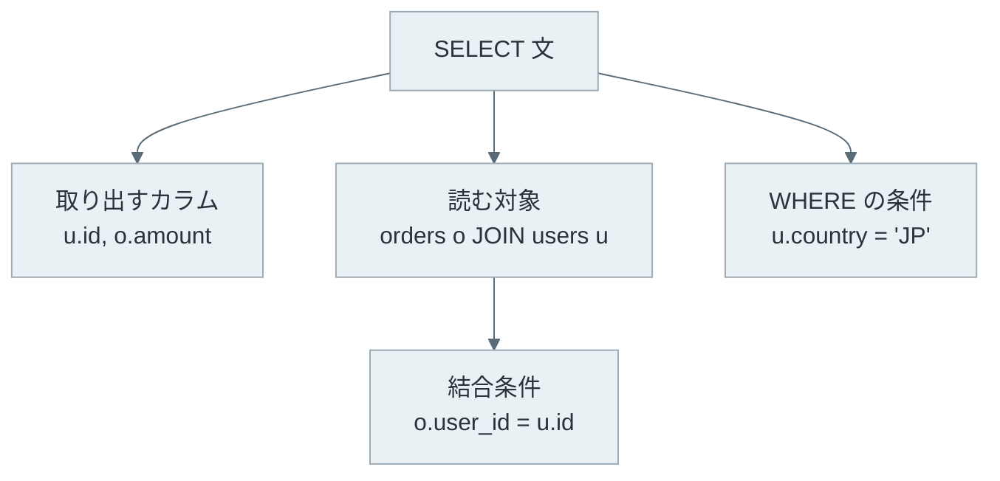
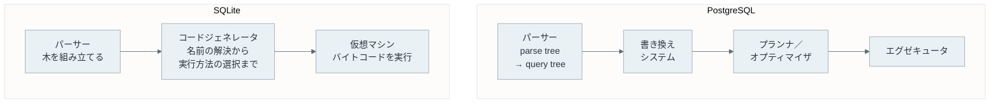
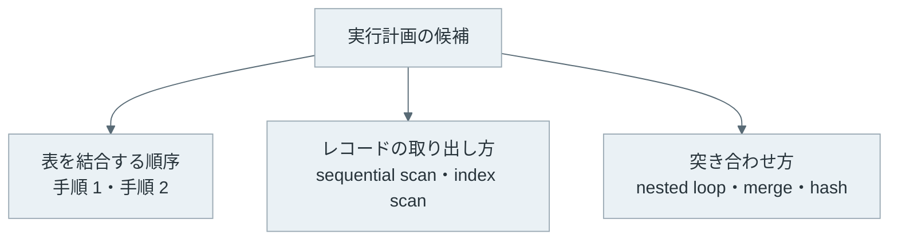
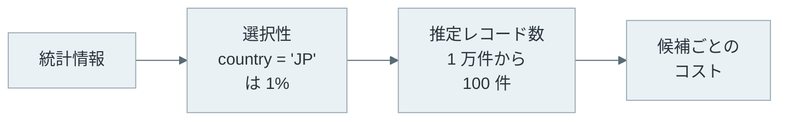
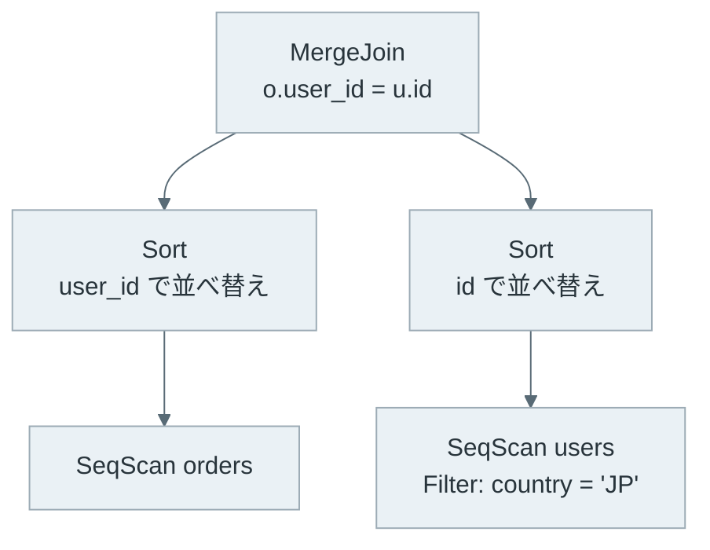
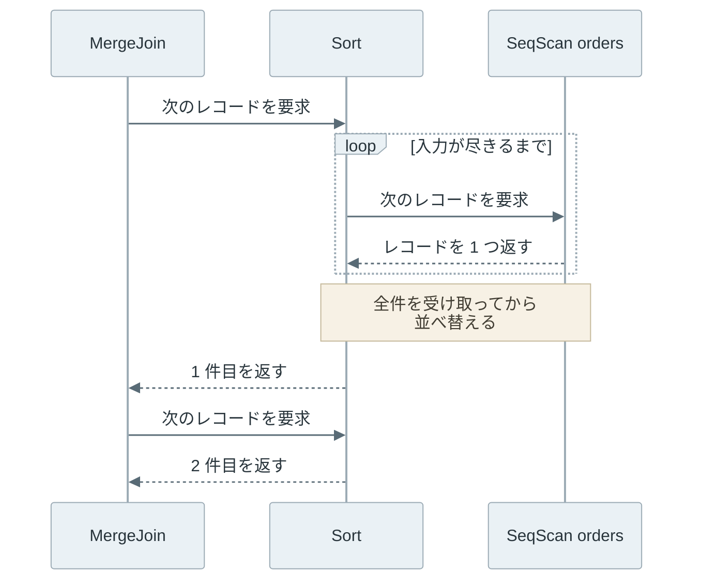

Query Processing（問い合わせ処理）は、DB（データベース）が受け取った SQL 文を実行可能な手順に変換し、その手順を動かして結果のレコードを返すまでの処理です。ここで選ばれた手順を実行計画（クエリプラン、query plan）と呼びます。

応答の遅い SQL を調べる時は、DB が選んだ実行計画を確認します。[PostgreSQL](https://www.postgresql.org/) で `EXPLAIN SELECT ...` と打つと、DB が選んだ手順が木の形で返ってきます。

この木を読めるようになると、遅い問い合わせのどの部分が原因なのかを絞り込めます。昨日まで速かった SQL が今日から遅い、という現象の理由も、木を見比べれば見当が付きます。以下は、SQL 文が結果のレコードになるまでの流れです。


- title: 構文解析
  body: SQL 文を読み、構文を表す木を作る。
- title: 名前・型などの解決
  body: 問い合わせの木を作る。
- title: 書き換え・実行方法の選択
  body: 実行計画を作る。
- title: 実行
  body: 計画に従って処理し、結果のレコードを返す。


同じ SQL 文でも、表の大きさや索引（インデックス）の有無が変われば、「実行方法を選ぶ」段階から出てくる実行計画は変わります。

<br>

本記事では、1 台の DB が 1 本の `SELECT` を処理する流れを説明します。手順を DB が決める理由から始めて、以下の疑問を扱います。

- なぜ SQL を書いた側ではなく、DB が実行手順を決めるのか。
- 構文解析と名前の解決では、SQL 文から何が作られるのか。
- DB は、複数の候補からコストでどう実行計画を選ぶのか。
- DB はなぜ東京の利用者 100 件を 1 件と見積もるのか。
- 選ばれた実行計画は、どう動いてレコードを取り出すのか。

複数の問い合わせが同時に走る時の並行制御と、処理を複数のノードや複数の CPU に分散する構成には触れません。

---

### 前提

処理を何段階に分けるかと、それぞれの段階の呼び名は DBMS（Database Management System）で違います。[PostgreSQL のドキュメント](https://www.postgresql.org/docs/current/query-path.html)は、接続の確立を別にするとパーサー、書き換えシステム、プランナ／オプティマイザ、エグゼキュータの 4 つに分けて説明しています。

本記事では次の 3 段階に分けて説明し、DBMS ごとの違いを補足します。構文を解析して名前や型を解決する段階、実行方法を選ぶ段階（プランナ。オプティマイザとも呼ぶ）、選んだ手順を動かす段階（実行器。PostgreSQL ではエグゼキュータ）です。

---

### DB が実行手順を決める理由

SQL は、欲しい結果の条件を書く言語です。どの表をどの順に読み、どの索引を使うかという手順は書きません。同じ結果を返す手順は複数あり、どれを選ぶかで読むレコード数が桁違いに変わります。例えば、利用者の表が 1 万件、注文の表が 100 万件あり、日本の利用者の注文だけを取り出すとします。

素朴に考えても、次の 2 つの手順が思い付きます。


- title: 手順 1：注文から始める
  steps:
  - 注文 100 万件を読む
  - 1 件ごとに利用者を引く
  - 日本の利用者だけ残す
- title: 手順 2：利用者から始める
  steps:
  - 利用者 1 万件から日本の 100 件を取り出す
  - 100 件それぞれについて、索引で注文を引く


どちらの手順も同じレコードの集まりを返します。しかし、突き合わせの起点になるのは、手順 1 では最後に捨てるレコードまで含めた 100 万件、手順 2 では 100 件で、4 桁の差があります。手順 2 も日本の 100 件を選ぶために利用者 1 万件を読むので、読む総量の差はこれより小さくなります。

手順 2 の有利さを大きく左右するのは、注文の表にある索引です。索引は、カラムの値から該当するレコードの在り処を引ける別のデータ構造です。日本の利用者 100 件それぞれについて `user_id` から対応する注文だけを探せるので、100 万件を読む手順 1 との差が開きます。索引の構造は [B-Tree](/notes/database-systems/b-tree/) のノートで扱っています。

索引が無くても、同じ結合の順で処理すること自体はできます。その場合は起点の 100 件それぞれについて注文の表を繰り返し調べることになり、手順 2 の方がかえって高コストになり得ます。結合の順序と、後から読む表からレコードを取り出す方法は別々の選択です。取り出し方が変われば、速い手順も入れ替わります。

<br>

どちらが選ばれるかは、アプリケーションに組み込んで使う DB である [SQLite](https://www.sqlite.org/) の実行計画で分かります。以下は、利用者 1 万件（うち日本は 100 件）と注文 100 万件を作り、注文の表を `FROM` の先頭に書いて実行計画を表示する SQL です。索引は `orders.user_id` にだけ張ります。

```sql
CREATE TABLE users (id INTEGER PRIMARY KEY, country TEXT);
CREATE TABLE orders (id INTEGER PRIMARY KEY, user_id INTEGER, amount INTEGER);
CREATE INDEX idx_orders_user_id ON orders(user_id);

-- id が 1〜100 の利用者だけを日本にする。
WITH RECURSIVE s(n) AS (SELECT 1 UNION ALL SELECT n + 1 FROM s WHERE n < 10000)
INSERT INTO users SELECT n, CASE WHEN n <= 100 THEN 'JP' ELSE 'US' END FROM s;
-- 注文は 1 人あたり 100 件ずつ割り振る。
WITH RECURSIVE s(n) AS (SELECT 1 UNION ALL SELECT n + 1 FROM s WHERE n < 1000000)
INSERT INTO orders SELECT n, n % 10000 + 1, n % 1000 FROM s;

EXPLAIN QUERY PLAN
SELECT u.id, o.amount
  FROM orders o JOIN users u ON o.user_id = u.id
 WHERE u.country = 'JP';
```

SQLite 3.45.3 の `sqlite3 :memory:` に流すと、実行計画は次の通りです。

```text
QUERY PLAN
|--SCAN u
`--SEARCH o USING INDEX idx_orders_user_id (user_id=?)
```

[SQLite のドキュメント](https://www.sqlite.org/eqp.html)によれば、`SCAN` は表を全部読むこと、`SEARCH` はレコードの一部だけを訪れることを表します。SQLite の結合は、外側の表を 1 件ずつ読み、そのレコードごとに内側の表から一致するレコードを探す入れ子のループで動きます。出力の項目は入れ子の順に並び、先に並ぶ項目が外側です。

上記の出力で外側に来ているのは、`FROM` の 2 番目に書いた `u`、つまり利用者の表です。`country` に索引が無いため全部読み、そこで得た日本の 100 件それぞれについて、内側で注文の表を索引で引いています。`(user_id=?)` の `?` には、外側から渡る `u.id` の値が入ります。手順 2 と同じ形です。

`FROM` の順を入れ替えて注文の表を後ろに書いても、返ってくる実行計画は同じでした。

<br>

[SQLite の結合](https://www.sqlite.org/optoverview.html)では、既定で `FROM` の左端の表が外側になります。ただし、良い索引を使えるなら入れ子の順序を変えます。並べ替えの対象になるのは内部結合で、外部結合（`LEFT JOIN` など）そのものは書いた順から並べ替えません。

どちらの表を外側にするかの材料は、索引の有無と、表のレコード数や条件を通るレコードの割合の見積もりです。この例では見積もりの材料を集める `ANALYZE` を実行しておらず、SQLite は表の実際のレコード数を知りません。表を空にしても同じ実行計画になったので、この計画は `orders.user_id` の索引と、統計が無い時の既定の推定値から選ばれています。

---

### 構文解析と名前の解決で作る問い合わせの木

最初の段階は構文解析です。文字列として届いた SQL が、取り出すカラム・読む対象・条件といった部品に分解され、SQL の文法だけを頼りにした木になります。以下は、先ほどの `SELECT` から作られる木です。



PostgreSQL の構文解析は、DB が自身のスキーマを格納したカタログを一切引きません（[PostgreSQL のドキュメント](https://www.postgresql.org/docs/current/parser-stage.html)）。そのため、上記の図の木に `users` という名前があっても、それがどの表を指すのかはまだ確認していません。木には読む順序も使う索引も入っておらず、実行計画に進む前に、名前と型の解決と、書き換えが行われます。

名前と型の解決では、カタログを引いて、`users` という表と `country` というカラムが本当にあるのか、`country` の型が何なのかを確認します。PostgreSQL はこの処理を transformation process と呼び、構文だけを表す木（parse tree）とは別に、意味を解決し終えた問い合わせの木（query tree）を作ります。

書き換えでは、例えばビューを読む問い合わせなら、ビューの名前がその定義に書かれた問い合わせに置き換わります。[PostgreSQL の書き換えシステム](https://www.postgresql.org/docs/current/query-path.html)は、システムカタログに格納された規則の中から、問い合わせの木に適用できるものを探して適用します。

<br>

この 2 つをどこで、どういう区切りで行うかは DBMS で違います。[SQLite](https://www.sqlite.org/arch.html) には独立した書き換えの段階が無く、パーサーが木を組み立てた後に、コードジェネレータがその木を解析してバイトコード（DB の内部だけで使う小さな命令列）を生成します。以下は、PostgreSQL の段階と並べた図です。



上記の図のように段階の数と呼び名が違っても、名前や型の解決を挟んでから実行方法の選択に進む順序は共通しています。

---

### コストによる実行方法の選択

同じ結果を返す実行計画は複数あり、その 1 つ 1 つを候補と呼びます。候補の数は結合する表が増えるほど急に増え、全ての候補を調べると過大な時間とメモリが掛かる場合があります。[PostgreSQL](https://www.postgresql.org/docs/current/planner-optimizer.html) は、結合する表の数がしきい値（設定項目 `geqo_threshold`）より少ない間は候補をほぼ網羅的に調べ、しきい値に達すると遺伝的アルゴリズムによる探索に切り替えます。

遺伝的アルゴリズムは、良い候補どうしを組み合わせて少しずつ改善する探索の方法で、全ての候補を調べません。最適な手順を必ず選ぶのではなく、妥当な手順を現実的な時間で選ぶ割り切りです。候補の絞り方は DBMS ごとに違い、[SQLite](https://www.sqlite.org/queryplanner-ng.html) は結合順を探す各段で良い経路を少数だけ残し、全ての候補を調べずに計画を作ります。

[PostgreSQL のプランナ](https://www.postgresql.org/docs/current/planner-optimizer.html)は、調べた候補の中から、見積もったコストが最も小さいものを選び、実行器に渡す実行計画にします。

候補どうしで大きく違うのは、表を結合する順序、1 つの表からレコードを取り出す方法、2 つのレコードの集まりを突き合わせる方法です。以下の図の手順 1・手順 2 は、「DB が実行手順を決める理由」で見たものです。



レコードの取り出し方は、表を先頭から順に読む方法（sequential scan）と、索引を辿って必要なレコードだけを読む方法（[index scan](/notes/database-systems/index-scan/)）が代表です。同じ動作でも `EXPLAIN` での名前は DBMS で違い、表の全走査を PostgreSQL は `Seq Scan`、SQLite は `SCAN` と表示します。

突き合わせ方として PostgreSQL が用意している 3 つを整理すると、以下の通りです。

| 結合アルゴリズム | やり方 | 選ばれやすい場面 |
| --- | --- | --- |
| nested loop join | 外側の入力から得た 1 件ごとに、内側の入力から一致するレコードを探す | 外側の入力のレコード数が少なく、内側を索引で引ける |
| merge join | 結合に使うカラムで両方の入力を整列してから、並行に読んで突き合わせる | 結合カラムの順序が索引で得られるか、整列してでも各入力を 1 回ずつの走査で済ませたい |
| hash join | 片方の入力を先に読んでハッシュ表を作り、もう片方を読みながら突き合わせる | 等値の結合で、ハッシュ表が作業用のメモリに収まる |

上記の表に書いた外側・内側や片方・もう片方は、実行時にどちらの入力から読むかを指し、SQL 文で先に書いた表とは限りません。

<br>

どの候補を選ぶかを決める材料が、統計情報です。PostgreSQL は、表と索引のレコード数とディスクブロック数を `pg_class` に、カラムの値の分布を `pg_statistic` に持ちます。どちらも問い合わせのたびには更新されず、`ANALYZE` などを実行した時点の値が使われます。

`pg_class` を更新するのは `ANALYZE` や `CREATE INDEX` などの一部の命令で、`pg_statistic` の項目は更新した直後でも「[always approximate](https://www.postgresql.org/docs/current/planner-stats.html)」（常に近似）です。

統計からコストが決まるまでには、間に 1 段挟まります。DB はまず統計から、条件を通るレコードの割合である選択性（selectivity）を見積もり、各条件を通った後に何件残るかを出します。

このレコード数の見積もりが推定レコード数（cardinality estimate）で、実際に残るレコード数（cardinality）とは別の値です。`country = 'JP'` が全体の 1% を通す条件だと推定できれば、1 万件の表からは 100 件が残る、という具合です。以下は、統計からコストまでの流れをこの例で示した図です。



上記の図の最後の段で求める候補ごとのコストは、推定レコード数を基に、そのレコードを読むのに何ページ触るか、突き合わせに何回比較するかを換算した値です。

先ほどの例で候補を 3 つ挙げると、注文を全走査して hash join する候補 1、手順 2 と同じく利用者を絞ってから索引で注文を引く候補 2、両方を整列して merge join する候補 3 です。

同じ利用者 1 万件と注文 100 万件を PostgreSQL 17.11 に入れ、他の結合方法を設定で外して、候補ごとの見積もりコストを `EXPLAIN` で表示しました。注文は利用者ごとに連続して入れ、並列実行は切っています。以下は候補 2 を表示する部分の抜粋です（全体は [lab/experiment.sql](https://github.com/nao1215/debimate/blob/main/content/notes/database-systems/query-processing/lab/experiment.sql)）。

```sql
-- hash join と merge join を外し、候補 2 だけを残す。
SET enable_hashjoin = off; SET enable_mergejoin = off; SET enable_bitmapscan = off;
EXPLAIN SELECT u.id, o.amount
  FROM orders o JOIN users u ON o.user_id = u.id
 WHERE u.country = 'JP';
```

```text
 Nested Loop  (cost=0.42..1277.50 rows=9985 width=8)
   ->  Seq Scan on users u  (cost=0.00..180.00 rows=100 width=4)
         Filter: (country = 'JP'::text)
   ->  Index Scan using idx_orders_user_id on orders o  (cost=0.42..9.98 rows=100 width=8)
         Index Cond: (user_id = u.id)
```

`cost` の 2 つ目の値が、最後のレコードを返し終えるまでの見積もりコストです。何も外さない既定の設定でも、PostgreSQL はこの候補 2 を選びました。3 つの候補の見積もりコストと、`EXPLAIN ANALYZE` で 5 回測った実行時間の中央値を以下に並べます。



左の図の値（Estimated cost）は、測った時間ではなく見積もりです。図の Plan 1〜3 は、本文の候補 1〜3 に当たります。この例では右の実行時間と順位がそろいましたが、統計が実際のデータと離れれば、推定レコード数とコストがずれ、候補の順位も入れ替わります。実行計画が突然変わったように見える現象は、統計の変化が主な原因の 1 つです。

<br>

データの並びも見積もりを動かします。注文を SQLite の例と同じく利用者に散らして入れた表では、候補 2 の見積もりが 21,655 に上がり、PostgreSQL は候補 1 を選びました。2 つの並びで候補 1 と候補 2 の見積もりコストを比べたのが以下の図です（[lab/output.txt](https://github.com/nao1215/debimate/blob/main/content/notes/database-systems/query-processing/lab/output.txt) の `orders_scattered`）。



変わったのは索引で引く候補 2 の見積もりだけで、注文を全走査する候補 1 は、どちらの並びでも 18,213 でした。

<br>

コストで選ぶ作りは PostgreSQL に限りません。[SQLite](https://www.sqlite.org/optoverview.html) も、競合する複数の実行計画について CPU とディスク入出力のコストを見積もります。統計は `ANALYZE` で集めて、`sqlite_stat` で始まる名前の表に格納します。ただし `ANALYZE` を実行するかどうかは任意で、集めていない間は、先の例のように組み込みの既定の推定値が使われます。

---

### 見積もりが外れやすいケース

推定レコード数がずれる原因は、統計の古さだけではありません。代表的な場面には次のものがあります。

- カラムどうしに相関がある条件で絞り込む場合
- 統計を集めた後で、大量のレコードを入れ替えた表を読む場合
- `WHERE status = $1` のように値を後から渡し、計画を作る時点で値が分からない場合
- 結合を何段も重ね、中間結果のレコード数の誤差が積み上がる場合

カラムどうしの相関とは、`country = 'JP' AND city = '東京'` のように、片方が決まるともう片方の取り得る値が絞られる関係を指します。カラムごとの分布だけを持っている場合、DB は 2 つの条件が[独立](/ml/math/joint-marginal-conditional/#独立と条件付き独立)だとみなして、それぞれの選択性を掛け合わせます。

例えば `country = 'JP'` を通るレコードが 1%、`city = '東京'` を通るレコードが 1% だとします。東京のレコードがほぼ全て日本である場合、独立とみなして掛け合わせた見積もりは 0.01% ですが、実際に残るのは 1% で、2 桁離れます。

見積もりが外れても、結果のレコードが間違うわけではありません。ずれるのは、どの手順が速いかという判断だけです。ずれているかどうかは、計画だけを表示する `EXPLAIN` では分かりません。[PostgreSQL](https://www.postgresql.org/docs/current/using-explain.html) の `EXPLAIN` は、`ANALYZE` を付けると問い合わせを実行し、計画の各部分で数えたレコード数と実行時間を見積もりと並べて表示します。

計画の中で見積もりと実際が大きく開いている箇所を探すと、遅さの原因を絞り込めます。なお、`EXPLAIN ANALYZE` は問い合わせを動かすので、更新を伴う文で使う時は影響に注意が必要です。

この偏りを持つ利用者 1 万件を PostgreSQL 17.11 に入れて、`EXPLAIN ANALYZE` を実行しました。`country` と `city` はどの値も 1% で、東京の 100 件は全て `JP` です。

```sql
CREATE TABLE users (id int PRIMARY KEY, country text, city text);
-- id が 1〜100 の利用者は日本の東京、残りは 99 組の国と都市に 100 件ずつ。
INSERT INTO users
SELECT n,
       CASE WHEN n <= 100 THEN 'JP' ELSE 'C' || (n % 99) END,
       CASE WHEN n <= 100 THEN '東京' ELSE 'T' || (n % 99) END
  FROM generate_series(1, 10000) AS n;
ANALYZE users;

-- 時間の表示を省き、レコード数だけを比べる。
EXPLAIN (ANALYZE, TIMING OFF, SUMMARY OFF)
SELECT * FROM users WHERE country = 'JP' AND city = '東京';
```

結果は以下の通りです。

```text
 Seq Scan on users  (cost=0.00..205.00 rows=1 width=10) (actual rows=100 loops=1)
   Filter: ((country = 'JP'::text) AND (city = '東京'::text))
   Rows Removed by Filter: 9900
```

括弧の 1 つ目の `rows` が推定レコード数、2 つ目の `actual rows` が実際のレコード数です。掛け合わせた 0.01% から 1 件と見積もり、実際には 100 件が残りました。表を 1 つ読むだけの問い合わせなので計画は変わりませんが、このレコード数が結合の材料になれば、前の節の 3 つの候補のコストがずれ、順位が入れ替わる原因になります。

PostgreSQL では、`CREATE STATISTICS users_dep (dependencies) ON country, city FROM users;` で片方のカラムからもう片方がどれだけ決まるかを集め、`ANALYZE` し直すと、同じ問い合わせの推定が `rows=100` になりました。

条件ごとの推定レコード数と実際のレコード数は以下の通りです（[lab/experiment.sql](https://github.com/nao1215/debimate/blob/main/content/notes/database-systems/query-processing/lab/experiment.sql)）。



1 つのカラムの条件では推定（estimated rows）と実際（actual rows）が一致し、外れたのは 2 つの条件を掛け合わせた所だけでした。

---

### 実行計画からレコードを引き出す実行器 {#実行計画から行を引き出す実行器}

実行計画は、レコードを作る部品を組み合わせた木です。表を走査する、2 つの入力を結合する、並べ替える、といった 1 つ 1 つの部品を演算子と呼びます。SQL に書く `=` や `AND` の演算子とは別のものを指します。

以下は、先ほどの問い合わせを merge join で処理する場合の実行計画です。この木は、名前の解決で作った問い合わせの木を基に、プランナが新しく組み立てたものです。



上記の図で、元の SQL の 2 つの条件は別々の演算子に置かれています。`u.country = 'JP'` は利用者の表を走査する所でレコードを絞る条件になり、`o.user_id = u.id` は 2 つの入力を突き合わせる条件になっています。1 つの表だけで判定できる条件は、その表を走査する演算子に寄せると、結合に渡るレコード数が減ります。

<br>

PostgreSQL の実行器では、上の演算子が下の演算子に次の 1 件を要求し、要求された演算子が 1 件だけ返します。返すレコードが尽きた演算子は、その旨を呼び出し元に伝えます。この作りは、PostgreSQL のドキュメントで「[demand-pull pipeline mechanism](https://www.postgresql.org/docs/current/executor.html)」（要求で引き出すパイプラインの仕組み）と呼ばれています。

この仕組みは一般に、各演算子が準備（open）・次の 1 件の生成（next）・後始末（close）の 3 つの手続きを持ち、上の演算子が下の演算子の next を呼ぶ形で説明されます。open・next・close は下記の Graefe 氏の論文が使う呼び名で、PostgreSQL のソースコードでは [`ExecInitNode`・`ExecProcNode`・`ExecEndNode`](https://github.com/postgres/postgres/blob/master/src/backend/executor/README) がそれぞれに当たります。

Goetz Graefe 氏の論文「[Query Evaluation Techniques for Large Databases](https://cs.uwaterloo.ca/~david/cs848s13/graefe.pdf)」（ACM Computing Surveys 25(2)）も同じ作りを整理していて、この形の演算子（iterator）を組み合わせれば、いくらでも複雑な実行計画を組み立てられるとしています。

以下は、上記の実行計画の木から `MergeJoin` の下で注文の表を並べ替える枝だけを取り出した、要求と応答の往復です。



上記の図の `Sort` が全件を待つのは、入力の順序を全く利用できない整列では、全件が揃わないと先頭が決まらないからです。hash join でハッシュ表を作る方の入力にも、同じ性質があります。

このように、最初の 1 件を返す前に入力の大半（場合によっては全部）を読む必要がある演算子を blocking operator と呼びます。レコードの流れがそこで一度せき止められるので、結果の 1 件目が返るまでの時間が延びます。`LIMIT` を付けて先頭の数件だけを取り出す問い合わせでは、この差が応答時間に出ます。

読み込んだ中間データを保持するので、メモリも使います。実装によっては、作業用に割り当てられたメモリに収まらない場合に、中間データの一部を一時ファイルなどのストレージに書き出して処理を続けます。

演算子の木を辿る作りが唯一の形ではありません。SQLite では、アプリケーションが `sqlite3_step()` を呼ぶと、コードジェネレータが生成したバイトコードが仮想マシンに渡って動きます。1 件ずつ結果を作って返す点は木を辿る作りと共通していて、違うのは木を降りるか命令列を進むかという実行の形です。

---

### 利点

- 表の大きさやデータの偏りが変わっても、SQL を書き直さずに実行手順だけが変わる
- 索引を追加すると、既存の問い合わせでもその索引を使う実行計画が候補に加わる
- 手順を書かずに済むため、SQL が業務上の条件だけを表す短い文で収まる
- 統計を更新した時も、DB のバージョンを上げて実装が変わった時も、その時点の情報と実装で手順が選び直される

---

### 欠点

Query Processing では、手順の決定を DB に預け、データの分布に応じて選ばせます。そのため、SQL の書き手には次の制約があります。

- 既定では手順を SQL に書かないので、何が選ばれたのかは `EXPLAIN` で確認するまで分からない
- 統計情報が古いと、実際のレコード数とかけ離れた見積もりのまま手順が選ばれる
- 結合する表が増えるほど候補が増え、広く探索する DBMS では実行計画を作る処理に時間が掛かる
- データ量や統計の更新をきっかけに手順が変わり、同じ SQL の応答時間が動く

多くの DBMS は、選ばれる手順に人が介入する手段を別に用意しています。特定のアルゴリズムを避けさせる設定、特定の索引を優先させる指定、探索する候補の範囲を狭める設定、実行方法をより強く指定するヒントなど、形はさまざまです。

例えば [SQLite](https://www.sqlite.org/optoverview.html) は、`CROSS JOIN` と書いた結合の順序を並べ替えないので、書き手がループの入れ子の順序を固定できます。どこまで強制できるかは DBMS と機能によって違い、あくまで選ばれやすさを変えるだけのものもあります。
