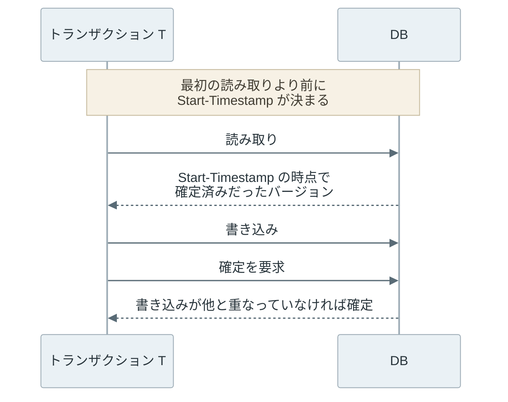
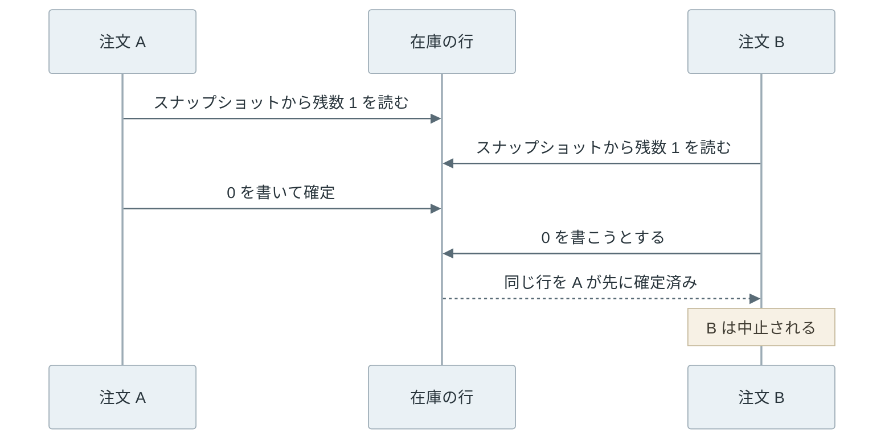
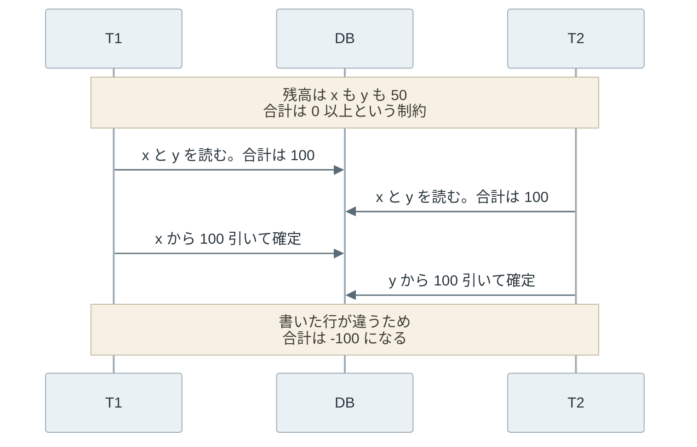
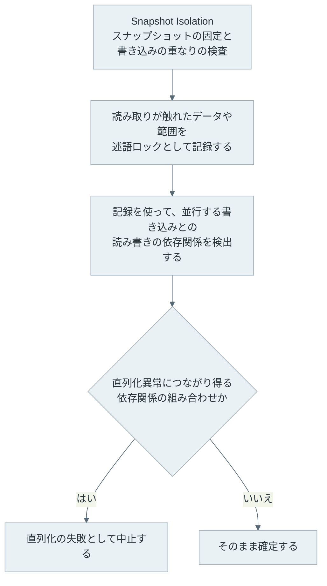

Snapshot Isolation は、トランザクションごとに 1 つのスナップショットを固定して読み、書き込みが重なった時に片方を中止する分離の方式です。分離とは、同時に走るトランザクションどうしが互いの途中の変更をどこまで見るかを決めることを指します。スナップショットは、ある時点までに確定した変更だけを含むデータの見え方です。DB は行の古いバージョンを残しておき、読む側が基準の時点に合うバージョンを選びます。

この方式が必要になる場面の代表は、長い集計と更新が同時に走る業務です。締め日の売上を集計する処理が数分走っている間も、注文の登録は止めたくないとします。読み取りをロックで守る作りでは、集計が読んだ行は集計が終わるまで更新できません。スナップショットから読めば、集計は最後まで同じ時点の値を読み続けられ、注文の登録も止めずに済みます。

1 本のトランザクションが、読みと書きで何を基準にするのかを以下に示します。



上記の図の Start-Timestamp（読み取りの基準になる時点）は、最初の読み取りより前に決まります。以降の読み取りは全部この 1 つの時点を基準にし、判定が入るのは書き込みの可否だけです。

本記事では、Snapshot Isolation が何を防いで何を防がないのか、その境目が他の実現方式とどう違うのかを説明します。読み取りの作りから順に、次の疑問を取り上げます。

- スナップショットから読むと、なぜ読み手が書き手を待たずに済むのか。
- 同じデータへの書き込みが重なった時、どちらが中止されるのか。
- 別々の行を書く 2 本は、なぜ両方とも確定して合計を負にできるのか（write skew）。
- locking REPEATABLE READ や PostgreSQL の REPEATABLE READ とは、何が違うのか。
- write skew は、Serializable Snapshot Isolation や明示的なロックでどこまで止められるのか。

分離レベルの意味と、dirty read・nonrepeatable read・phantom read・lost update という異常の名前は [Transaction Isolation](../transaction-isolation/) で扱っているので、本記事では繰り返しません。行のバージョンを併存させる MVCC の仕組みも同じノートにあります。

---

### スナップショットを固定した読み取り

Snapshot Isolation は、Berenson 氏らが 1995 年に発表した論文「[A Critique of ANSI SQL Isolation Levels](https://www.microsoft.com/en-us/research/wp-content/uploads/2016/02/tr-95-51.pdf)」が定義した方式です。SQL 標準が名前を付けた 4 つの分離レベルとは別の方式で、標準の表には出てきません。論文には、各トランザクションが Start-Timestamp で確定済みだったデータのスナップショットから読む方式だと説明されています。

スナップショットが固定されるといっても、見えなくなるのは他のトランザクションが後から確定した変更だけです。自分がそのトランザクションの中で書いた変更は、後の読み取りから見えます。

読み手は書き手の確定を待ちません。論文によれば、Snapshot Isolation で走るトランザクションは、Start-Timestamp のスナップショット（そのための古いバージョン）を保てる限り、読み取りで止められることがありません。

---

### 書き込みの重なりを止める first-committer-wins

読み取りが待たないだけでは、[Transaction Isolation](../transaction-isolation/) の冒頭で見た在庫の取り合いは止まりません。2 本とも同じ残数 1 を読み、両方が 0 を書けてしまいます。Snapshot Isolation は、書き込みに検査を置いてこれを止めます。

論文が定めた条件では、T1 が確定できるのは、T1 の実行区間 [Start-Timestamp, Commit-Timestamp] の中に Commit-Timestamp を持つ別のトランザクションが、T1 と同じデータを書いていない場合に限られます。満たさなければ T1 は中止されます。論文はこの規律を first-committer-wins と呼び、lost update を防ぐと説明しています。



commit の時点で検査するこの形は論文の概念モデルで、実装が同じ形を取るとは限りません。PostgreSQL の REPEATABLE READ は、書き込みの時点で先に更新した相手を待ち、相手が確定していれば、順に実行したとはみなせないとして中止します（直列化の失敗）。待ちが入る点が違い、片方が中止される結果は同じです。

---

### 別々の行を書く write skew

first-committer-wins が見ているのは、同じデータへの書き込みが重なったかどうかです。2 本が別々の行を書けば、この検査には掛かりません。論文が write skew と名付けた異常で、読んだ結果に基づいて別々の行を書き、その組み合わせで初めて破れる制約がある場合に現れます。

例えば、2 つの口座に掛かる制約は次のように破れます。



上記の図の 2 本は同じスナップショットを見て、別の行を書きます。書き込みが重なっていないので first-committer-wins は働かず、両方とも確定します。

上記の図と同じ順序の操作を PostgreSQL 17.10 の 2 本の接続で実際に動かすと、以下のようになります。分離レベルは REPEATABLE READ で、T2 は T1 が確定する前に読みます（出力は抜粋）。

```text
-- T1
BEGIN ISOLATION LEVEL REPEATABLE READ;
SELECT sum(balance) FROM accounts;   -- 100
-- T2
BEGIN ISOLATION LEVEL REPEATABLE READ;
SELECT sum(balance) FROM accounts;   -- 100
-- T1
UPDATE accounts SET balance = balance - 100 WHERE id = 'x';
COMMIT;
-- T2
UPDATE accounts SET balance = balance - 100 WHERE id = 'y';
COMMIT;
-- 2 本が確定した後
SELECT sum(balance) FROM accounts;   -- -100
```

エラーも待ちも起きず、2 本とも `COMMIT` を通りました。どちらも自分のスナップショットの中では合計 0 を残す計算をしており、制約を破っているのは確定した後の状態だけです。既にある行を書き換える場合に限らず、条件に合う行を数える制約も、2 本がそれぞれ別の行を挿入することで壊れます。

---

### locking REPEATABLE READ との違い

論文は、Snapshot Isolation と REPEATABLE READ を包含関係にない 2 つとして置いています。ここで論文が指す REPEATABLE READ は、読み取りのロックを確定まで持つ形で実現したものです。比べているのは 2 つの実現方式であって、標準のレベル名ではありません。

2 つの性質を整理すると、以下の通りです。

| | locking REPEATABLE READ | Snapshot Isolation |
| --- | --- | --- |
| 読み取りの作り | 読んだ行のロックを確定まで持つ | 固定したスナップショットから読む |
| 同じデータで競合した時 | 読んだ行への書き込みが待たされる | 読み取りと書き込みは待ち合わせない |
| write skew | 読んだ行を相手が書けないので起きない | 起きる |
| 同じ条件で読み直した時 | 条件に合う行が新しく挿入されると結果が変わる | スナップショットが動かないので結果は変わらない |

上記の表の下 2 行では、防ぐ異常が逆になっています。片方が防ぐ異常をもう片方が許すので、どちらが強いとは決まりません。

---

### PostgreSQL の REPEATABLE READ との関係

PostgreSQL の REPEATABLE READ は、学術文献や他の DB で「[Snapshot Isolation](https://www.postgresql.org/docs/current/transaction-iso.html)」として知られる技術で実装されています。先ほどの実験で 2 本とも確定したのは、この実装だからです。

REPEATABLE READ という名前が Snapshot Isolation を意味するわけではありません。標準が定めているのは、そのレベルで起きてはならない現象までで、実現方式は DBMS が決めます。同じ名前で読み取りのロックを使う実装なら、write skew は起きません。

---

### Serializable Snapshot Isolation が足す検査

トランザクションを 1 本ずつ順に実行した場合（直列）のどの順序とも一致しない結果を直列化異常と呼びます。口座の例は、T1→T2 でも T2→T1 でも 2 本目が残高不足に気付くので、合計 -100 は直列では起きません。

Snapshot Isolation に直列化異常の検査を足し、write skew のような異常を防ぐ方式の 1 つが Serializable Snapshot Isolation（SSI）です。

PostgreSQL の SERIALIZABLE は「[Serializable Snapshot Isolation](https://www.postgresql.org/docs/current/transaction-iso.html)」（SSI）で実装されています。

足されるのは、トランザクションの間の読み書きの依存関係を追う仕組みです。PostgreSQL は、読み取りが実際に触れたデータや範囲を述語ロック（predicate lock）として記録します。この記録は、ある書き込みが、並行して走る別のトランザクションが先に読んだ結果を変えていたかどうかの判定に使われます。口座の例なら、T1 が x と y を読んだことを記録しておき、T2 が y を書いた時に、T1 が読んだものを T2 が書き換えたという依存を見付けます。

記録した依存関係のうち、直列化異常につながり得る組み合わせが見付かると、そのトランザクションは直列化の失敗として中止されます。先ほどの実験を SERIALIZABLE で動かすと、T2 の `UPDATE` が `could not serialize access due to read/write dependencies among transactions` で中止され、T1 だけが確定した合計は 0 で止まりました。



述語ロックは名前にロックが付いていても待ちを起こさず、デッドロックの原因にもなりません。

この検査が効くのは、相手も SERIALIZABLE の場合だけです。

---

### 明示的なロックで押さえられる範囲

アプリケーション側で write skew を止める手もあります。`SELECT ... FOR UPDATE` のように、読む時点で行にロックを取る書き方です。ロックを取れば、その行は自分のトランザクションが終わるまで他から更新されません。

口座の例なら、T1 と T2 の両方が x と y の 2 行を同じ規則でロックして読む必要があり、片方だけでは防げません。

押さえられるのは、壊れる制約に関わる行を全部ロックできる場合です。まだ存在しない行が制約に関わるなら、行ロックには掴む対象がありません。

加えて、`LOCK TABLE` のような明示的なロックで書き込みを止めて最新の確定状態を検査する場合は、スナップショットが固定される前にロックを取る必要があります。アプリケーション側での整合性の検査を扱う[ページ](https://www.postgresql.org/docs/current/applevel-consistency.html)にも、REPEATABLE READ では問い合わせより先にロックを取るようにとあります。順序が逆でスナップショットが先に固定されていると、ロックを取って以降の書き込みを止めても、その前に別のトランザクションが確定した変更は見えないままです。

[Soft Delete](../soft-delete/) のノートでも、状態の遷移を 1 本ずつ順に処理させる手当てとして同じ書き方を挙げています。

---

### 利点

- 読み取りが書き込みを待たないので、長い集計と更新を同時に走らせられる
- 他のトランザクションが途中で確定した変更で、複数の問い合わせの基準時点がずれない
- lost update が DBMS の検査で止まり、アプリケーション側で読み直しを組む手間が減る
- 書き込みをしないトランザクションは、first-committer-wins では中止されない

---

### 欠点

Snapshot Isolation は、読み取りを待たせない代わりに、書き込みの重なりしか検査しません。そのため、次の制約があります。

- 別々の行を書く write skew が残り、壊れたことは結果の値としてだけ現れる
- 書き込みが重なったトランザクションは中止されるので、再試行の処理が必要
- 古いバージョンを保持する領域が必要で、長いトランザクションがあるほど溜まる
- SQL 標準に Snapshot Isolation という分離レベル名が無く、標準のレベル名だけからは実現方式を判別できない
