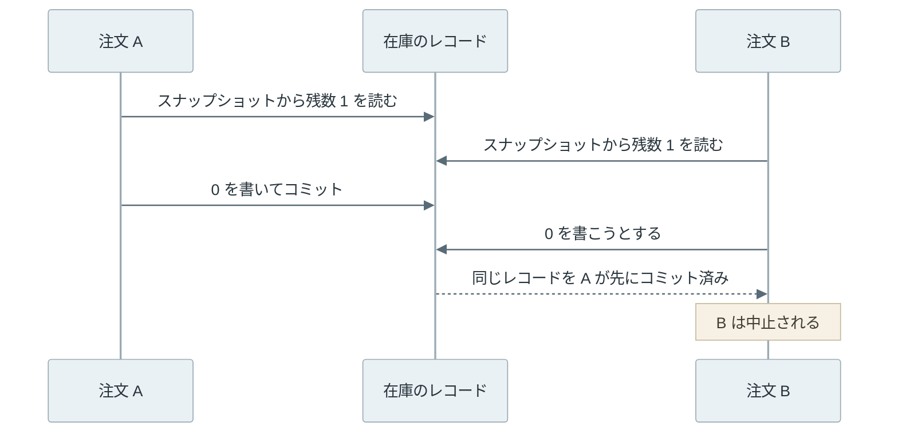
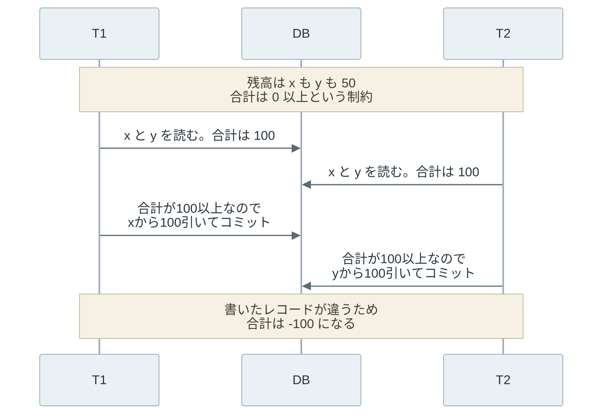
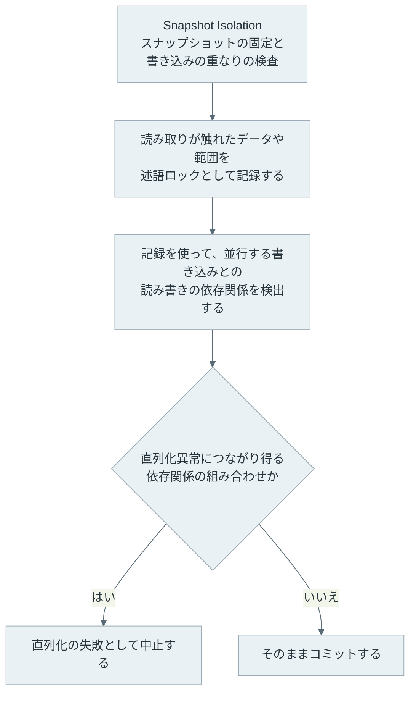

Snapshot Isolation は、トランザクションごとに 1 つのスナップショットを固定して読み、書き込みが重なった時に片方を中止する分離の方式です。分離とは、同時に走るトランザクションどうしが互いの途中の変更をどこまで見るかを決めることを指します。スナップショットは、ある時点までにコミット（commit）した変更だけを含むデータの見え方です。

DB はレコードの古いバージョンを残しておき、読む側が基準の時点に合うバージョンを選びます。

締め日の売上を集計する処理が数分走っている間も、注文の登録は止めたくないとします。読み取りをロックで守る作りでは、集計が読んだレコードは集計が終わるまで更新できません。スナップショットから読めば、集計は最後まで同じ時点の値を読み続けられ、注文の登録も止めずに済みます。

2 本のトランザクションが、口座 x と y の残高（どちらも 50）を読んでから書く場合を以下に示します。



上記の図の縦線が Start-Timestamp（読み取りの基準になる時点）で、最初の読み取りより前に決まります。以降の読み取りは全部この 1 つの時点を基準にし、判定が入るのは書き込みの重なりだけです。書いたレコードが違う 2 本は両方ともコミットし、2 口座の合計は -100 になります。この異常を write skew と呼びます。

<br>

本記事では、Snapshot Isolation が何を防いで何を防がないのか、その境目が他の実現方式とどう違うのかを説明します。読み取りの作りから順に、次の疑問を取り上げます。

- スナップショットから読むと、なぜ読み手が書き手を待たずに済むのか。
- 同じデータへの書き込みが重なった時、どちらが中止されるのか。
- 別々のレコードを書く 2 本は、なぜ両方ともコミットして合計を負にできるのか（write skew）。
- locking REPEATABLE READ や PostgreSQL の REPEATABLE READ とは、何が違うのか。
- write skew は、Serializable Snapshot Isolation や明示的なロックでどこまで止められるのか。

分離レベルの意味と、dirty read・nonrepeatable read・phantom read・lost update という異常の名前は [Transaction Isolation](../transaction-isolation/) で扱っているので、本記事では繰り返しません。レコードのバージョンを併存させる MVCC の仕組みも同じノートにあります。

---

### スナップショットを固定した読み取り

Snapshot Isolation は、Berenson 氏らが 1995 年に発表した論文「[A Critique of ANSI SQL Isolation Levels](https://www.microsoft.com/en-us/research/wp-content/uploads/2016/02/tr-95-51.pdf)」が定義した方式です。SQL 標準が名前を付けた 4 つの分離レベルとは別の方式で、標準の表には出てきません。

論文には、各トランザクションが Start-Timestamp でコミット済みだったデータのスナップショットから読む方式だと説明されています。

スナップショットが固定されるといっても、見えなくなるのは他のトランザクションが後からコミットした変更だけです。自分がそのトランザクションの中で書いた変更は、後の読み取りから見えます。

Snapshot Isolation では、Start-Timestamp のスナップショットに必要な古いバージョンを保持できる限り、読み取りが書き込みの完了を待つことはありません。

---

### 書き込みの重なりを止める first-committer-wins

読み取りが待たないだけでは、[Transaction Isolation](../transaction-isolation/) の冒頭で見た在庫の取り合いは止まりません。2 本とも同じ残数 1 を読み、両方が 0 を書けてしまいます。Snapshot Isolation は、書き込みに検査を置いてこれを止めます。

論文が定めた条件では、T1 がコミットできるのは、T1 の実行区間 [Start-Timestamp, Commit-Timestamp] の中に Commit-Timestamp を持つ別のトランザクションが、T1 と同じデータを書いていない場合に限られます。満たさなければ T1 は中止されます。

論文はこの規律を first-committer-wins と呼び、lost update を防ぐと説明しています。



commit の時点で検査するこの形は論文の概念モデルで、実装が同じ形を取るとは限りません。[PostgreSQL の REPEATABLE READ](https://www.postgresql.org/docs/current/transaction-iso.html#XACT-REPEATABLE-READ) は、書き込みの時点で先に更新した相手を待ち、相手がコミットしていれば、順に実行したとはみなせないとして中止します（直列化の失敗）。待ちが入る点が違い、片方が中止される結果は同じです。

---

### 別々のレコードを書く write skew {#別々の行を書く-write-skew}

first-committer-wins が見ているのは、同じデータへの書き込みが重なったかどうかです。2 本が別々のレコードを書けば、この検査には掛かりません。論文が write skew と名付けた異常で、読んだ結果に基づいて別々のレコードを書き、その組み合わせで初めて破れる制約がある場合に現れます。

引き出しには「2 口座の合計が 100 以上なら指定口座から 100 を引き、それ未満なら更新しない」という規則を設けます。個別口座が負になることは許し、2 口座の合計を 0 以上に保つ例です。この条件なら、直列に処理した時は 2 本目が残高不足に気付き、合計が負になる引き出しを止められます。

この規則を並行して実行すると、次のように制約が破れます。



上記の図の 2 本は同じスナップショットを見て、別のレコードを書きます。書き込みが重なっていないので first-committer-wins は働かず、両方ともコミットします。

次の疑似コードは、x と y それぞれの口座に対して実行します。読み取り、条件判断、更新を同じトランザクションに含めます。

```text
BEGIN ISOLATION LEVEL REPEATABLE READ
合計 = SELECT sum(balance) FROM accounts
if 合計 >= 100:
    UPDATE accounts SET balance = balance - 100 WHERE id = 対象口座
    COMMIT
else:
    ROLLBACK  # 残高不足。更新しない
```

[実験コード](./lab/run.py)では、初期値を x=50、y=50 に揃え、同じ条件付き処理を 3 通りの順序・分離レベルで実行します。並行のケースは 2 接続の読み取りを先に終え、T1 をコミットしてから T2 を更新します。直列のケースは T1 のコミット後に T2 を開始します。

`Session` は接続を開いたまま SQL を実行し、`scenario` は読み取りと更新の順序を変えて比較します。

<br>

<details>
<summary>run.py の全体（Docker で PostgreSQL 17 を起動し、3 通りを実行して停止する）</summary>

```python
"""条件付き引き出しを直列・並行で比較する。Python 3とDocker、postgres:17が必要。
python3 run.py : 外部ポート/永続ボリュームを使わず専用コンテナを最後に停止する。
"""

import subprocess
import time
import uuid

name = 'snapshot-lab-' + uuid.uuid4().hex[:10]


def docker(*args, **kwargs):
    return subprocess.run(['docker', *args], text=True, check=True, **kwargs)


class Session:
    def __init__(self):
        self.p = subprocess.Popen(
            [
                'docker',
                'exec',
                '-i',
                name,
                'psql',
                '-X',
                '-Atq',
                '-v',
                'ON_ERROR_STOP=1',
                '-U',
                'postgres',
                '-h',
                '127.0.0.1',
            ],
            stdin=subprocess.PIPE,
            stdout=subprocess.PIPE,
            stderr=subprocess.PIPE,
            text=True,
        )

    def sql(self, sql):
        marker = 'end_' + uuid.uuid4().hex
        self.p.stdin.write(sql + "\nSELECT '" + marker + "';\n")
        self.p.stdin.flush()
        lines = []
        while True:
            line = self.p.stdout.readline()
            if not line:
                error = self.p.stderr.read()
                self.p.wait(timeout=10)
                raise RuntimeError(error.strip())
            if line.strip() == marker:
                return lines
            lines.append(line.strip())

    def close(self):
        if self.p.poll() is None:
            self.p.stdin.close()
            self.p.wait(timeout=10)
        self.p.stdout.close()
        self.p.stderr.close()


def scenario(label, isolation, parallel):
    admin = Session()
    a, b = Session(), Session()
    try:
        admin.sql("TRUNCATE accounts; INSERT INTO accounts VALUES ('x', 50), ('y', 50);")
        decisions, seen = [], []
        a.sql('BEGIN ISOLATION LEVEL ' + isolation + ';')
        first = int(a.sql('SELECT sum(balance) FROM accounts;')[0])
        if parallel:
            b.sql('BEGIN ISOLATION LEVEL ' + isolation + ';')
            second = int(b.sql('SELECT sum(balance) FROM accounts;')[0])
        # 同じアプリケーション規則: 合計が100以上なら100を引く。
        for i, (session, account) in enumerate([(a, 'x'), (b, 'y')]):
            if i == 1 and not parallel:
                b.sql('BEGIN ISOLATION LEVEL ' + isolation + ';')
                second = int(b.sql('SELECT sum(balance) FROM accounts;')[0])
            total = first if i == 0 else second
            seen.append(total)
            if total < 100:
                session.sql('ROLLBACK;')
                decisions.append('insufficient')
                continue
            try:
                session.sql(
                    "UPDATE accounts SET balance = balance - 100 WHERE id = '"
                    + account
                    + "'; COMMIT;"
                )
                decisions.append('committed')
            except RuntimeError as error:
                if 'could not serialize access' not in str(error):
                    raise
                decisions.append('serialization_failure')
        final = int(admin.sql('SELECT sum(balance) FROM accounts;')[0])
        print(f'{label}: seen={seen}, decisions={decisions}, total={final}')
        expected = (
            ([100, 0], ['committed', 'insufficient'], 0)
            if not parallel
            else (
                ([100, 100], ['committed', 'committed'], -100)
                if isolation == 'REPEATABLE READ'
                else ([100, 100], ['committed', 'serialization_failure'], 0)
            )
        )
        assert (seen, decisions, final) == expected
    finally:
        a.close()
        b.close()
        admin.close()


try:
    docker(
        'run',
        '-d',
        '--rm',
        '--name',
        name,
        '--network',
        'none',
        '--tmpfs',
        '/var/lib/postgresql/data',
        '-e',
        'POSTGRES_HOST_AUTH_METHOD=trust',
        'postgres:17',
        stdout=subprocess.DEVNULL,
    )
    for _ in range(60):
        ready = subprocess.run(
            ['docker', 'exec', name, 'pg_isready', '-U', 'postgres', '-h', '127.0.0.1'],
            stdout=subprocess.DEVNULL,
            stderr=subprocess.DEVNULL,
        )
        if ready.returncode == 0:
            break
        time.sleep(0.5)
    else:
        raise RuntimeError('PostgreSQL did not become ready')
    admin = Session()
    try:
        print('PostgreSQL', admin.sql('SHOW server_version;')[0])
        admin.sql('CREATE TABLE accounts (id text PRIMARY KEY, balance integer NOT NULL);')
    finally:
        admin.close()
    scenario('serial RR', 'REPEATABLE READ', False)
    scenario('parallel RR', 'REPEATABLE READ', True)
    scenario('parallel SERIALIZABLE', 'SERIALIZABLE', True)
finally:
    subprocess.run(['docker', 'stop', name], stdout=subprocess.DEVNULL, stderr=subprocess.DEVNULL)
```

</details>

<br>

Python 3 と [Docker](https://docs.docker.com/) が使える環境で `python3 run.py` を実行できます。専用の PostgreSQL コンテナを使い、外部ポートや永続ボリュームを作らず、実験後に停止します。以下は PostgreSQL 17.11 での出力です。

```text
serial RR: seen=[100, 0], decisions=['committed', 'insufficient'], total=0
parallel RR: seen=[100, 100], decisions=['committed', 'committed'], total=-100
parallel SERIALIZABLE: seen=[100, 100], decisions=['committed', 'serialization_failure'], total=0
```

`seen` は各接続が読んだ合計、`decisions` はコミット・残高不足・直列化失敗、`total` は実行後の合計です。直列実行では 2 本目が 0 を読み、引き出しを止めます。

一方で、並行の REPEATABLE READ では両方が 100 を読むため、条件を満たしたと判断して別々のレコードを更新し、合計が -100 になりました。

既にあるレコードを書き換える場合だけでなく、条件に合うレコード数を制約にした処理でも、各接続が別のレコードを追加することで制約を破る場合があります。

---

### locking REPEATABLE READ との違い

論文で比較する Snapshot Isolation と REPEATABLE READ は、それぞれ防止できる異常が異なり、包含関係にはありません。ここで論文が指す REPEATABLE READ は、読み取りのロックをコミットまで持つ形で実現したものです。比べているのは 2 つの実現方式であって、標準のレベル名ではありません。

2 つの性質を整理すると、以下の通りです。

| | locking REPEATABLE READ | Snapshot Isolation |
| --- | --- | --- |
| 読み取りの作り | 読んだレコードのロックをコミットまで持つ | 固定したスナップショットから読む |
| 同じデータで競合した時 | 読んだレコードへの書き込みが待たされる | 読み取りと書き込みは待ち合わせない |
| write skew | 読んだレコードを相手が書けないので起きない | 起きる |
| 同じ条件で読み直した時 | 条件に合うレコードが新しく挿入されると結果が変わる | スナップショットが動かないので結果は変わらない |

上記の表の下 2 行では、防ぐ異常が逆になっています。片方が防ぐ異常をもう片方が許すので、どちらが強いとは決まりません。

---

### PostgreSQL の REPEATABLE READ との関係

PostgreSQL の REPEATABLE READ は、学術文献や他の DB で「[Snapshot Isolation](https://www.postgresql.org/docs/current/transaction-iso.html)」として知られる技術で実装されています。先ほどの実験で 2 本ともコミットしたのは、この実装だからです。

REPEATABLE READ という名前が Snapshot Isolation を意味するわけではありません。標準が定めているのは、そのレベルで起きてはならない現象までで、実現方式は DBMS が決めます。同じ名前で読み取りのロックを使う実装なら、write skew は起きません。

---

### Serializable Snapshot Isolation による直列化異常の検査

トランザクションを 1 本ずつ順に実行した場合（直列）のどの順序とも一致しない結果を直列化異常と呼びます。口座の例は、T1→T2 でも T2→T1 でも 2 本目が残高不足に気付くので、合計 -100 は直列では起きません。

Snapshot Isolation は、別々のレコードを更新して全体の制約を壊す write skew を防げません。Serializable Snapshot Isolation（SSI）は、トランザクション間の読み書きの依存関係を監視し、直列化異常につながり得る組み合わせを検出すると、トランザクションを中止する方式です。

SSI は、Cahill 氏らが 2008 年の論文「[Serializable Isolation for Snapshot Databases](https://doi.org/10.1145/1376616.1376690)」で示しました。PostgreSQL の SERIALIZABLE は、この [SSI](https://www.postgresql.org/docs/current/transaction-iso.html) で実装されています。

依存関係を調べるために、PostgreSQL は、読み取りが実際に触れたデータや範囲を述語ロック（predicate lock）として記録します。この記録は、ある書き込みが、並行して走る別のトランザクションが先に読んだ結果を変えていたかどうかの判定に使われます。

口座の例なら、T1 と T2 が x と y を読んだことを記録しておきます。T1 が x を書くと、T2 が読んだものを T1 が書き換えたという依存が見付かり、T2 が y を書くと逆向きの依存が見付かります。PostgreSQL は依存が 1 本あるだけでは中止せず、この例のように 2 本が連続してつながる形を見付けた時に中止を考えます。PostgreSQL 17 の [README-SSI](https://github.com/postgres/postgres/blob/REL_17_STABLE/src/backend/storage/lmgr/README-SSI) は、この形を dangerous structure と呼んでいます。

記録した依存関係のうち、直列化異常につながり得る組み合わせが見付かると、関係するいずれかのトランザクションが直列化の失敗として中止されます。先ほどの実験を SERIALIZABLE で動かすと、T2 は更新・コミットの途中で `could not serialize access` を含むエラーを受け、T1 だけがコミットしました。合計は 0 です。

一般には失敗が更新時に起きるかコミット時に起きるかまで決め打ちせず、トランザクション全体を[再試行](/notes/distributed-systems/retry-backoff/)できるようにします。再試行時は合計を読み直すため、この例では残高不足で引き出しを止めます。



述語ロックは読み取りを記録する仕組みで、他のトランザクションを待たせるロックではありません。そのため、述語ロック自体は[デッドロック](/notes/database-systems/deadlock/)を起こしません。SSI による直列化の保証を得るには、制約に関わる各トランザクションを SERIALIZABLE で実行します。

---

### 明示的なロックで押さえられる範囲

アプリケーション側で write skew を止める手もあります。`SELECT ... FOR UPDATE` のように、読む時点でレコードにロックを取る書き方です。ロックを取れば、そのレコードは自分のトランザクションが終わるまで他から更新されません。

口座の例なら、T1 と T2 の両方が x と y の 2 件を同じ規則でロックして読む必要があり、片方だけでは防げません。この方法で制約を守れるのは、制約に関わるレコードを全部ロックできる場合です。まだ存在しないレコードの追加が制約を壊す場合は、行ロックだけでは防げません。

加えて、`LOCK TABLE` のような明示的なロックで書き込みを止めて最新のコミット済みデータを検査する場合は、スナップショットが固定される前にロックを取る必要があります。アプリケーション側での整合性の検査を扱う[ページ](https://www.postgresql.org/docs/current/applevel-consistency.html)にも、REPEATABLE READ では問い合わせより先にロックを取るようにとあります。

順序が逆でスナップショットが先に固定されていると、ロックを取って以降の書き込みを止めても、その前に別のトランザクションがコミットした変更は見えないままです。

[Soft Delete](../soft-delete/) のノートでも、状態の遷移を 1 本ずつ順に処理させる手当てとして同じ書き方を挙げています。

---

### 利点

- 読み取りが書き込みを待たないので、長い集計と更新を同時に走らせられる
- 他のトランザクションが途中でコミットした変更で、複数の問い合わせの基準時点がずれない
- lost update が DBMS の検査で止まり、アプリケーション側で読み直しを組む手間が減る
- 書き込みをしないトランザクションは、first-committer-wins では中止されない

---

### 欠点

Snapshot Isolation は、読み取りを待たせない代わりに、書き込みの重なりしか検査しません。そのため、次の制約があります。

- 別々のレコードを書く write skew が残り、壊れたことは結果の値としてだけ現れる
- 書き込みが重なったトランザクションは中止されるので、再試行の処理が必要
- 古いバージョンを保持する領域が必要で、長いトランザクションがあるほど溜まる
- SQL 標準に Snapshot Isolation という分離レベル名が無く、標準のレベル名だけからは実現方式を判別できない
