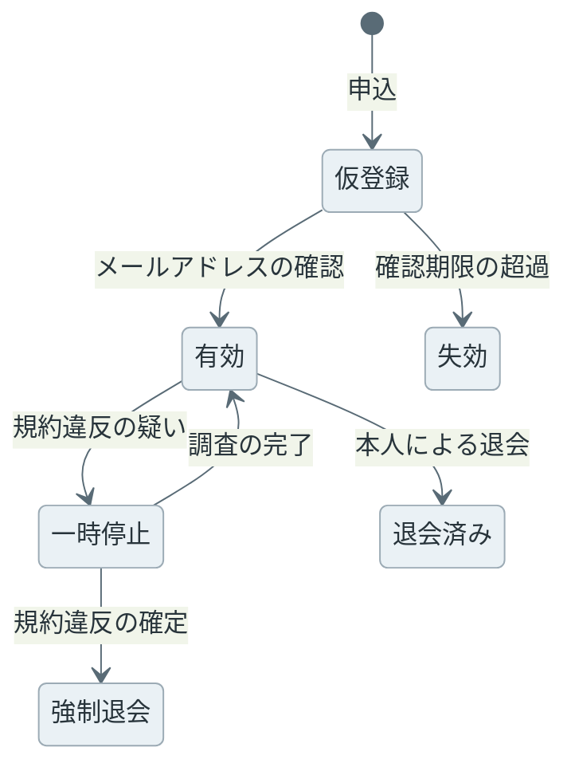
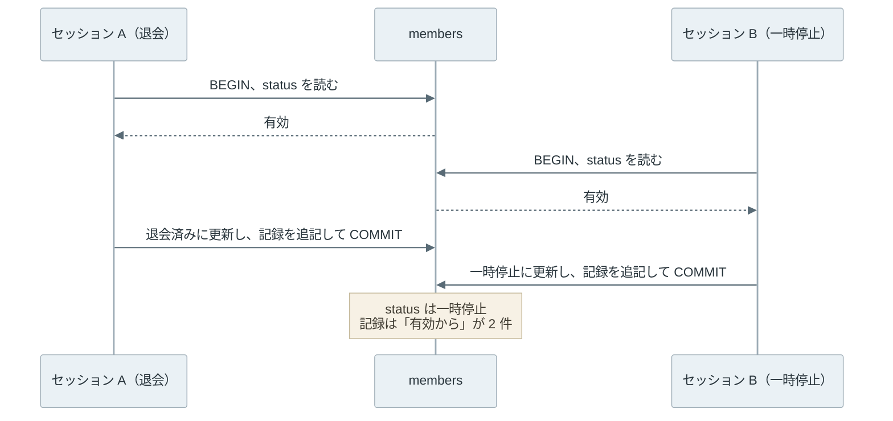
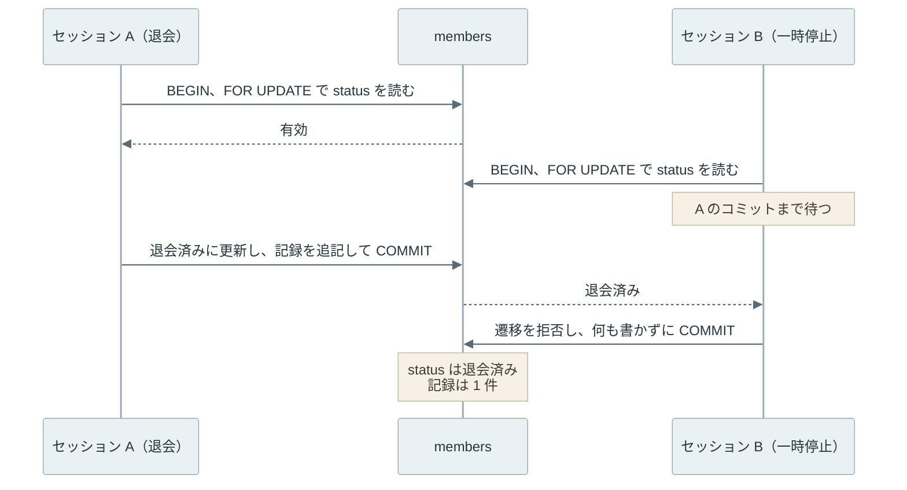

機材の予約サービスを考えます。予約を取り消すと、予約のレコードは消えずに `deleted_at` に取り消した日時が入ります。商品はカメラ・三脚・レンズの 3 つで、カメラには予約が 1 件も無く、三脚には有効な予約が 1 件、レンズには取り消した予約が 1 件だけあります。商品ごとに有効な予約の数 `active_count` を出すため、次の SQL を書きました。結果は何行になるでしょうか。

```sql
SELECT p.name, count(r.id) AS active_count
FROM products p
LEFT JOIN reservations r ON r.product_id = p.id
WHERE p.deleted_at IS NULL
  AND r.deleted_at IS NULL
GROUP BY p.id, p.name;
```

答えは 2 行で、レンズが結果から消えます。次の図は、PostgreSQL 17.11 での結果と、条件を `ON` に移した場合の結果を並べたものです。



予約が 1 件も無いカメラは残るのに、取り消した予約しか無いレンズだけが消えました。エラーは出ず、2 行の結果はもっともらしく見えます。

<br>

このように、`DELETE` の代わりに削除済みの印をカラムに書き、通常の問い合わせから外す設計を論理削除（soft delete）と呼びます。印には `deleted_at` のような日時や `is_deleted` のような真偽値を使い、レコードを表から取り除く普通の `DELETE` は物理削除と呼びます。論理削除は既存の表にカラムを 1 つ足すだけで入れられます。誤って消しても戻せ、過去の注文から会員も辿れるので、最初の選択肢として選ばれやすい設計です。

ただし「`deleted_at` が `NULL` なら有効」という約束は、テーブルの定義のどこにも書かれていません。読む SQL が 1 本残らず条件を書くことで、初めて成り立ちます。冒頭の SQL は、その条件を書く場所を誤った例です。

<br>

本記事では、これから `deleted_at` を足そうとしている人と、既存のシステムで `deleted_at` に出会った人に向けて、次の疑問に答えます。

- `deleted_at` の条件を書く場所で、なぜ結果が変わるのか
- 退会者と同じメールアドレスで、なぜ再登録できないのか
- 外部キーは、退会した会員への注文を止めるのか
- 消したレコードを残す方法は、論理削除の他に何があるか
- 個人データの消去を求められた時、論理削除で足りるか
- 論理削除で済むのは、どんな時か

実験には、Docker の公式イメージで動かした PostgreSQL 17.11 と MySQL 8.4.11 を使いました。

---

### 条件を書く場所で変わる結合の結果

SQL は、論理的には `FROM` と `JOIN` で表を結合した後に、`WHERE` で行を絞り込みます。`LEFT JOIN` は、左に書いた表の行を必ず残し、右の表に相手が居ない行では右側のカラムを `NULL` で埋める結合です。冒頭の SQL で、`WHERE` を通る前の行を出すと次の通りでした。`canceled` は、`r.deleted_at` に日時が入っているかを表す列で、図の「取り消し」に当たります。

```text
  name  | reservation_id | canceled
--------+----------------+----------
 カメラ |                | f
 三脚   |             10 | f
 レンズ |             11 | t
```

カメラは予約が無いので、`r.deleted_at` には結合が埋めた `NULL` が入ります。`r.deleted_at IS NULL` は、この `NULL` と「取り消していない予約」の `NULL` を区別できず、カメラを通します。

レンズは、取り消した予約と結合しているので結果から外されます。取り消した予約を結合の相手から外したかったのに、商品ごと消したわけです。結合が作る `NULL` と表に保存された `NULL` の違いは、[NULL](../sql-null/#outer-join-が作り出す-null) のノートでも扱っています。

意図どおりにするには、予約の条件を `ON` に書きます。`ON` の条件は結合の相手を選ぶ段階で使われるので、取り消した予約は結合の前に外れ、レンズは予約の無い商品として残ります。

```sql
SELECT p.name, count(r.id) AS active_count
FROM products p
LEFT JOIN reservations r ON r.product_id = p.id AND r.deleted_at IS NULL
WHERE p.deleted_at IS NULL
GROUP BY p.id, p.name;
```

条件の書き方だけ変えて同じ集計を 4 通り流した結果が、次の表です。

| 予約の条件 | カメラ | 三脚 | レンズ |
|---|---|---|---|
| `WHERE` に書く | 0 | 1 | 行が無い |
| `ON` に書く | 0 | 1 | 0 |
| 書き忘れる | 0 | 1 | 1 |
| 有効な予約のビューを結合する | 0 | 1 | 0 |

書き忘れた場合は、取り消した予約が 1 件として数えられます。どの書き方でもエラーは出ないので、正しい数字を知っている人が見るまで気付けません。

<br>

#### 条件をビューに閉じ込める

表の 4 行目は、有効な予約だけを返すビューを作り、結合の相手を表からビューに替えたものです。

```sql
CREATE VIEW active_reservations AS
  SELECT * FROM reservations WHERE deleted_at IS NULL;
```

ビューを結合すれば、条件を書く場所を誤る余地がありません。ただし、元の表を直接読む SQL が 1 本でも残れば同じ問題が起きます。退会した会員も一覧に出す管理画面のように、わざと条件を外す SQL もあるので、条件が無いことだけでは書き忘れと判定できません。

PostgreSQL の[行セキュリティポリシー](https://www.postgresql.org/docs/current/ddl-rowsecurity.html)で、条件を DB に持たせる手もあります。それでも、管理画面のような例外の経路をどう通すかは設計が必要です。

Rails の gem である [discard](https://github.com/jhawthorn/discard) や Laravel の [SoftDeletes](https://laravel.com/docs/12.x/eloquent#soft-deleting) のように、表とプログラムのオブジェクトを対応付ける ORM（Object-Relational Mapping）の部品として、論理削除を用意しているものも多くあります。SoftDeletes は全ての問い合わせに条件を自動で足し、discard は既定では足しません。

ORM が条件を自動で足すほど、DB を直接読む運用者はかえって条件を忘れやすくなります。Stripe や Heroku で論理削除を使ってきた Brandur Leach 氏が、「[Soft Deletion Probably Isn't Worth It](https://brandur.org/soft-deletion)」で挙げている問題の 1 つです。

冒頭と同じ結合の問題は、Zenn の「[LEFT JOINの論理削除はWHERE句でしぼるな](https://zenn.dev/levtech/articles/squeeze-on-join-on)」でも紹介されています。そこでは、予約を取り消した商品が「予約の無い商品」の抽出から漏れる例を挙げています。

---

### 退会者と同じアドレスでの再登録

論理削除が影響するのは、読む SQL だけではありません。会員の表 `members` の `email` に一意制約を張ると、DB は値を [B-Tree](../b-tree/) のインデックスに入れて重複を検査し、退会済みのレコードもその対象になります。退会した人が同じアドレスで登録し直そうとすると、次のように拒否されます。

```text
ERROR:  duplicate key value violates unique constraint "m1_email_key"
```

制約を `UNIQUE (email, deleted_at)` に張り替えると、再登録は通ります。ところが今度は、有効な会員どうしで同じアドレスが 2 件入りました。PostgreSQL の既定では 2 つの `NULL` を等しいと見なさないので、`(b@, NULL)` どうしは別の値として扱われます。

以下は、退会した a、再登録の a、有効な b、もう 1 件の有効な b の順に入れた結果です。一意制約の書き方ごとに、インデックスに入る値と、衝突して拒否された値を並べました。



有効な会員だけに一意性を掛けたい時の書き方は、PostgreSQL では 2 つあります。1 つは、インデックスに載せるレコードを条件で選ぶ[部分インデックス](https://www.postgresql.org/docs/current/indexes-partial.html)で、退会済みのレコードはインデックスに入りません。

```sql
CREATE UNIQUE INDEX members_email_active ON members (email) WHERE deleted_at IS NULL;
```

もう 1 つは PostgreSQL 15 で入った `NULLS NOT DISTINCT` で、`NULL` どうしを等しいと見なします。この書き方では、退会済みのレコードも `(email, deleted_at)` の値としてインデックスに入るので、同じアドレスを同じ時刻に 2 回退会させると衝突します。

部分インデックスの作り方と、`NULL` が一意制約に空ける穴は、[UNIQUE 制約](../unique-constraint/)のノートで扱っています。

<br>

部分インデックスは PostgreSQL や [SQLite](https://www.sqlite.org/partialindex.html) にありますが、MySQL には `WHERE` 付きのインデックスがありません。MySQL 8.4 でも `UNIQUE (email, deleted_at)` は有効な会員どうしの重複を通しました。代わりに、8.0.13 から使える [functional key parts](https://dev.mysql.com/doc/refman/8.4/en/create-index.html#create-index-functional-key-parts) で、退会済みなら `NULL` を返す式に一意のインデックスを張ります。一意性の検査は `NULL` を対象にしないので、退会済みのレコードだけが外れます。

```sql
CREATE TABLE members (
  id int PRIMARY KEY,
  email varchar(100) NOT NULL,
  deleted_at datetime NULL,
  UNIQUE KEY email_active ((IF(deleted_at IS NULL, email, NULL)))
);
```

2 つの DB での結果をまとめると、次の通りです。

| DB | 一意制約の書き方 | 再登録 | 有効どうしの重複 |
|---|---|---|---|
| PostgreSQL 17 | `UNIQUE (email)` | できない | 止める |
| PostgreSQL 17 | `UNIQUE (email, deleted_at)` | できる | 通る |
| PostgreSQL 17 | 部分インデックス | できる | 止める |
| PostgreSQL 17 | `NULLS NOT DISTINCT` | できる | 止める |
| MySQL 8.4 | `UNIQUE (email, deleted_at)` | できる | 通る |
| MySQL 8.4 | 式に一意のインデックス | できる | 止める |

部分インデックスと式のインデックスは、退会済みのレコードを縛りません。同じアドレスで退会と再登録を繰り返せば、退会済みのレコードは何件でも並びます。退会済みも含めて「このアドレスの人は誰か」を引く処理は、複数件が返ることを前提に書く必要があります。

---

### 外部キーが見ない deleted_at

外部キーも `deleted_at` を見ません。外部キーは参照先のレコードが存在するかだけを検査する制約で、論理削除したレコードは存在しているからです。注文の表 `orders` から会員に `ON DELETE CASCADE` 付きの外部キーを張り、会員を論理削除すると次の通りでした。

```text
-- 佐藤さんが退会（論理削除）
-- ON DELETE CASCADE は動かず、注文は有効のまま
 id  | member_id | active
-----+-----------+--------
 100 |         1 | t
-- 退会した会員への新しい注文も通る
 active_orders_of_withdrawn
----------------------------
                          2
```

`UPDATE` で日時を入れただけなので、`ON DELETE` に書いた動作は起きず、退会した会員を参照する新しい注文も通りました。物理削除なら、`ON DELETE` を書かない外部キーは、注文の残る会員の `DELETE` を止めます。`CASCADE` を書いていれば、止まらずに注文ごと消えます。次の出力は `ON DELETE` を書かずに張った表で試したもので、論理削除の表と分けるために表名に 2 を付けています。

```text
ERROR:  update or delete on table "members2" violates foreign key constraint "orders2_member_id_fkey" on table "orders2"
```

論理削除で同じことを止めるには、会員の状態を含めた複合キーで参照するか、トリガーで検査を書きます。

複合キーなら、会員の表に `status` の列と `UNIQUE (id, status)` を置き、注文の表に `CHECK (member_status = '有効')` を付けた `member_status` の列を足して、外部キーを `(member_id, member_status)` で張ります。

```sql
CREATE TABLE members3 (
  id     int PRIMARY KEY,
  status text NOT NULL,
  UNIQUE (id, status)
);
CREATE TABLE orders3 (
  id            int PRIMARY KEY,
  member_id     int  NOT NULL,
  member_status text NOT NULL DEFAULT '有効' CHECK (member_status = '有効'),
  FOREIGN KEY (member_id, member_status) REFERENCES members3 (id, status)
);
```

手元の PostgreSQL 17 では、退会した会員に新しい注文を入れても、注文が 1 件でもある会員を退会させても、外部キーの違反で止まりました。

この形では全ての注文が `member_status = '有効'` を持つので、過去の注文を残したまま会員を退会させるには、注文が済んだ時に `member_status` を `NULL` にするような設計が別に必要です。

先の Brandur 氏も、外部キーを失うことを論理削除の欠点に挙げています。外部キーが何を保証し、`ON DELETE` に何を書くと何が変わるかは、[外部キー](../foreign-key/)のノートで扱っています。

---

### 消えて困るものと、残す場所 {#行を消さずに残そうとする理由}

ここまでの 3 つの問題は、どれも「消したはずのレコードが表に残っている」ことから来ています。それでもレコードを残したくなるのは、物理削除で消えて困るものがあるからです。

- 確定した売上の集計や帳票の値が、後から変わる
- 過去の注文から、どの会員の注文かを辿れなくなる
- 誤って消した時に、元に戻せない

物理削除しようとすると、外部キーに書いた `ON DELETE` ごとに何かを失います。

| `ON DELETE` の指定 | 会員を消した時の注文 | 失うもの |
|---|---|---|
| `CASCADE` | 一緒に消える | 過去の注文 |
| `RESTRICT` | 残る | 注文のある会員を消す操作 |
| `SET NULL` | 残り、`member_id` は `NULL` | 注文から会員を辿る経路 |

誤って消したデータは、バックアップがあっても戻すまでに時間が掛かることがあります。表のレコードではなく顧客の環境ごとの削除ですが、実在の事故があります。

2022 年 4 月 5 日、Jira や Confluence を提供する Atlassian は、古いアプリを消す保守作業で、アプリを指す ID ではなくサイト全体の ID を削除の API に渡しました。API はどちらの ID も受け付け、775 の顧客が持つ 883 サイトが即座に削除されました。

[事後報告](https://www.atlassian.com/blog/atlassian-engineering/post-incident-review-april-2022-outage)によると、失われたデータは削除直前の 5 分以内でした。それでも、大量のサイトをまとめて戻す手順が無く、一部の顧客では復旧に最長で 14 日掛かりました。再発防止の筆頭は全てのシステムでの「soft delete」でしたが、中身は、保持期間が過ぎるまで本番から消さないことと、無効化（deactivation）を経た後にだけ削除を許すことです。カラムを 1 つ足すことではなく、状態の遷移と保持期間の設計に近いものです。

<br>

残す場所は、論理削除の他にもあります。以下は、退会した佐藤さんのレコードが、設計ごとにどこに残るかを描いた図です。



図の 1 つ目が、本記事で見てきた論理削除です。それぞれの設計で、ここまでの問題がどう変わるかを並べると次の通りです。アーカイブは、論理削除や状態のカラムで残したレコードを後から別の表へ移す手順なので、図には描かず表の最後に置きました。以降の節で、削除したレコードの表と状態のカラムを見た後、アーカイブと匿名化に進みます。

| 設計 | 読む SQL の条件 | 一意制約・外部キー | 戻し方 |
|---|---|---|---|
| 論理削除 | 全ての SQL に必要 | 削除済みにも掛かる | `NULL` に戻す |
| 削除したレコードの表 | 不要 | そのまま効く | JSON から入れ直す |
| 状態のカラムと履歴 | 状態ごとに書く | 状態を含めて設計する | 状態を遷移させる |
| 匿名化 | 状態などで外す | そのまま効く | 戻せない |
| アーカイブ | 保持期間の分だけ必要 | 移す時に外部キーが問題 | 元の表へ入れ直す |

匿名化しても、退会者 1 のレコードは `members` に残ります。会員一覧や会員数の集計で退会者を外す条件は別に必要なので、匿名化は状態のカラムや論理削除と組み合わせて使います。

[LSM-Tree](../lsm-tree/) の tombstone のように、DB が内部で削除を印として書く仕組みもあります。tombstone はストレージの実装に属し、アプリケーションが読む SQL には現れないので、上の表には入れていません。

---

### 削除したレコードの表

先の Brandur 氏が勧めているのは、`deleted_at` を置かずに物理削除し、消したレコードをトリガーで別の表に JSON として残す方法です。氏は[続きの投稿](https://brandur.org/fragments/deleted-record-insert)で、`AFTER DELETE` のトリガーから全ての表で共通に使える関数を紹介しています。手元では次の形にしました。

```sql
CREATE TABLE deleted_record (
  id         bigint GENERATED ALWAYS AS IDENTITY PRIMARY KEY,
  table_name text  NOT NULL,
  object_id  int   NOT NULL,
  data       jsonb NOT NULL,
  deleted_at timestamptz NOT NULL DEFAULT now()
);
CREATE FUNCTION deleted_record_insert() RETURNS trigger LANGUAGE plpgsql AS $$
BEGIN
  INSERT INTO deleted_record (table_name, object_id, data)
  VALUES (TG_TABLE_NAME, OLD.id, to_jsonb(OLD.*));
  RETURN OLD;
END;
$$;
CREATE TRIGGER keep AFTER DELETE ON reservations
  FOR EACH ROW EXECUTE FUNCTION deleted_record_insert();
```

冒頭と同じ商品と予約で、レンズの予約を `DELETE` で取り消しました。冒頭の SQL から `deleted_at` の条件を外して流すと、レンズは予約 0 件として残りました。

```text
  name  | active_count
--------+--------------
 カメラ |            0
 三脚   |            1
 レンズ |            0
 table_name  | object_id |            data
--------------+-----------+-----------------------------
 reservations |        11 | {"id": 11, "product_id": 3}
```

戻す時は、`jsonb_populate_record` で JSON を元のテーブルと同じ形に直して入れ直します。現行の表には有効なレコードしか無いので、条件の書き忘れも、一意制約の範囲のずれも起きません。予約の残る商品の `DELETE` は、外部キーが止めます。

ただし、戻せるのはテーブルの形が消した時から変わっていない間だけです。消したデータを戻す場面も多くありません。Brandur 氏が Heroku・Stripe と今の職場で 10 年以上論理削除を使ってきた間に、論理削除でデータを戻した例は無かったそうです。削除には外部システムへの通知やファイルの削除が伴い、`deleted_at` を `NULL` に戻すだけでは元に戻らないからです。

---

### 状態のカラムと、変わった記録 {#状態の列に残らない履歴を記録する別の表}

業務の言葉には、「削除」という操作はほとんどありません。会員は退会し、商品は販売を終え、注文はキャンセルされ、投稿は公開を取り下げられます。和田卓人氏の講演資料「[SQL アンチパターン 幻の第 26 章「とりあえず削除フラグ」](https://www.slideshare.net/slideshow/ronsakucasual/52256922)」は、ユーザーから「論理削除」という言葉を聞いたことが無い、という一文を引いています。元は ledsun 氏が[ブログ](https://ledsun.hatenablog.com/entry/2015/03/27/015203)に書いた言葉で、その後には退職や売上の打ち消しのような、実際に聞く要件が並んでいます。

Udi Dahan 氏の「[Don't Delete – Just Don't](https://udidahan.com/2009/09/01/dont-delete-just-dont/)」も、削除を考えずに、その理由を探すよう勧めています。

会員なら、仮登録・有効・一時停止・失効・退会済み・強制退会のような状態があります。呼び名が決まると、その状態から次にどこへ動けるかも決まります。会員の遷移は、例えば次の図のようになります。



論理削除では、図で別々の状態として並ぶ退会済み・強制退会・失効が、「`deleted_at` に日時がある」という 1 つの値にまとめられます。これでは、再入会を許すか、返金するかを状態ごとに決められません。状態をカラムに持てば、値の集合は `CHECK` 制約で縛れます。

```sql
CREATE TABLE members (
  id     int PRIMARY KEY,
  status text NOT NULL CHECK (status IN ('仮登録', '有効', '一時停止', '失効', '退会済み', '強制退会'))
);
CREATE TABLE member_status_changes (
  id          bigint GENERATED ALWAYS AS IDENTITY PRIMARY KEY,
  member_id   int  NOT NULL REFERENCES members (id),
  from_status text,
  to_status   text NOT NULL,
  reason      text,
  changed_by  int,
  changed_at  timestamptz NOT NULL DEFAULT clock_timestamp()
);
```

`CHECK` が縛るのは値だけです。退会済みから一時停止に戻すような、図に矢印の無い遷移まで禁じるなら、アプリケーションかトリガーで検査します。

`status` を `UPDATE` すると前の値は残りません。いつ・誰が・なぜ状態を変えたかに監査で答えるには、遷移を追記する `member_status_changes` のような表を置きます。

表を追記だけに保つには、アプリケーションが使う DB ユーザーから `UPDATE` と `DELETE` の権限を外すような手当ても必要です。追記する 1 件に業務の出来事として名前を付けて扱う考え方は、[Domain Event](../../software-architecture/domain-event/) のノートで扱っています。

更新前の値を DB が自動で残す仕組みもあります。SQL Server の [temporal table](https://learn.microsoft.com/en-us/sql/relational-databases/tables/temporal/overview) や MariaDB の[システムバージョニング](https://mariadb.com/docs/server/reference/sql-structure/temporal-tables/system-versioned-tables)です。一方、遷移の記録だけを持ち、現在の状態を毎回そこから組み立てる設計は [Event Sourcing](../../software-architecture/event-sourcing/) です。現在の状態を `members` に置いたまま記録を足す履歴の表とは、別の設計です。

<br>

#### 遷移を同時に走らせた時

`members` の更新と記録の追記は、同じトランザクションで実行します。片方だけが成功すると、現在の状態と遷移の記録が食い違ったまま残るからです。ただし、トランザクションが揃えるのは 2 つの書き込みが両方成功するか両方失敗するかで、正しい遷移の順序までは保証しません。退会 A と一時停止 B を 2 つのセッションで同時に走らせ、どちらも「有効なら遷移する」と判断させた時の順序が次の図です。



分離レベルを PostgreSQL が既定とする [READ COMMITTED](https://www.postgresql.org/docs/17/transaction-iso.html) で実行すると、`status` は一時停止になり、記録には「有効 → 退会済み」と「有効 → 一時停止」が並びました。退会したはずの会員が一時停止になり、記録も実際の順序と食い違います。古い値を読んで判断し、先の書き込みを上書きするこの異常は lost update と呼ばれ、[トランザクション分離レベル](../transaction-isolation/)のノートで扱っています。

次の出力はスクリプトが表示した順に並んでおり、時間の順は上の図で示した通りです。B が状態を読んだのは、A のコミットより前です。

```text
A が読んだ状態: 有効
A が 有効 から 退会済み に変えた
B が読んだ状態: 有効
B が 有効 から 一時停止 に変えた
  status
----------
 一時停止
```

読む `SELECT` に `FOR UPDATE` を付けると、B は A のコミットを待ってから読み直し、退会済みからの遷移を拒否しました。退会済みから一時停止への矢印は先の状態遷移図に無いので、B はこの時点で拒否できます。上の図と同じ 2 つのセッションで描くと、次の順序になります。



```text
B が読んだ状態: 退会済み
B は 退会済み からの遷移を拒否した
```

分離レベルを REPEATABLE READ 以上にした場合は、B は直列化の失敗で中止され、アプリケーションがやり直します。どちらの手当ても、状態のカラムを使う時に限らず、遷移を判断してから書く処理に必要です。

---

### 現行の表から移す

状態のカラムでも論理削除でも、現行の表からレコードは減りません。10 年続くサービスなら、10 年分の退会者が有効な会員と同じ表に積み上がります。使わなくなったレコードを別の表や保管先へ移す方法をアーカイブと呼びます。

先の削除したレコードの表も別の表へ移しますが、`DELETE` のたびにトリガーが 1 件ずつ JSON で残すので、現行の表には最初から削除済みのレコードがありません。アーカイブは、保持期間が過ぎた後に、論理削除や状態のカラムで現行の表に残したレコードをまとめて、元と同じ形の表へ移します。

手順は、複写を確認してから元の表で `DELETE` する順です。退会から 1 年を保持期間にするなら、次のように移します。

```sql
BEGIN;
INSERT INTO members_archive
  SELECT * FROM members WHERE deleted_at < now() - interval '1 year';
DELETE FROM members WHERE deleted_at < now() - interval '1 year';
COMMIT;
```

保持期間を置けば、その間は条件が必要ですが、条件で外すレコードは保持期間の分だけに減ります。退会と同時に移せば、現行の表から条件を外せます。

<br>

会員を移す時は、注文からの外部キーが問題になります。既定の `NO ACTION` や `RESTRICT` なら会員の `DELETE` は止まり、`CASCADE` なら注文まで消えます。注文を残したまま会員を移すには、次のどれかを選びます。

- 会員と一緒に注文もアーカイブの表へ移す
- 注文に必要な会員の値を注文の表へ複写し、外部キーを外す
- `id` だけの表を置き、現行・アーカイブの両方からそこを参照する

注文の外部キーを `members_archive` に張り替える手は使えません。注文の表には有効な会員の注文と退会者の注文が混在し、1 つの外部キーは 1 つの表しか参照できないからです。

同じ DB の中なら、上の SQL のように複写と `DELETE` を 1 つのトランザクションで実行します。別の保管先へ移す時は 1 つのトランザクションに括れないことが多いので、複写だけが済んで `DELETE` が失敗した状態から再実行しても、複写した行が重複しない手順にします。トランザクションをどこで区切るかは、[Transaction Scope](../transaction-scope/) のノートで扱っています。

---

### 個人データの消去を求められた時

EU の GDPR（一般データ保護規則）の[第 17 条](https://gdpr-info.eu/art-17-gdpr/)は、本人が個人データの消去を求める権利を定めています。消去の権利（right to erasure）と呼ばれ、第 1 項に求められる場合の (a) から (f) が並び、第 3 項に法的義務の遵守や法的請求への対応のような例外があります。求めが第 1 項に当たれば、データを持つ事業者は不当な遅滞なく（without undue delay）消去します。

消去の対象はレコードではなく、個人データです。論理削除は画面から見えなくするだけで、データは表に残るので、この要求には応えられません。選べるのは次の 2 つです。

- 匿名化: 氏名やメールアドレスを消し、取引の記録は残す
- 消去: レコードごと消し、バックアップ・ログ・集計表・検索の索引に残る複製まで洗い出す

匿名化のつもりで、メールアドレスを [SHA-256](/notes/security/sha-256/) のハッシュ値に置き換えるだけでは足りません。手元の名簿や漏えいしたアドレスの一覧を同じ関数に通せば、元のアドレスと照合できるからです。

GDPR の[前文第 26 項](https://gdpr-info.eu/recitals/no-26/)は、追加の情報を使えば特定の人に結び付けられるデータを仮名化（pseudonymisation）されたデータと呼び、識別できる人の情報として扱います。どこまで消すかは法務と決めることで、本記事では DB の設計で選べる手段だけを扱っています。

---

### deleted_at を足す前に

論理削除で済むのは、状態が有効と無効の 2 つしかなく、読む経路が 1 つのアプリケーションに閉じていて、条件の抜けを検査できる時です。短い期間だけ戻せればよい場合や、設定値・タグのように状態の遷移を持たないデータも当たります。

既に `deleted_at` がある表では、まず冒頭の図で上の段に示したのと同じ SQL を探します。`LEFT JOIN` した表の `deleted_at` を `WHERE` で絞っている SQL は、相手のレコードが全て消された行を結果から外しています。

次に、一意制約が退会済みに掛かっていないか、`(email, deleted_at)` の 2 列で張って有効どうしの重複を通していないかを見ます。外部キーが退会済みへの参照を通すことも前提にしておきます。

これから足すなら、何を残したいのかを先に言葉にします。戻したいだけなら削除したレコードの表で足り、退会や販売終了のような業務の終わり方を区別したいなら状態のカラムと記録の表を選びます。

それでも日時のカラムで持つ場合は、`canceled_at` や `retired_at` のように業務の語で名付け、`is_deleted` や `deleted_at` は避けます。名前が `canceled_at` なら、冒頭の SQL で取り消した予約しか無いレンズをどう数えるかは、書く人が意識しやすくなります。

実験の SQL・実行用のスクリプト・出力の全体は [lab/](https://github.com/nao1215/debimate/tree/main/content/notes/database-systems/soft-delete/lab) にあります。
