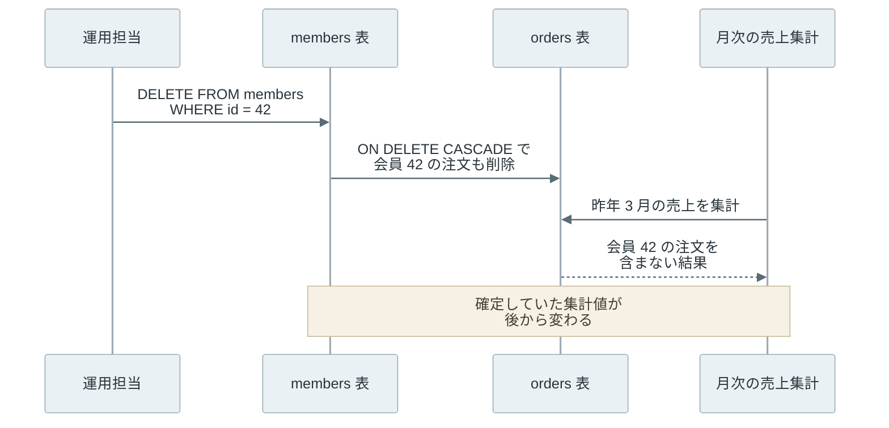
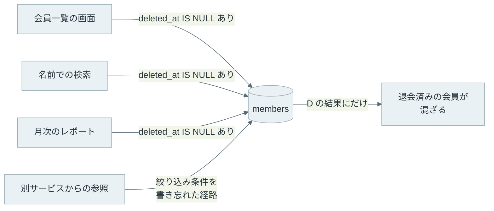
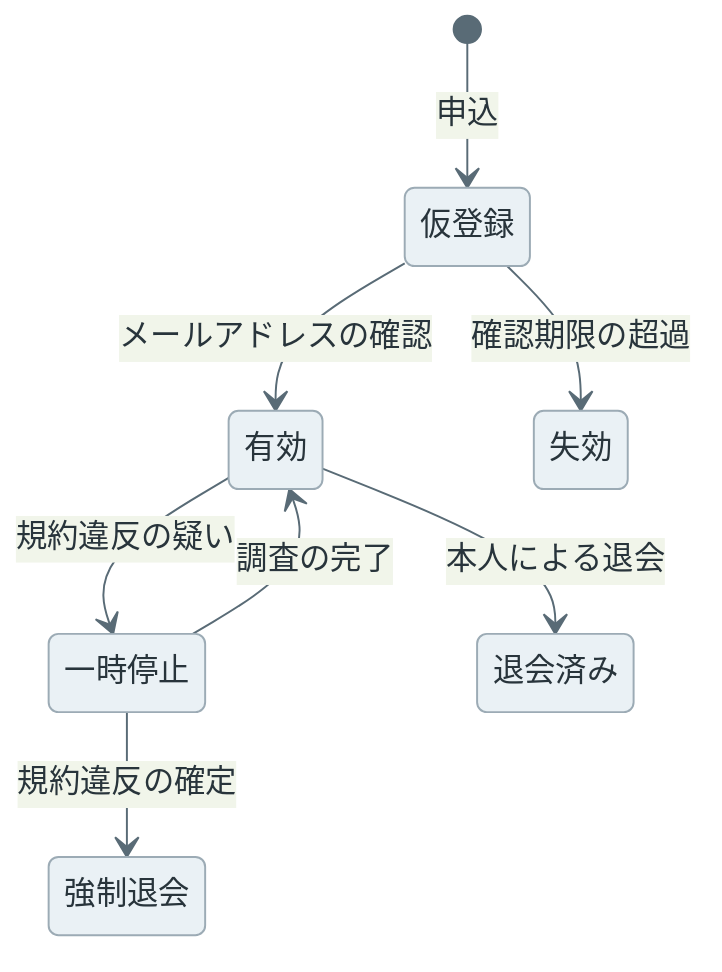
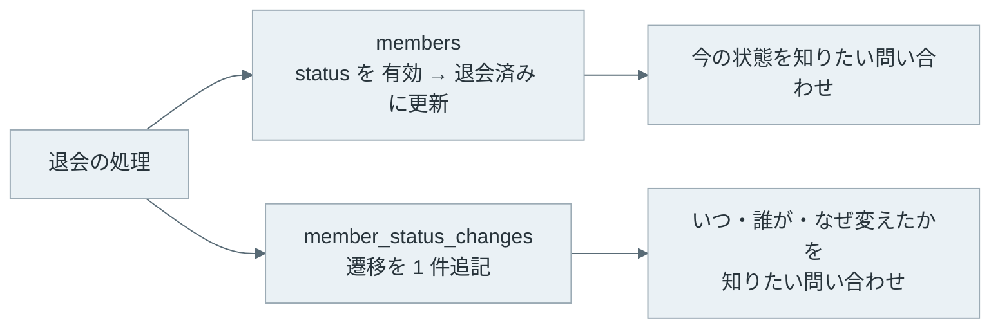
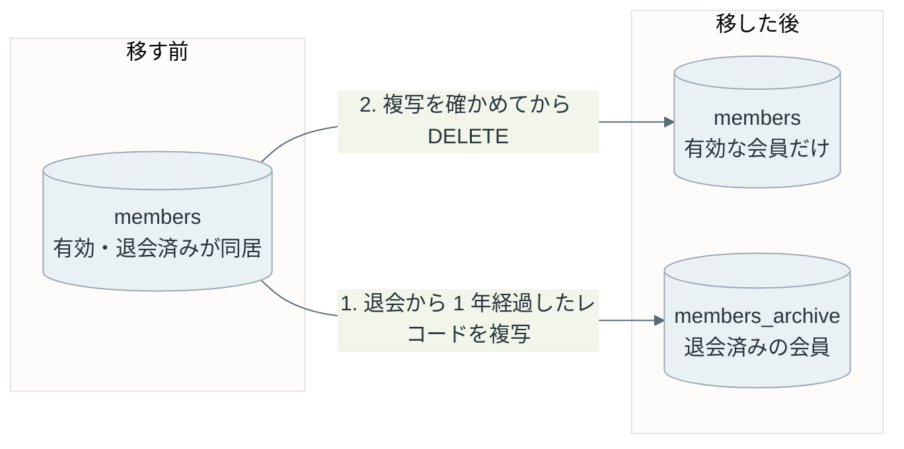
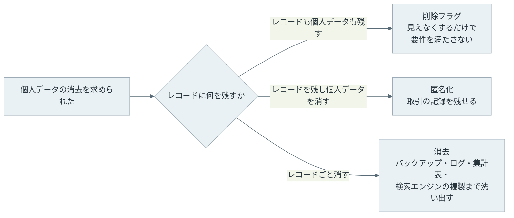

削除フラグとは、レコードを `DELETE` する代わりに「削除済み」を表すカラムを足し、通常の問い合わせからそのレコードを除外する設計です。`is_deleted` のような真偽値のカラムや、`deleted_at` のような日時のカラムで表し、論理削除（logical delete、soft delete）とも呼ばれます。レコードそのものを表から取り除く物理削除と対になる語です。

例えば、退会した会員のレコードを残すために削除フラグが使われます。会員のレコードを `DELETE` で取り除くと、注文が会員を参照する外部キー（参照先のレコードが実在することを保証する制約）の設計によっては過去の注文まで消えたり、注文から会員を辿る経路が失われたりします。どちらでも、問い合わせ対応で「去年の 3 月に何を買ったか」に答えるのが難しくなります。

誤った操作を元に戻したい、監査に備えて記録を残したい、という要望も同じ形で現れます。レコードを残したまま無いことにするカラムを 1 つ足せば、これらが一度に片付くように見えます。

業務の上で使われなくなったレコードの扱い方には、主に以下の 5 つがあります。図は、使わなくなった時を境に、どこに何が残るかを並べたものです。



実際の設計では、5 つのどれか 1 つを選ぶより組み合わせる方が普通です。状態を遷移させたレコードを後からアーカイブに移す、レコードを残したまま個人データだけを匿名化する、といった具合です。

<br>

本記事では、RDB（リレーショナルデータベース）の表に削除フラグを置く設計を説明します。レコードを残したい理由から始めて、次の疑問に答えていきます。

- なぜレコードを消さずに残そうとするのか。
- バックアップから戻せる削除でも、なぜレコードを残す仕組みが求められるのか。
- 削除フラグは、問い合わせと制約にどんな影響を及ぼすのか。
- 削除フラグに求めていた役割のうち、状態の遷移・履歴の表・アーカイブはそれぞれどれを引き受けるのか。
- 個人データの消去を求められた時、残したレコードをどう扱うのか。
- 削除フラグが妥当になりやすいのは、どんな場合なのか。

分散 DB（データベース）が複製の間で消去を伝えるために置く tombstone のような内部的な印には触れません。注文した時点の氏名や住所を残すかどうかも、会員のレコードを消すかどうかとは別の設計課題なので扱いません。

---

### レコードを消さずに残そうとする理由 {#行を消さずに残そうとする理由}

`DELETE` はレコードを表から取り除きます。そのレコードを別の表が参照していた場合に何が起きるかは、[外部キー制約](../foreign-key/)に付ける `ON DELETE` の指定で決まります。会員と注文のように一方が他方を参照している構造では、`DELETE` の影響が 1 つの表に留まりません。

会員のレコードを消した時に何が起きるかを以下に示します。外部キー制約に `ON DELETE CASCADE` を指定した場合の例です。



`ON DELETE` の指定を変えると何が守られ、何が失われるのかを整理すると、以下の通りです。

| `ON DELETE` の指定 | 会員を消した時の注文 | 失うもの |
| --- | --- | --- |
| `CASCADE` | 一緒に消える | 過去の注文 |
| `RESTRICT` | 残る | 「退会した会員を消す」操作が成立しない |
| `SET NULL` | 残る（`member_id` は `NULL`） | 注文から会員を辿る経路 |

どの指定を選んでも、会員のレコードを消す限り何かは失われます。消えて困る理由は、代表的には 3 つあります。

- 上記の図のように、確定していた集計や帳票の値が後から変わる
- `ON DELETE SET NULL` を選んだ場合や外部キー制約が無い場合に、注文から会員を辿る経路が切れる
- 誤った操作を元に戻せない

契約・取引・入出金のように、後から「その時点で何が成立していたか」を問われるデータでは、この 3 つが全部当てはまります。

<br>

誤って削除したデータは、バックアップがあっても復旧に時間がかかる場合があります。大規模な例が、2022 年 4 月 5 日に [Atlassian](https://www.atlassian.com/)（Jira や Confluence を提供する企業）で起きた障害です。表のレコードではなく顧客の環境ごとの削除でした。

Atlassian は、古いアプリを顧客のサイト（顧客ごとのクラウド環境）から消す保守作業で ID を取り違え、サイト全体の ID を削除の API に渡しました。

この API はどちらの ID も受け付けて入力を正しいと見なす作りだったので、775 の顧客の 883 サイトがその場で削除されました。失われたデータは削除前の 5 分以内に留まりましたが、バックアップからサイトを大量に戻す手順が無く、一部の顧客では[復旧に最長 14 日](https://www.atlassian.com/engineering/post-incident-review-april-2022-outage)掛かりました。

Atlassian が再発防止の 1 つ目に挙げたのは、保持期間が過ぎるまで本番環境からデータを消さない方針と、無効化（deactivation）を経た後にだけ削除を許す確認を設ける計画でした。Atlassian はこれを soft delete と呼んでいますが、挙げられた中身はカラム 1 つの削除フラグではなく、後の節で扱う状態の遷移と保持期間に近いものです。

レコードを消したくないという要求は、ここまでの理由から見て妥当です。問題は、その要求に `is_deleted` という 1 カラムで答えると、問い合わせ・制約・業務の意味のそれぞれに影響が及ぶ点です。

---

### 削除フラグが問い合わせと制約に及ぼす影響

削除フラグを 1 つ置くと、有効なレコードだけを読みたい全ての問い合わせが、「削除済みを除く」絞り込み条件を必要とします。以下は、会員の表に `deleted_at` を置いた例です。以降の SQL は [PostgreSQL](https://www.postgresql.org/) の構文です。

```sql
CREATE TABLE members (
    id         BIGINT PRIMARY KEY,
    email      TEXT NOT NULL,
    name       TEXT NOT NULL,
    deleted_at TIMESTAMPTZ,
    UNIQUE (email)
);
```

`deleted_at` が `NULL` なら有効、日時が入っていれば削除済み、という約束です。この約束は DDL（Data Definition Language、表や索引を定義する SQL）のどこにも書かれておらず、`members` を読む全てのコードが `WHERE deleted_at IS NULL` を守ることで成り立ちます。



書き漏れは構文の誤りではないため実行時にエラーにならず、返るレコード数が多いことも正常な結果と区別が付きません。`JOIN` の先の表にも同じ絞り込み条件が必要なので、削除フラグを持つ表が増えるほど守る箇所も増えていきます。

有効なレコードだけを返すビューを用意する、PostgreSQL の[行レベルセキュリティ](https://www.postgresql.org/docs/current/ddl-rowsecurity.html)（読めるレコードの条件を DB に設定する機能）で絞り込み条件を DB に寄せる、といった方法で書き漏れの余地は狭められます。ただし、その表を触る経路を全部その仕組みに通す必要があります。退会済みも含めて一覧したい管理画面のような経路もあるので、絞り込み条件が無いことだけでは書き忘れと判定できません。

制約についても影響が出ます。上記の DDL の [`UNIQUE (email)`](../unique-constraint/) は削除済みのレコードにも掛かるので、一度退会した会員と同じメールアドレスでは新規に登録できません。

| id | email | deleted_at | 登録の可否 |
| --- | --- | --- | --- |
| 42 | taro@example.com | 2026-03-01 10:00 | 退会済みとして残っている |
| 51 | taro@example.com | NULL | `UNIQUE (email)` 違反で入らない |

PostgreSQL や [SQLite](https://www.sqlite.org/partialindex.html) のように[部分索引](https://www.postgresql.org/docs/current/indexes-partial.html)を持つ DBMS（Database Management System）なら、索引に載せるレコードを選ぶ条件（predicate）を付けて、その条件を満たすレコードだけに一意性を課せます。

表に付けた `UNIQUE (email)` を外し、代わりに次の索引を置きます。

```sql
CREATE UNIQUE INDEX members_email_active_idx
    ON members (email)
    WHERE deleted_at IS NULL;
```

この索引は `deleted_at` が `NULL` のレコードだけを対象にします。退会済みのレコードと同じメールアドレスで新規に登録でき、有効な会員どうしで同じアドレスが重複することは防げます。裏返すと、条件から外れたレコードは縛られないので、退会済みのレコードどうしで同じアドレスは何件でも並びます。

部分索引を持たない DBMS もあります。例えば MySQL は `WHERE` 句を付けて索引を作る構文を持たないため、[式の値に索引を張る functional key parts](https://dev.mysql.com/doc/refman/8.4/en/create-index.html) で代用します。退会済みなら `NULL` を返す式に一意索引を張ると、`NULL` は一意性の検査から外れるので同じ効果を得られます。索引の構造は [B-Tree](../b-tree/) のノートで扱っています。

外部キー制約も同じ問題を抱えます。通常の外部キーが保証するのは参照先のレコードが存在することまでで、`deleted_at` が `NULL` かどうかまでは見ません。

その結果、退会済みの会員に対して新しい注文を作る操作は、この制約では止まりません。DB の制約だけで禁じたい場合は、会員の状態まで含めた複合キーで参照する、レコードの追加時に DB が自動で実行する処理（トリガー）で検査する、といった追加の設計が必要です。

---

### 「削除」から業務の状態遷移への書き直し

`is_deleted` や `deleted_at` は、業務の語彙ではありません。ユーザーが「削除」と呼ぶ操作の裏には、退会・販売終了・キャンセルのような別々の業務上の意図があります。

和田卓人氏の「[SQL アンチパターン 幻の第 26 章「とりあえず削除フラグ」](https://www.slideshare.net/slideshow/ronsakucasual/52256922)」は、解決策への糸口として ledsun 氏の「[論理削除フラグという名の死亡フラグ](https://ledsun.hatenablog.com/entry/2015/03/27/015203)」から「私の経験上は、ユーザーから「論理削除」という言葉を聞いたことがありません」という一文を引いています。引用元ではこの後に、退職や売上の打ち消しといった実際に聞く要件が並べられています。

同じ点を指摘した文章に、Udi Dahan 氏の [Don't Delete – Just Don't](https://udidahan.com/2009/09/01/dont-delete-just-dont/) があります。「don't think about deleting entities. Look for the reason why.」（エンティティを削除することを考えるのではなく、その理由を探しなさい）と書き、続けてエンティティが移り変わる状態を理解するよう促しています。

画面のボタンが「削除」でも、業務にはその操作を指す名前が既にあります。対応の例を以下に挙げます。

| 画面での操作 | 業務での呼び名 | 遷移後の状態 |
| --- | --- | --- |
| 会員の削除 | 退会 | 退会済み |
| 商品の削除 | 販売終了 | 販売終了 |
| 注文の削除 | キャンセル | キャンセル済み |
| 投稿の削除 | 公開の取り下げ | 公開停止 |

呼び名が決まると、その状態から次にどこに動けるのかも決まります。例えば、会員の遷移は次のようになります。



上記の図では、退会済み・強制退会・失効が別々の状態として並んでいます。削除フラグを使うと、この 3 つが `is_deleted = true` という 1 つの値になります。状態をカラムで持てば、再入会を認めるかどうか、返金の対象になるかどうかを状態ごとに決められます。

表としては、`members` から `deleted_at` を落とし、代わりに `status TEXT NOT NULL` のようなカラムを置く形になります。取り得る値を `CHECK` 制約で列挙すれば、想定外の文字列は入りません。

ただし `CHECK` が縛れるのは値の集合だけです。上記の図に矢印の無い遷移（退会済みから一時停止に戻す等）まで禁じるなら、アプリケーションで検査するか、トリガーなど別の仕組みが必要です。

---

### 状態のカラムに残らない履歴を記録する別の表 {#状態の列に残らない履歴を記録する別の表}

状態をカラムで持つ設計にも、削除フラグと共通する限界があります。`status` を `UPDATE` で書き換えると、書き換える前の値はそのカラムに残りません。「いつ退会したのか」「一度退会してから再入会したのか」に、現在の状態を持つカラムだけでは答えられません。

状態を書き換える前の値が DBMS 側に残る仕組みもあります。SQL Server の [temporal table](https://learn.microsoft.com/en-us/sql/relational-databases/tables/temporal/overview) や MariaDB の[システムバージョニング](https://mariadb.com/docs/server/reference/sql-structure/temporal-tables/system-versioned-tables)は、`UPDATE` の前の値を自動で保持します。そうした仕組みを使わない場合、遷移を残すには、遷移を 1 件として追記する表を別に置きます。以下は PostgreSQL の構文で書いた例です。

```sql
CREATE TABLE member_status_changes (
    id          BIGSERIAL PRIMARY KEY,
    member_id   BIGINT NOT NULL REFERENCES members (id),
    from_status TEXT,
    to_status   TEXT NOT NULL,
    reason      TEXT,
    changed_by  BIGINT,
    changed_at  TIMESTAMPTZ NOT NULL DEFAULT now()
);
```

DDL は書き換えを禁止しないので、この表を追記だけに保つには、`UPDATE` と `DELETE` の権限をアプリケーションの利用者から外すといった手当てが別に必要です。1 回の退会処理が書き込む先を以下の図に示します。



上記の図の `members` への更新と `member_status_changes` への追記は、同じトランザクション（複数の書き込みをまとめて、成功か失敗かのどちらかにする単位）で行います。片方だけが成功すると、現在の状態と遷移の記録が食い違ったまま残るからです。

トランザクションが揃えるのは、2 つの書き込みが両方成功するか両方失敗するかだけです。履歴が正しい遷移の並びになることまでは保証しません。

PostgreSQL 17.11 で、`id` と `status` だけに絞った `members` の会員 42 に、退会の処理 A と一時停止の処理 B を同時に走らせました。どちらも今の `status` を読み、その値を `from_status` にして遷移を 1 件追記します。以下は処理 A が流す SQL で、処理 B は `退会済み` を `一時停止` に替えた同じ SQL を流します。

```sql
BEGIN;
SELECT status FROM members WHERE id = 42;        -- 手順 1（B は手順 2）。'有効' が返る
UPDATE members SET status = '退会済み' WHERE id = 42;   -- 手順 3（B は手順 4）
INSERT INTO member_status_changes (member_id, from_status, to_status)
    VALUES (42, '有効', '退会済み');               -- from_status には SELECT で読んだ値を入れる
COMMIT;
```

実行の順序は以下の図の通りです。



A も B も、相手が書く前の `有効` を読んでから書き込みます。両方の確定後に `members` と `member_status_changes` を読んだ結果は次の通りです。

```text
  status
----------
 一時停止

 member_id | from_status | to_status
-----------+-------------+-----------
        42 | 有効        | 退会済み
        42 | 有効        | 一時停止
```

退会したはずの会員が一時停止になり、履歴には `有効` から始まる遷移が 2 件並びます。先の書き込みを古い値に基づいて上書きする、[lost update](../transaction-isolation/) と呼ばれる異常です。

手順 1 と 2 の `SELECT` に `FOR UPDATE` を付けて会員のレコードをロックすると、B は A の `COMMIT` まで待ってから `退会済み` を読みます。退会済みから一時停止への矢印は上記の状態遷移図に無いので、B はこの時点で遷移を拒否できます。

現在の状態を保存せず、遷移の記録だけから状態を毎回組み立てる方式が [Event Sourcing](../../software-architecture/event-sourcing/) です。ここで挙げた履歴テーブルは現在の状態を `members` に残しているので、Event Sourcing とは別の設計になります。追記する 1 件を業務の出来事として名前を付けて扱う考え方は [Domain Event](../../software-architecture/domain-event/) で整理しています。

---

### 使わなくなったレコードのアーカイブへの移動 {#使わなくなった行のアーカイブへの移動}

状態のカラムを足しても、現行の表からレコードが減るわけではありません。退会済みの会員が 10 年分積み上がった表は、有効な会員だけを読む問い合わせにとって余分なレコードを抱えた状態になります。アーカイブは、そのレコードを現行の表から取り除いて別の場所に移す方法です。

以下は、移す前と移した後の構成です。



上記の図の移送は、複写してから消すという順序で行います。退会済みの会員のレコードは `members_archive` に残るので、過去の注文からその会員を辿る経路を残せます。

ただし、保持期間を置いている間は退会済みのレコードが `members` に残ります。`status = '有効'` の絞り込み条件は残りますが、除く対象が直近 1 年に退会した会員だけに減ります。退会と同時に移す設計にすれば、`members` から絞り込み条件を外せます。

移す時に決めることが 2 つあります。1 つ目は移す条件で、退会から 1 年といった保持期間を業務の要件として決めます。2 つ目は参照の扱いです。`orders` から `members` への外部キーが `RESTRICT` や既定の `NO ACTION` なら、親のレコードを消す `DELETE` はその制約で止まり、`CASCADE` なら注文まで消えます。

注文を残したまま親のレコードを移す手は、主に次の 3 つです。

- 子のレコードも同時にアーカイブに移す（`orders_archive` が `members_archive` を参照する）
- `orders` に会員名などの必要な値を複写しておいて外部キーを外す
- 会員の `id` だけを持つ表を置き、`orders`・`members`・`members_archive` の 3 つがその表を参照する

`orders` の外部キーの参照先を `members_archive` に張り替える手は使えません。`orders` には有効な会員の注文と退会済みの会員の注文が混ざっていますが、1 つの外部キーが参照できる表は 1 つだけだからです。

移送先が同じ DB の別の表なら、複写と `DELETE` を 1 つのトランザクションにまとめられます。別の DB や別の保管先に移す場合は 1 つのトランザクションで括れないことがあるので、複写だけが済んで `DELETE` が失敗した状態を想定し、途中から再実行できる手順にしておきます。

---

### 消去が要件になる場合

レコードを残せない場合もあります。個人データの消去を求められた時が、その代表です。GDPR（General Data Protection Regulation、EU 一般データ保護規則）の第 17 条は、消去権（right to erasure）を定めています。

同条の第 1 項には、「[The data subject shall have the right to obtain from the controller the erasure of personal data concerning him or her without undue delay](https://gdpr-info.eu/art-17-gdpr/)」（データ主体は、自分に関する個人データの消去を不当な遅滞なく行うよう管理者に求める権利を持つ）とあります。

この権利には条件があります。引用した一文は `where one of the following grounds applies` と続き、収集の目的が達成された場合や同意が撤回された場合など、(a) から (f) の発動事由が並びます。第 3 項にも例外があり、法的義務の遵守や、法的請求の主張・行使・防御に必要な場合が挙がっています。

消去の対象は個人データであって、レコードそのものではありません。レコードに何を残すかで、取れる手が分かれます。



上記の図の匿名化を選べるかどうかは、残した値から元の個人データを辿れないようにできるかで決まります。例えば、メールアドレスを [SHA-256](https://csrc.nist.gov/pubs/fips/180-4/upd1/final) のハッシュ値に置き換えただけでは足りません。手元の会員名簿や漏えいしたアドレスの一覧を同じ関数に通し、保存したハッシュ値と比較すれば、元のアドレスが分かります。

GDPR の[前文第 26 項](https://gdpr-info.eu/recitals/no-26/)は、追加の情報で特定の人に結び付けられるデータを仮名化（pseudonymisation）したデータと呼び、識別可能な人に関する情報として扱います。消去を求められた個人データは、ハッシュ値の形で残ったままです。

削除フラグを最初の選択肢として置いた設計ほど、消去の経路を持たないまま運用が始まります。全ての表に機械的にカラムを足す設計は、消せる仕組みではなく、消したように見せる仕組みだけを増やすからです。

---

### 利点

削除フラグは、レコードを表に残したまま、カラムの値だけで有効と削除済みを切り替えます。そのため、次の利点があります。

- 既存の表にカラムを 1 つ追加するだけで導入できる
- レコードそのものは、カラムの値を戻すことで復元しやすい
- 参照先のレコードが残るので、`ON DELETE CASCADE` で子のレコードまで消えることも、注文から会員を辿る経路が切れることも無い

---

### 欠点

一方で、削除フラグは業務上の終わり方の違いを 1 つのカラムに畳みます。その結果、次の制約があります。

- 有効なレコードだけを読みたい全ての問い合わせに、削除済みを除く絞り込み条件が必要
- 絞り込み条件の書き漏れがエラーにならず、結果に混ざった時点では気付けない
- 一意制約が削除済みのレコードにも掛かり、同じ値での再登録を妨げる
- 素直に書いた外部キー制約では、削除済みの親を参照する子の作成を止められない
- 退会・強制退会・失効という違う終わり方が、同じ値になる
- 個人データの消去を求められた時に、カラムを書き換えるだけでは要件を満たせない

---

### 削除フラグが妥当になりやすいケース

- 状態が有効と無効の 2 つしかなく、業務にもその 2 つ以外の呼び名が無い場合
- レコードを読む経路が 1 つのアプリケーションに閉じていて、絞り込み条件の抜けを検査できる場合
- 消したレコードを短い期間だけ戻せれば良く、長期の履歴が必要ない場合
- 設定値やタグのような、業務上の状態遷移を持たないデータを扱う場合

いずれの場合も、カラム名を業務の語に寄せておくと、後から状態を増やす時の判断が楽になります。`is_deleted` ではなく `canceled_at` や `retired_at` と書けば、その表のレコードがどう終わるのかが名前から読み取れます。
