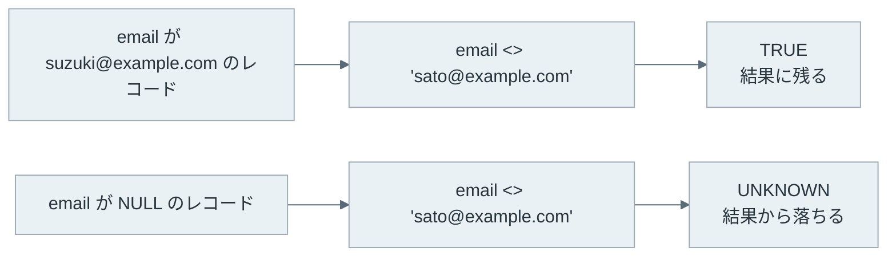
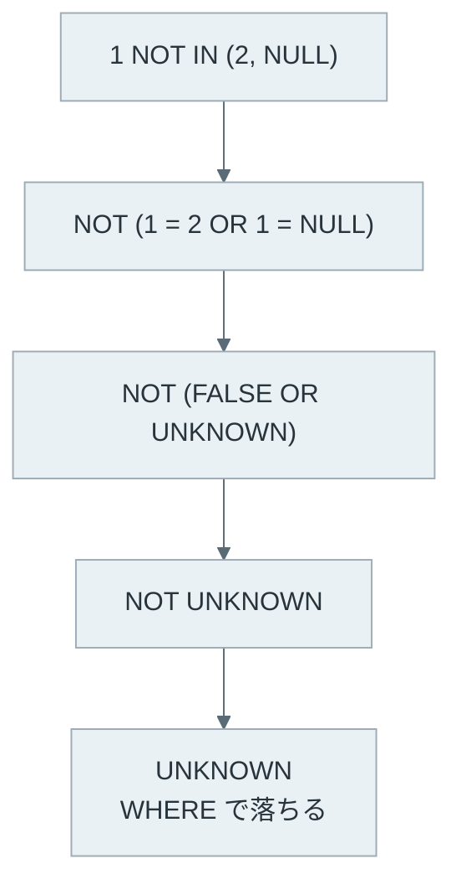
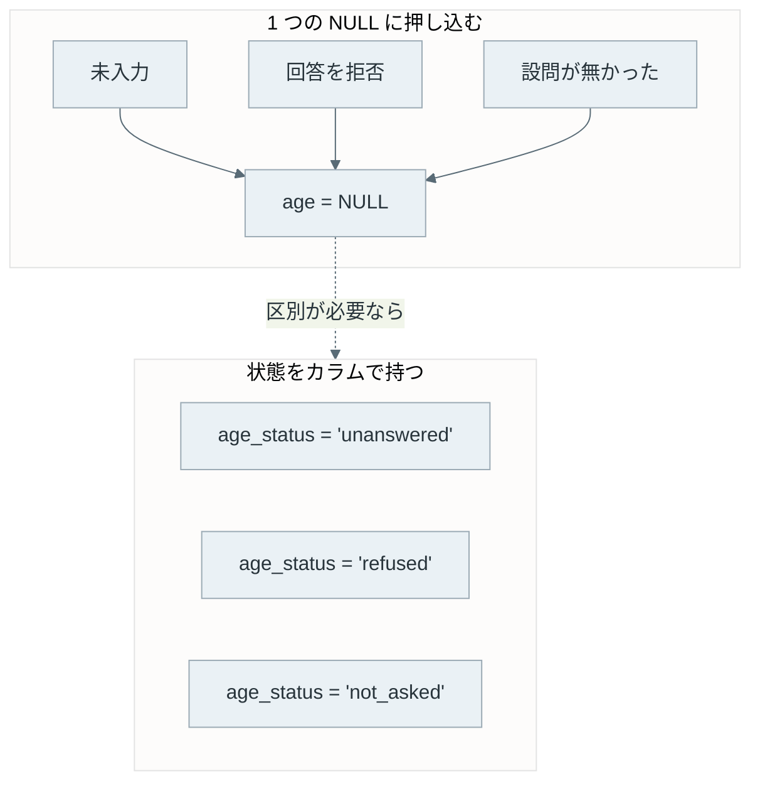

`NULL` は、値が存在しないことや不明であることを表すために SQL が特別扱いする印です。数値の 0、真偽値の `false`、要素が 0 個の配列は、どれも通常の値なので `NULL` とは別に扱われます。

`=` や `<>` で `NULL` と比べると、結果は TRUE でも FALSE でもない UNKNOWN になります。`WHERE` は条件が TRUE になったレコードだけを残すので、`column = NULL` と書いても 1 件も返りません。

例えば、任意入力のカラムを持つ表では、検索結果から未入力のレコードが抜けることがあります。会員登録でメールアドレスを任意にすると、未入力の会員は `email` が `NULL` になります。「佐藤さん以外の会員」を出すつもりで `WHERE email <> 'sato@example.com'` と書くと、未入力の会員は結果に入りません。エラーにはならず、レコード数が少ないことも正常な結果と区別が付きません。

同じ条件が、値の入ったレコードと `NULL` のレコードでどう分かれるのかを以下に示します。



<br>

本記事では、SQL の `NULL` の扱いと、それが表の設計に与える影響を説明します。扱う疑問は次の通りです。

- なぜ `NULL` を普通の値として扱えないのか。
- 三値論理は、検索条件で残るレコードをどう変えるのか。
- `NOT IN` は、なぜレコードを返さなくなることがあるのか。
- 集約関数・一意制約・並べ替え・`OUTER JOIN` では、`NULL` はどう扱われるのか。
- 年齢の分からない会員が「最年長」として返る DBMS があるのはなぜか。
- カラムの `NULL` に何を意味させるべきか。sentinel value で代用すると何が起きるのか。

プログラミング言語の null 参照や JSON の null には触れません。`NULL` の扱いには SQL 標準が定めている部分と、DBMS（Database Management System）ごとに決めて良い部分があるので、SQL 標準の規則を説明し、DBMS ごとの違いを補足します。

---

### 前提

例には次の表を使います。動かして確かめた結果は SQLite 3.50.6 のもので、並べ替えの例だけは PostgreSQL 17.10 でも動かしています。

```sql
CREATE TABLE users (
    id         BIGINT PRIMARY KEY NOT NULL,
    name       VARCHAR(100) NOT NULL,
    email      VARCHAR(255),
    age        INTEGER,
    deleted_at TIMESTAMP
);
```

ここでは主キーを「欠けない識別子」として使いたいため、`NOT NULL` を明示しています。SQLite の通常の rowid table では、`INTEGER PRIMARY KEY` 以外の `PRIMARY KEY` は歴史的な互換性のため `NULL` を許します。SQL 標準や他の DBMS と同じつもりで `BIGINT PRIMARY KEY` だけを書かず、移植する DDL では必要な制約を明記します。

入っているデータは次の 4 件とします。

| id | name | email | age | deleted_at |
| --- | --- | --- | --- | --- |
| 1 | 佐藤 | sato@example.com | 20 | `NULL` |
| 2 | 鈴木 | suzuki@example.com | 31 | `NULL` |
| 3 | 高橋 | `NULL` | `NULL` | `NULL` |
| 4 | 田中 | `NULL` | 45 | 2026-03-01 10:00 |


- title: email が NULL
  body: 連絡先が未登録です。
- title: age が NULL
  body: 年齢が不明です。
- title: deleted_at が NULL
  body: この教材では、まだ削除されていない状態です。


---

### NULL を普通の値として扱えない理由

0 は数量が 0 であることを表し、空文字列は長さ 0 の文字列です。[MySQL のマニュアル](https://dev.mysql.com/doc/refman/8.4/en/working-with-null.html)では、0 と空文字列は値なので `NOT NULL` のカラムにも入れられ、`NULL` は値を持っていないことを表すと説明されています。

ただし、空文字列を `NULL` と別に扱うかどうかは DBMS で違います。Oracle Database は現在、長さ 0 の文字列を `NULL` として扱います。[SQL 言語リファレンス](https://docs.oracle.com/en/database/oracle/oracle-database/23/sqlrf/Nulls.html)には、将来のリリースでもそうとは限らないという注意も書かれています。

`NULL` は値が存在しないか不明なことを表すので、比べても TRUE か FALSE かを決められません。SQL の論理式は、TRUE と FALSE に UNKNOWN を加えた 3 つの値を取ります。この 3 つの値で論理式を組み立てる規則は、三値論理（three-valued logic）と呼ばれます（[PostgreSQL のドキュメント](https://www.postgresql.org/docs/current/functions-logical.html)）。

以降では、カラムに値が無い状態を `NULL`、比較や論理式で真偽を決められない結果を UNKNOWN と書き分けます。ただし、`SELECT NULL = NULL;` のように比較の結果そのものを取り出すと、UNKNOWN は `NULL` として表示されます。

`=`・`<>`・`<`・`>` のような比較演算子は、左右のどちらか一方でも `NULL` なら結果が UNKNOWN になります。`NULL = NULL` も `NULL <> 20` も UNKNOWN で、片方の値が分かっているかどうかは関係ありません。

UNKNOWN は、それを含む式の全体に伝わります。以下は、PostgreSQL のドキュメントが載せている真理値表から、UNKNOWN が関わる行だけを抜き出したものです（元の表は UNKNOWN を `NULL` と表記しています）。

| a | b | a AND b | a OR b | NOT a |
| --- | --- | --- | --- | --- |
| TRUE | UNKNOWN | UNKNOWN | TRUE | FALSE |
| FALSE | UNKNOWN | FALSE | UNKNOWN | TRUE |
| UNKNOWN | UNKNOWN | UNKNOWN | UNKNOWN | UNKNOWN |

上記の表で UNKNOWN が消えているのは 2 か所だけです。AND の片方が FALSE なら結果は FALSE、OR の片方が TRUE なら結果は TRUE で、もう片方が何であっても変わりません。`NOT` が反転できるのは TRUE と FALSE だけなので、UNKNOWN は UNKNOWN のまま残ります。

比較演算子の結果が UNKNOWN にしかならない以上、`NULL` かどうかを判定するには専用の書き方が必要です。`IS NULL` と `IS NOT NULL` は値どうしを比べず、そのカラムが `NULL` かどうかだけを TRUE か FALSE で返します。

<br>

ここまでは比較演算子と論理演算子に限った規則です。`GROUP BY`・`DISTINCT`・`UNION` は `NULL` どうしを同じものとして 1 つに畳みます。例えば `SELECT email, COUNT(*) FROM users GROUP BY email` では、高橋さんと田中さんの `NULL` が 1 つのグループにまとまり、2 と数えられます。

比較にも、`NULL` どうしを同じものとして扱う `IS NOT DISTINCT FROM` という述語があります（[PostgreSQL のドキュメント](https://www.postgresql.org/docs/current/functions-comparison.html)）。`NULL` でない入力どうしなら `=` と同じ結果を返し、両方が `NULL` なら TRUE、片方だけが `NULL` なら FALSE を返します。対応の有無と構文は DBMS で違います。

---

### 三値論理と検索条件

`WHERE` が残すのは、条件が TRUE になったレコードだけです。FALSE と UNKNOWN はどちらも残りません。`NULL` が絡む条件でレコードが消えるのは、この規則と、前の節で見た `NOT` の規則からきています。

次の 4 つの問い合わせで、この規則が結果にどう表れるのかを確かめられます。

```sql
SELECT NULL = NULL;                        -- NULL（UNKNOWN）
SELECT * FROM users WHERE age <> 20;       -- id = 2, 4（id = 3 は落ちる）
SELECT * FROM users WHERE email = NULL;    -- 0 行
SELECT * FROM users WHERE email IS NULL;   -- id = 3, 4
```

2 番目の「20 歳ではない会員」では、`age` が `NULL` の高橋さんが落ちます。`NULL <> 20` が FALSE ではなく UNKNOWN になり、`WHERE` の結果から外れるからです。3 番目が 0 件なのも同じ理由で、`email = NULL` は全てのレコードで UNKNOWN になります。

`email` が `NULL` のレコードを探すなら、4 番目の `IS NULL` で書きます。未入力のレコードも含めて「20 歳ではない会員」を出したいなら、`WHERE age <> 20 OR age IS NULL` と書きます。

`COALESCE(age, -1) <> 20` のように、`NULL` を別の値に置き換えてから比べる方法もあります。`COALESCE` は引数を左から見て最初に `NULL` でない値を返す関数で、全ての引数が `NULL` なら `NULL` を返します。ここでの `-1` は問い合わせの中だけで使う値で、表に保存する設計とは別です。

同じ三値論理を使っていても、判定の向きが逆の場所があります。`CHECK` 制約は FALSE になったレコードだけを弾くので、UNKNOWN になるレコードは通ります。`CHECK (age > 0)` を張ったカラムにも、`NULL` は入れられます。

---

### NOT IN が 1 件も返さない理由 {#not-in-が-1-行も返さない理由}

`NOT IN` は、`NULL` の影響が最も分かりにくい形で出る場所です。ブロックした会員を除いた一覧は、次のように書けます。

```sql
-- blocked_users.user_id には 2 と NULL が入っている
SELECT * FROM users
 WHERE id NOT IN (SELECT user_id FROM blocked_users);   -- 0 行

SELECT * FROM users u
 WHERE NOT EXISTS (SELECT 1 FROM blocked_users b
                    WHERE b.user_id = u.id);            -- id = 1, 3, 4
```

上記の `NOT IN` は 1 件も返しません。`blocked_users.user_id` に `NULL` が 1 つ混ざっただけで、ブロックされていない 3 人も消えます。理由は、`NOT IN` が等値比較の OR に展開されるからです。id が 1 のレコードでは、式が次のように畳まれます。



分かれ目は 3 段目です。一致する値が 1 つも無くても、`FALSE OR UNKNOWN` は FALSE ではなく UNKNOWN になり、`NOT` を通しても UNKNOWN のまま残ります。id が 2 のレコードは `2 = 2` が TRUE なので、`NOT` を通した結果は FALSE になります。つまり、集合に `NULL` が 1 つでも入ると、`NOT IN` が TRUE を返すレコードは無くなります。

`NOT EXISTS` が 3 件を返すのは、判定の形が違うからです。`EXISTS` は、括弧の中に書いた副問い合わせ（別の `SELECT` を入れ子にしたもの）が 1 件以上返したかどうかだけを見て、TRUE か FALSE を返します。副問い合わせの中で `b.user_id = u.id` が UNKNOWN になったレコードは、その `WHERE` で落ちるだけで、外側には UNKNOWN として伝わりません。

主な対策は、副問い合わせに `WHERE user_id IS NOT NULL` を加える、`user_id` を `NOT NULL` にする、`NOT EXISTS` で書く、の 3 つです。カラムが `NOT NULL` だと分かっている場合を除けば、`NOT EXISTS` の方が結果を読み違えにくいと考えられます。

ただし、外側のカラムが `NULL` のレコードでも、`NOT IN` と `NOT EXISTS` の結果は分かれます。例えば `WHERE email NOT IN (SELECT email FROM blocked_emails)` では、`email` が `NULL` の高橋さんと田中さんは、副問い合わせが 1 件以上返す限り落ちます。`NOT EXISTS` なら副問い合わせが 0 件を返すので、2 人は残ります。上記の例の `id` は、この教材では `NOT NULL` を明示した主キーなので、この差は出ません。

SQLite 固有の違いは、最小の DDL でも確かめられます。`BIGINT PRIMARY KEY` を「NULL を拒否する制約」とは読めません。

```sql
CREATE TABLE sqlite_legacy_key (id BIGINT PRIMARY KEY);
INSERT INTO sqlite_legacy_key VALUES (NULL), (NULL); -- SQLite の通常表では通る

CREATE TABLE portable_key (id BIGINT PRIMARY KEY NOT NULL);
INSERT INTO portable_key VALUES (NULL); -- NOT NULL constraint failed
```

---

### 集約関数・一意制約・並べ替え・OUTER JOIN での扱い

`NULL` の扱いは、検索条件の外にも及びます。

#### 集約関数ごとに違う NULL の扱い

複数のレコードの値を 1 つにまとめる関数を集約関数と呼びます。PostgreSQL の[集約関数](https://www.postgresql.org/docs/current/functions-aggregate.html)では、`count(*)` は入力レコードの数を数え、カラムや式を渡した `count` と `sum`・`avg` は `NULL` でない入力値だけを対象にします。先ほどの 4 件に当てた結果は以下の通りです。`age` は 20・31・`NULL`・45 の 4 つです。

| 式 | 結果 | 理由 |
| --- | --- | --- |
| `COUNT(*)` | 4 | レコードの数を数える |
| `COUNT(email)` | 2 | `NULL` でない値の数を数える |
| `SUM(age)` | 96 | `NULL` を足し込まない |
| `AVG(age)` | 32 | 96 を 4 ではなく 3 で割る |

`AVG` の分母はレコード数ではなく、値が入っているレコードの数です。未入力を 0 とみなした平均が欲しいなら、`AVG(COALESCE(age, 0))` のように書き手が指定します。

PostgreSQL が汎用の集約関数として挙げる `count`・`sum`・`avg` などは、レコードが 1 つも選ばれない時、`count` を除いて `NULL` を返します（[同じページ](https://www.postgresql.org/docs/current/functions-aggregate.html)）。例えば `SUM` は 0 ではなく `NULL` を返すので、合計を 0 として扱いたいなら `COALESCE` で包みます。

#### 一意制約での NULL の重複

同じ値の重複を防ぐ一意制約でも、`NULL` の扱いには注意が必要です。PostgreSQL は既定で 2 つの `NULL` を等しいと見なさないので、`email` に一意制約を張っても、`email` が `NULL` の会員は何件でも入ります。

ここは DBMS ごとに割れます。PostgreSQL のドキュメントには「[The default null treatment in unique constraints is implementation-defined according to the SQL standard](https://www.postgresql.org/docs/current/ddl-constraints.html)」（一意制約における null の既定の扱いは、SQL 標準では実装定義である）とあります。PostgreSQL 自身も、15 以降は `NULLS NOT DISTINCT` を付ければ `NULL` どうしを重複として扱えます。「`NULL` は一意制約に引っかからない」を SQL 全体の規則として覚えると、移植した先で別の結果になります。

#### 並べ替えでの NULL の位置

`ORDER BY` で `NULL` を先頭と末尾のどちらに置くかも、DBMS ごとに既定が違います。例えば、削除されていない会員から「最年長の会員」を出すつもりで次の問い合わせを書くと、PostgreSQL と SQLite で返る会員が変わります。

```text
SELECT name, age FROM users
 WHERE deleted_at IS NULL ORDER BY age DESC LIMIT 1;

-- PostgreSQL（psql -A -P null=NULL）
name|age
高橋|NULL
(1 row)

-- SQLite（sqlite3 -header -nullvalue NULL）
name|age
鈴木|31
```

PostgreSQL では、年齢が分からない高橋さんが最年長として返ります。PostgreSQL は既定で `NULL` を[どの値よりも大きいもの](https://www.postgresql.org/docs/current/queries-order.html)として並べるので、`DESC` の先頭に置きます。SQLite は逆に `NULL` を[どの値よりも小さいもの](https://www.sqlite.org/lang_select.html#orderby)として扱い、`DESC` の末尾に回します。

`ORDER BY age DESC NULLS LAST` と書けば、どちらでも鈴木さんが返ります。MySQL 8.4.11 は `NULLS LAST` を構文エラーにしますが、`ORDER BY age IS NULL, age DESC` なら同じ結果です。

#### OUTER JOIN が作り出す NULL

`LEFT OUTER JOIN` は、左の表のレコードを必ず残し、右の表に相手が居ないレコードでは右側のカラムを `NULL` で埋める結合です（[PostgreSQL のドキュメント](https://www.postgresql.org/docs/current/queries-table-expressions.html)）。

注文の表 `orders` は `id`（主キー）・`user_id`・`amount` を持ち、`(10, 1, 1200)` と `(11, 2, NULL)` の 2 件が入っているとします。`users u LEFT OUTER JOIN orders o ON o.user_id = u.id` の結果には、2 種類の `NULL` が同じ形で並びます。

| name | email | o.id | o.amount |
| --- | --- | --- | --- |
| 佐藤 | sato@example.com | 10 | 1200 |
| 鈴木 | suzuki@example.com | 11 | `NULL` |
| 高橋 | `NULL` | `NULL` | `NULL` |
| 田中 | `NULL` | `NULL` | `NULL` |

高橋さんの `email` は表に保存された `NULL` で、値が入力されていないことを表します。同じレコードの `o.id` と `o.amount` は結合が埋めた `NULL` で、注文が 1 件も無いことを表します。鈴木さんの `o.amount` は、注文はあるが金額が未入力の `NULL` です。

生成された `NULL` は条件の書き方にも影響します。注文の無い会員を探すなら、結合を終えた結果に対して `WHERE o.id IS NULL` と書きます。この時に見るカラムには、`o.id` のような `NOT NULL` のカラムを選びます。`o.amount` で同じことをすると、鈴木さんのように注文はあるが金額が未入力のレコードまで混ざります。同じ条件を `ON o.user_id = u.id AND o.id IS NULL` のように `ON` 句に書くと、結合の相手を選ぶ段階で使われます。どの注文もこの条件に合わないので、4 人全員が注文のカラムを `NULL` で埋めた形で残り、絞り込みになりません。

---

### カラムの NULL に持たせる意味 {#列の-null-に持たせる意味}

カラムを設計する時は、`NULL` が表す状態を決めます。意味が 1 つに決まっていれば、`NULL` は素直な表現です。`deleted_at` が `NULL` なら有効、日時が入っていれば削除済み、という [Soft Delete](../soft-delete/) の使い方はその例で、`NULL` は「まだ削除されていない」の 1 つだけを表します。

問題が起きるのは、違う状態を 1 つの `NULL` に押し込んだ時です。`age` が `NULL` の会員について、回答を拒否したのか、入力欄を飛ばしたのか、設問自体が無かったのかは、カラムからは読み取れません。

押し込んだ場合と分けた場合を並べると、以下のようになります。



上記の図の「状態をカラムで持つ」では、`age` を `NULL` のまま残しつつ、なぜ `NULL` なのかを `age_status` で持ちます。集計から除く条件を状態ごとに変えられるので、「拒否した人を除いた平均」のような問い合わせが書けます。

判断の基準は、その違いで処理が変わる場面があるかどうかです。変わらないなら、状態カラムは読む側の負担を増やすだけになります。

値が必ず入るカラムには、`NOT NULL` を付けた方が良いです。格納値に `NULL` が無ければ、そのカラムを条件に使っても、カラム自身の `NULL` が原因で UNKNOWN になることはありません。読み出すコードからも `NULL` の分岐が減ります。

ただし、`OUTER JOIN` が埋める `NULL` と、レコードが 1 つも選ばれなかった集約が返す `NULL` は、`NOT NULL` のカラムからでも現れます。

とはいえ、値がまだ入っていない時期が業務として実在するカラムもあります。そこを無理に `NOT NULL` にすると、次に述べる代用値の問題が出ます。

---

### sentinel value による代用の問題

`NULL` を避けるために、「値が無い」を表す特別な値を決めて入れる方法もあります。空文字列・0・`1970-01-01`・`9999-12-31` のような値で、sentinel value と呼びます。`NOT NULL` を付けられるので、一見すると `NULL` の問題を回避したように見えます。

しかし、問題の場所が移るだけです。sentinel value は普通の値なので、`NULL` なら SQL が特別に扱ってくれる次のような処理も、書き手が自分で用意します。

| 観点 | `NULL` | sentinel value |
| --- | --- | --- |
| 集約関数 | `SUM` や `AVG` から自動で外れる | 0 や `9999-12-31` が計算に混ざる |
| 判定 | `IS NULL` という専用の述語がある | 値の約束をスキーマの外で共有する |
| 入力の禁止 | `NOT NULL` を 1 つ書けば済む | カラムごとに `CHECK` 制約を書く |
| 意味の衝突 | 値が無いことだけを表す | 本物の 0 や本物の日付と区別が付かない |

表の中で最も影響が大きいのは最終行です。例えば、年齢に 0 を入れる設計では、0 歳の会員が現れた時点で意味が衝突します。日付の `9999-12-31` も、期限の比較でそのまま最大値として扱われるので、「期限が最も遠い契約」を求めた結果に紛れ込みます。

とはいえ、sentinel value が常に誤りというわけではありません。使ってよい条件は 2 つで、その値が本物の値として入り得ないことと、集約・並べ替え・範囲の比較に混ざっても意味が壊れないことです。`9999-12-31` は 1 つ目を満たしても、2 つ目で外れます。

---

### NULL が自然に現れるケース

- 後から埋まる値を持つカラム（退会日時、配送完了日時、承認日時）
- 条件によっては永久に埋まらないカラム（解約理由、備考）
- 任意入力の項目で、未入力と空文字列を区別したいカラム
- `OUTER JOIN` の結果として、相手のレコードが無いことを表す場合
