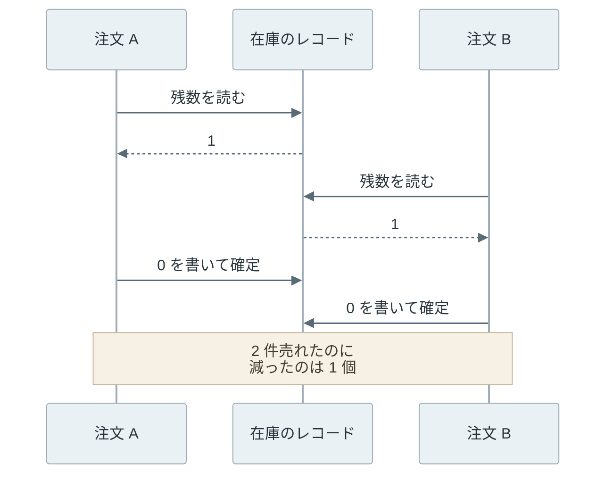
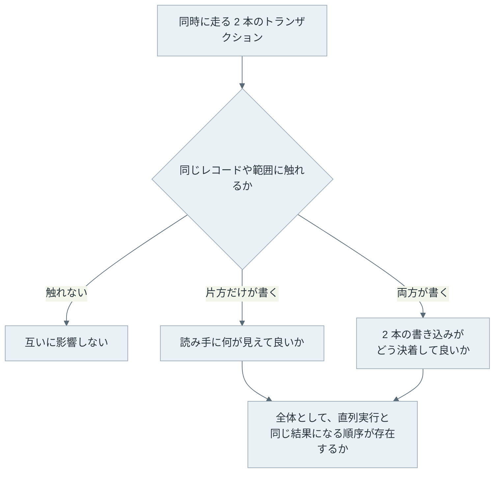
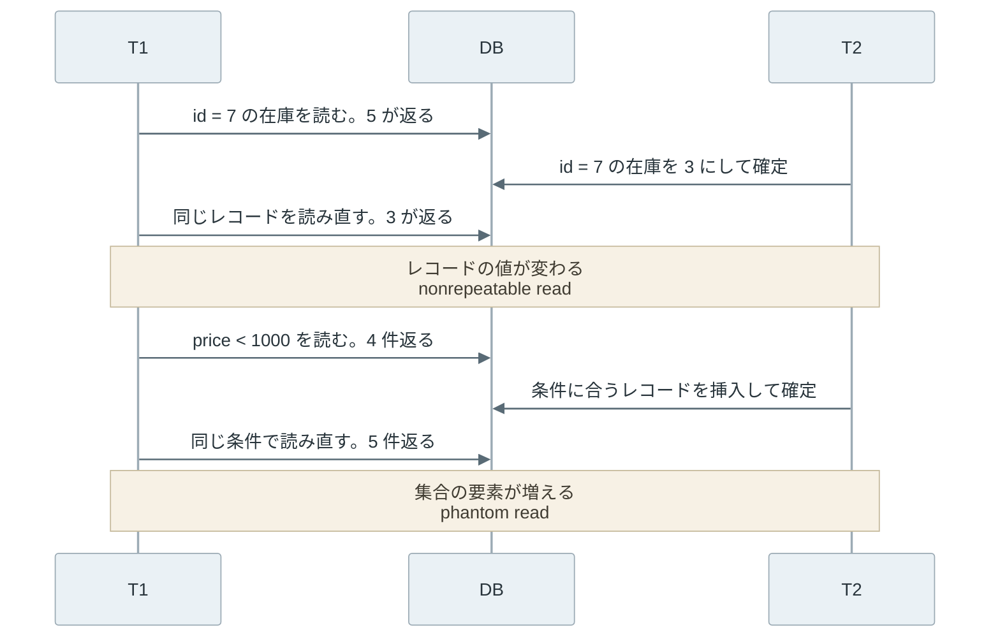
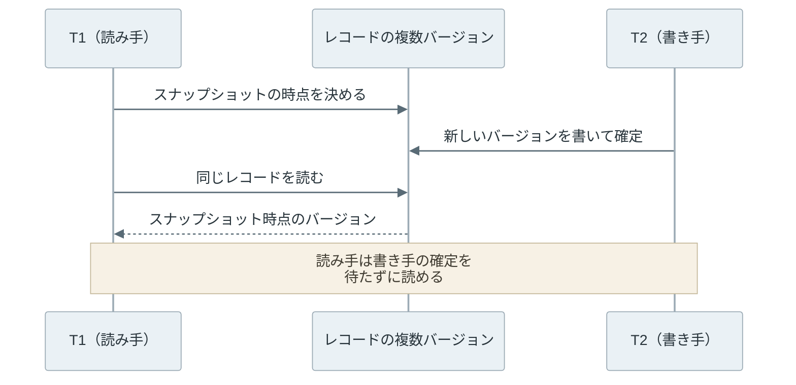
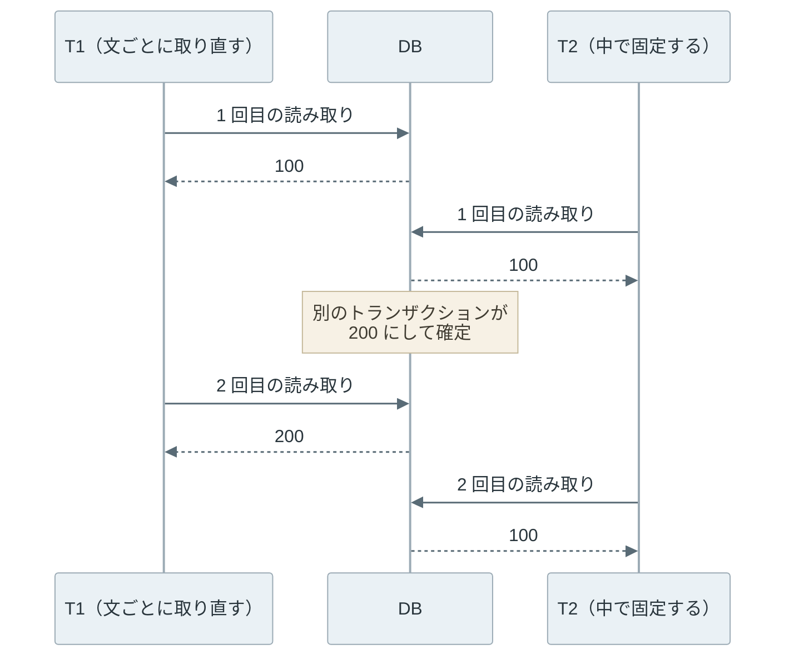
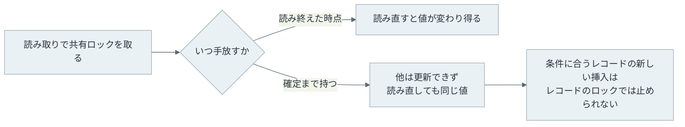
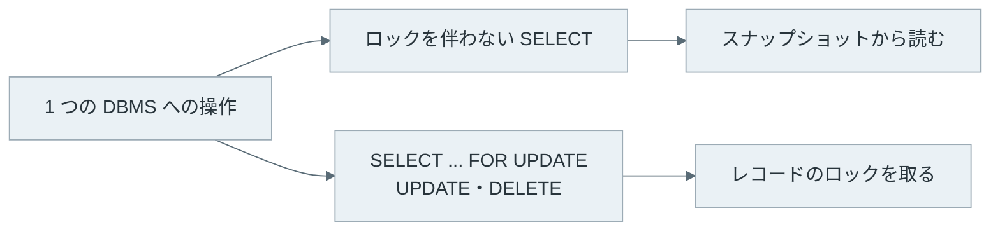

Transaction Isolation（分離）は、複数のトランザクションを同時に実行した時に、互いの読み書きがどのように観測され、どのような結果まで許されるかを定める規則です。ACID（Atomicity、Consistency、Isolation、Durability。原子性・一貫性・分離・耐久性）の I です。

トランザクションは複数の読み書きを 1 つのまとまりとして扱う単位で、まとまりを全部反映して終えることを確定（commit）、全部無かったことにして終えることを中止（abort）と言います。

例えば、在庫を引き当てる処理を考えます。残り 1 個の商品に 2 件の注文がほぼ同時に届くと、どちらの処理も残数として 1 を読み、そこから 1 を引いた 0 を書きます。読んだ値をアプリケーション側で計算して書き戻す形なので、DB（データベース）から見れば 2 件とも正しい更新です。

同じレコードを読んでから書く 2 本のトランザクションを以下に示します。



上記の図で注文 B が読んだ 1 は、注文 A が書き込む前の値です。この異常は lost update と呼ばれます。2 件目が中止されなければ、エラーは出ないまま在庫が 0 になり、後の棚卸しで初めて数が合わないと分かります。

DBMS（Database Management System）は、こうした異常をどこまで許すかを段階で選ばせており、この段階を分離レベルと呼びます。SQL 標準は 4 段階を定めています。どのレベルで動かすかは、接続ライブラリの設定や `SET TRANSACTION ISOLATION LEVEL` でトランザクションごとに指定します。

SQL 標準の 4 段階と、それぞれで起き得る異常を以下に示します。



上記の図の通り、段階を上げるほど起き得る異常が減ります。各異常の中身は後の節で説明します。

<br>

本記事では、1 台の DBMS の中で複数のトランザクションが同時に走る場合を例に、こうした異常の型と、分離レベルという段階がそれをどこまで防ぐのかを説明します。段階がある理由から始めて、次の疑問に答えます。

- なぜ分離レベルという段階があるのか。
- 同時実行では、どんな異常が現れるのか。
- SQL 標準の分離レベルは、それぞれどの異常を防ぐのか。
- 冒頭の在庫の取り合いは、REPEATABLE READ にすれば止まるのか。
- 読み取りの可視性と書き込みの競合は、どんな仕組みで制御されるのか。
- 分離レベルを上げても解けないのは、どんな場合なのか。

複数の DB にまたがる更新は [2PC](../../distributed-systems/two-phase-commit/) の題材とします。ACID のうち原子性と耐久性を支える仕組みは [WAL](../../distributed-systems/write-ahead-log/) で扱っているので、ここでは分離だけを見ます。分離レベルには SQL 標準が定めている部分と DBMS ごとに決めて良い部分があるので、標準の規則を軸に置き、実装で割れる所は都度断ります。

---

### 分離レベルという段階がある理由

正しさだけを求めるなら、トランザクションを 1 本ずつ順に実行すれば済みます。同時に 1 本しか走っていなければ、互いの途中経過を読むことも、自分が読んだ値を横から書き換えられることもありません。

ただし、この方式では接続を増やしても処理量が伸びず、1 本の長いトランザクションが後続を全部待たせます。そこで DBMS は、複数のトランザクションを重ねて実行しつつ、1 本ずつ実行した場合と同じ結果に近づけます。SQL 標準の最も強いレベルは、この一致そのものを要求しています。

残りの 3 レベルは、同時実行で起きる異常（標準の言葉では現象）のうち、各レベルで起きてはならないものによって定義されています。全部を直列実行と一致させる代わりに許す現象を増やし、DBMS が並行して処理しやすいようにしています。減るコストが待ちなのか、中止と再試行なのか、検査なのかは実現方式で変わるので、レベルを下げれば必ず速くなるとは限りません。

2 本のトランザクションが重なった時、分離レベルが何を定めるのかを以下の図に示します。



分離レベルが定めるのは、並行実行でどのような観測と結果を許すかです。上記の図に並べた 3 つの問いがその中身です。

どう実現するかは、分離レベルが決めていません。DBMS はこの保証を満たすために、読み取りの可視性を制御したり、競合する処理を待たせたり、中止したりします。

---

### 同時実行で現れる異常

標準が名前を付けた異常は 3 つで、どれも 1 本のトランザクションの読み書きの間に、別のトランザクションの書き込みが入り込む形をしています。標準はこれらを現象（phenomena）と呼びます。

| 異常 | 何が起きるか |
| --- | --- |
| dirty read | 別のトランザクションが書いた、まだ確定していない値を読む |
| nonrepeatable read | 一度読んだレコードを読み直すと、値が変わっているかレコードが消えている |
| phantom read | 同じ検索条件で読み直すと、条件に合うレコードの集合が変わっている |

後ろの 2 つの違いは、変わるのが読んだレコードなのか、条件に合うレコードの集合なのかです。集合が変われば phantom read に当てはまるので、挿入でレコードが増える形だけとは限りません。

以下は、1 本のトランザクションの中で 2 種類の読み直しを並べた流れです。



上記の図の後半のように条件に合うレコードが入れ替わる場合、読んだレコードを 1 つずつロック（印を付けて、他のトランザクションの書き込みを待たせること）しても防げません。この点が、phantom read を分けて扱う理由になります。

<br>

標準の 3 つの現象だけでは、商用の DBMS が実装している分離レベルを区別できません。Berenson 氏らが 1995 年に発表した論文「[A Critique of ANSI SQL Isolation Levels](https://www.microsoft.com/en-us/research/wp-content/uploads/2016/02/tr-95-51.pdf)」はこの点を指摘し、異常を足しました。

足した異常には、確定していない書き込みを別のトランザクションが上書きする dirty write と、冒頭の在庫の例で挙げた lost update が入ります。

論文には、nonrepeatable read の意味を広げ、読んだレコードを他のトランザクションが書き換えること自体まで含めて禁止すれば、lost update も併せて防げると書かれています。これは論文が採る広い解釈での話であって、標準の表で REPEATABLE READ を選べばどの DBMS でも lost update が防がれる、という意味にはなりません。

もう 1 つが write skew です。2 本のトランザクションがそれぞれ別のレコードを書いた結果、両方が前提にしていた制約が破れる異常で、[Snapshot Isolation](../snapshot-isolation/) で扱います。

---

### SQL 標準が定めた 4 つの分離レベル

4 つのレベルと、そこで起きてはならない現象の対応を整理すると、以下の通りです。

| 分離レベル | dirty read | nonrepeatable read | phantom read |
| --- | --- | --- | --- |
| READ UNCOMMITTED | 起き得る | 起き得る | 起き得る |
| READ COMMITTED | 起きない | 起き得る | 起き得る |
| REPEATABLE READ | 起きない | 起きない | 起き得る |
| SERIALIZABLE | 起きない | 起きない | 起きない |

上記の表の「起き得る」は、その現象を標準が禁止していないという意味で、実装がそれより強く保証しても標準には反しません。PostgreSQL のドキュメントは、自身の REPEATABLE READ が phantom read を許さないことに触れた上で、「[higher guarantees are acceptable](https://www.postgresql.org/docs/current/transaction-iso.html)」（より強い保証は許容される）としています。

最終行の SERIALIZABLE だけは、この 3 列だけでは定義し切れません。各レベルが 1 つ手前に何を足すのかを以下の図に示します。


SERIALIZABLE が要求しているのは、並行実行の結果が何らかの直列実行と同じ効果になることです。3 つの現象は、そこから外れる形のうち名前が付いた一部にすぎず、ほかに直列実行では起きない結果が残っていれば、SERIALIZABLE の保証は満たしません。

<br>

同じレベル名でも、DBMS による差があります。PostgreSQL は 4 つ全部を指定として受け付けるものの、内部では 3 つしか実装しておらず、ドキュメントには「[PostgreSQL's Read Uncommitted mode behaves like Read Committed](https://www.postgresql.org/docs/current/transaction-iso.html)」（PostgreSQL の Read Uncommitted モードは Read Committed と同じように動く）と書かれています。

[Oracle Database のドキュメント](https://docs.oracle.com/en/database/oracle/oracle-database/23/cncpt/data-concurrency-and-consistency.html)は、提供する分離レベルとして read committed（既定）と serializable、および読み取り専用のモードを挙げており、read uncommitted と repeatable read は挙げていません。

MySQL の既定のストレージエンジンである [InnoDB](https://dev.mysql.com/doc/refman/8.4/en/innodb-transaction-isolation-levels.html) は、4 つ全部に対応した上で既定を REPEATABLE READ としています。設定するレベル名を揃えても、実際に防がれる現象は揃いません。

例えば、冒頭の在庫の取り合いを PostgreSQL 17.11 と MySQL 8.4.11 の InnoDB で再現します。在庫のテーブルに残数 1 のレコードを置き、2 本の接続（注文 A・注文 B）を開いて、以下の SQL を上から順に打ちます。注文 B は、注文 A が確定する前に残数を読みます。

```sql
-- 準備（PostgreSQL・MySQL 共通）
CREATE TABLE stock (id INT PRIMARY KEY, qty INT NOT NULL);
CREATE TABLE orders (id INT PRIMARY KEY, item_id INT NOT NULL);
INSERT INTO stock VALUES (1, 1);

-- 手順 1：注文 A
-- MySQL では BEGIN の行を次の 2 文にする
-- SET TRANSACTION ISOLATION LEVEL REPEATABLE READ; START TRANSACTION;
BEGIN ISOLATION LEVEL REPEATABLE READ;
SELECT qty FROM stock WHERE id = 1;   -- 1 が返る

-- 手順 2：注文 B（手順 1 と同じ BEGIN の後）
SELECT qty FROM stock WHERE id = 1;   -- 1 が返る

-- 手順 3：注文 A
INSERT INTO orders VALUES (1, 1);
UPDATE stock SET qty = 0 WHERE id = 1;
COMMIT;

-- 手順 4：注文 B
INSERT INTO orders VALUES (2, 1);
UPDATE stock SET qty = 0 WHERE id = 1;
COMMIT;

-- 手順 5：どちらかの接続で結果を見る
SELECT qty, (SELECT count(*) FROM orders) AS orders FROM stock WHERE id = 1;
```

手順 4 の `UPDATE` と手順 5 の結果は以下の通りです（出力は抜粋）。

```text
-- PostgreSQL
ERROR:  could not serialize access due to concurrent update
 qty | orders
-----+--------
   0 |      1

-- MySQL
Query OK, 0 rows affected (0.00 sec)
+-----+--------+
| qty | orders |
+-----+--------+
|   0 |      2 |
+-----+--------+
```

PostgreSQL では注文 B が中止され、B が足した注文のレコードも取り消されました（B の `COMMIT` は `ROLLBACK` として扱われます）。MySQL では 2 本ともエラー無しで確定し、冒頭の図のとおり 2 件売れて減ったのは 1 個になりました。この差がどこから来るかは、書き込みの競合の処理で見ます。

---

### 読み取りの可視性

DBMS は、読み取りに使う値の選択と、競合する書き込みの制御を組み合わせます。何を可視にするかを制御する代表的な方法として、スナップショットとロックがあります。

スナップショットとは、レコードに複数のバージョンがある時に、その読み取りにどれを見せるかを決める基準です。ここでのバージョンは、レコードを更新しても古い内容を消さずに残した、レコードの各時点の内容を指します。ある論理的な時点を決め、その時点で確定していたバージョンだけを見せます。DB 全体を複製するわけではありません。

レコードの複数のバージョンを保持し、スナップショットに従って可視なバージョンを選ぶ方式が MVCC（Multiversion Concurrency Control）です。



上記の図の T1 が待たされないのは、新しいバージョンと古いバージョンが同時に存在するからです。代わりに、古いバージョンを保持する領域と、不要になったバージョンを回収する処理が必要です。

時点をいつ決め直すかは、分離レベルと DBMS で変わります。例えば、同じ 2 回の読み取りは、2 つの方式で次のように分かれます。



上記の図の T2 が 2 回目でも 100 を読むのは、スナップショットが動かないからです。

どちらの方式になるかはレベルで決まり、PostgreSQL と InnoDB はどちらも READ COMMITTED が文ごと、REPEATABLE READ が固定です。

同じ REPEATABLE READ でも、固定の基準になるのは PostgreSQL が最初の文、InnoDB が最初の読み取りです。

InnoDB のドキュメントには、ロックを伴わない通常の `SELECT`（consistent read）が「[the snapshot established by the first such read in that transaction](https://dev.mysql.com/doc/refman/8.4/en/innodb-consistent-read.html)」（そのトランザクションの中で最初のそうした読み取りで確立されたスナップショット）を読み続けるとあります。

PostgreSQL の REPEATABLE READ が基準にするのは、`BEGIN` などのトランザクション制御の文を除いて、トランザクションの中で最初に実行した文の開始時点です。

もう 1 つの方法がロックです。読み取りの前に共有ロック（読み取りどうしは共存でき、書き込みだけを待たせるロック）を取れば、確定していない値を読むことはなくなります。いつ手放すかで段階が分かれます。



ロックだけで SERIALIZABLE を実現する代表が 2 相ロック（two-phase locking）です。ロックを取り終えてから解放を始め、解放後は新しいロックを取らない規律です。検索条件の範囲まで含めてロックし、この規律を守れば、並行実行の結果が直列実行と一致します。

範囲をロックして phantom read を防ぐ実装では、条件に合うレコードが後から入り得る、索引に並んだキーとキーの間（隙間）までロックする必要があります。MySQL の InnoDB はこの方法を使い、単位になるのは [Index Scan](../index-scan/) で見た索引の範囲です。ドキュメントには、一意索引を一意な条件で引く場合、見付けたレコードだけをロックして隙間はロックしないと書かれています。

それ以外の検索条件では、ロックを伴う読み取りと `UPDATE`・`DELETE` が、走査した索引の範囲を「[using gap locks or next-key locks to block insertions by other sessions into the gaps covered by the range](https://dev.mysql.com/doc/refman/8.4/en/innodb-transaction-isolation-levels.html)」（gap lock か next-key lock で、その範囲に含まれる隙間への他セッションからの挿入を防ぐ）形でロックします。

gap lock は隙間へのロック、next-key lock はレコードとその手前の隙間をまとめたロックです。キーが 10・20・30・40 の索引に 15 を挿入する場合は、以下のようになります。



15 は 10 と 20 の間の隙間に入るので、キー 20 のレコードだけをロックしても挿入は止まりません。

<br>

一方で、PostgreSQL の SERIALIZABLE は範囲をロックする代わりに、あるトランザクションが読んだデータを別のトランザクションが書き換えたかを記録し、直列実行と矛盾する組み合わせなら中止します。

スナップショットとロックの性質を整理すると、以下の通りです。読み取りの可視性だけの比較で、書き込み同士の競合はこの表の外にあります。

| | スナップショットから読む | ロックを取って読む |
| --- | --- | --- |
| 通常の読み取りと書き込みの関係 | 互いをブロックしにくい | 互いに待つ |
| 追加で必要な資源 | 古いバージョンの保持と回収 | ロックの管理 |
| 読み取りの一貫性の決まり方 | スナップショットの時点で決まる | ロックを保持する期間で決まる |

左の列を「しにくい」としたのは、ロックを伴う読み取りや書き込み同士の競合では待ちが起きるからです。

---

### 書き込みの競合の処理

2 本のトランザクションが同じレコードを書こうとした時の扱いは、大きく 3 通りに分かれます。

- ロックで待たせる。先に取った方が確定するまで、もう一方は止まる
- 競合を検査して片方を中止する。確定の時点で判定する形が代表になる
- 待たせた上で中止する。相手の確定を待ち、確定していたら自分を中止する

PostgreSQL の REPEATABLE READ は 3 番目です。先ほどの実験では注文 A が既に確定していたので、注文 B は待たずに中止されました。

ドキュメントには、先に更新した側が確定していれば「[rolled back with the message ERROR: could not serialize access due to concurrent update](https://www.postgresql.org/docs/current/transaction-iso.html)」（ERROR: could not serialize access due to concurrent update というメッセージでロールバックされる）とあります。

Oracle の serializable も同じ形で、トランザクションの開始後に確定した更新に当たると `ORA-08177` を返します。待たせる方式ならデッドロックへの備え、中止させる方式なら再試行の処理が必要です。

読み取りの可視性と書き込みの競合は分けて考えられ、1 つの DBMS が複数の方式を組み合わせます。操作ごとにどちらが働くのかは以下の通りで、この分かれ方は InnoDB と PostgreSQL のどちらにも当てはまります。



MySQL の実験で注文 B の `UPDATE` が通ったのも、この分かれ方から来ます。InnoDB の[スナップショットが効くのはロックを伴わない `SELECT`](https://dev.mysql.com/doc/refman/8.4/en/innodb-consistent-read.html) で、`UPDATE` や `DELETE` は他のトランザクションが確定したばかりのレコードにも及びます。

実験の B はスナップショットから 1 を読みましたが、`UPDATE` は A が確定した 0 のレコードに当たりました。値が既に 0 なので結果は `0 rows affected` で、B が読んだ 1 と食い違うことは検査されないまま確定しています。

読み取りをトランザクション単位のスナップショットで固定し、書き込みは同じデータへの競合を検出して捌く、という組み方が Snapshot Isolation です。冒頭の在庫の例のような競合は防げる一方で、別々のレコードを書き換えて制約を壊す write skew は残ります。[Snapshot Isolation](../snapshot-isolation/) で扱います。

---

### 利点

- 同時に走るトランザクションの数を増やしながら、1 本ずつ実行した結果に近づけられる
- 段階を選べる DBMS では、必要な正しさと並行実行のコストの釣り合いをトランザクション単位で決められる
- 異常に名前が付いているため、起きた不具合をどのレベルなら防げるかを判断できる
- 強い分離を DBMS が引き受ける範囲では、アプリケーションのロック設計を減らせる

---

### 欠点

分離レベルを選ぶ時は、次のコストと実装上の制約も確認します。

- 強い分離では待ち・中止と再試行・競合検査などのコストが増える場合があり、どこに現れるかは実現方式で変わる
- 同じレベル名でも DBMS ごとに保証が違い、移す時に挙動が変わる
- 中止されたトランザクションを再試行する処理が、アプリケーション側に必要
- 弱いレベルで起きる異常はエラーにならず結果の値としてだけ現れるため、テストで気付きにくい

冒頭の在庫の引き当てで、最後の 2 つを数えました。PostgreSQL 17.11 で、残数を読んでから自分で計算した値を書き戻すトランザクションを pgbench から並行に流し、READ COMMITTED と SERIALIZABLE で比べます。

各クライアントが 200 件ずつ注文し、直列化の失敗で中止された時は先頭から再試行します（上限 10,000 回）。失われた更新は「確定した注文の数 − 在庫が減った数」です。

```sql
BEGIN;
SELECT qty FROM stock WHERE id = 1 \gset
INSERT INTO orders (item_id) VALUES (1);
UPDATE stock SET qty = :qty - 1 WHERE id = 1;
END;
```

全体は [lab/lost_update.py](https://github.com/nao1215/debimate/blob/main/content/notes/database-systems/transaction-isolation/lab/lost_update.py) にあります。結果は次の通りです。



<details>
<summary>測定値（抜粋）</summary>

```text
level           clients  orders  stock_decrease  lost_updates  retried_tx  retries  gave_up
read committed        2     400             207           193           0        0        0
read committed       32    6400             200          6200           0        0        0
serializable          2     400             400             0          72      353        0
serializable         32    6400            6400             0        1556   171923        0
```

</details>

READ COMMITTED はエラーを 1 件も返さないまま、32 並列では 6,400 件の注文に対して在庫が 200 個しか減りませんでした。SERIALIZABLE では失われた更新が 0 件になった代わりに、32 並列で注文 1 件あたり平均 27 回の再試行が起きています。

2 回流すと再試行の回数は少し動き（32 並列で 171,923 回と 163,073 回）、SERIALIZABLE の失われた更新は 2 回とも 0 件でした。同じ 1 件に更新が集中する形なので、次の節の 4 つ目にも当たります。

---

### 分離レベルの引き上げでは解けないケース

- 画面の表示から更新までの間に人の操作を挟む更新
- DB の外にある処理（メールの送信、外部 API の呼び出し）を含む一連の作業
- 複数の DB やサービスにまたがる更新
- 同じレコードへの更新が集中していて、中止と再試行が積み上がる場合

1 つ目が分離レベルで解けないのは、トランザクションを開いたまま人の操作を待つと、その間ロックと接続を握り続けるからです。そのため、読んだ時のバージョン番号を更新条件に入れ、値が変わっていたら弾く方法（楽観ロック）が使われます。

2 つ目と 3 つ目は、DB のロックやスナップショットが届かない状態を含むためで、複数の DB にまたがる確定は [2PC](../../distributed-systems/two-phase-commit/) の題材になります。4 つ目は、レベルを上げるほど中止が増える形なので、同じレコードに更新が集中しないよう、更新するレコードの分け方を変える必要があります。
