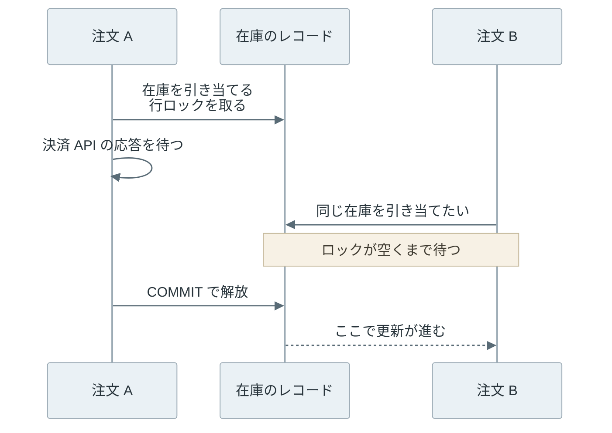
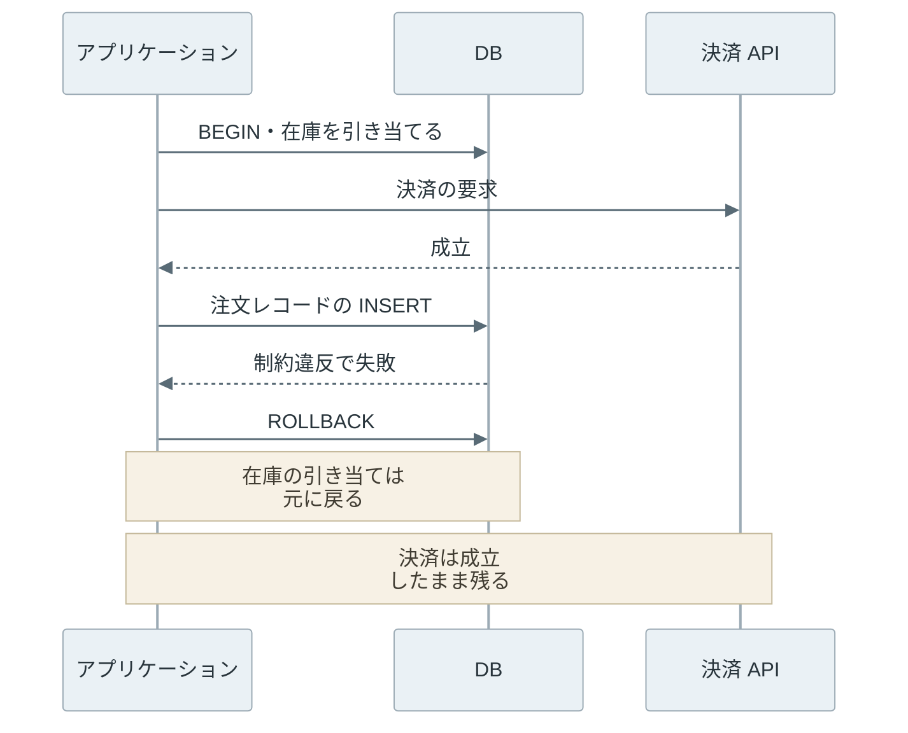
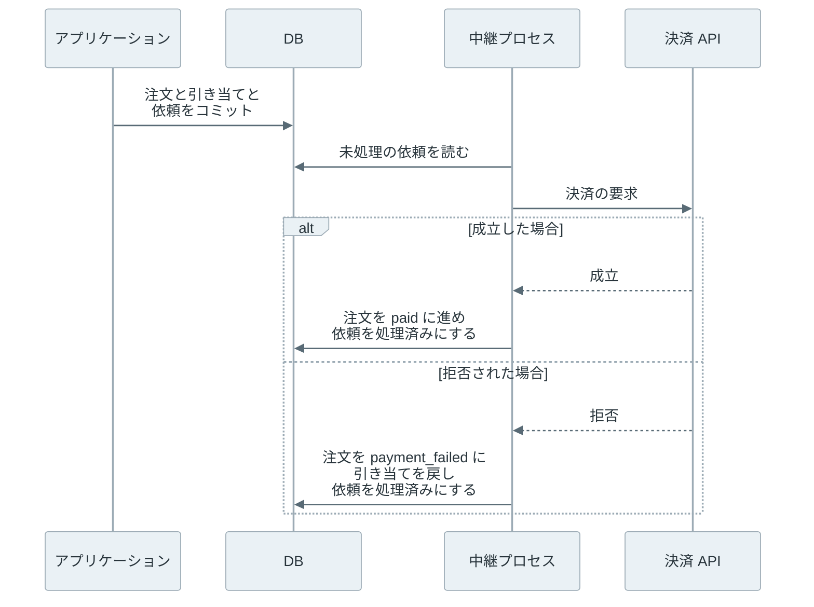

Transaction Scope（トランザクションの範囲）は、`BEGIN` から `COMMIT` までの間にどの処理を入れるかの決め方です。DB（データベース）のトランザクションが巻き戻せるのは、その DB 内の更新です。外部 API の呼び出しまで取り消せるわけではありません。

レコードを更新すると、DB はそのレコードに他からの更新を待たせるロック（行ロック）を取り、通常はトランザクションが終わるまで外しません。そのため、範囲を広げるほど、DB 接続と早い段階で取った行ロックを長く保持します。

外部システムを呼ぶ処理では、DB 内の更新と外部の処理をどこで分けるかが問題になります。在庫を引き当て、決済 API を呼び、注文のレコードを作る、という 3 つの処理があるとします。どれかが失敗した時に全て取り消すつもりで、3 つを 1 つのトランザクションに入れた場合を考えます。

3 つの処理を 1 つのトランザクションに入れた形（上）と、DB の更新だけを入れて決済をコミットの後に回した形（下）を以下に示します。



上の形では、決済 API の応答時間がそのままロックの保持時間に足されます。下の形ではロックが短く済む代わりに、決済の呼び出しをコミットと別に管理する必要があります。

<br>

本記事では、[PostgreSQL](https://www.postgresql.org/) の挙動を基本に、ロックを保持している間に何が起きるのかと、外部の呼び出しをどこに出すのかを説明します。ロック待ちの実験には PostgreSQL 17.10、外部 API とロールバックの実験には [SQLite](https://www.sqlite.org/) を使います。範囲を広げた時の困り事から始めて、次の疑問に答えます。

- なぜトランザクションを広げると困るのか。
- 決済の応答を待つ間、DB の中のトランザクションは何をしているのか。
- 外部 API の呼び出しは、なぜロールバックで戻らないのか。
- 決済の依頼を DB に残してから呼ぶと、何が変わるのか。
- トランザクションを短くしても、どんな問題が残るのか。

複数のレコードを違う順序でロックして互いに待つ状態は [Deadlock](../deadlock/)、他のトランザクションの変更がどこまで見えるかを定める分離レベルは [Transaction Isolation](../transaction-isolation/)、複数の DB にまたがるコミットは [2PC（Two-Phase Commit、2 相コミット）](../../distributed-systems/two-phase-commit/) の題材とします。

---

### トランザクションを広げると困る理由

行ロックを保持している間に待たされるのは、同じレコードを更新しようとしたトランザクションと、`SELECT ... FOR UPDATE` のように競合するモードのロックを取ろうとしたトランザクションです。ロックを伴わない通常の `SELECT` は、この行レベルロックでは待ちません。

PostgreSQL のドキュメントには、「[Row-level locks are released at transaction end or during savepoint rollback, just like table-level locks](https://www.postgresql.org/docs/current/explicit-locking.html)」（行レベルのロックは、表レベルのロックと同じく、トランザクションの終了時かセーブポイント（トランザクションの途中に置く戻り先）の巻き戻し時に解放される）とあります。

決済 API をトランザクションの中で呼んだ場合に、後続がどこで止まるのかを以下の図に示します。



上記の図を 2 本の接続で実際に動かし、決済 API の応答待ちをアプリケーション側の 5 秒の待ちに置き換えた結果は以下の通りです。注文 B は、注文 A が在庫のレコードを `UPDATE` した 1 秒後に同じレコードを `UPDATE` します。A の `UPDATE` から 3 秒後には、接続ごとの状態を返す [`pg_stat_activity`](https://www.postgresql.org/docs/current/monitoring-stats.html#MONITORING-PG-STAT-ACTIVITY-VIEW) も読みました。

```text
-- 注文 B
UPDATE stock SET qty = qty - 1 WHERE id = 7;
Time: 4005.503 ms (00:04.006)

-- 3 秒後の pg_stat_activity（抜粋）
 application_name |        state        | wait_event_type
------------------+---------------------+-----------------
 order_a          | idle in transaction | Client
 order_b          | active              | Lock
```

以下は、上記の実行を時間軸に並べた図です。



在庫数を 1 減らすだけの注文 B の `UPDATE` に、4 秒掛かりました。この間の注文 A は `idle in transaction`、つまり開いたまま次の文を待つ状態で、DB の中では何も処理していません。それでも行ロックは A が持ち続けます。ロック待ちを打ち切る [`lock_timeout`](https://www.postgresql.org/docs/current/runtime-config-client.html#GUC-LOCK-TIMEOUT) は既定で無効なので、B の待ちは A の応答待ちに合わせて伸びます。

<br>

ロックに加えて、トランザクションを開いている間は DB への接続も 1 本占有します。Go の `database/sql` のドキュメントは、「[Once DB.Begin is called, the returned Tx is bound to a single connection](https://pkg.go.dev/database/sql)」（DB.Begin を呼ぶと、返された Tx は 1 本の接続に結び付けられる）と書いています。

その接続がプールに戻るのは `Commit` か `Rollback` の後です。上限まで接続が埋まると、その注文と関係のない処理まで接続を取れずに待ちます。

開いたままのトランザクションがあると、更新前の古い行バージョンを `VACUUM` という掃除の処理（[MVCC と VACUUM](/notes/database-systems/mvcc-vacuum/) のノート）で回収できず、表が膨らみ続けることがあります（[`VACUUM` による回収](https://www.postgresql.org/docs/current/routine-vacuuming.html)、[`idle_in_transaction_session_timeout` の説明](https://www.postgresql.org/docs/current/runtime-config-client.html)）。

---

### ロールバックで戻らない外部 API の呼び出し

外部 API をトランザクションの中で呼ぶと、待ち時間に加えて、DB を巻き戻しても外部で起きたことは戻らない、という問題が出ます。

以下は、決済が成立した後で、注文レコードの `INSERT` が制約違反で失敗した場合の流れです。



上記の図の `ROLLBACK` で在庫の引き当ては消えます。利用者から見ると、代金を払ったのに注文が残っていない状態になります。取り消すには、アプリケーションから[補償](/notes/distributed-systems/saga/)の要求（返金や決済の取り消し）を明示的に送ります。

---

### ロールバック後に残る決済の実験

図の順序を[ローカルで実行するコード](lab/run.py)で確認します。アプリの DB と決済サービスの DB を別々に用意し、決済サービスは localhost の HTTP サーバーとして動かします。実際の送金は行いません。ここでは Python 標準ライブラリの SQLite を使い、トランザクションの境界を確認します。前節の PostgreSQL のロック待ちを再現する実験ではありません。

アプリは在庫を 1 個減らして決済 API を呼び、その後で不正な金額 `-100` の注文を登録します。`CHECK (amount > 0)` に違反するため、例外を受けたアプリが明示的に `rollback()` を呼びます。[SQLite のトランザクション制御](https://www.sqlite.org/lang_transaction.html)では、制約違反だけでトランザクション全体が必ず戻るわけではありません。このサンプルは ROLLBACK を実行して終了させます。

以下が `run.py` の全体です。

```python
"""A loopback payment mock commits independently of the caller's transaction."""

import sqlite3
import tempfile
import threading
from http.server import BaseHTTPRequestHandler, HTTPServer
from pathlib import Path
from urllib.request import Request, urlopen


def main():
    with tempfile.TemporaryDirectory(prefix="transaction-scope-") as directory:
        provider_path = Path(directory) / "provider.db"
        with sqlite3.connect(provider_path) as provider:
            provider.execute("CREATE TABLE charges (id INTEGER PRIMARY KEY)")

        class PaymentHandler(BaseHTTPRequestHandler):
            def do_POST(self):
                with sqlite3.connect(provider_path) as provider:
                    provider.execute("INSERT INTO charges DEFAULT VALUES")
                self.send_response(200)
                self.end_headers()
                self.wfile.write(b"paid")

            def log_message(self, *_args):
                pass

        server = HTTPServer(("127.0.0.1", 0), PaymentHandler)
        thread = threading.Thread(target=server.serve_forever, daemon=True)
        thread.start()
        try:
            with sqlite3.connect(":memory:") as app:
                app.executescript("""
                    CREATE TABLE stock (quantity INTEGER);
                    INSERT INTO stock VALUES (1);
                    CREATE TABLE orders (amount INTEGER CHECK (amount > 0));
                """)
                for attempt in (1, 2):
                    app.execute("BEGIN")
                    try:
                        app.execute("UPDATE stock SET quantity = quantity - 1")
                        request = Request(
                            f"http://127.0.0.1:{server.server_port}/pay", data=b"", method="POST"
                        )
                        with urlopen(request, timeout=5) as response:
                            assert response.read() == b"paid"
                        app.execute("INSERT INTO orders VALUES (-100)")
                    except sqlite3.IntegrityError:
                        app.rollback()
                    else:
                        raise AssertionError("constraint failure expected")
                    quantity = app.execute("SELECT quantity FROM stock").fetchone()[0]
                    orders = app.execute("SELECT count(*) FROM orders").fetchone()[0]
                    with sqlite3.connect(provider_path) as provider:
                        charges = provider.execute("SELECT count(*) FROM charges").fetchone()[0]
                    print(
                        f"attempt={attempt} app: stock={quantity} orders={orders}; provider: charges={charges}"
                    )
                    assert (quantity, orders, charges) == (1, 0, attempt)
        finally:
            server.shutdown()
            thread.join()
            server.server_close()


if __name__ == "__main__":
    main()
```

```sh
python3 lab/run.py
```

[実行結果](lab/output.txt)では、同じ処理をもう一度試しています。

```text
attempt=1 app: stock=1 orders=0; provider: charges=1
attempt=2 app: stock=1 orders=0; provider: charges=2
```

| 保存先 | 1 回目の失敗後 | 再試行の失敗後 |
|---|---|---|
| アプリの在庫 | 1 個に戻る | 1 個に戻る |
| アプリの注文 | 0 件 | 0 件 |
| 決済サービスの決済 | 1 件残る | 2 件残る |

決済サービスは HTTP の成功応答を返す前に、自分の DB をコミットしています。呼び出し元の `rollback()` は、その別のトランザクションを取り消しません。このサンプルには重複を防ぐ処理がないため、単純な再試行で決済が増えました。再試行時にも同じ処理 ID を使って決済の重複を防ぎ、注文に対応する決済状態を記録する必要があります。

---

### 結果が分からない COMMIT

`COMMIT` がエラーを返しても、DB 側ではコミットしていることがあります。DB サーバーがコミットを終えた後、成功の応答を返す途中で接続が切れることがあり、アプリケーションからはコミットできたのかどうかを判断できません。

そのため、`COMMIT` のエラーをコミットされていないと決め付けて処理をやり直すと、コミット済みの更新が二重に反映される場合があります。

確認するには、注文 ID や処理 ID のように、トランザクションを始める前に生成した一意なキーで結果を読み直し、この試行がコミットしているかを見ます。既存のレコードを `UPDATE` するだけの処理では、レコードの有無を見ても判断できません。その場合は、同じトランザクションで処理 ID を記録用の表に 1 件挿入しておき、やり直す前にその ID があるかを読みます。

---

### 決済の依頼を DB に残してからの呼び出し

トランザクションを DB の更新だけに絞り、決済の呼び出しをコミットの後に置くと、行ロックと DB 接続の保持時間は DB 内の処理で決まります。代わりに、コミットした直後にプロセスが落ちると呼び出しが漏れます。在庫は引き当てられ、注文のレコードもあるのに、決済だけが行われていない状態になります。

処理されていない依頼を後から実行するために、決済 API への依頼を DB のレコードとして残し、別のプロセスに読ませます。このプロセスは依頼のレコードを定期的に読んで外部 API を呼ぶ常駐プログラムで、以降は中継プロセスと呼びます。

注文を `pending_payment` の状態で作り、在庫を引き当て、「決済を呼ぶ」という依頼のレコードを書くところまでを 1 つのトランザクションにします。中継プロセスがその依頼を読んで決済 API を呼び、成立したら注文を `paid` に進めます。

DB の更新と同じトランザクションで配送すべきメッセージを記録し、後から別プロセスが配送する形は [Transactional Outbox](../../distributed-systems/transactional-outbox/) と呼ばれ、ここではその配送先を決済 API にしています。

以下は、コミットと呼び出しを分けた形です。



上記の図の依頼のレコードは注文と在庫の更新と同じトランザクションに入るので、依頼の記録だけが漏れる状態を避けられます。決済 API を呼んだ後も、注文の状態の更新と依頼を処理済みにする更新は、同じトランザクションでコミットします。片方だけが残ると、依頼の状態と注文の状態が食い違います。

同じ依頼が再送されるのは、決済 API では成立したのに、その結果をローカルの DB に記録する前に中継プロセスが落ちた場合です。依頼は未処理のまま残るので、次に読んだ時にもう一度送られます。呼び出し先に冪等（べきとう、idempotent）な扱いが必要になるのは、この経路があるからです。冪等とは、同じ要求を繰り返しても、課金のような業務上の結果が 1 回分から増えない性質です。

残高不足やカードの拒否で決済が成立しないことは珍しくないので、拒否された時の行き先も先に決めます。上記の図では注文を `payment_failed` に進め、引き当てた在庫を戻しています。巻き戻しで消すのではなく、失敗も状態として残す形になります。

3 つの置き方の性質を整理すると、以下の通りです。

| 置き方 | ロックと接続の保持時間 | 失敗した時に残るもの |
| --- | --- | --- |
| トランザクションの中で呼ぶ | 相手の応答時間が加わる | 巻き戻しても外部の副作用が残る |
| コミットしてから呼ぶ | DB の中の処理で決まる | コミットと呼び出しの間で落ちると呼び出しが漏れる。呼び出し結果が不明な場合は再試行で重複し得る |
| 依頼を同じトランザクションで記録し、中継プロセスが呼ぶ | DB の中の処理で決まる | 記録が残るため後から拾えるが、API の成功と依頼の処理済み化の間で落ちると再送される |

再送を安全に扱うために、決済 API では要求ごとに一意な鍵（[idempotency](/notes/distributed-systems/idempotency/) key）を添えて、同じ鍵の 2 度目の要求では課金を増やさない形が使われます。

---

### 利点

- 行ロックの保持時間が DB の中の処理で決まり、相手のシステムの遅延に左右されなくなる
- 応答待ちで DB 接続を握らないので、同時に捌ける件数が接続の本数で頭打ちになりにくい
- 巻き戻す対象が DB の中だけになり、外部の副作用は補償という別の手段で扱うと決められる
- 依頼を DB に残す形なら、コミットした依頼はプロセスが止まっても失われない

---

### 欠点

範囲を狭めると、トランザクションの外に出した処理を状態と再送で扱います。そのため、次の制約があります。

- 注文が `pending_payment` のまま残る時間が生まれ、その状態を画面と集計の両方で扱う必要がある
- 依頼を中継プロセスに預けると、業務と直接関係のない表とプロセスを運用し続ける
- 呼び出し先が重複排除に使える識別子や仕組みを提供していない場合は、ローカルの DB だけで重複した外部の副作用を完全に防ぐことはできない。結果の照会や業務上の一意キー、補償処理などを組み合わせて扱う
- 外部の失敗を巻き戻しではなく、注文の状態遷移として設計し直す必要がある

---

### トランザクションを短くしても残るケース

- 複数のレコードを更新する処理どうしが、違う順序でロックを取る場合
- 画面の表示から更新までの間に人の操作を挟む更新
- 同じレコードへの更新が集中していて、範囲を狭めても待ちが積み上がる場合
- 読んだ値をもとに書き戻す処理で、同時実行の異常が結果に現れる場合

複数のレコードのロック順序が逆になる問題は、トランザクションの範囲を狭めても消えません。同じ 2 件を逆の順で更新する 2 本は、互いの解放を待ってどちらも進まなくなります。順序を揃える方法は [Deadlock](../deadlock/) で扱います。

人の操作を挟む更新では、操作を待つ間トランザクションを開いたままにせず、表示した時から値が変わっていないかを更新の時に検査します。読んだ時のバージョン番号を更新条件に入れ、値が変わっていたら弾く方法（楽観ロック）が使われます。

更新が特定の 1 件に集中する問題は、範囲を狭めるだけでは解消しないため、更新を 1 件に集めない設計に変えます。例えば、人気商品の在庫を 1 件で持たずに複数のレコードに分けて引き当て、その合計を在庫数とします。読んだ値をもとに書き戻す時の異常と分離レベルの関係は [Transaction Isolation](../transaction-isolation/) の題材です。
