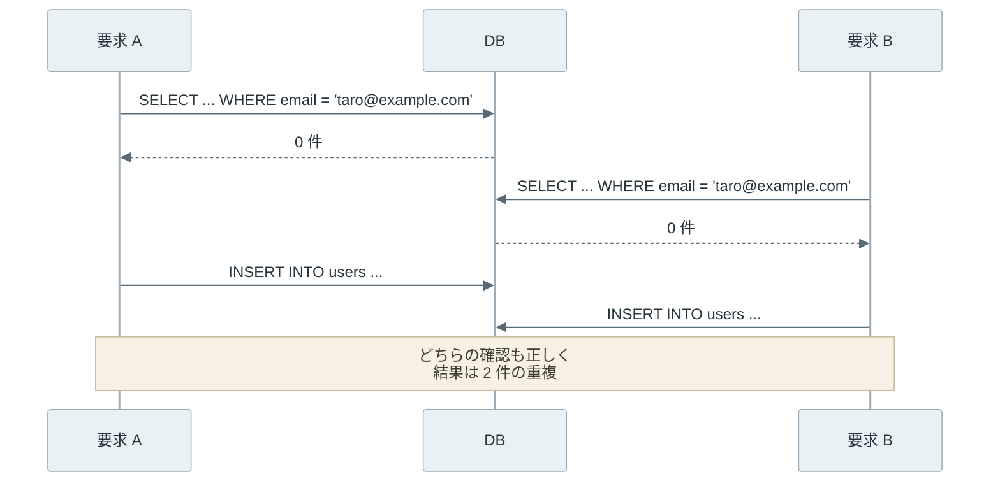
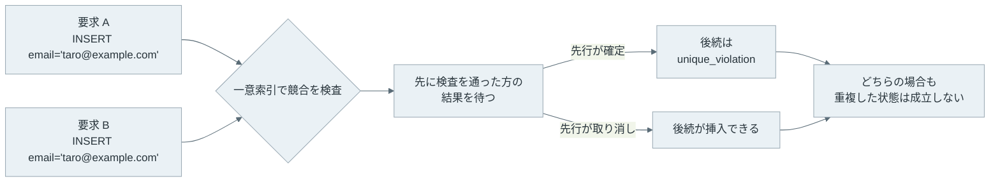
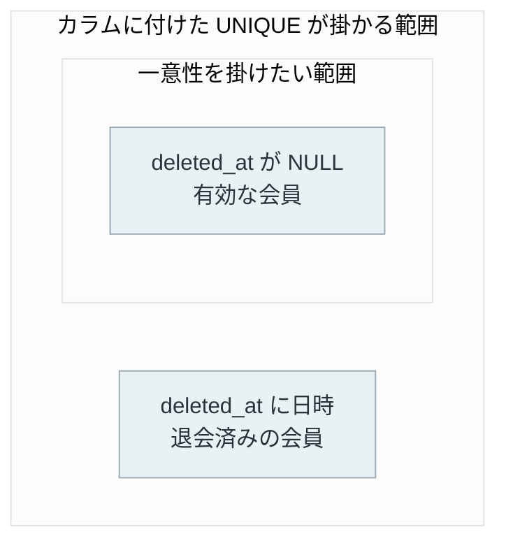
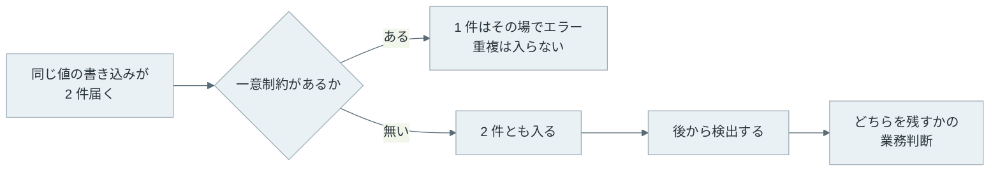

[一意制約](https://www.postgresql.org/docs/current/ddl-constraints.html)（unique constraint）は、あるカラム、または複数のカラムの組に入っている値が表の中で重複しないことを DB（データベース）に保証させる仕組みです。SQL では、カラムの定義に `UNIQUE` を書くか、表に対して `UNIQUE (列名, ...)` を書いて宣言します。

例えば、会員登録では同じメールアドレスの重複を防ぐために使います。同じアドレスで 2 件のアカウントができると、パスワード再設定のメールがどちらに届くのかが決まらず、問い合わせを受けた時にどちらが本人のものかも判定できません。重複を消して片方に寄せる作業は、後になるほど難しくなります。

重複を止められる場所を以下に示します。


上記の図の前の 2 つは、重複を早く見付けるために使えます。一意制約は、並行する書き込みを含めて、重複した状態が表に確定するのを最後に止めます。

<br>

本記事では、1 つの表の中で値を重複させない一意制約を説明します。確認してから書く手順が壊れる理由から始めて、次の疑問に答えます。

- なぜ存在確認してから INSERT しても重複するのか。
- 同時に届いた 2 件目の INSERT は、一意制約のもとで何を待ち、どう失敗するのか。
- 複合 UNIQUE や NULL・論理削除のある表では、一意性がどこまで掛かるのか。
- 衝突した時の動作は、ON CONFLICT でどう決めるのか。
- UNIQUE を張らない場合、誰が重複を止めるのか。

以降の SQL は PostgreSQL の構文で書き、実行結果は PostgreSQL 17.10 のものです。

---

### 存在確認してから INSERT しても重複する理由

アプリケーションで重複を防ぐ素直な書き方は、`SELECT` で同じ値のレコードを探し、無ければ `INSERT` する手順です。1 件ずつ順番に処理される限り、この手順は正しく動きます。壊れるのは、同じ値を持つ要求が同時に届いた時です。

以下は、2 つの要求が重なった時の順序です。



確認した時点ではまだ相手のレコードが無く、`INSERT` を出す時点では相手が入っています。確認した時点と書き込んだ時点がずれているので、アプリケーションはその間に入った相手の挿入に気付けません。

一意制約の無い `users` 表に対して、上記の図の順序で 2 本の接続を実際に動かした結果は以下の通りです。2 本とも `SELECT` で 0 件を確かめてから `INSERT` しています。

```text
SELECT id, email FROM users ORDER BY id;
 id |      email
----+------------------
  1 | taro@example.com
  2 | taro@example.com
(2 rows)
```

分離レベルという設定を上げれば、この競合を止められる場合もあります。ただし、止まるかどうかは設定と実装で変わり、表の定義を見ただけでは分かりません。「`users.email` は表の中で重複しない」という業務上の要求を宣言するものでもありません。分離レベルは [Transaction Isolation](../transaction-isolation/) のノートで扱っています。

`SELECT` による確認を消す必要はありません。利用者に早く案内する、重複の理由を業務の言葉で説明する、といった役割はこの確認が担います。しかし、それは利用者への案内であって、一意性の保証ではありません。

---

### 一意制約による競合の絞り込み

一意制約は、書き込みそのものを検査の対象にします。PostgreSQL では、一意制約を足すと、対象のカラムまたはカラムの組に対する一意索引が自動で作られます。索引とは、カラムの値と、その値を持つレコードの位置を並べて持つ補助の構造です。以降は、一意性の検査を `COMMIT` まで遅らせる指定（`DEFERRABLE`）を付けない、PostgreSQL の既定の形を前提にします。この場合、検査は書き込みの時点で行われます。

一意索引は、同じキー（制約を張ったカラムの値）を持つレコードが 2 件以上確定しないよう検査します。`INSERT` の際に一意索引を使って競合するレコードを検査し、相手の状態に応じて待機するか、一意制約違反として書き込みを止めます。アプリケーションが書く `SELECT` は値を読むだけで、その値を自分のために取っておくわけではありません。索引の構造は [B-Tree](../b-tree/) のノートで扱っています。

同じ値の `INSERT` が同時に走った時に何が起きるのかを以下の図に示します。



先ほどの実験を `email TEXT NOT NULL UNIQUE` の表でやり直すと、要求 B の `INSERT` はすぐには返らず、要求 A の確定を待ってから失敗しました（出力は抜粋）。待った約 1 秒は、B の `INSERT` から A の `COMMIT` までの、実験で決めた間隔です。

```text
INSERT INTO users VALUES (2, 'taro@example.com');
ERROR:  23505: duplicate key value violates unique constraint "users_email_key"
DETAIL:  Key (email)=(taro@example.com) already exists.
Time: 1004.212 ms (00:01.004)
```

上記の `23505` は SQLSTATE（SQL のエラーに付く 5 文字の符号）で、PostgreSQL は一意制約違反に [`23505`（`unique_violation`）](https://www.postgresql.org/docs/current/errcodes-appendix.html)を割り当てています。アプリケーションは、この符号を見て「メールアドレスの重複」という業務上のエラーに変換できます。

この経路を想定外の失敗として扱い、HTTP の 500 を返す実装にすると、業務のエラーとして返せる要求まで障害になります。

---

### 組み合わせで一意にする複合 UNIQUE

一意にしたい単位は、1 つのカラムとは限りません。外部の認証サービスと利用者を結び付ける表では、「同じ利用者が同じサービスを 2 回登録できない」という制約になります。カラムを並べて書くと、その組み合わせに対して一意性が掛かります。以下の `identities` の `provider` は認証サービスの名前（github など）、`subject` はそのサービスが利用者に振った ID です。

```sql
CREATE TABLE users (
    id    BIGINT PRIMARY KEY,
    email TEXT NOT NULL UNIQUE
);

CREATE TABLE identities (
    user_id  BIGINT NOT NULL REFERENCES users (id),
    provider TEXT   NOT NULL,
    subject  TEXT   NOT NULL,
    UNIQUE (user_id, provider)
);
```

例えば、`UNIQUE (user_id, provider)` では、入るレコードと弾かれるレコードが次のように分かれます。

| user_id | provider | 結果 |
| --- | --- | --- |
| 1 | github | 1 件目として入る |
| 1 | google | 入る。`provider` が違う |
| 2 | github | 入る。`user_id` が違う |
| 1 | github | 弾かれる。組み合わせが 1 件目と同じ |

制約を `UNIQUE (user_id)` にすると、1 人の利用者は 1 つのサービスしか登録できなくなります。逆に `UNIQUE (provider)` にすると、そのサービスを使えるのが全体で 1 人だけになります。一意性の制約として決めるのは、どのカラムの組を 1 つの単位と見なすかです。

カラムを並べる順序は、重複と見なすレコードを変えません。順序が意味を持つのは、自動で作られた複合索引を検索にも使う場合で、どのカラムを先頭に置くのが良いかは検索の条件との組み合わせで決まります。

同じ表に別の一意制約を重ねることもできます。`identities` に `UNIQUE (provider, subject)` を足せば、外部のサービスが持つ利用者の識別子 1 つに対して、`users` のレコードを 1 つに限定できます。

---

### 一意性に穴が空く NULL と論理削除

1 つ目の穴は `NULL` です。PostgreSQL は既定で 2 つの `NULL` を等しいと見なさないので、`email` に一意制約を張っても `email` が `NULL` のレコードは何件でも入ります。`NULLS NOT DISTINCT` を付ければ重複として扱えます。この扱いは DBMS（Database Management System）ごとに割れるので、[NULL](../sql-null/) のノートで扱っています。

もう 1 つの穴は、レコードを消さずに「削除済み」の印を付ける設計です。例えば `deleted_at` というカラムを足し、退会した時に日時を入れて、有効な会員は `NULL` のままにします。制約は削除済みのレコードにも掛かるので、一度退会した会員と同じアドレスでは再登録できません。設計の是非は [Soft Delete](../soft-delete/) のノートで扱っています。

どちらも、一意性を掛けたい範囲と、制約が実際に掛かる範囲がずれる形です。



上記の図の内側が掛けたい範囲で、外側が実際に掛かる範囲です。有効な会員だけに一意性を掛けたい場合、PostgreSQL では索引に載せるレコードを条件で絞れます。カラムに書いた `UNIQUE` には、PostgreSQL が `users_email_key` という名前を自動で付けています。この制約を外し、退会した日時を持つカラムを足した上で、一意性を次の部分索引に置き換えます。

```sql
ALTER TABLE users DROP CONSTRAINT users_email_key;
ALTER TABLE users ADD COLUMN deleted_at TIMESTAMPTZ;

CREATE UNIQUE INDEX users_email_active_idx
    ON users (email)
    WHERE deleted_at IS NULL;
```

この部分索引は `deleted_at` が `NULL` のレコードだけを対象にします。退会済みのレコードと同じアドレスで新規に登録でき、有効な会員どうしでの重複は防げます。条件から外れたレコードは縛られないので、退会済みのレコードどうしでは同じアドレスが何件でも並びます。部分索引は全ての DBMS にある機能ではありません。

---

### ON CONFLICT による衝突時の動作の指定

一意制約に違反した `INSERT` は、既定ではエラーになります。エラーを受けてから、衝突した既存のレコードに改めて `UPDATE` を送る方法も考えられます。ただし PostgreSQL では、トランザクションの中で 1 文がエラーになると、以降の文を受け付けなくなります。続けるには、事前に途中の戻り先（SAVEPOINT）を置いてそこまで戻すか、トランザクションを分け直す必要があります。分け直せば、その 2 文の間にまた競合が入ります。PostgreSQL の `ON CONFLICT` 句は、この往復を避けて、衝突した時の動作を `INSERT` の中で決める書き方です。

`ON CONFLICT` は、一意制約違反や排他制約違反でエラーにする代わりに、どう動くかを[指定する句](https://www.postgresql.org/docs/current/sql-insert.html)で、書ける動作は 2 つです。

| 指定 | 衝突したレコードへの動作 | 使う場面 |
| --- | --- | --- |
| `DO NOTHING` | 挿入しない。エラーにもしない | 既にあるなら、そのままで良い |
| `DO UPDATE` | 衝突した既存のレコードを更新する | 最新の値で上書きしたい |

```sql
INSERT INTO users (id, email) VALUES (5, 'taro@example.com')
ON CONFLICT (email) WHERE deleted_at IS NULL DO NOTHING;

INSERT INTO identities (user_id, provider, subject)
VALUES (1, 'github', 'u-123')
ON CONFLICT (user_id, provider) DO UPDATE
    SET subject = EXCLUDED.subject;
```

`ON CONFLICT` の括弧に書くのは制約の名前ではなくカラムです。DB はそのカラムから、衝突の判定に使う一意索引を割り出します。制約の名前で指定する `ON CONSTRAINT` の形もあります。

この指定は `DO UPDATE` では必要で、`DO NOTHING` では省けます。省いた場合は、一意制約や一意索引など `ON CONFLICT` が競合判定に使える全ての対象について、衝突したレコードを挿入しません。

`EXCLUDED` は挿入しようとしたレコードを指す名前で、上記の例では新しい `subject` を既存のレコードに書き戻しています。`users` の一意性は部分索引に置き換えてあるので、`ON CONFLICT` にも索引と同じ条件を添えます。条件を落とすと、どの索引との衝突なのかが決まらず、`INSERT` はエラーになります。

どちらを選ぶかは、その競合を業務としてどう解釈するかで決まります。競合を異常と見なし、エラーのまま扱う方が正しい場合もあります。

---

### UNIQUE を張らない場合に重複を止める担当

一意制約を置かない構成もあります。代表的なのは、重複が業務の要求として許される場合と、重複を後から人が判断して寄せる運用にしている場合です。同じ氏名の会員や、同じ件名の問い合わせは、重複していても誤りではありません。

判断が必要なのは、重複を許さないつもりでいながら制約を書いていない場合です。一意制約を使わずに重複へ対処する方法には、次の 3 つがあります。

- 書き込みの経路を 1 か所に集め、その全部で同じ確認を通す
- 重複を定期的に検出し、業務の判断でどちらを残すかを決める
- 重複したレコードがある前提で読み、表示や集計を組み立てる処理でそれらを 1 件に畳む

1 つ目は、「存在確認してから INSERT しても重複する理由」で見た通り、経路をそろえても競合の隙間が残ります。2 つ目と 3 つ目は、重複が生まれることを止めずに、後から辻褄を合わせる方針です。制約の有無で、辻褄を合わせる場所がどこに移るのかを以下の図に示します。



上記の図の「後から検出する」に進む経路では、判断を下すまでの間、重複したレコードを読んだ集計や通知が出続けます。どちらを残して良いのかは表の外にある業務の要求で決まるので、機械的には片付きません。

一意にしたい単位が業務の要求として決まっているなら、その宣言は表の定義に置けます。

---

### 利点

- 経路や実装によらず、重複したレコードそのものが表に入らない
- 競合した書き込みが同時に届いても、成立するのは 1 件だけになる
- 一意にしたい単位が、カラムの組として表の定義に残る
- 一意索引が作られるので、そのカラムで検索する問い合わせも速くなりやすい

---

### 欠点

一意制約は、重複の判定を DB に任せます。その代わりに、次の負担と限界があります。

- 書き込みのたびに検査が入り、索引の維持と合わせて書き込みの負担が増える
- 一意にする単位を後から変えると、既存の重複を片付けるまで制約を張れない
- 制約に違反した時のエラーは、アプリケーションが業務の言葉に変換する必要がある
- 表をまたぐ重複や、表記ゆれを含んだ重複には掛からない

4 つ目は、一意制約が DB の比較した結果だけを見ることから来ます。通常の `text` に張った一意制約では、`Taro@example.com` と `taro@example.com` を別の値として扱う構成になります。一意制約は DB の比較規則に従うため、業務上は同じ値でも重複と判定されない場合があります。必要なら、保存する前に `lower()` で小文字にそろえるか、`lower(email)` に一意索引を張るなどして、比較する値をそろえます。
