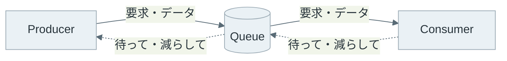
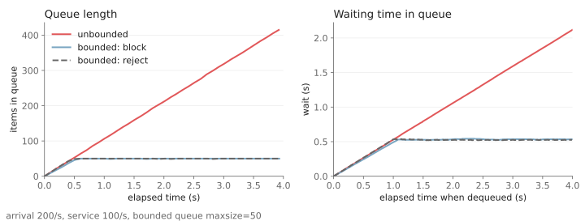
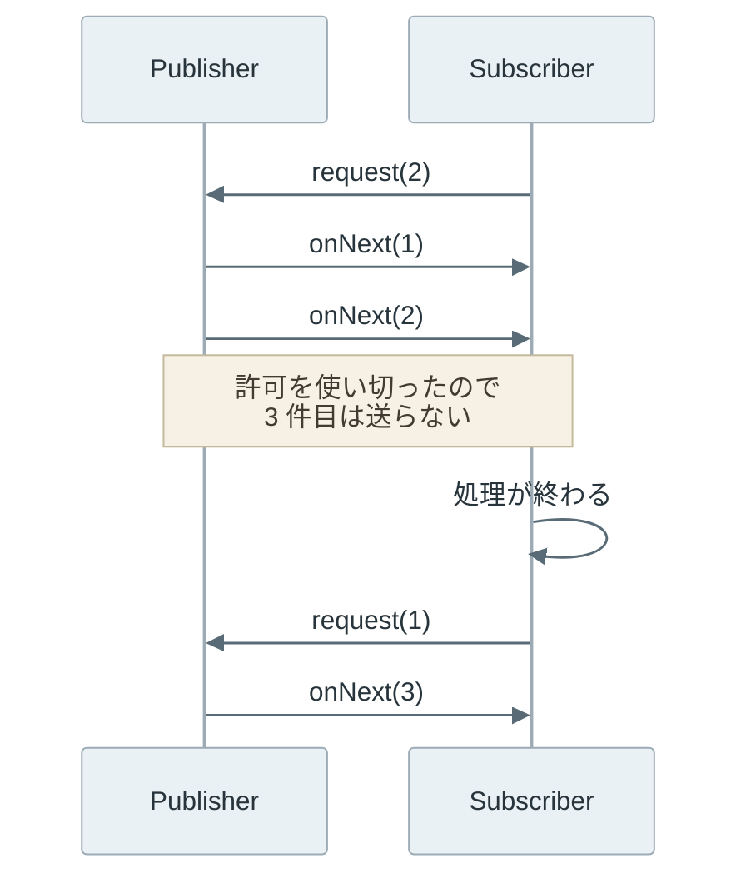
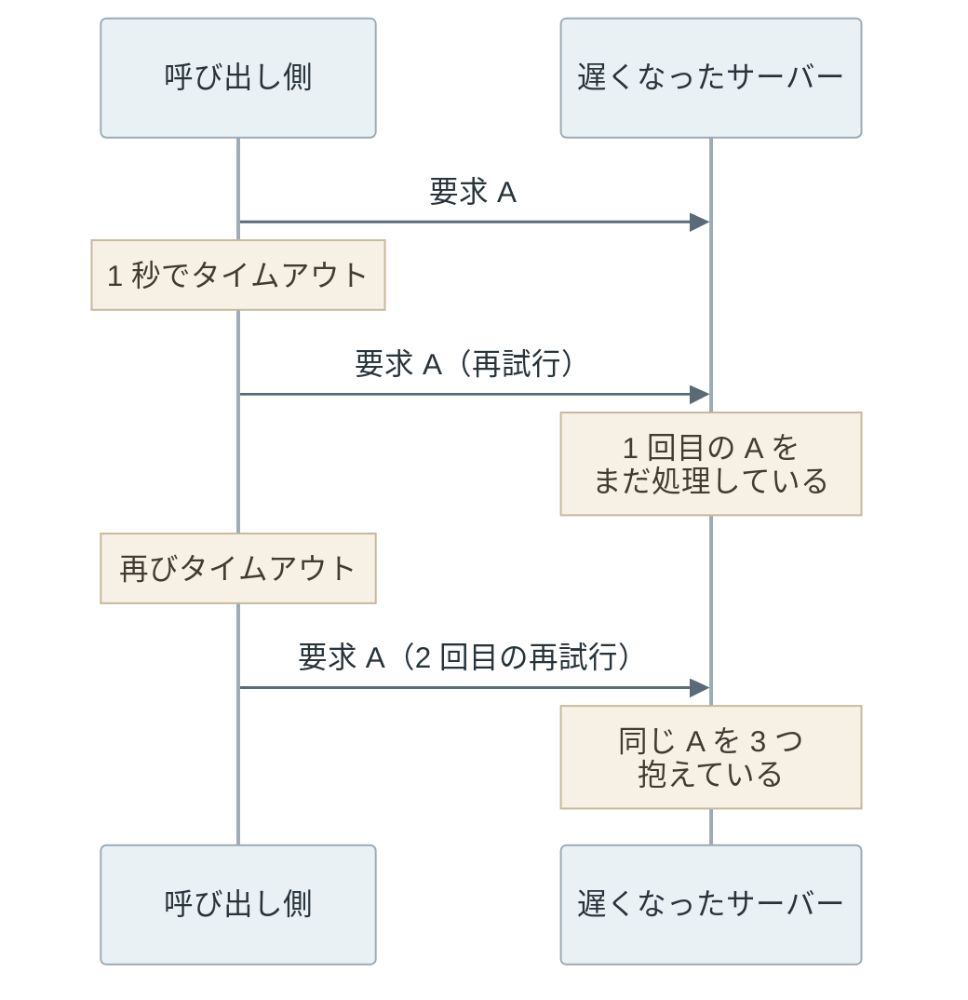

バックプレッシャー（backpressure）は、下流の処理が追い付かない時に、その事実を上流に伝えて送る量を減らさせる仕組みです。データを作って送る側を Producer、受け取って処理する側を Consumer と呼ぶと、要求やデータは Producer から Consumer に流れ、「待って」の信号は逆向きに流れます。



例えば、アクセスログを集めて検索用の DB（データベース）に入れる処理を考えます。普段は 1 秒に 100 件を処理できていても、セール開始の瞬間にログが 1 秒 200 件に増えると、差の 100 件は毎秒どこかに溜まります。溜まる場所がメモリ上のキューなら、キューは増え続け、ログが DB に入るまでの遅れも伸び続けます。しかも、キューへの追加はメモリが尽きるまで成功を返し続けるので、送る側からは異常が見えません。

<br>

本記事では、Python のローカル実験と RFC の仕組みから、Producer と Consumer の速度差がどこに溜まり、どう上流に伝わるのかを説明します。次の疑問に順に答えます。

- 処理が追い付かない時、キューと待ち時間はどう伸びるのか。
- キューに上限を付けると、何が守られ、何を諦めるのか。
- 送る量は、送る側と受ける側のどちらが決めるのか。
- タイムアウトと再試行は、どんな条件で負荷を何倍にするのか。
- HTTP の API では、下流の詰まりをどうやって上流に伝えるのか。

ネットワーク経路の混雑に合わせて送信量を絞る TCP の[輻輳制御（congestion control）](https://www.rfc-editor.org/rfc/rfc5681)は、受け手の余裕に合わせる本記事の流量制御とは別の仕組みなので、詳しくは説明しません。

---

### 速度差が生むキュー

Producer の到着率（1 秒あたりに届く件数）を λ、Consumer の処理率（1 秒あたりに捌ける件数）を μ とします。λ が μ より小さければ、到着が一時的に偏ってもキューはいずれ空に戻ります。しかし λ が μ を上回る状態が続くと、キュー長は 1 秒ごとに λ − μ 件ずつ増えます。

待ち時間もキュー長に比例して伸びます。キューが先着順（FIFO）なら、新しく並んだ要求は、前にいる L 件が処理率 μ で捌けるまで待つので、待ち時間はおよそ L ÷ μ 秒です。例えば μ = 100 件/秒で 400 件が並んでいれば、最後尾の要求は約 4 秒待ちます。

キュー長が一定に落ち着いている状態では、平均キュー長 L、キューに入る率 λ、平均待ち時間 W の間に [Little の法則](https://doi.org/10.1287/opre.9.3.383) L = λW が成り立ちます。上限のあるキューが満杯で張り付いている時は、キューに入れる率が μ まで下がるので、W = L ÷ μ として待ち時間を見積もれます。上限の無いキューは落ち着く点を持たないので、L と W は時間に比例して伸び続けます。

---

### 上限なしと上限ありのキューの実験

Python 標準ライブラリの [asyncio.Queue](https://docs.python.org/3/library/asyncio-queue.html) で、速度差が溜まる様子を確認します。`asyncio.Queue` は `maxsize=0` で上限なし、正の値で上限ありのキューになり、満杯の時に `await put()` は空きが出るまで待ち、`put_nowait()` は `QueueFull` を送出します。

実験の条件は次の通りです。到着は 5 ms ごと（200 件/秒）、処理は 1 件 10 ms（100 件/秒）で、4 秒間だけ要求を作ります。1 件には 10 KB のデータを持たせ、`tracemalloc` で Python が確保したメモリの最大値を測ります。比べるのは、上限なし（unbounded）、上限 50 件で満杯なら Producer を待たせる（block）、上限 50 件で満杯なら断る（reject）の 3 つです。

```python
"""到着率 200 件/秒、処理率 100 件/秒で 3 種類のキューを 4 秒間動かす実験。"""
import asyncio
import json
import sys
import time
import tracemalloc

ARRIVAL_INTERVAL = 0.005  # 5 ms ごとに 1 件到着する（200 件/秒）
SERVICE_TIME = 0.010      # 1 件の処理に 10 ms かかる（100 件/秒）
DURATION = 4.0            # 4 秒間だけ要求を作る
MAXSIZE = 50              # 上限ありキューの長さ
PAYLOAD = 10_000          # 1 件あたり 10 KB のデータを持たせる


async def run(mode):
    queue = asyncio.Queue(maxsize=0 if mode == "unbounded" else MAXSIZE)
    stats = {"sent": 0, "rejected": 0, "done": 0,
             "samples": [], "waits": []}
    start = time.monotonic()

    async def producer():
        n = 0
        while True:
            now = time.monotonic() - start
            if now >= DURATION:
                return
            item = (time.monotonic(), bytes(PAYLOAD))
            if mode == "reject":
                try:
                    queue.put_nowait(item)
                except asyncio.QueueFull:
                    stats["rejected"] += 1
            else:
                await queue.put(item)  # unbounded は即座に返る。block は空くまで待つ
            stats["sent"] += 1
            n += 1
            if mode == "block":
                await asyncio.sleep(ARRIVAL_INTERVAL)  # 待たされた分だけ後ろへずれる
            else:
                # 到着は外から決まった時刻に来る（遅れても取り戻す）
                await asyncio.sleep(max(0, n * ARRIVAL_INTERVAL - now))

    async def consumer():
        while True:
            enqueued, _ = await queue.get()
            stats["waits"].append((time.monotonic() - start,
                                   time.monotonic() - enqueued))
            await asyncio.sleep(SERVICE_TIME)
            stats["done"] += 1

    async def sampler():
        while True:
            stats["samples"].append((time.monotonic() - start, queue.qsize()))
            await asyncio.sleep(0.1)

    tracemalloc.start()
    tasks = [asyncio.create_task(consumer()), asyncio.create_task(sampler())]
    await producer()
    _, peak = tracemalloc.get_traced_memory()
    tracemalloc.stop()
    for t in tasks:
        t.cancel()
    stats["peak_mb"] = peak / 1_000_000
    stats["left"] = queue.qsize()  # 4 秒の時点でまだ並んでいる件数
    return stats


def main():
    results = {}
    print(f"{'mode':<10}{'sent':>6}{'rejected':>9}{'done':>6}"
          f"{'left':>6}{'max_wait_s':>11}{'last_wait_s':>12}{'peak_MB':>9}")
    for mode in ["unbounded", "block", "reject"]:
        s = asyncio.run(run(mode))
        results[mode] = s
        print(f"{mode:<10}{s['sent']:>6}{s['rejected']:>9}{s['done']:>6}"
              f"{s['left']:>6}{max(w for _, w in s['waits']):>11.2f}"
              f"{s['left'] * SERVICE_TIME:>12.2f}{s['peak_mb']:>9.1f}")
    if len(sys.argv) > 1:
        with open(sys.argv[1], "w") as f:
            json.dump(results, f)


main()
```

Python 3.14.4 で実行した結果です。ローカルのタイマー精度に左右されるので、数値は実行のたびに少し変わります。

```text
$ python3 queue_experiment.py results.json
mode        sent rejected  done  left max_wait_s last_wait_s  peak_MB
unbounded    800        0   376   423       2.12        4.23      4.4
block        430        0   379    50       0.54        0.50      0.6
reject       800      372   377    50       0.54        0.50      0.6
```

列の意味は、`sent` が Producer の作った件数、`rejected` が断った件数、`done` が処理を終えた件数、`left` が 4 秒の時点でまだ並んでいる件数です。`max_wait_s` は取り出された要求の待ち時間の最大値、`last_wait_s` は `left` の件数を公称の 1 件 10 ms で捌いた場合の、最後尾の要求の待ち時間の見積もりです。

キュー長と待ち時間を時系列で描くと、以下の通りです。グラフの生成コードは [figures.py](https://github.com/nao1215/debimate/blob/main/content/notes/distributed-systems/backpressure/figures.py) にあります。



上限なしのキューは、800 件全てを受け付け、1 件も断っていません。しかし処理できたのは 376 件で、423 件はメモリ上に並んだまま、最後尾は 4 秒以上待つ見込みです。メモリも 4.4 MB と、上限ありの 7 倍に増えました。4 秒で止めたので小さな値ですが、到着が続く限り、この線は伸び続けます。つまり、上限の無いキューは、メモリが尽きるまで「受け付けた」という成功を返し続けます。

上限ありの 2 つは、キュー長が 50 件、待ち時間が約 0.5 秒で止まりました。設定は 100 件/秒ですが、`asyncio.sleep` が指定より少し長く眠るので、1 件は約 10.6 ms かかり、処理率は約 94 件/秒（4 秒で 377 件）に下がりました。満杯の時にキューに入れる率はこの処理率と同じなので、Little の法則から W = 50 ÷ 94 ≒ 0.53 秒となり、測った値とほぼ一致します。上限の長さが、そのまま待ち時間の上限を決めています。

---

### 上限に達した時の 3 つの選択

キューに上限を付けると、満杯になった時に何をするかを選ぶ必要があります。実験の block と reject に加えて、古い要求か新しい要求を黙って捨てる（drop）選択もあります。


- title: 待たせる（block）
  body: 空きが出るまで Producer を止める。
  items:
  - 何も失わない
  - Producer の速度が Consumer に合う
  - Producer の前で別の待ちが生まれる
- title: 捨てる（drop）
  body: 満杯の時に要求を黙って捨てる。
  items:
  - Producer は止まらない
  - 送った側は失われたことを知らない
  - 欠けても困らない計測値などで使う
- title: 断る（reject）
  body: 満杯の時にエラーを返す。
  items:
  - Producer が失敗を知り、判断できる
  - 待ち時間の上限を守れる
  - 再試行の扱いを上流が決める必要がある


block は、Producer が自分の速度を変えられる時に、何も失わずに流量を合わせられます。実験の block では、Producer が 4 秒で作った件数が 430 件まで減り、Consumer の速度に合わせて遅くなりました。ファイルを読んで送るバッチ処理なら、影響はファイルを読む速度が落ちることだけです。

しかし、Producer の前にユーザーからの要求が届き続ける構成では、block は待ちを上流に移すだけです。Web サーバーのスレッドが下流の空きを待って止まると、そのスレッドの前に新しい要求が並びます。上流が待たされた状態をさらに上流に伝える手段を持たないなら、どこかの層で drop か reject を選ぶ必要があります。

---

### 送る量を決める側

キューの外では、Producer と Consumer の間で「どれだけ送って良いか」を誰が決めるかで、方式が 3 つに分かれます。

| 方式 | 送る量を決める側 | 例 |
|---|---|---|
| Push | Producer。作った分だけ送る | Webhook（イベントを相手の URL に POST する仕組み） |
| Pull | Consumer。取りに行った分だけ届く | [Apache Kafka](https://kafka.apache.org/42/design/design/) のコンシューマ、Transactional Outbox の relay |
| Credit-based | Consumer が「あと n 件」と許可し、Producer はその範囲で送る | Reactive Streams の `request(n)`、TCP の受信ウィンドウ、HTTP/2 のフロー制御ウィンドウ |

Push は届くまでの遅延が小さい代わりに、Consumer の処理速度が生産速度を下回ると、超過分が Consumer 側に溜まります。Kafka が Consumer に取りに行かせる Pull 型を選んだ理由の 1 つも、Push 型ではこの状態で Consumer が溢れることです。[Transactional Outbox](../transactional-outbox/) の relay も、outbox テーブルを自分の間隔で読みに行く Pull 型です。その代わりに、Pull 型ではデータが無い時も問い合わせを繰り返す無駄が生じます。Kafka は、データが届くまで要求を待たせておく long poll でこの無駄を避けています。

Credit-based は、Push の速さを残したまま Pull と同じ上限を付ける方式です。[Reactive Streams](https://www.reactive-streams.org/) では、Subscriber が `Subscription.request(n)` で受け取れる件数を伝え、[仕様](https://github.com/reactive-streams/reactive-streams-jvm/blob/v1.0.4/README.md)のルール 1.1 で、Publisher が送る `onNext` の総数はそれまでに要求された総数以下と定めています。



上記の図で、Publisher は 3 件目を手元に持っていても、Subscriber の `request(1)` が届くまで送りません。待つ場所が Subscriber のキューではなく Publisher 側になるので、Subscriber のメモリは許可した件数分で頭打ちになります。なお、`request(Long.MAX_VALUE)` は「事実上無制限」とみなして良いとルール 3.17 にあり、これを呼ぶと Push と変わりません。

TCP も同じ構造です。[RFC 9293](https://www.rfc-editor.org/rfc/rfc9293#section-3.8.6) では、受信側が各セグメントで受け取れるシーケンス番号の範囲（受信ウィンドウ）を広告し、送信側はその範囲に収まるように送ります。アプリケーションが受信バッファを読まなければウィンドウは 0 まで縮み、送信側は止まります。

ちなみに [RFC 9293 の 3.8.6.1](https://www.rfc-editor.org/rfc/rfc9293#section-3.8.6.1) は、受信側がウィンドウを閉じたまま無期限に待つ場面として、RFC 1122 にある「プリンタの紙切れ」の例を引いています。紙が補充されるまで、送信側は窓が開いたかを確かめる小さなセグメント（zero-window probe）を定期的に送りながら接続を保ちます。

[HTTP/2](https://www.rfc-editor.org/rfc/rfc9113#section-5.2) は、1 本の TCP 接続に複数のストリームを載せるので、ストリームごとと接続全体の 2 段でウィンドウを持ちます。初期値はどちらも 65,535 バイトで、対象は DATA フレームだけです。受信側は処理した分を `WINDOW_UPDATE` フレームで返し、送信側の枠を広げます。

この制御は隣り合う 2 点の間だけで閉じています。中継するプロキシは `WINDOW_UPDATE` を次の接続に転送しません（[RFC 9113 の 6.9](https://www.rfc-editor.org/rfc/rfc9113#section-6.9)）。それでも、プロキシの先の受信側が転送を絞れば、プロキシの受信バッファが埋まり、その影響は間接的に元の送信者まで伝わり得ます。つまり、各区間がそれぞれ上限を持っていれば、下流の詰まりは区間ごとの満杯の連鎖として上流に届きます。どこか 1 つの区間に上限の無いバッファがあると、連鎖はそこで止まり、詰まりはそのバッファに溜まります。

---

### タイムアウトと再試行による増幅

Backpressure で流量を絞っても、上流が失敗を再試行で埋め合わせると、届く量は逆に増えます。問題になるのは、下流の遅れがタイムアウトを超えた時です。



呼び出し側から見ると、遅いだけのサーバーと止まったサーバーは区別が付きません（[Heartbeat](../heartbeat/) と同じ問題です）。呼び出し側がタイムアウトで諦めても、サーバーは 1 回目の要求の処理をやめるとは限りません。そのため、遅いサーバーほど同じ要求を重ねて抱え、さらに遅くなります。再試行で同じ処理が 2 回実行されても結果が壊れないようにする話は [Idempotency](../idempotency/) で説明しており、ここでは量の話だけをします。

再試行が複数の層で独立に行われると、回数は掛け算で増えます。次のコードは、最下層が失敗し続け、各層が下の層の失敗のたびに再試行する前提で、最下層に届く試行回数の最大値を計算します。

```python
"""各層が独立に再試行した時、最下層に届く試行回数の最大値を計算する。

前提: 1 回のユーザー操作が L 層を順に呼び出す。最下層が失敗し続け、
各層は下の層の失敗を受けるたびに再試行し、全ての試行が最下層まで届く。
"""


def worst_case(retries, layers):
    return (1 + retries) ** layers  # 1 層あたり 1 + retries 回呼ぶ


def retry_only_at_one_layer(retries):
    return 1 + retries  # 拒否した層の直上だけが再試行する


def with_budget(ratio, layers):
    # 単純化: SRE 本の 10% はクライアントごとの再試行の比率で、各層が要求数の
    # ratio 倍までしか再試行しないとみなして層の数だけ掛ける
    return (1 + ratio) ** layers  # 各層の再試行を要求数の ratio 倍までに抑える


print("layers  retry=1  retry=2  retry=3  one-layer(r=3)  budget10%")
for layers in range(1, 6):
    print(f"{layers:>6} {worst_case(1, layers):>8} {worst_case(2, layers):>8}"
          f" {worst_case(3, layers):>8} {retry_only_at_one_layer(3):>15}"
          f" {with_budget(0.1, layers):>10.2f}")
```

```text
$ python3 retry_amplification.py
layers  retry=1  retry=2  retry=3  one-layer(r=3)  budget10%
     1        2        3        4               4       1.10
     2        4        9       16               4       1.21
     3        8       27       64               4       1.33
     4       16       81      256               4       1.46
     5       32      243     1024               4       1.61
```

3 層がそれぞれ 3 回再試行すると、1 回の操作が最下層では 64 回の試行になります。Google の [SRE 本の Addressing Cascading Failures](https://sre.google/sre-book/addressing-cascading-failures/) も、同じ条件の例で 64 回（4³）を挙げています。AWS の [Timeouts, retries, and backoff with jitter](https://builder.aws.com/content/3EumjoZascWd1oZiEgL8ORlv3qE/timeouts-retries-and-backoff-with-jitter) は、5 層の各層が 3 回再試行すると 243 倍になると説明しています。243 は 3⁵ で、1 層あたり合計 3 回の試行として計算した値なので、上記の出力の retry=2 の列と同じ値です。下流が遅れて失敗している時ほど、この最大値に近づきます。

増幅を抑える方法のうち 2 つは、上記の出力の右 2 列に対応します。

- 再試行する層を 1 つに絞る。拒否した層の直上だけが再試行し、それより上には「過負荷なので再試行しない」というエラーを返す（SRE 本の [Handling Overload](https://sre.google/sre-book/handling-overload/)）
- 再試行の回数に上限（retry budget）を設ける。同じ章の例は、1 要求あたり最大 3 回に加えて、クライアントごとに再試行を要求数の 10% までに抑える形で、上記の計算では 5 層でも約 1.6 倍に収まる
- 再試行の間隔を指数的に延ばし（指数バックオフ）、乱数で散らす（jitter）。散らさないと、同時に失敗したクライアントが同時に再送し、負荷の山が周期的に戻ってくる

---

### 下流の遅延を上流に伝える方法

HTTP の API には `request(n)` のような許可の仕組みが無いので、サーバーは断る応答で詰まりを伝えます。[RFC 6585](https://www.rfc-editor.org/rfc/rfc6585#section-4) の 429 Too Many Requests は、クライアントが一定時間に送りすぎた時の応答です。[RFC 9110](https://www.rfc-editor.org/rfc/rfc9110#section-15.6.4) の 503 Service Unavailable は、一時的な過負荷や保守で処理できない時の応答です。どちらも `Retry-After` ヘッダで、次に送るまで待つ秒数か日時（例えば `Retry-After: 30`）を付けられます。

上限ありのキューが満杯になった時に 503 を返す処理は、load shedding（負荷の一部を意図的に捨てる処理）の一種です。クライアントがタイムアウトする状況では、全部を遅く処理して全部をタイムアウトさせるより、一部を早く断って残りを時間内に返す方が、成功する要求の数は多くなります。しかし、断る処理にもコストがかかります。要求の解析や認証の後で断るなら、その分の CPU は使ってしまいます。

詰まりを判断する基準は、キュー長より待ち時間の方が向いています。100 件のキューでも、1 件 1 ms で捌けるなら 0.1 秒、1 件 1 秒かかるなら 100 秒待つからです。ネットワーク機器のキュー管理アルゴリズム [CoDel（RFC 8289）](https://www.rfc-editor.org/rfc/rfc8289)は、パケットのキュー長ではなくキューに滞在した時間を見て、滞在時間が目標を超えた状態が続いた時に捨て始めます。サーバーのキューでも、取り出した要求の待ち時間が閾値を超えていたら処理せずに断る、という形で応用できます。

待ち時間の判断は、要求に期限を持たせると層を越えて伝わります。deadline propagation は、最上位の層が期限（deadline）を決めて下の層に渡し、各層が期限を過ぎた要求を処理せずに捨てる方法です（SRE 本の Addressing Cascading Failures）。これにより、呼び出し側が既に諦めた要求をサーバーが処理し続ける状態を避けられます。

似た目的の仕組みに [Circuit Breaker](/notes/software-architecture/circuit-breaker/) があります。Circuit Breaker は、失敗が続いている下流への呼び出しを一定時間止める仕組みで、失敗を検知して呼び出しを遮断します。Backpressure は、下流が処理できる量に流量を合わせる仕組みで、下流が正常に動いていても速度差があれば働きます。そのため 2 つは併用でき、速度差は Backpressure で合わせ、失敗し続ける下流への呼び出しは Circuit Breaker で止める、という分担になります。

---

### 利点

- メモリとキュー長に上限が付き、過負荷で Consumer のプロセスが落ちる事態を避けられる
- 待ち時間に上限が付き、受け付けた要求は一定時間内に処理される見込みが立つ
- 上流が、下流の遅れをエラーや速度の低下として知ることができる
- 一部を断ることで、残りの要求を時間内に成功させられる

### 欠点

Backpressure は、受け付ける量を下流の処理能力に合わせます。その代わりに、次の制約があります。

- 超過分の要求は待たされるか断られるので、上流かユーザーが失敗を受け止める必要がある
- block を選ぶと、上流のスレッドや接続が止まり、待ちが上流に移るだけになる場合がある
- 上限の長さや待ち時間の閾値を負荷に合わせて決める必要があり、小さすぎると一時的な山でも断ってしまう
- 経路のどこか 1 か所に上限の無いバッファがあると、信号がそこで途切れる

### 適さないケース

- 到着が処理能力を上回るのが一瞬だけで、上限なしのキューでも十分に吸収できる場合
- Producer が速度を落とせず、断った要求の行き場も無い場合（センサーの計測値を落とすしかない時など）
- 断られた要求を上流が即座に再試行し、再試行の上限もバックオフも無い場合

最後の項目は、Backpressure の信号が上流で再試行に変換されてしまう状態です。429 や 503 を返しても、上流がすぐに再送するなら負荷は減りません。断る側の上限と、再試行する側の上限とバックオフは、組にして設計します。
