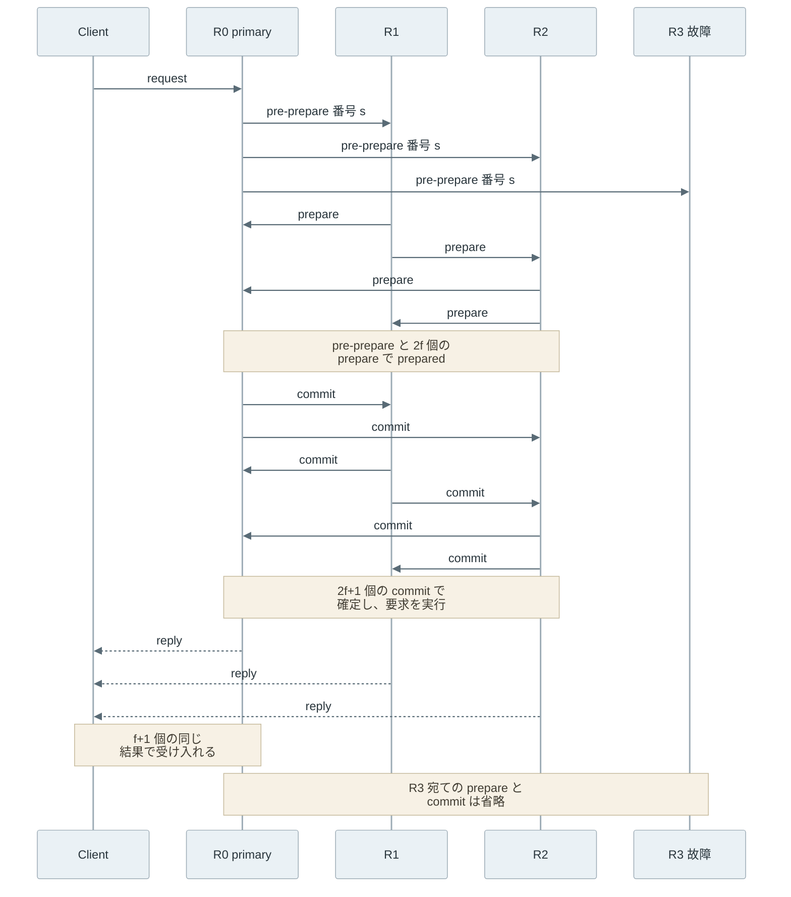
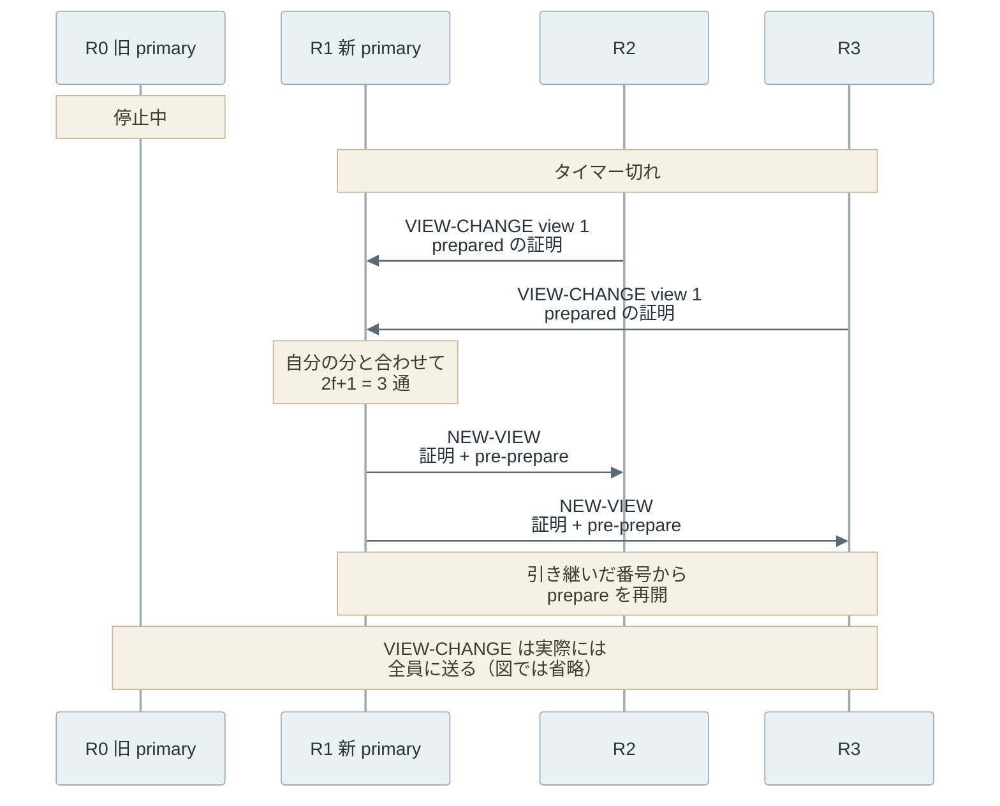

ビザンチン障害耐性（Byzantine Fault Tolerance、BFT）は、一部のノードが嘘をついても、正直なノード同士の決定を揃える性質です。ここで言う嘘は、誤った値を返すことに加えて、相手ごとに違う値を言うこと（equivocation、二枚舌）も含みます。止まったノードだけを想定する合意の仕組みは、この種の故障に耐えられません。

以下は、止まる故障と嘘をつく故障の違いです。



上記の図の右側の B と C は、手元の情報だけでは、どちらの値が嘘なのかを判定できません。このような故障を前提にしなければならないのは、運営者の違うノードが同じ台帳を持つブロックチェーンや、攻撃者に乗っ取られる可能性を想定する複製です。[PBFT の論文](https://www.usenix.org/conference/osdi-99/practical-byzantine-fault-tolerance)は、攻撃に加えてソフトウェアのバグも、このような故障の原因に挙げています。

<br>

本記事では、嘘をつくノードがいる前提で合意を成立させる方法について、代表的なアルゴリズムである PBFT を例に説明します。扱う疑問は次の通りです。

- 止まる故障と嘘をつく故障では、何が違うのか。署名で防げるのはどこまでか。
- f 台の嘘つきに耐えるには、なぜ 3f+1 台が必要なのか。
- PBFT の prepare と commit は、それぞれ何を守っているのか。
- 順序を決めるノードが止まったり嘘をついたりした時、どう交代するのか。
- 誰でも参加できるネットワークでは、なぜ同じ方法が使えないのか。

---

### 停止する故障と嘘をつく故障

停止故障（crash fault）は、ノードが動作を止め、以後は何も送らない故障です。[Raft](https://raft.github.io/raft.pdf) のような合意アルゴリズムや、[Quorum](../quorum/) で説明した過半数の考え方は、この故障とネットワークの分断を前提にしています。止まったノードは誤った値を送らないので、届いた値は本物として扱えます。

ビザンチン障害（Byzantine fault）は、ノードが規則に従わず、任意の振る舞いをする故障です。名前は、[Lamport 氏らの 1982 年の論文](https://lamport.azurewebsites.net/pubs/byz.pdf)が、敵に通じた者が混じる将軍たちが攻撃か撤退かを揃える問題として定式化したことに由来します。黙り続けるのも振る舞いの 1 つなので、停止故障はビザンチン障害の特別な場合です。ビザンチン障害に耐える仕組みは停止故障にも耐えますが、逆は成り立ちません。

<br>

嘘の一部は、[デジタル署名](/notes/blockchain-systems/digital-signature/)で防げます。例えば、C が「A は abort と言っていた」と B に伝えても、A の署名が無ければ B は信じません。しかし、署名が保証するのは送り主と内容の一致で、送り主が正直であることではありません。


- title: 署名で防げること
  items:
  - 他のノードになりすます
  - 他のノードが送った内容を書き換える
- title: 署名で防げないこと
  items:
  - A が自分の鍵で commit と abort の両方に署名する
  - 署名した 2 つを B と C に別々に送る


ちなみに、相反する 2 つの署名は誰でも検証できる二枚舌の証拠になり、[Proof of Stake](/notes/blockchain-systems/proof-of-stake/) はこれを根拠に罰則を科します。ただし、罰則は事後の処罰で、嘘が届くことは止めません。

---

### 3f+1 台が必要な理由

嘘つきの台数の上限を f とします。f 台のノードは黙ったまま応答しない可能性があるので、各ノードは n 台のうち n−f 台の応答が揃った時点で判断を進める必要があります。全員の応答を待つと、嘘つきが黙るだけで合意が止まります。

判断に使う n−f 台の集まりは quorum と呼ばれます。停止故障だけを考えるなら、2f+1 台のうち過半数の f+1 台で判断すれば足ります。2 つの quorum は必ず 1 台以上重なり、重なったノードは正直に「先に別の決定を見た」と伝えるからです。

ビザンチン障害では、重なりに嘘つきが入ると、そのノードは 2 つの quorum に別々の話をします。そのため、2 つの quorum の重なりに、正直なノードが少なくとも 1 台残る必要があります。n−f 台の quorum が 2 つあると、重なりは少なくとも n−2f 台です。そこから嘘つき f 台を除いても 1 台以上残る条件は n−3f ≥ 1、つまり n ≥ 3f+1 です。

以下は、f=1 で 3 台と 4 台を比べた図です。赤い A が嘘つきで、実線と破線の括弧が 2 つの quorum を表します。



上記の図の左では、A が Q1 には commit、Q2 には abort と言えば、2 つの quorum が別の決定に同意します。右では、重なりにいる正直な C が両方に同じ値を言うので、2 つの決定は同時に成立しません。

署名を使えば台数を減らせるかは、条件によります。Lamport 氏らの論文は、署名付きのメッセージなら 3 台でも 1 台の嘘つきに耐えるアルゴリズムを示しています。ただし、メッセージは必ず届き、届かなければ受け手がそれを検知できる、という前提を置いています。PBFT はこの前提を置かず、遅延に上限が無くても安全性が崩れない設計で、その条件では 3f+1 台が最小（論文の言う optimal）です。

---

### 全数列挙での確認

3 台では足りないことは、全ての組み合わせを列挙すると確かめられます。[ローカルで実行するコード](lab/bft_quorum.py)は Python の標準ライブラリだけで動きます。

前半の `quorum_intersection` は、quorum の全ての組と嘘つきの全ての選び方について、重なりに残る正直なノードの最小数を数えます。後半の `one_round` は、PBFT の最初の 2 段階だけの 1 ラウンドです。ノード 0 が値を提案する primary で、残りの backup は受け取った値を全員に伝え直します。各ノードは提案と伝え直された値を 1 票ずつ数え、quorum の台数分だけ同じ値が揃ったら、その値で prepared になるものとします。

単純化として commit と View Change は含めず、メッセージは全て届くものとします。嘘つき 1 台が送り先ごとに commit・abort・沈黙を選ぶ全通りを試します。

<details><summary>bft_quorum.py の全体</summary>

```python
"""Check quorum intersection and an equivocating primary by exhaustive search."""

from itertools import combinations, product

VALUES = ("commit", "abort", None)  # None means the faulty node stays silent


def quorum_intersection(n, f):
    """Return the worst case of honest nodes shared by two quorums of size n - f."""
    q = n - f
    nodes = range(n)
    worst = None
    for q1, q2 in combinations(combinations(nodes, q), 2):
        shared = set(q1) & set(q2)
        for faulty in combinations(nodes, f):
            honest = shared - set(faulty)
            if worst is None or len(honest) < len(worst[0]):
                worst = (honest, q1, q2, faulty)
    return q, worst


def one_round(n, q, faulty, proposal="commit"):
    """Simplified pre-prepare + prepare round. Node 0 is the primary."""
    backups = range(1, n)
    others = lambda i: [j for j in range(n) if j != i]
    results = []
    # Faulty node: picks a value (or silence) for every receiver independently.
    for lie in product(VALUES, repeat=n - 1):
        lie = dict(zip(others(faulty), lie))
        if faulty == 0:
            pre_prepare = {i: lie[i] for i in backups}
        else:
            pre_prepare = {i: proposal for i in backups}
        votes = {i: {} for i in range(n)}  # votes[receiver][sender] = value
        for i in range(n):
            if i != faulty:
                own = proposal if i == 0 else pre_prepare[i]
                for j in range(n):
                    if own is not None:
                        votes[j][i] = own
            else:
                for j, value in lie.items():
                    if value is not None:
                        votes[j][i] = value
        prepared = {}
        for i in range(n):
            if i == faulty:
                continue
            for value in ("commit", "abort"):
                if sum(v == value for v in votes[i].values()) >= q:
                    prepared[i] = value
        results.append(prepared)
    split = [p for p in results if len(set(p.values())) > 1]
    stuck = [p for p in results if not p]
    return len(results), split, stuck


def main():
    print("== quorum intersection (quorum = n - f)")
    for n, f in [(3, 1), (4, 1), (5, 1), (6, 2), (7, 2)]:
        q, (honest, q1, q2, faulty) = quorum_intersection(n, f)
        verdict = "ok" if honest else f"counterexample Q1={q1} Q2={q2} faulty={faulty}"
        print(f"n={n} f={f} quorum={q} min honest in overlap={len(honest)} {verdict}")

    print("== one round, equivocating or silent node")
    for n, q in [(3, 2), (3, 3), (4, 3)]:
        for faulty, role in [(0, "primary"), (n - 1, "backup")]:
            total, split, stuck = one_round(n, q, faulty)
            example = f" e.g. {split[0]}" if split else ""
            print(f"n={n} quorum={q} faulty={role:7} cases={total:2} "
                  f"split={len(split):2} nobody_prepared={len(stuck):2}{example}")


if __name__ == "__main__":
    main()
```

</details>

`python3 lab/bft_quorum.py` の[実行結果](lab/output.txt)は以下の通りです（Python 3.14 で実行）。

```text
== quorum intersection (quorum = n - f)
n=3 f=1 quorum=2 min honest in overlap=0 counterexample Q1=(0, 1) Q2=(0, 2) faulty=(0,)
n=4 f=1 quorum=3 min honest in overlap=1 ok
n=5 f=1 quorum=4 min honest in overlap=2 ok
n=6 f=2 quorum=4 min honest in overlap=0 counterexample Q1=(0, 1, 2, 3) Q2=(0, 1, 4, 5) faulty=(0, 1)
n=7 f=2 quorum=5 min honest in overlap=1 ok
== one round, equivocating or silent node
n=3 quorum=2 faulty=primary cases= 9 split= 2 nobody_prepared= 1 e.g. {1: 'commit', 2: 'abort'}
n=3 quorum=2 faulty=backup  cases= 9 split= 0 nobody_prepared= 0
n=3 quorum=3 faulty=primary cases= 9 split= 0 nobody_prepared= 7
n=3 quorum=3 faulty=backup  cases= 9 split= 0 nobody_prepared= 4
n=4 quorum=3 faulty=primary cases=27 split= 0 nobody_prepared=13
n=4 quorum=3 faulty=backup  cases=27 split= 0 nobody_prepared= 0
```

前半では、quorum を n−f 台とした場合に反例が出るのは n=3f の 3 台と 6 台だけで、3f+1 の 4 台と 7 台では重なりに正直なノードが必ず残ります。後半では、3 台のまま quorum を 3 台に上げた場合も試しています。結果を整理すると、以下の通りです。



つまり 3 台では、2 票で判断すると割れ、quorum を 3 票に上げると割れない代わりに嘘つきが黙るだけで止まります。4 台で primary が嘘をついて誰も prepared にならない 13 通りは、後述の View Change で primary を交代させて進めます。

---

### PBFT の通常動作

[PBFT（Practical Byzantine Fault Tolerance）](https://www.usenix.org/conference/osdi-99/practical-byzantine-fault-tolerance)は、Castro 氏と Liskov 氏が 1999 年に OS の学会 OSDI で発表した、状態機械の複製（全ノードが同じ要求を同じ順序で実行する構成）のアルゴリズムです。3f+1 台のうち 1 台が primary として要求に通し番号を振り、残りの backup が番号を検証します。primary を務める期間を view と呼び、view の番号ごとに primary が替わります。

以下は、4 台（f=1）で 1 つの要求を処理する流れです。R0 が primary で、R3 は故障して何も送らない場合を描いています。



pre-prepare は、primary が「view v で、この要求に通し番号 s を振る」と宣言するメッセージです。backup はそれを受け入れると、同じ内容の prepare を全員に送ります。各段階で揃える票と、その段階が防ぐことは以下の通りです。

| 段階 | 次に進む条件 | 防ぐこと |
|---|---|---|
| prepare | pre-prepare と、異なる backup からの一致した 2f 個の prepare（prepared） | 同じ view で 1 つの番号に 2 つの要求が入ること |
| commit | prepared に加えて、一致した 2f+1 個の commit（自分の分を含む）。番号の小さい要求を実行し終えていれば実行する | primary の交代後に、確定した要求が消えること |
| reply | Client が異なるノードから f+1 個の同じ結果を受け取る | 嘘つきの返した結果を Client が受け入れること |

prepare で揃える票は合わせて 2f+1 票で、前節の quorum と同じ台数です。2 つの 2f+1 票は f+1 台以上で重なり、その中の正直なノードは同じ番号に 2 つの prepare を送りません。そのため、primary が二枚舌を使っても、prepared まで進めるのは片方の要求だけです。

<br>

しかし、prepared は自分の手元で順序が揃ったことを示すだけで、他のノードが同じ状態にあるかは分かりません。commit の段階で 2f+1 個の一致した commit が揃えば、少なくとも f+1 台の正直なノードがその要求を prepared にしています。この f+1 台の証明が、次の節の View Change で引き継がれます。つまり、prepare が守るのは view の中の順序で、commit が守るのは view をまたいだ確定です。

---

### View Change

View Change は、primary が止まった時や、順序を進めない時に、次の primary に交代する手続きです。backup は、受け取った要求を一定時間内に実行できないとタイマーを切らし、交代を求める VIEW-CHANGE を全員に送ります。[Leader and Followers](../leader-and-followers/) の Raft では、Follower は[ハートビート](../heartbeat/)の途絶で Leader を疑います。PBFT の backup が要求の実行を見張るのは、嘘をつく primary はハートビートを送り続けたまま順序だけを止められるからです。次の view の primary は、投票ではなく view の番号をノード数で割った余りで決まります。

VIEW-CHANGE には、送り主が prepared にした要求の証明を入れます。証明は、pre-prepare と 2f 個の一致した prepare の組です。署名付きのメッセージを束ねているので、嘘つきは存在しない prepared をでっち上げられません。VIEW-CHANGE には古い記録を捨てるためのチェックポイントの情報も入りますが、本記事では省略します。

ここまでの説明は、全てのメッセージに署名する前提で書かれた論文の 4 節の手順です。論文の実装は通常の往復を MAC（Message Authentication Code、共有鍵で作る認証符号）で認証します。MAC は第三者に真正性を示せないので、View Change は別の手順に変えてあり、詳細は[同じ著者の技術メモ](https://dspace.mit.edu/handle/1721.1/149288)で説明されています。



新しい primary は、自分の分と合わせて 2f+1 通の VIEW-CHANGE を集めると、新しい view の開始を告げる NEW-VIEW を送ります。NEW-VIEW には、集めた VIEW-CHANGE と番号ごとの pre-prepare を入れます。prepared の証明がある番号では最も新しい view の証明にある要求を出し直し、証明が無い番号には何もしない要求（null request）を割り当てます。

証明を引き継ぐ理由は、前の view で確定した要求を消さないためです。ある要求が正直なノードの 1 台でも確定していれば、f+1 台の正直なノードが prepared の証明を持っています。2f+1 通の VIEW-CHANGE には、その中の 1 台が必ず含まれます。NEW-VIEW の中身は添えられた VIEW-CHANGE から計算し直せるので、新しい primary が嘘つきでも、計算と合わない NEW-VIEW は backup に拒否されます。

<br>

View Change を始めるきっかけは、タイマーという時間の仮定です。PBFT は「遅延が時間の経過より速く際限なく伸び続けはしない」という弱い仮定に、処理を進め続ける性質（liveness）でだけ頼ります。タイマーが早く切れすぎても、確定した要求は覆りません。遅延に上限が無いネットワークでは、1 台が止まり得るだけで、必ず終わる決定的な合意アルゴリズムを作れないことが [FLP Impossibility](/notes/distributed-systems/flp-impossibility/) として示されています。

---

### 参加者の決め方と票の重み

PBFT は、参加するノードが n 台に決まっていて、互いを認証する鍵を持っていることを前提にしています。f を台数の 1/3 未満とする条件は、1 台が 1 票を持つ数え方の上に成り立っています。

誰でも参加できるネットワークでは、この数え方が崩れます。1 人の攻撃者が多数のノードを立ち上げて、1/3 を超える票を握れるからです。1 人が多数の参加者を装う攻撃は[シビル攻撃（Sybil attack）](https://www.microsoft.com/en-us/research/publication/the-sybil-attack/)と呼ばれます。対策の 1 つは、量産できない資源に票の重みを結び付けることです。

| 参加の形 | 票の数え方 | 例 |
|---|---|---|
| 参加者が決まっている | 1 台 1 票。嘘つきは台数の 1/3 未満 | PBFT |
| 参加者に票の重みを与える | ステークなどの重みの合計で数える。嘘つきは重みの合計の 1/3 未満 | Tendermint、Ethereum の Casper FFG |
| 誰でも参加でき、計算量で重みを付ける | 計算量に比例した重み。嘘つきの計算量が過半に届かないこと | [Proof of Work](/notes/blockchain-systems/proof-of-work/) |

[Tendermint の論文](https://arxiv.org/abs/1807.04938)は、ノードごとに voting power（票の重み）を持たせ、嘘つきの重みが全体の 1/3 未満であることを前提に PBFT と同じ 2f+1 の閾値を使います。Ethereum の [Finality](/notes/blockchain-systems/finality/) を決める Casper FFG も、[合意層の仕様](https://github.com/ethereum/consensus-specs/blob/master/specs/phase0/beacon-chain.md)では、バリデータの有効残高（effective balance）の合計の 2/3 以上が投票した checkpoint を justified にします。Proof of Work は投票の代わりに、最も多くの計算を積んだ列を選ぶ規則で順序を揃え、確定は覆る確率が下がっていく形で表されます。

<br>

メッセージの数も、参加者を絞る理由になります。PBFT の prepare と commit では各ノードが他の全員に送るので、要求 1 つあたりのメッセージ数はノード数の 2 乗（O(n²)）で増えます。100 台なら、1 段階で約 1 万通です。Tendermint は全員への直接の送信ではなくゴシップ（隣接するノード同士でメッセージを中継する方式）で配りますが、全員の票を全員に届け、2/3 を超える重みの票を集める点は変わりません。全員の票を集めずに、無作為に選んだ少数への問い合わせを繰り返して通信量を抑える方式は [Snowman](/notes/blockchain-systems/snowman/) のノートで説明しています。

---

### 利点

- 嘘をつくノードや、相手ごとに違う値を送るノードが f 台いても、正直なノードの決定が割れない
- 安全性を遅延の仮定に頼らないので、ネットワークが遅れても確定済みの要求は覆らない
- 全てのメッセージに署名する構成なら、相反する署名から二枚舌をしたノードを後から特定できる

---

### 欠点

BFT は、誰も信用しない前提で票を数えます。その代わりに、次の制約があります。

- 同じ f 台に耐えるのに、停止故障だけを想定する場合の 2f+1 台より多い 3f+1 台が必要になる
- 各段階で全員が全員に送るので、メッセージ数がノード数の 2 乗で増え、参加者の数を大きくしにくい
- 参加者を事前に決める必要があり、誰でも参加できるネットワークでは票の重みを別に用意する必要がある
- 同じソフトウェアのバグが全ノードで同時に起きると、嘘つきが f 台を超え、保証が成り立たない

---

### 適さないケース

- 1 つの組織が全ノードを管理し、停止と分断だけを想定すれば足りる場合。Raft の方が台数もメッセージも少ない
- 参加者の入れ替わりが激しく、誰が投票できるかを決められない場合
- 要求ごとに非常に多くのノードの票を短い待ち時間で集める必要がある場合

欠点の最後に挙げた共通のバグは、台数を増やしても防げません。PBFT の論文もこれを認めたうえでノードが独立に故障する前提を置き、その手段として、ノードごとに実装・OS・管理者を変えることや、N-version programming（別々のチームによる実装）を挙げています。
