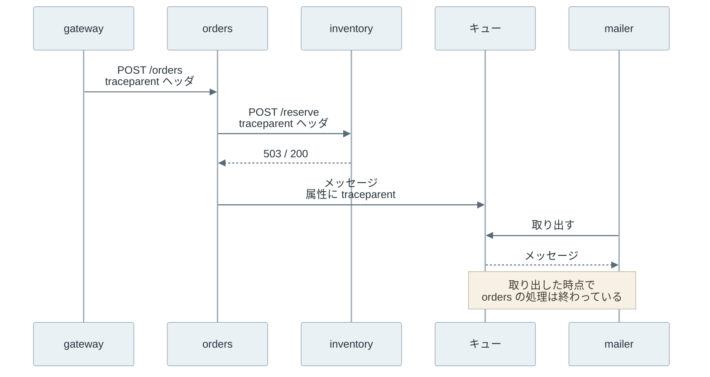

```text
traceparent: 00-4bf92f3577b34da6a3ce929d0e0e4736-00f067aa0ba902b7-01
```

上記は、サービスが別のサービスを呼ぶ時に HTTP ヘッダとして付ける 1 行です。[W3C Trace Context](https://www.w3.org/TR/trace-context/)（W3C の勧告）が形式を定めており、「この要求は、どの処理の続きか」を受け取った側に伝えます。このように処理の間で受け渡す情報は、Context と呼ばれます。

分散トレーシング（distributed tracing）は、1 つの要求が複数のサービスを通る時の経路と、各処理にかかった時間を記録する仕組みです。記録には、どの処理がどの処理を呼んだかという親子関係も含みます。例えば、「注文確定が時々 2 秒かかる」という報告を受けた時、1 件の要求に絞って、注文・在庫・メール送信のどのサービスで時間を使ったのかを辿れるようにします。

以下は、本記事の実験で記録した 1 件の注文確定の処理を時間軸に並べた図です。棒の 1 本が 1 つの処理で、字下げが呼び出しの親子関係を表します。



上記の図には、同じ在庫引き当て（`reserve`）と同じメール処理（`process`）が 2 回ずつ現れています。1 回目が失敗し、[再試行](../retry-backoff/)（図の resend）と再配送（図の attempt）で 2 回目が成功したからです。記録を読む側がこの重複を理解していないと、「在庫を 2 回引き当てた」と読み違えます。

<br>

本記事では、分散トレーシングを初めて学ぶ人に向けて、記録の構造と Context の受け渡しを説明し、Python 標準ライブラリだけで作ったトレーサーで癖を再現します。次の疑問に答えます。

- ログがあるのに、なぜ別の記録の仕組みが必要なのか。
- Trace・Span・Context は、それぞれ何を表すのか。
- HTTP 呼び出しとキューを越えて、Context をどう渡すのか。
- 再試行とキューの再配送は、記録の上でどう見えるのか。
- 記録を間引く Sampling と、ホストごとの時計のずれは、何を壊すのか。

本記事では、記録の構造と読み方を説明し、収集基盤の選び方や特定の製品の使い方には触れません。

---

### 分散トレーシングが必要な理由

サービスごとのログだけでは、1 件の要求の経路を組み立てられません。注文確定の要求が毎秒 100 件届くと、在庫サービスのログには 100 件分の行が混ざって並びます。在庫サービスの「503 を返した」という行が、どの注文確定から来た呼び出しなのかは、行の中に手掛かりが無ければ分かりません。

要求ごとに ID を発行してログに書けば、同じ要求の行は集められます。しかし、ID だけでは、行の間の関係が分かりません。在庫サービスの行が 2 つあった時、それが「同じ呼び出しの開始と終了」なのか「別々の 2 回の呼び出し」なのか、どちらの呼び出しが注文サービスのどの処理から出たのかは、ID が同じというだけでは決められません。

分散トレーシングは、ID に加えて「誰に呼ばれたか」と「いつ始まり、いつ終わったか」を記録します。この記録の構造を大規模に運用した例として、Google の [Dapper の論文](https://research.google/pubs/dapper-a-large-scale-distributed-systems-tracing-infrastructure/)（2010 年）が広く参照されています。

---

### Trace・Span・Context

分散トレーシングの記録は、Trace と Span の 2 段でできています。Span は 1 つの処理（1 回の HTTP 呼び出しや、1 件のメッセージの処理）の記録で、Trace は 1 つの要求から派生した Span の集まりです。

同じ Trace の Span は同じ trace ID を持ち、Span ごとに自分の span ID と、自分を呼んだ Span の ID（parent span ID）を持ちます。親を持たない Span を root span と呼び、木の根になります。以下は、実験の構成を 4 つの Span に縮めて、ID の関係だけを描いた図です。



各 Span が持つのは親の ID だけで、子の一覧は持ちません。木は、記録を集めた側が parent span ID を辿って組み立てます。

[OpenTelemetry](https://opentelemetry.io/)（CNCF のプロジェクトが公開する計装の仕様と実装）の [Tracing API](https://opentelemetry.io/docs/specs/otel/trace/api/) では、Span は主に次の情報を持ちます。

| 項目 | 内容 | 実験の例 |
|---|---|---|
| 名前 | 処理の種類 | `POST /reserve` |
| 種類（SpanKind） | 要求を受けた側（SERVER）、送った側（CLIENT）、キューに送った側（PRODUCER）、取り出した側（CONSUMER）、内部の処理（INTERNAL） | 実験では記録していない |
| trace ID・span ID | 所属する Trace と、自分の識別子 | 16 バイト・8 バイトの乱数 |
| 親 | 呼び出し元の Span。root span には無い | orders の `reserve` |
| 開始・終了時刻 | 記録したホストの時計で測った時刻 | ミリ秒の UNIX 時刻 |
| 属性（attributes） | キーと値の組。HTTP のステータスや再試行の回数など | `http.request.resend_count=1` |
| ステータス（status） | 未設定（Unset）・成功（Ok）・失敗（Error）の 3 値 | `ERROR` |
| link | 親子ではない別の Span への参照 | 後述 |

Context は、サービスの境界を越えて渡す最小限の情報です。中身は trace ID・span ID・trace flags（記録するかどうかを示す sampled フラグなど）と、製品ごとの追加情報（tracestate）で、開始時刻や属性は渡しません。冒頭のヘッダは、この Context を 1 行の文字列にしたものです。

| 位置 | 値 | 意味 |
|---|---|---|
| version | `00` | 形式のバージョン。`ff` は無効 |
| trace-id | `4bf92f3577b34da6a3ce929d0e0e4736` | 16 バイトの trace ID。全て 0 は無効 |
| parent-id | `00f067aa0ba902b7` | 呼び出し元の Span の span ID。全て 0 は無効 |
| trace-flags | `01` | 最下位ビットが sampled フラグ |

ハマりどころは parent-id の向きです。ヘッダに入っているのは送る側の Span の ID で、受け取った側はこの値を自分の parent span ID として記録し、自分の span ID は新しく作ります。ヘッダの値を自分の span ID として使い回すと、親と子が同じ ID になり、木が組み立てられません。

---

### Context の伝搬

Context を次の処理に渡すことは、伝搬（propagation）と呼ばれます。同期的な HTTP 呼び出しでは、呼ぶ側が `traceparent` ヘッダに Context を書き込み、呼ばれた側が読み出します。

OpenTelemetry では、この書き込みは inject、読み出しは extract と呼ばれ、[Propagators API](https://opentelemetry.io/docs/specs/otel/context/api-propagators/) で形式を差し替えられるようにしています。W3C Trace Context には、製品ごとの追加情報を載せる `tracestate` ヘッダもあり、最大 32 個のキーと値の組を運べます。

キューを挟む非同期処理には HTTP ヘッダがありません。そのため、送る側はメッセージの属性（ヘッダやメタデータ）に Context を入れ、取り出した側がそこから読みます。OpenTelemetry の[メッセージングの規約](https://opentelemetry.io/docs/specs/semconv/messaging/messaging-spans/)（2026 年 11 月時点で状態は Development）は、送る側が各メッセージに作成時の Context を付けることを求めています。

以下が、実験の構成で Context が流れる順序です。



上記の図のキューから先では、mailer がメッセージを取り出した時に、送った側の Span は既に終わっています。HTTP の子は親の時間の内側に収まりますが、キューの先の処理は親より後に始まり、親が終わった後も続きます。この形は異常ではありません。

キューの先の処理は、送った側の子になるとは限りません。1 回の取り出しで 100 件のメッセージをまとめて処理すると、その処理には親が 100 個あることになりますが、Span の親は 1 つしか持てません。このような場合、親子ではなく link で関係を記録します。

link は「この Span は、あの Span と関係がある」という参照で、別の Trace の Span も指せます。メッセージングの規約は link を既定にし、1 件だけを処理する場合に限って、作成時の Context を親にしてもよいとしています。実験は 1 件ずつ処理するので、親子で記録しています。

---

### 自作トレーサーでの実験

[ローカルで実行するコード](lab/run.py)では、127.0.0.1 上に gateway・orders・inventory の 3 つの HTTP サーバーを立て、キューを Python の `queue.Queue` で代用します。全て 1 つのプロセスの中のスレッドで動き、外部には接続しません。各サービスは `Tracer` を持ち、Span を終えた時点で JSON を 1 行ずつファイルに書きます。

癖を再現するために、次の 3 つを仕込みました。

- inventory は 1 回目の呼び出しに 503 を返し、orders は 1 回だけ再試行する
- mailer は 1 回目の処理で、完了の通知（ack）を返す前に落ちた扱いにし、同じメッセージをキューに戻す
- 引数で、inventory の `Tracer` が記録する時刻だけをずらす（OS の時計は変えない）

以下が `run.py` の抜粋です。ヘッダの組み立てと分解、inventory の処理、HTTP サーバーの起動、木の表示は省略しました。全体は [lab/run.py](lab/run.py) にあります。

```python
class Tracer:
    def __init__(self, service, log_path, clock_offset=0.0):
        self.service, self.log_path, self.clock_offset = service, log_path, clock_offset

    def now_ms(self):
        return (time.time() + self.clock_offset) * 1000

    def start(self, name, parent=None, **attrs):
        return {
            "trace_id": parent["trace_id"] if parent else new_id(16),
            "span_id": new_id(8),
            "parent_id": parent["span_id"] if parent else None,
            "flags": parent["flags"] if parent else "01",
            "name": name, "service": self.service,
            "start": self.now_ms(), "attrs": attrs, "status": "OK",
        }

    def end(self, span, status="OK"):
        span["end"], span["status"] = self.now_ms(), status
        with LOCK, open(self.log_path, "a") as f:
            f.write(json.dumps(span) + "\n")


def call(tracer, parent, url, name, **attrs):
    span = tracer.start(name, parent, **attrs)
    req = Request(url, data=b"{}", method="POST",
                  headers={"traceparent": format_traceparent(span)})
    try:
        with urlopen(req, timeout=5) as res:
            code = res.status
    except HTTPError as e:
        code = e.code
    tracer.end(span, "OK" if code < 400 else "ERROR")
    return code

# --- 抜粋のための区切り（run.py には無い行）。以下は run() の中で定義する処理 ---

    def orders_handler(parent):
        span = orders.start("POST /orders", parent)
        for attempt in range(2):                   # one retry
            extra = {"http.request.resend_count": attempt} if attempt else {}
            if call(orders, span, inv_url + "/reserve", "reserve", **extra) == 200:
                break
            time.sleep(0.01)
        send = orders.start("publish order.created", span)
        mail_queue.put({"order_id": 42, "attrs": {"traceparent": format_traceparent(send)}})
        orders.end(send)
        orders.end(span)
        return 201

    def mail_worker():
        while calls["deliveries"] < 2:
            msg = mail_queue.get()
            calls["deliveries"] += 1
            parent = parse_traceparent(msg["attrs"]["traceparent"])
            span = worker.start("process order.created", parent,
                                **{"app.delivery_attempt": calls["deliveries"]})
            time.sleep(0.01)                       # "send the mail"
            if calls["deliveries"] == 1:           # crash before ack -> redelivered
                worker.end(span, "ERROR")
                mail_queue.put(msg)
                continue
            worker.end(span)
```

`call` は、呼び出しごとに新しい Span を作り、その span ID をヘッダに入れて送ります。受け取った側の `parse_traceparent` は、ヘッダの parent-id を親として返すだけで、自分の span ID は `start` が作ります。

gateway には、冒頭のヘッダをそのまま付けた要求を送りました。そのため、記録した Trace の trace ID は冒頭の値と一致し、root span の親は記録に無い `00f067aa0ba902b7` になります。

このコードでは、ID の生成に `os.urandom`、時刻に `time.time()`（壁時計）を使い、span をファイルに直接書いています。実際のトレーサーは Span をバッファに貯めて収集サーバーに送りますが、記録の構造は同じです。`app.delivery_attempt` は、実験のために付けた独自の属性名で、OpenTelemetry の規約にある名前ではありません。

以下が実行結果です（[output.txt](lab/output.txt)）。時刻と span ID は実行ごとに変わります。1 回目は時計のずれ無し、2 回目は inventory の時計を 100 ms 遅らせました。

```text
$ python3 lab/run.py --json
# inventory clock offset = +0ms
trace_id=4bf92f3577b34da6a3ce929d0e0e4736 spans=10
POST /checkout [gateway] start=+0ms dur=56ms OK
  create order [gateway] start=+0ms dur=56ms OK
    POST /orders [orders] start=+1ms dur=55ms OK
      reserve [orders] start=+1ms dur=22ms ERROR
        POST /reserve [inventory] start=+2ms dur=21ms ERROR
      reserve [orders] start=+34ms dur=22ms OK http.request.resend_count=1
        POST /reserve [inventory] start=+35ms dur=20ms OK
      publish order.created [orders] start=+56ms dur=0ms OK
        process order.created [mailer] start=+57ms dur=10ms ERROR app.delivery_attempt=1
        process order.created [mailer] start=+67ms dur=10ms OK app.delivery_attempt=2
```

<br>

<details>
<summary>1 回目に --json で出した Span の 1 行と、2 回目の実行（inventory の時計を 100 ms 遅らせた）</summary>

```text
{"trace_id": "4bf92f3577b34da6a3ce929d0e0e4736", "span_id": "70cb5ef4d3511c27", "parent_id": "829d45d021a44c64", "flags": "01", "name": "POST /reserve", "service": "inventory", "start": 1794265371612.1865, "attrs": {}, "status": "ERROR", "end": 1794265371632.7566}
```

```text
$ python3 lab/run.py -0.1
# inventory clock offset = -100ms
trace_id=4bf92f3577b34da6a3ce929d0e0e4736 spans=10
POST /checkout [gateway] start=+0ms dur=62ms OK
  create order [gateway] start=+0ms dur=62ms OK
    POST /orders [orders] start=+2ms dur=60ms OK
      reserve [orders] start=+2ms dur=22ms ERROR
        POST /reserve [inventory] start=-97ms dur=20ms ERROR  <-- starts 99ms before parent
      reserve [orders] start=+38ms dur=23ms OK http.request.resend_count=1
        POST /reserve [inventory] start=-60ms dur=21ms OK  <-- starts 99ms before parent
      publish order.created [orders] start=+61ms dur=0ms OK
        process order.created [mailer] start=+61ms dur=10ms ERROR app.delivery_attempt=1
        process order.created [mailer] start=+72ms dur=14ms OK app.delivery_attempt=2
```

</details>

<br>

1 件の注文確定から、10 個の Span ができました。在庫の引き当てとメールの処理は、それぞれ 2 つの Span として現れています。2 回目の実行では、inventory の Span が親の `reserve` より 99 ms 前に始まっています。呼ぶ前に呼ばれた処理が始まることは無いので、この表示は時計のずれが作った見かけです。次の節から、この 2 つの現象を順に読み解きます。

---

### 再試行とキューが作る重複 Span

再試行では、試行ごとに別の Span を作ります。OpenTelemetry の [HTTP の規約](https://opentelemetry.io/docs/specs/semconv/http/http-spans/)も、送信の試行ごとに Span を作り、2 回目以降の Span に `http.request.resend_count` を付けるよう求めています。

実験の出力では、1 回目の `reserve` が `ERROR`、2 回目が `OK` で `http.request.resend_count=1` を持ちます。読む側は、同じ親の下に同じ名前の Span が並んでいたら、ステータスと試行回数の属性で失敗した試行と成功した試行を見分けます。

ただし、失敗した Span は「何も起きなかった」ことを意味しません。実験の inventory は 503 を返す前に何も変更していませんが、在庫を減らした後で応答だけがタイムアウトする場合もあります。その場合、呼ぶ側の Span は `ERROR` でも、在庫は減っています。Span のステータスは呼ぶ側から見た結果で、相手の DB の状態ではありません。

2 回目の試行で在庫が二重に減らないことは、記録の仕組みではなく、[Idempotency](../idempotency/) のような受け取る側の設計が保証します。

キューの再配送も同じ形の記録を作ります。実験の mailer は、1 回目の処理でメールを送った後、ack を返す前に落ちました。キューは処理が終わっていないと判断して同じメッセージを再び渡し、2 回目の処理が成功しました。

2 つの `process order.created` は同じ親を持ち、実際にメールを送る処理なら、利用者には同じメールが 2 通届きます。少なくとも 1 回届けるキューでは、この重複を前提にして処理を冪等にします。送る側で DB の更新とメッセージ送信が食い違う問題には、[Transactional Outbox](../transactional-outbox/) で対処します。

重複した Span は、件数の集計も狂わせます。Span の数から「在庫引き当ての回数」を数えると、実際の注文の数より多くなります。業務の回数を数えるなら、成功した Span だけを数えるか、業務側の記録から数えます。再試行が増えると下流への要求も増えるので、[Circuit Breaker](/notes/software-architecture/circuit-breaker/) で呼び出しを止める判断と組み合わせて読みます。

---

### Sampling

全ての要求の Span を保存すると、保存と送信のコストが要求の数に比例して増えます。そのため、一部の Trace だけを残す Sampling を行います。Dapper の論文では、要求の多いサービスでは 1/1024 の割合でも分析に十分なデータが集まったと報告しています。

[OpenTelemetry の Sampling の説明](https://opentelemetry.io/docs/concepts/sampling/)では、決める時点で head sampling と tail sampling の 2 つのタイプに分けています。head-based・tail-based とも呼ばれます。

| タイプ | 決める時点 | 長所 | 短所 |
|---|---|---|---|
| head sampling | Trace の最初の Span を作る時 | 単純で、捨てる Trace の Span を作らずに済む | 後でエラーになる Trace を選んで残せない |
| tail sampling | Trace の Span が揃った後 | エラーや遅い Trace を選んで残せる | 全ての Span を一度受け取り、判断まで保持する必要がある |

head sampling では、入口のサービスが trace ID などから残すかを決め、その結果を trace-flags の sampled フラグに入れて下流に伝えます。下流はフラグに従うので、1 つの Trace の Span が揃って残るか、揃って捨てられます。

しかし、入口の時点では、その要求が後で inventory の 503 に当たるかどうかは分かりません。1/1024 で残すなら、エラーになった要求の Trace も、1,024 件のうち 1,023 件ほどは捨てられます。

tail sampling は、判断を Trace の終わりまで遅らせることで、この問題を解決します。その代わりに、判断する場所が全ての Span を一度受け取り、Trace が揃うまでメモリなどに保持します。

1 つの Trace の Span が別々の収集サーバーに届くと判断できないので、OpenTelemetry Collector の [load balancing exporter](https://github.com/open-telemetry/opentelemetry-collector-contrib/blob/main/exporter/loadbalancingexporter/README.md) のように、trace ID で送り先を揃える構成も必要になります。入口で大まかに間引き、残った分に tail sampling を掛ける組み合わせもあります。

---

### Clock Skew

Span の開始・終了時刻は、その Span を記録したホストの時計で測ります。ホストごとの時計は完全には揃わず、このずれを Clock Skew と呼びます。実験の 2 回目では、inventory の時計を 100 ms 遅らせただけで、子が親より前に始まる Trace ができました。



上記の図で、`POST /reserve` の棒の長さは 20 ms と 21 ms で、時計をずらさなかった 1 回目の実行（21 ms と 20 ms）と変わりません。同じホストの時計で測った開始と終了の差は、ずれの影響を受けません。狂うのは、別のホストで測った時刻同士を比べた時だけです。

そのため、Trace の時刻は次のように読みます。

- Span の長さ（終了 − 開始）は信頼できる。ただし、壁時計の時刻で測っていると、記録の途中で時刻が跳んだ時に長さも狂う。時計を合わせる [NTP](https://www.rfc-editor.org/rfc/rfc5905) の実装は通常、時計の進む速さを変えて少しずつ合わせるが、ずれが大きい時の一括補正（step）や手動の変更では時刻が跳ぶ（[Heartbeat](../heartbeat/) の単調増加する時計の話と同じ）
- 呼ぶ側の Span と呼ばれた側の Span の開始時刻の差は、そのままネットワークの遅延とは読めない。差には時計のずれが混ざる
- 呼ぶ側は呼ばれる側より先に送り、呼ばれる側は応答より先に受け取るので、呼ばれた側の Span は呼ぶ側の Span の内側にある筈である。外にはみ出していたら、時計のずれを疑う。ただし、キューの先の処理は親の外にはみ出すのが通常なので、この見方は HTTP のような同期の呼び出しに限る

最後の性質は、Dapper の論文でも、サーバー側の時刻の上限と下限を決めるために使われています。表示する側のツールによっては、この性質を使って子の Span の位置を補正します。

例えば、[Jaeger](https://www.jaegertracing.io/docs/2.23/deployment/configuration/#clock-skew-adjustment) は問い合わせを受ける側で補正し、補正した Span に画面上で警告を出します。補正の上限は `max_clock_skew_adjust` で決め、`0s` にすると補正しません。そのため、画面の並びが記録された生の時刻と違う場合があります。

---

### 利点

- 1 件の要求について、どのサービスのどの処理で時間を使ったかが、親子関係付きで分かる
- 再試行や再配送が起きた要求が、同じ親の下に並ぶ Span として見える
- W3C Trace Context に従えば、言語や製品の違うサービスの間でも Context を引き継げる
- 失敗した要求の Trace で、エラーを出したサービスから入口まで遡れる

### 欠点

分散トレーシングは、各サービスが Context を受け取り、Span を記録して次に渡すことで成り立ちます。その代わりに、次の制約があります。

- 1 つのサービスでも Context を渡し忘れると、そこで Trace が切れ、下流は別の Trace として記録される
- HTTP クライアント、キュー、スレッドの切り替えごとに計装が必要で、非同期処理ほど手間が増える
- Span の数は要求の数と呼び出しの深さに比例し、保存・送信のコストを抑えるには Sampling が必要になる
- 属性に個人情報や認証情報を入れると、収集基盤に広く複製される。W3C Trace Context は `traceparent` と `tracestate` に個人を特定できる情報を入れることを禁じ、OpenTelemetry も[機微な情報を最初から集めない](https://opentelemetry.io/docs/security/handling-sensitive-data/)ことを勧めている
- 外部から届いた `traceparent` をそのまま引き継ぐと、相手が sampled フラグを立てた要求を大量に送り、記録の量を増やせる（[W3C Trace Context §7.2](https://www.w3.org/TR/trace-context/#denial-of-service)）。外部との境界では Trace を新しく始め直す選択肢がある

### 適さないケース

- 1 つのプロセスで完結する処理。プロファイラや通常のログの方が、少ない手間で同じことが分かる
- 監査の証跡として、全ての要求の記録を漏れなく残す必要がある場合。Sampling で捨てる前提の仕組みとは目的が違う
- 別々のホストの Span の時刻から、処理の正確な前後関係を決めたい場合。Clock Skew の節の通り、ホストをまたぐ時刻の比較は信頼できない

<br>

なお、図は [figures.py](https://github.com/nao1215/debimate/blob/main/content/notes/distributed-systems/distributed-tracing/figures.py) で、実験の出力の値から生成しています。
