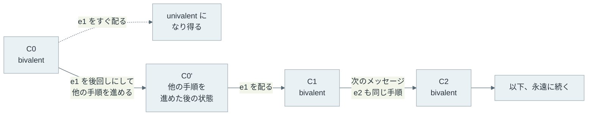

FLP 不可能性（FLP impossibility）は、Fischer・Lynch・Paterson の 3 氏が論文「[Impossibility of Distributed Consensus with One Faulty Process](https://doi.org/10.1145/3149.214121)」（1985 年）で示した定理です。ここでの合意は、複数のサーバー（論文の用語ではプロセス）がそれぞれ持つ値から、1 つの値を全員で選ぶことです。

同期した時計を持たず、メッセージの遅延に上限が無い非同期のシステムでは、プロセスが 1 台止まるかもしれないというだけで、決定的なアルゴリズムは合意が必ず終わることを保証できません。決定的とは、乱数を使わず、同じ状態で同じメッセージを受け取れば必ず同じ動きをすることです。

この定理は「合意は不可能」とも「分散システムは動かない」とも言っていません。多くの実行では合意は普通に終わります。定理が示すのは、どんなプロトコルにも、メッセージの届く順番しだいで決定が永遠に先送りされる実行が少なくとも 1 つある、ということです。その原因は、遅いだけのプロセスと止まったプロセスを外から区別できない点にあります。



上記の図は 3 台のうち p0 と p2 だけを描き、p1 は省略しています。網掛け部分では、p0 が観測できることは 2 つの世界で同じです。p0 が 100 ms で「p2 は止まった」と判断すると、世界 B では生きている p2 を無視して決めることになります。判断せずに待つと、世界 A では永遠に待つことになります。

<br>

本記事では、小さな合意プロトコルの実験と合わせて、FLP 不可能性の主張と前提を説明します。取り上げる疑問は以下の通りです。

- 定理はどんなモデルの上で、何を「できない」と言っているのか。
- 誰も止まっていないのに、なぜ合意が終わらない実行が作れるのか。
- timeout で故障と見なすと、何が壊れるのか。
- [Raft](https://raft.github.io/) や [Paxos](https://lamport.azurewebsites.net/pubs/paxos-simple.pdf) のような合意アルゴリズムは、どの前提を足して動いているのか。

扱う故障は、プロセスが途中で止まる故障（crash）だけです。誤った値や矛盾した値を送る故障は、[Byzantine Fault Tolerance](../byzantine-fault-tolerance/) のノートで扱います。

---

### 定理が置くモデル

冒頭で触れた合意（consensus）では、各プロセスが最初に持つ値を初期値と呼びます。合意には、一般に次の 3 つの性質を求めます。

- agreement（一致）: 決定した正常なプロセスは、全員が同じ値を選ぶ
- validity（妥当性）: 選ばれる値は、誰かの初期値である
- termination（終了）: 正常なプロセスは、いつか必ず決定する

agreement と validity は、悪いことが起きないという性質で、safety（安全性）と呼ばれます。termination は、良いことがいつか起きるという性質で、liveness（活性）と呼ばれます。safety の違反は有限の時点で観測できますが、liveness の違反は「まだ決まっていない」状態が永遠に続くことなので、どの時点でも確定しません。

定理は、この合意を次の表のモデルの上で考えます。FLP のモデルは、故障を「止まる」だけに絞り、メッセージも失われないとする、合意にとって有利なモデルです。不利な点は、時間に関する保証が 1 つも無いことだけです。

| 項目 | FLP のモデル |
| --- | --- |
| プロセス | 決定的に動く（乱数を使わない）。最大 1 台が予告なく止まり得る |
| メッセージ | 失われず、いつかは必ず届く。ただし遅延に上限が無く、順序も入れ替わる |
| 時計 | 同期した時計を持たない。そのため timeout を使うアルゴリズムは書けない |
| 故障の検知 | できない。止まったのか遅いだけなのかを判別する手段が無い |

メッセージがどの順に届くかは、プロトコルにとって最も都合の悪い順を選ぶ相手（敵対者、adversary）が決めると考えます。この相手は、どのメッセージも永遠に止めておくことはできませんが、いくらでも後回しにできます。不可能性の証明は、この相手がうまく順番を選べば決定を先送りし続けられる、という形を取ります。

FLP 不可能性は、上記の表のモデルの上では、決定的なプロトコルが safety を守ったまま liveness まで保証することはできない、という定理です。

論文はさらに条件を弱め、決定するのは誰か 1 台でよく、validity の代わりに、0 と 1 のどちらも決定され得ることだけを求めています。後者は、常に 0 を選ぶような自明な解を除くための validity より弱い条件で、非自明性と呼ばれます。これほど弱い要求でも、終わらない実行が残ります。

---

### 決定を先送りし続ける筋書き

証明では、システム全体のある時点の様子を状態（configuration）と呼びます。状態は、全プロセスの内部の値と、送られたがまだ届いていないメッセージの集まりからなります。状態を 1 つ進める手順（step）は、1 台が自分宛てのメッセージを 1 通受け取り（何も受け取らない手順もあります）、内部の値を変え、必要ならメッセージを送ることです。

証明の中心にある語は bivalent（二価）です。ある状態から、その後の配送順しだいで 0 にも 1 にも決まり得るなら、その状態は bivalent です。どちらか一方にしか決まり得ないなら univalent（一価）で、0-valent か 1-valent と呼びます。

証明は 2 段に分かれます。1 段目の論文の補題 2（Lemma 2）は、初期状態の中に bivalent なものが必ずあることを示します。2 段目の補題 3 は、bivalent な状態から bivalent な状態へ進み続けられることを示します（補題 1 は、関わるプロセスが重ならない手順は順序を入れ替えても同じ状態に着く、という補題 3 で使う道具です）。

<br>

#### 補題 2：bivalent な初期状態がある

bivalent な初期状態が無いと仮定します。すると、全ての初期状態は 0-valent か 1-valent のどちらかです。仮定の下では、非自明性から、0-valent と 1-valent の初期状態は両方あります。初期値を 1 台ずつ変えて並べると、0-valent と 1-valent が隣り合う所があり、その 2 つの違いは 1 台の初期値だけです。

プロトコルは 1 台が止まっても決定しなければならないので、その 1 台が一切動かない実行でも、残りのプロセスは決定まで進みます。隣り合う 2 つの状態の違いは動かない 1 台の初期値だけで、その 1 台は何も送らないので、残りのプロセスには 2 つが区別できません。そのため、どちらから始めても同じ値に決まります。

これは、片方が 0-valent でもう片方が 1-valent という前提と矛盾します。そのため、bivalent な初期状態は必ずあります。以下は、3 台の場合の並べ方の一例です。



図の 0-valent と 1-valent の割り当ては背理法の仮の例で、後の実験のプロトコルとは関係ありません。どこで 0-valent と 1-valent が隣り合うかはプロトコルで変わりますが、隣り合う所は必ずあります。

<br>

#### 補題 3：bivalent のまま進み続ける

補題 3 は、bivalent な状態 C に配送待ちのメッセージ e がある時、e を後回しにして他の手順を進めてから配れば、配った後も bivalent な状態を選べることを示します。e を永遠に配らないことはできません。どのメッセージもいつかは届くことが、モデルの条件だからです。

証明は、e を配る直前の手順が、e の宛先と同じプロセスのものかどうかで場合分けします。違えば補題 1 の入れ替えで、同じならそのプロセスが動かない実行を使って矛盾を導きます。本記事では、証明の細部は省略します。

以下の図は、この補題を繰り返して決定を先送りする流れです。どのプロセスも動き続け、どのメッセージもいつかは届くようにするため、後回しにするメッセージ e1, e2, ... は、プロセスを順番に回した時の、そのプロセス宛てで最も古い配送待ちのメッセージ（無ければ何も受け取らない手順）にします。



この選び方なので、全プロセスが無限に動き、全てのメッセージがいつかは届くので、この実行はモデルの上で正当（admissible）です。そのうえで、どの段階も bivalent で終わるので、誰も決定しません。

注目したいのは、この実行では誰も止まっていないことです。1 台の停止の可能性が効いているのは、補題 2 と補題 3 で「ある 1 台が動かなくても、残りは決定まで進めなければならない」と使われる所です。止まったプロセスを待ち続けるプロトコルは termination を満たせません。待たずに進めるプロトコルは、遅いだけのメッセージを後回しにする配送順に付け込まれます。

データベースのトランザクションを複数のサーバーで確定する commit プロトコルも、全員で「確定するか取り消すか」を決める合意の一種です。そのため、1 台の遅延や応答不能で全体が無期限に待つ期間（window of vulnerability）は、全ての commit プロトコルにあることになります（論文の序論）。[2PC](../two-phase-commit/) でコーディネーターが止まると参加者が待ち続ける問題も、その一例です。

---

### 3 プロセスの合意で再現する実験

ここからは本記事の実験の話です。定理は全ての決定的なプロトコルに終わらない実行があると言いますが、実験で見せられるのは、1 つのプロトコルを単純化したモデルで動かした場合だけです。上記の筋書きのうち「後回しにして bivalent に留める」という構図を目に見える形にするのが目的です。定理のモデルとの違いは以下の通りです。

| 項目 | 定理（FLP 論文のモデル） | 本記事の実験 |
| --- | --- | --- |
| 対象 | 全ての決定的なプロトコル | 下記の 1 つのプロトコル |
| 進み方 | 手順を 1 つずつ進める。ラウンドは無い | ラウンド制で、1 ラウンドは 2 段階 |
| 配送順を選ぶ相手 | どのメッセージもいくらでも後回しにできる | 各段階で、自分以外の誰のメッセージが先に届くかだけを選ぶ（後述の `adversary` は、この狭い範囲で選ぶ相手） |
| 遅れたメッセージ | いつか必ず届き、処理される | ラウンドが過ぎてから届き、捨てられる |
| 示すもの | 終わらない実行が必ずある（証明） | このプロトコルに、決定を先送りし続ける配送順がある（反例の 1 つ） |

実験のプロトコルでは、各プロセスは推定値（今決めようとしている値。最初は自分の初期値）を持ち、2 段階からなるラウンドを繰り返します。元にしたのは [Ben-Or の乱択合意](https://doi.org/10.1145/800221.806707)（後述）で、決め手が無い時に推定値を乱数で決め直します（硬貨投げ）。実験では、これを「0 に戻す」という決定的な規則に置き換えました。

1 台の停止に備えて、各段階では自分を含めて 2 通を受け取った時点で先に進みます。つまり、自分以外の 1 台から届くのを待つだけです。

1. 段階 1: 推定値を全員に送る。先に届いた 2 通の値が一致すれば、その値を提案し、割れたら `?`（決め手なし）を提案する
2. 段階 2: 提案を全員に送る。先に届いた 2 通が同じ値の提案なら決定する。1 通でも値の提案があれば推定値をその値にし、無ければ 0 にする

以下は、1 ラウンドを進める `run_round` です。`first1[i]` と `first2[i]` は、段階 1 と段階 2 で、プロセス i に自分以外で先に届く相手の番号です。全体は [lab/flp_lab.py](lab/flp_lab.py) で、Python 3 の標準ライブラリだけで動きます。

```python
def run_round(x, first1, first2):
    """1 ラウンドを進める。x は各プロセスの推定値。決めたプロセスと値も返す。"""
    # 段階 1: 推定値を交換する。先に届いた 2 通（自分の値を含む）が一致すれば提案、割れたら "?"
    proposal = [x[i] if x[i] == x[first1[i]] else "?" for i in range(N)]
    # 段階 2: 提案を交換する。2 通とも同じ値の提案なら決定する
    new_x, decided = [], {}
    for i in range(N):
        values = [v for v in (proposal[i], proposal[first2[i]]) if v != "?"]
        if len(values) == 2:
            decided[i] = values[0]
        new_x.append(values[0] if values else 0)  # 決め手が無ければ 0 に戻す（決定的な規則）
    return tuple(new_x), decided
```

同じラウンドで 0 と 1 の両方が提案されることはありません。提案には 2 台の値の一致が必要で、3 台のうち 2 台の組は必ず 1 台を共有し、共有する 1 台が 0 と 1 を同時に持つことはないからです。

そのため、誰かが決定すると全員の推定値がその値に揃い、agreement はどの配送順でも守られます。決定には同じ値の提案が 2 台から要ります。3 台のうち 2 台から受け取る他のプロセスは、その 2 台の少なくとも 1 台と必ず重なるので、1 通はその値の提案を見ます。

実験コードの `check_agreement` は、8 通りの推定値と 64 通りの配送順の全ての組でこのことを確認します。配送順は、各段階で 3 台がそれぞれ 2 通りの相手を選ぶので 2³ = 8 通り、2 段階で 8 × 8 = 64 通りです。

<br>

<details>
<summary>flp_lab.py の全体（全探索・スケジューラー・timeout の多数決、約 100 行）</summary>

```python
"""FLP の筋書きを小さな合意プロトコルで再現する（FLP の厳密なモデルより単純化してある）。"""
import itertools
import random

N = 3  # プロセス数。1 台の停止に備え、自分を含めて N - 1 = 2 通を集めたら先に進む
OTHERS = [tuple(j for j in range(N) if j != i) for i in range(N)]
# 配送順の選び方: 各段階で、各プロセスが「自分以外の誰のメッセージを先に受け取るか」
SCHEDULES = list(itertools.product(itertools.product(*OTHERS), repeat=2))


def run_round(x, first1, first2):
    """1 ラウンドを進める。x は各プロセスの推定値。決めたプロセスと値も返す。"""
    # 段階 1: 推定値を交換する。先に届いた 2 通（自分の値を含む）が一致すれば提案、割れたら "?"
    proposal = [x[i] if x[i] == x[first1[i]] else "?" for i in range(N)]
    # 段階 2: 提案を交換する。2 通とも同じ値の提案なら決定する
    new_x, decided = [], {}
    for i in range(N):
        values = [v for v in (proposal[i], proposal[first2[i]]) if v != "?"]
        if len(values) == 2:
            decided[i] = values[0]
        new_x.append(values[0] if values else 0)  # 決め手が無ければ 0 に戻す（決定的な規則）
    return tuple(new_x), decided


def reachable_decisions(x):
    """状態 x から、配送順の選び方しだいで到達できる決定値の集合。"""
    found, seen, stack = set(), {x}, [x]
    while stack:
        state = stack.pop()
        for first1, first2 in SCHEDULES:
            nxt, decided = run_round(state, first1, first2)
            found |= set(decided.values())
            if not decided and nxt not in seen:
                seen.add(nxt)
                stack.append(nxt)
    return found


def check_agreement():
    """全ての状態と配送順で、違う値の決定が出ないこと、決定後は全員の推定値が揃うことを確かめる。"""
    for x in itertools.product((0, 1), repeat=N):
        for first1, first2 in SCHEDULES:
            nxt, decided = run_round(x, first1, first2)
            assert len(set(decided.values())) <= 1
            assert not decided or set(nxt) == set(decided.values())
    print(f"[check] agreement holds: {2 ** N} states x {len(SCHEDULES)} schedules")


def adversary(x, _rng):
    """決定を出さず、次の状態も bivalent に留まる配送順を選ぶ。"""
    for first1, first2 in SCHEDULES:
        nxt, decided = run_round(x, first1, first2)
        if not decided and reachable_decisions(nxt) == {0, 1}:
            return first1, first2
    raise RuntimeError("bivalent に留まる配送順が無い")


def fair_random(_x, rng):
    """遅れるメッセージをラウンドごとにランダムに選ぶ。"""
    return rng.choice(SCHEDULES)


def run(name, scheduler, x, rounds, seed=1, verbose=True):
    """全員が決めるか rounds に達するまで回す。decisions は {プロセス: (値, 決めたラウンド)}。"""
    rng, decisions = random.Random(seed), {}
    if verbose:
        print(f"[{name}] start x={x} reachable={sorted(reachable_decisions(x))}")
    for r in range(1, rounds + 1):
        x, decided = run_round(x, *scheduler(x, rng))
        for i, v in decided.items():
            decisions.setdefault(i, (v, r))
        if verbose and (r <= 3 or len(decisions) == N):
            print(f"  round {r}: x={x} decided={decisions}")
        if len(decisions) == N:
            break
    else:
        if verbose:
            print(f"  ... round {rounds}: x={x} decided={decisions} reachable={sorted(reachable_decisions(x))}")
    assert len({v for v, _ in decisions.values()}) <= 1, "agreement violated"
    return decisions


def timeout_vote(values, delay_ms, timeout_ms):
    """全員の値を待つが、timeout までに届かない相手は止まったと見なして多数決（同数なら小さい値）。"""
    print(f"[timeout] values={values} timeout={timeout_ms}ms")
    for i in range(N):
        heard = [values[i]] + [values[j] for j in OTHERS[i] if delay_ms[j][i] <= timeout_ms]
        suspected = [j for j in OTHERS[i] if delay_ms[j][i] > timeout_ms]
        decision = max(sorted(set(heard)), key=heard.count)
        print(f"  p{i}: heard={heard} suspected={suspected} -> decide {decision}")


if __name__ == "__main__":
    check_agreement()
    start = (0, 1, 1)
    run("fair", fair_random, start, rounds=50)
    results = [run("fair", fair_random, start, 50, seed, verbose=False) for seed in range(10000)]
    undecided = sum(len(d) < N for d in results)
    print(f"  10000 seeds: undecided={undecided} max_round={max(r for d in results for _, r in d.values())}")
    run("adversary", adversary, start, rounds=1000)
    # p2 のメッセージは p1 には 10ms で届くが、p0 には 150ms 掛かる。p2 は止まっていない
    delay = [[0, 10, 10], [10, 0, 10], [150, 10, 0]]  # delay[送信元][宛先]
    timeout_vote(start, delay, timeout_ms=100)
```

</details>

<br>

以下が Python 3.14 で `python3 lab/flp_lab.py` を実行した結果です。`reachable` は、その状態から実験の配送順の範囲で到達できる決定値の集合で、`[0, 1]` なら実験のモデルの上で bivalent です。

```text
[check] agreement holds: 8 states x 64 schedules
[fair] start x=(0, 1, 1) reachable=[0, 1]
  round 1: x=(1, 1, 1) decided={}
  round 2: x=(1, 1, 1) decided={0: (1, 2), 1: (1, 2), 2: (1, 2)}
  10000 seeds: undecided=0 max_round=9
[adversary] start x=(0, 1, 1) reachable=[0, 1]
  round 1: x=(0, 1, 1) decided={}
  round 2: x=(0, 1, 1) decided={}
  round 3: x=(0, 1, 1) decided={}
  ... round 1000: x=(0, 1, 1) decided={} reachable=[0, 1]
[timeout] values=(0, 1, 1) timeout=100ms
  p0: heard=[0, 1] suspected=[2] -> decide 0
  p1: heard=[1, 0, 1] suspected=[] -> decide 1
  p2: heard=[1, 0, 1] suspected=[] -> decide 1
```

プロトコルは 1 つで、`fair` と `adversary` で違うのは配送順の選び方（スケジューラー）だけです。

`fair` は、遅れるメッセージをランダムに選んだ場合です。1 万通りの乱数の種の全てで、9 ラウンド以内に全員が同じ値に決めました。決めた値は上の出力に出していませんが、`results` を値ごとに数えると 1 が 5,068 通り、0 が 4,932 通りでした。冒頭で書いた「多くの実行では合意は普通に終わる」の一例です。

`adversary` は、決定を出さず、実験のモデルの上で bivalent に留まる配送順を毎ラウンド探すスケジューラーです。以下の図は、`(0, 1, 1)` から選ばれた 1 ラウンドです。



段階 1 では、p0 と p1 が互いの割れた値を先に受け取って `?` を提案し、p2 だけが 1 を提案します。段階 2 で p0 は p1 の `?` を受け取って 0 に戻り、p1 と p2 は 1 のままです。状態は `(0, 1, 1)` に戻り、1,000 ラウンド繰り返しても決まりませんでした。

p2 から p0 への提案 1 が先に届けば、p0 も 1 になり、次のラウンドで全員が 1 に決まります。`adversary` は、この 1 通を毎回後回しにしています。補題 3 の「e を後回しにする」と同じ構図です。誰も止まっていません。p2 の提案は p1 には届いています。p2 が止まっていれば、p1 も `?` しか受け取れず、推定値は 0 に戻ります。

ただし、遅れたメッセージを捨てるのは実験の単純化です。FLP のモデルではメッセージはいつか必ず処理されるので、毎ラウンド同じ 1 通を捨てる実行は、論文の admissible な実行そのものではありません。実験が示すのは、このプロトコルにも先送りの構図が現れることまでです。

<br>

`timeout` は、別の素朴なプロトコルです。冒頭の図の世界 B と同じ状況で、p2 の値は p0 に 150 ms で届きます。全員の値を待ち、100 ms までに届かない相手は止まったと見なして、届いた値の多数決で決めます。p0 は生きている p2 を除いて `[0, 1]` から 0 を選び（同数なら小さい値）、p1 と p2 は 1 を選びました。agreement が壊れています。

---

### timeout で分かるのは疑いだけ

上記の実験の 2 段階のプロトコルは、safety を守る代わりに、決定を先送りされ得ました。定理が言うのは、この先送りが実験のプロトコルだけの弱点ではないことです。agreement と非自明性を守る決定的なプロトコルなら、どれを選んでも終わらない実行が残ります。

`timeout` のプロトコルは時計を使うので、FLP のモデルの外にあります。遅延に上限があるという仮定を置いて先に進み、その仮定が外れた時に、同じ区別の付かなさから safety を失った例です。

[ハートビート](../heartbeat/)のような故障検知が出せるのは、「一定時間、何も届いていない」という観測だけです。非同期のモデルでは、何秒待っても「まだ遅いだけ」の可能性が残るので、timeout の満了は故障の証明ではなく疑い（suspicion）です。

疑いを根拠に先へ進むなら、疑いが外れた時にも safety が壊れない作りが必要になります。時計を使わない実験の 2 段階のプロトコルも、残りの 1 台は止まったかもしれないとみなして、3 通目を待たずに先へ進みます。

過半数を集めるだけでは、この作りになりません。実験の `timeout` でも、p0 は {p0, p1}、p1 は {p0, p1, p2} という重なる過半数を聞いたうえで、別々の値に決めています。[Quorum](../quorum/) の重なりに加えて、過半数から同じ値を受け取った時だけ決め、決めなかったプロセスはその値を引き継ぐ規則が必要です。

実験の 2 段階のプロトコルの段階 2 が、この作りです。その代わり、条件が揃わない間は決定が進みません。

---

### 合意アルゴリズムが足す前提

FLP の前提のうち、時間・決定性・故障の検知のどれかを緩めると、合意が終わるようにできます。代表的な 3 つの緩め方を整理すると、以下の通りです。

| 緩め方 | 足す前提 | 守るもの |
| --- | --- | --- |
| 部分同期（[Dwork, Lynch, Stockmeyer 1988](https://doi.org/10.1145/42282.42283)） | ある時点（GST、Global Stabilization Time）から後は遅延に上限が付く。その時点はプロセスに知らされない | safety は常に守る。termination は GST の後に得る |
| 乱択（Ben-Or 1983） | プロセスが乱数を使える（決定的でなくなる） | safety は常に守る。止まるのが半数未満なら、確率 1 で終わる |
| 故障検知器（[Chandra & Toueg 1996](https://doi.org/10.1145/226643.226647)） | 誤りを含む故障検知器を使える。検知器には 2 つの条件がある。止まったプロセスは、いずれ全ての正常なプロセスからずっと疑われる。正常なプロセスの少なくとも 1 台は、いずれ誰からも疑われなくなる | safety は常に守る。正常なプロセスが過半数なら終わる |

部分同期の論文では、通信が部分同期のモデルで、止まる故障を `t` 台まで許す合意は、全体の台数 `N` が `N ≥ 2t + 1` の時に限り可能だと示されています。上記の表の故障検知器は ◇S（Eventually Strong）と呼ばれる種類で、途中で何度疑いを外してもかまいません。外れた疑いは termination を遅らせるだけで、safety は壊しません。

Raft は、複数のサーバーに同じ操作の列（ログ）を同じ順で複製するための合意アルゴリズムで、部分同期の考え方に近い設計です。[Raft の論文](https://raft.github.io/raft.pdf) 5.6 節は、次の要求を置いています。

> safety must not depend on timing: the system must not produce incorrect results just because some event happens more quickly or slowly than expected.
>
> （safety はタイミングに依存してはならない。何かが想定より速く、または遅く起きただけで、誤った結果を出してはならない。）

しかし、Leader（ログの順序を決める 1 台）を選んで保ち続けられるかどうかはタイミングに依存します。論文は、次の条件を満たす間は、安定した Leader を選んで保てるとしています。

```text
broadcastTime ≪ electionTimeout ≪ MTBF
```

左から、全サーバーへ並列に RPC を送って応答を受け取るまでの平均時間、選出の待ち時間、1 台の故障の平均間隔 MTBF（Mean Time Between Failures）で、この順に大きく離れている必要があります。

Paxos でも、提案を出すノードどうしが番号を競り合うと何も選ばれないまま進まなくなる場合があり、[Leader and Followers](../leader-and-followers/) のノートで図にしています。

---

### 設計への読み替え

FLP 不可能性から設計に持ち帰れることは、timeout をどこで使っているかの確認です。liveness のためだけに使っているなら、timeout が外れても遅くなるだけで済みます。safety の判断に使っているなら、遅延が想定を超えた瞬間に結果が壊れます。

例えば、Raft の選出の待ち時間を往復の時間に近づけすぎると、生きている Leader が居るのに選出が始まり、選出を繰り返して書き込みが進まなくなります。これは liveness の問題で、ログが食い違うことはありません。

逆に、読み取りの例があります。Raft の Leader は、知らない間に別のサーバーが新しい Leader になって書き込みを受けているかもしれないので、読み取りの前に自分がまだ Leader であることを過半数に確認します。

[Lease](../lease/) を使ってこの確認を省く読み取り（Raft 論文 8 節が代わりの方法として挙げるもの）は、時計のずれ（clock skew）に上限があることを前提に、タイミングを safety の判断に持ち込みます。前提が外れると、古い値を返す可能性があります。

つまり、基本の Raft や Paxos は、safety をタイミングから切り離して常に守り、liveness だけを「いつかは遅延が落ち着く」という前提に預けています。ブロックチェーンの合意エンジンの [CometBFT](/notes/blockchain-systems/cometbft/) も同じ分け方で、2/3 を超える票が集まらない間は確定を止め、嘘をつく票の重みが 1/3 未満である限り、確定した内容を食い違わせません。
