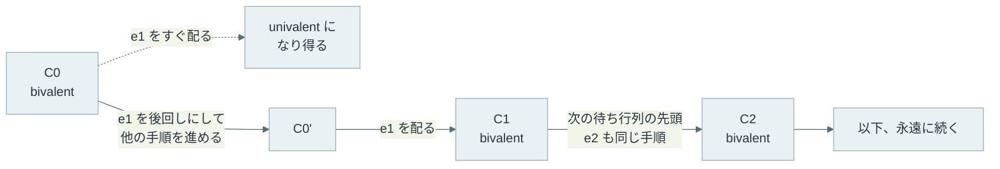

FLP 不可能性（FLP impossibility）は、Fischer・Lynch・Paterson の 3 氏が論文「[Impossibility of Distributed Consensus with One Faulty Process](https://doi.org/10.1145/3149.214121)」（1985 年）で示した定理です。時計を持たず、メッセージの遅延に上限が無い非同期のシステムでは、プロセスが 1 台止まるかもしれないというだけで、決定的なアルゴリズムは合意が必ず終わることを保証できません。

この定理は「合意は不可能」とも「分散システムは動かない」とも言っていません。多くの実行では合意は普通に終わります。定理が示すのは、どんなプロトコルにも、メッセージの届く順番しだいで決定が永遠に先送りされる実行が少なくとも 1 つある、ということです。その原因は、遅いだけのプロセスと止まったプロセスを外から区別できない点にあります。



上記の図の網掛け部分では、p0 が観測できることは 2 つの世界で同じです。p0 が 100 ms で「p2 は止まった」と判断すると、世界 B では生きている p2 を無視して決めることになります。判断せずに待つと、世界 A では永遠に待つことになります。

<br>

本記事では、小さな合意プロトコルの実験と合わせて、FLP 不可能性の主張と前提を説明します。取り上げる疑問は以下の通りです。

- 定理はどんなモデルの上で、何を「できない」と言っているのか。
- 誰も止まっていないのに、なぜ合意が終わらない実行が作れるのか。
- timeout で故障と見なすと、何が壊れるのか。
- [Raft](https://raft.github.io/) や [Paxos](https://lamport.azurewebsites.net/pubs/paxos-simple.pdf) のような合意アルゴリズムは、どの前提を足して動いているのか。

扱う故障は、プロセスが途中で止まる故障（crash）だけです。誤った値や矛盾した値を送る故障は、[Byzantine Fault Tolerance](../byzantine-fault-tolerance/) のノートで扱います。

---

### 定理が置くモデル

FLP のモデルは、故障を「止まる」だけに絞り、メッセージも失われないとする、合意にとって有利なモデルです。不利な点は、時間に関する保証が 1 つも無いことだけです。

| 項目 | FLP のモデル |
| --- | --- |
| プロセス | 決定的に動く。最大 1 台が予告なく止まり得る |
| メッセージ | 失われず、いつかは必ず届く。ただし遅延に上限が無く、順序も入れ替わる |
| 時計 | 持たない。そのため timeout を使うアルゴリズムは書けない |
| 故障の検知 | できない。止まったのか遅いだけなのかを判別する手段が無い |

合意（consensus）は、各プロセスが持つ初期値から 1 つの値を全員で選ぶ問題です。一般に、次の 3 つの性質を求めます。

- agreement（一致）: 決定した正常なプロセスは、全員が同じ値を選ぶ
- validity（妥当性）: 選ばれる値は、誰かの初期値である
- termination（終了）: 正常なプロセスは、いつか必ず決定する

agreement と validity は、悪いことが起きないという性質で、safety（安全性）と呼ばれます。termination は、良いことがいつか起きるという性質で、liveness（活性）と呼ばれます。safety の違反は有限の時点で観測できますが、liveness の違反は「まだ決まっていない」状態が永遠に続くことなので、どの時点でも確定しません。

FLP 不可能性は、上記の表のモデルの上では、決定的なプロトコルが safety を守ったまま liveness まで保証することはできない、という定理です。論文はさらに条件を弱め、決定するのは誰か 1 台でよく、0 と 1 のどちらも決定され得る（常に 0 を選ぶような自明な解ではない）ことだけを求めています。これほど弱い要求でも、終わらない実行が残ります。

---

### 決定を先送りし続ける筋書き

証明の中心にある語は bivalent（二価）です。ある時点の状態（configuration）から、その後の配送順しだいで 0 にも 1 にも決まり得るなら、その状態は bivalent です。どちらか一方にしか決まり得ないなら univalent（一価）で、0-valent か 1-valent と呼びます。

証明は 2 段に分かれます（補題 1 は、関わるプロセスが重ならない手順は順序を入れ替えても同じ状態に着く、という可換性の技術的な補題です）。論文の補題 2（Lemma 2）は、初期状態の中に bivalent なものが必ずあることを示します。

bivalent な初期状態が無いと仮定すると、非自明性から 0-valent と 1-valent の両方があり、初期値を 1 台ずつ変えて並べると、0-valent と 1-valent が隣り合う所があり、違いは 1 台の初期値だけです。その 1 台が一切動かない実行を考えると、他のプロセスには 2 つの状態が区別できず、同じ値に決まります。そのため、どちらかは bivalent です。

以下は、3 台の場合の並べ方の一例です。



どこで 0-valent と 1-valent が隣り合うかはプロトコルで変わりますが、隣り合う所は必ずあります。

補題 3 は、bivalent な状態 C に配送待ちのメッセージ e がある時、e を後回しにして他の手順を進めてから配れば、配った後も bivalent な状態を選べることを示します。以下の図は、この補題を繰り返して決定を先送りする流れです。



上記の図の e1, e2 は、プロセスを順番に回した時の、各プロセス宛ての最も古いメッセージです。全プロセスが無限に動き、全てのメッセージがいつかは届くので、この実行はモデルの上で正当（admissible）です。そのうえで、どの段階も bivalent で終わるので、誰も決定しません。

注目したいのは、この実行では誰も止まっていないことです。1 台の停止の可能性が効いているのは、補題 2 と補題 3 で「ある 1 台が動かなくても、残りは決定まで進めなければならない」と使われる所です。止まったプロセスを待ち続けるプロトコルは termination を満たせません。待たずに進めるプロトコルは、遅いだけのメッセージを後回しにする配送順に付け込まれます。

定理から、1 台の遅延で全体が無期限に待つ期間（window of vulnerability）は、全ての commit プロトコルにあることになります（論文の序論）。[2PC](../two-phase-commit/) でコーディネーターが止まると参加者が待ち続ける問題も、その一例です。

---

### 3 プロセスの合意で再現する実験

Python で書いた 3 プロセスの合意プロトコルで、上記の筋書きを再現します。プロトコルは、Ben-Or の乱択合意（後述）の硬貨投げを「0 に戻す」という決定的な規則に置き換えたものです。1 台の停止に備えて、各段階では自分を含めて 2 通を受け取った時点で先に進みます。

1. 段階 1: 推定値を全員に送る。先に届いた 2 通の値が一致すれば、その値を提案し、割れたら `?` を提案する
2. 段階 2: 提案を全員に送る。先に届いた 2 通が同じ値の提案なら決定する。1 通でも値の提案があれば推定値をその値にし、無ければ 0 にする

同じラウンドで 0 と 1 の両方が提案されることはありません。提案には 2 台の値の一致が必要で、3 台のうち 2 台の組は必ず 1 台を共有し、共有する 1 台が 0 と 1 を同時に持つことはないからです。そのため、誰かが決定すると全員の推定値がその値に揃い、agreement はどの配送順でも守られます。実験コードの `check_agreement` は、8 通りの推定値と 64 通りの配送順の全ての組でこのことを確かめます。

このモデルは FLP のモデルより単純です。スケジューラーが選べるのは「自分以外の誰の通知が先に届くか」だけで、遅れた通知も後で届きますが、ラウンドが過ぎているので捨てられます。以下は、1 ラウンドを進める `run_round` です。全体は [lab/flp_lab.py](lab/flp_lab.py) で、Python 3 の標準ライブラリだけで動きます。

```python
def run_round(x, first1, first2):
    """1 ラウンドを進める。x は各プロセスの推定値。決めたプロセスと値も返す。"""
    # 段階 1: 推定値を交換する。先に届いた 2 通（自分の値を含む）が一致すれば提案、割れたら "?"
    proposal = [x[i] if x[i] == x[first1[i]] else "?" for i in range(N)]
    # 段階 2: 提案を交換する。2 通とも同じ値の提案なら決定する
    new_x, decided = [], {}
    for i in range(N):
        values = [v for v in (proposal[i], proposal[first2[i]]) if v != "?"]
        if len(values) == 2:
            decided[i] = values[0]
        new_x.append(values[0] if values else 0)  # 決め手が無ければ 0 に戻す（決定的な規則）
    return tuple(new_x), decided
```

<details>
<summary>flp_lab.py の全体（全探索・スケジューラー・timeout の多数決、約 110 行）</summary>

```python
"""FLP の筋書きを小さな合意プロトコルで再現する（FLP の厳密なモデルより単純化してある）。"""
import itertools
import random

N = 3  # プロセス数。1 台の停止に備え、自分を含めて N - 1 = 2 通を集めたら先に進む
OTHERS = [tuple(j for j in range(N) if j != i) for i in range(N)]
# 配送順の選び方: 各段階で、各プロセスが「自分以外の誰の通知を先に受け取るか」
SCHEDULES = list(itertools.product(itertools.product(*OTHERS), repeat=2))


def run_round(x, first1, first2):
    """1 ラウンドを進める。x は各プロセスの推定値。決めたプロセスと値も返す。"""
    # 段階 1: 推定値を交換する。先に届いた 2 通（自分の値を含む）が一致すれば提案、割れたら "?"
    proposal = [x[i] if x[i] == x[first1[i]] else "?" for i in range(N)]
    # 段階 2: 提案を交換する。2 通とも同じ値の提案なら決定する
    new_x, decided = [], {}
    for i in range(N):
        values = [v for v in (proposal[i], proposal[first2[i]]) if v != "?"]
        if len(values) == 2:
            decided[i] = values[0]
        new_x.append(values[0] if values else 0)  # 決め手が無ければ 0 に戻す（決定的な規則）
    return tuple(new_x), decided


def reachable_decisions(x):
    """状態 x から、配送順の選び方しだいで到達できる決定値の集合。"""
    found, seen, stack = set(), {x}, [x]
    while stack:
        state = stack.pop()
        for first1, first2 in SCHEDULES:
            nxt, decided = run_round(state, first1, first2)
            found |= set(decided.values())
            if not decided and nxt not in seen:
                seen.add(nxt)
                stack.append(nxt)
    return found


def check_agreement():
    """全ての状態と配送順で、違う値の決定が出ないこと、決定後は全員の推定値が揃うことを確かめる。"""
    for x in itertools.product((0, 1), repeat=N):
        for first1, first2 in SCHEDULES:
            nxt, decided = run_round(x, first1, first2)
            assert len(set(decided.values())) <= 1
            assert not decided or set(nxt) == set(decided.values())
    print(f"[check] agreement holds: {2 ** N} states x {len(SCHEDULES)} schedules")


def adversary(x, _rng):
    """決定を出さず、次の状態も bivalent に留まる配送順を選ぶ。"""
    for first1, first2 in SCHEDULES:
        nxt, decided = run_round(x, first1, first2)
        if not decided and reachable_decisions(nxt) == {0, 1}:
            return first1, first2
    raise RuntimeError("bivalent に留まる配送順が無い")


def fair_random(_x, rng):
    """遅れる通知をラウンドごとにランダムに選ぶ。"""
    return rng.choice(SCHEDULES)


def run(name, scheduler, x, rounds, seed=1, verbose=True):
    """全員が決めるか rounds に達するまで回す。decisions は {プロセス: (値, 決めたラウンド)}。"""
    rng, decisions = random.Random(seed), {}
    if verbose:
        print(f"[{name}] start x={x} reachable={sorted(reachable_decisions(x))}")
    for r in range(1, rounds + 1):
        x, decided = run_round(x, *scheduler(x, rng))
        for i, v in decided.items():
            decisions.setdefault(i, (v, r))
        if verbose and (r <= 3 or len(decisions) == N):
            print(f"  round {r}: x={x} decided={decisions}")
        if len(decisions) == N:
            break
    else:
        if verbose:
            print(f"  ... round {rounds}: x={x} decided={decisions} reachable={sorted(reachable_decisions(x))}")
    assert len({v for v, _ in decisions.values()}) <= 1, "agreement violated"
    return decisions


def timeout_vote(values, delay_ms, timeout_ms):
    """全員の値を待つが、timeout までに届かない相手は止まったと見なして多数決（同数なら小さい値）。"""
    print(f"[timeout] values={values} timeout={timeout_ms}ms")
    for i in range(N):
        heard = [values[i]] + [values[j] for j in OTHERS[i] if delay_ms[j][i] <= timeout_ms]
        suspected = [j for j in OTHERS[i] if delay_ms[j][i] > timeout_ms]
        decision = max(sorted(set(heard)), key=heard.count)
        print(f"  p{i}: heard={heard} suspected={suspected} -> decide {decision}")


if __name__ == "__main__":
    check_agreement()
    start = (0, 1, 1)
    run("fair", fair_random, start, rounds=50)
    results = [run("fair", fair_random, start, 50, seed, verbose=False) for seed in range(10000)]
    undecided = sum(len(d) < N for d in results)
    print(f"  10000 seeds: undecided={undecided} max_round={max(r for d in results for _, r in d.values())}")
    run("adversary", adversary, start, rounds=1000)
    # p2 の通知は p1 には 10ms で届くが、p0 には 150ms 掛かる。p2 は止まっていない
    delay = [[0, 10, 10], [10, 0, 10], [150, 10, 0]]  # delay[送信元][宛先]
    timeout_vote(start, delay, timeout_ms=100)
```

</details>

以下が Python 3.14 で `python3 lab/flp_lab.py` を実行した結果です。`reachable` は、その状態から到達できる決定値の集合で、`[0, 1]` なら bivalent です。

```text
[check] agreement holds: 8 states x 64 schedules
[fair] start x=(0, 1, 1) reachable=[0, 1]
  round 1: x=(1, 1, 1) decided={}
  round 2: x=(1, 1, 1) decided={0: (1, 2), 1: (1, 2), 2: (1, 2)}
  10000 seeds: undecided=0 max_round=9
[adversary] start x=(0, 1, 1) reachable=[0, 1]
  round 1: x=(0, 1, 1) decided={}
  round 2: x=(0, 1, 1) decided={}
  round 3: x=(0, 1, 1) decided={}
  ... round 1000: x=(0, 1, 1) decided={} reachable=[0, 1]
[timeout] values=(0, 1, 1) timeout=100ms
  p0: heard=[0, 1] suspected=[2] -> decide 0
  p1: heard=[1, 0, 1] suspected=[] -> decide 1
  p2: heard=[1, 0, 1] suspected=[] -> decide 1
```

`fair` は、遅れる通知をランダムに選んだ場合です。1 万通りの乱数の種の全てで、9 ラウンド以内に全員が 1 に決めました。冒頭で書いた「多くの実行では合意は普通に終わる」は、この結果のことです。

`adversary` は、決定を出さず bivalent に留まる配送順を毎ラウンド探すスケジューラーです。具体的には、p0 と p1 が互いの割れた値を先に受け取って `?` を提案し、p2 だけが 1 を提案します。段階 2 で p0 は `?` だけを受け取って 0 に戻り、状態は `(0, 1, 1)` のまま 1,000 ラウンド進みませんでした。誰も止まっていません。遅れた通知は、このモデルではラウンドの後に届いて捨てられる扱いです。

なお、この実験は 1 つのプロトコルに対する反例を見せるもので、定理の証明ではありません。毎ラウンド同じ配送順を選ぶ実行も、FLP の admissible な実行と同じものではありません。

`timeout` は、別の素朴なプロトコルです。全員の値を待ち、100 ms までに届かない相手は止まったと見なして、届いた値の多数決で決めます。p2 の値は p0 に 150 ms で届くので、p0 は生きている p2 を除いて `[0, 1]` から 0 を選び、p1 と p2 は 1 を選びました。agreement が壊れています。

---

### timeout で分かるのは疑いだけ

上記の実験の `adversary` のプロトコルは safety を守る代わりに、決定を先送りされ得ました。FLP 不可能性が当てはまるのは `adversary` の結果で、agreement と非自明性を守る決定的なプロトコルには、終わらない実行が残ります。`timeout` のプロトコルは時計を使うので、FLP のモデルの外にあります。遅延に上限があるという仮定を置いて先に進み、その仮定が外れた時に、同じ区別の付かなさから safety を失った例です。

[ハートビート](../heartbeat/)のような故障検知が出せるのは、「一定時間、何も届いていない」という観測だけです。非同期のモデルでは、何秒待っても「まだ遅いだけ」の可能性が残るので、timeout の満了は故障の証明ではなく疑い（suspicion）です。疑いを根拠に先へ進むなら、疑いが外れた時にも safety が壊れない作りが必要になります。

過半数を集めるだけでは、この作りになりません。実験の `timeout` でも、p0 は {p0, p1}、p1 は {p0, p1, p2} という重なる過半数を聞いたうえで、別々の値に決めています。[Quorum](../quorum/) の重なりに加えて、過半数から同じ値を受け取った時だけ決め、決めなかったプロセスはその値を引き継ぐ規則が必要です。実験の `fair` と `adversary` のプロトコルの段階 2 が、この作りです。その代わり、条件が揃わない間は決定が進みません。

---

### 合意アルゴリズムが足す前提

FLP の前提のうち、時間・決定性・故障の検知のどれかを緩めると、合意が終わるようにできます。代表的な 3 つの緩め方を整理すると、以下の通りです。

| 緩め方 | 足す前提 | 守るもの |
| --- | --- | --- |
| 部分同期（[Dwork, Lynch, Stockmeyer 1988](https://doi.org/10.1145/42282.42283)） | ある時点（GST）から後は遅延に上限が付く。その時点はプロセスに知らされない | safety は常に守る。termination は GST の後に得る |
| 乱択（[Ben-Or 1983](https://doi.org/10.1145/800221.806707)） | プロセスが乱数を使える（決定的でなくなる） | safety は常に守る。止まるのが半数未満なら、確率 1 で終わる |
| 故障検知器（[Chandra & Toueg 1996](https://doi.org/10.1145/226643.226647)） | 誤りを含む故障検知器を使える。止まったプロセスはいずれ全ての正常なプロセスから疑われ続け、正常なプロセスの少なくとも 1 台はいずれ誰からも疑われなくなる | safety は常に守る。正常なプロセスが過半数なら終わる |

部分同期の論文では、止まる故障を `t` 台まで許す合意は `N ≥ 2t + 1` の時に限り可能だと示されています。上記の表の故障検知器は ◇S（Eventually Strong）と呼ばれる種類で、途中で何度疑いを外してもかまいません。外れた疑いは termination を遅らせるだけで、safety は壊しません。

Raft は部分同期の考え方に近い設計です。[Raft の論文](https://raft.github.io/raft.pdf) 5.6 節は、次の要求を置いています。

> safety must not depend on timing: the system must not produce incorrect results just because some event happens more quickly or slowly than expected.
>
> （safety はタイミングに依存してはならない。何かが想定より速く、または遅く起きただけで、誤った結果を出してはならない。）

しかし、Leader（ログの順序を決める 1 台）を選んで保ち続けられるかどうかはタイミングに依存します。論文は、`broadcastTime ≪ electionTimeout ≪ MTBF`（往復の時間、選出の待ち時間、故障の平均間隔がこの順に大きく離れる）という条件を満たす間は、安定した Leader を選んで保てるとしています。Paxos でも、提案を出すノードどうしが番号を競り合うと何も選ばれないまま進まなくなる場合があり、[Leader and Followers](../leader-and-followers/) のノートで図にしています。

---

### 設計への読み替え

FLP 不可能性から設計に持ち帰れることは、timeout をどこで使っているかの確認です。liveness のためだけに使っているなら、timeout が外れても遅くなるだけで済みます。safety の判断に使っているなら、遅延が想定を超えた瞬間に結果が壊れます。

例えば、Raft の選出の待ち時間を往復の時間に近づけすぎると、生きている Leader が居るのに選出が始まり、選出を繰り返して書き込みが進まなくなります。これは liveness の問題で、ログが食い違うことはありません。逆に、[Lease](../lease/) を使って過半数との確認を省く読み取り（Raft 論文 8 節が挙げる任意の最適化）は、ノード間で時計の進む速さのずれに上限があることを前提に、タイミングを safety の判断に持ち込みます。前提が外れると、古い値を返す可能性があります。

つまり、基本の Raft や Paxos は、safety をタイミングから切り離して常に守り、liveness だけを「いつかは遅延が落ち着く」という前提に預けています。
