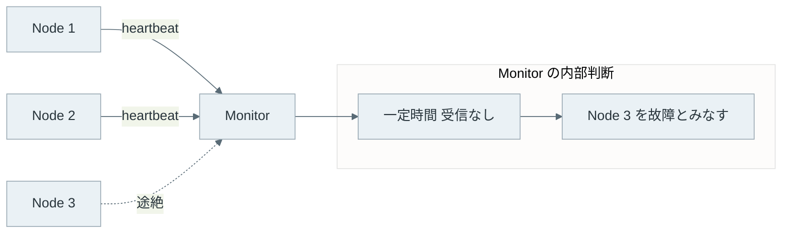
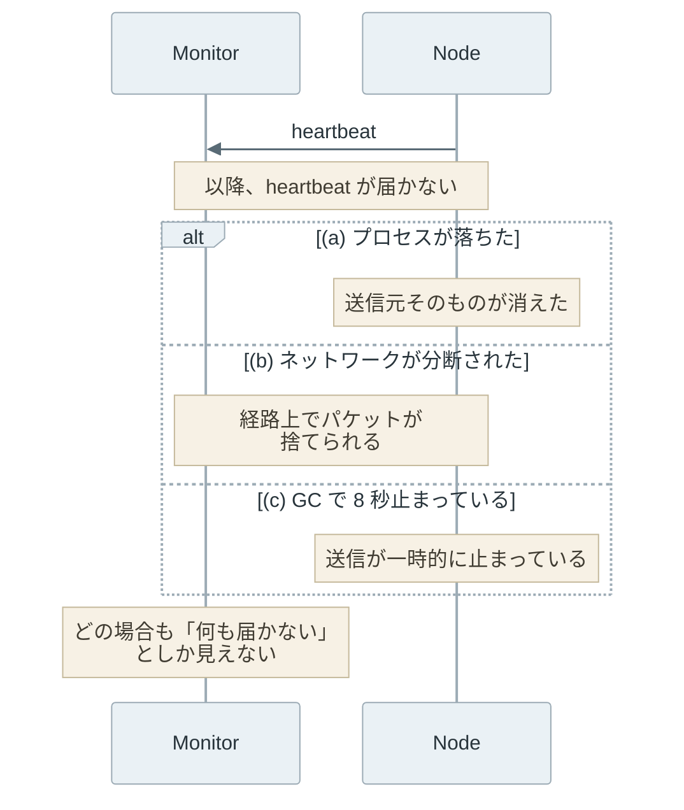
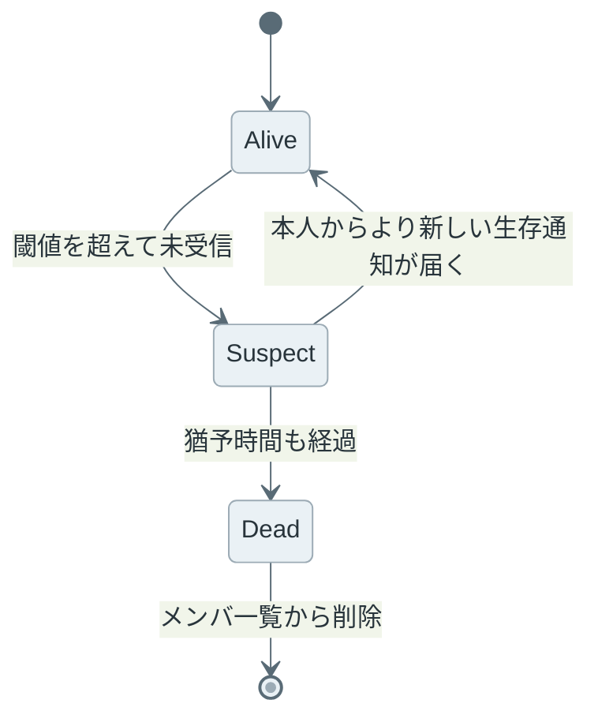

ハートビート（heartbeat）は、ノードが「自分は生きている」という短い信号を一定間隔で送り続け、受け取る側がその途絶をもって障害と判断する仕組みです。

分散システムでは、あるノードが応答しない理由を外から確定できません。観測できるのは「応答が返ってこない」という一点だけです。ハートビートは、この曖昧さを「一定時間内に信号が来たか」という判定可能な形に落とし込んでいます。

登場人物と信号の向きを以下に示します。監視される側から送る形が基本です。

上記の図の点線部分が途絶えた信号で、Monitor に「故障しました」という報告は届きません。落ちたノードは自分の停止を報告できないので、Monitor は「何も届かないこと」から Node 3 の故障を判断します。

 

本記事では、ノードの停止をハートビートで検知する方法を説明します。取り上げる疑問は以下の通りです。

- なぜ TCP の接続断だけでは、障害を検知できないのか。
- 信号を監視される側が送るか、監視する側が取りに行くかで、何が変わるのか。
- 一時的な遅延で即座に故障扱いにしないために、どんな状態を挟むのか。
- 故障とみなす閾値を短くすると、何が起きるのか。
- 固定の閾値を決めきれない環境では、どう判定するのか。

扱うのはノードが停止する故障だけです。誤った値を返す故障（ビザンチン障害）の検知は、ハートビートの範囲外なので本記事では扱いません。

---

### ハートビートが必要な理由

障害を検知できないクラスタは、壊れたノードに仕事を送り続けます。例えば、ロードバランサは死んだバックエンドにリクエストを流し続けます。書き込みを 1 台に集約する構成では、その 1 台（リーダー）が落ちても誰も代わりに立たず、書き込みが止まったままになります。同じデータの複製（レプリカ）が落ちても作り直しが始まらず、残った 1 台が壊れたらデータそのものが失われます。

TCP の接続断だけでは、ハートビートの代わりになりません。TCP は接続を保ったまま通信する規約なので、切断を検知すれば故障が分かるように見えます。しかし、接続が切れていなくても、ノードが仕事をできない場合があります。例えば、プロセスが生きていてもデッドロック（互いの処理の終了を待ち合って止まる状態）や GC（Garbage Collection）の長時間停止で応答しなくなることがあり、その間ソケットは正常に開いたままです。経路上のファイアウォールやロードバランサが黙ってパケットを捨てると、送信側は接続が切れたことに長い間気付けません。

以下は、信号が途絶えた時に Monitor から見える現象です。3 つの分岐は同時に起きるのではなく、どれか 1 つが起きている状況を表します。

上記の図の 3 つのケースは原因も対処も違うのに、Monitor から見える現象は同じです。非同期ネットワーク（メッセージの遅延に上限を置かないモデル）では、何秒待っても「まだ遅いだけ」という可能性が残るので、「遅いだけのノード」と「落ちたノード」を確実に見分けられません。

実用的な障害検知は「確実に見分ける」を諦め、「一定時間待って来なければ落ちたとみなす」と割り切ります。ハートビートは、この割り切りを最も少ない手間で形にした仕組みです。

---

### 構成要素と監視の形

構成要素は、送信間隔・タイムアウト・状態遷移の 3 つだけです。ノードは間隔 `T` ごとに信号を送り、監視側は最後に受信した時刻からの経過が閾値を超えたら故障とみなします。閾値は間隔の数倍に取るのが通常で、1 回や 2 回の取りこぼしで故障扱いにしないための余裕を持たせます。具体的には、1 秒ごとに信号を送り、5 秒間受信が無ければ故障とみなす設定です。

監視の形は 2 通りあります。1 台の監視役が全ノードを見る中央集約型（central monitoring）と、各ノードが互いを見る相互監視型（mutual monitoring）です。ノード数を `n` とすると、1 周期に流れるメッセージは中央集約型で `n` 本、相互監視型で `n × (n-1)` 本になります。中央集約型は通信量が少ない代わりに、監視役に負荷が集中し、そこが落ちると誰も故障を検知できません。相互監視型は特定の監視役に依存しません。

 

信号の向きも、監視される側が送るか、監視する側が取りに行くかで 2 通りあります。以下の表の Raft はリーダーを 1 台選んで全ノードのログを揃える合意アルゴリズムで、Kubernetes の liveness probe は監視側がコンテナの応答を定期的に確かめる仕組みです。

| | push 型 | pull 型 |
| --- | --- | --- |
| 信号の向き | ノード → 監視側 | 監視側 → ノード |
| 代表例 | Raft の `AppendEntries` | Kubernetes の liveness probe |
| ノード追加時 | ノード側が宛先を知る必要がある | 監視側が対象一覧を持つ必要がある |
| 信号を作る主体 | 監視される側 | 監視する側の要求に応じて答える |

何を検知できるかは、信号を誰が作っているかで決まります。例えば、リクエストを処理するループの中で信号を送れば、処理が詰まると信号も止まります。タイマー専用のスレッドで送ると、処理ループが止まっていても信号は流れます。この違いは push と pull のどちらにも当てはまります。

Raft では、監視される側がリーダー、監視する側がフォロワーになります。リーダーが `AppendEntries` を送り続け、フォロワーは一定時間それが届かないことでリーダーの故障を判断します。同時に、リーダーは送った `AppendEntries` に応答が返るかどうかでフォロワーの生存を知ります。

Kubernetes には両方の形があります。各ノードで動くエージェント（kubelet）が中央の API server 上にある [Lease](../lease/) オブジェクト（期限付きで権利を貸す仕組み）を更新して[ノードの死活を伝える](https://kubernetes.io/docs/concepts/architecture/leases/)のが push、その kubelet が同じノードのコンテナに [liveness probe](https://kubernetes.io/docs/concepts/workloads/pods/pod-lifecycle/) を送るのが pull です。kubelet 自身がそのノード上で動いているので、ノードが落ちると probe を送る側も止まります。そのため、後者はノード自体の障害を検知できません。

---

### 状態遷移

ノードの状態を生きている／死んでいるの二値で扱うと、一時的な遅延で即座に故障扱いになります。多くの実装は間に猶予の状態を挟みます。

Suspect は「怪しい。ただし、まだ復旧を始めない」段階です。ここでリーダー再選出やデータ再配置を始めてしまうと、ノードが実は生きていた場合に無駄な負荷だけが残ります。図の「より新しい生存通知」は、後述の世代番号を上げた通知を指します。

[SWIM](https://www.cs.cornell.edu/projects/Quicksilver/public_pdfs/SWIM.pdf)（メンバーの死活をノード同士で確かめ合うプロトコル）は、Suspect に落とす前に、ランダムに選んだ数台のノードに代理の確認を頼みます。監視側から 1 本の経路で届かなくても、別のノードを経由すれば応答が返ることがあります。代理の確認も失敗した場合に限って Suspect とし、猶予時間が過ぎてから故障を確定させます。

上記の図の Dead は終端になっています。SWIM では、各ノードが自分の世代番号（incarnation number）を持ち、Suspect と広められたノードは、より大きい世代番号を付けた生存通知でそれを打ち消します。一方、SWIM の論文では、Dead の通知が世代番号に関係なく他の通知を上書きすると決められています。一度 Dead が確定したノードはメンバ一覧から削除され、復帰するには別のメンバとして参加し直します。

---

### タイムアウトの決め方

閾値の設定は、検知の速さと誤検知率のトレードオフになります。

| 閾値 | 検知の速さ | 誤検知 | 向く状況 |
| --- | --- | --- | --- |
| 短い（間隔の 2〜3 倍） | 速い | 増える | 同一データセンタ内、遅延が安定している |
| 長い（間隔の 5〜10 倍） | 遅い | 減る | 拠点をまたぐ、遅延のばらつきが大きい |

閾値を短くしすぎると、誤検知そのものより、それをきっかけに走る再選出が問題になります。生きているリーダーを故障とみなして再選出を始めると、旧リーダーが応答を再開した直後にまた別の再選出が走り、選出を繰り返すだけでクラスタが仕事を進められなくなります。リーダーはノードの投票で選ばれます。過半数の票を必要としない構成では、分断の両側でそれぞれリーダーが立つ split brain（二重リーダー）も、誤検知がきっかけで起こります。

 

誤った判定の後始末は、途絶えていた時間より長く掛かる場合があります。2018 年 10 月 21 日の [GitHub の障害](https://github.blog/news-insights/company-news/oct21-post-incident-analysis/)では、機器の交換作業で、米国東海岸のネットワーク拠点と主なデータセンタの間の通信が 43 秒途切れました。その間に、MySQL のリーダー（primary）の故障を複数の情報から判定して切り替える Orchestrator が、書き込み先を西海岸のデータセンタに移し始めました。

止まっていたのは通信だけで、東海岸のリーダーは動いていました。先に示した 3 つの分岐の (b) を (a) のように扱って切り替えたので、通信が戻った時には東西の両方に相手の持たない書き込みがあり、すぐには元に戻せませんでした。サービスの劣化は 24 時間 11 分続き、再発防止策の 1 つは、地域をまたいでリーダーを昇格させない設定です。

過半数を要求する構成では、少数派は票を集められないためリーダーが立ちません。それでも、分断された旧リーダーは、交代に気付くまで自分をリーダーだと思い込んだまま動き続けます。書き込みの確定にも過半数の応答を要求する構成なら、旧リーダーは書き込みを確定できません。しかし、新リーダー側で確定した書き込みを知らないため、古い値を読み取りに返す可能性は残ります。

Raft では、リーダーが読み取りに応答する前に過半数とハートビートを交換し、自分がまだリーダーであることを確認します（[Leader and Followers](../leader-and-followers/)）。代わりに、ハートビートを [Lease](../lease/) のように扱う方法もあります（[Raft の論文](https://raft.github.io/raft.pdf) 8 節）。過半数から応答を得てから一定時間は新しいリーダーが立たないとみなし、確認を省いて読み取りに答える方法で、ノード間で時計の進む速さのずれに上限があることを前提にします。

 

監視側が最後の受信からの経過時間を測る時は、単調増加する時計（monotonic clock）を使います。壁時計は、時刻をネットワーク越しに合わせる NTP（Network Time Protocol）の補正で進んだり巻き戻ったりします。そのまま差分を取ると、補正の分だけ故障判定が早まったり遅れたりします。

---

### 連続値で表す疑わしさ

固定値を決めきれない環境では、生死の二値ではなく「疑わしさ」を連続値で出す方式もあります。

Phi Accrual Failure Detector は、Hayashibara 氏らが 2004 年に発表した論文「[The φ accrual failure detector](https://dspace.jaist.ac.jp/dspace/handle/10119/4784)」で提案された方式です。直近のハートビート到着間隔を記録して分布を推定し、「最後の受信からの経過時間が、その分布から見てどれだけ外れているか」を `phi` という 1 つの数値で表します。定義は `phi = -log10(P)` です。

最後の受信から `t` 秒が経ったとして、`P` は「到着間隔に当てはめた確率モデルの上で、間隔が `t` 秒より長くなる確率」を表します。`phi` が 1 増えるたびに `P` は 1/10 になり、`phi = 1` はモデル上の `P` が 10%、`phi = 2` は 1%、`phi = 3` は 0.1% であることに対応します。これはモデルが実際の遅延分布と一致する場合の値で、現実の障害確率や誤検知率を直接表す値ではありません。

当てはめる分布は実装によって違い、上記の論文と分散アプリ用のライブラリ [Akka](https://doc.akka.io/libraries/akka-core/current/typed/failure-detector.html) は正規分布、分散 DB の Cassandra は指数分布を使います。どの分布を選んでも、到着間隔の傾向が急に変わった直後は推定が追いつきません。

利用側は許容できる疑わしさの水準から閾値を決められ、同じ検知器の上で「警告は `phi = 5`、クラスタからの切り離しは `phi = 8`」のように複数の閾値を使い分けられます。

---

### 利点

- 定期送信と最終受信時刻の比較だけで実装できる
- 落ちたノードが自己申告できなくても、信号の不在から検知できる
- 通信量をノード数と間隔から一定に見積もれる
- 既存の通信に相乗りできる。データ複製の通信を兼用する実装が多い

---

### 欠点

ハートビートは、信号の有無だけで生死を判断して実装を小さく保つ代わりに、以下の弱点を抱えます。

- 遅いノードと落ちたノードを区別できず、誤検知を完全には無くせない
- 閾値の分だけ、障害発生から気付くまでに時間が空く
- 相互監視の構成では、1 周期あたりのメッセージが `n × (n-1)` 本に膨らむ
- 信号が届くことしか保証しない。ディスクが壊れていても応答さえ返れば健全と判定される
- 監視側の停止や過負荷が、全ノードの一斉故障判定として現れる

通信量の問題は、相互監視の構成を避けて解決します。gossip 方式では各ノードがランダムに選んだ少数のノードとだけ情報を交換し、故障の情報がクラスタ全体に伝播します。1 ノードが 1 周期に送るメッセージの本数は、ノード数に依存しなくなります。ただし、1 通に載せる情報量を抑える工夫が無ければ、本数が一定でも通信量はノード数とともに増えます。

---

### 適さないケース

- 秒未満の検知が要求される場面。閾値を詰めると誤検知が跳ね上がる
- 拠点をまたぐ広域構成。往復遅延のばらつきがそのまま誤検知になる
- ノードが数万台に及ぶ構成での中央集約型。監視側に負荷が集中する
- 処理の正しさまで担保したい場合。応答の有無しか見ていない
