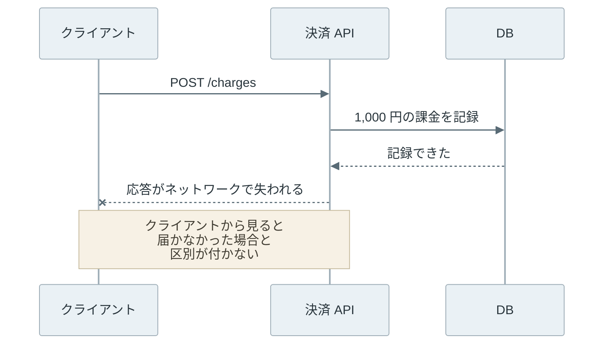
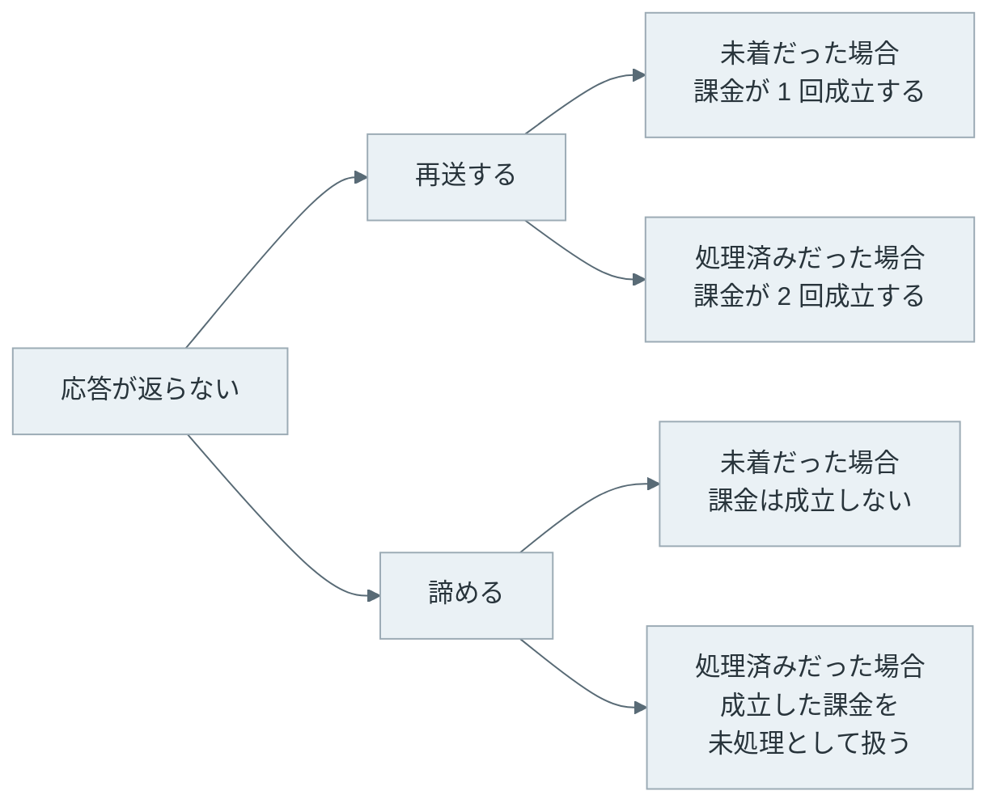
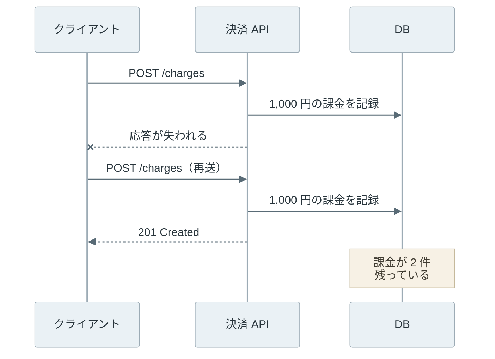
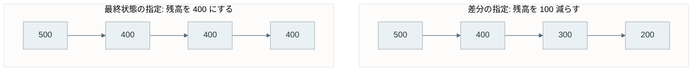
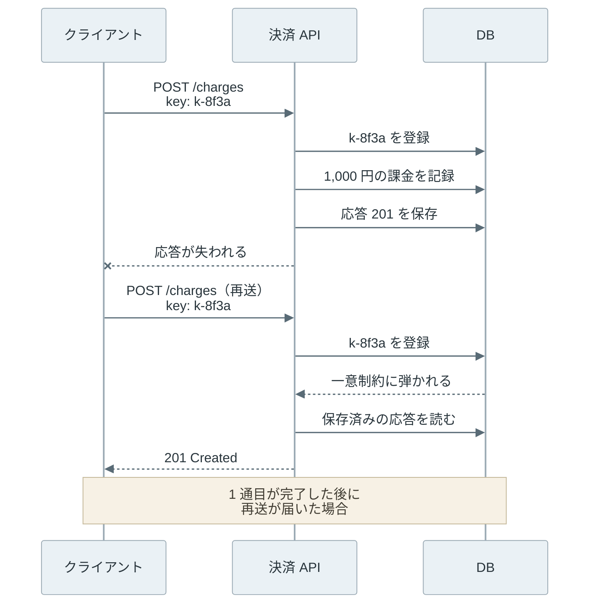
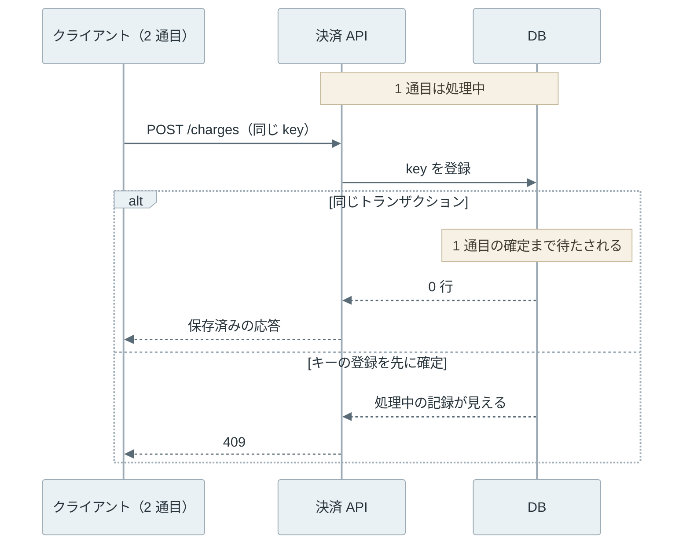
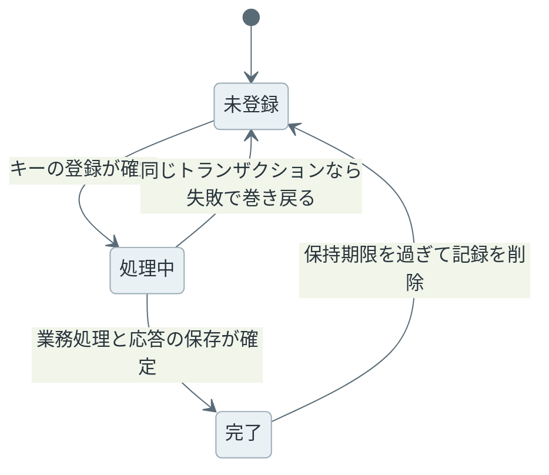

冪等（べきとう、idempotent）は、同じ操作を 1 回実行した時と、繰り返し実行した時とで、要求した側が意図した結果が同じになる性質です。

決済 API に課金の POST を送り、504 Gateway Timeout が返ってきたとします。課金が成立したのか、要求が届かないまま終わったのかは、この応答からは分かりません。この POST が冪等なら、もう一度送っても課金は 1 回分に留まります。



応答が途絶えても相手の状態は分からない構図は、[Heartbeat](../heartbeat/) が扱う「遅いノードと落ちたノードを見分けられない」問題と同じです。

<br>

本記事では、要求の再送で生じる重複と、その防ぎ方を説明します。手順を追いながら、次の疑問に答えます。

- 再送すると、なぜ同じ処理が重複する場合があるのか。
- 繰り返しても結果が変わらない操作とは、どんな書き方なのか。
- 冪等キーで、重複した要求をどう見分けるのか。
- 1 通目の処理が終わる前に再送が届いたら、何を返せるのか。
- キーの記録をいつ消し、使い回されたキーをどう扱うのか。

誤った値を返す故障（ビザンチン障害）と、複数の要求を跨いだ順序の保証は、本記事では扱いません。

---

### 再送だけで足りない理由

区別が付かない以上、送信側が選べるのは再送するか諦めるかの 2 つで、どちらを選んでも壊れる場合が残ります。



上記の図で再送を選び、成功を確認できるまで再試行すると、同じ要求が複数回届く可能性があります。1 回分の課金を作る要求が 2 通届けば、素朴な実装は 2 回分の課金を作ります。



API 側に重複を防ぐ処理がないと、再送された要求も新しい課金として実行してしまいます。そのため、繰り返しに耐える形を用意するのは、API を提供する側になります。

---

### 繰り返しても結果が変わらない操作

一番単純な方法は、繰り返しても結果が変わらない書き方を選ぶことです。残高 500 の口座に「残高を 100 減らす」と「残高を 400 にする」を 3 回ずつ適用すると、以下の通りに分かれます。



ただし、「残高を 400 にする」の結果が変わらないのは、同じ要求だけを繰り返す限りです。

<br>

HTTP のメソッドにも同じ区別が入っています。例えば PUT は、要求の本文が表す状態で、指定した URL のリソースを作成または置き換えるよう求めるメソッドです。同じ本文で何度送っても、意図している状態は最後の 1 通と変わりません。

HTTP の意味論を定める RFC 9110 は、PUT・DELETE と safe なメソッド（GET、HEAD、OPTIONS、TRACE。クライアントが状態変更を要求しない操作）を冪等なメソッドとして挙げています。定義は、「[the intended effect on the server of multiple identical requests with that method is the same as the effect for a single such request](https://www.rfc-editor.org/rfc/rfc9110.html#name-idempotent-methods)」（同じ要求を複数回送った時にサーバー上で意図される結果が、1 回送った時と同じ）です。

揃うのは意図された結果だけなので、要求ごとにログを残すといった副作用は、回数に応じて増えても構いません。応答の中身も揃いません。つまり DELETE の 2 回目が 404 を返しても、削除済みという意図された結果は同じなので、冪等性の定義を満たします。

冪等と safe は別の性質で、冪等なメソッドはサーバーの状態を変えて構いません。なお RFC 9110 は、非冪等なメソッドをクライアントが原則として自動で再試行しないよう求めています。

冒頭の課金の POST は、この書き換えができません。最終状態を指定できるのは、書き込む先が要求の中で決まっている操作です。新規の課金や伝票番号の採番は、実行するたびに別の対象ができるので、上書きすべき先がありません。

---

### 冪等キーで重複を見分ける仕組み

最終状態を指定する形に書き直せない場合は、要求に一意な値を付けて見分けます。この値を冪等キー（idempotency key）と呼び、クライアントが要求ごとに生成して添えます。

サーバーはキーのカラムに一意制約（同じ値のレコードを 2 つ作れない制約）を付けてキーを登録してから業務処理（ここでは課金を記録する処理）を行い、同じキーの 2 度目には業務処理を再実行せず、記録済みの応答を返します。



応答まで保存するのは、冪等の要件ではありません。クライアントは自分の要求が初回か再送かを区別できないので、同じ応答を返しておくと呼び出し側の分岐が不要になります。

DB（データベース）の一意制約は、同じキーの要求が同時に届いても、初回として扱われるのを 1 通だけにします。存在を確認してから記録する順序だと、2 通が両方とも「まだ無い」を読む余地が残ります。

この排他が働くのは登録の瞬間で、業務処理との整合は別に設計する必要があります。キーの記録と課金の記録は、同じトランザクションに入れるのが素直です。分けると、キーは登録済みなのに課金が無い（あるいはその逆の）食い違いが残り得ます。どこまでを 1 つのトランザクションに入れるかは [Transaction Scope](../../database-systems/transaction-scope/) の題材です。

PostgreSQL は、`ON CONFLICT` 句で一意制約の衝突を扱えます。以下が、冪等キーのテーブルと登録の一例です。

```sql
CREATE TABLE idempotency_keys (
    id          bigserial   PRIMARY KEY,
    key         text        NOT NULL UNIQUE,
    fingerprint text        NOT NULL,
    status      text        NOT NULL DEFAULT 'in_progress',
    response    jsonb,
    expires_at  timestamptz NOT NULL
);

-- 行が返れば初回の要求、0 行なら同じキーの要求が既にある
INSERT INTO idempotency_keys (key, fingerprint, expires_at)
VALUES ('k-8f3a', 'sha256:3f6c9d2a', now() + interval '24 hours')
ON CONFLICT (key) DO NOTHING
RETURNING id;
```

`fingerprint` は要求本文のハッシュで、同じキーが別の本文で使われたことを見分けるために残します（後述）。業務処理の確定と同時に `status` を完了に書き換え、`response` に応答を保存します。処理中と完了を `status` で分けることも、保持期間を 24 時間にすることも、このコードが選んだ設計で、仕様が定めた形ではありません。受信済みのイベント ID を一意制約付きで記録する形も同じ作りで、[Domain Event](../../software-architecture/domain-event/) で扱っています。

<br>

このキーを運ぶ Idempotency-Key リクエストヘッダは、IETF（インターネットの技術仕様を定める団体）の HTTPAPI ワーキンググループの Internet-Draft（RFC になる前の草案）[The Idempotency-Key HTTP Header Field](https://datatracker.ietf.org/doc/html/draft-ietf-httpapi-idempotency-key-header-08) が定義しています。2026 年 11 月時点の最新は 2026 年 10 月 22 日提出の draft-08 で、RFC にはなっていません。以降の 409・422・有効期限の扱いは、draft-08 の記述に従います。

完了後に届いた再送への応答は、draft-07 の「前回の結果を返す」から、draft-08 で「要求が意図通りに完了したことと矛盾しない応答を返す」に改められました。保存した応答をそのまま返すのは、この条件を満たす素直な実装の 1 つです。なお draft-08 の改訂履歴では、この文言はまだ議論中とされています。

---

### 処理中に届いた再送の扱い

1 通目の処理が終わる前に 2 通目が届く場合、2 通目に何を返せるかは、キーの記録をどのトランザクションに置いたかで変わります。



同じトランザクションに置くと、処理中の記録は確定前なので、レコードそのものは他の要求から見えません。ただし、一意制約の検査は未確定のレコードも対象にするため、2 通目の登録は 1 通目が確定するか中止されるまで待たされます。

PostgreSQL 17 で、1 通目が前述の INSERT でキーを登録して 5 秒後に COMMIT し、2 通目がその登録の 1 秒後に同じ INSERT を送ると、2 通目の psql の出力は以下の通りです。

```text
 id
----
(0 rows)

Time: 3999.811 ms (00:04.000)
```

2 通目は 1 通目の COMMIT まで約 4 秒待たされ、0 行を受け取りました。1 通目を ROLLBACK に変えると、同じく約 4 秒待った後に 1 行が返り、2 通目が初回として業務処理に進みます。

キーの登録を先に確定させると、処理中であることが他の要求から見えます。処理中の要求と同じキーが届いた場合の応答には、この草案で 409 が推奨されています。409 は、対象リソースの現在の状態と衝突していて、解消すれば送り直せる場合に使う応答です。処理中であることをどう検出するかは、草案では定めていません。

代償として、キーだけが登録されて業務処理がまだ終わっていない期間ができます。この間にプロセスが落ちると記録が処理中のまま残るので、一定時間後に未登録へ戻すなどの回収手段が必要です。

409 を受け取ったクライアントや、待たされる途中で諦めたクライアントは、課金が成立したかどうかを知らないままです。冪等キーが保証するのは結果を 1 回分に保つ所までで、1 通目の完了を待って同じ応答を返すことは含まれません。

キーと業務処理を同じトランザクションに置く場合は、一意制約の検査が先の処理を待つため、完了後に同じ応答を返せます。同じキーのまま間隔を空けて送り直せば、完了後は保存済みの応答が返ります。

---

### キーの寿命と使い回し

キーの記録は、いつか消さなければ増え続けます。草案は、有効期限の方針を API の提供側が決めて文書化するよう求めていますが、具体的な期間は示していません。



記録が消えた後の再送は、初回の要求として素通りします。そのため、送信側が再試行を続ける期間より期限が短いと、最後の方の再試行は重複として弾かれません。逆に期限を延ばすほど、記録は増えます。

同じキーが違う本文で使い回された要求は、再送として扱えません。草案は、この場合の応答に 422 を割り当てています。422 は、本文の構文は正しいのに、その内容の指示を処理できない場合に使う応答です。前述の `fingerprint` カラムが、この判定に使う本文の指紋（idempotency fingerprint）です。草案は、指紋をキーと併用する判定も認めています。

キーを生成するのはクライアントで、草案は UUID のようなランダムな識別子を推奨しています。再送のたびに新しいキーを作る実装では、サーバーの記録と結び付かず、重複排除が働きません。

---

### 利点

- 応答が失われた要求について、結果を 1 回分に保ったまま再試行できる
- 再試行の判断をクライアントに任せられ、サーバーは重複の判定だけを持てる
- 一意制約という DB の既存の仕組みで、同時に届いた 2 通も同じ経路で扱える
- 1 通目が完了した後なら、2 度目の要求にも同じ応答を返せる

---

### 欠点

冪等キーでは、重複の判定を送信側ではなくサーバーが引き受けます。そのため、サーバー側に次の負担が残ります。

- キーの記録と業務処理をどのトランザクションに入れるか、対象の API ごとに決める必要がある
- キーの記録が課金のテーブルとは別に増え、削除の運用を決める必要がある
- 重複排除が働く範囲が保持期限に縛られ、期限を過ぎた再送は素通りする
- 処理中の再送を待たせるか 409 で返すかが、トランザクションの置き方で変わる

---

### 適さないケース

- 差分の指定を最終状態の指定に書き換えられ、キーを持たずに繰り返しに耐えられる操作
- 同じ要求が複数回届いても業務上の結果が変わらない、読み取りだけの操作
- 要求ごとに新しい対象を作ることが目的で、重複した要求も別々の要求として扱いたい操作
