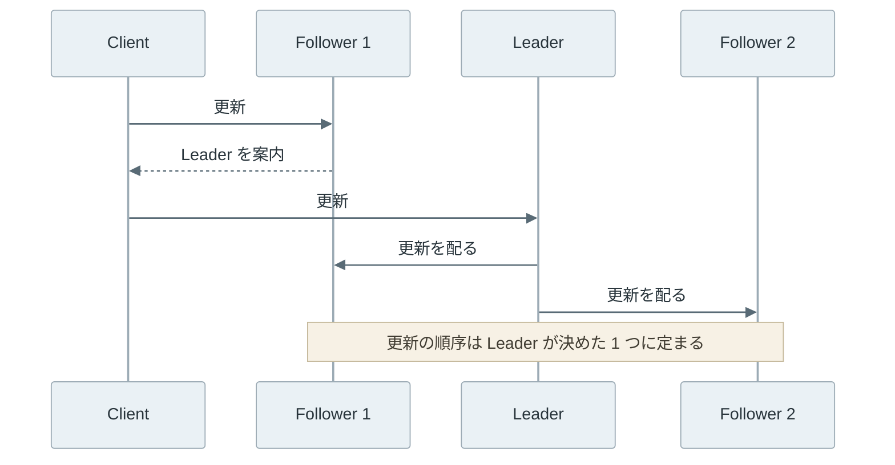
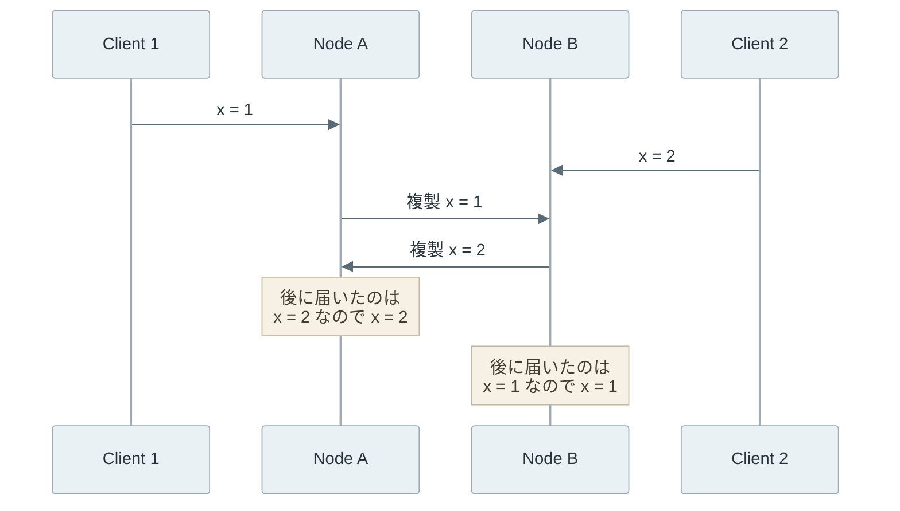
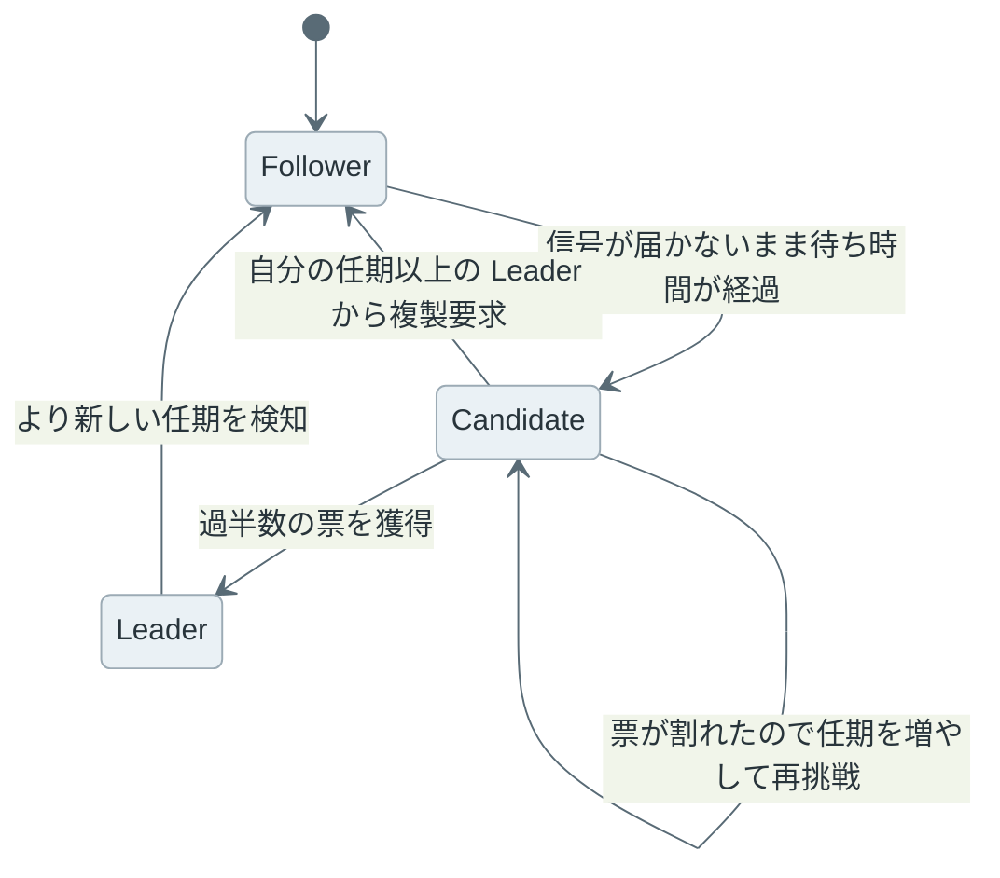
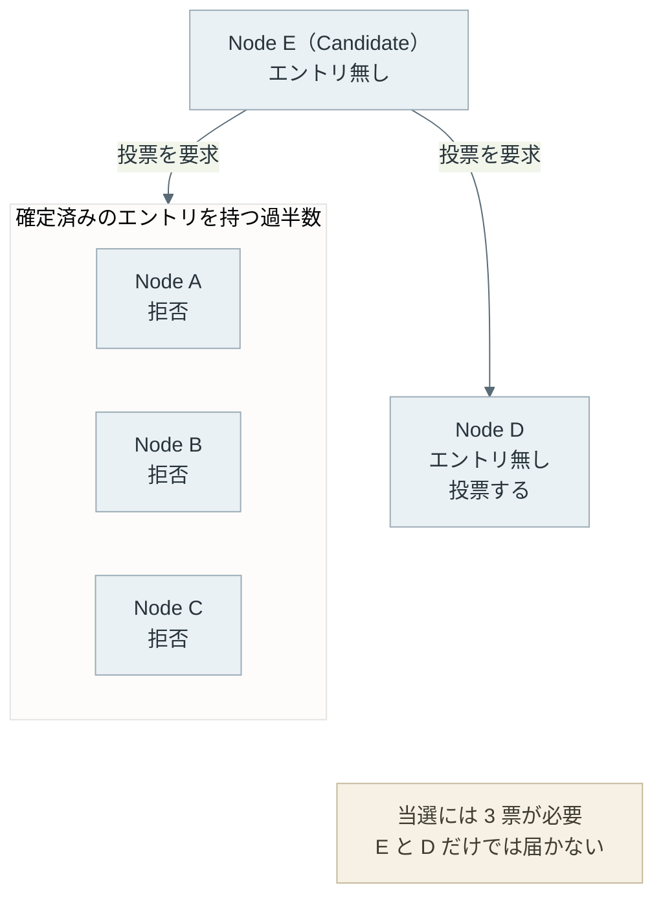
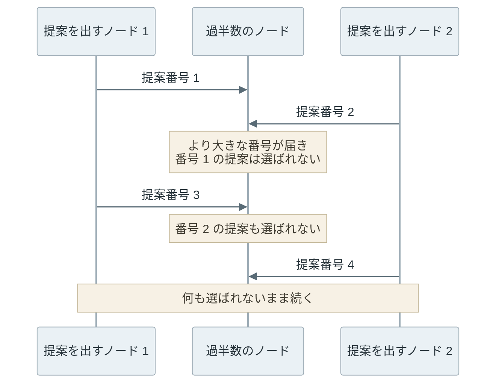
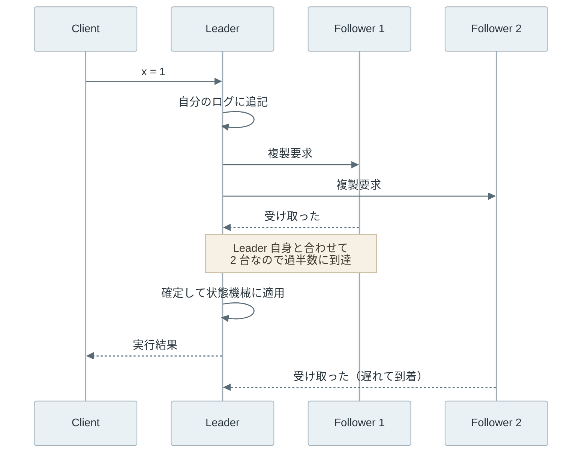
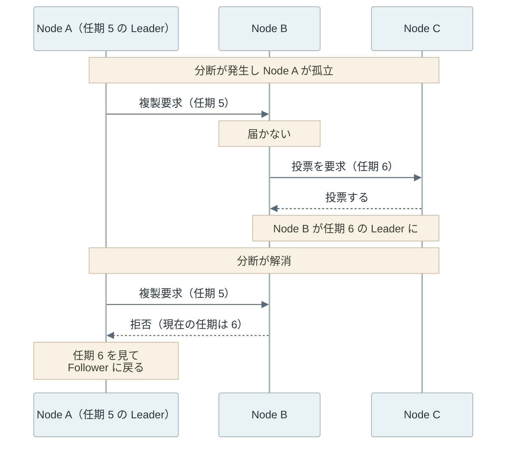
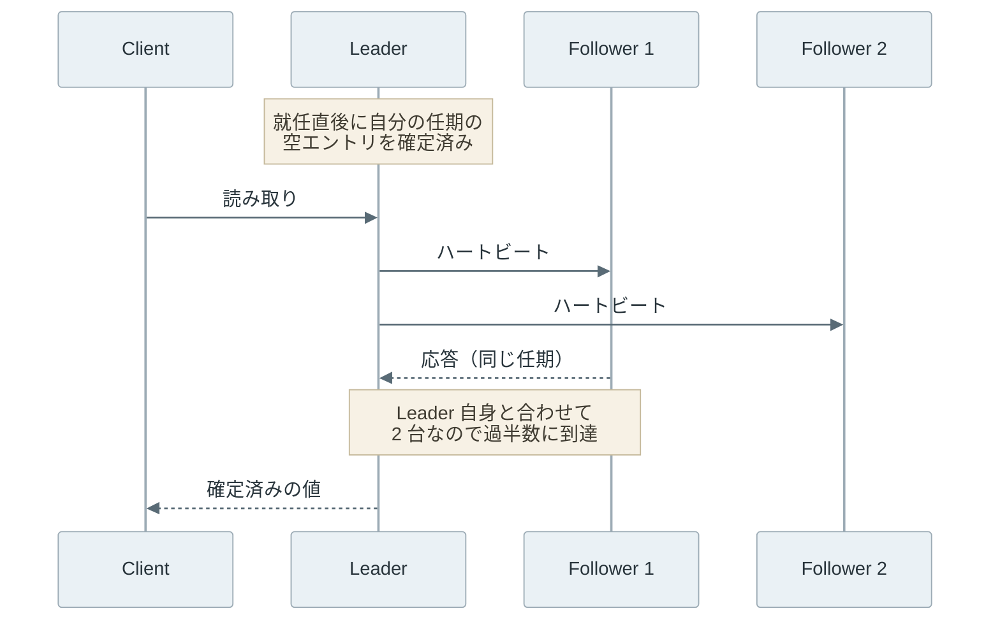

Leader and Followers は、同じデータを複製して持つノードのうち 1 台を Leader に決め、更新を全て Leader が受け付けて残りの Follower に配る構成です。更新の受け口が 1 台に絞られるため、同じデータへの更新の順序は Leader が決めた 1 つに定まります。

例えば、在庫や座席のように同じ 1 件を複数の要求が取り合うデータでは、更新の順序が結果を決めます。1 台のノードだけで持てば順序は 1 つに定まりますが、そのノードが止まると更新も読み取りも止まります。止まらないように複製を増やすと、今度は同じデータへの更新が別々のノードに届き、順序が食い違います。

Follower は、Client から更新を受け取っても自分では処理せず、Client を Leader に案内します。Leader が落ちた場合は、残った Follower の中から次の Leader を選び直します。



<br>

本記事では、更新を 1 台に集約して複製する方法を説明します。話は次の順に進めます。

- なぜ全ノードが対等に更新を受け付けると、値が食い違うのか。
- Leader が落ちた時、次の Leader をどう選び、2 台立つのをどう防ぐのか。
- Leader が受け付けた更新は、いつ確定するのか。
- 分断から復帰した古い Leader は、どう締め出されるのか。
- Leader から読んでも古い値が返るのは、どんな時か。

想定する故障は、ノードの停止とネットワークの分断の 2 つです。誤った値を返す故障（ビザンチン障害）には触れません。仕組みの説明には Raft を使います。Raft は、複製したログ（受け付けた更新を順に追記した記録）を全ノードで同じ順序に揃えるための合意アルゴリズムで、動作が論文で細部まで規定されています。

---

### Leader が必要な理由

全ノードが対等に更新を受け付ける構成では、同じデータへの更新が別々のノードに同時に届きます。到着の順序が入れ替わると、追加の併合規則を置かない限り、最終的に残る値がノードごとに食い違います。

例えば、2 台が独立に更新を受け付けると、以下のようになります。



上記の図で問題なのは、どちらのノードも自分の見た順序で正しく処理している点です。順序を決める場所がどこにも無いため、値が 2 通りに割れています。後から一方を選び直すには、どちらが後の更新なのかを判定する材料が別に必要です。

[クォーラム](../quorum/)で読み書きするノードの集合を重ねるだけでは、更新の順序は決まりません。過半数を要求すると、書き込みに関わったノードの集合と読み取りに関わったノードの集合は、必ず 1 台以上を共有します。ただし、共有するノードが 2 つの更新を両方受け取っていることと、どちらが後の更新なのかを判定できることは別です。

更新の順序を 1 つに決めるには、全ノードが共有できる 1 つの並びが必要です。Leader and Followers は、その並びを決める役目を Leader に集約します。ただし、全ノードに共通の並びとして残るのは、後の節で説明する確定を済ませた更新だけです。確定前の更新は、Leader が交代すると切り捨てられる場合があります。

パターンの名前は Unmesh Joshi 氏の書籍『Patterns of Distributed Systems』（邦訳『分散システムのためのデザインパターン』）で使われているもので、Martin Fowler 氏のサイトにも [Leader and Followers](https://martinfowler.com/articles/patterns-of-distributed-systems/leader-follower.html) として要約が置かれています。

---

### 任期と選出

Leader は固定ではなく、落ちた時に選び直せる必要があります。Raft は時間を任期（term）という単調増加する番号で区切り、1 つの任期に立つ Leader を最大 1 台に制限します。Diego Ongaro と John Ousterhout が 2014 年に発表した [Raft の論文](https://raft.github.io/raft.pdf)は、この性質を Election Safety と呼んでいます。

Follower は Leader から定期的に届く信号を待ちます。信号が一定時間届かなければ、Leader が落ちたと判断して自分が Candidate になり、任期を 1 つ増やして他のノードに投票を求めます。クラスタの全構成ノードのうち過半数から票を集めたノードが、その任期の Leader になります。信号そのものは[ハートビート](../heartbeat/)で、Raft では中身が空の複製要求を流用しています。

以下が役割の遷移です。



上記の図で Candidate から Candidate に戻る経路は、複数のノードが同時に Candidate になって票が割れた場合を表します。全ノードが同じ待ち時間を使うと、票の割れが繰り返されます。そのため、Raft は待ち時間をランダムな幅で散らし、選出を始めるたびに引き直します。Leader から Follower に戻る経路は、分断から復帰した旧 Leader が通るので、「古い Leader の締め出し」で改めて扱います。

投票を求められた側の処理は短く書けます。Leader が 2 台立つのを防いでいるのは、1 つの任期で 2 票を投じないことと、当選に過半数を要求することの組み合わせです。過半数の集合はどの 2 つを取っても 1 台以上を共有するので、共有するノードが 1 票しか出さなければ、同じ任期に 2 台が過半数に届くことはありません。

```go
// handleRequestVote は、Candidate から届いた投票要求を処理します。
// ログの新しさの検査（Raft 論文 5.4 節）は省略しています。
func (n *node) handleRequestVote(term int, candidateID string) bool {
	if term < n.currentTerm {
		return false // 古い任期からの要求は拒否する
	}
	if term > n.currentTerm {
		// 新しい任期を見たら、投票の記録を捨てて Follower に戻る
		n.currentTerm = term
		n.votedFor = ""
		n.role = roleFollower
	}
	if n.votedFor != "" && n.votedFor != candidateID {
		return false // 同じ任期で 2 台に投票しない
	}
	n.votedFor = candidateID
	return true
}
```

上記のコードは `currentTerm` と `votedFor` をメモリ上で書き換えるだけで、実装には不足があります。Raft は、この 2 つとログを RPC（Remote Procedure Call、遠隔手続き呼び出し）に応答する前に安定ストレージ（再起動や電源断の後も内容が残る記憶装置）に書くことを要求しています。投票した直後に再起動して `votedFor` を失うと、同じ任期でもう 1 台に投票してしまい、Leader が 2 台立ちます。

<br>

省略したログの新しさの検査は、確定済みのエントリ（Leader が過半数への複製を確かめ、以後取り消されないと判断したログの 1 件）を守るためのものです。Raft では、Candidate より新しいログを持つノードは投票を拒否します。新しさは末尾のエントリの任期で比べ、任期が同じならログが長い方を新しいとします（論文 5.4.1 節）。確定済みのエントリは過半数が持っており、票を集めるにも過半数が必要なので、エントリを持つ過半数と票を出す過半数は必ず重なります。

以下は、確定済みのエントリを持たないノードが Candidate になった例で、台数と配置は説明用の値です。



上記の図で Node E が当選できない理屈は、[クォーラム](../quorum/)と同じです。

期間を区切って権利を与える点は、[Lease](../lease/) と同じ発想です。違いは期限の決め方にあり、Lease は時間の経過で切れるのに対し、任期はより新しい任期の出現で切れます。任期は時計を参照しないので、ノード間で時刻を合わせる必要がありません。その代わり、誰かが新しい任期を始めるまで古い Leader は自分の失効を知りません。

時刻を合わせずに済むのは安全性（safety、誤った結果を出さない性質）の話で、処理が前に進むかどうかはタイミングに依存します。Raft は、信号が往復する時間・選出の待ち時間・ノードが故障する平均間隔が、この順に十分な差で並ぶことを前提にしています。待ち時間が往復の時間に近いと、生きている Leader が居るのに選出が始まり、更新が進まなくなります。

<br>

更新の並びを決める役を 1 台に固定しない解き方もあり、その代表が Leslie Lamport 氏の合意アルゴリズム Paxos です。合意アルゴリズムの役目は、提案された値のうち 1 つだけが選ばれることを保証することです（[Paxos Made Simple](https://lamport.azurewebsites.net/pubs/paxos-simple.pdf)）。Paxos では、提案を出すノードが値に番号（提案番号）を付けて過半数の受け入れを求めます。受け入れる側は、より大きな番号を見たら、それより小さい番号の提案を以後受け入れないと約束します。1 つの値だけが選ばれるという保証は固定された Leader を前提とせず、提案番号とクォーラムだけで守られます。

しかし、提案を出すノードが複数居ると、互いに大きな番号を出し合い、何も選ばれないまま進まなくなる場合があります。以下はその例で、番号は説明用の値です。



上記の図のような番号の競り合いを避けて進み続けるには、提案を出す役を 1 台に定める必要があります（同じ論文の 2.4 節）。ログの各位置について Paxos を繰り返し、安定した Leader で処理を効率化する構成が、一般に Multi-Paxos と呼ばれます。

---

### 更新の複製と確定

Client の更新を受け取った Leader は、まず自分のログの末尾に追記し、続けて同じ内容を Follower に送ります。ログは [WAL](../write-ahead-log/)（Write-Ahead Log、書き込み先行ログ）と同じく末尾に追記していく記録で、Leader が決めた順序をそのまま保持します。追記した 1 件をエントリと呼びます。

現在の任期で作られたエントリが過半数のノードに複製された時点で、Leader はそのエントリを確定（commit）させます。確定は実行と同じではありません。Leader は確定したエントリを自分の状態機械（state machine、ログのコマンドを順に適用して状態を作る部分）に適用し、その実行結果を Client に返します。

追記しかしないのは Leader のログだけです。Leader は複製要求に直前のエントリの位置と任期を添え、Follower は同じ位置に同じ任期のエントリが無ければ拒否します。拒否されると Leader は位置を 1 つずつ戻して送り直し、一致した位置より後ろを上書きさせます。Raft は、Leader が追記しかしない性質を Leader Append-Only と呼んでいます。

以下が確定までの往復です。



上記の図で Leader が Client に応答したのは、Follower 2 の応答が届く前です。全ノードの応答を待たないため、1 台が遅れていても更新は進みます。遅れた Follower は、後から届いた分を自分のログに追記して追い付きます。

Leader は、Follower ごとに「どこまで複製できたか」の位置を `matchIndex` として持ち、確定済みの末尾を `commitIndex` として持ちます。確定の判定は、`matchIndex` を数えて過半数に届いた位置まで `commitIndex` を進める処理になります。

```go
// advanceCommitIndex は、過半数に複製できた位置まで commitIndex を進めます。
// Leader を務めているノードだけが呼びます。
// n.log は Raft 論文に合わせて添字 1 から使い、log[0] は番兵です。
// commitIndex の初期値 0 は、まだ何も確定していない事を表します。
func (n *node) advanceCommitIndex() {
	total := len(n.matchIndex) + 1 // Follower の数と、Leader 自身の 1 台
	for i := len(n.log) - 1; i > n.commitIndex; i-- {
		if n.log[i].Term != n.currentTerm {
			continue // 過去の任期のエントリは、応答数だけでは確定させない
		}
		agreed := 1 // Leader は自分のログに追記済み
		for _, m := range n.matchIndex {
			if m >= i {
				agreed++
			}
		}
		if agreed*2 > total {
			n.commitIndex = i
			return
		}
	}
}
```

複製の数で確定させるのは現在の任期で作られたエントリだけ、という条件が入っています。Raft 論文の Figure 2 は確定の規則を「`N > commitIndex` かつ過半数の `matchIndex[i] >= N` かつ `log[N].term == currentTerm` を満たす N があれば `commitIndex = N` とする」と規定しており、`log[N].term == currentTerm` がこの条件です。

過去の任期のエントリは、過半数に複製されていても、後の Leader に上書きされる場合があります。そのエントリを持たないノードでも、ログの末尾により新しい任期のエントリがあれば、ログの新しさの検査を通って Leader に選ばれることがあるからです（論文の Figure 8）。

例えば 5 台の構成で、任期 2 の Leader が 1 件を自分ともう 1 台に配って落ち、任期 3 の Leader が同じ位置に別のエントリを自分だけに書いて落ちたとします。任期 4 で最初の Leader が復帰し、任期 2 のエントリを 3 台目に配って過半数に届かせても、ここで落ちれば、任期 3 のエントリを末尾に持つノードが当選して任期 2 のエントリを上書きします。

現在の任期のエントリが過半数に複製されると、そのエントリを持たないノードは検査に落ち、Leader になれません。Raft は、2 つのログの同じ位置に同じ任期のエントリがあれば、そこまでの内容が全て一致するように保っています。そのため、Leader が `commitIndex` を現在の任期のエントリの位置まで進めると、その手前にある過去の任期のエントリも確定済みの範囲に入ります。

---

### 古い Leader の締め出し

ネットワークが分断されると、Leader が生きているのに Follower がその信号を受け取れない状態になります。多数派（過半数が残った側）のノードは新しい Leader を選び、少数派に取り残された旧 Leader は自分が Leader のつもりで動き続けます。1 台に集約したはずの更新の受け口が、一時的に 2 台に増えます。

以下は、分断が起きてから旧 Leader が締め出されるまでの流れです。




上記の図の Node A は、拒否の応答に含まれる任期番号を見て、初めて自分が交代させられたことを知ります。権利を渡すたびに大きくなる番号で古い操作を拒否する点は、[Lease](../lease/) で使う fencing token と同じ発想です。

分断されている間、Node A が更新を確定させることはありません。確定には過半数の応答が必要で、少数派は定義上その数に届かないからです。更新は確定していないので、Node A は Client に完了も返していません。分断が解消すると、Node A のログは前述の手順で任期 6 の Leader のものと突き合わせられ、食い違う位置から後ろが上書きされます。

締め出しは、複製要求を受け取る側の数行のコードで実現できます。

```go
// handleAppendEntries は、Leader から届いた複製要求を処理します。
// ログの整合性検査と追記（Raft 論文 5.3 節）は省略しています。
func (n *node) handleAppendEntries(args appendEntriesArgs) appendEntriesReply {
	if args.Term < n.currentTerm {
		// 分断から復帰した旧 Leader は、ここで弾かれる。
		// 応答に自分の任期を載せるので、旧 Leader は交代を知る
		return appendEntriesReply{Term: n.currentTerm, Success: false}
	}
	if args.Term > n.currentTerm {
		n.currentTerm = args.Term
		n.votedFor = ""
	}
	n.role = roleFollower
	n.leaderID = args.LeaderID // Client を現在の Leader に案内するために覚える
	return appendEntriesReply{Term: n.currentTerm, Success: true}
}
```

---

### 読み取りの流し先

読み取りを Follower に分散させると、Leader の負荷は下がります。その代わり、確定した更新がまだ届いていない Follower は古い値を返します。更新の直後に自分の書いた値を読み返す用途では、この遅れが表に出ます。

Leader から読んでも、古い値が返る場合があります。2014 年、Kyle Kingsbury 氏は故障を注入して DB の正しさを調べる Jepsen で、etcd（Raft で複製する Key-Value ストア）の[読み取りが古い値を返す](https://aphyr.com/posts/316-call-me-maybe-etcd-and-consul)ことを示しました。当時の etcd は、`consistent` を指定した読み取りでも、自分を Leader と考えているノードが手元の状態をそのまま返していました。分断で孤立した旧 Leader も、交代に気付くまでは自分を Leader と考えているので、新しい Leader の下で確定した値を知らないまま応答します。

Kingsbury 氏はこの問題を [issue #741](https://github.com/etcd-io/etcd/issues/741)「Consistent reads are not consistent」（一貫性のある読み取りが一貫していない）として報告し、読み取りもログに追記して確定させる `quorum=true` が etcd に足されました。ログを通せば確実ですが、読み取りのたびに複製と確定の往復が掛かります。

<br>

Raft は、ログに追記せずに最新の値を返すため、2 つの手順を要求しています（論文 8 節）。1 つ目は、Leader が就任した直後に自分の任期の空エントリを確定させることです。`advanceCommitIndex` は現在の任期のエントリしか複製の数で数えないので、自分の任期のエントリを 1 つ確定させるまで、就任した Leader はどこまでが確定済みなのかを把握できません。

2 つ目は、読み取りに応答する前に過半数とハートビートを交換することです。上記の etcd の旧 Leader のような応答は、ここで防げます。新しい Leader が既に立っていれば、過半数のうち少なくとも 1 台が新しい任期を返します。

以下は、2 つの手順を済ませた Leader が読み取りに応答するまでの流れです。



論文は、上記の図の往復の代わりに、ハートビートを Lease のように扱う方法も挙げています。過半数への問い合わせを省ける代わりに、ノード間の時計のずれに上限があることを前提にします。

ここまでの厳密さが必要ない読み取りであれば、Follower に流して構いません。集計や一覧の表示のように、数秒古い値でも判断が変わらない用途が候補になります。

---

### 利点

- 確定した更新の順序が Leader のログの並びに定まり、順序を後から復元する仕組みが必要ない
- 過半数の応答で確定するため、一部のノードが遅れても更新が進む
- Follower は Leader の内容を写すだけなので、複製の処理が単純になる
- Leader が落ちても、過半数のノードが残っていれば選び直して処理を続けられる
- Raft のように任期の番号で新旧を判定する実装なら、時計を合わせずに古い Leader を排除できる

---

### 欠点

この構成は、更新の順序を Leader 1 台に決めさせる代わりに、次の制約を負います。

- 更新が全て Leader を通るため、書き込みの性能が Leader 1 台の性能で頭打ちになる
- Leader が落ちてから次が決まるまで、更新を受け付けられない時間が生じる
- 選出の待ち時間を短くすると誤検知による交代が増え、長くすると復旧が遅れる
- 拠点をまたぐ構成では、確定のたびに Leader と過半数の間の往復の時間が加わる
- Follower から読むと、確定済みの更新がまだ届いていない値が返る場合がある

---

### 適さないケース

- 書き込みが多く、1 台では捌けないワークロード。データを分割して Leader を複数立てる構成を検討する
- 分断中も両側で更新を受け付けたいシステム。CRDT（Conflict-free Replicated Data Type）を検討する。CRDT は、並行な更新の順序を決めなくても、同じ更新を受け取ったノード同士が同じ状態に揃うデータ型である。ただし扱えるデータの形は限られる
- 数百台のノードを 1 つの合意グループに参加させる構成。1 つのグループは数台に絞るのが前提で、システム全体の台数が多いことは問題にならない
- 更新が稀で、1 台の停止による短い中断を許容できるシステム
