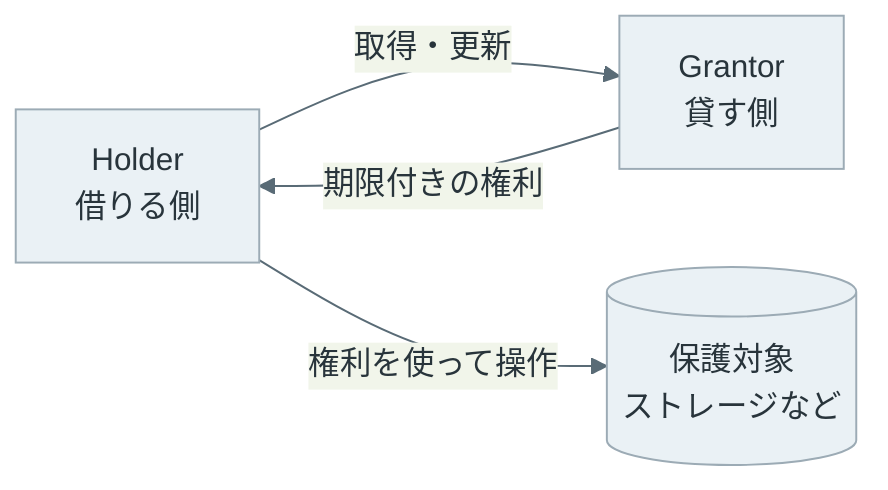
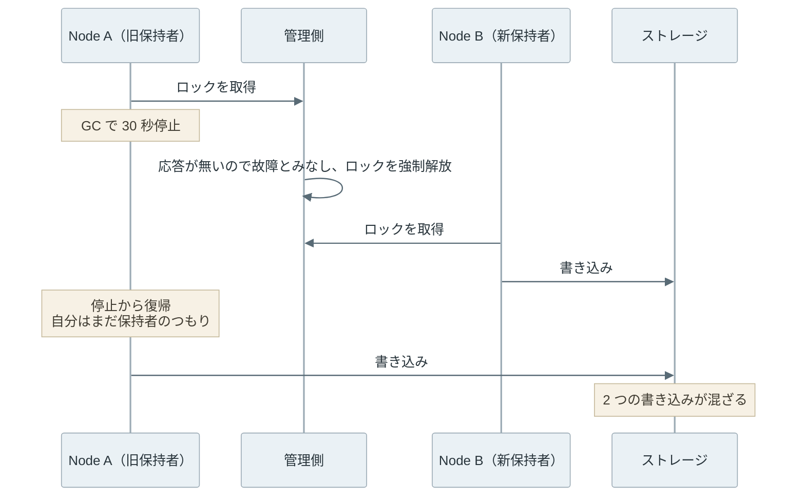
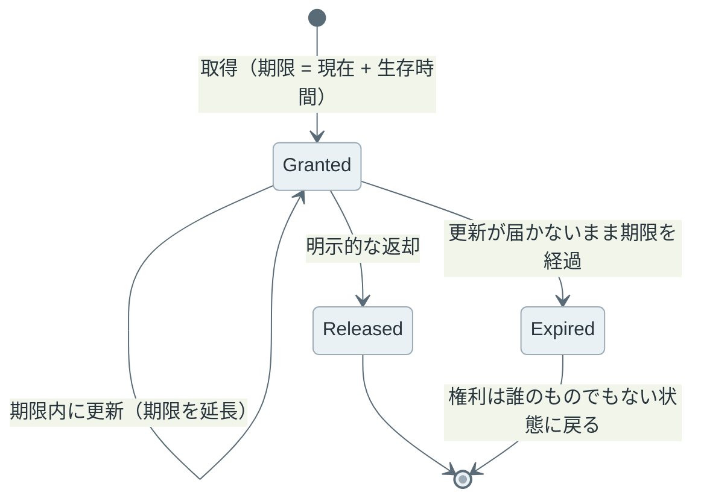
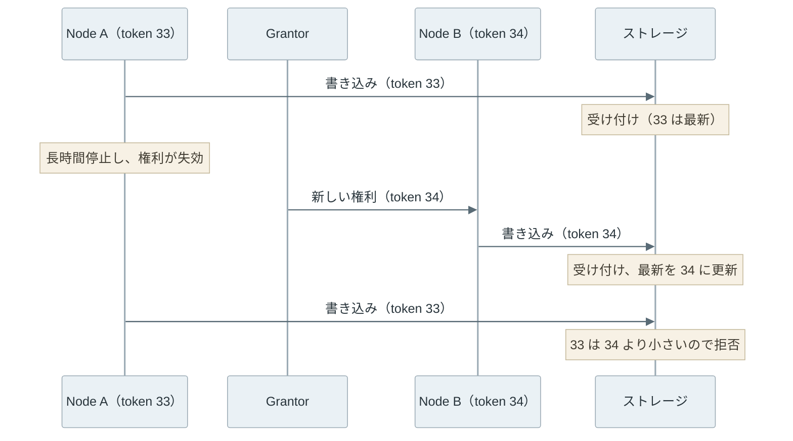

Lease（リース）は、ある権利を期限付きで貸し出し、期限が過ぎたら自動的に失効させる仕組みです。貸す側は「これから 10 秒間、あなたがリーダーです」と伝え、借りた側は期限が来る前に更新を続けます。更新が途切れれば、誰の操作も無しに権利は消えます。

権利を渡す時に困るのは、渡した相手が黙って消える場合です。相手が落ちたのか、ネットワークが詰まっているのかを外から確定できないため、「返してもらう」という手順は当てにできません。Lease は権利の回収を相手の行動に頼らず、時間の経過だけで済ませます。ここでは、書き込みを 1 台に集約する構成でのリーダーの座や、1 台だけが触って良い資源の使用権（ロック）を貸す用途を扱います。

登場人物を以下に示します。

上記の図の Grantor は権利の管理だけを担当し、保護対象への操作は Holder が行います。権利の貸し借りと実際の操作が別の経路を通るため、保護対象は「操作してきた相手が今も権利を持っているか」を知りません。

本記事では、Lease で権利を期限付きで貸す方法について、以下の問いに沿って説明します。

- なぜ管理側がロックを強制的に解放する方法は、誤検知に耐えられないのか。
- 取得・更新・返却・失効の 4 つの操作で、状態はどう動くのか。
- 貸す側と借りる側の時計について、何を前提にしているのか。
- Lease を使っていても、止まっていたサーバーが古い権利のまま応えてしまうのはなぜか。fencing token はそれをどう防ぐのか。
- etcd や Chubby は、Lease の考え方をどう実装しているのか。

---

### Lease が必要な理由

期限の無いロックは、保持者が落ちた時点で解放されなくなります。解放できるのは本人だけなので、後続の処理は管理者が手で消すまで待ち続けます。

[ハートビート](../heartbeat/)で保持者の生死を見張り、落ちたと判断した時点で管理側がロックを強制的に解放する方法は、誤検知に耐えられません。停止したノードと、応答が遅いだけのノードを確実に区別する手段が無いからです。

例えば、保持者の同意なしにロックを強制解放し、次のノードが取得すると、以下のようになります。図中の GC（Garbage Collection）は、使われなくなったメモリを回収する処理で、実行中はプロセスが数秒から数十秒止まることがあります。

上記の図で問題なのは、管理側がロックを解放して Node B が取得しても、Node A 側の認識が変わらない点です。停止していた間に何が起きたかを知る手段が無いため、復帰した瞬間から保持者として振る舞います。

Lease は、この認識のずれを縮めます。権利に期限が入っているので、Node A は復帰した時点で「自分の権利は既に切れている」と自分で判断できます。判断の材料は自分の時計で数えた経過時間だけなので、管理側と連絡が取れない状態でも成立します。

ただし、期限を確かめた直後に止まると失効後に書き込む隙間が残り、これは後述の fencing token が塞ぎます。

---

### 4 つの操作と状態遷移

操作は、取得・更新・返却・失効の 4 つです。権利を貸す長さを生存時間（TTL、Time To Live）と呼びます。4 つの操作が状態をどう動かすかは、以下の通りです。

上記の図の `Released` は、仕事が終わった Holder が期限を待たずに自分から返す経路です。一方、`Expired` への遷移には誰の操作も必要ありません。返却が届かなかった場合の受け皿が `Expired` で、Lease の特徴はこの経路にあります。

Holder と Grantor が数えるのは経過時間だけで、絶対時刻は見ません。Holder は要求を送った時刻から数え、Grantor は応答を返した時刻から数えます。通信の往復にかかった分だけ Holder の期限が先に来るため、Holder が権利を手放してから Grantor が次の相手に貸すまでに空白ができます。

---

### 時計に置く前提

Lease の安全性（同じ時点に権利を持つ者が 2 人にならないこと）は、貸す側と借りる側の時計が同じ時刻を指していることには依存しません。依存するのは、両者の時計の進む速さのずれに上限があることです。具体的には、Grantor の 10 秒と Holder の 10 秒のずれが、数パーセント以内に収まるという仮定を置きます。

ずれはゼロではないので、実装では起点をずらすだけでなく、上限までのずれをマージンとして見込みます。Holder は自分の数えた期限よりさらに早く権利を手放し、Grantor はさらに遅く次の相手に貸します。空白の時間を広く取るほど安全側に倒れ、その分だけ切り替えが遅くなります。

---

### fencing token

Lease は時計の仮定に加えて、Holder が保護対象を操作する時点で Lease がまだ有効であることにも頼っています。この仮定は、前述の GC 停止の図と同じ形で、Lease を使っていても実際に破れます。

分散 DB の HBase では、各サーバーが [ZooKeeper](https://zookeeper.apache.org/doc/current/zookeeperProgrammers.html#ch_zkSessions)（Grantor の役を担う協調サービス）とセッションという Lease を結び、管理役の master はセッションが切れたサーバーを故障とみなして担当を別のサーバーへ移します。

[HBASE-7504](https://issues.apache.org/jira/browse/HBASE-7504) では、どのサーバーがどのデータを持つかを引く時の起点になる [-ROOT- テーブル](https://svn.apache.org/repos/asf/hbase/hbase.apache.org/trunk/0.94/book/arch.catalog.html)の担当サーバーが GC で約 229 秒止まり、その間にセッションが失効しました。ところが、移す前に master が確認すると、GC から戻ったこのサーバーは「まだ担当している」と応えたので、master は移すのをやめました。直後にこのサーバーは故障扱いを知って自ら停止し、-ROOT- は master を再起動するまで誰も担当しない状態になりました。

止まっていたサーバーは、Lease が切れたことを知らないまま古い権利で応えていたわけです。時計の進む速さがずれていなくても起きるため、時計の仮定を強めても防げません。[修正](https://github.com/apache/hbase/commit/f26e14a1b1e2ef51e8bca9132d98ccd29270ec19)後の master は、故障扱いにしたサーバーからのこの応答を採用しません。

古い権利からの応答を受け手が捨てる、という同じ考え方を番号で行うのが [fencing token](https://martin.kleppmann.com/2016/02/08/how-to-do-distributed-locking.html) です。fencing token は権利を貸すたびに大きくなる番号で、Grantor が権利と一緒に渡します。番号は減らないため、保護対象は大小の比較だけで古い権利からの操作を拒否できます。以下は、失効に気付かない Holder の書き込みを拒否する流れです。

上記の図のストレージは、権利の期限を知らず、番号の大小だけで判断しています。Lease は時間で、fencing token は順序で権利を守ります。

この 2 つは対等ではありません。番号を検査できる保護対象では、書き込みの正しさを最後に担保しているのは fencing token です。一方で、次に誰が権利を持つかを決めるのは Lease です。

---

### 実装の例

分散 KVS（Key-Value Store、キーと値を複数ノードで保持する DB）の [etcd](https://etcd.io/docs/v3.5/learning/api/) が lease を API として持っています。生存時間を指定して lease を作り（実際の長さはサーバーが決める）、キーをその lease に紐付けると、更新が途絶えた後にそれらのキーがまとめて削除されます。更新は `LeaseKeepAlive`、明示的な返却は `LeaseRevoke` です。リーダーの座を表すキーを lease に紐付けておけば、保持者が落ちた後にキーが消え、次の候補が取得できるようになります。

Google の分散ロックサービス [Chubby](https://research.google/pubs/pub27897/) も同じ考え方を実装しています。Chubby はクライアントとの間でセッションを維持し、期限が切れたセッションのロックを解放します。fencing token に当たる番号として、ロックの世代番号を含む sequencer も渡し、受け取ったサーバーが検査します。検査できないサーバー向けには、障害で空いたロックを一定時間ほかに渡さない lock-delay で、遅れて届く書き込みを時間で逃がします。

---

### 利点

- 保持者が落ちても、時間の経過だけで権利が戻る
- 管理者の介入も、他ノードによる強制解除も必要ない
- Grantor と連絡が取れなくても、借りた側が自分で失効を判断できる
- 期限の記録と更新の受け付けだけで実装できる

---

### 欠点

Lease は、権利の回収を相手の返却ではなく時間の経過に任せます。そのため、待ち時間と時計に関わる次の制約を抱えます。

- 保持者が明らかに落ちていても、期限が来るまで次の担当者は動けない
- 時計の進む速さのずれに上限があることと、操作の時点で Lease が有効であることの 2 つの仮定に頼る
- 期限を長くすると復旧が遅れ、短くすると更新の通信が増える
- 更新の通信と実際の仕事は別なので、仕事が止まっている Holder でも、更新さえ続けば権利を持ち続ける
- Grantor 自身が落ちると権利の記録ごと失われるため、実装では Grantor を複数ノードで複製する（etcd は Raft で記録を揃える）。複製しても、交代した Grantor は前の Grantor が貸した期限を正確に知らず、長めに見積もり直す必要がある

---

### 適さないケース

- 障害から数十ミリ秒で切り替えたい場面。期限を詰めると一時的な遅延で失効する
- 保護対象が番号を検査できず、時計の仮定も置けない場合。二重書き込みを防げない
- 権利の受け渡しが稀で、人手による切り替えで足りるシステム
