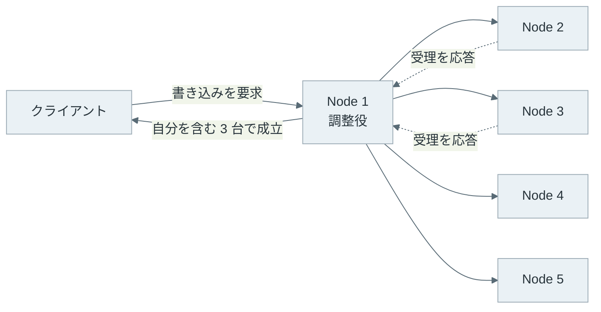
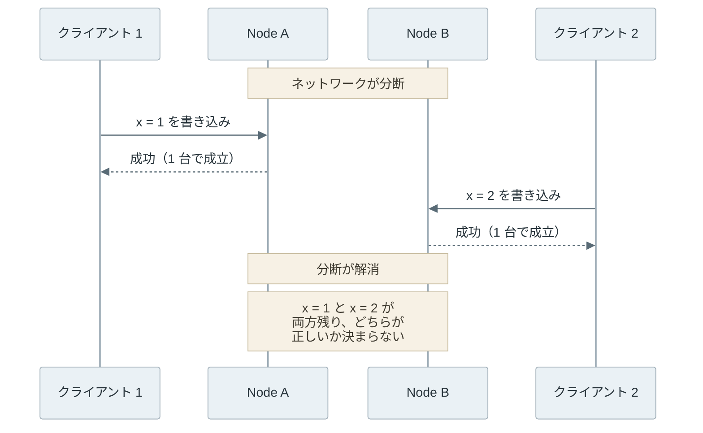
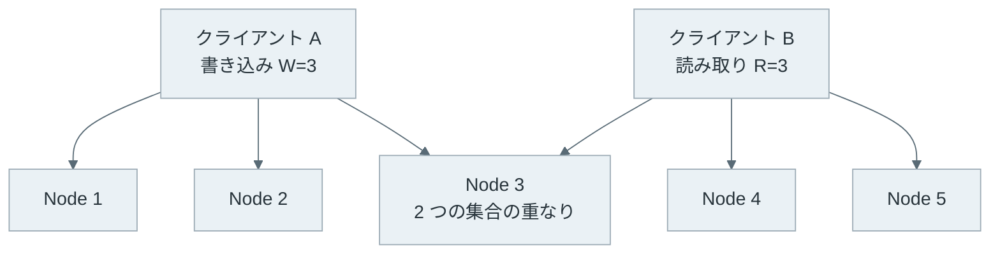
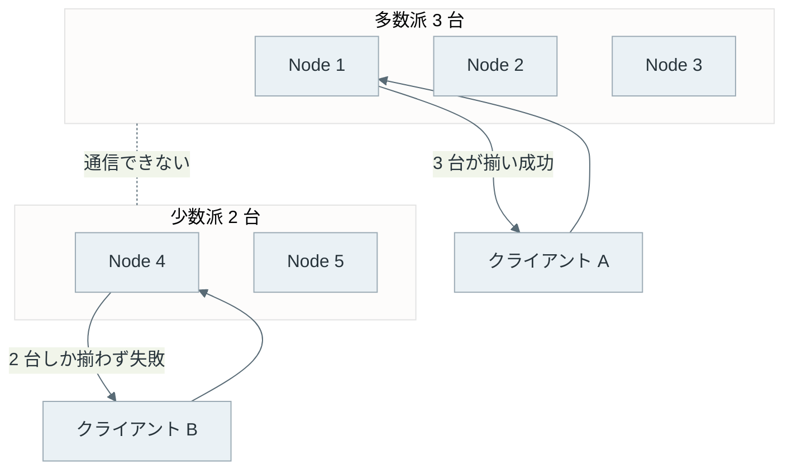

Quorum（クォーラム、定足数）は、ある操作を成立させるために応答が必要なノードの最小数です。同じ値を複数のノードに持たせる複製の構成では、全ノードの応答を待たず、この数だけ集まった時点で操作を確定させます。最も広く使われるのは過半数を要求する構成で、N 台のクラスタなら `N / 2 + 1` 台（小数点以下は切り捨て）の応答で成立します。

書き込みが成立するまでの流れを以下に示します。

上記の図の調整役は、クライアントの要求を最初に受けたノードが務めます。調整役も複製を持つ 5 台の 1 台で、N はこの 5 台です。調整役は自分を含めて 3 台を数えた時点で成立とし、残る 2 台の応答は待ちません。遅いノードや落ちたノードがクライアントの待ち時間に響かないことが、クォーラムを使う直接の理由です。

本記事では、クォーラムで複製の読み書きを成立させる方法を説明します。具体的には、次の疑問に答えていきます。

- なぜ全台でも 1 台でもなく、過半数を選ぶのか。
- 読み書きの集合や書き込み同士の集合を重ねるには、どんな条件が要るのか。
- 3 台の複製で、W と R をどう配分するのか。
- 集めた値の新旧を見誤ると、何が失われるのか。
- 何台あれば何台の障害に耐えられ、分断が起きると何が起きるのか。

前提として、故障はノードの停止とネットワークの分断だけを考えます。誤った値を返す故障（ビザンチン障害）には触れません。

---

### Quorum が必要な理由

成立に必要な応答数は、1 台から N 台までのどこかから選びます。N 台にすると、値は必ず全台に揃うものの、1 台が落ちただけで書き込みが止まります。1 台にすると、応答は速い代わりに、書いた値を持たないノードが残ります。

1 台で成立させる構成では、ネットワークが分断された時に問題が起きます。分断された両側が、それぞれ独立に書き込みを受け付けます。

上記の図で問題になるのは、分断が解消した後です。どちらのクライアントも成功の応答を受け取っているため、一方を捨てると、成功した筈の更新が消えます。全ノードの応答を待つ構成なら、この食い違いは生じません。分断中はどちらも全台の応答を集められず、両側とも書き込みを断るからです。

過半数は、1 台と N 台の中間です。互いに素な過半数の集合は同時に 2 つ作れないため、分断中に書き込みが成立するのは多数派だけです。少数派は必要な応答数を集められず、書き込みを断ります。

---

### 集合を重ねる 2 つの条件

効いているのは台数そのものではなく、過半数を選ぶと顔ぶれが必ず重なることです。ある操作が 5 台から 3 台を選び、別の操作も 3 台を選ぶと、合わせて 6 台分を選んだことになります。5 台しか居ないので、どちらの 3 台にも入るノードが必ず 1 台以上あります。

N 台の複製に対して、書き込みに必要な応答数を W、読み取りに必要な応答数を R と書きます。W と R の選び方には、目的の違う条件が 2 つあります。`W + R > N` を満たすと、書き込みに参加したノードの集合と、読み取りが応答を集めた集合は、必ず 1 台以上重なります。重なったノードは、最後に成功した書き込みの値を持っています。ただし、集めた R 個の応答のうちどれが最新かを見分ける手段は別に必要です（後述）。

`W > N / 2` を満たすと、書き込み同士も、必ず 1 台以上のノードで重なります。ただし、保証されるのは両方の書き込みを見るノードが必ず居ることまでです。そのノードが両方を受け付ければ、2 つのバージョンがどちらも残ります。例えば、各値にバージョン番号を添えておき、書き込みが元にした番号と手元の番号が一致する時だけ受け付ける規則（compare-and-set）を置けば、同じバージョンを元に作った書き込みのうち成立するのは最大 1 つです。

以下は、5 台で W と R を 3 台ずつにした場合の重なりです。

上記の図の Node 3 が重なりです。N は 5、W と R はどちらも 3 なので `W + R = 6` となり、N を 1 台分超えます。

---

### W と R の配分

複製が 3 台（N = 3）の場合に選べる W と R は、以下の通りです。

| 書き込み W | 読み取り R | 読み書きが重なる `W + R > N` | 書き込み同士が重なる `W > N / 2` | 性質 |
|---|---|---|---|---|
| 1 台 | 3 台 | ○ | ✕ | 書き込みが速い。1 台でも落ちると読めず、同時書き込みが両方成立する |
| 2 台 | 2 台 | ○ | ○ | 読み取りも書き込みも 1 台の障害に耐える |
| 3 台 | 1 台 | ○ | ○ | 読み取りが速い。1 台でも落ちると書き込めない |

W = R = `N / 2 + 1` を選んだ構成を過半数クォーラム（majority quorum）と呼びます。2 つの条件を同時に満たし、読み書きのどちらも同じ台数で済むため、既定の選択になります。読み取りが書き込みより桁違いに多い構成では R を小さく寄せる配分も向いていると考えられます。ただし、その分だけ W が大きくなり、書き込みが少数の障害で止まりやすくなります。

R と W を利用者の設定として外に出した例に、Amazon が社内向けに作った複製付きの Key-Value ストアである [Dynamo](https://www.allthingsdistributed.com/files/amazon-dynamo-sosp2007.pdf)（2007 年の論文）があります。Dynamo は `R + W > N` を満たす設定を quorum-like と呼び、`W > N / 2` は要求しません。

よく使われる `N = 3`、`R = 2`、`W = 2` の構成は `W > N / 2` を満たします。それでも、Dynamo の各ノードは断る規則を持たずに両方を受け付けるため、同時書き込みで生じた複数のバージョンはどちらも残ります。集合が重なるだけでは片方の書き込みは消えない、という例です。論文は、残ったバージョンを読み取りの時にクライアントへ全部渡し、併合の判断をアプリケーションに任せる、という使い方を挙げています。

注意点として、Dynamo が使うのは sloppy quorum と呼ばれる方式です。ノードが落ちている間は本来の N 台以外に書くため、`R + W > N` を設定しても、前述の重なりは保証されません。

---

### 新しい値の見分け方

読み取りが集めた R 個の値のうちどれが新しいのかは、値そのものからは分かりません。単調に増えるバージョン番号を値に添えておき、番号の大きい方を新しいと判定します。書き込みが 1 台を必ず経由する構成なら、そのノードが採番すれば番号は 1 本に並びます。

複数のノードが並行して書き込みを受け付ける構成では、単一の番号だけでは、並行して起きた 2 つの更新と後から起きた更新を区別できません。区別する必要がある場合は、vector clock（ノードごとの更新回数の組）を保持し、一方の更新が他方を因果的に含むか、互いに無関係かを判定します。例えば、`{A:2, B:1}` と `{A:1, B:2}` はどちらも相手を含まないので無関係で、`{A:2, B:2}` は両方を含むので後の更新です。無関係な更新どうしの優先順位までは決まらないため、別に競合解決の規則が必要です。

書き込みが W に届かないまま失敗した場合、既に受理したノードには値が残ります。クライアントには失敗が返るため、その時点ではその書き込みは成立していません。ただし、受理したノードの値が、読み取り時の修復や裏で走る複製の同期で他のノードに広がり、W 台以上が持つようになる場合もあります。そのため、書き込みの失敗は「成立しなかった」ではなく「成立したかどうか分からない」を意味します。クライアントは、同じ操作をやり直せるように作る必要があります。

失敗した書き込みが、成功した書き込みを消すこともあります。2013 年に Kyle Kingsbury 氏は、故障を注入して DB の正しさを調べる Jepsen で、Dynamo に倣った Key-Value ストアの [Riak](https://aphyr.com/posts/285-call-me-maybe-riak) を調べました。sloppy quorum を使わず R と W を過半数にした設定でも、分断を起こしながら 1 つのキーに数を書き足すと、成功を返した書き込みの約 92% が失われました。

少数派で失敗した書き込みは一部のノードに残り、読み取り時の修復で広がりました。この設定の Riak は、競合したバージョンのうちタイムスタンプの大きい方だけを残すので、失敗した側の書き込みが多数派の成功した書き込みを上書きしました。タイムスタンプは時計の値で、前述のバージョン番号と違って更新の前後関係を表しません。併合を後述の CRDT に任せた同じ検査では、成功を返した書き込みは 1 件も失われませんでした。

---

### 台数と耐えられる障害数

過半数を割った時点で、クラスタは書き込みを止めます。そのため、f 台の障害に耐えるには、f 台が落ちても過半数が残る `2f + 1` 台が必要です。

| クラスタの台数 | 過半数 | 耐えられる障害数 |
|---|---|---|
| 3 | 2 | 1 |
| 4 | 3 | 1 |
| 5 | 3 | 2 |
| 6 | 4 | 2 |
| 7 | 4 | 3 |

台数を偶数にしても、耐えられる障害数は 1 台少ない奇数台の場合と変わりません。故障し得るノードだけが増えるため、奇数台で構成します（`2f + 1` の関係は [Majority Quorum のパターン解説](https://martinfowler.com/articles/patterns-of-distributed-systems/majority-quorum.html)、表と偶数台の話は KVS（Key-Value Store）である etcd の [FAQ](https://etcd.io/docs/v3.5/faq/) にあります）。etcd の FAQ は、台数を増やすと複製先が増えて書き込みの性能が落ちるため 7 台以下に収めるよう勧め、多くの場合は 2 台の障害に耐える 5 台で足りるとしています。

---

### 分断が起きた場合

例えば、5 台が 3 台と 2 台に分断されると、以下のようになります。

上記の図で分かれ目になっているのは、要求を受けたノードがどちら側に居るかだけです。少数派に送ったクライアント B は失敗を受け取り、別のノードに送り直すまで書き込めません。多数派が残る分かれ方であれば、クラスタ全体としては分断中も書き込みを受け付けられ、値が 2 箇所で別々に更新されることはありません。5 台が 2 台・2 台・1 台に割れた場合は、どこも過半数を作れないので全体が止まります。

少数派が断るのは、過半数を必要とする操作だけです。実装によっては、少数派のノードが単独で読み取りに応答し、古い値を返します。全台に書いて読み取りを 1 台で済ませる配分も、分断には耐えられません。この配分は N = 5、W = 5、R = 1 に相当し、分断されると多数派でも書き込めなくなります。分断中に進み続けるには、W を過半数まで下げる必要があります。

分断が解消すると、少数派は多数派から差分を受け取って追い付きます。追い付かせる処理はクォーラムの外にあり、ログを複製する仕組みや、読み取りの時に古い値を見つけて直す仕組みが担当します。
W を過半数に取り、成功を返す前にディスクに書き終えていても、成功を返した更新が分断の後も残るとは限りません。書き込みを受け付けるノード（リーダー）を選び直す時や追い付かせる時に、その更新を持たないノードの内容で上書きすれば失われます。

Raft（etcd などが使う合意アルゴリズム）では、リーダーを選ぶ票を出せるのは自分のログ（受け付けた更新の記録）が候補より新しくないノードだけで、前のリーダーが作った更新は過半数に複製されただけでは確定と扱いません。この 2 つの条件があると、確定した更新を持たないノードはリーダーに選ばれません（[Leader and Followers](../leader-and-followers/)）。

---

### 利点

- 遅いノードや落ちたノードの応答を待たずに操作を確定できる
- 互いに素な過半数の集合は作れないため、分断中も更新を 1 箇所に寄せられる
- 台数から耐えられる障害数が決まり、構成を見積もりやすい
- W と R の配分で、書き込みと読み取りのどちらを速くするか選べる

---

### 欠点

クォーラムは、少数のノードの復旧を待たずに過半数だけで進みます。その分、過半数を集められない時と、集めるまでの待ち時間に弱点が出ます。

- 過半数を割ると、生き残ったノードがあっても書き込みを止める
- 台数を偶数にしても耐えられる障害数は増えず、通信量だけが増える
- どの値が新しいのかを判定するバージョン番号を別に用意する必要がある
- 応答の遅いノードは毎回クォーラムから外れ、追い付くまでの間は古い値を持つ
- 拠点をまたぐ構成では、過半数を集めるたびに拠点間の往復の時間が待ち時間に加わる

---

### 適さないケース

- 分断中も両側で書き込みを受け付けたいシステム。CRDT（Conflict-free Replicated Data Type）のように後から併合できるデータ型を検討する
- ノードが数百台に広がる構成。クォーラムを数える対象は数台に絞り、残りは読み取り用の複製に回す
- 書き込みの待ち時間に上限があり、過半数のノードの応答が揃うまで待てない場合

CRDT は、複数のノードが独立に更新しても、後から併合すれば必ず同じ結果に収束するように作ったデータ型です。集合への要素の追加やカウンタの増加のように、適用の順序が入れ替わっても結果が変わらない操作だけを提供します。クォーラムが応答数で解いている競合の問題は、データ型の性質で回避されます。
