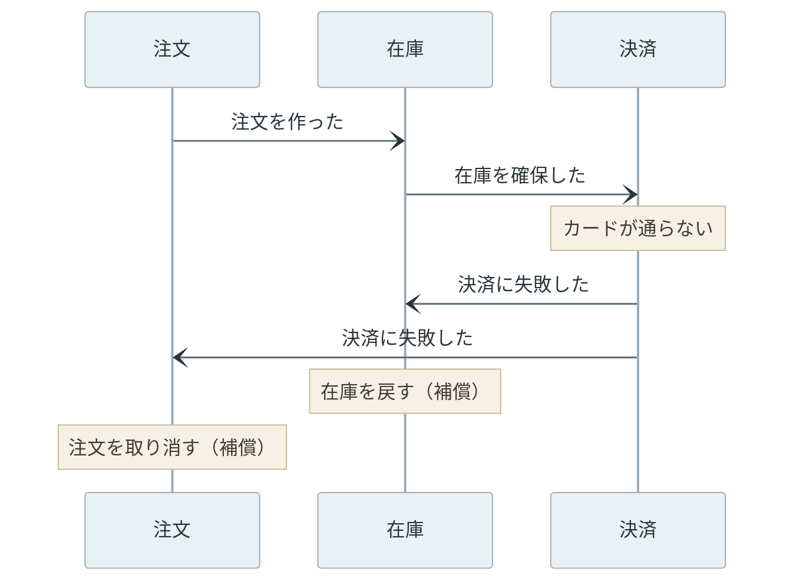
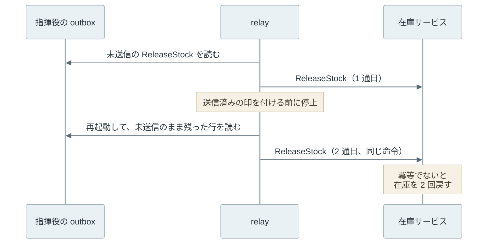

Saga は、複数のサービスにまたがる 1 つの業務の処理について、サービスごとの[ローカルトランザクション](/notes/database-systems/transaction-scope/)（1 つの DB の中で閉じたトランザクション）の列として順に確定させ、途中の段が失敗したら確定済みの段を補償トランザクション（compensating transaction）で打ち消す方法です。名前と考え方は、Hector Garcia-Molina 氏と Kenneth Salem 氏が 1987 年の SIGMOD で発表した論文「[Sagas](https://doi.org/10.1145/38713.38742)」（[PDF](https://www.cs.cornell.edu/andru/cs711/2002fa/reading/sagas.pdf)）に由来します。

例えば、通販サイトの注文で、注文・在庫・決済・配送が別々のサービスで、それぞれが自分の DB（データベース）を持っているとします。1 件の注文を通すには、4 つの DB を順に更新する必要があります。決済でカードが通らなかった時には、既に確保した在庫を戻し、作った注文を取り消します。以下は、この流れを描いた図です。



図の T1〜T4 は各段のローカルトランザクション、C1 と C2 はその補償です。決済の T3 は pivot（成功したらそれより後ろは戻さない分岐点）で、後の「補償できない段の置き場所」で詳しく扱います。

補償は、DB の ROLLBACK とは別物です。T1 と T2 は既に確定していて、その結果は他の処理から見えています。補償は、確定した変更を打ち消す新しいローカルトランザクションです。

[2PC](/notes/distributed-systems/two-phase-commit/)（2 相コミット）は、全員が確定できる状態になるまでロックを持って待たせることで、確定か中止かを揃えます。Saga はその待ちを捨て、各段をすぐ確定させる代わりに、途中の状態が見える期間と、打ち消しの手順を設計する責任を引き受けます。

<br>

本記事では、Saga の組み立て方と、[分離性](/notes/database-systems/transaction-isolation/)（isolation）が無いことで起きる事故について、Python で書いた 4 つのサービスの小さな Saga を動かした結果で説明します。扱う疑問は次の通りです。

- 補償トランザクションは、何をどこまで元に戻すのか。
- 次の段を誰が決めるのか（オーケストレーションとコレオグラフィー）。
- 補償の前に途中の状態を別の処理が見ると、何が起きるのか。
- 取り消せない段（決済や確認メールの送信）は、列のどこに置くのか。
- 補償のメッセージが 2 回届くと、何が起きるのか。

Saga を実装するワークフローエンジンの製品比較と、サービスの分け方そのものは扱いません。

---

### Saga が必要な理由

サービスごとに DB を分けると、1 つの DB のトランザクションでは複数の DB の更新をまとめられません。[2PC](/notes/distributed-systems/two-phase-commit/) でまとめる方法はあるものの、準備（確定できる状態まで進めてロックを持つこと）を終えた参加者は、コーディネータ（全員に確定か中止かを伝える役）の決定が届くまでロックを持って待ちます。コーディネータが止まれば、在庫のレコードに触る他の注文まで詰まります。以下は、2PC と Saga で各サービスがロックを持つ時間を比べた模式図です。



2PC では、一番早く準備を終えたサービスほど長く待ちます。Saga では待ちが無くなる代わりに、確定した結果が、後の段の結果を待たずに他の処理から見えるようになります。この代償は、後の「補償の前に途中の状態が見える」の節で扱います。

上記に加えて、参加者の全員が 2PC に対応していなければなりません。外部の決済サービスやメールの配信サービスの多くは HTTP の API で呼ぶだけの相手で、準備済みの状態で待つ手順を持っていません。

<br>

論文が扱った問題も、待ちの長さです。論文は、何時間・何日も掛かる長いトランザクション（LLT、long lived transaction）がロックを持ち続け、短いトランザクションを待たせることを問題にしました。

航空券の予約を例に、LLT を個別に確定できる T1, T2, ..., Tn の列に分け、それぞれに補償の C1, C2, ..., Cn-1 を用意します。システムが保証するのは、T1, T2, ..., Tn を全て実行するか、ある j で T1, ..., Tj, Cj, ..., C1 を実行するかのどちらかです。

論文が実装を論じたのは 1 台の DB の中の Saga で、分散した DB でも実装できると述べるに留まります。

複数のサービスにまたがる処理への応用は、後にマイクロサービスの文脈で広まりました。[microservices.io の Saga のページ](https://microservices.io/patterns/data/saga.html)（Chris Richardson 氏）や、[Azure Architecture Center の Saga のページ](https://learn.microsoft.com/en-us/azure/architecture/patterns/saga)（2026 年 11 月時点）は、サービスごとに DB を持つ構成でのデータの整合性の保ち方として説明しています。

---

### ローカルトランザクションと補償

Saga の各段は、1 つのサービスの中で閉じたローカルトランザクションです。各段は自分の DB だけを更新して確定し、その結果をメッセージで次へ伝えます。補償は、その段の効果を業務の意味で打ち消す、別のローカルトランザクションです。

補償が DB を T の前の状態に戻すとは限らない点は、論文が航空券の座席の例で説明しています。

> The compensating transaction undoes, from a semantic point of view, any of the actions performed by Ti, but does not necessarily return the database to the state that existed when the execution of Ti began.
>
> （補償トランザクションは、Ti が行った操作を意味の上で取り消すが、Ti の実行が始まった時の状態に DB を戻すとは限らない。）

座席の予約を取り消す補償は、予約数から 1 を引きます。予約した時の予約数を覚えておいて書き戻すことはしません。予約と取り消しの間に、別の客が同じ便を予約しているかもしれないからです。この違いは、後の実験で実際に数字が狂う形で出てきます。

<br>

#### 実験の構成

手元で、注文・在庫・決済・配送の 4 つのサービスと、次の段を決める指揮役（orchestrator）を Python で書きました。2026 年 11 月 11 日に、Python 3.14.4 の標準ライブラリ（[sqlite3](https://docs.python.org/3/library/sqlite3.html)、SQLite 3.46.1）だけで動かしています。乱数は使わず、何度実行しても同じログになります。

各サービスは自分専用の SQLite の DB を持ち、他のサービスの DB には触りません。

指揮役への返事は、業務の更新と同じトランザクションで outbox テーブル（これから送るメッセージを貯める表）に入れ、relay（outbox の未送信の行を読んで送る処理）が後からバス（サービス間でメッセージを運ぶ仕組み）に流します（[Transactional Outbox](/notes/distributed-systems/transactional-outbox/)）。バスは仮想の時計を持ち、決済は外部の API を呼ぶ想定で仮想の時刻で 5、他のサービスは 1 だけ処理に掛かります。全体は [lab/saga.py](https://github.com/nao1215/debimate/blob/main/content/notes/distributed-systems/saga/lab/saga.py) にあります。

指揮役は、次の表に従って命令を出します（ログの出力を除いた抜粋）。

```python
# 進める命令と、それを打ち消す補償の命令。決済が pivot で、それより後は補償せずに再試行で進める
STEPS = [
    ("order", "CreateOrder", "CancelOrder"),
    ("inventory", "ReserveStock", "ReleaseStock"),
    ("payment", "ChargeCard", None),         # pivot
    ("shipping", "ArrangeShipping", None),   # retryable
]

class Orchestrator(Node):
    def compensate(self, saga, body, failed, reason):
        """失敗した段より前の段について、後ろから順に補償の命令を出す。"""
        self.db.execute("UPDATE sagas SET status = 'COMPENSATING' WHERE id = ?", (saga,))
        for dest, _, undo in reversed(STEPS[:failed]):
            if undo:
                self.emit(dest, type=undo, **body)
```

`emit()` は、宛先と命令を指揮役の outbox に入れる関数です。Saga の状態（どの段まで進んだか、補償中か）の更新と同じトランザクションで outbox に入れるので、状態だけが進んで命令が出ない、という食い違いは起きません。

<br>

#### 決済で失敗した時

利用限度額が 500 円の客 alice が、1000 円の本を 1 冊注文した時のログです（在庫は 3 冊）。`t` は仮想の時刻です。

```text
t= 0  orchestrator start           saga-A  (alice, 1 個)
t= 1  order        CreateOrder     saga-A
t= 3  inventory    ReserveStock    saga-A  -> available=2
t= 9  payment      ChargeCard      saga-A  1000 円 -> card_declined
t=10  orchestrator compensate      saga-A  ChargeCard が card_declined
t=11  inventory    ReleaseStock    saga-A  -> available=3
t=11  order        CancelOrder     saga-A
-- 結果: available=3  saga-A=CANCELLED
```

決済が断られると、指揮役は在庫を戻す ReleaseStock と、注文を取り消す CancelOrder を出しました。在庫は 3 冊に戻り、注文は削除されずに CANCELLED として残ります。注文のレコードを消さずに状態を変えるのも、補償が「元の状態に戻す」ではなく「意味の上で打ち消す」ものだからです。失敗した決済の段は、自分のローカルトランザクションが ROLLBACK されるだけなので、補償は要りません。

---

### オーケストレーションとコレオグラフィー

次の段を誰が決めるかで、Saga の組み立て方は 2 つに分かれます。上記の実験のように中央の指揮役が命令を出す形をオーケストレーション（orchestration）、各サービスが出したイベントを次のサービスが受けて自分の段を始める形をコレオグラフィー（choreography）と呼びます。



オーケストレーションでは、Saga がどこまで進んだかが指揮役の DB の 1 か所にあります。段の順序の変更や補償の順序は指揮役のコードを読めば分かり、障害の調査もそこから始められます。その代わりに、指揮役という部品を作って動かし続ける必要があり、Azure のページは指揮役が障害点になることを欠点に挙げています。

<br>

コレオグラフィーでは、各サービスは「在庫を確保した」のような[ドメインイベント](/notes/software-architecture/domain-event/)を出し、それを購読したサービスが次の段を始めます。調整役が要らないので、段が少ない単純な流れでは部品が少なく済みます。一方で、流れの全体はどのサービスにも書かれておらず、各サービスの購読の設定を集めないと分かりません。段を足すたびに、誰がどのイベントに反応するかを追う手間が増えます。

補償も同じ形で流れます。以下は、コレオグラフィーで決済が失敗した時のイベントの流れです。



指揮役がいないので、「決済に失敗した」を誰が購読して何を戻すかは、在庫と注文のサービスの購読の設定にだけ書かれます。

<br>

どちらの形でも、各段は「DB を更新して確定する」と「次へ伝えるメッセージを出す」の 2 つを食い違わせてはいけません。確定したのにメッセージが出なければ、Saga はそこで止まります。各段のメッセージを [Transactional Outbox](/notes/distributed-systems/transactional-outbox/) で出すのはこのためです。

指揮役が止まった時に、Saga の途中から再開する仕組みも要ります。この部分を引き受けるのが、[Temporal](https://temporal.io/) のようなワークフローエンジンです。2026 年 11 月時点の Temporal の [Saga のページ](https://docs.temporal.io/design-patterns/saga-pattern)は、補償をワークフローのコードの中でリストに登録しておき、失敗した時に逆順に実行する書き方を示し、ワーカー（ワークフローのコードを実行するプロセス）が落ちても補償が実行されることをエンジンが保証するとしています。

---

### 補償の前に途中の状態が見える

Saga には、ACID の I にあたる分離性がありません。T2 で確定した在庫の確保は、決済の結果を待っている間、補償で戻されるまで、他の処理からそのまま見えます。論文も、補償を実行する時に、途中の結果を見た他のトランザクションへ知らせたり、それらを中止したりはしないと書いています。

在庫を 1 冊にして、決済で失敗する alice の注文（Saga A）を流しました。A が在庫を確保してから補償で戻すまで（t=3〜11）の間に、商品ページが在庫を表示し、限度額に余裕のある bob が同じ本を注文（Saga B）します。以下はログの抜粋です。

```text
t= 3  inventory    ReserveStock    saga-A  -> available=0
t= 4  page         商品ページ: 在庫切れ
t= 7  inventory    ReserveStock    saga-B  -> available=0  out_of_stock
t= 8  orchestrator compensate      saga-B  ReserveStock が out_of_stock
t= 9  payment      ChargeCard      saga-A  1000 円 -> card_declined
t=11  inventory    ReleaseStock    saga-A  -> available=1
-- 結果: available=1  saga-A=CANCELLED, saga-B=CANCELLED
```

商品ページは在庫切れと表示し、bob の注文は在庫切れで取り消されました。bob の確保が断られた t=7 の 4 時刻後に、A の補償が在庫を 1 冊に戻しています。結果は、1 冊残っているのに alice も bob も買えない、です。後で取り消される途中の値を他の処理が読む、いわゆる dirty read です。

<br>

#### semantic lock

対策の 1 つは、途中の状態に「仮押さえ（確定待ち）」の印を付けることです。この印を semantic lock と呼びます。DB のロックとは違い、アプリケーションが決めた状態の値で、読む側はそれを見て振る舞いを変えます。実験では、確保した予約に `PENDING` の状態を付け、在庫が足りない時に PENDING の予約が残っていれば、在庫切れではなく「後で取れるかもしれない」と返すようにしました。

```python
    def ReserveStock(self, m):
        avail = self.available()
        if avail < m["qty"]:
            if self.semantic_lock and self.pending() > 0:
                return {"ok": False, "reason": "busy"}   # 仮押さえ中。後で取れるかもしれない
            return {"ok": False, "reason": "out_of_stock"}
        state = "PENDING" if self.semantic_lock else "RESERVED"
        ...
```

指揮役は busy の返事を受けると、補償せずに、その 6 時刻後に同じ命令を送り直します。最後の段（配送）まで通った後には、予約の PENDING を外す命令を出します。以下は、印の有無で在庫の数と 2 人の注文の結末を比べた図です。



印を付けた場合、商品ページは「仮押さえ中」と表示でき、bob の注文は t=15 の再試行で在庫を確保して、決済まで通りました。印は途中の状態を隠すわけではありません。読む側が「この値はまだ変わり得る」と分かるようにするだけで、待つか断るかは読む側が決めます。

<br>

#### 補償を差分で書く

補償の書き方そのものでも、数字が狂います。在庫 2 冊を alice と bob が 1 冊ずつ確保し、alice の決済だけが失敗する場面で、補償を「確保の前の値を書き戻す」と「確保した数を足す」の 2 通りで書きました。

```text
補償を値の書き戻しで書く      -- 結果: available=2  saga-A=CANCELLED, saga-B=CONFIRMED
補償を差分で書く              -- 結果: available=1  saga-A=CANCELLED, saga-B=CONFIRMED
```

bob の 1 冊は売れているので、残りは 1 冊が正しい値です。書き戻しの補償は、alice が確保する前の 2 を書いたため、bob の確保を消してしまいました。在庫の DB は 2 冊と言うのに、倉庫には 1 冊しかありません。別の Saga の更新を上書きして消す lost update で、論文の座席の例が警告していた形です。

差分で書いた更新は、他の Saga の増減と順序を入れ替えても結果が同じです。こうした更新を commutative update（可換な更新）と呼び、Azure のページは semantic lock と並ぶ対策に挙げています。

このページには、ほかにも、段の並べ替えで途中の状態が見える期間を縮める pessimistic view や、更新の前に値が変わっていないかを確かめ直す reread value などが挙がっています。

---

### 補償できない段の置き場所

在庫の確保は戻せても、全ての段が戻せるわけではありません。送った確認メールは取り消せず、「先ほどのメールは誤りでした」と送り直すしかありません。決済も、返金はできるものの、カードの明細には請求と返金の両方が残ります。

Azure のページは、段を 3 種類に分けています。

| 種類 | 役割 | 本記事の例 |
|---|---|---|
| compensable | 補償で打ち消せる段 | 注文を作る、在庫を確保する |
| pivot | 成功したら後戻りしない分岐点 | 決済 |
| retryable | pivot の後で、成功するまで[再試行](/notes/distributed-systems/retry-backoff/)して進める段 | 配送の手配、確認メール |

pivot が失敗すれば、前の compensable な段を補償します。pivot が成功したら、後ろの段は補償せず、一時的な失敗なら再試行で最後まで進めます。

冒頭の図では、灰色の領域の「補償できる段」が compensable、領域の外の T3 が pivot、緑の領域の「再試行で進める段」が retryable です。

この分け方は、論文が述べる後ろ向きの回復（backward recovery）と前向きの回復（forward recovery）に近い考え方です。ただし、論文の前向きの回復はセーブポイントから欠けた T を実行し直す仕組みで、pivot の考え方そのものではありません。

実験で配送の API を 1 回だけ失敗させると、指揮役は補償せずに送り直し、注文を確定させました（ログの抜粋）。

```text
t= 9  payment      ChargeCard      saga-A  1000 円 -> charged
t=11  shipping     ArrangeShipping saga-A  -> timeout
t=12  orchestrator retry           saga-A  ArrangeShipping
t=19  shipping     ArrangeShipping saga-A  -> ok
t=20  orchestrator done            saga-A
```

<br>

この分け方から、段の並べ方が決まります。取り消せない段は、失敗し得る段より後ろに置きます。確認メールを在庫の確保より前に送ると、在庫切れで補償する時に、送ったメールを取り消せません。決済を pivot にするなら、在庫の確保のように失敗しやすく戻しやすい段を決済の前に集め、決済の後ろには、時間を掛ければ必ず成功する段だけを置きます。後ろの段は再試行されるので、同じ命令が何度届いても 1 回分の効果にする[冪等性](/notes/distributed-systems/idempotency/)が要ります。

---

### 補償が 2 回届く時

再試行は、retryable な段だけの話ではありません。補償のメッセージも、Transactional Outbox の relay で出す限り、2 回以上届き得ます。relay が送った後、送信済みの印を付ける前に止まると、再起動した relay は同じ行をもう一度送るからです。



実験では、指揮役の relay が ReleaseStock を送った直後に、relay を 1 回だけ止めました。在庫を戻す処理が「確保した数を足す」だけだと、2 通目でも足します（ログの抜粋）。

```text
t=10  orchestrator relay が ReleaseStock を送った直後に停止、再起動
t=11  inventory    ReleaseStock    saga-A  -> available=3
t=11  inventory    ReleaseStock    saga-A  -> available=4
-- 結果: available=4  saga-A=CANCELLED
```

3 冊のうち 1 冊を確保して戻しただけなのに、在庫は 4 冊になりました。存在しない 1 冊が商品ページに並び、誰かが買えば欠品になります。「補償を差分で書く」で lost update を防いだ更新は、順序の入れ替えには強くても、重複には弱いわけです。

<br>

直し方は、予約の状態を見て、戻す前の状態の時だけ在庫を足すことです。以下は、lab/saga.py の ReleaseStock から、実験用の切り替え（書き戻しと冪等でない版）を除いて整理した部分です。

```python
    def ReleaseStock(self, m):
        # 予約の状態が「戻す前」の時だけ戻す。2 通目は rowcount が 0 になり、在庫に触らない
        cur = self.db.execute("UPDATE reservations SET state = 'RELEASED'"
                              " WHERE saga = ? AND state IN ('RESERVED', 'PENDING')", (m["saga"],))
        if cur.rowcount == 0:
            return {"ok": True, "note": "already released"}
        qty = self.db.execute("SELECT qty FROM reservations WHERE saga = ?", (m["saga"],)).fetchone()[0]
        self.db.execute("UPDATE stock SET available = available + ? WHERE item = 'book'", (qty,))
        return {"ok": True}
```

状態の更新と在庫の加算は同じトランザクションの中にあるので、2 通目は `rowcount` が 0 になって在庫に触りません。この版では、2 通目のログが `available=3  already released` になり、在庫は 3 冊のままでした。注文を取り消す CancelOrder は、状態を CANCELLED に置き換える更新なので、何度届いても結果は同じです。

<br>

もう 1 つの難しさは、進める命令が実行されたかどうか分からないまま補償する場面です。ReserveStock の応答がタイムアウトした時、在庫は確保されたかもしれず、されていないかもしれません。上の ReleaseStock は、戻す前の予約が無ければ `rowcount` が 0 になって何もしないので、ReserveStock が結局実行されなかった場合は扱えます。ただし、遅れた ReserveStock が補償の後に届くと、在庫を減らした予約が残ったままになります。2026 年 11 月時点で [Apache Seata が Saga モードについて書いたドキュメント](https://seata.apache.org/docs/user/mode/saga/)は、補償が進める処理より先に実行されるこの状態を hanging と呼び、空の補償をした業務キーを記録しておき、後から来た進める処理を断るよう勧めています。本記事の実験で使った ReserveStock は、この検査をしていません。

2026 年 11 月時点の Temporal のドキュメントは、補償を段の実行の前に登録し、段が実行されなかった場合には何もしない、冪等な補償を書くよう勧めています。補償は「打ち消す相手が無い」場合も「2 回目」の場合も、1 回分の効果に収まるように書きます。

---

### 利点

- 各段がすぐ確定するので、2PC のように他のサービスのロックを持って待たない
- HTTP の API しか持たない外部サービスも、補償の手順を決めれば Saga の段にできる
- 1 つのサービスが止まっても、その段を再試行するか補償するかを Saga の側で選べる
- 失敗した時の振る舞い（何を戻し、何を戻さないか）が、業務の手順としてコードに残る

### 欠点

Saga は、各段をすぐ確定させて待ちを無くします。その代わりに、次の制約があります。

- 分離性が無く、補償の前の途中の状態が他の処理から見える。対策は段ごとに設計する
- 進める処理とほぼ同じ数の補償トランザクションを書き、保守し続ける必要がある
- 補償も失敗し得るので、成功するまで再試行するか、人手で直す手順が要る
- 各段のメッセージに Transactional Outbox、各段と補償に冪等性が必要で、部品が増える
- 状態が複数の DB に散るので、ある注文がどこまで進んだかを追う仕組みが要る

### 適さないケース

- 途中の状態が見えること自体が許されない処理。残高の移動のように、他の処理が中間の値を読むと実害が出る場合
- 補償を定義できない段が、失敗し得る段より前に来てしまう業務
- 全ての更新が 1 つの DB に収まる処理。ローカルトランザクション 1 つで済む
- 段の結果を他の段がすぐ一貫した形で読む必要がある、強く結び付いた更新。サービスの分け方を見直す方が先になる
