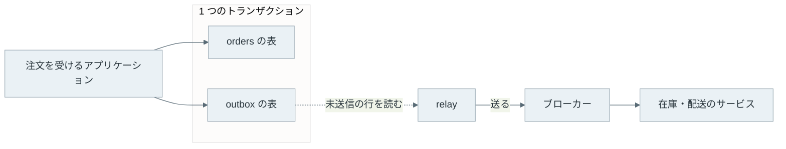

注文を DB（データベース）に保存したら、在庫や配送のサービスに「注文が確定した」というイベントを送りたい場面があります。DB の更新とイベントの送信を食い違わせないために、注文と同じトランザクションで、送りたいイベントを outbox という表に 1 行書いておき、別のプロセスが後からその行を読んで送る仕組みを [Transactional Outbox](https://microservices.io/patterns/data/transactional-outbox.html) と呼びます。

送り先は、[Kafka](https://kafka.apache.org/) や [RabbitMQ](https://www.rabbitmq.com/) のように、メッセージを受け取って購読する側へ配るサーバーで、メッセージブローカー（以降はブローカー）と呼ばれます。outbox の行を読んで送るプロセスは、以降 relay と呼びます。以下は、書き込み先と送る流れの図です。



アプリケーションはブローカーと直接やり取りせず、注文と outbox の行をまとめてコミットするか、まとめてロールバックします。ブローカーへの送信は、このトランザクションに含まれません。

outbox の行には、どの注文のイベントかを指す ID、イベントの種類、受け取る側が読む中身を入れます。outbox への INSERT を書き忘れた処理からは、イベントが 1 件も出ません。どのイベントを outbox に書くかの考え方は、[Domain Event](/notes/software-architecture/domain-event/) にまとめています。

relay の作りは、前回読んだ最大の id より大きい行を読めば済みそうに見えます。ところが、PostgreSQL の 8 つの接続から注文を 4,000 件書き、その読み方の relay を動かすと、以下のように 300 件を超える行が送られませんでした。



送られなかった行は表にあり、コミットも済んでいます。注文のトランザクションが INSERT からコミットまでに掛かる時間を 0〜20 ms に延ばすと、5 回とも 332〜364 件が抜け、処理の無い 0 ms では 0〜2 件でした。手元の軽いテストでは見つからず、本番で時々届かないイベントとして現れる種類の不具合です。同じ表を別の 2 つの読み方で読んだ relay は、どの条件でも 1 行も落としませんでした。

<br>

本記事では、outbox をこれから入れる人と、既存のシステムで outbox の表と relay に出会った人に向けて、次の疑問に答えます。

- outbox を使わずに、コミットしてから送ると何が起きるのか。
- relay が id の順に読むと、なぜコミット済みの行を飛ばすのか。
- 取りこぼさない読み方は、何と引き換えになるのか。
- 同じイベントが 2 回届くのは、なぜか。
- relay を増やすと、イベントの順番はどうなるのか。
- 表を読まずに DB の変更の記録から読む方式は、何が違うのか。

実験には、Docker で動かした PostgreSQL 18.6 と、Python のドライバの [psycopg](https://www.psycopg.org/psycopg3/) 3.3.8 を使いました。ブローカーの代わりに、別の DB の表へ、届いた順にイベントを積んでいます。

---

### コミットしてから送る場合との比較

outbox を使わずに書くと、注文をコミットしてからブローカーへ送るか、送ってからコミットするかの 2 通りになります。どちらも、2 つの書き込みの間でプロセスが落ちると、片方だけが残ります。以下は、注文をコミットしてから送る書き方と、outbox を使う書き方の実験のコードです。

```python
def dual_write_child(seed):
    """注文をコミットしてから、ブローカーに送る（outbox を使わない）。"""
    rnd = random.Random(seed)
    with conn() as c, conn("broker", autocommit=True) as b:
        while True:
            oid = c.execute("INSERT INTO orders (item) VALUES ('book') RETURNING id").fetchone()[0]
            c.commit()
            time.sleep(rnd.uniform(0, 0.004))  # コミットと送信の間の処理（ログ出力・変換など）
            b.execute("INSERT INTO events (order_id, type) VALUES (%s, 'OrderPlaced')", (oid,))


def outbox_app_child(seed):
    with conn() as c:
        while True:
            oid = c.execute("INSERT INTO orders (item) VALUES ('book') RETURNING id").fetchone()[0]
            c.execute("INSERT INTO outbox (order_id, type, payload) VALUES (%s, 'OrderPlaced', '{}')", (oid,))
            c.commit()


def outbox_relay_child(seed):
    """未送信の行を 1 件ずつ送り、送った後に印を付ける。"""
    rnd = random.Random(seed)
    with conn() as c, conn("broker", autocommit=True) as b:
        while True:
            row = c.execute("SELECT id, order_id FROM outbox WHERE NOT published ORDER BY id LIMIT 1 FOR UPDATE SKIP LOCKED").fetchone()
            if not row:
                c.commit()
                time.sleep(0.01)
                continue
            b.execute("INSERT INTO events (outbox_id, order_id, type) VALUES (%s, %s, 'OrderPlaced')", row)
            time.sleep(rnd.uniform(0, 0.004))
            c.execute("UPDATE outbox SET published = true WHERE id = %s", (row[0],))
            c.commit()
```

それぞれ 0.1〜0.3 秒動かしては SIGKILL で止める操作を 100 回繰り返しました。SIGKILL は後始末をさせずにプロセスを止めるシグナルで、電源断や [OOM Killer](/notes/computer-systems/oom-killer/) に止められた場合の代わりです。outbox の書き方では、アプリケーションと relay を同時に止め、最後に relay だけを動かして残りを送り切りました。以下は、止めた後に残ったものです。



止めるまでの時間が毎回ばらつき、書き方によって 1 件に掛かる時間も違うので、注文の総数は書き方ごとに異なります。コミットしてから送る書き方では、注文 2,894 件のうち 61 件のイベントが届きませんでした。順番を逆にすると、注文 3,196 件に対して、DB に無い注文のイベントが 60 件届きました。ブローカーへ送った後、コミットの前に止まり、注文がロールバックされたからです。outbox を使う書き方では、注文 5,565 件の全てにイベントが届きました。注文と outbox の行は同じトランザクションに入るので、片方だけが残ることはありません。

DB とブローカーを 1 つのトランザクションにまとめる手段には [2PC](/notes/distributed-systems/two-phase-commit/) もあります。ただし、DB とブローカーの片方か両方が対応していないことがあり、対応していても、全員の応答が揃うまで待つので、ブローカーの停止や遅れが注文の受け付けまで止めます。outbox は、DB のトランザクションだけで済ませる代わりの手段です。ブローカーが止まっていても、注文と outbox の行はコミットでき、relay が後から送ります。

送り先が決済のような外部 API の場合の置き方は [Transaction Scope](/notes/database-systems/transaction-scope/) で、複数のサービスにまたがる処理を取り消す方法は [Saga](/notes/distributed-systems/saga/) で扱っています。なお、outbox の書き方に残った 59 件の重複は、「2 回届くイベント」の節で取り上げます。

---

### id の順に読む relay が飛ばす行

outbox の行を書くまでは、上記のとおり簡単です。冒頭の図で行を落としたのは、行を読む側でした。以下は、冒頭の図で 342 件を落とした relay のコードです。0.05 秒ごとに、前回読んだ最大の id より大きい行を読みます。実験では、送る代わりに、送った id を `sent` に記録しています。

```python
def relay_by_id(stop, sent):
    cursor = 0
    with conn(autocommit=True) as c:
        while True:
            done = stop.is_set()
            rows = c.execute("SELECT id FROM outbox WHERE id > %s ORDER BY id LIMIT 500", (cursor,)).fetchall()
            for (i,) in rows:
                sent.append(i)
            if rows:
                cursor = rows[-1][0]
            elif done:
                return
            time.sleep(0.05)
```

outbox の id は `bigserial` で、PostgreSQL のシーケンスが番号を配ります。番号が決まるのは INSERT を実行した時で、コミットした時ではありません。[公式ドキュメント](https://www.postgresql.org/docs/18/functions-sequence.html)にあるとおり、シーケンスは他のトランザクションを待たせないために、配った番号をロールバックしても戻しません。id の順は INSERT の順で、コミットの順とは限らないわけです。

<br>

2 つの注文で、この食い違いを起こしてみました。トランザクション A は 0.02 秒に outbox へ INSERT して id 1 を取り、在庫の確認などで 1.5 秒掛かってからコミットします。トランザクション B は 0.33 秒に id 2 を取り、すぐにコミットします。relay は、この実験では 0.5 秒ごとに読みます。以下は、その時刻を 0.5 倍速で再生した図です。



relay が 0.52 秒に読んだ時、id 1 の行はまだコミットされていないので見えず、id 2 だけを送ってカーソルを 2 に進めます。1.53 秒に id 1 がコミットされても、relay の条件は `id > 2` なので、この行が読まれることはありません。

冒頭の図で、INSERT からコミットまでの処理を長くするほど抜けが増えたのは、この追い越しが起きる幅が広がるからです。0 ms でも 2 件抜けた回があり、処理を何も挟まなくても追い越しは起きます。同じ問題は、Postgres の変更を配信する [Sequin のブログ](https://blog.sequinstream.com/postgres-sequences-can-commit-out-of-order/)でも、カーソルで読む時の落とし穴として紹介されています。

id の代わりに、INSERT の時刻を入れた `created_at` や、時刻順に並ぶ [UUIDv7](/notes/database-systems/uuidv7-primary-key/) で読んでも、値が決まるのは INSERT の時なので、同じことが起きます。前のページの最後のキーから続きを読む [Keyset Pagination](/notes/database-systems/keyset-pagination/) で、書き込みの続く表を読む時も、同じ食い違いに注意が必要です。

---

### 取りこぼさない 2 つの読み方

冒頭の図で 1 行も落とさなかった 2 つの relay は、行を「id がカーソルより後か」で選びません。1 つは、送ったかどうかの印を行に持たせる読み方です。

```python
def relay_by_flag(stop, sent):
    """未送信の印（published = false）の行を読み、送ったら印を変える。"""
    with conn() as c:
        while True:
            done = stop.is_set()
            rows = c.execute("SELECT id FROM outbox WHERE NOT published ORDER BY id LIMIT 500 FOR UPDATE SKIP LOCKED").fetchall()
            for (i,) in rows:
                sent.append(i)
            if rows:
                c.execute("UPDATE outbox SET published = true WHERE id = ANY(%s)", ([r[0] for r in rows],))
            c.commit()
            if not rows and done:
                return
            time.sleep(0.05)
```

遅れてコミットした id 1 も、`published` が false のまま表に現れるので、次に読んだ時に送られます。[FOR UPDATE SKIP LOCKED](https://www.postgresql.org/docs/18/sql-select.html#SQL-FOR-UPDATE-SHARE) は、読んだ行をロックし、他の relay がロックしている行は飛ばす指定で、relay を複数動かしても同じ行を取り合いません。

代わりに、送った行の全てに UPDATE が走ります。PostgreSQL の UPDATE は更新前の行を残すので、送った数だけ VACUUM が片付ける行が増えます。送った行を UPDATE せずに DELETE する実装もありますが、消した行が VACUUM まで残るのは同じで、その影響は [MVCC と VACUUM](/notes/database-systems/mvcc-vacuum/) で扱っています。読む時は、未送信の行だけに張った[部分インデックス](https://www.postgresql.org/docs/18/indexes-partial.html)を使えば、送った行が増えても読む量は増えません。送った行を調査のためにいつまで残すかは決まっていないので、削除の周期は運用で決めます。

<br>

#### トランザクション ID で読む

もう 1 つは、行を書いたトランザクションの ID で読む読み方です。outbox の表に `tx xid8 DEFAULT pg_current_xact_id()` の列を足し、書いたトランザクションの ID を行に残します。relay は、まだ終わっていないトランザクションのうち最も古いものより前の ID の行だけを読みます。

```python
def relay_by_xmin(stop, sent):
    """書いたトランザクション ID（xid8）で読み、まだ終わっていないトランザクションより前のトランザクションだけを送る。"""
    last = ("0", 0)
    with conn(autocommit=True) as c:
        while True:
            done = stop.is_set()
            rows = c.execute(
                """SELECT tx::text, id FROM outbox
                   WHERE (tx, id) > (%s::xid8, %s)
                     AND tx < pg_snapshot_xmin(pg_current_snapshot())
                   ORDER BY tx, id LIMIT 500""", last).fetchall()
            for tx, i in rows:
                sent.append(i)
            if rows:
                last = rows[-1]
            elif done:
                return
            time.sleep(0.05)
```

`pg_snapshot_xmin(pg_current_snapshot())` は、その時点でまだ終わっていないトランザクションの中で最も小さい ID です。[公式ドキュメント](https://www.postgresql.org/docs/18/functions-info.html#FUNCTIONS-PG-SNAPSHOT)によると、それより小さい ID のトランザクションは、全てコミット済みかロールバック済みです。この境界より前の行は、後から増えることがありません。そのため、カーソルで読んでも、遅れてコミットした行を飛ばさないわけです。

カーソルに tx と id の組 `(tx, id)` を使うのは、1 つのトランザクションが outbox に複数の行を書くと、同じ tx の行が並ぶからです。tx だけをカーソルにすると、`LIMIT 500` で途中まで読んだトランザクションの残りの行が、次の `tx > カーソル` の条件から外れて飛ばされます。

代わりに、境界を進めないトランザクションが 1 つあると、relay は何も送れません。以下は、outbox と関係の無い集計の表に INSERT したまま 3 秒開いておくトランザクションと、0.5 秒ごとにコミットされる注文を並べた実験です。



0.51〜2.85 秒にコミットされた 5 件の注文は、集計のトランザクションが終わった 3.21 秒の直後に、まとめて届きました。待たせたトランザクションは outbox の表に触れていません。境界は DB 全体のトランザクションで決まるので、別の機能のバッチでも relay は止まります。一方で、[公式ドキュメント](https://www.postgresql.org/docs/18/transaction-id.html)によると、トランザクション ID が割り当てられるのは最初に書き込んだ時です。`SELECT` だけのトランザクションを開いたまま 5 行をコミットした回では、5 行とも境界の前に入りました。止めるのは、書き込みを始めたまま終わらないトランザクションです。

<br>

#### 読み方を変えても残る遅れ

表を定期的に読む relay は、どちらの読み方でも、読む間隔の分だけ遅れます。ファンコミュニティのサービスを作る Gaudiy の [EC チームのブログ](https://techblog.gaudiy.com/entry/2025/08/13/131201)では、DB の負荷から決めた 5 秒の間隔のせいで、コインの購入がすぐに反映されず、失敗したと思ったユーザーが購入をやり直す問題が起きていました。一方で、間隔を詰めるほど、送る行が無いのに表を読む回数が増え、DB の負荷になります。この遅れを無くす方式は、最後の節で扱います。

---

### 2 回届くイベント

最初の節の実験で、outbox を使う書き方には 59 件の重複が残りました。relay は、ブローカーへ送ってから `published` を true にしてコミットします。送った後、コミットの前に止まると、印の UPDATE はロールバックされ、次の relay が同じ行をもう一度送ります。100 回止めて 59 件は、止めた時に relay がこの間にいた回数です。

順番を逆にして、印を付けてから送れば重複は消えますが、今度は印を付けた後で止まった行が届かなくなります。

つまり、落ちる可能性のあるプロセスが、ブローカーへの送信と DB の更新の 2 つに書く以上、片方だけ残る隙間はどこかに残ります。outbox は、その隙間で起きることを「届かない」から「2 回届く」へ変える仕組みです。relay は届くまで[送り直し](/notes/distributed-systems/retry-backoff/)を続けるので、少なくとも 1 回は届き、2 回以上届くこともあります。この送り方を at-least-once と呼びます。

microservices.io の[説明](https://microservices.io/patterns/data/transactional-outbox.html)も、relay は同じメッセージを 2 回以上送り得るので、受け取る側を冪等にする必要がある、としています。冪等とは、同じ要求を何度受け取っても結果を 1 回分に保つ性質で、仕組みは [Idempotency](/notes/distributed-systems/idempotency/) で扱っています。ブローカーから受け取る側へ配る段でも、ブローカーの配送保証によっては同じメッセージが再び配られるので、relay だけを直しても重複は消えません。outbox では、行の id かイベントごとの UUID を送り、受け取る側が処理済みの ID を記録して、2 回目を捨てる形がよく使われます。

```sql
-- 受け取る側の DB。処理済みのイベント ID の記録と、在庫の引き当てを同じトランザクションで行う
BEGIN;
INSERT INTO processed_events (event_id) VALUES ($1) ON CONFLICT DO NOTHING;
-- 1 行入った時だけ在庫を引き当てる。0 行なら処理済みなので、何もせずにコミットする
COMMIT;
```

---

### relay を増やした時の順番

1 件の注文には、確定・支払い・発送のように、順番に意味のあるイベントが続きます。relay が 1 つなら、未送信の印で読んだ行を id の順に送れます。relay を増やすと、`SKIP LOCKED` で別々の行をまとめて取り、並行して送るので、同じ注文のイベントが別の relay に分かれます。

以下は、10 行ずつ取る relay 2 個で注文 6 件分の 18 行を読み、ブローカーに届いた順を記録した図です。動きを目で追えるように、1 行の送信に 0.2 秒掛けています。



注文 4 の確定は id 10 で relay A の最後の行、支払いと発送は id 11・12 で relay B の最初の行です。2 つの relay は並行して送るので、B の支払いは 0.33 秒に、A の確定は 2.08 秒に届きました。入れ替わりは、取った行の境目で同じ注文のイベントが分かれた所に起きます。

では、どれくらいの注文で入れ替わるのでしょうか。以下は、500 件の注文ごとに OrderPlaced（確定）・OrderPaid（支払い）・OrderShipped（発送）の 3 つのイベントをこの順に別々のトランザクションで書き、relay の数を変えて送った結果です。relay は 10 行ずつ取り、1 行の送信に 0〜2 ms 掛かるようにして、それぞれ 5 回繰り返しました。



relay を 2 個にすると、5 回の[中央値](/ml/math/median/)で 500 件のうち 131 件の注文の順番が入れ替わりました。4 個は図の回では 107 件でしたが、やり直すと 2 個より多い回もあり、2 個との大小は回ごとに入れ替わりました。relay の数より、取った行の境目で同じ注文のイベントが分かれるかで決まります。

右の 2 本（注文で分担）は、注文の番号を relay の数で割った余りで、どの relay が担当するかを決めています。同じ注文のイベントは必ず同じ relay が順に送るので、入れ替わりは 0 件でした。

```python
where = f" AND order_id % {part[1]} = {part[0]}" if part else ""  # part = (担当する余り, relay の数)
rows = c.execute("SELECT id, order_id, type FROM outbox WHERE NOT published" + where +
                 " ORDER BY id LIMIT 10 FOR UPDATE SKIP LOCKED").fetchall()
```

送り先が Kafka なら、同じキーのイベントは同じパーティションに入り、[公式の説明](https://kafka.apache.org/intro)によると、パーティションの中では書いた順に読まれます。注文の番号をキーにすれば、ブローカーの中でも注文ごとの順番が保たれます。順番が必要なのは注文ごとで、全ての注文をまたいだ順番まで必要なことは少ないので、その単位で分けるのが現実的です。

---

### WAL から読む方式

ここまでの relay は、outbox の表を定期的に読みました。microservices.io はこの方式を [Polling publisher](https://microservices.io/patterns/data/polling-publisher.html) と呼びます。もう 1 つの方式は、表を読まずに、DB の変更の記録から outbox への INSERT を拾うもので、[Transaction log tailing](https://microservices.io/patterns/data/transaction-log-tailing.html) と呼ばれます。

DB は、表を書き換える前に変更を追記用のログに書き、落ちた時はそのログから復旧します。PostgreSQL ではこのログが WAL（Write-Ahead Log）で、仕組みは [WAL](/notes/distributed-systems/write-ahead-log/) で扱っています。

PostgreSQL では、WAL を行の変更に読み替える機能は[論理デコーディング](https://www.postgresql.org/docs/18/logicaldecoding-explanation.html)と呼ばれ、[公式ドキュメント](https://www.postgresql.org/docs/18/logicaldecoding-output-plugin.html)によると、並行したトランザクションはコミットの順に読み出され、ロールバックしたトランザクションは読み出されません。以下は、8 並列で書いた outbox の 4,000 行について、付属の [test_decoding](https://www.postgresql.org/docs/18/test-decoding.html) で読み出した順に id を並べた図です。



id は前後しますが、4,000 行の全てを 1 行も落とさずに読みました。WAL から読む順はコミットの順なので、遅れてコミットした id 1 も、コミットした位置で届きます。

また、書き込み中の長いトランザクションで止まらないのも、トランザクション ID で読む relay との違いです。集計の表に INSERT したトランザクションを開いたまま、outbox に 5 行をコミットして読むと、WAL からは 5 行とも読めました。同じ時点で `tx < pg_snapshot_xmin(...)` の条件で読める行は 0 行でした。3 行目は、前の節で触れた `SELECT` だけのトランザクションの回です。

```text
集計のトランザクションが開いている間に、WAL から読めた outbox の行: [1, 2, 3, 4, 5]
同じ時点で、tx < pg_snapshot_xmin の条件で読める行: 0 行
SELECT だけのトランザクションが開いている間にコミットした 5 行のうち、同じ条件で読める行: 5 行（そのトランザクションの ID: 割り当て無し）
```

この方式を製品にしたものに、[Debezium](https://debezium.io/) があります。WAL から拾った outbox の行は、[Outbox Event Router](https://debezium.io/documentation/reference/stable/transformations/outbox-event-router.html) が Kafka のメッセージに組み直します。既定では `aggregateid` の列を Kafka のキーに使います。outbox の表の `order_id` をこの列に入れれば、前の節の注文ごとの順番も保たれます。このように DB の変更の記録を外へ流す仕組みは、CDC（Change Data Capture）と呼ばれます。MySQL では変更の記録である[バイナリログ](https://dev.mysql.com/doc/refman/8.4/en/binary-log.html)を読む形になり、Debezium にも [MySQL 用のコネクタ](https://debezium.io/documentation/reference/stable/connectors/mysql.html)があります。

[event-driven.io のブログ](https://event-driven.io/en/push_based_outbox_pattern_with_postgres_logical_replication/)も、表を定期的に読む代わりに、PostgreSQL の論理レプリケーションで変更を DB 側から送る方式として紹介しています。論理レプリケーションは、論理デコーディングで読み出した変更を購読する側へ流す PostgreSQL の機能です。

<br>

#### WAL から読む方式の注意

その代わり、DB の設定と運用に手が入ります。`wal_level` を `logical` にする必要があり、変更には PostgreSQL の再起動が必要です。読んだ位置はレプリケーションスロットに記録されます。[公式ドキュメント](https://www.postgresql.org/docs/18/logicaldecoding-explanation.html)は、スロットは読む側が止まっていても必要な WAL の削除を止め、ディスクを使い続けると注意しています。relay が止まったまま気づかないと、DB のディスクが埋まります。

同じ箇所に、スロットの位置はチェックポイントの時にしか保存されないので、DB が落ちると前の位置に戻り、最近の変更がもう一度送られる、とあります。WAL から読む方式でも重複は残るので、受け取る側の冪等性は外せません。4 つの読み方を並べると、以下の通りです。

| 読み方 | 取りこぼし | 長いトランザクション | 送るたびの書き込み | 準備 |
|---|---|---|---|---|
| id の順 | 起きる（342 件） | 影響しない | 無し | 無し |
| 未送信の印 | 無し | 影響しない | 行ごとに UPDATE か DELETE | 部分インデックス |
| トランザクション ID | 無し | 終わるまで止まる | 無し | xid8 の列 |
| WAL から読む | 無し | 影響しない | 無し | `wal_level` とスロットの監視 |

---

### relay を作る前・読む前に確認すること

入れる前に、outbox が必要かを考えます。outbox は送った結果を待たずにコミットするので、送れたかどうかをその場で呼び出し元に返す処理には向きません。また、状態の変化をイベントの並びとして保存する [Event Sourcing](/notes/software-architecture/event-sourcing/) を採っているなら、その記録を直接送れるので、outbox の表は必要ありません。

<br>

outbox を入れる人も、既存の relay に出会った人も、最初に見るのは relay の SQL です。以下のように、INSERT の時に決まる値をカーソルにして読んでいれば、冒頭の図の赤い棒と同じ取りこぼしが起きます。

```sql
-- どちらも、カーソルを進めた後でコミットされた、カーソルより小さい値の行を読まない
SELECT * FROM outbox WHERE id > $1 ORDER BY id LIMIT 500;
SELECT * FROM outbox WHERE created_at > $1 ORDER BY created_at LIMIT 500;
```

負荷の低い時間帯や手元のテストでは 0〜2 件で、気づきにくいことも冒頭の図のとおりです。未送信の印かトランザクション ID で読む形に変えるか、WAL から読む方式に移します。

次に、受け取る側が同じイベントの 2 回目を捨てられるかを確認します。outbox の relay は、どの読み方でも落ちた時に同じイベントを送り直します。冒頭の図で落としていない 2 つの relay も、送った後の印やカーソルの保存の前で止まれば重複を出します。

順番が必要なら、その単位を決めます。注文ごとの順番なら、注文の番号で relay や Kafka のパーティションを分ければ、relay を増やしても入れ替わりません。

最後に、どこまでの遅れを許せるかで方式を選びます。表を読む relay は読む間隔の分だけ遅れ、トランザクション ID で読む relay は長いトランザクションの分だけ止まります。それを許せなければ WAL から読む方式で、その時はスロットが WAL を溜め込んでいないかを監視に足します。

実験のコード・実行の手順・出力の全体は [lab/](https://github.com/nao1215/debimate/tree/main/content/notes/distributed-systems/transactional-outbox/lab) にあります。
