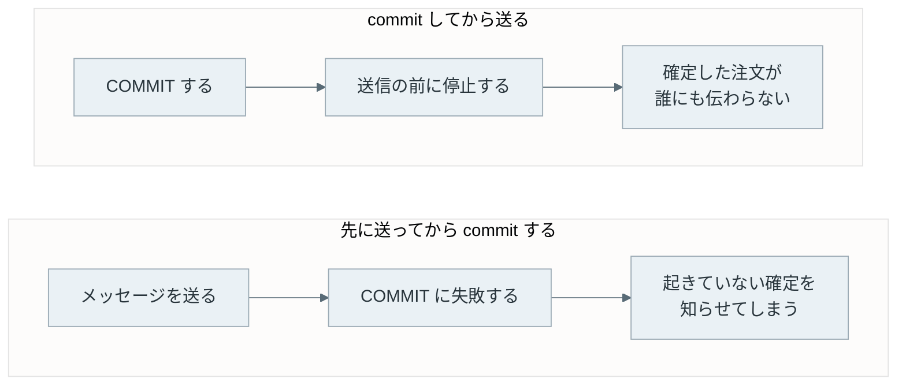
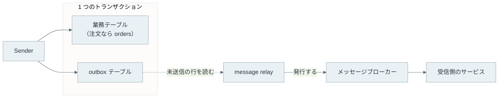
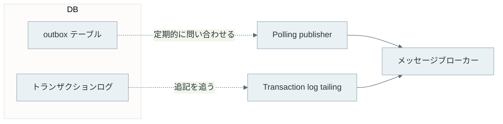
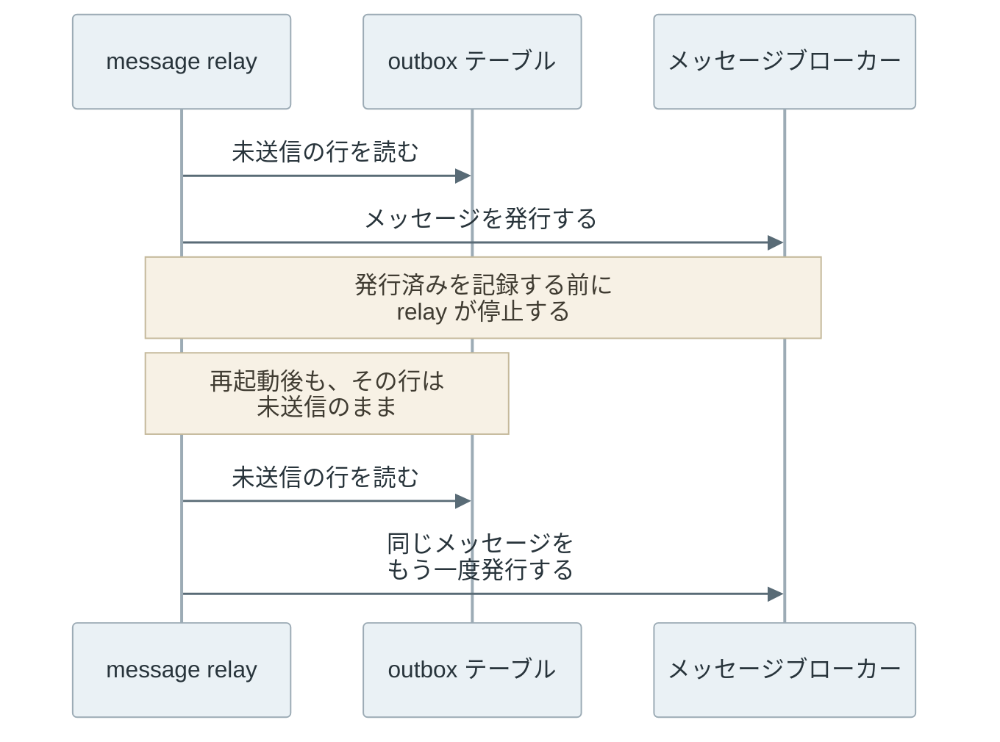
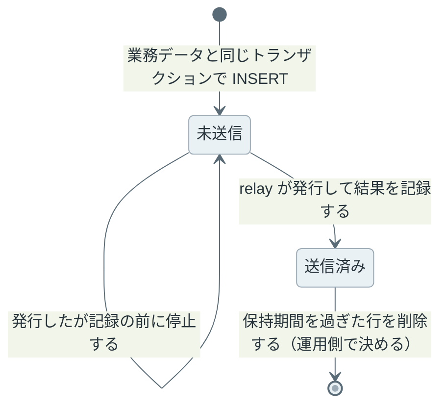

Transactional Outbox は、送るべきメッセージを業務データの更新と同じトランザクションで DB の outbox テーブルに書き、別のプロセス（message relay）がそれを後からメッセージブローカー（メッセージを預かって受信側に配る仕組み）に送るパターンです。書き込み先を DB の 1 箇所に寄せることで、2 つの書き込みが食い違う余地を減らします。

例えば、注文を確定する処理には書き込み先が 2 つあります。1 つは注文を記録する DB、もう 1 つは在庫や配送を担う別のサービスに「注文が確定した」と伝えるためのメッセージブローカーです。

以下は、DB とブローカーに別々に書く二重書き込み（左）と、Transactional Outbox（右）を比べた図です。



左の構成で COMMIT の直後にプロセスが停止すると、注文は確定したのに外には知らされていない、という食い違いが生じます。在庫を担うサービスは注文の存在を知りません。一方、アプリケーションから見ると、失敗した処理は 1 つもありません。

<br>

本記事では、この食い違いを防ぐ方法を説明します。答えていく疑問は 5 つです。

- なぜ送信と commit の順序を入れ替えても、食い違いを防げないのか。
- 送るべきメッセージは、DB の中にどう書くのか。
- relay は何を読んで、outbox の行をブローカーに送るのか。
- 先に INSERT した行が後から発行されるのは、どんな時か。
- メッセージが発行される回数と順序は、どこまで保証されるのか。

受け取った側で重複をどう排除するかの実装と、複数サービスにまたがる業務の取り消しは、本記事では扱いません。

---

### 2 つの書き込みが食い違う理由

冒頭の例から送信と commit の順序を入れ替えても、壊れ方が入れ替わるだけです。



例えば、決済の完了を伝えるメッセージを先に送ると、受け取った側は領収書を発行します。その後でトランザクションが中止されれば、DB に存在しない決済の領収書だけが残ります。

2 つの書き込みを 1 つの操作にまとめる手段としては、[2PC](../two-phase-commit/) があります。関わった全員の最終的な判断を確定か中止のどちらか一方に揃えるプロトコルで、DB とブローカーを 2 つの参加者として並べれば、片方だけが成立した状態を避けられます。

しかし、DB とブローカーの一方または両方が 2PC に対応していない場合があります。[Pattern: Transactional outbox の説明](https://microservices.io/patterns/data/transactional-outbox.html)では、サービスを両方に依存させることも望ましくない場合が多いとしています。

Transactional Outbox は、こうした依存を避けるため、DB とブローカーを 2PC で結ぶ方法を取りません。両方が対応していても、2PC では参加者全員の応答が揃うまで判断を待つので、ブローカーの停止や遅延が DB 側の処理まで止めます。

---

### 書き込み先の DB への集約

食い違いの原因は順序の選び方ではなく、1 つの処理が 2 つの書き込み先を持っていることです。そのため Transactional Outbox は、ブローカーへ直接送る代わりに、送るべきメッセージを DB の中に書きます。



上記の図では、メッセージを送る側を Sender と呼んでいます。Sender はブローカーと直接やり取りしないため、ブローカーが停止しても、直ちに注文の受け付けが止まるわけではありません。

commit すると業務データとメッセージが DB に保存され、rollback すると両方の変更が取り消されます。ブローカーへの送信は、このトランザクションには含まれません。

この例では、以下の 2 つの INSERT を同じトランザクションに入れます（PostgreSQL の例）。

```sql
BEGIN;

INSERT INTO orders (id, customer_id, total_amount, status)
VALUES ('01J8Z3', 42, 12800, 'confirmed');

INSERT INTO outbox (id, aggregate_id, event_type, payload)
VALUES ('01J8Z4', '01J8Z3', 'OrderConfirmed',
        '{"order_id": "01J8Z3", "total_amount": 12800}'::jsonb);

COMMIT;
```

`id` はメッセージの識別子です。outbox の残る 3 列は、どの注文についての出来事かを指す `aggregate_id`、出来事の種類を表す `event_type`、受け取る側が読む中身の `payload` です。列の設計と relay のコードは [Domain Event](../../software-architecture/domain-event/) が、トランザクションに何を入れるかは [Transaction Scope](../../database-systems/transaction-scope/) が扱っています。

2 つ目の INSERT の前にプロセスが停止すると、commit に達していないので、1 つ目の変更も確定しません。

---

### relay が outbox を読む 2 つの方法

outbox に溜まった行をブローカーに送る方法は、relay が何を読むかで 2 つに分かれます。Polling publisher は outbox テーブルを繰り返し読み、まだ送っていない行を見つけて発行します。Transaction log tailing は、DB が自分の永続化のために書いているトランザクションログを追い、outbox に挿入された各メッセージを発行します。



トランザクションログは、[WAL](../write-ahead-log/) のように更新を順に書き足していく記録です。仕組みは DB ごとに違い、Transactional Outbox の解説は MySQL の binlog、PostgreSQL の WAL、AWS DynamoDB の table streams を例に挙げています。

DB の変更を捕捉して外部に流す仕組みは一般に CDC（Change Data Capture）と呼ばれ、Transaction log tailing はその 1 つです。

Transactional Outbox の解説で挙げられている主な性質を整理すると、以下の通りです。

| 観点 | Polling publisher | Transaction log tailing |
|---|---|---|
| 読む先 | outbox テーブル | DB のトランザクションログ |
| 利点 | 特定のトランザクションログ機構に依存しにくい | commit 済みの変更をトランザクションログから追跡できる |
| 欠点 | 順序通りに発行するのが難しい。この方式に対応していない NoSQL の DB もある | DB 固有の解決策が必要。重複した発行を避けるのが難しい |

順序が崩れるのは、outbox の行の ID の順と commit の順がずれ、読んだ時点でまだ commit されていなかった行を後から拾う場合です。

PostgreSQL 17 で、注文 A の行を INSERT して commit を 3 秒遅らせ、その間に注文 B の行を INSERT して commit しました。B の commit 直後と A の commit 後に、relay が未送信の行を id の順に読んで送信済みにしています。



relay の出力は以下の通りです。

```text
-- relay 1 回目
2|OrderConfirmed B
-- relay 2 回目
1|OrderConfirmed A
```

先に採番された A が、B の後に発行されています。読んだ位置を最後の id で覚える relay なら、2 回目は id 2 より後ろしか探さないので、A は一度も発行されません。

Polling publisher では、未送信の行を条件で探す必要もあります。NoSQL の DB の中には、この問い合わせが苦手なものがあります。

一方、Transaction log tailing で同じメッセージが再発行されるのは、ログのどこまで読んだかの記録と、ブローカーへの発行が別々の書き込みだからです。

読む先が違っても、outbox に書く側の処理は変わりません。変わるのは、メッセージがどの順序で何回ブローカーに発行されるかです。

---

### 保証される範囲と保証されない範囲

outbox に配送すべきメッセージが残るかどうかは、commit の成否と一致します。しかし、ブローカーに発行される回数が 1 回になるとは限りません。relay がブローカーに発行した後、outbox の行に送信済みの印を付ける（または行を消す）前に落ちると、再起動後に同じメッセージをもう一度発行します。



発行と記録は別の書き込みなので、再起動後の relay は、発行の前に落ちたのか、発行と記録の間で落ちたのかを区別できません。relay が未送信のメッセージを継続して再試行する前提では、取りこぼしを避ける代わりに同じメッセージを複数回発行し得ます。この配送方式を at-least-once と呼びます。

relay が決めるのはブローカーへ発行するまでで、受信側のサービスに何回届くかはブローカーの配送保証にも左右されます。どちらの経路でも重複はあり得るので、受け取る側は冪等（べきとう、idempotent）でなければなりません。実現の方法は [Idempotency](../idempotency/) が扱っています。

順序も同じで、保証の範囲が段階に分かれます。relay が 1 つだけで、commit した順に行を発行すれば、ブローカーへの発行順は保てます。relay を並列にしたり、前述の実験のように ID の順と commit の順がずれたりすると崩れます。受信側それぞれに同じ順序で届くことは多くの場合に必要ですが、ブローカーの性質で決まり、このパターンは扱っていません。

<br>

Polling publisher で送信済みを outbox に記録する実装では、1 行を未送信と送信済みの 2 状態で扱えます。



送信済みになった行をいつまで置くかは、パターンでは決められていません。行が積み上がるほど未送信の行を探す読み取りは重くなるので、削除の周期は運用側で決める必要があります。

---

### 利点

- 2PC を使わずに、DB の更新と配送すべきメッセージの記録のずれを防げる
- メッセージの順序を保つよう設計できるが、実際の保証は relay の実装に依存する
- ブローカーへの同期送信を待たず、業務データと outbox の記録を commit できる

---

### 欠点

- outbox への INSERT を書き忘れると、DB だけが更新されてメッセージが出ない状態に戻る
- relay が同じメッセージを 2 回以上発行し得るので、受け取る側を冪等にする必要がある
- 業務と直接関係のない outbox テーブルと relay プロセスを運用し続ける必要がある

---

### 適さないケース

以下は、ここまでの性質から導いた判断です。

- 送信の成否をその場で呼び出し元に返す必要がある、同期の要求応答
- 状態の変化をイベントの並びとして保存する [Event Sourcing](../../software-architecture/event-sourcing/) を採っていて、その記録からそのまま配送できる場合
- 受け取る側を冪等にできず、重複した発行を許容できない処理
