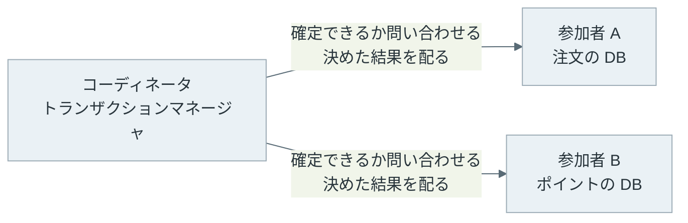
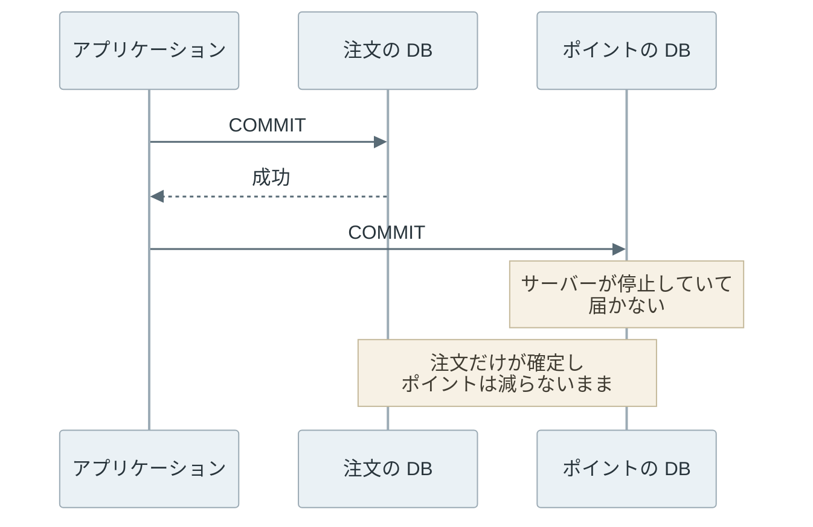
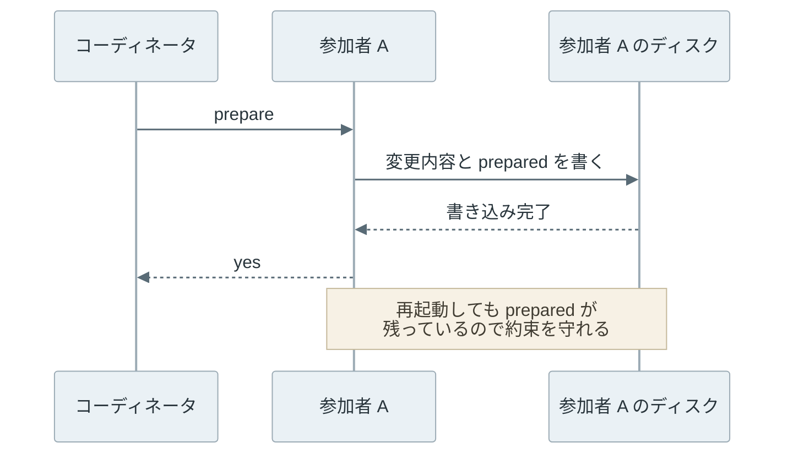
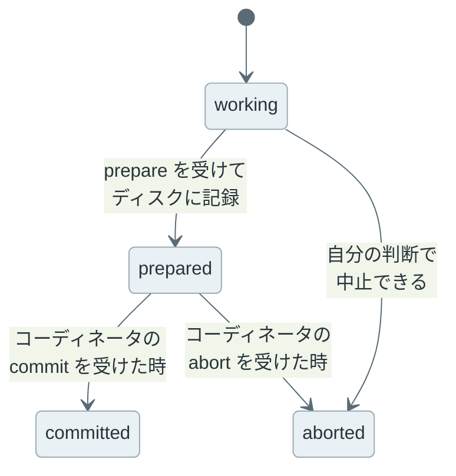
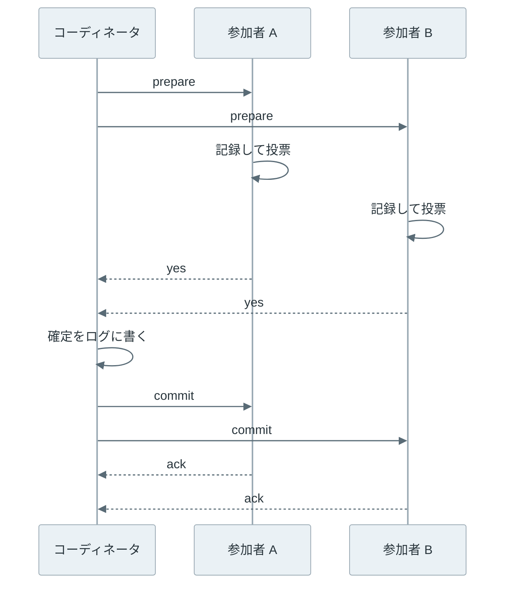
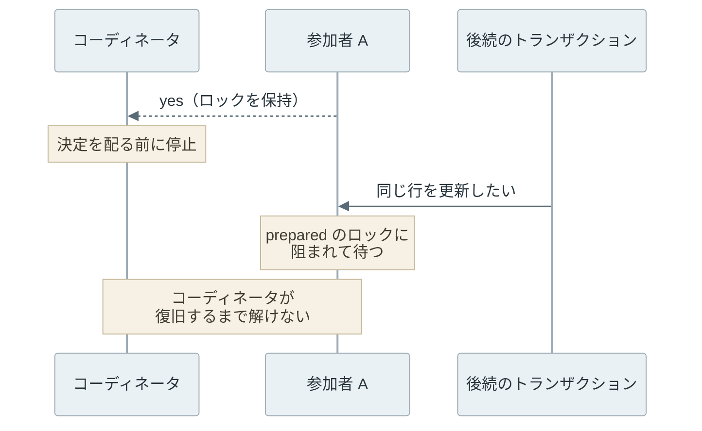
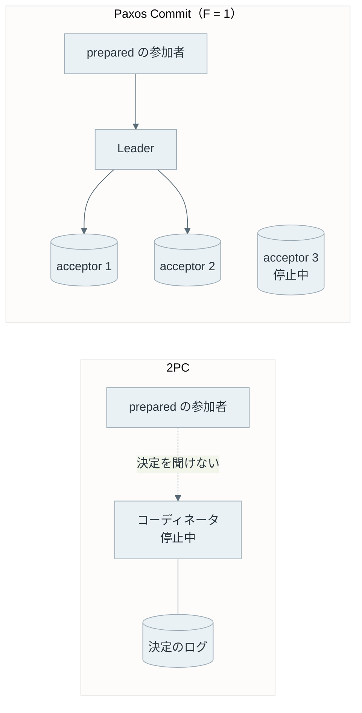

2PC（Two-Phase Commit、2 相コミット）は、複数の DB にまたがる 1 つの更新について、関わった全員の最終的な判断が確定（commit）か中止（abort）のどちらか一方に揃うようにする手順です。確定できるかを全員に問い合わせる準備フェーズと、決めた結果を配る決定フェーズの 2 段階で進むことが名前の由来です。

この手順が必要な場面の代表は、1 つの業務処理が複数の DB を書き換える時です。例えば、注文を記録する DB と、支払いに使うポイントの残高を持つ DB が別のサーバーにある EC サイトで、ポイント払いの注文を受けるとします。注文が確定したのにポイントの更新は中止された、という食い違いが起きると、後から人手で突き合わせて直すしかありません。

1 つの注文処理は、注文の DB とポイントの DB で別々のトランザクション（ローカルトランザクション）として実行されます。登場するのは、確定か中止かを決めて参加者に配るコーディネータと、自分のローカルトランザクションを実際に確定・中止する参加者です。上記の例では、注文の DB を参加者 A、ポイントの DB を参加者 B とします。コーディネータは、2 つの DB とは別に動くトランザクションマネージャ（複数の DB のトランザクションをまとめて確定させる専用のプロセス）が務めます。

2PC は、ある参加者は確定・別の参加者は中止という最終的な判断の分裂を防ぐことを目的にしています。揃うのは最終的な判断であって、複数の DB の変更が同じ瞬間に見え始めることまでは保証しません。決定を配っている途中には、片方が確定済みで、もう片方はまだ決定を待っている、という瞬間があり得ます。

 

本記事では、2PC が判断を揃える手順と、その代償を説明します。以下の疑問を 1 つずつ見ていきます。

- なぜ 2 つの DB に順番に COMMIT を送るだけでは、片方だけが成立するのか。
- 参加者が yes の約束を残せないと、何が起きるのか。
- 決定フェーズで、コーディネータは結果をいつ記録し、どう配るのか。
- コーディネータが止まると、なぜ参加者は動けなくなるのか。
- その停止を避けるために、どんな手順が提案されてきたのか。

想定する故障は、参加するプロセスの停止と通信の途絶です。誤った値を返す故障（ビザンチン障害）には触れません。

---

### コミットの合図を 2 回に分ける理由

素朴な方法は、アプリケーションが 2 つの DB に順番に COMMIT を送ることです。この方法は、1 つ目の COMMIT と 2 つ目の COMMIT の間に故障が挟まると壊れます。具体的には、以下の流れで片方だけが成立します。

上記の図の注文の確定は取り消せません。ローカルトランザクションの原子性（変更を全て反映するか、全て無かったことにするかの性質）は 1 台の DB の中で閉じており、確定した変更は以後に始まる読み取りから見えます。後から注文を打ち消す更新を入れることはできるものの、それは新しい別の更新であり、間の時間には片方だけの状態が読まれています。

2 回の COMMIT の間隔が短くても、この故障は避けられません。しかも、片方だけが成立したことに気付いて直す仕組みは、この構成のどこにもありません。

壊れた原因は、確定という後戻りできない一線を各参加者がばらばらの瞬間にまたいでいることです。そのため 2PC は、確定の前に「言われればいつでも確定できる」状態を全員に作らせ、全員がそこに到達したことを見届けてから、確定の合図を一斉に配ります。

---

### 準備フェーズ - 確定できる状態の用意と投票

前提として、注文とポイントの更新は、アプリケーションが各 DB のローカルトランザクションとして実行済みです。各参加者は更新対象の行のロックを取り、変更を確定しないまま保持しています。2PC が引き受けるのは、この確定の段階だけです。

コーディネータは、全参加者に prepare（準備の要求）を送ります。受け取った参加者は、トランザクションの変更内容と「準備が完了した」という記録をディスクに書いてから、確定に応じられるなら yes、応じられないなら no を返します。この返事が投票になります。

yes の返事は、コーディネータに言われればいつでも確定するという約束です。参加者は、返事の後に再起動しても約束を守れるように、クラッシュしても消えないディスクに先に書きます。以下は、prepare を受けてから yes を返すまでの順序です。

書き込みと yes の順序が逆だと、再起動した参加者は自分が何を約束したのかを知らないまま、コーディネータから commit を受け取ります。

 

約束を残せない実装が、10 年近く直らずに残っていました。MySQL の XA トランザクション（後述の XA 仕様に基づく 2PC）では、クライアントが切断するかサーバーを正常に停止すると、prepared まで進んだトランザクションが中止されていました。

切断の場合、DB は動き続けているのに yes の約束だけが消えるので、接続し直したコーディネータが commit を送っても、確定させる相手が残っていません。2005 年に [Bug #12161](https://bugs.mysql.com/bug.php?id=12161) として報告され、prepared の状態をバイナリログ（MySQL が変更を記録するログ）に残すよう直されたのは、2015 年の 5.7.7 です。

この永続化には DB の [WAL](../write-ahead-log/) などが使われ、PostgreSQL では PREPARE TRANSACTION がこの状態を作ります。[公式ドキュメント](https://www.postgresql.org/docs/current/sql-prepare-transaction.html)は、このコマンドの後で「トランザクションはセッションから切り離され、その状態は完全にディスクに保存される。コミットが要求される前に DB がクラッシュしても、コミットに成功する見込みが非常に高い」と説明しています。

yes と答えた参加者は、自分から中止する権利を手放します。準備の前なら、参加者はいつでも自分の判断で中止できます（制約違反やタイムアウトが典型）。準備の後は、確定か中止かを決める権限がコーディネータに一本化されます。運用者が待ち切れずに prepared のトランザクションを手で確定・中止すること（PostgreSQL なら ROLLBACK PREPARED）自体はできますが、選べば最終的な判断が揃う保証は失われます。この一本化があるから、コーディネータは全員の yes を見た時点で、勝手に中止した参加者が出ることを心配せずに確定を配れます。

以下が参加者の状態遷移です。

上記の図の prepared から出る 2 本の矢印は、どちらもコーディネータの決定を条件にしています。参加者は、更新対象へのロックを保持したまま prepared に留まり、決定を待ちます。

---

### 決定フェーズ - 配る前の結果の記録

コーディネータが確定を選べるのは、全参加者の yes が揃った時だけです。1 台でも no を返すか応答が間に合わなければ、コーディネータは中止を選び、参加者に abort を送ります。

選んだ決定は、参加者に配る前に自分のログに書きます。この書き込みで、トランザクション全体の結果が決まります。書く前にコーディネータが落ちれば、再起動後に中止を選び直せます。書いた後に落ちても、ログを読んで同じ決定を配り直せます。決定が後から変わらないのは、この順序で書いているからです。

以下は、prepare から確定までの全体の流れです。

参加者は、commit を受け取った時点で自分のローカルトランザクションを確定できます。上記の図の ack（acknowledgment、受領の応答）は、コーディネータが完了を確かめるための応答で、2 つのフェーズそのものとは別の役割です。ack が返らない参加者には、コーディネータが決定を送り直します。決定はログに残っているので、何度送っても同じ結果です。再起動した参加者も、ディスクに prepared の記録を見付けたらコーディネータに問い合わせ、決定を受け取り直します。

上記の図のとおり、確定までには prepare の要求と投票、commit の通知という複数回の通信に加え、参加者・コーディネータ双方のディスクへの書き込みが挟まります。この遅延は確定のたびに掛かり、参加者が増えるほどメッセージの数も比例して増えます。

---

### コーディネータの停止で縛られる参加者

yes と答えた後、決定が届く前にコーディネータが落ちると、参加者は動けなくなります。確定も中止も自分では選べないからです。この宙吊りは in-doubt と呼ばれ、2PC の代表的な弱点です（Jim Gray 氏と Leslie Lamport 氏の論文「[Consensus on Transaction Commit](https://lamport.azurewebsites.net/video/consensus-on-transaction-commit.pdf)」、2004 年。この論文ではコーディネータを transaction manager、参加者を resource manager と呼ぶ）。

他の参加者に聞いて回る手はあります。誰かが既に commit か abort を受け取っていれば、決定はその受け取った内容だと分かる筈です。しかし、全員が prepared のままなら決められません。コーディネータが確定をログに書いた直後に落ちた可能性が残るからです。その場合、復旧したコーディネータはログにある確定を配り直すので、待ち切れずに中止した参加者と食い違います。

in-doubt の間、参加者はロックを保持し続けます。その結果、同じ行に触る後続のトランザクションが次々に詰まります。prepared のトランザクションは、外部のトランザクションマネージャが速やかに確定か中止を指示する前提で使います。PostgreSQL のドキュメントも、ロックを持ち続けることを理由に、長時間放置しないよう注意を促しています。

例えば、コーディネータが決定を配る前に停止すると、以下のように後続のトランザクションが詰まります。

コーディネータが止まっても、確定と中止が食い違う結末にはなりません。壊れるのは進行性（liveness、処理が前に進む性質）で、決定を知らない参加者は、安全性（safety、確定と中止が食い違う結果を出さない性質）を保ったまま止まって待ちます。この待ちが blocking と呼ばれる代償です。上記の図の詰まりを解く正攻法は、コーディネータの復旧です。

---

### blocking を避ける手順

blocking を避ける狙いで提案されてきた手順は、non-blocking commit protocol と総称されます。その代表的な系統が 3 相コミット（Three-Phase Commit）です。

3 相コミットは、prepared と確定の間に、全員が yes と答えたことを参加者に知らせた状態（pre-commit）を足し、残った参加者は、誰かがこの状態にあれば確定、誰も居なければ中止を選びます。ただし、メッセージの遅延に上限があることを前提にしており、ネットワークが分断されると両側で別の判断をし得ます。前述の論文によれば、3 相コミットの系統で、正しさの条件をはっきり定め、それを満たすと証明された完全なアルゴリズムは知られていません。

 

論文が代わりに提案する Paxos Commit は、合意アルゴリズムの Paxos（[Leader and Followers](../leader-and-followers/) で触れた、提案された値のうち 1 つだけを選ぶ手順）を参加者ごとに 1 つずつ動かし、それぞれの Prepared / Aborted という判断を複製します。

判断を記録するのは acceptor（合意の記録役）で、acceptor が何台まで同時に故障しても進めたいかを F として 2F + 1 台を置きます。1 台の故障まで許すなら F = 1 で、acceptor は 3 台になります。提案をまとめる Leader が 1 台に定まり、その Leader と F + 1 台以上の acceptor が十分な期間通信できていれば、決定まで進められます。

冒頭の例に当てはめると、参加者 A は自分の判断（Prepared）を 3 台の acceptor に送り、2 台が記録した時点で A の判断は決まります。B も同様です。Leader は A と B の判断が両方 Prepared に決まったのを見て確定を配ります。Leader が落ちても、別のノードが acceptor に聞けば A と B の判断を復元できます。

決定の記録がどこにあるのかを 2PC と並べると、以下のようになります。

上記の図の Paxos Commit では、acceptor が 1 台止まっていても、1 台に定まった Leader が参加者や残り 2 台の acceptor と通信できれば、参加者は決定を知ることができます。故障に強くなる代わりに、メッセージの数は増えます。F = 0 にして acceptor と Leader を 1 台ずつ同じノードに置くと、Paxos Commit は 2PC と本質的に同じ手順になります。そのノードで Leader と acceptor を兼ねるのが、2PC のコーディネータです。

Paxos Commit でも、トランザクションを確定できるのは、参加者ごとの Paxos が全て Prepared を選んだ時だけです。過半数（2F + 1 台のうち F + 1 台）で足りるのは、参加者 1 つ分の判断を複製して持つ acceptor の間に限られます。

全員の Prepared を求める理由は、参加者がそれぞれ別の資源を管理していることにあると整理できます。冒頭の例で、ポイントの DB が残高不足で中止を選んだなら、注文の DB が yes を返していても全体は確定にできません。この点が、同じデータを複製して持つノードの間で過半数を使う [Leader and Followers](../leader-and-followers/) や[クォーラム](../quorum/)との違いです。

---

### 利点

- 最終的な決定が参加者の間で確定と中止に分裂することを防げる
- 参加者は、ローカルトランザクションの仕組み（WAL とロック）をほぼそのまま流用できる
- X/Open XA（コーディネータと参加者の間のインターフェースを定めた仕様）として標準化され、対応する DB やミドルウェアを組み合わせて使える

XA は、標準化団体 X/Open の文書「Distributed Transaction Processing: The XA Specification」として発行されています。例えば MySQL は、[XA トランザクションのドキュメント](https://dev.mysql.com/doc/refman/8.4/en/xa.html)で、実装がこの文書に基づくと明記しています。

---

### 欠点

2PC は、全参加者の yes が揃うまで確定を待つことで判断を揃えます。この待ちが、次の代償として現れます。

- 1 台でも準備に失敗すると全体が中止になり、参加者が増えるほど確定に進める見込みが下がる
- prepared の参加者はロックを持ったまま待ち、決定が遅れるほど後続のトランザクションを巻き込む
- コーディネータが進行性の単一障害点になる。故障しても結果は分裂せず安全に止まる代わりに、prepared のまま決定を知らない参加者は、待ち続けるしかない（blocking）
- 確定のたびに複数回の通信と、参加者・コーディネータ双方のディスクへの書き込みが掛かる

---

### 適さないケース

- 参加者に他の組織のサービスが混ざる統合。相手にロックの保持と in-doubt の受け入れを要求する

- 書き込みの遅延とスループットを最優先する経路
- DB の更新を先に確定し、イベントを介して別のサービスを後から追随させる結果整合で足りる業務。[Transactional Outbox](../transactional-outbox/) は、そのイベント発行を確実にする代表的な方法になる
