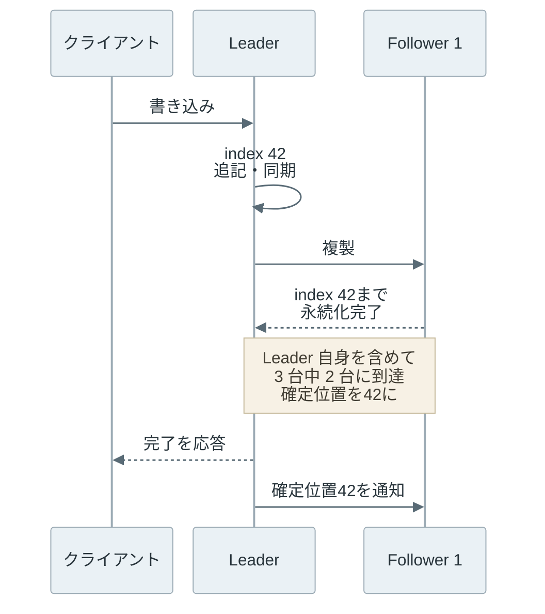

WAL（Write-Ahead Log、書き込み先行ログ）は、DB（データベース）の表や索引をディスクに書き出す前に、その変更をログとして永続化する仕組みです。更新の途中で停止しても、ログを使って未反映の変更を適用できます。毎回すべてのデータページを同期する代わりに、追記するログを同期して応答できる点も利点です。

例えば、残高を更新して成功を返した直後にサーバーが停止したとします。メモリだけにあった更新は消えますが、ログに残っていれば再起動時に残高を復元できます。先に書く対象と、後から書く対象は以下の通りです。


- title: 変更を記録
  body: 表や索引に加える変更を WAL に追記します。
- title: WAL を同期
  body: 変更を復元できるログを先に永続化します。
- title: データページを同期
  body: 対応する表や索引のページを書き出します。同期コミットの応答は、この完了を待つ必要がありません。


メモリ上のページは WAL の同期前に変更しても構いません。そのページをディスクに書き出す時には、対応する WAL の同期が終わっている必要があります。また、成功応答済みの更新を停止後も残す同期コミットでは、コミットに必要な WAL を同期してから応答します。[PostgreSQL の WAL の説明](https://www.postgresql.org/docs/current/wal-intro.html)も、この永続化の順序を示しています。

以下は、本記事の後半で扱うログ上の 3 つの位置の例です。



上記の図の左側は捨てて良い古いログ、右側はまだクライアントに見せないエントリです。

<br>

本記事では、1 台のサーバーが状態を失わないための WAL から、ログを複製した時に現れる 2 つの位置、低位ウォーターマーク（Low-Water Mark）と高位ウォーターマーク（High-Water Mark）までを説明します。扱う疑問は次の 6 つです。

- 状態をディスク上のデータ構造に直接書く方法には、どんな問題があるのか。
- エントリをどんな形式で追記するのか。
- ディスクへの同期が失敗した時、同期をやり直して良いのか。
- 再起動した時、書きかけのエントリが残ったログからどう復旧するのか。
- 追記しかしないログは、どこまで捨てて良いのか。
- ログを複製した時、どこまでをクライアントに見せて良いのか。

トランザクションの分離レベルや、ログを使った時点復旧は、本記事では扱いません。

---

### WAL が必要な理由

状態をディスク上のデータ構造に直接書く方法には、2 つの問題があります。1 つは速度、もう 1 つは中断です。

速度の面では、索引や表のページ（ディスクに読み書きする固定長の単位）はディスク上で離れた位置にあるため、更新のたびに複数箇所に書き込む必要があります。WAL は末尾に追記するだけなので、書き込み位置が連続します。[PostgreSQL のドキュメント](https://www.postgresql.org/docs/current/wal-intro.html)も、ディスク書き込みが減る理由として、コミットのたびに変更した全てのデータファイルを同期する代わりに WAL だけを同期すれば済む点を挙げています。

中断はより深刻です。複数のページを書き換える途中でプロセスが停止すると、一部だけが更新された状態が残ります。例えば、索引のページだけを書き換えた所で停止すると、以下のようになります。


- title: 索引を更新
  body: 新しいデータの位置を記録します。
- title: 本体の更新前に停止
  body: 索引は新しい状態、本体は古い状態のまま残ります。
- title: 再起動して検索
  body: 索引が指す先に、目的のデータが見つかりません。


上記の例で壊れているのは、索引と本体の対応です。どちらのページも単体では読めるため、サーバーは矛盾に気付かないまま古いデータを返すか、存在しない位置を参照します。停止はどの瞬間にも起こり得るので、書き込む順番を工夫しても、複数箇所の更新を分割不能にはできません。

WAL を先に永続化しておけば、データページの更新が途中で止まっても、ログから再適用できます。トランザクションを扱う DB では、どの変更を確定したものとして復旧するかも判断します。以下のサンプルは、1 件の完全なレコードを 1 件の確定したコマンドとして扱う、単一 Writer のログに絞ります。

単一 Writer でも、末尾のレコードが途中までしか書かれない場合があります。しかし「同期前に停止した」だけでは、そのレコードが消えるとは限りません。OS が既に書き出していれば、完全なレコードが残ります。


- title: 同期完了前
  body: 完全なレコードが残る場合も、一部だけ残る場合もあります。成功はまだ応答しません。
- title: 同期完了後・応答前
  body: ログから復元できます。しかしクライアントには成功したか分かりません。
- title: 成功応答後
  body: ログから復元できます。ストレージが同期の保証を守ることが前提です。


このため、応答が届かなかった要求は、再試行すると二重に適用される可能性があります。再送の扱いは[冪等性](/notes/distributed-systems/idempotency/)で別に説明しています。WAL だけで要求の重複を防げるわけではありません。

---

### エントリの形式と追記

WAL に何を書くかは実装によって違います。状態を変えるコマンドをそのまま書く方式と、変更後のページの内容を書く方式があり、PostgreSQL は後者に近い形でページに対する変更を記録します。以下ではコマンドを書く方式で説明します。

1 件のエントリには、順序を表す通し番号（index）と、再適用に必要なデータ、そして破損を検出するためのチェックサムを持たせます。index はログの中での連番で、DB の索引とは関係がありません。チェックサムは、データから計算した短い値で、偶発的な破損を検出します。ここで使う CRC32 は暗号学的なハッシュではなく、異なる内容でも同じ値になる場合があります。

[Go](https://go.dev/) で書くと次のようになります。レコードの最初の 8 バイトが長さ（4 バイト）とチェックサム（4 バイト）で、その後に続く本体の頭 8 バイトが index です。

```go
// maxEntrySize は、indexを含む本体の最大バイト数です。
const maxEntrySize = 8 << 20

// Entry は WAL に 1 件追記する状態変更です。
type Entry struct {
	Index uint64
	Data  []byte
}

// Append は entry をログ末尾に追記し、ディスクに書き終えるまで戻りません。
func Append(f *os.File, e Entry) error {
	if len(e.Data) > maxEntrySize-8 {
		return fmt.Errorf("entry data exceeds %d bytes", maxEntrySize-8)
	}
	body := make([]byte, 8+len(e.Data))
	binary.BigEndian.PutUint64(body, e.Index)
	copy(body[8:], e.Data)

	record := make([]byte, 8+len(body))
	binary.BigEndian.PutUint32(record, uint32(len(body)))
	copy(record[8:], body)
	// チェックサムは長さと本体の両方を覆う。
	binary.BigEndian.PutUint32(record[4:], crc32.ChecksumIEEE(append(record[:4:4], body...)))

	if n, err := f.Write(record); err != nil {
		return err
	} else if n != len(record) {
		return io.ErrShortWrite
	}
	return f.Sync()
}
```

最後の `f.Sync()` が耐久性を決めています。`Write` が返った時点でデータは OS のページキャッシュ（OS が書き込みを一旦ためておくメモリ上の領域）にあり、まだディスクに届いていない部分は、電源断で失われる可能性があります。`Sync` はそれをディスクに書き出す指示です。

1 件ごとに同期すると遅くなるため、複数の書き込みをまとめて 1 回で同期する実装が使われます。まとめている間は応答も待たせるので、同期の回数を減らす代わりに応答時間が延びます。

この差を手元のマシン（Ubuntu 26.04.1、ext4、NVMe SSD の KIOXIA EXCERIA PLUS G4）で測りました。`Append` と同じ形式で 116 バイトのレコードを作り、何件ごとに `Sync` を 1 回呼ぶかを変えます。

前半は休まず書き続けた時の 1 秒あたりの件数、後半は 1 ミリ秒ごとに 1 件届くとして、規定の件数が揃うまで待ってから書いた時の、届いてから同期が終わるまでの時間です。各値は 3 回の中央値です。

以下は計測部分で、コードの全体は [fsyncbench/main.go](https://github.com/nao1215/debimate/blob/main/content/notes/distributed-systems/write-ahead-log/lab/fsyncbench/main.go) にあります。

```go
// appendBatch writes n records in one Write and makes them durable with one Sync.
func appendBatch(f *os.File, next *uint64, n int, data []byte) {
	buf := make([]byte, 0, n*(16+len(data)))
	for i := 0; i < n; i++ {
		*next++
		buf = append(buf, encode(*next, data)...)
	}
	if _, err := f.Write(buf); err != nil {
		panic(err)
	}
	if err := f.Sync(); err != nil {
		panic(err)
	}
}
```

<details>
<summary>計測の出力（各値は 3 回の中央値）</summary>

```text
[part 1] back to back, 1 s per batch size, median of 3
batch  records/s  syncs/s  round_p50_ms  round_p99_ms
    1       1328     1328         0.699         2.014
    4       5671     1418         0.692         0.840
   16      22063     1379         0.704         0.912
   64      85654     1338         0.732         1.000
  256     314132     1227         0.769         1.586

[part 2] one record every 1 ms, wait for a full batch, then Sync, median of 3
batch  latency_p50_ms  latency_p99_ms
    1           1.394          23.430
    4           2.828           4.965
   16           9.453          17.945
   64          33.667          64.965
```

</details>

以下は、上記の出力を描いた図です。



1 回の `Sync` は件数によらず約 0.7 ミリ秒なので、1 秒あたりの件数はまとめた数にほぼ比例して増えます。一方で、件数が揃うのを待つ分だけ応答は延びます。1 件ごとの同期は処理能力（約 1,300 件/秒）が到着（1,000 件/秒）に近く、少し遅れると待ち行列が伸びるため p99 が跳ねます。

計測中は他の処理も動いていて、別の回では 1 件ごとの中央値が 440 ミリ秒になり、前半の大きいバッチでも `Sync` が 3 ミリ秒前後に延びる回がありました。出力の全体は [fsyncbench_output.txt](https://github.com/nao1215/debimate/blob/main/content/notes/distributed-systems/write-ahead-log/lab/fsyncbench_output.txt) にあります。

本体の上限には index の 8 バイトも含めるため、Data の上限は 8MiB から 8 バイトを引いた値です。書く側と読む側で同じ上限を使わなければ、正常に保存したレコードを復旧時に拒否してしまいます。ファイルは追記モードで開き、書き込みまたは同期に失敗したら、そこで書き込みを止めます。末尾を確認せずに次のレコードを継ぎ足しません。

<br>

`Sync` が失敗した後の扱いも、耐久性を左右します。2018 年には、PostgreSQL の [fsync（`Sync` が内部で呼ぶシステムコール）の扱い](https://wiki.postgresql.org/wiki/Fsync_Errors)が問題になりました。

一部の OS は、書き出せなかったページキャッシュのデータを捨てて fsync の失敗として報告し、もう一度 fsync を呼ぶと成功を返します。それまでの PostgreSQL はデータファイルの fsync が失敗すると再試行していたので、失われたデータを書き終えたものとして扱う恐れがありました。

以下は、データファイルの fsync が失敗した後の 2 つの扱いを並べた図です。



上記の図の上段では、2 回目の fsync の成功が、捨てられたデータについて何も保証していません。

2019 年 2 月の更新（[PostgreSQL 11.2](https://www.postgresql.org/docs/release/11.2/) など）からは、既定では fsync が失敗すると再試行せずにサーバーを止め、再起動時に WAL から再生します。失敗したのはデータファイル側の同期で、その時点の WAL は、失われたデータの唯一残った写しになり得ます。

PostgreSQL の[非同期コミット](https://www.postgresql.org/docs/current/wal-async-commit.html)では、WAL の同期完了を待たずに成功を返します。直近のコミットを失う可能性と引き換えに待ち時間を減らします。これは WAL を使わない設定ではなく、WAL をデータページより先に永続化する規則は残ります。

---

### 復旧の手順

復旧では、先頭から完全なレコードを読みます。次のコードは、正常な終端、途中で切れた末尾、破損を区別します。

```go
var ErrIncomplete = errors.New("incomplete record")
var ErrCorrupt = errors.New("corrupt record")

func Replay(r io.Reader) ([]Entry, error) {
	var entries []Entry
	header := make([]byte, 8)
	for {
		n, err := io.ReadFull(r, header)
		if err == io.EOF && n == 0 {
			return entries, nil
		}
		if err != nil {
			return entries, readError(err)
		}
		size := binary.BigEndian.Uint32(header)
		if size < 8 || size > maxEntrySize {
			return entries, ErrCorrupt
		}
		body := make([]byte, size)
		if _, err := io.ReadFull(r, body); err != nil {
			return entries, readError(err)
		}
		if crc32.ChecksumIEEE(append(header[:4:4], body...)) != binary.BigEndian.Uint32(header[4:]) {
			return entries, ErrCorrupt
		}
		entries = append(entries, Entry{
			Index: binary.BigEndian.Uint64(body),
			Data: body[8:],
		})
	}
}

func readError(err error) error {
	if errors.Is(err, io.EOF) || errors.Is(err, io.ErrUnexpectedEOF) {
		return ErrIncomplete
	}
	return err
}
```

`Replay` は、エラーが起きるまでに読み終えた完全なエントリを返します。ただし、呼び出し側はエラーを無視して起動を続けてはいけません。長さやチェックサムが不正なら、末尾の書きかけか、確定したレコードの破損かをこの形式だけでは区別できないためです。ゼロ埋めによる事前確保も、このサンプルでは行いません。

末尾の欠損と確認できた場合は、最後の完全なレコードまで戻して復旧する方針が考えられます。しかし、過去の同期済みデータが壊れていれば、別の複製やバックアップからの復旧が必要です。読み取りの入出力エラーも、そのまま呼び出し元に返します。

<br>

[実行可能なサンプル](lab/main.go)では、3 件のログを作り、末尾を 1 バイト切った場合と、2 件目を書き換えた場合を比較します。元のファイルは残し、コピーしたバイト列に対して操作します。

以下は、前述の `Append` と `Replay` を呼び出す実験部分の抜粋です。`must` はエラーがあれば実験を停止する補助関数です。インポートと各関数をまとめた全体は [main.go](lab/main.go) にあります。

```go
func must(err error) {
	if err != nil {
		panic(err)
	}
}

func main() {
	dir, err := os.MkdirTemp("", "wal-lab-")
	must(err)
	defer os.RemoveAll(dir)
	f, err := os.OpenFile(filepath.Join(dir, "wal"), os.O_CREATE|os.O_RDWR|os.O_APPEND, 0600)
	must(err)
	defer f.Close()
	for i := 1; i <= 3; i++ {
		must(Append(f, Entry{uint64(i), []byte("set balance=500")}))
	}
	raw, err := os.ReadFile(f.Name())
	must(err)
	printReplay := func(label string, data []byte) {
		entries, err := Replay(bytes.NewReader(data))
		fmt.Printf("%s: entries=%d error=%v\n", label, len(entries), err)
	}
	printReplay("complete", raw)
	printReplay("truncated tail", raw[:len(raw)-1])
	corrupt := bytes.Clone(raw)
	corrupt[len(raw)/3+16] ^= 1
	printReplay("corrupt middle", corrupt)
	boundary, err := os.OpenFile(filepath.Join(dir, "boundary"), os.O_CREATE|os.O_RDWR|os.O_APPEND, 0600)
	must(err)
	defer boundary.Close()
	data := bytes.Repeat([]byte{0x5a}, maxEntrySize-8)
	must(Append(boundary, Entry{1, data}))
	_, err = boundary.Seek(0, 0)
	must(err)
	entries, err := Replay(boundary)
	must(err)
	fmt.Printf("maximum data: bytes=%d entries=%d equal=%t\n", len(data), len(entries), len(entries) == 1 && bytes.Equal(entries[0].Data, data))
	oversized, err := os.OpenFile(filepath.Join(dir, "oversized"), os.O_CREATE|os.O_RDWR|os.O_APPEND, 0600)
	must(err)
	defer oversized.Close()
	err = Append(oversized, Entry{1, make([]byte, maxEntrySize-7)})
	info, statErr := oversized.Stat()
	must(statErr)
	fmt.Printf("oversized data: rejected=%t file_bytes=%d\n", err != nil, info.Size())
}
```

```sh
cd lab
go run .
go test ./...
```

```text
complete: entries=3 error=<nil>
truncated tail: entries=2 error=incomplete record
corrupt middle: entries=1 error=corrupt record
maximum data: bytes=8388600 entries=1 equal=true
oversized data: rejected=true file_bytes=0
```

最後の 2 行はサイズの境界です。上限ちょうどの Data は保存したバイト列と一致し、1 バイト超えるとファイルに書く前に拒否されます。末尾の切断は復旧処理の入力を再現する実験であり、実際の電源断やストレージの耐久性を検証したものではありません。

復旧では、ディスク上のデータ構造やスナップショットに既に反映したエントリをもう一度読む場合があります。そのため、同じエントリを 2 回適用しても結果が変わらないことが必要で、これを冪等（べきとう、idempotent）と呼びます。

一般的な作り方は、適用済みの index を状態と一緒に保存し、復旧時にそこまでを読み飛ばす方法です。エントリを「残高を 100 増やす」ではなく「残高を 500 にする」と書く方法もあります。ただし、古い設定を新しい設定の後に再適用して良いわけではなく、ログの順序と適用済み位置の管理は必要です。

---

### このコードが扱っていないこと

上記のコードでは、次の機能を省いています。

- 複数の Writer：index の採番、追記、同期、状態への適用を一連の順序として管理する排他制御
- 親ディレクトリの同期：新しいファイルの名前はディレクトリの中身として記録されるので、省くとクラッシュ後に新しいファイルが存在しないことがある
- 複数レコードのトランザクション、index の連続性検査、破損後のファイル修復
- 複製：他のサーバーに配る場合に必要な情報（後述の高位ウォーターマークの節で扱う Leader の任期など）

---

### 低位ウォーターマーク

WAL は追記しかしないため、放置すればディスクを使い切ります。スナップショットを取れば、そこから再開できるので、それ以前のログは必要なくなります。低位ウォーターマークとは、[この位置より前のログを捨てて良い](https://martinfowler.com/articles/patterns-of-distributed-systems/low-watermark.html)と宣言する index です。削除の判断をログの機構から切り離し、どこまで捨てて良いかを外から与える形にしています。

ファイル単位で削除できるように、ログは一定の大きさごとに別のファイルに分けます。分けた 1 ファイルをセグメントと呼びます。通常のファイルでは先頭部分だけを簡単に切り落とせないため、古いファイルを丸ごと削除できる単位を用意します。

例えば、index 200 までを反映したスナップショットを取ると、以下のセグメントが削除できるようになります。


- title: 削除できる範囲
  items:
  - "segment 1：index 1〜100"
  - "segment 2：index 101〜200"
  body: スナップショットから復元できるため、この 2 ファイルを削除できます。
- title: 残す範囲
  items:
  - "segment 3：index 201〜300"
  - "segment 4：index 301 以降"
  body: スナップショットより後の変更をログから再適用します。


上記の図では、スナップショットから再開できるので、index 200 以前のエントリは再適用しません。segment 1 と segment 2 がファイルごと削除の対象になり、復旧はスナップショットの読み込みと index 201 以降の再適用に変わります。

低位ウォーターマークの決め方で代表的なのは 2 つです。1 つはスナップショットに基づく方法で、上記の図がこの方法です。もう 1 つは保持期間に基づく方法で、書かれてから一定時間が過ぎたエントリを消します。ただし、ログを読む遅い Follower やバックアップ処理があれば、その用途に必要なログも残します。保持期間だけで状態復元に必要なログを消して良いわけではありません。

---

### 高位ウォーターマーク

WAL が守るのは、1 台のサーバーが停止して再起動するまでの範囲です。そのサーバーが壊れたままなら、誰も読み書きできません。可用性を上げるには、同じログを複数のサーバーに複製します。

[Leader と Follower による複製](../leader-and-followers/)では、1 台が Leader になって書き込みを受け付け、残りの Follower にログを配ります。Leader が落ちたら、残ったサーバーの中から新しい Leader を選び直します。

この時に問題になるのが、Leader が受け取ったエントリのうち、どこまでが失われないと言えるのかです。Leader のログに書いてあるだけでは、Leader が壊れた瞬間にそのエントリも失われます。

高位ウォーターマークとは、[複製が確定した最後のエントリの index](https://martinfowler.com/articles/patterns-of-distributed-systems/high-watermark.html) です。確定の条件は実装によって違います。[過半数を使う合意](../quorum/)では、複製と Leader 選出の両方に規則を設けて、確定したエントリを引き継ぎます。[Apache Kafka](https://kafka.apache.org/) は過半数ではなく、追い付いているレプリカの集合（ISR、In-Sync Replicas）の全員が受け取った時点を確定とします。

以下は、Raft で現在の任期のエントリを同期して複製する場合です。Leader 自身と Follower 1 で永続化が完了すると、高位ウォーターマークが進みます。



上記の図では、Leader が Follower 2 の受領を待たずに応答を返しています。これが可用性を高めています。1 台が遅れていても書き込みは進みます。

[Raft](https://raft.github.io/raft.pdf) は、過半数に複製されたことだけでは確定と扱いません。Leader が自分の任期（term）で作ったエントリが過半数に複製された時点で確定とし、それより前のエントリはまとめて確定します。前の任期のエントリを複製数だけで確定と判断すると、後から選ばれた Leader がそれを上書きする経路が残るからです（Raft 論文の Figure 8）。

高位ウォーターマークより後ろのエントリは、Leader のログには存在するのにクライアントからは見えません。Leader が交代すると、新しい Leader は自分のログを正として、食い違う部分を Follower に上書きさせます。確定していないエントリは、新しい Leader がそれを持っていれば後から確定し、持っていなければ消えます。

以下は、高位ウォーターマークが 42 の時に、43 までしか持たない Follower 1 が新しい Leader になった例です。



高位ウォーターマークより後ろを読み取り対象から外すことで、確定するか消えるか分からないエントリをクライアントへ返さずに済みます。

そのため、この位置は「ここまでは見せて良い」ではなく「ここより後ろは見せてはいけない」という上限です。

実際に読み取りに応じて良いかには別の条件が付きます。Raft で線形化可能な読み取りを返すには、Leader が現在の任期のコミット位置を確認し、まだ Leader であることを過半数との通信などで確認する必要があります。さらに、読み取り対象の状態へ確認済みのコミット位置まで適用してから応答します（Raft 論文 §8）。

<br>

なお、以前の Kafka の Follower は、再起動した時に自分が知る高位ウォーターマークより後ろを切り捨てていました。高位ウォーターマークは Follower に遅れて伝わるため、Leader では確定済みのエントリまで捨てる場合があり、ログの内容が食い違ったり、確定済みのデータが失われたりしました。

現在は、Leader の担当期間ごとに増える番号（leader epoch）をログに記録し、Follower が Leader に問い合わせて切り捨て位置を教えてもらう方式になっています（[KIP-101](https://cwiki.apache.org/confluence/display/KAFKA/KIP-101+-+Alter+Replication+Protocol+to+use+Leader+Epoch+rather+than+High+Watermark+for+Truncation)）。

---

### 3 つの位置の関係

1 台のサーバーのログの上には、意味の違う 3 つの位置が同時に存在します。

| 位置 | 意味 | 進める条件 |
|---|---|---|
| 低位ウォーターマーク | この前は削除して良い | スナップショットや保持期間を確認し、復旧・複製に不要と判断 |
| 高位ウォーターマーク | ここより後ろは見せない | 実装が定める複製の条件を満たす |
| ログ末尾 | 追記された最後のエントリ | 新しい書き込みを受け付ける |

本記事では、低位ウォーターマーク L を「残す最初の index」、高位ウォーターマーク H を「確定した最後の index」、ログ末尾 T を「追記した最後の index」とします。

確定した範囲からだけ削除する場合、同じサーバー上では `L ≤ H + 1` と `H ≤ T` が成り立ちます。index H までを全てスナップショットに反映して削除した場合、残す最初の index は H+1 になるためです。


- title: 未適用のログがある
  items:
  - "L=201、H=240、T=250"
  - "201〜240 の 40 件は確定済み"
  - "241〜250 の 10 件は未確定"
- title: 全件をスナップショットに反映した
  items:
  - "L=201、H=200、T=200"
  - "残すログは 0 件"
  - "L が H より 1 大きくても矛盾しません"


低位ウォーターマークの制約を `L ≤ H` にすると、後者の正常な状態を表せません。保持期間を使う場合も、未確定のエントリや復旧に必要なエントリを削除しない条件を別に設けます。

連番に欠番がなければ、保持するエントリ数は `max(0, T - L + 1)`、未確定のエントリ数は `T - H` です。復旧時間は件数だけでなく、各レコードの大きさや再適用の処理にも依存します。また、未確定である理由は複製の遅れだけとは限りません。

別のサーバー同士の位置には、この不等式をそのまま使えません。遅れた Follower のログ末尾が、Leader の高位ウォーターマークより手前にある場合があります。

---

### 利点

- 追記だけで耐久性を確保でき、コミットのたびに全データページを同期する必要がない
- 書き込み位置が連続するため、複数箇所を書き換えるより同期の負荷が小さい
- 複数の変更をまとめて 1 回の同期にでき、書き込みが多いほど同期の回数を大きく減らせる
- 同期済みログから未反映の変更を再適用できる。トランザクションを扱う DB では、未確定変更の扱いも別に判断する
- 同じログを他のサーバーに送れば、そのまま複製の材料になる

---

### 欠点

WAL では、データ構造に加えてログも保存・管理する必要があります。

- 同じ内容をログとデータ構造に 2 度書くため、書き込み量が増える
- ログを捨てる仕組みを別に用意しないとディスクを使い切る
- 状態を変えるコマンドが、再適用しても結果が変わらない性質を満たす必要がある
- 保持したログの量や再適用の処理が増えると、復旧に時間がかかる
- 複製した場合、確定していないエントリを読ませない制御が別に必要

---

### 適さないケース

- 停止したら状態を捨てて作り直して良いキャッシュのような用途
- 1 件あたりのデータが大きく、ログとデータ構造への 2 度書きが帯域を圧迫する場合
- 書き込みがほとんど無く、読み取りだけが続くシステム
