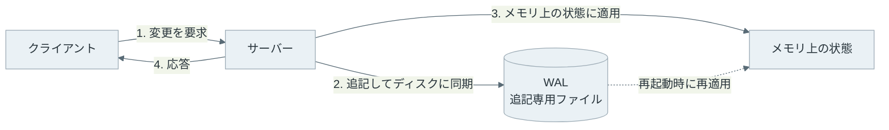
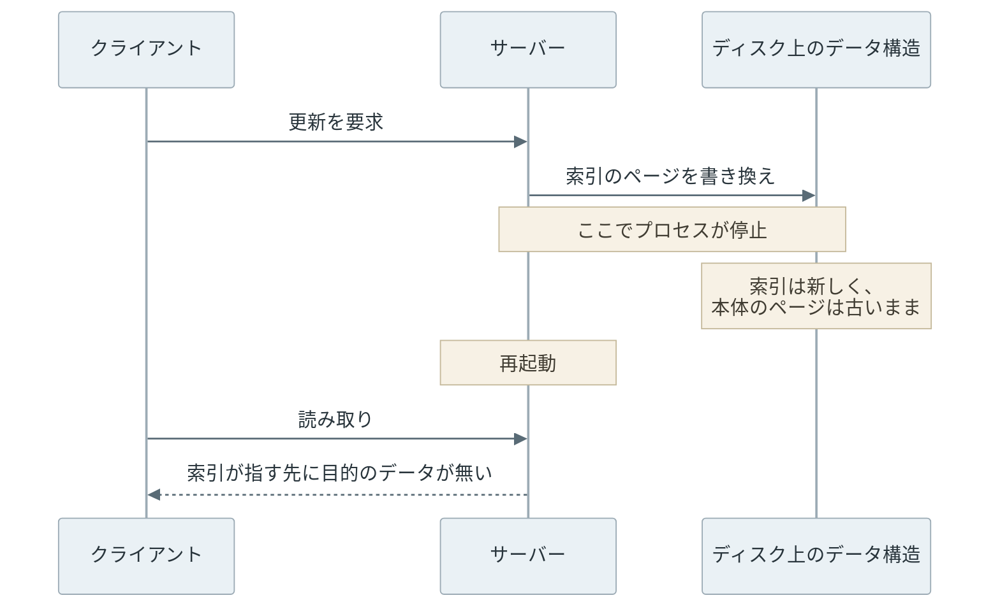
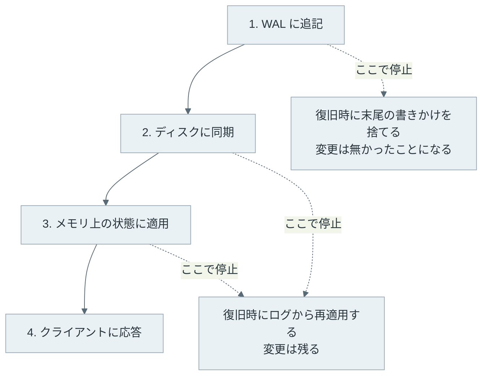
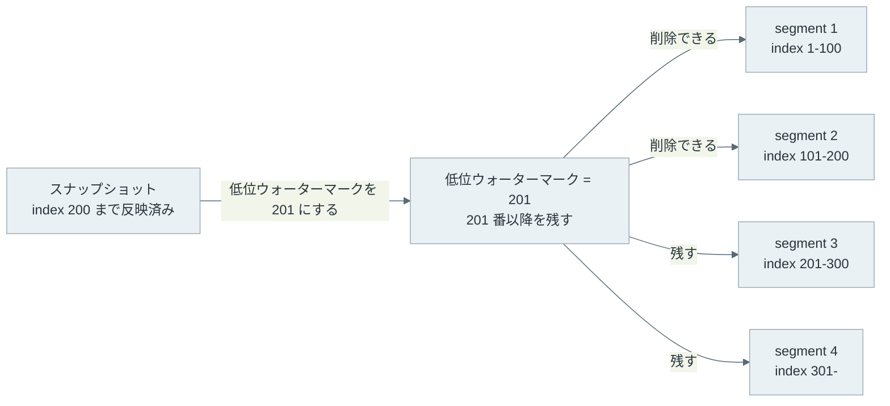
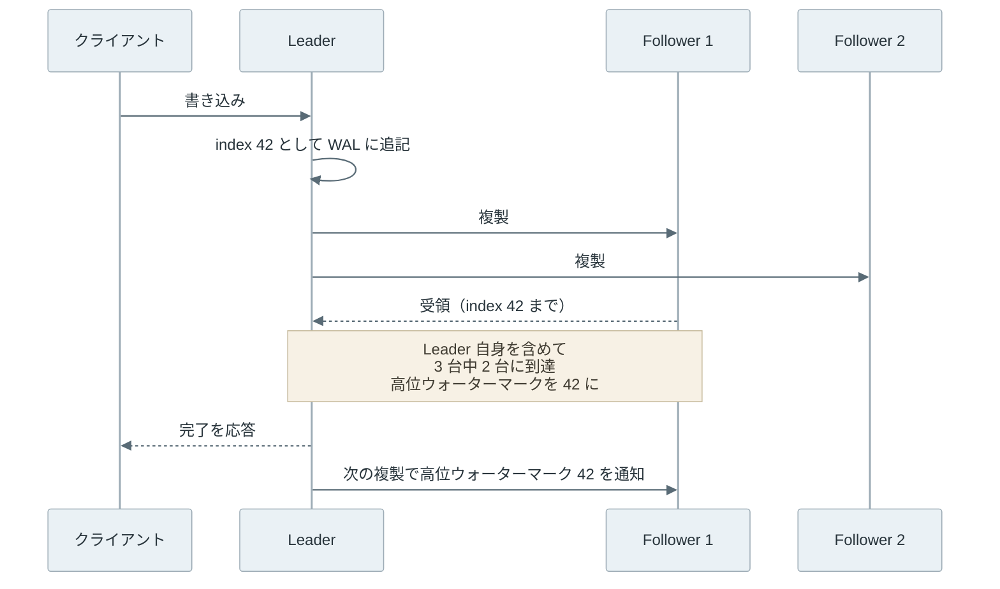

WAL（Write-Ahead Log、書き込み先行ログ）は、状態を変更する前にその変更内容を追記専用のファイルに書き、ディスクに書き終えてから応答を返す仕組みです。再起動した時は、スナップショット（ある時点の状態をまとめてディスクに保存したもの）以降のログを読み直して同じ変更を適用し、停止する直前の状態を復元します。利用できるスナップショットが無ければ、ログの先頭から再生します。

書き込みが到着してから応答するまでの経路を以下に示します。



上記の図で順番が重要なのは 2 と 3 です。ディスクに書き終えるのが先で、メモリ上の状態を変えるのは後になります。逆順にすると、ディスクに書き終える前の変更を他の要求が読めてしまい、その直後に停止すると、読まれた値が復旧後に消えます。点線の経路は通常の処理では通らず、再起動の時だけ通ります。

上記の図の適用先はメモリ上の状態です。RDB でも、変更はまずメモリ上のページに適用し、ディスク上のデータ構造（索引や表のページ）には後からまとめて書き出します。

本記事では、1 台のサーバーが状態を失わないための WAL から、ログを複製した時に現れる 2 つの位置、低位ウォーターマーク（Low-Water Mark）と高位ウォーターマーク（High-Water Mark）までを説明します。扱う疑問は次の 6 つです。

- 状態をディスク上のデータ構造に直接書く方法には、どんな問題があるのか。
- エントリをどんな形式で追記するのか。
- ディスクへの同期が失敗した時、同期をやり直して良いのか。
- 再起動した時、書きかけのエントリが残ったログからどう復旧するのか。
- 追記しかしないログは、どこまで捨てて良いのか。
- ログを複製した時、どこまでをクライアントに見せて良いのか。

トランザクションの分離レベルや、ログを使った時点復旧は、本記事では扱いません。

---

### WAL が必要な理由

状態をディスク上のデータ構造に直接書く方法には、2 つの問題があります。1 つは速度、もう 1 つは中断です。

速度の面では、索引や表のページ（ディスクに読み書きする固定長の単位）はディスク上で離れた位置にあるため、更新のたびに複数箇所に書き込む必要があります。WAL は末尾に追記するだけなので、書き込み位置が連続します。[PostgreSQL のドキュメント](https://www.postgresql.org/docs/current/wal-intro.html)も、ディスク書き込みが減る理由として、コミットのたびに変更した全てのデータファイルを同期する代わりに WAL だけを同期すれば済む点を挙げています。

中断はより深刻です。複数のページを書き換える途中でプロセスが停止すると、一部だけが更新された状態が残ります。例えば、索引のページだけを書き換えた所で停止すると、以下のようになります。



上記の図で壊れているのは、索引と本体の対応です。どちらのページも単体では読めるため、サーバーは矛盾に気付かないまま古いデータを返すか、存在しない位置を参照します。停止はどの瞬間にも起こり得るので、書き込む順番を工夫しても、複数箇所の更新を分割不能にはできません。

WAL は、「変更内容を 1 箇所に記録してから、実際の更新を行う」という順序を守ることで、この問題を解きます。記録が完了していれば、更新の途中で止まっても再適用でやり直せます。記録が完了していなければ、その変更は無かったことにできます。

中断そのものは無くなりません。変わるのは、中断が半端な状態を残す場所です。WAL で書きかけになり得るのはログ末尾の 1 件だけなので、そこを読み飛ばせば残りは全て完全なエントリです。

停止した時点ごとに復旧後の結果を整理すると、以下の通りです。



上記の図の分かれ目は、2 の同期が終わったかどうかだけです。どちらに転んでも、応答を返すのは 4 の時点なので、応答済みの変更が失われることはありません。

---

### エントリの形式と追記

WAL に何を書くかは実装によって違います。状態を変えるコマンドをそのまま書く方式と、変更後のページの内容を書く方式があり、PostgreSQL は後者に近い形でページに対する変更を記録します。以下ではコマンドを書く方式で説明します。

1 件のエントリには、順序を表す通し番号（index）と、再適用に必要なデータ、そして破損を検出するためのチェックサムを持たせます。index はログの中での連番で、DB の索引とは関係がありません。チェックサムは、データから計算した短い値で、内容が 1 ビットでも変われば別の値になります。

Go で書くと次のようになります。レコードの最初の 8 バイトが長さ（4 バイト）とチェックサム（4 バイト）で、その後に続く本体の頭 8 バイトが index です。

```go
// maxEntrySize は、壊れた長さから巨大な確保が走る事を防ぐ上限です。
const maxEntrySize = 8 << 20

// Entry は WAL に 1 件追記する状態変更です。
type Entry struct {
	Index uint64
	Data  []byte
}

// Append は entry をログ末尾に追記し、ディスクに書き終えるまで戻りません。
func Append(f *os.File, e Entry) error {
	body := make([]byte, 8+len(e.Data))
	binary.BigEndian.PutUint64(body, e.Index)
	copy(body[8:], e.Data)

	record := make([]byte, 8+len(body))
	binary.BigEndian.PutUint32(record, uint32(len(body)))
	copy(record[8:], body)
	// チェックサムは長さと本体の両方を覆う。
	binary.BigEndian.PutUint32(record[4:], crc32.ChecksumIEEE(append(record[:4:4], body...)))

	if _, err := f.Write(record); err != nil {
		return err
	}
	return f.Sync()
}
```

最後の `f.Sync()` が耐久性を決めています。`Write` が返った時点でデータは OS のページキャッシュ（OS が書き込みを一旦ためておくメモリ上の領域）にあり、電源が落ちれば消えます。`Sync` はそれをディスクに書き出す指示です。1 件ごとに同期すると遅くなるため、複数の書き込みをまとめて 1 回で同期する実装が使われます。まとめている間は応答も待たせるので、同期の回数を減らす代わりに応答時間が延びます。

`Sync` が失敗した後の扱いも、耐久性を左右します。2018 年には、PostgreSQL の fsync（`Sync` が内部で呼ぶシステムコール）の扱いが問題になりました。一部の OS は、書き出せなかったページキャッシュのデータを捨てて fsync の失敗として報告し、もう一度 fsync を呼ぶと成功を返します。それまでの PostgreSQL はデータファイルの fsync が失敗すると再試行していたので、失われたデータを書き終えたものとして扱う恐れがありました。

2019 年 2 月の更新（[PostgreSQL 11.2](https://www.postgresql.org/docs/release/11.2/) など）からは、fsync が失敗すると再試行せずにサーバーを止め、再起動時に WAL から再生します。失敗したのはデータファイル側の同期で、その時点の WAL は、失われたデータの唯一残った写しになり得ます。

同期を省いた場合に失われるものは、電源断やカーネルの停止で消える直近の書き込みだけです。プロセスだけが落ちた場合はページキャッシュが残るため、WAL は機能します。PostgreSQL はこの割り切りを[非同期コミット](https://www.postgresql.org/docs/current/wal-async-commit.html)として設定で選べるようにしています。

---

### 復旧の手順

復旧では、先頭から読んで書きかけの位置で止めます。

```go
// Replay は先頭から順に読み、書きかけの位置で打ち切ります。
func Replay(r io.Reader) ([]Entry, error) {
	var entries []Entry
	header := make([]byte, 8)
	for {
		if _, err := io.ReadFull(r, header); err != nil {
			return entries, truncatedOrFailed(err)
		}
		size := binary.BigEndian.Uint32(header)
		if size < 8 || size > maxEntrySize {
			return entries, nil // ゼロ埋めや壊れた長さ
		}
		body := make([]byte, size)
		if _, err := io.ReadFull(r, body); err != nil {
			return entries, truncatedOrFailed(err)
		}
		if crc32.ChecksumIEEE(append(header[:4:4], body...)) != binary.BigEndian.Uint32(header[4:]) {
			return entries, nil // 本体か長さが壊れている
		}
		entries = append(entries, Entry{
			Index: binary.BigEndian.Uint64(body),
			Data:  body[8:],
		})
	}
}

// truncatedOrFailed は、書きかけによる終端を正常とし、それ以外は失敗として返します。
func truncatedOrFailed(err error) error {
	if errors.Is(err, io.EOF) || errors.Is(err, io.ErrUnexpectedEOF) {
		return nil
	}
	return err
}
```

停止した瞬間に書いていたエントリは、ヘッダの途中で切れているか、本体が途中までしか届いていないか、中身が壊れているかの 3 通りです。`io.ReadFull` の失敗が前の 2 つ、チェックサムの不一致が最後の 1 つを捉えます。これとは別に長さの検査を先に置いているのは、事前確保（ファイルの領域を先にゼロで埋めて確保しておくこと）をしたファイルの末尾を終端として扱うためです。ゼロが並ぶ位置を長さ 0 のエントリとして読むと、その先で、空の本体から index を取り出そうとします。

末尾で打ち切っても確定したデータを失わないのは、壊れる位置がログの末尾に限られるという前提があるからです。上記のコードは、ディスクの劣化でログの途中が壊れた場合も、末尾の書きかけと区別せずに打ち切ります。また、読み取りの途中で本物の入出力エラーが起きた場合は、そこで打ち切らずにエラーを返します。読めなかったログを「そこで終わり」として起動を続けると、確定したデータを黙って捨てます。

再適用に必要な性質がもう 1 つあります。復旧では、ディスク上のデータ構造やスナップショットに既に反映したエントリをもう一度読む場合があります。そのため、同じエントリを 2 回適用しても結果が変わらないことが必要で、これを冪等（べきとう、idempotent）と呼びます。一般的な作り方は、適用済みの index を状態と一緒に保存し、復旧時にそこまでを読み飛ばす方法です。エントリを「残高を 100 増やす」ではなく「残高を 500 にする」と書く方法もあります。

---

### このコードが扱っていないこと

上記のコードが扱っていないことは、次の 3 つです。

- 複数の Writer：`Append` に排他制御が無く、同時に呼ぶと書き込みが混ざる
- 親ディレクトリの同期：新しいファイルの名前はディレクトリの中身として記録されるので、省くとクラッシュ後に新しいファイルが存在しないことがある
- 複製：他のサーバーに配る場合に必要な情報（後述の高位ウォーターマークの節で扱う Leader の任期など）

---

### 低位ウォーターマーク

WAL は追記しかしないため、放置すればディスクを使い切ります。スナップショットを取れば、そこから再開できるので、それ以前のログは必要なくなります。低位ウォーターマークとは、[この位置より前のログを捨ててよい](https://martinfowler.com/articles/patterns-of-distributed-systems/low-watermark.html)と宣言する index です。削除の判断をログの機構から切り離し、どこまで捨てて良いかを外から与える形にしています。

ファイル単位で削除できるように、ログは一定の大きさごとに別のファイルに分けます。分けた 1 ファイルをセグメントと呼びます。ファイルの途中を削っても空きは戻らないので、ファイルごと消せる境界が必要です。

例えば、index 200 までを反映したスナップショットを取ると、以下のセグメントが削除できるようになります。



上記の図では、スナップショットから再開できるので、index 200 以前のエントリは再適用しません。segment 1 と segment 2 がファイルごと削除の対象になり、復旧はスナップショットの読み込みと index 201 以降の再適用に変わります。

低位ウォーターマークの決め方で代表的なのは 2 つです。1 つはスナップショットに基づく方法で、上記の図がこの方法です。もう 1 つは保持期間に基づく方法で、書かれてから一定時間が過ぎたエントリを消します。前者は状態の復元に必要な分だけを正確に残します。

---

### 高位ウォーターマーク

WAL が守るのは、1 台のサーバーが停止して再起動するまでの範囲です。そのサーバーが壊れたままなら、誰も読み書きできません。可用性を上げるには、同じログを複数のサーバーに複製します。

複製の構成では、1 台が Leader になって書き込みを受け付け、残りの Follower にログを配ります。Leader が落ちたら、残ったサーバーの中から新しい Leader を選び直します。この時に問題になるのが、Leader が受け取ったエントリのうち、どこまでが失われないと言えるのかです。Leader のログに書いてあるだけでは、Leader が壊れた瞬間にそのエントリも失われます。

高位ウォーターマークとは、[複製が確定した最後のエントリの index](https://martinfowler.com/articles/patterns-of-distributed-systems/high-watermark.html) です。確定の条件は実装によって違います。過半数のサーバーに複製された時点を確定とする方式では、次の Leader は必ず過半数の同意で選ばれます。過半数どうしは必ず 1 台以上重なり、その 1 台は自分よりログが古い候補には投票しないため、過半数が持つエントリは新しい Leader にも残ります。[Apache Kafka](https://kafka.apache.org/) は過半数ではなく、追い付いているレプリカの集合（ISR、In-Sync Replicas）の全員が受け取った時点を確定とします。

以下は、過半数を条件とする方式で、Leader が書き込みを受け取ってから高位ウォーターマークが進むまでの流れです。



上記の図では、Leader が Follower 2 の受領を待たずに応答を返しています。これが可用性を高めています。1 台が遅れていても書き込みは進みます。

ここで注意点があります。[Raft](https://raft.github.io/raft.pdf) は、過半数に複製されたことだけでは確定と扱いません。Leader が自分の任期（term）で作ったエントリが過半数に複製された時点で確定とし、それより前のエントリはまとめて確定します。前の任期のエントリを複製数だけで確定と判断すると、後から選ばれた Leader がそれを上書きする経路が残るからです（Raft 論文の Figure 8）。

高位ウォーターマークより後ろのエントリは、Leader のログには存在するのにクライアントからは見えません。Leader が交代すると、新しい Leader は自分のログを正として、食い違う部分を Follower に上書きさせます。確定していないエントリは、新しい Leader がそれを持っていれば後から確定し、持っていなければ消えます。どちらに転ぶか分からないものを読ませないための線が、高位ウォーターマークです。

そのため、この位置は「ここまでは見せて良い」ではなく「ここより後ろは見せてはいけない」という上限です。実際に読み取りに応じて良いかには別の条件が付きます。Raft では Follower は読み取りに応答せず、Leader も就任した直後は追加の手続きを経るまで読み取りに応えません（Raft 論文 §8）。

<br>

なお、以前の Kafka の Follower は、再起動した時に自分が知る高位ウォーターマークより後ろを切り捨てていました。高位ウォーターマークは Follower に遅れて伝わるため、Leader では確定済みのエントリまで捨てる場合があり、ログの内容が食い違ったり、確定済みのデータが失われたりしました。現在は、Leader の担当期間ごとに増える番号（leader epoch）をログに記録し、Follower が Leader に問い合わせて切り捨て位置を教えてもらう方式になっています（[KIP-101](https://cwiki.apache.org/confluence/display/KAFKA/KIP-101+-+Alter+Replication+Protocol+to+use+Leader+Epoch+rather+than+High+Watermark+for+Truncation)）。

---

### 3 つの位置の関係

1 台のサーバーのログの上には、意味の違う 3 つの位置が同時に存在します。

| 位置 | 意味 | 進める条件 |
|---|---|---|
| 低位ウォーターマーク | この前は削除して良い | スナップショット完了か保持期間の経過 |
| 高位ウォーターマーク | ここより後ろは見せない | 実装が定める複製の条件を満たす |
| ログ末尾 | 追記された最後のエントリ | 新しい書き込みを受け付ける |

3 つは、低位ウォーターマーク、高位ウォーターマーク、ログ末尾の順に並びます。ただし、この並びは自動的に保たれるものではありません。保持期間で削除を決める方式は、確定したかどうかを見ずに時間だけで判断するため、放っておけば確定前のエントリを消します。実装で、低位ウォーターマークが高位ウォーターマークより先に進まないという制限を別に課す必要があります。

比べる対象が別のサーバーになると、この並びは崩れます。遅れている Follower のログ末尾は、Leader の高位ウォーターマークより手前に来ます。

低位ウォーターマークとログ末尾の差は、再起動時に読み直すエントリの量を表し、この差が大きいほど復旧に時間がかかります。高位ウォーターマークとログ末尾の差は、複製が追い付いていない量を表します。

---

### 利点

- 追記だけで耐久性を確保でき、データ構造の更新をディスクに同期しなくて良い
- 書き込み位置が連続するため、複数箇所を書き換えるより同期の負荷が小さい
- 複数の変更をまとめて 1 回の同期にでき、書き込みが多いほど同期の回数を大きく減らせる

- 復旧の手順が順方向の再適用だけになり、壊れた位置で打ち切る判断も単純になる
- 同じログを他のサーバーに送れば、そのまま複製の材料になる

---

### 欠点

WAL は、データ構造より先にログに追記して耐久性を得ます。その代わり、ログという 2 つ目の置き場所を管理することになります。

- 同じ内容をログとデータ構造に 2 度書くため、書き込み量が増える
- ログを捨てる仕組みを別に用意しないとディスクを使い切る
- 状態を変えるコマンドが、再適用しても結果が変わらない性質を満たす必要がある
- 復旧時間がログの長さに比例し、スナップショットの間隔で決まる
- 複製した場合、確定していないエントリを読ませない制御が別に必要

---

### 適さないケース

- 停止したら状態を捨てて作り直して良いキャッシュのような用途
- 1 件あたりのデータが大きく、ログとデータ構造への 2 度書きが帯域を圧迫する場合
- 書き込みがほとんど無く、読み取りだけが続くシステム
- 電源断で直近の書き込みが消えても構わず、応答時間を最優先する場合
