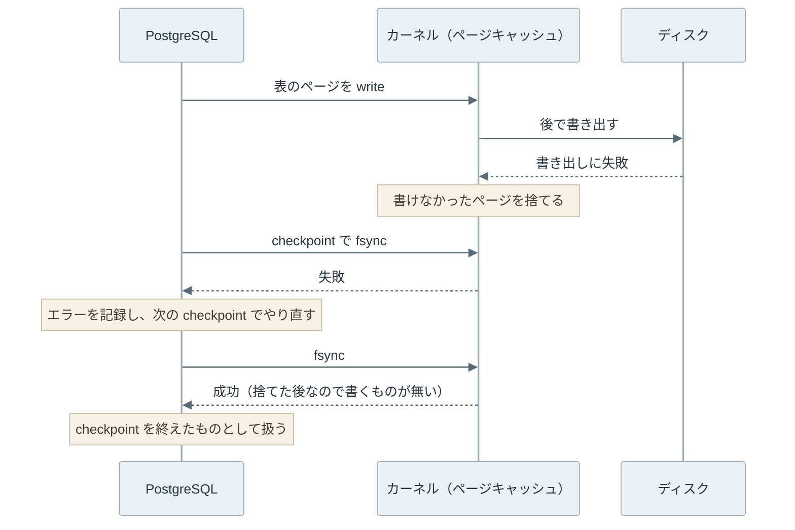

PostgreSQL を速くする設定として、次の 2 つがよく紹介されます。テスト用の DB（データベース）を [Testcontainers](https://testcontainers.com/) で立てる [エムスリーのテックブログ](https://www.m3tech.blog/entry/2026/08/28/160000)でも、2 つが並んで使われています。

```text
synchronous_commit = off
fsync = off
```

どちらか一方だけを設定した PostgreSQL に 1 行ずつ INSERT を送り続け、途中で `docker kill` を使ってプロセスごと強制終了したとします。起動し直した時、成功が返ったはずの行が消えているのは、どちらの設定でしょうか。

<br>

消えたのは synchronous_commit = off の方でした。fsync = off は、5 回試して 5 回とも 1 行も失いませんでした。以下は、手元の PostgreSQL 18.6 で、既定の設定と 2 つの設定を 5 回ずつ試した結果です。



名前だけを見ると、fsync を止める方が危なそうです。違いは、成功を返す時点で、コミットの記録がどこまで届いているかにあります。その記録を残す仕組みが WAL です。

[WAL](https://www.postgresql.org/docs/18/wal-intro.html)（Write-Ahead Log、ログ先行書き込み）は、表や索引のデータを書き換える前に、変更の内容を追記するだけのログに書いておく仕組みです。落ちた後は、このログを読み直して、データに反映されていなかった変更をやり直します。

WAL は PostgreSQL や SQLite の WAL モードで使われ、MySQL の InnoDB では同じ役割のログを redo log と呼びます。[LSM-Tree](/notes/database-systems/lsm-tree/) を使うストレージや、[Leader and Followers](/notes/distributed-systems/leader-and-followers/) で複製する仕組みも、同じ形のログを中心に置きます。

<br>

本記事では、DB の設定で synchronous_commit を見かけた人、pg_wal のディレクトリがディスクを埋めて慌てた人、ログを使う仕組みを自分で書こうとしている人に向けて、次の疑問に答えます。

- コミットが成功を返した時、ディスクには何があるのか
- synchronous_commit = off と fsync = off は、何を手放すのか
- 1 件ずつ同期すると遅いのに、同時に送ると速くなるのはなぜか
- 同期そのものが失敗したら、何を信じれば良いのか
- ログはいつ消せるのか。pg_wal が膨らむのはなぜか
- 複製した時、どこから先をクライアントに見せてはいけないのか

実験には、Docker で動かした PostgreSQL 18.6 と MySQL 8.4 を使いました。トランザクションの[分離レベル](/notes/database-systems/transaction-isolation/)と、ログを使った時点復旧は扱いません。

---

### コミットが返った時にディスクにあるもの

最初に、ログを使わずに表のデータを直接書き換える場合を考えます。1 行の INSERT でも、表のページと、主キーを引く索引のページという、ファイルの離れた位置を書き換えます。成功を返す前にそれぞれをディスクへ書き出すと、離れた位置への書き出しを何回も待つことになります。

途中で止まると、索引だけが新しく表が古い、という組み合わせが残ります。どちらのページも単体では正しく読めるので、壊れたことに気付けません。[B-Tree](/notes/database-systems/b-tree/) のページ分割のように、1 回の変更で書き換えるページが増えるほど、この問題は大きくなります。

WAL は、変更の内容をログの末尾に順に追記し、成功を返す前にはログだけをディスクへ書き出します。表や索引のページは、後でまとめて書き出します。この書き出しを checkpoint と呼びます。落ちた時に表のページが古くても、ログが残っていれば変更をやり直せます。

WAL が決めているのは、ディスクに書き出す順番です。メモリ上のページはいつ書き換えてもよく、そのページをディスクに書き出す前に、対応するログがディスクに届いていれば良い、という規則です。

<br>

PostgreSQL に付属する [pg_waldump](https://www.postgresql.org/docs/18/pgwaldump.html) を使うと、ログの中身を読めます。checkpoint の直後に、索引の無い列（残高）を 400 から 500 に変える UPDATE を 1 回だけ実行した時のログは、次の 3 件でした（出力は列を一部省略）。手順と省略前の出力は [waldump.sh](https://github.com/nao1215/debimate/blob/main/content/notes/distributed-systems/write-ahead-log/lab/waldump.sh) にあります。

```text
rmgr: XLOG        len (rec/tot):  49/ 109, tx:   0, lsn: 0/01793FC0, desc: FPI_FOR_HINT , blkref #0: rel 1663/5/16384 blk 0 FPW
rmgr: Heap        len (rec/tot):  71/  71, tx: 755, lsn: 0/01794048, desc: HOT_UPDATE old_off: 1, ... new_off: 2, blkref #0: rel 1663/5/16384 blk 0
rmgr: Transaction len (rec/tot):  34/  34, tx: 755, lsn: 0/01794090, desc: COMMIT 2026-11-17 13:04:10.395431 UTC
```

1 件目は、checkpoint の後で初めて手を入れたページの中身を丸ごとログに写した記録です。この回は、UPDATE が行を読んだ時に、その行が見えるかどうかの目印（ヒントビット）をページに書いたので、その時点で写しが取られました。ページを書き出している途中で OS が止まると、新旧の中身が混ざったページが残ることがあるので、その時はこの写しから戻します。

2 件目が行の更新、3 件目がコミットの記録です。PostgreSQL の WAL に書かれるのは SQL の文ではなく、どのページをどう変えたかです。[etcd](https://etcd.io/) のように、状態を変えるコマンドをそのまま書く実装もあります。各行の `lsn` は、ログの先頭からのバイト位置を表す番号です。

コミットが成功するとは、3 件目にある COMMIT の記録が、決められた所まで届いたということです。表のファイル（`rel 1663/5/16384`）は、この時点ではまだ書き換わっていません。

<br>

#### 記録が通る 3 つの置き場

「ディスクに届いた」には段階があります。PostgreSQL がログを書くと、記録はまず PostgreSQL のメモリにある WAL バッファに入り、`write` で OS に渡され、`fsync` でディスクに届きます。以下は、3 つの置き場と、設定ごとに成功を返す位置を描いた図です。



PostgreSQL のプロセスが落ちると、そのメモリにある WAL バッファが消えます。OS のページキャッシュは OS のメモリなので、PostgreSQL が落ちても残り、後で OS がディスクへ書き出します。OS が止まったり電源が切れたりすると、ページキャッシュも消えます。冒頭の `docker kill` はプロセスを止めるだけなので、消えるのは図で左にある箱だけです。

ディスクに届いた後に落ちても、別の問題が残ります。コミットが済んでから成功の応答がクライアントに届くまでの間に落ちると、クライアントからは成功したかどうかが分かりません。その要求を送り直すと、同じ変更が 2 回適用されることがあります。WAL はこの重複を防がないので、[Idempotency](/notes/distributed-systems/idempotency/) のように、送り直しても結果が変わらない作りが別に必要です。

---

### synchronous_commit = off と fsync = off が手放すもの

[synchronous_commit](https://www.postgresql.org/docs/18/runtime-config-wal.html#GUC-SYNCHRONOUS-COMMIT) = off にすると、PostgreSQL はコミットの記録を WAL バッファに入れた時点で成功を返します。

バッファの中身は、WAL writer というバックグラウンドのプロセスが `wal_writer_delay`（既定 200 ms）ごとに書き出します。書き出す前に落ちて失い得る範囲は、[最大で `wal_writer_delay` の 3 倍](https://www.postgresql.org/docs/18/wal-async-commit.html)です。

冒頭の実験は [Go](https://go.dev/) で書き、1 本の接続で 1 行ずつ INSERT を送り、2 秒後に別の goroutine から `docker kill` を呼びました。以下は、その部分の抜粋です。全体は [killtest/main.go](https://github.com/nao1215/debimate/blob/main/content/notes/distributed-systems/write-ahead-log/lab/killtest/main.go) にあります。

```go
go func() {
	time.Sleep(*killAfter)
	run("kill", container) // SIGKILL。postmaster も子プロセスもまとめて止まる
	close(stop)
}()

for id := int64(1); ; id++ {
	var lsn string
	err := c.QueryRow(ctx, "INSERT INTO t VALUES ($1) RETURNING pg_current_wal_insert_lsn()::text", id).Scan(&lsn)
	if err != nil {
		break // 止めた後は失敗する。成功が返った行だけを数える
	}
	res.Acks = append(res.Acks, ack{ID: id, AtMs: ms(), LSN: lsn})
}
```

INSERT と一緒に受け取る `pg_current_wal_insert_lsn()` は、その行の記録を WAL バッファに入れた位置です。

別の接続からは 5 ms ごとに `pg_current_wal_lsn()` を読み、OS に渡した（write した）ログの位置を記録しました。2 つの位置を比べると、成功が返った行の記録が OS まで届いていたかが分かります。以下は、6,087 行が消えた回の、止める直前の 1 秒です。



成功が返った行と、OS に渡した行の差は、多い時で数千行ありました。消えていた 6,087 行は、止まる直前の 359 ms に成功が返った行で、ドキュメントが示す上限の 600 ms に収まっています。10 行おきに残した記録で突き合わせると、消えた行の境目と、最後に OS へ渡した位置は、同じ 10 行の間にありました。

<br>

1 行単位で比べるために、同じ設定でもう 1 回止め、今度は成功が返った行を全て残しました。この回は 172 行が消え、その 172 行は、記録が最後に OS へ渡した位置（0/1A1A000）より後ろにある行と 1 行の違いも無く一致しました。突き合わせの出力は [killtest_async_check.txt](https://github.com/nao1215/debimate/blob/main/content/notes/distributed-systems/write-ahead-log/lab/killtest_async_check.txt) にあります。

<br>

この回で起動し直した PostgreSQL のログには、ログを読み直して止まった位置が出ています。

```text
LOG:  database system was not properly shut down; automatic recovery in progress
LOG:  redo starts at 0/1766020
LOG:  invalid magic number 0000 in WAL segment 000000010000000000000001, LSN 0/1A1A000, offset 10592256
LOG:  redo done at 0/1A19FB8 system usage: CPU: user: 0.01 s, system: 0.00 s, elapsed: 0.01 s
```

ログのファイルは 0/1A1A000 から先が書かれずに 0 のままで、PostgreSQL はそこをログの終わりとして読み直しを終えます。0/1A1A000 は、最後に OS へ渡した位置と同じです。消えた行は、この終わりより後ろにあるはずだった記録です。記録はコミットの順に並んでいるので、後のトランザクションだけが残って前が消えることはありません。synchronous_commit = off で起きるのは直近のコミットを失うことで、DB が壊れることではありません。

<br>

#### fsync = off が手放すもの

fsync = off の PostgreSQL は、コミットの時に `write` で OS に渡すところまでは済ませ、`fsync` だけを省きます。プロセスが落ちても記録はページキャッシュに残るので、冒頭の実験では 1 行も消えませんでした。手放しているのは、OS が止まった時と電源が切れた時の備えです。

この備えが無いと、失うのは直近のコミットだけでは済みません。[fsync](https://www.postgresql.org/docs/18/runtime-config-wal.html#GUC-FSYNC) を止めると、ログを表のページより先にディスクへ届ける、という WAL の規則も OS 任せになります。そのため、OS や機械が止まった時には、回復できない形で DB が壊れ得ます。fsync を off にして良いのは、外のデータから DB を作り直せる時だけです。

テストのために毎回作り直す DB は、ちょうどその場合に当たります。手元の環境で電源断は試していないので、本記事の実験が示すのは、プロセスが落ちた時の違いだけです。

<br>

#### 他の DB にある同じ設定

成功を返す位置を選べる設定は、他の DB にもあります。MySQL の [innodb_flush_log_at_trx_commit](https://dev.mysql.com/doc/refman/8.4/en/innodb-parameters.html#sysvar_innodb_flush_log_at_trx_commit) を 1・2・0 に変えて同じ実験をすると、次の通りでした。MySQL は、redo log とは別に持つ binlog の同期を外すため、`--skip-log-bin` で起動しました。PostgreSQL は 5 回、MySQL は 3 回ずつ試しています。

| DB | 設定 | 成功を返す時の位置 | docker kill で消えた行 |
|---|---|---|---|
| PostgreSQL | 既定 | ディスク | 0・0・0・0・0 |
| PostgreSQL | synchronous_commit = off | PostgreSQL のメモリ | 33〜6,087 |
| PostgreSQL | fsync = off | OS のメモリ | 0・0・0・0・0 |
| MySQL | 1（既定） | ディスク | 0・0・0 |
| MySQL | 2 | OS のメモリ | 0・0・0 |
| MySQL | 0 | MySQL のメモリ | 7・4・8 |

MySQL の 2 は PostgreSQL の fsync = off に、0 は synchronous_commit = off に近い位置で成功を返し、プロセスが落ちた時の結果も同じように分かれました。SQLite の WAL モードで [synchronous = NORMAL](https://www.sqlite.org/pragma.html#pragma_synchronous) にした時も、アプリケーションが落ちてもコミットは残り、電源断や OS の停止では直近のコミットが巻き戻ることがあります。

ログを中心に置くシステムでも、同期しないことを選ぶ例があります。[Kafka](https://kafka.apache.org/39/design/design/) は、受け取ったデータをすぐにファイルへ書きますが、ディスクへの同期は必ずしもせず、ページキャッシュに渡すだけです。毎回 `fsync` すると性能が 2〜3 桁落ちるからで、1 台の電源断で失った分は、他のレプリカから取り戻す前提です。

ログを持つことと、ログをディスクに届けることは別の判断です。

---

### 1 件ずつ同期するのに速くなる理由

既定の設定は、冒頭の実験で 1 秒あたり 1,438 行しか成功を返しませんでした。1 本の接続では、1 件のコミットごとに `fsync` を 1 回待つからです。手元の NVMe SSD では、`fsync` を含めて 1 回のコミットに 1 ms 弱掛かっていました。

ところが、同時に送るクライアントの数を増やすと、既定のままでもコミットの数が増えていきます。PostgreSQL に付属するベンチマークのツール [pgbench](https://www.postgresql.org/docs/18/pgbench.html) で 1 行の INSERT を 1 トランザクションとして 10 秒ずつ流し、[pg_stat_io](https://www.postgresql.org/docs/18/monitoring-stats.html#MONITORING-PG-STAT-IO-VIEW) から、WAL を `fsync` した回数を数えました。

```sh
for n in 1 2 4 8 16 32 64; do
  before=$(q "SELECT sum(fsyncs) FROM pg_stat_io WHERE object = 'wal'")
  tx=$(docker exec $C pgbench -U postgres -n -c $n -j $n -T 10 -f /tmp/insert.sql postgres ...)
  after=$(q "SELECT sum(fsyncs) FROM pg_stat_io WHERE object = 'wal'")
done
```



`fsync` の回数は 1 秒あたり約 1,000〜1,400 回でほぼ変わらないのに、コミットは 64 クライアントで 43,136 回になりました。1 回の `fsync` で、平均 30 件のコミットがディスクに届いています。

`fsync` はそのファイルに書かれた内容をまとめてディスクへ届けるので、あるセッションの `fsync` を待つ間に他のセッションが書いたコミットの記録も、次の 1 回にまとめて乗ります。これをグループコミット（group commit）と呼びます。

PostgreSQL では設定が無くてもこの形になり、[commit_delay](https://www.postgresql.org/docs/18/runtime-config-wal.html#GUC-COMMIT-DELAY) は、まとめる相手を待つ時間をわざと延ばす設定です。1 回に乗る件数は増えますが、待った分だけ 1 件ごとの応答は遅くなります。

1 回の `fsync` に乗る件数は、クライアントの数のほぼ半分でした。推測ですが、`fsync` の最中に成功が返ったクライアントは、次の記録を書いても今の `fsync` には乗れず、次の `fsync` を待つからだと考えています。クライアントが 2 つのグループに分かれ、交互に `fsync` に乗ります。以下は、8 クライアントでこの推測を描いた模式図です。



2 クライアントで 1 回あたり 1.0 のままなのも、2 つのグループがそれぞれ 1 クライアントになるので、この推測と合います。

synchronous_commit = off との差も、同時に送る数で変わります。この pgbench での比較では、1 クライアントでは off の方が 34 倍速く、64 クライアントでは 5.5 倍でした。off にする前に、本番で同時に何本のコミットが走るかを見ておくと、得られる速さを見積もれます。

---

### fsync が失敗した時

ここまでは、`fsync` が成功を返せば、記録はディスクに届いているという前提でした。2018 年、この前提が成り立たないことが PostgreSQL のメーリングリストで報告されました。後に fsyncgate と呼ばれた件で、Craig Ringer 氏が 2018 年 3 月に書いた[メール](https://danluu.com/fsyncgate/)から始まるスレッドは、Dan Luu 氏のサイトに保存されています。経緯は、LWN.net の「[PostgreSQL's fsync() surprise](https://lwn.net/Articles/752063/)」（2018 年 4 月 18 日）がまとめています。

PostgreSQL は、checkpoint で表のページを書き出す `fsync` が失敗すると、エラーを記録して、次の checkpoint で `fsync` をやり直していました。ところが、Linux を含む一部の OS は、ディスクに書けなかったページキャッシュの中身を捨てたうえで、1 回目の `fsync` で失敗を返します。2 回目の `fsync` は、捨てた後なので成功を返します。PostgreSQL は、失われたデータを書けたものとして扱う恐れがありました。以下は、その流れです。



2019 年 2 月 14 日に出た [PostgreSQL 11.2](https://www.postgresql.org/docs/release/11.2/) からは、既定で、データファイルの `fsync` が失敗したら再試行せず、サーバーを PANIC で止めます。再起動すると WAL から変更をやり直すので、捨てられたページの中身はログから戻ります。その時の WAL は、失われたデータを持つ唯一の写しになり得ます。同じ修正は、9.4〜10 の更新にも入りました。

元の動きに戻す [data_sync_retry](https://www.postgresql.org/docs/18/runtime-config-error-handling.html#GUC-DATA-SYNC-RETRY) という設定もありますが、カーネルが中身を捨てないと確信できる時だけ使うものです。

<br>

[PostgreSQL の wiki](https://wiki.postgresql.org/wiki/Fsync_Errors) には、Linux 4.13 で `fsync` がエラーを報告する仕組みが改善されたことや、InnoDB や MongoDB の WiredTiger でも同じ見直しがあったことが記録されています。2020 年には、ext4・XFS・Btrfs と、その上で動く DB などが `fsync` の失敗をどう扱うかを調べた論文「[Can Applications Recover from fsync Failures?](https://www.usenix.org/conference/atc20/presentation/rebello)」も出ました。

<br>

#### ログを自分で書く時に守ること

ログを使う仕組みを自分で書くなら、この件を含めて守ることが 4 つあります。1 つ目は、`write` や `fsync` が失敗したら、再試行で成功したことにせず、追記を止めることです。失敗した後、ファイルの末尾がどうなっているかは分からないので、その後ろに継ぎ足しません。

2 つ目は、読み直す時の判断です。各記録に長さとチェックサム（CRC など）を付けておけば、途中で切れた記録や中身が変わった記録を見つけられます。CRC が見つけるのは偶然の破損で、意図した書き換えは防げません。

ただ、前の節で見た PostgreSQL のように、読めない記録が見つかった所をログの終わりとして扱う場合、書き込みの途中で切れた末尾と、ずっと前に同期した部分の破損は、形だけでは区別できません。後者は別のレプリカかバックアップから戻すしかないので、読めない記録を無視して起動を続けない作りにします。

読み直しでは、記録の先頭にある長さの欄が壊れていることもあります。壊れた長さをそのまま信じて巨大な領域を読もうとしないよう、記録 1 件の長さには上限を決めておきます。この上限は、書く時と読む時で同じ値を使います。揃っていないと、正しく書けた記録を読み直しの時に壊れたものとして扱います。

3 つ目に、新しいログのファイルを作った時は、ファイルだけでなく、そのファイルを置いたディレクトリも `fsync` します。ファイルの名前はディレクトリの中身として記録されるので、ディレクトリを同期しないと、落ちた後にファイルそのものが見つからないことがあります。Go なら次のように書きます。

```go
f, err := os.OpenFile(filepath.Join(dir, "wal-000002"), os.O_CREATE|os.O_WRONLY|os.O_APPEND, 0o600)
if err != nil {
	return err
}
defer f.Close()
d, err := os.Open(dir)
if err != nil {
	return err
}
defer d.Close()
if err := d.Sync(); err != nil { // 新しいファイルの名前をディスクに届ける
	return err
}
```

4 つ目は、同じ記録を 2 回読む場合への備えです。読み直しでは、スナップショットや表に反映済みの記録をもう一度読むことがあります。同じ記録を 2 回適用しても結果が変わらないよう、適用済みの位置を状態と一緒に保存して読み飛ばすか、「残高を 100 増やす」ではなく「残高を 500 にする」のように書きます。後者の書き方でも、記録の順番と適用済みの位置は管理します。

---

### ログを消せる位置と pg_wal が膨らむ理由

PostgreSQL は、データを置くディレクトリの下に pg_wal というディレクトリを作り、WAL のファイルをそこに置きます。ログは追記するだけなので、何もしなければ増え続けます。

checkpoint で表のページを書き出し終えると、その時点より前のログは、落ちた時のやり直しには使いません。PostgreSQL は、使わなくなったログのファイル（16 MB ごとのセグメント）を消すか、名前を変えて使い回します。ログは先頭だけを切り詰められないので、消す時はファイル単位です。

ログを読むのは、落ちた後の自分だけではありません。レプリカ（standby）や、WAL を読んで変更を外へ流す [CDC](/notes/distributed-systems/transactional-outbox/) の仕組みも、ログを順に読みます。PostgreSQL の [replication slot](https://www.postgresql.org/docs/18/warm-standby.html#STREAMING-REPLICATION-SLOTS) は、レプリカや CDC がまだ読んでいないログを消さないよう、相手ごとに位置（`restart_lsn`）を覚えておく仕組みです。

相手がいなくなった slot が残ると、その位置から先のログが消せなくなります。

slot が無い場合と、使われていない slot が 1 つある場合で、20 万行を足して CHECKPOINT するのを 10 回繰り返し、pg_wal の大きさを測りました（[slot.sh](https://github.com/nao1215/debimate/blob/main/content/notes/distributed-systems/write-ahead-log/lab/slot.sh)）。

```sh
q "SELECT pg_create_physical_replication_slot('standby1', true)"  # slot がある場合だけ
for step in 1 2 3 4 5 6 7 8 9 10; do
  q "INSERT INTO t (pad) SELECT repeat('x', 200) FROM generate_series(1, 200000)"
  q "CHECKPOINT"
  q "SELECT sum(size) / 1024 / 1024 FROM pg_ls_waldir()"
done
```



slot が無ければ、653 MB 書いても pg_wal は 96 MB で止まりました。使われていない slot が 1 つあるだけで、書いた量とほぼ同じ 672 MB まで増え続け、slot を消して CHECKPOINT すると 144 MB に戻りました。本番では、止めたレプリカや、使わなくなった CDC の slot を消し忘れると、この線がディスクの容量まで伸びます。

上限を決める [max_slot_wal_keep_size](https://www.postgresql.org/docs/18/runtime-config-replication.html#GUC-MAX-SLOT-WAL-KEEP-SIZE) の既定は -1 で、上限がありません。256 MB にすると、上限を超えた所で slot の `wal_status` が `lost` になり、pg_wal は 160 MB 前後で止まりました。

代わりに、その slot を使っていたレプリカは、続きのログが消えたので読めなくなり、作り直しになります。ディスクを守るか、遅れたレプリカを守るかの選択です。PostgreSQL 18 には、使われていない時間で slot を無効にする [idle_replication_slot_timeout](https://www.postgresql.org/docs/18/runtime-config-replication.html#GUC-IDLE-REPLICATION-SLOT-TIMEOUT) も入りました。

<br>

ここより前は消して良い、という位置は、Unmesh Joshi 氏がまとめた分散システムのパターン集で [Low-Water Mark](https://martinfowler.com/articles/patterns-of-distributed-systems/low-watermark.html) と呼ばれています。位置の決め方は、スナップショットや checkpoint に反映し終えた所で決める方法と、保持する期間や量で決める方法の 2 つです。後者だけで決めると、遅れたレプリカがまだ読んでいないログまで消えます。上の 256 MB の上限は、後者の決め方でした。

どちらの決め方でも、次の節で扱う High-Water Mark より後ろの、まだ確定していない記録は消しません。

---

### 複製した時に見せない位置

ログを複製する仕組みでは、もう 1 つ位置を持ちます。どこから先をクライアントに見せてはいけないか、という位置です。以下は、1 本のログに置く 3 つの位置を描いた図です。



複製では、1 台の Leader がログの末尾に記録を追記し、他のレプリカ（Follower）へ送ります。Leader が追記したばかりの記録は、Follower に届く前に Leader が落ちると、新しい Leader に引き継がれず消えることがあります。

そこで、複製が確定した最後の位置を [High-Water Mark](https://martinfowler.com/articles/patterns-of-distributed-systems/high-watermark.html) とし、そこまでの記録に成功を返します。そこより後ろはクライアントに見せません。確定の条件は実装で違い、多くは過半数のレプリカに届くことです。Kafka では過半数ではなく、ISR と呼ぶ、Leader に追いついているレプリカの全員に届くことです。

[Raft](https://raft.github.io/raft.pdf) ではコミットのインデックスがこれに当たります。[Quorum](/notes/distributed-systems/quorum/) の重なりと、ログの古い候補を Leader に選ばない規則を組み合わせて、どの Leader に代わっても残るようにしています。

ただし Raft は、過半数に届いただけでは確定と扱いません。今の Leader が自分の任期（term）で書いた記録が過半数に届いた時に、その記録と、それより前の記録をまとめて確定します。前の任期で書いた記録を数だけで確定と扱うと、後から選ばれた Leader に上書きされる経路が残るからです。この例は Raft 論文の Figure 8 にあります。

High-Water Mark より後ろの記録は、新しい Leader が持っていれば後で確定し、持っていなければ上書きされて消えます。以下は、High-Water Mark が 42 の時に、43 までしか持たない Follower が新しい Leader になった例です。



High-Water Mark は、ここまでなら見せて良いという保証ではなく、ここより後ろは見せてはいけないという上限です。

ただ、High-Water Mark までなら読ませて良い、とは限りません。Raft で最新の値を返すには、Leader が自分の任期で書いた記録を確定させ、まだ Leader であることを過半数との通信で確認し、確定した位置まで状態に適用してから答える必要があります。この手順は Raft 論文の 8 節にあります。

<br>

PostgreSQL の同期レプリケーションでは、synchronous_commit の値で、standby のどこまで届いたら成功を返すかを選びます。

| 値 | 成功を返す時点 | standby の OS が落ちても残るか |
|---|---|---|
| remote_apply | standby で適用し、問い合わせから見える | 残る |
| on（既定） | standby のディスクに届いた | 残る |
| remote_write | standby の OS に渡した | 消え得る |
| local | 自分のディスクに届いた（standby は待たない） | 消え得る |

前に描いた 3 つの置き場は、standby にもあります。remote_write は standby だけ fsync = off にしたのに近く、remote_apply は書いた直後の読み取りが standby でも見えることまで待つ設定です。

<br>

#### Kafka で起きた切り詰めの問題

High-Water Mark は、自分のログを切り詰める位置に使うと問題を起こします。再起動した Follower では、ログの末尾に、前の Leader から受け取ったものの確定しなかった記録が残っていることがあります。その記録は、今の Leader が持つログと食い違っているかもしれません。そこで Follower は、確定していると分かる位置までログを切り詰めてから、Leader に続きを取りに行きます。

以前の Kafka は、この位置に、Follower が自分で知っている High-Water Mark を使っていました。ところが、High-Water Mark は、Follower が次に続きを取りに行った時の応答で遅れて伝わるので、Follower が知っている値は古いことがあります。以下は、この問題を直した Kafka の改善提案 [KIP-101](https://cwiki.apache.org/confluence/display/KAFKA/KIP-101+-+Alter+Replication+Protocol+to+use+Leader+Epoch+rather+than+High+Watermark+for+Truncation) に載っている、確定した記録が消える流れを簡単にしたものです。


確定済みの記録を捨てる以外にも、レプリカの間でログが食い違う場合がありました。KIP-101 は、Leader が代わるたびに増える番号（leader epoch）をログに記録し、どこまで切り詰めるかを Leader に問い合わせる方式に変えました。

---

### 設定を選ぶ前に確認すること

冒頭の 2 つの設定に戻ると、どちらも速さは同じくらいで、守るものが違いました。synchronous_commit = off は PostgreSQL が落ちた時に直近の数百 ms のコミットを失い、fsync = off は OS や電源が落ちた時に DB ごと壊れ得ます。選ぶ前に確認することは、次の 4 つです。

最初は、成功の応答を受けて、外へ何かをするかです。メールを送る、在庫を引き当てる、他のシステムに通知するといった処理が、成功を前提に動くなら、synchronous_commit = off は使えません。例えば、ATM が現金を出したことを記録するトランザクションがこれに当たります。

synchronous_commit はトランザクションごとに変えられるので、アクセスログのように失っても困らない書き込みだけを off にする手もあります。

次は、同時に何本のコミットが走るかです。グループコミットの実験では、64 クライアントで off との差が 5.5 倍まで縮まりました。同時に送る数が多い本番なら、設定を変えずに得られる速さが大きくなります。

3 つ目は、pg_wal を誰が膨らませているかです。次の問い合わせで、`active` が false のまま残っている slot と、slot ごとに手放せずにいるログの量を見ます。

```sql
SELECT slot_name, active, wal_status,
       pg_size_pretty(pg_current_wal_lsn() - restart_lsn) AS retained
FROM pg_replication_slots;
```

使っていない slot を消したうえで、max_slot_wal_keep_size で上限を決めておきます。上限を決めるなら、遅れたレプリカを作り直す手順も用意しておきます。

最後は、`fsync` の失敗を成功にしないことです。PostgreSQL では data_sync_retry を既定の off のまま使い、ログを自分で書くなら、失敗した後は書き込みを止めて、ログから読み直す道を残します。テスト用に毎回作り直す DB なら、ここに挙げたどれも気にせず、fsync = off で速さを取って構いません。

実験のコード・実行用のスクリプト・出力の全体は [lab/](https://github.com/nao1215/debimate/tree/main/content/notes/distributed-systems/write-ahead-log/lab) にあります。
