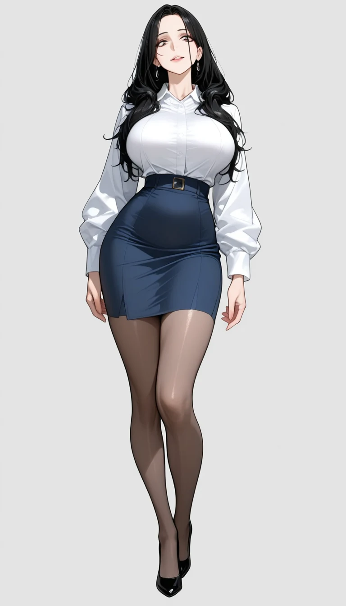
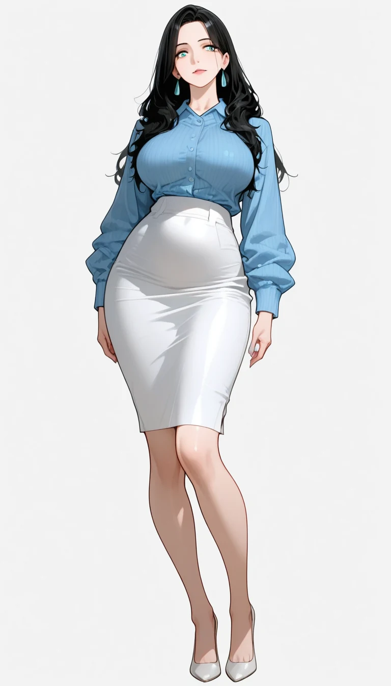
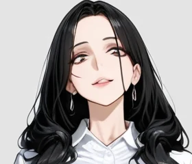
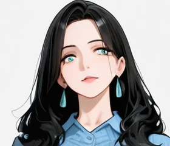
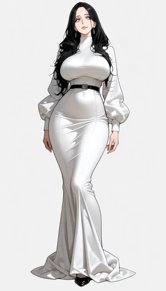
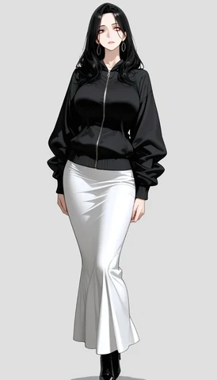
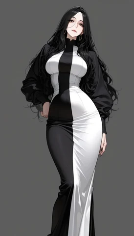

Attribute Binding（属性の束縛）は、画像生成のプロンプトに書いた色や素材などの属性が、その語の修飾する対象に正しく付くことです。例えば `black hair, aqua eyes` と書いたら、青緑（aqua）は目に付き、髪は黒のままであってほしいわけです。

以下は、手元の画像生成モデルで同じ seed から描いた 2 枚です。seed（シード値）は生成の出発点になるノイズを決める値で、同じ seed ならプロンプトを少し変えても構図はほぼ同じになり、変えた語の効き目だけを見比べられます。右は `aqua eyes` を足しただけですが、目だけでなく、髪の内側の房と光沢にも青緑が入りました。



このように属性が別の対象に移る現象は、色移り（color leakage）とも呼ばれます。英語の文法では `aqua` は隣の `eyes` に掛かりますが、本記事で使う SDXL 系の画像生成モデルの中に、文法上の結び付きを画像の領域の結び付きとして守る仕組みはありません。仕組みは次の節で説明します。

色移りは、[キャラクターの絵](../character-consistency/)を大量に作るほど目に付きます。著者も立ち絵（キャラクターの全身を 1 人で描いた絵）を量産していた時に、目の色が髪に移る、銀色の小物を足すと黒いコートが白くなる、`two-tone`（2 色）と書くと脚が左右で白と黒に塗り分けられる、といった取り違えを繰り返しました（当時の作業の様子は [2026/10/26 週の weeknotes](/weeknotes/2026-10-26/8575939c5076/) に書いています）。

<br>

本記事では、画像生成を使い始めたエンジニアに向けて、色移りが起きる理由を説明します。モデルの中でプロンプトを読む部分の出力を比べる実験と、seed だけを変えて生成した画像の色を機械で数える実験から、次の疑問に答えます。

- 色の語は、モデルのどこで別の語や別の位置に届くのか。
- 目の色が髪に移る割合は、語順やプロンプトの分割で変わるのか。
- 髪への色移りをネガティブプロンプトの語（ネガティブプロンプト。描いてほしくない物を書く欄）で止めると、服の色はどうなるのか。
- 2 色の服は、どう書けば狙った部位に色が付くのか。

実験は 2026 年 11 月 10 日に、SDXL 系（次の節で説明します）のモデル 1 つで行いました。数値はこのモデル・この条件での結果で、他のモデルに同じ割合で当てはまるとは限りません。

---

### 色の語が別の物に届く 2 か所

[SDXL](https://arxiv.org/abs/2307.01952)（Stable Diffusion XL）は、ノイズから少しずつ絵を作る[拡散モデル](../diffusion-model/)です。プロンプトはそのままでは使えないので、モデルはまずプロンプトを[トークン](../tokenizer/)（語や語の断片）に区切り、トークンごとに数値の列（ベクトル。以下、出力と呼びます）に変えます。

絵を描く側のネットワーク（後で説明する UNet）は、この出力を見ながら画像の各位置のノイズを取り除きます。全体の流れは [Prompt Weighting のノート](/notes/generative-ai/prompt-weighting/)で説明しているので、ここでは色の語が別の物に届く 2 か所だけを取り上げます。



<br>

#### ① プロンプトを読む所（text encoder）

1 か所目は、プロンプトを出力に変える text encoder です。SDXL は、[CLIP](https://arxiv.org/abs/2103.00020)（画像と文章を同じベクトルの空間に対応付けるモデル）の文章側を 2 つ持ちます。[CLIP ViT-L](https://huggingface.co/openai/clip-vit-large-patch14) と、[OpenCLIP](https://github.com/mlfoundations/open_clip) の ViT-bigG です。2 つの出力は横に並べて 1 本にして使うので、実験 A では 2 つを別々に測ります。

どちらも、各トークンの出力は、自分と自分より前のトークンだけから作られます（causal attention。[KV Cache のノート](/notes/generative-ai/kv-cache/)で説明している仕組みと同じです）。上記の図の中央のように、後ろの語の出力には前の語が混ざり、前の語の出力には後ろの語が混ざりません。`black hair, aqua eyes` の順なら、`aqua` は `eyes` の出力に混ざりますが、`hair` の出力には届きません。

<br>

#### ② 画像の各位置が出力を選ぶ所（cross-attention）

2 か所目は、絵を描く側の [UNet](https://arxiv.org/abs/1505.04597)（ノイズを予測するネットワーク）にある cross-attention です。画像の各位置は、トークンの出力のうち、どれをどれだけ使うかを重みで決めて混ぜます。

この重みは、各位置の中身と各トークンの出力の組み合わせから計算され、`aqua` を目の位置だけで使うという制約はありません。図の右のように、髪の位置が `aqua` の出力を使えば、髪にも青緑が付きます。[Prompt-to-Prompt の論文](https://arxiv.org/abs/2208.01626)は、この重みが各語と画像の配置の関係を決めていると報告しています。

なお、`aqua` の情報は `aqua` 自身の出力だけでなく、後ろの `eyes` や文の終わりの記号の出力にも乗ります（実験 A）。SDXL は、文全体を 1 本にまとめたベクトル（pooled 出力）も画像全体の条件に使います。図は、色が届く道筋を単純にして描いたものです。

<br>

#### 研究で知られている 2 つの経路

属性の取り違えは、画像生成の研究でも広く知られた問題です。[Structured Diffusion Guidance の論文](https://arxiv.org/abs/2212.05032)（ICLR 2023）も、原因の候補として上記の 2 か所を挙げています。

1 つ目は text encoder の経路です。論文の例の `a yellow apple and red bananas` では、`bananas` の出力に前の `yellow` が混ざり、バナナが黄色く描かれやすくなります。論文は、名詞句ごとに分けて text encoder に通した出力を使い、この経路を弱めています。

2 つ目は cross-attention の経路です。論文の例では、`bird` の重みが熊の口の周りにも掛かり、熊の口が嘴のような形になりました。

この経路には、生成の途中で cross-attention の重みに手を入れる手法が提案されています。[Attend-and-Excite](https://arxiv.org/abs/2301.13826) は、頼んだ対象の語の重みがどこにも集まらない時に重みを強め、対象が描かれない問題を減らします。[SynGen](https://arxiv.org/abs/2306.08877) は、修飾語と名詞の重みの分布を揃え、修飾語が名詞と同じ位置に効くようにします（どちらも本記事では試していません）。

---

### 実験 A: 1 か所目で、色の語はどれだけ混ざるか

1 つ目の経路は、手元のモデルでどれくらい効くのでしょうか（画像を作らない実験なので、画像を生成する実験 1〜3 と分けて実験 A と呼びます）。目の色の語だけを `aqua` から `brown` に変えた 2 つのプロンプトを text encoder に通し、トークンごとの出力の差（1 − [コサイン類似度](/ml/math/vector-matrix-ops/)。0 なら同じ）を数えました。

考え方は単純です。違うのは目の色の語だけなので、出力が変わったトークンには目の色の情報が混ざっていて、差が 0 のトークンには混ざっていないと分かります。

[lab/clip_mix.py](https://github.com/nao1215/debimate/blob/main/content/notes/generative-ai/attribute-binding/lab/clip_mix.py) は、[ComfyUI](https://github.com/Comfy-Org/ComfyUI)（ノードをつないで画像生成の処理を組む OSS）のライブラリで、モデルのファイルから text encoder だけを CPU に読みます。

UNet に渡す出力は、77 トークン分（短いプロンプトは余りを埋めて 77 にそろえる）の 2,048 次元のベクトルです。`clip_layer(-2)` は、最後の層ではなく最後から 2 番目の層の出力を使う設定で、生成の時と同じにしています。以下が中心の部分です。

```python
# lab/clip_mix.py から抜粋（全体はリンク先）
_, clip, *_ = comfy.sd.load_checkpoint_guess_config(
    ckpt, output_vae=False, output_clip=True, output_model=False)
clip.clip_layer(-2)                          # CLIPSetLastLayer -2 と同じ
ca = clip.encode_from_tokens(clip.tokenize(a))[0]   # [77, 2048]
cb = clip.encode_from_tokens(clip.tokenize(b))[0]   # 1 語だけ違うプロンプト
# 先頭の 768 次元が CLIP ViT-L、残りの 1,280 次元が OpenCLIP ViT-bigG
cos = torch.nn.functional.cosine_similarity
dl = 1 - cos(ca[:, :768], cb[:, :768], dim=-1)
dg = 1 - cos(ca[:, 768:], cb[:, 768:], dim=-1)
```

左と中央は、目の色の語を変えた時の差を 2 つの語順で比べたものです。右端は比べる基準で、髪の色の語そのものを `aqua` から `black` に変えた時に、`hair` の出力がどれくらい変わるかを見ています（目は `brown` に固定）。



変えた語より前のトークンは、2 つの encoder とも差が 0 でした（`BOS` と `EOS` は文の始まりと終わりの記号です）。`black hair, aqua eyes` の順なら、`hair` の出力は目の色に全く影響されません。

一方で、`aqua eyes, black hair` の順でも、`hair` の差は CLIP ViT-L で 0.0007、ViT-bigG で 0.0044 でした。髪の色の語そのものを変えた時（右端）の 0.24・0.25 と比べると、数百分の 1 から数十分の 1 です。

中央のグラフで `aqua eyes` より後ろのトークンのうち、差が大きいのは直後の読点（CLIP ViT-L で 0.14）と `EOS`（ViT-bigG で 0.11）でした。このプロンプトに限れば、text encoder の中で `hair` の出力に混ざる色は小さいと言えます。ただし、読点や `EOS` に乗った色は、② で髪の位置から使われる可能性があります。

<br>

<details>
<summary>実験 A の出力（aqua eyes, black hair の行）</summary>

```text
[eyes_first] '1girl, aqua eyes, black hair' vs '1girl, brown eyes, black hair'
   # token          CLIP-L  bigG
   0 <|startoftext|> 0.0000  0.0000
   1 1</w>          0.0000  0.0000
   2 girl</w>       0.0000  0.0000
   3 ,</w>          -0.0000  -0.0000
   4 aqua</w>       0.4575  0.2537
   5 eyes</w>       0.2277  0.1300
   6 ,</w>          0.1395  0.0636
   7 black</w>      0.0074  0.0063
   8 hair</w>       0.0007  0.0044
   9 <|endoftext|>  0.0036  0.1088
  padding 67 tokens: CLIP-L max 0.0063, bigG max 0.0114
```

</details>

<br>

---

### 画像の色の数え方と実験の条件

出力の差が小さくても、絵の髪が青緑になるかは別の話です。ここからは、実際に絵を生成して、髪に入った青緑を数えます。

条件ごとに、seed を 1000 から順に変えて 12 枚ずつ生成しました。条件の間で変えたのはプロンプトだけで、seed は同じ番号を使います。同じ seed なら、条件が違っても構図はほぼ同じになります。

色は機械で数えます。[CLIPSeg](https://arxiv.org/abs/2112.10003)（語を渡すと、画像の中でその語に当たる領域を返すモデル。重みは [CIDAS/clipseg-rd64-refined](https://huggingface.co/CIDAS/clipseg-rd64-refined)）で `hair` の領域を切り出し、領域の全画素のうち、青緑（色相 150〜200 度）の画素が占める割合を数えます。色味の弱い画素や暗い画素（白・灰色・黒）は、青緑には数えません。以下は、冒頭の右の絵を測った途中の様子です。



この絵では、CLIPSeg の髪の領域が、顔の右側の内側の房をほとんど含んでいません。数えた 2.5% は頭頂の光沢と左の毛先で、目で一番目立つ青緑の房は数に入っていません。機械の値は、色移りの量を少なめに測ることがあります。

それでも、髪の領域の 0.5% 以上が青緑なら色が移ったとする判定は、目で見た判定とよく合いました。一致した枚数は、後の実験の節で示します。測定の手順は [lab/measure.py](https://github.com/nao1215/debimate/blob/main/content/notes/generative-ai/attribute-binding/lab/measure.py) にあります。

```python
# lab/measure.py から抜粋
HUES = {"aqua": (150, 200), "blue": (205, 255)}   # 色相（度）

def hue_share(h, s, v, mask, name):
    """領域のうち、色の付いた画素（彩度 0.25 以上・明るさ 0.2 以上）で name の色相の割合。"""
    lo, hi = HUES[name]
    colored = mask & (s >= 0.25) & (v >= 0.2)
    hit = colored & (h >= lo) & (h <= hi)
    return float(hit.sum() / max(mask.sum(), 1))

m = seg.masks(img, ["hair", "eyes", "face"])     # CLIPSeg で確率 0.5 以上の画素
hair = m["hair"] & ~m["eyes"]                    # 目の画素は髪から除く
r["hair_aqua"] = hue_share(h, s, v, hair, "aqua")
```

<br>

#### 実験に使ったモデル

モデルの組は 2 通りです。ベースモデルだけの組でモデルの素の振る舞いを見て、画風 LoRA を当てた組でキャラクターの立ち絵を作る時の振る舞いを見ます。

画風 LoRA は、元のモデルに小さな差分を重ねて絵柄を変える追加学習の成果物です（仕組みは [LoRA のノート](/notes/generative-ai/lora/)）。本記事の説明用に用意した独自の LoRA（`example_style_lora.safetensors`）を使い、プロンプトの先頭にはその LoRA を効かせる起動語 `<trigger>` を置きました。

| 項目 | ベースモデルだけ | 画風 LoRA あり |
|---|---|---|
| モデル | [WAI-illustrious-SDXL v17.0](https://civitai.com/models/827184?modelVersionId=2883731)（イラスト向けの SDXL 系モデル） | 同じモデルに画風 LoRA を強さ 0.75 で重ねる |
| 構図と解像度 | 上半身、1024 × 1024 | 全身の立ち絵、768 × 1344 |
| ステップ数・[CFG](https://arxiv.org/abs/2207.12598)（プロンプトに従わせる強さ）・サンプラー | 28・5.5・euler_ancestral（[k-diffusion](https://github.com/crowsonkb/k-diffusion) 由来） | 同じ |

人物は成人で、服を着た姿に限りました。体の部位を強調する語は書かず、ネガティブプロンプトに `nude, cleavage` などを入れ、画風 LoRA の組では `child, loli` も入れています。生成した画像は全て目で確認し、露出のある絵はありませんでした。プロンプトの全文は [lab/gen.py](https://github.com/nao1215/debimate/blob/main/content/notes/generative-ai/attribute-binding/lab/gen.py) にあります。

<br>

<details>
<summary>実行した環境</summary>

- ComfyUI v0.35.0（[commit 19e1058](https://github.com/Comfy-Org/ComfyUI/tree/19e1058f4c445ef74047e77a23f9ca7684c1e4b6)）の API に、ワークフローを 1 枚ずつ送りました。GPU は AMD Radeon 8060S です。
- CLIPSeg と WD tagger v3（[Danbooru](https://danbooru.donmai.us/) というイラスト投稿サイトのタグで学習したモデル）は、どちらも Apache-2.0 の重みを CPU で動かしました。
- 同じ seed で 2 回生成すると、1 画素も違わない画像になりました。GPU・ドライバ・PyTorch の版が違うと、同じ seed でも画素が一致するとは限りません。版の一覧は [lab/README.txt](https://github.com/nao1215/debimate/blob/main/content/notes/generative-ai/attribute-binding/lab/README.txt) にあります。

</details>

<br>

---

### 実験 1: 目の色が髪に移る

黒髪の人物に `aqua eyes` を足すと、髪に青緑が入るのでしょうか。ベースモデルだけの組で、色の部分を 4 通りに変えて 12 枚ずつ生成しました。対照の `black hair`、目の色を後ろに書いた `black hair, aqua eyes`、前に書いた `aqua eyes, black hair`、2 つに分けて text encoder に通す条件です。

最後の条件は、1 つ目の経路を断つためのものです。プロンプトを前半（`…, white collared shirt, black hair`）と後半（`aqua eyes, simple background, white background`）に分けました。

ComfyUI の [ConditioningConcat](https://github.com/Comfy-Org/ComfyUI/blob/19e1058f4c445ef74047e77a23f9ca7684c1e4b6/nodes.py#L134-L160) は、別々に text encoder に通した 2 つの出力をつなぎ、トークンの並びの方向に 1 本の列にするノードです。前半と後半は別々に通るので、`black hair` の出力に `aqua` は混ざりません。

<br>

<details>
<summary>stable-diffusion-webui の BREAK との関係</summary>

[stable-diffusion-webui](https://github.com/AUTOMATIC1111/stable-diffusion-webui) で `BREAK` と書くと、そこで [75 トークンの区切り](/notes/generative-ai/clip-token-limit/#77-トークンの区切り)を改めるので（[BREAK keyword](https://github.com/AUTOMATIC1111/stable-diffusion-webui/wiki/Features#break-keyword)）、効果は近いと考えられます。ComfyUI v0.35.0 の `CLIPTextEncode` は、`BREAK` を普通の語として読みます。

</details>

<br>

以下は、髪の領域に占める青緑の画素の割合を 1 枚 1 点で描いたグラフです。横線は 12 枚の平均です。



`aqua eyes` を足すと、どの条件でも 12 枚全ての髪に青緑の光沢や毛先が入りました（目視でも 12 枚全て）。2 つに分けて通す条件の平均は少し下がりましたが、seed ごとのばらつき（約 1〜10%）の方が大きく、12 枚では差があるとは言えません（全ての値は [lab/output_summary.txt](https://github.com/nao1215/debimate/blob/main/content/notes/generative-ai/attribute-binding/lab/output_summary.txt)）。

<br>

目の色を後ろに書いた条件では、実験 A の通り、`hair` の出力は目の色の影響を受けていません。それでも髪は青緑になりました。つまり、このモデルの色移りは 1 つ目の経路だけでは説明できません。

残る説明の候補は 2 つあります。2 つ目の経路（画像の髪の位置が `aqua` の出力を使う）と、学習した画像に「青緑の目の人物は、髪にも青緑の光沢がある」組み合わせが多かったことです。

SDXL が画像全体の条件に使う pooled 出力も候補に見えますが、2 つに分けて通す条件の pooled 出力は `aqua` を含まない前半だけから作られるので、それだけでは説明できません。cross-attention の重みは取り出していないので、本記事の実験では 2 つを区別できていません。

<br>

機械の判定は、この組の 48 枚全てで目視と一致しました。1 回目の目視で見落とした前髪の細い光沢を機械が拾った 1 枚があり、拡大して見直してラベルを直した後の数です。一方で、画像からイラストのタグ（髪の色や人数を表す語）を推定する [WD tagger v3](https://huggingface.co/SmilingWolf/wd-vit-tagger-v3) は、色移りした 36 枚のうち 8 枚にしか髪の色のタグを付けませんでした。光沢や毛先のような細い色は、タグの単位では拾えません。

---

### 実験 2: 髪をネガティブプロンプトで塞ぐと

画風 LoRA を当てた立ち絵でも、`aqua eyes` の有無だけを変えて 12 枚ずつ比べました。頼んだ服は `white collared shirt, long navy skirt`（白い襟付きのシャツと紺の長いスカート）です。スカートの丈は、プロンプト通りにならない絵もありました。

さらに、髪を単色にするネガティブプロンプト（`multicolored hair, streaked hair, two-tone hair` など）を足したプロンプトでも 12 枚ずつ比べています。髪への移りをネガティブプロンプトで止めた時に、服の色がどうなるかを見るためです。

最初のプロンプトでは目を閉じた絵が多かったので、このプロンプトには目をはっきり描く語（`sharp eyes, eye highlights, detailed eyes`）も足しました。以下、このプロンプトを「髪を抑えたプロンプト」と呼びます。2 か所を同時に変えたので、ネガティブプロンプトだけの効き目とは切り分けられていません。

この組は、服の色も含めて目で数えました。

| 条件（画風 LoRA あり、12 枚ずつ） | 髪に青緑 | シャツが青系 | スカートが白 |
|---|---|---|---|
| 立ち絵のプロンプト | 0 | 4 | 0 |
| 立ち絵のプロンプト + `aqua eyes` | 12 | 6 | 4 |
| 髪を抑えたプロンプト | 0 | 2 | 0 |
| 髪を抑えたプロンプト + `aqua eyes` | 1 | 5 | 5 |

以下は、髪を抑えたプロンプトの同じ seed の 2 枚です。集計に使った画像をそのまま載せています。下の段は、顔の周りを等倍で切り抜いたものです。プロンプトの並びは、髪と目の語が先、服の語が後です（全文は lab/gen.py）。

<div class="binding-rows" style="margin:1.5rem 0">
<div style="display:flex;gap:8px;justify-content:center;align-items:flex-end;margin:0 0 12px"><figure style="flex:0 1 320px;min-width:0;margin:0"><a href="images/attribute-binding_s_rep_none_1000.webp"></a><figcaption style="margin:4px 0 0;text-align:center;font-weight:normal;font-size:14px">目の色なし（seed 1000）</figcaption></figure><figure style="flex:0 1 320px;min-width:0;margin:0"><a href="images/attribute-binding_s_rep_aqua_1000.webp"></a><figcaption style="margin:4px 0 0;text-align:center;font-weight:normal;font-size:14px">aqua eyes（seed 1000）</figcaption></figure></div>
<div style="display:flex;gap:8px;justify-content:center;align-items:flex-end;margin:0 0 12px"><figure style="flex:0 1 320px;min-width:0;margin:0"><figcaption style="margin:4px 0 0;text-align:center;font-weight:normal;font-size:14px">顔の周り（等倍）</figcaption></figure><figure style="flex:0 1 320px;min-width:0;margin:0"><figcaption style="margin:4px 0 0;text-align:center;font-weight:normal;font-size:14px">顔の周り（等倍）</figcaption></figure></div>
</div>

`aqua eyes` を足した右の絵では、髪は黒のままですが、シャツが水色、スカートが白になり、耳飾りまで青緑です。シャツの水色は目の青緑が移ったと読めます。スカートの白は、シャツに書いた白がスカートへ移り、2 つの色が入れ替わったように見えます（理由は確認していません）。

表の通り、髪を単色にするネガティブプロンプトは効き、髪に青緑が入ったのは 12 枚中 1 枚でした。一方で、青系のシャツ（5 枚）と白いスカート（5 枚）は、ネガティブプロンプトを足す前（6 枚・4 枚）と同じくらい出ています。この条件では、髪への色移りは止まっても、服の色の取り違えは残りました。

<br>

この結果から言えることには限りがあります。目の色を書かないプロンプトでも、シャツが青系になる絵は 2〜4 枚あり、12 枚ずつでは服の色の変化の大きさまでは決められません。また、このプロンプトでは `aqua eyes` が服の語より前にあるので、1 つ目の経路（text encoder の中で後ろの服の語の出力に混ざる）も残っています。どちらの経路で移ったのかは区別できていません。

機械の判定は、この組では 48 枚中 41 枚の一致に下がりました。食い違った 7 枚は全て、機械が、髪の領域に重なった水色のシャツや青い背景、黒髪の青みのある艶を青緑と数えた誤りです。服の色が変わる絵では、領域の切り出しの誤りが色の数え違いになります。

---

### 実験 3: two-tone の塗り分け

色の取り違えは、色の組をまとめて渡した時にも起きます。2 色の服を頼む書き方は 2 通りあります。`two-tone dress, black and white dress` と色の組を 1 か所に書く方法と、`black jacket, white long skirt` と部位ごとに色を書く方法です。前者は、どちらの色をどこに塗るかを決めていません。

画風 LoRA の 2 つのプロンプト（立ち絵のプロンプトと、髪を抑えたプロンプト）で 6 枚ずつ、合わせて 12 枚ずつ比べました。以下の上の行は同じ seed の 2 枚で、左が `two-tone`、右が部位ごとの指定です。下の行は `two-tone` で左右に塗り分けられた例です。

<div class="binding-rows" style="margin:1.5rem 0">
<div style="display:flex;gap:8px;justify-content:center;align-items:flex-end;margin:0 0 12px"><figure style="flex:0 1 240px;min-width:0;margin:0"><figcaption style="margin:4px 0 0;text-align:center;font-weight:normal;font-size:14px">two-tone、seed 1000</figcaption></figure><figure style="flex:0 1 240px;min-width:0;margin:0"><figcaption style="margin:4px 0 0;text-align:center;font-weight:normal;font-size:14px">部位ごと、seed 1000</figcaption></figure></div>
<div style="display:flex;gap:8px;justify-content:center;align-items:flex-end;margin:0 0 12px"><figure style="flex:0 1 240px;min-width:0;margin:0"><figcaption style="margin:4px 0 0;text-align:center;font-weight:normal;font-size:14px">two-tone、seed 1005</figcaption></figure></div>
</div>

部位ごとに書いた 12 枚は、全て上着が黒、スカートが白でした（目視）。ただし、こちらは上着とスカートの 2 着を頼んでいるので、1 着のドレスを頼んだ `two-tone` とは服の種類も違います。`two-tone` の 12 枚は、体の左右で白と黒が分かれた絵が 4 枚、上が黒で下が白の絵が 2 枚で、残りの 6 枚は白一色や、両脇だけ黒い帯などばらばらでした（目視。lab のラベルには左右の塗り分けだけを記録しています）。

色の組をまとめて渡すと「2 色ある」ことしか伝わらず、どこを何色にするかはモデルが seed ごとに決めます。服の領域を中心で左右に割って黒の割合を比べる機械の判定は、立ち絵のプロンプトで描いた 12 枚（`two-tone` 6 枚と部位ごと 6 枚）で目視と 9 枚しか合わなかったので、目で数えた値を使っています。

---

### 色移りを減らす書き方

実験の結果から、色移りを減らす書き方は以下の通りです。どれも確率を下げる方法で、色移りが無くなる保証はありません。

- 色を書くのは、色を決めたい部位だけにする。書いた色は、髪・服・小物など別の部位にも移る（実験 1・2）
- 色の組をまとめて渡さず、部位ごとに書く（実験 3）
- 生成した絵の色を機械で測り、怪しい絵は目で見る。タグの推定だけでは細い色移りを見落とし、領域の切り出しは服や背景と混ざる

語順の入れ替えとプロンプトの分割は、実験 1 では効きませんでした。text encoder の中で混ざる経路は断てても、画像の各位置が出力を選ぶ経路と、学習した画像の組み合わせの影響は残るからと考えられます。前者には、Attend-and-Excite や SynGen のように生成の途中で重みに手を入れる手法が提案されていますが、本記事の色移りが直るかは試していません。

色を付ける対象を書かない語は、画面の広い範囲に効きます。`sunset` のような照明の語は、空だけでなく背景や白い物、肌まで光の色に染めます（色かぶり。実測は [Prompt Weighting のノートの実験 3](/notes/generative-ai/prompt-weighting/#実験-3-照明の語とネガティブプロンプトの重みを組み合わせる)）。著者は、立ち絵ではこれらの語を[検査](../image-linting/)で止める決まりにしています。

<br>

#### 対策が効きにくいケース

実験で確認した範囲ではありませんが、著者が立ち絵を作った経験では、次の場合に上記の書き方が効きにくくなりました。

- 学習した画像で、2 つの属性がいつも一緒に描かれている組み合わせ（目の色と同じ色の髪の光沢など）
- 画風 LoRA のように、特定の色や服の傾向を強く持つ差分を重ねている場合
- 白・水色・紺のように近い色を別々の部位に割り当てる場合（実験 2 でも、白いシャツと紺のスカートで色の入れ替わりが見えました）

---

### 余談: 縦横比で同じ人物が増える

色の話からは外れますが、同じ立ち絵の実験で目に付いた取り違えがもう 1 つあります。`solo`（1 人）と書き、ネガティブプロンプトに `2girls` を入れても、人物が 2 人描かれることがありました。画風 LoRA の 2 つのプロンプト（立ち絵のプロンプトと、髪を抑えたプロンプト。どちらも目の色は書いていません）のまま解像度だけを変えて 6 枚ずつ生成し、2 人以上が描かれた絵を目で数えました。



増えたのは、どれも同じ顔・同じ服の人物でした。もう 1 人が立っている絵と、顔の大写しが差し込まれた絵があります。画面の余白を埋めるように、同じ人物をもう 1 枚の中に描き足したように見えます。

著者は以前、832 × 1216 で人物が並び、768 × 1344 に変えて直した経験があります。今回は逆に、768 × 1344 で 12 枚中 4 枚、832 × 1216 で 12 枚中 1 枚でした。この枚数では縦横比ごとの差は言えず、安全な縦横比はモデルとプロンプトごとに数えて決める必要があります。

WD tagger の `multiple_girls`・`2girls`・`multiple_views` のどれかが 0.35 以上なら 2 人以上とする機械の判定は、目で数えた人数と全て一致しました。
