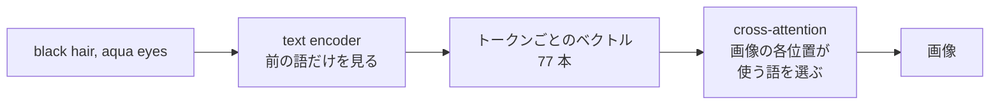
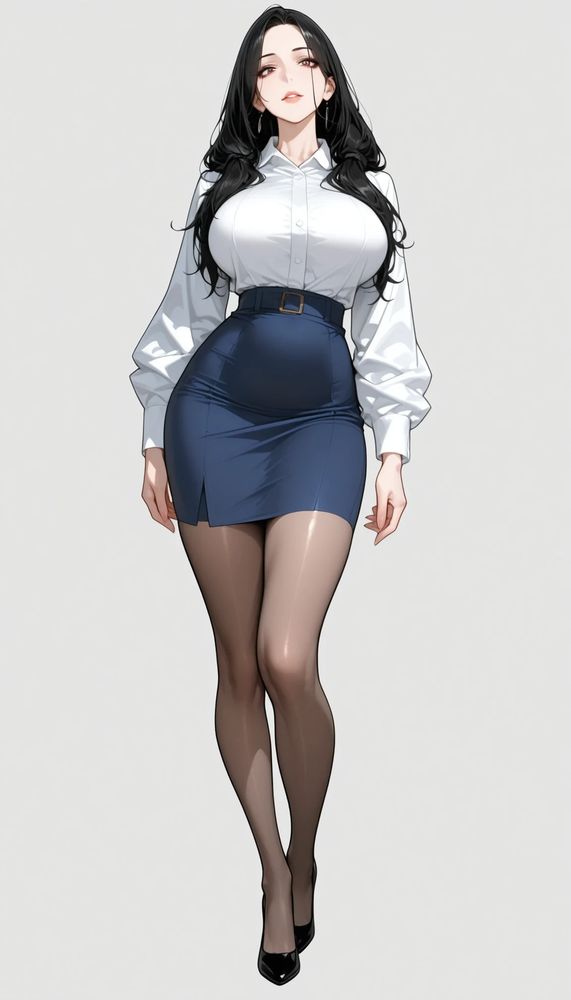
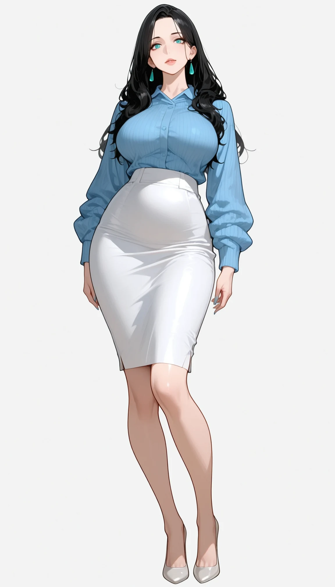
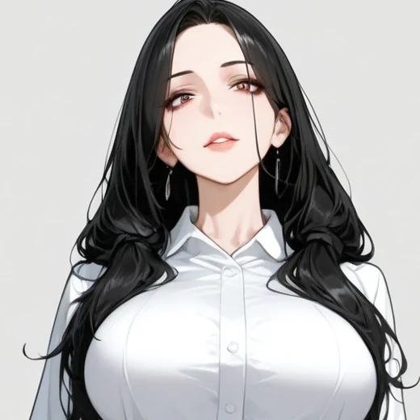
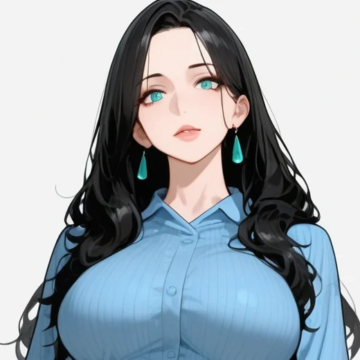

`black hair, aqua eyes` と書けば、青緑（aqua）は目にだけ付くと思うかもしれません。英語の文法でも、`aqua` は隣の `eyes` に掛かります。しかし、手元の画像生成モデルで seed だけを 12 通りに変えて生成すると、12 枚全てで髪の光沢や毛先まで青緑になりました。



Attribute Binding（属性の束縛）は、プロンプトに書いた色や素材などの属性が、その語の修飾する対象に正しく付くことです。上記の図のように属性が別の対象に移る現象は、色移り（color leakage）とも呼ばれます。画像生成モデルの中に、文法上の結び付きを画像の領域の結び付きとして守る仕組みはありません。

色移りは、キャラクターの絵を大量に作るほど目に付きます。著者も立ち絵を量産していた時に、目の色が髪に移る、銀色の小物を足すと黒いコートが白くなる、`two-tone`（2 色）と書くと脚が左右で白と黒に塗り分けられる、といった取り違えを繰り返しました（当時の様子は [2026/10/26 週の weeknotes](/weeknotes/2026-10-26/8575939c5076/) に書いています）。

<br>

本記事では、画像生成を使い始めたエンジニアに向けて、Attribute Binding が崩れる理由を説明します。text encoder の出力を比べる実験と、seed だけを変えて生成した画像の色を機械で数える実験から、次の疑問に答えます。

- 色の語は、プロンプトのどこで、どの語に混ざるのか。
- 目の色が髪に移る割合は、語順やプロンプトの分割で変わるのか。
- 色以外の語や画面の縦横比でも、同じ取り違えは起きるのか。
- 色移りを減らすには、プロンプトをどう書けば良いのか。

実験はすべて 2026 年 11 月 10 日に、[ComfyUI](https://github.com/Comfy-Org/ComfyUI)（ノードをつないで画像生成の処理を組む OSS）v0.35.0 と SDXL 系のモデル 1 つで行いました。数値はこのバージョン・この条件での結果です。

---

### 前提: プロンプトが画像に届く経路

[SDXL](https://arxiv.org/abs/2307.01952)（Stable Diffusion XL）は、ノイズから少しずつ絵を作る拡散モデルです。text encoder がプロンプトをトークン（語や語の断片）ごとのベクトルの列に変え、ノイズを予測する [UNet](https://arxiv.org/abs/1505.04597) がそれを参照します。全体の流れは [Prompt Weighting のノート](/notes/generative-ai/prompt-weighting/)で説明しているので、ここでは色移りに関わる 2 か所だけを取り上げます。



1 か所目は text encoder です。SDXL は [CLIP](https://arxiv.org/abs/2103.00020)（画像と文章を同じベクトルの空間に対応付けるモデル）の文章側を 2 つ持ちます。[CLIP ViT-L](https://huggingface.co/openai/clip-vit-large-patch14) と、[OpenCLIP](https://github.com/mlfoundations/open_clip) の ViT-bigG です。

どちらも、各トークンの出力を自分より前のトークンだけから作ります（causal attention。[KV Cache のノート](/notes/generative-ai/kv-cache/)の前提の節と同じ仕組みです）。そのため、後ろの語の出力には前の語の情報が混ざり、前の語の出力には後ろの語が混ざりません。

2 か所目は UNet の cross-attention です。画像の各位置は、トークンのベクトルの列のうち、どれをどれだけ使うかを重みで決めて混ぜます。この重みは位置の中身から計算され、`aqua` を目の位置だけで使うという制約はありません。[Prompt-to-Prompt の論文](https://arxiv.org/abs/2208.01626)は、この重みが各語と画像の配置の関係を決めていると報告しています。

---

### 色が混ざる 2 つの経路

属性の取り違えは、画像生成の研究でも広く知られた問題です。[Structured Diffusion Guidance の論文](https://arxiv.org/abs/2212.05032)（ICLR 2023）は、原因の候補を 2 つ挙げています。

- text encoder の出力に前の語が混ざる。`a yellow apple and red bananas` では、`bananas` の出力に `yellow` が混ざり、バナナが黄色く描かれやすい
- cross-attention の重みが別の対象の位置にも掛かる。論文の例では、`bird` の重みが熊の口の周りにも掛かり、熊の口が嘴のような形になった

論文は、名詞句ごとに分けて text encoder に通す方法で色移りを減らしています。[Attend-and-Excite](https://arxiv.org/abs/2301.13826)（頼んだ対象が描かれない問題を減らす手法）や [SynGen](https://arxiv.org/abs/2306.08877)（修飾語と名詞の重みの分布を揃える手法）は、2 つ目の経路を生成の途中で直す手法です（ここでは試していません）。

<br>

#### 実験 A: 色の語を 1 つ変えて、各トークンの出力を比べる

1 つ目の経路は、手元のモデルでどれくらい効くのでしょうか。目の色の語だけを `aqua` から `brown` に変えた 2 つのプロンプトを text encoder に通し、トークンごとの出力の差（1 − コサイン類似度。0 なら同じ）を数えました。

[lab/clip_mix.py](https://github.com/nao1215/debimate/blob/main/content/notes/generative-ai/attribute-binding/lab/clip_mix.py) は、ComfyUI のライブラリでチェックポイントの text encoder だけを CPU に読み、UNet に渡す 77 × 2,048 の列をそのまま比べます。以下が中心の部分です。

```python
# lab/clip_mix.py から抜粋（全体はリンク先）
_, clip, *_ = comfy.sd.load_checkpoint_guess_config(
    ckpt, output_vae=False, output_clip=True, output_model=False)
clip.clip_layer(-2)                          # CLIPSetLastLayer -2 と同じ
ca = clip.encode_from_tokens(clip.tokenize(a))[0]   # [77, 2048]
cb = clip.encode_from_tokens(clip.tokenize(b))[0]   # 1 語だけ違うプロンプト
# 先頭の 768 次元が CLIP ViT-L、残りの 1,280 次元が OpenCLIP ViT-bigG
cos = torch.nn.functional.cosine_similarity
dl = 1 - cos(ca[:, :768], cb[:, :768], dim=-1)
dg = 1 - cos(ca[:, 768:], cb[:, 768:], dim=-1)
```

右端は比べる基準として、髪の色の語を `aqua` から `black` に変えた時の差です。



変えた語より前のトークンは、2 つの encoder とも差が 0 でした（`BOS` と `EOS` は文の始まりと終わりの記号です）。`black hair, aqua eyes` の順なら、`hair` の出力は目の色に全く影響されません。

一方で、`aqua eyes, black hair` の順でも、`hair` の差は CLIP ViT-L で 0.0007、ViT-bigG で 0.0044 でした。髪の色の語を変えた時の 0.24・0.25 の数百分の 1 から数十分の 1 です。

差が大きいのは直後の読点（0.14）と `EOS`（ViT-bigG で 0.11）でした。このプロンプトに限れば、text encoder の中で `hair` に混ざる色は小さいと言えます。

<details>
<summary>実験 A の出力（aqua eyes, black hair の行）</summary>

```text
[eyes_first] '1girl, aqua eyes, black hair' vs '1girl, brown eyes, black hair'
   # token          CLIP-L  bigG
   0 <|startoftext|> 0.0000  0.0000
   1 1</w>          0.0000  0.0000
   2 girl</w>       0.0000  0.0000
   3 ,</w>          -0.0000  -0.0000
   4 aqua</w>       0.4575  0.2537
   5 eyes</w>       0.2277  0.1300
   6 ,</w>          0.1395  0.0636
   7 black</w>      0.0074  0.0063
   8 hair</w>       0.0007  0.0044
   9 <|endoftext|>  0.0036  0.1088
  padding 67 tokens: CLIP-L max 0.0063, bigG max 0.0114
```

</details>

---

### 実験の条件

手元の ComfyUI（[commit 19e1058](https://github.com/Comfy-Org/ComfyUI/tree/19e1058f4c445ef74047e77a23f9ca7684c1e4b6)、GPU は AMD Radeon 8060S）の API に、ワークフローを 1 枚ずつ送りました。変えたのはプロンプトと解像度だけで、seed は 1000 から順に同じ番号を使います。同じ seed なら、条件が違っても構図はほぼ同じになります。

モデルの組は 2 通りです。ベースモデルだけの組でモデルの素の振る舞いを見て、画風 LoRA を当てた組でキャラクターの立ち絵を作る時の振る舞いを見ます。画風 LoRA は本記事の説明用に用意した独自の LoRA（`example_style_lora.safetensors`、起動語は `<trigger>`）で、仕組みは [LoRA のノート](/notes/generative-ai/lora/)で説明しています。

| 項目 | ベースモデルだけ | 画風 LoRA あり |
|---|---|---|
| モデル | [WAI-illustrious-SDXL v17.0](https://civitai.com/models/827184?modelVersionId=2883731)（イラスト向けの SDXL 系モデル） | 同じモデルに画風 LoRA を強さ 0.75 で重ねる |
| 構図と解像度 | 上半身、1024 × 1024 | 全身の立ち絵、768 × 1344 |
| ステップ数・[CFG](https://arxiv.org/abs/2207.12598)（プロンプトに従わせる強さ）・サンプラー | 28・5.5・euler_ancestral（[k-diffusion](https://github.com/crowsonkb/k-diffusion) 由来） | 同じ |

人物は成人で、服を着た姿に限りました。体の部位を強調する語は書かず、打ち消しに `nsfw, nude, cleavage, child, loli` などを入れています。生成した画像は全て目で確かめ、露出のある絵はありませんでした。プロンプトの全文は [lab/gen.py](https://github.com/nao1215/debimate/blob/main/content/notes/generative-ai/attribute-binding/lab/gen.py) にあります。

色は機械で数えます。[CLIPSeg](https://arxiv.org/abs/2112.10003)（語を渡すと、画像の中でその語に当たる領域を返すモデル。重みは [CIDAS/clipseg-rd64-refined](https://huggingface.co/CIDAS/clipseg-rd64-refined)）で `hair` などの領域を切り出し、彩度と明るさの足りない黒・白・灰色の画素を除いて色相を数えます。

髪の領域の 0.5% 以上が青緑（色相 150〜200 度）なら、髪に色が移ったと判定します（[lab/measure.py](https://github.com/nao1215/debimate/blob/main/content/notes/generative-ai/attribute-binding/lab/measure.py)）。

人数は、画像から [Danbooru](https://danbooru.donmai.us/)（イラスト投稿サイト）のタグを推定する [WD tagger v3](https://huggingface.co/SmilingWolf/wd-vit-tagger-v3) で見ます。どちらの重みも Apache-2.0 で公開されています。機械の判定は、本記事の執筆時に全ての画像を目で見て付けたラベルと突き合わせました。

```python
# lab/measure.py から抜粋
HUES = {"aqua": (150, 200), "blue": (205, 255)}   # 色相（度）

def hue_share(h, s, v, mask, name):
    """領域のうち、色の付いた画素（彩度 0.25 以上・明るさ 0.2 以上）で name の色相の割合。"""
    lo, hi = HUES[name]
    colored = mask & (s >= 0.25) & (v >= 0.2)
    hit = colored & (h >= lo) & (h <= hi)
    return float(hit.sum() / max(mask.sum(), 1))

m = seg.masks(img, ["hair", "eyes", "face"])     # CLIPSeg で確率 0.5 以上の画素
hair = m["hair"] & ~m["eyes"]                    # 目の画素は髪から除く
r["hair_aqua"] = hue_share(h, s, v, hair, "aqua")
```

---

### 実験 1: 目の色が髪に移る

黒髪の人物に `aqua eyes` を足すと、髪に青緑が入るのでしょうか。ベースモデルだけの組では、語順と分割の効き目も見るために、色の部分を 4 通りに変えて 12 枚ずつ生成しました。対照の `black hair`、目の色を後ろに書いた `black hair, aqua eyes`、前に書いた `aqua eyes, black hair`、2 つに分けて text encoder に通す条件です。

最後の条件は、1 つ目の経路を断つためのものです。ComfyUI の [ConditioningConcat](https://github.com/Comfy-Org/ComfyUI/blob/19e1058f4c445ef74047e77a23f9ca7684c1e4b6/nodes.py#L134-L160) は、別々に text encoder に通した 2 つの出力をトークンの並びの方向に連結するノードです。`…, black hair` と `aqua eyes, …` は別々に通るので、`black hair` の出力に `aqua` は混ざりません。

[stable-diffusion-webui](https://github.com/AUTOMATIC1111/stable-diffusion-webui) で `BREAK` と書くと、そこで 75 トークンの区切りを改めるので（[BREAK keyword](https://github.com/AUTOMATIC1111/stable-diffusion-webui/wiki/Features#break-keyword)）、効果は近いと考えられます。ComfyUI v0.35.0 の `CLIPTextEncode` は `BREAK` を普通の語として読みます。以下は、髪の領域に占める青緑の画素の割合を 1 枚 1 点で描いたグラフです。横線は 12 枚の平均です。



`aqua eyes` を足すと、どの条件でも 12 枚全ての髪に青緑の光沢や毛先が入りました。分割した条件の平均は少し下がりましたが、seed ごとのばらつき（1〜10%）の方が大きく、12 枚では差があるとは言えません（全ての値は [lab/output_summary.txt](https://github.com/nao1215/debimate/blob/main/content/notes/generative-ai/attribute-binding/lab/output_summary.txt)）。

<br>

目の色を後ろに書いた条件では、実験 A の通り `hair` の出力は目の色の影響を受けていません。それでも髪は青緑になりました。このモデルでは、2 つ目の経路（画像の髪の位置が `aqua` を参照する）か、学習した画像で「青緑の目の人物は髪にも青緑の光沢がある」組み合わせが多かったことの方が効いていると考えられます。cross-attention の重みは取り出していないので、2 つは区別できていません。

---

### 画風 LoRA での色移り

画風 LoRA の立ち絵の文面でも、`aqua eyes` の有無だけを変えて 12 枚ずつ比べました。さらに、髪を単色にする打ち消し（`multicolored hair, streaked hair, two-tone hair` など）と、目をはっきり描く語（`sharp eyes, eye highlights, detailed eyes`）を足した文面でも 12 枚ずつ比べています。

髪への移りを打ち消しで止めた時に、色がどこへ行くかを見るためです。服の色と目視の色移りは目で数えました。

| 条件（画風 LoRA あり、12 枚ずつ） | 髪に青緑 | シャツが青系 | スカートが白 |
|---|---|---|---|
| 立ち絵の文面 | 0 | 4 | 0 |
| 立ち絵の文面 + `aqua eyes` | 12 | 6 | 4 |
| 髪の打ち消しを足した文面 | 0 | 2 | 0 |
| 髪の打ち消しを足した文面 + `aqua eyes` | 1 | 5 | 5 |

以下は、髪の打ち消しを足した文面の同じ seed の 2 枚です。本文に大きく載せるために、生成した画像を 1.5 倍に拡大して描き直す仕上げをしています（denoise 0.4、[lab/hires.py](https://github.com/nao1215/debimate/blob/main/content/notes/generative-ai/attribute-binding/lab/hires.py)）。数えたのは仕上げ前の画像です。下の段は顔の周りを等倍で切り抜いたもので、画像を押すと元の解像度で開きます。

<div class="binding-rows" style="margin:1.5rem 0">
<div style="display:flex;gap:8px;justify-content:center;align-items:flex-end;margin:0 0 12px"><figure style="flex:0 1 360px;min-width:0;margin:0"><a href="images/attribute-binding_hires_s_rep_none_1000.webp"></a><figcaption style="margin:4px 0 0;text-align:center;font-weight:normal;font-size:14px">目の色なし（seed 1000）</figcaption></figure><figure style="flex:0 1 360px;min-width:0;margin:0"><a href="images/attribute-binding_hires_s_rep_aqua_1000.webp"></a><figcaption style="margin:4px 0 0;text-align:center;font-weight:normal;font-size:14px">aqua eyes（seed 1000）</figcaption></figure></div>
<div style="display:flex;gap:8px;justify-content:center;align-items:flex-end;margin:0 0 12px"><figure style="flex:0 1 360px;min-width:0;margin:0"><a href="images/attribute-binding_hires_s_rep_none_1000_crop.webp"></a><figcaption style="margin:4px 0 0;text-align:center;font-weight:normal;font-size:14px">顔の周り（等倍）</figcaption></figure><figure style="flex:0 1 360px;min-width:0;margin:0"><a href="images/attribute-binding_hires_s_rep_aqua_1000_crop.webp"></a><figcaption style="margin:4px 0 0;text-align:center;font-weight:normal;font-size:14px">顔の周り（等倍）</figcaption></figure></div>
</div>

頼んだのは白いシャツと紺のスカートです。`aqua eyes` を足した右の絵では、シャツが水色、スカートが白になり、耳飾りまで青緑です。

髪を単色にする打ち消しは効き、髪に青緑が入ったのは 12 枚中 1 枚でした。しかし、色移りが消えたわけではありません。青系のシャツと白いスカートは、打ち消しを足す前と同じくらい出ています。白と青系がシャツとスカートの間で入れ替わり、そこに目の青緑が加わった形です。打ち消しは移り先の 1 つを塞ぐだけで、色は別の部位に移ります。

<br>

機械の判定は、ベースモデルの組では 48 枚中 47 枚が目視と一致しました。残りの 1 枚は、目視で見落とした前髪の細い光沢を機械が拾った例で、拡大して見直してラベルを直しています。

画風 LoRA の組では、48 枚中 41 枚の一致に下がりました。食い違った 7 枚は全て、機械が、髪の領域に重なった水色のシャツや青い背景、黒髪の青みのある艶を青緑と数えた誤りです。WD tagger は、ベースモデルの組で色移りした 36 枚のうち 8 枚にしか髪の色のタグを付けませんでした。光沢や毛先のような細い色は、タグの単位では拾えません。

---

### 実験 2: two-tone の塗り分け

2 色の服を頼む書き方は 2 通りあります。`two-tone dress, black and white dress` と色の組を 1 か所に書く方法と、`black jacket, white long skirt` と部位ごとに色を書く方法です。前者は、どちらの色をどこに塗るかを決めていません。

画風 LoRA の 2 つの文面（立ち絵の文面と、髪の打ち消しを足した文面）で 6 枚ずつ、合わせて 12 枚ずつ比べました。以下の上の行は同じ seed の 2 枚で、左が `two-tone`、右が部位ごとの指定です。下の行は `two-tone` で左右に塗り分けられた例です。

<div class="binding-rows" style="margin:1.5rem 0">
<div style="display:flex;gap:8px;justify-content:center;align-items:flex-end;margin:0 0 12px"><figure style="flex:0 1 240px;min-width:0;margin:0"><figcaption style="margin:4px 0 0;text-align:center;font-weight:normal;font-size:14px">two-tone、seed 1000</figcaption></figure><figure style="flex:0 1 240px;min-width:0;margin:0"><figcaption style="margin:4px 0 0;text-align:center;font-weight:normal;font-size:14px">部位ごと、seed 1000</figcaption></figure></div>
<div style="display:flex;gap:8px;justify-content:center;align-items:flex-end;margin:0 0 12px"><figure style="flex:0 1 240px;min-width:0;margin:0"><figcaption style="margin:4px 0 0;text-align:center;font-weight:normal;font-size:14px">two-tone、seed 1005</figcaption></figure></div>
</div>

部位ごとに書いた 12 枚は、全て上着が黒、スカートが白でした（目視）。`two-tone` の 12 枚は、体の左右で白と黒が分かれた絵が 4 枚、上が黒で下が白の絵が 2 枚で、残りの 6 枚は白一色や、両脇だけ黒い帯などばらばらでした。

色の組を 1 語で渡すと「2 色ある」ことしか伝わらず、どこを何色にするかはモデルが seed ごとに決めます。

---

### 実験 3: 縦横比で人数が増える

`solo`（1 人）も、人数という属性を人物に結び付ける語です。この結び付きは、画面の縦横比を変えただけで崩れます。画風 LoRA の 2 つの文面のまま解像度だけを変えて 6 枚ずつ生成し、2 人以上が描かれた絵を目で数えました。



増えた人物は、どれも同じ顔・同じ服でした。`solo` と打ち消しの `2girls` があっても、モデルは画面の余白を同じ人物をもう 1 人描く場所として使います。WD tagger の `multiple_girls`・`2girls`・`multiple_views` のどれかが 0.35 以上なら 2 人以上とする機械の判定は、目で数えた人数と全て一致しました。

<br>

著者は以前、832 × 1216 で人物が並び、768 × 1344 に変えて直した経験があります。今回は逆に、768 × 1344 で 12 枚中 4 枚、832 × 1216 で 12 枚中 1 枚でした。この枚数では縦横比ごとの差は言えず、安全な縦横比はモデルと文面ごとに数えて決める必要があります。

---

### 実験 4: 照明の語で色がかぶる

照明の語は、画面のどこに掛かるのでしょうか。画風 LoRA の立ち絵の文面に `sunset`（夕焼け）か `night` を足し、同じ seed で語を足さない絵（seed 1000〜1003）と比べました。

| 条件（4 枚の平均） | 白い背景が残った枚数 | 画面全体の a\* | 画面全体の b\* | 顔の b\* |
|---|---|---|---|---|
| 語なし | 4 | 0.8 | -1.3 | 8.0 |
| `sunset` | 0 | 5.5 | 8.3 | 11.6 |
| `night` | 3 | 1.5 | -1.4 | 9.2 |

a\* と b\* は、L\*a\*b\* 色空間で赤みと黄みを表す値です。`sunset` は 4 枚全てで `white background` を押しのけて夕日の海辺を描き、画面全体が赤く黄色くなりました。顔の黄みも増えています。`night` で背景が夜の街に変わったのは 1 枚で、残りの 3 枚の色は語なしとほとんど変わりません。

髪の打ち消しを足した文面で同じ比べ方をしても、`sunset` は 4 枚全てで背景を夕日に変え、`night` で背景が変わったのは 1 枚だけでした。

照明の語は、空だけでなく背景・肌・髪の全体に掛かります。著者は、キャラクターの立ち絵で照明・時間帯の語を書くたびに顔の色が緑や黄に転んだので、これらの語を検査で止める決まりにしています（[2026/11/02 週の weeknotes](/weeknotes/2026-11-02/e2cecb994e2c/) に色かぶりの例があります）。何も書かない時のモデルの既定の光が、一番安定したからです。

---

### 色移りを減らす書き方

実験の結果から、色移りを減らす書き方は以下の通りです。どれも確率を下げる方法で、色移りが無くなる保証はありません。

- 色を書く部位を絞る。書いた色は、近くの部位や小物にも移る
- 色の組を 1 語で渡さず、部位ごとに書く（実験 2）
- 照明・時間帯の語を書かない（実験 4）
- 生成した絵の色を機械で測る。タグの推定だけでは細い色移りを見落とす

語順の入れ替えとプロンプトの分割は、実験 1 では効きませんでした。text encoder の中で混ざる経路は断てても、cross-attention で画像の各位置が語を参照する経路は残るからです。この経路を直すには、Attend-and-Excite や SynGen のように生成の途中で重みに手を入れる方法が必要になります。

### 対策が効きにくいケース

- 学習した画像で、2 つの属性がいつも一緒に描かれている組み合わせ（目の色と同じ色の髪の光沢など）
- 画風 LoRA のように、特定の色や服の傾向を強く持つ差分を重ねている場合
- 白・水色・紺のように近い色を別々の部位に割り当てる場合
