キャラクターの一貫性（character consistency）は、画像生成で表情・ポーズ・場面を変えながら同じキャラクターを何枚も描いた時に、顔立ち・髪型・服が同じ人物に見えることを指します。ゲームの立ち絵と表情差分、漫画のコマ、物語の挿絵のように、1 人を何度も登場させる用途で必要になります。

以下は、同じ文面（プロンプト）で、seed（最初のノイズを決める値。画像生成は乱数のノイズから絵を描き起こします）だけを 4 通りに変えて描いた絵です。文面には茶色の髪、低い位置のポニーテール、緑の目、白いシャツに紺（navy）のカーディガンと書いています。



ぱっと見では、4 枚は同じ人物に見えます。髪の色・目の色・シャツが文面の通りに揃うからです（本記事の絵は、塗りと線の癖を学習させた小さな追加の重み、画風 LoRA を当てて描いています）。ところが並べて見比べると、顔の向き・目の大きさ・唇の形・耳飾りの形は絵ごとに違い、カーディガンは 1 枚も紺にならず、色も揃いませんでした。似て見えることと、立ち絵の差分として並べられるほど揃っていることは別の話です。

<br>

本記事では、画像生成を使い始めたエンジニアに向けて、キャラクターの一貫性が崩れる理由と、手段ごとに何が揃うかを説明します。手元の ComfyUI（画像生成の OSS）で 1 人のキャラクターを描き分け、顔の近さを数値でも比べます。扱う疑問は次の通りです。

- 同じ文面で描いて似て見える絵は、どこがずれているのか。
- seed を固定すれば、表情やポーズを変えても同じ顔になるのか。
- 画風 LoRA・img2img・ControlNet・参照画像（IP-Adapter）は、それぞれ何を揃え、何を揃えないのか（いずれも後の節で説明します）。
- 揃い具合は、数値で測れるのか。

キャラクター LoRA の学習の手順と、動画で人物を揃える方法は説明しません。

---

### 前提: 1 枚ずつノイズから描く

[拡散モデル](/notes/generative-ai/diffusion-model/)は、ノイズだけの状態から少しずつノイズを取り除いて絵を作ります。最初のノイズは seed で決まるので、文面・seed・設定・環境が同じなら同じ絵になります（[Diffusion Model のノートの「同じ seed で同じ画像になる理由」](/notes/generative-ai/diffusion-model/#同じ-seed-で同じ画像になる理由)）。逆に言えば、1 枚ごとに独立にノイズから描くので、前に描いた絵の顔を覚えておく仕組みはありません。動画を 1 フレームずつ描き直すと細部がちらつくのも、同じ理由です（[Video Upscale のノート](/notes/generative-ai/video-upscale/)）。

各ステップ（ノイズを 1 段取り除く 1 回）でどんな絵に向かうかを導くのは文面です。文面の語は「髪は茶色」「目は緑」のような属性を指定できますが、目の形、鼻と口の間隔、頬の線のような顔立ちを表す語はほとんどありません。指定のない部分は、seed から作ったノイズと、モデルが学習した絵の傾向で決まります。

<br>

さらに、書いた属性も必ず守られるとは限りません。語の色が別の物に移る話は [Attribute Binding のノート](/notes/generative-ai/attribute-binding/)、語に重みを付けると絵が崩れる話は [Prompt Weighting のノート](/notes/generative-ai/prompt-weighting/)で扱いました。

冒頭の紺のカーディガンも、`cardigan` は 4 枚とも描かれたのに、`navy` は効いていません。詳しい外見の語を足しても、揃うのは語で書ける属性までで、語を積むほど別の崩れ方の危険が増えます。

そこで、語以外の経路で情報を渡す手段が使われます。以下は、生成の流れのどこに各手段が入るかを描いた図です。



手段ごとに、何を通して効かせるかが違います。

| 手段 | 何を通して効かせるか |
|---|---|
| seed の固定 | 最初のノイズ |
| [LoRA](/notes/generative-ai/lora/) | モデルの重み（学習で決まる内部の数値）に足す、学習した絵の傾向（画風 LoRA なら塗りと線、キャラクター LoRA なら顔と服） |
| [img2img](/notes/generative-ai/img2img-denoise/) | 下絵の画像そのもの（ノイズを混ぜて途中の段から描く） |
| [ControlNet](/notes/generative-ai/controlnet/) | 骨格・奥行き・輪郭などの形 |
| [IP-Adapter](https://github.com/tencent-ailab/IP-Adapter) | 参照画像の画像特徴 |

以降の実験で、これらが実際に何を揃えるかを確認します。

---

### 実験の条件

2026 年 11 月 11 日に、手元の [ComfyUI](https://github.com/Comfy-Org/ComfyUI)（ノードをつないで画像生成の処理を組む OSS）で描きました。

| 項目 | 値 |
|---|---|
| ベースモデル | [WAI-illustrious-SDXL の v17.0](https://civitai.com/models/827184?modelVersionId=2883731)（画像生成の拡散モデル Stable Diffusion XL、略して SDXL から派生したイラスト向けモデル） |
| LoRA | 本記事の説明用に用意した独自の画風 LoRA（`example_style_lora.safetensors`、強さ 0.75） |
| 解像度・ステップ | 832 × 1216、28 ステップ（そのほかの設定は下の詳細） |
| キャラクターの文面 | `<trigger>, 1girl, solo, adult woman, mature female, 20s, brown hair, medium hair, low ponytail, parted bangs, open eyes, green eyes, ..., white collared shirt, navy cardigan, long sleeves` |
| 場面の語 | 基準（無表情で立つ）、笑顔、手を振る、カフェで座ってカップを持つ |

<br>

<details>
<summary>環境と設定の詳細</summary>

- ComfyUI: v0.35.0 のタグより後のコミット `19e1058`
- 機材: AMD Ryzen AI Max+ 395 と Radeon 8060S（RAM 128GB のうち 64GB を GPU に割り当て）
- CFG（文面にどれだけ強く従わせるか）5.5、サンプラー euler_ancestral
- ライセンス（2026 年 11 月 11 日時点）: ベースモデルは [Fair AI Public License 1.0-SD](https://freedevproject.org/faipl-1.0-sd/)、IP-Adapter・ControlNet Union・WD tagger は Apache-2.0
- IP-Adapter: [ComfyUI_IPAdapter_plus](https://github.com/cubiq/ComfyUI_IPAdapter_plus)（コミット `a0f451a`）の `IPAdapterAdvanced` で使った。画像エンコーダーは OpenCLIP の ViT-H-14

</details>

<br>

`<trigger>` は LoRA を効かせる起動語です。文面の全文、ネガティブ（描かせたくない物を並べる文面）、候補から外した絵の理由は [lab/README.txt](https://github.com/nao1215/debimate/blob/main/content/notes/generative-ai/character-consistency/lab/README.txt) にあります。冒頭の 4 枚のうち、目がはっきり見えて正面を向いた右端（seed 20261114）を基準の絵にし、そこから描き分けました。

<br>

以下は、依頼を組み立てる [lab/run.py](https://github.com/nao1215/debimate/blob/main/content/notes/generative-ai/character-consistency/lab/run.py) から、手段ごとの依頼を並べた部分の抜粋です。ComfyUI のサーバーの API へ、全部で 36 枚の依頼を 1 枚ずつ送りました。

```python
# lab/run.py の JOBS を短くまとめたもの。S = 20261111、依頼の名前 -> (場面, seed, 付け足す手段)
for i in range(4):
    JOBS[f"seed_{i}"] = ("base", S + i, None)              # 同じ文面・seed だけ変える
    JOBS[f"nolora_{i}"] = ("base", S + i, "nolora")        # 画風 LoRA を外す
for sc in ("smile", "wave", "cafe"):
    JOBS[f"fixed_{sc}"] = (sc, None, None)                 # seed は基準と同じで、場面の語だけ変える
    JOBS[f"newseed_{sc}"] = (sc, S + 100, None)            # 場面の語と seed を変える
    for wgt in (0.5, 0.8):
        JOBS[f"ipa{int(wgt * 100)}_{sc}"] = (sc, S + 100, ("ipa", wgt))   # 基準の絵を参照画像に
    for d in (0.5, 0.7):
        JOBS[f"i2i{int(d * 100)}_{sc}"] = (sc, None, ("i2i", d))          # 基準の絵から img2img
for i in (1, 2):
    JOBS[f"pose_{i}"] = ("base", S + 200 + i, ("pose", 1.0))             # 基準の骨格で縛る
```

`ipa` は参照画像（IP-Adapter）、`i2i` は img2img、`pose` は骨格の ControlNet で、いずれも後の節で説明します。上記のほかに、参照画像の使い方の別案・denoise 0.85・物差し用の別人の 8 件を送っています（一覧は lab/README.txt）。

揃い具合は、目で見るのに加えて、顔の切り抜きを 2 つの方法で比べました。顔の範囲は、文字で指定した物の範囲を推定する [CLIPSeg](https://huggingface.co/CIDAS/clipseg-rd64-refined)（[論文](https://arxiv.org/abs/2112.10003)）に `face` を探させて切り抜いています（[lab/metrics.py](https://github.com/nao1215/debimate/blob/main/content/notes/generative-ai/character-consistency/lab/metrics.py)）。

| 指標 | 数え方 |
|---|---|
| 顔の CLIP の近さ | 画像と文章を同じ空間に埋め込む [CLIP](https://arxiv.org/abs/2103.00020) の [ViT-L/14](https://huggingface.co/openai/clip-vit-large-patch14) で顔の切り抜きをベクトルにし、基準の顔との [cos 類似度](/ml/math/vector-matrix-ops/)（1 が同一） |
| 顔のタグの一致 | 画像から Danbooru 形式のタグ（イラスト投稿サイト Danbooru のタグの体系。`brown hair` のような英語の語）を推定する [WD tagger（EVA02-Large v3）](https://huggingface.co/SmilingWolf/wd-eva02-large-tagger-v3/tree/b25b82a)に顔の切り抜きを掛け、表情・視線・背景などの語を除いたタグの集合の Jaccard 係数（共通のタグ ÷ どちらかにあるタグ） |

---

### 同じ文面で seed を変える

冒頭の 4 枚の顔を切り抜いて並べると、違いがはっきり出ます。

<div style="display:flex;justify-content:center;gap:8px;margin:1rem 0">
<figure style="margin:0;flex:0 1 150px;min-width:0">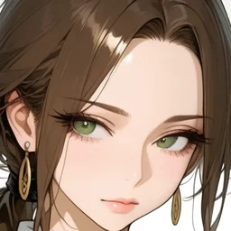<figcaption style="margin:4px 0 0;text-align:center;font-weight:normal;font-size:14px">20261111</figcaption></figure>
<figure style="margin:0;flex:0 1 150px;min-width:0">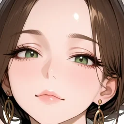<figcaption style="margin:4px 0 0;text-align:center;font-weight:normal;font-size:14px">20261112</figcaption></figure>
<figure style="margin:0;flex:0 1 150px;min-width:0">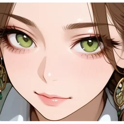<figcaption style="margin:4px 0 0;text-align:center;font-weight:normal;font-size:14px">20261113</figcaption></figure>
<figure style="margin:0;flex:0 1 150px;min-width:0">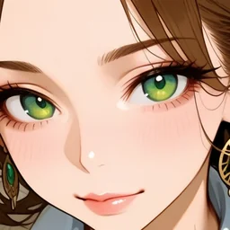<figcaption style="margin:4px 0 0;text-align:center;font-weight:normal;font-size:14px">20261114（基準）</figcaption></figure>
</div>

目の大きさと形、眉の角度、唇の厚みが絵ごとに違い、同じ人物の別の表情というより、似た特徴を持つ別人に見えます。文面には「無表情」と書いたのに、右の 2 枚は笑っています。

<br>

同じ文面・同じ seed で、画風 LoRA だけを外した 4 枚が以下です。

<div style="display:flex;justify-content:center;gap:8px;margin:1rem 0">
<figure style="margin:0;flex:0 1 170px;min-width:0">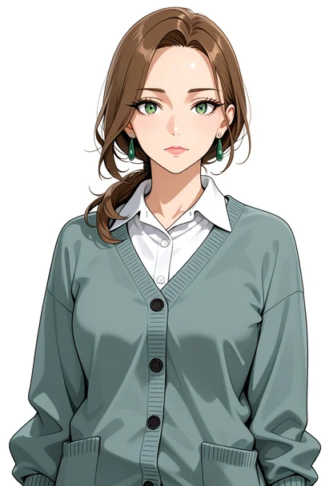<figcaption style="margin:4px 0 0;text-align:center;font-weight:normal;font-size:14px">20261111</figcaption></figure>
<figure style="margin:0;flex:0 1 170px;min-width:0">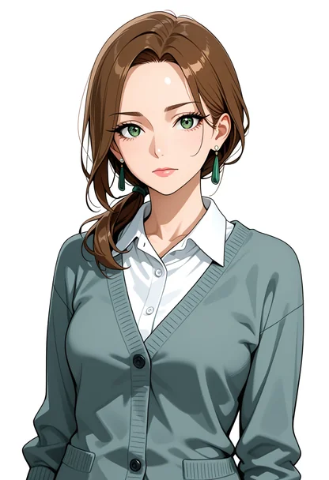<figcaption style="margin:4px 0 0;text-align:center;font-weight:normal;font-size:14px">20261112</figcaption></figure>
<figure style="margin:0;flex:0 1 170px;min-width:0">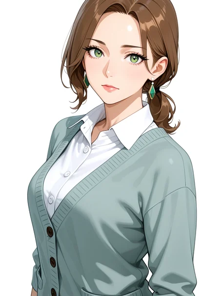<figcaption style="margin:4px 0 0;text-align:center;font-weight:normal;font-size:14px">20261113</figcaption></figure>
<figure style="margin:0;flex:0 1 170px;min-width:0">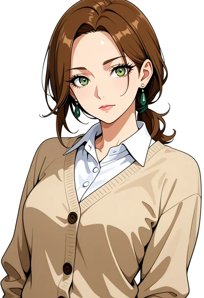<figcaption style="margin:4px 0 0;text-align:center;font-weight:normal;font-size:14px">20261114</figcaption></figure>
</div>

画風 LoRA を外した 4 枚は、どれも正面か少し斜めを向いて立つ構図で、顔立ちもよく似ています。組の中で総当たりに比べると（基準の絵との比較ではなく、4 枚どうしの比較）、顔のタグの一致は LoRA ありの 4 枚が平均 0.53（0.41〜0.73）、LoRA なしが平均 0.95（0.92〜1.00）でした（[lab/output_pairwise.txt](https://github.com/nao1215/debimate/blob/main/content/notes/generative-ai/character-consistency/lab/output_pairwise.txt)）。

画風 LoRA を当てると、絵ごとの差はむしろ広がりました。今回の 4 枚では、この画風 LoRA が斜め上からの構図や、顔の大きさ・向きに幅を持たせ、seed ごとの違いも大きくしたように見えました。画風 LoRA が揃えるのは塗りと線で、特定の人物の顔ではありません。なお、カーディガンは LoRA なしでも紺になりませんでした。

---

### seed を固定して場面の語を変える

同じ seed なら同じキャラクターになる、と考えたくなります。基準の絵と同じ seed のまま、場面の語だけを笑顔・手を振る・カフェに変えた 3 枚が以下です。

<div style="display:flex;justify-content:center;gap:8px;margin:1rem 0">
<figure style="margin:0;flex:0 1 170px;min-width:0">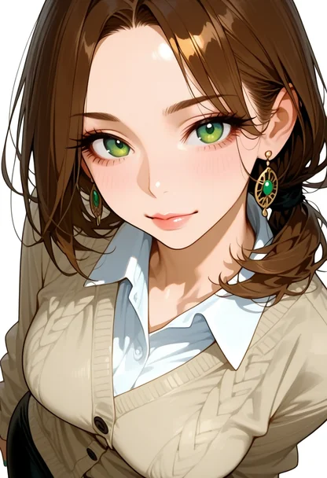<figcaption style="margin:4px 0 0;text-align:center;font-weight:normal;font-size:14px">基準</figcaption></figure>
<figure style="margin:0;flex:0 1 170px;min-width:0">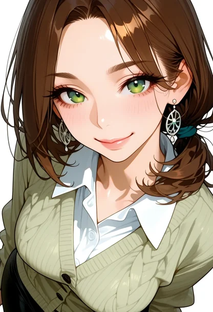<figcaption style="margin:4px 0 0;text-align:center;font-weight:normal;font-size:14px">笑顔</figcaption></figure>
<figure style="margin:0;flex:0 1 170px;min-width:0">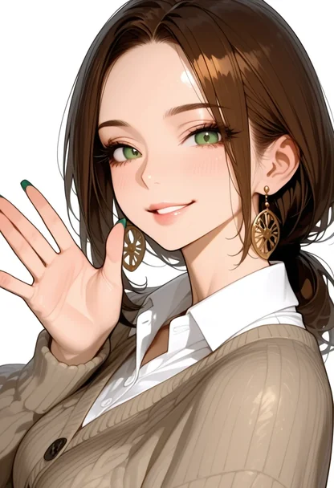<figcaption style="margin:4px 0 0;text-align:center;font-weight:normal;font-size:14px">手を振る</figcaption></figure>
<figure style="margin:0;flex:0 1 170px;min-width:0">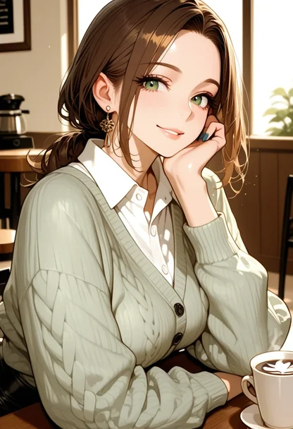<figcaption style="margin:4px 0 0;text-align:center;font-weight:normal;font-size:14px">カフェ</figcaption></figure>
</div>

語を 1 つ変えただけの笑顔は、構図も顔もほぼ基準のままでした。顔のタグの一致は 0.73 です。ただし、カーディガンの色はベージュから黄緑に、耳飾りは緑の石の飾りから銀の輪に変わっています。

手を振る・カフェでは、構図ごと変わりました。顔のタグの一致は 0.33 と 0.38 で、seed を変えた冒頭の 3 枚（0.41〜0.73）より低い値です。同じ seed でも、文面が変われば各ステップでモデルが向かう先が変わるので、最初のノイズが同じでも途中から別の絵になります。今回は、seed の固定が効いたのは、構図をほとんど変えない小さな差分まででした。

---

### 基準の絵から描き直す（img2img）

img2img は、下絵の画像を潜在（画像を縮めた内部の表現）に変えてノイズを混ぜ、途中の段から描き直します（[img2img Denoise のノート](/notes/generative-ai/img2img-denoise/)）。基準の絵を下絵にし、手を振る文面で denoise（下絵をどこまで描き直すか）を変えた絵が以下です。

<div style="display:flex;justify-content:center;gap:8px;margin:1rem 0">
<figure style="margin:0;flex:0 1 170px;min-width:0"><figcaption style="margin:4px 0 0;text-align:center;font-weight:normal;font-size:14px">基準</figcaption></figure>
<figure style="margin:0;flex:0 1 170px;min-width:0">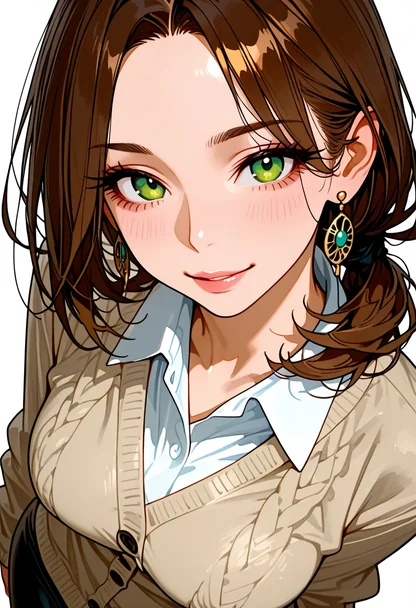<figcaption style="margin:4px 0 0;text-align:center;font-weight:normal;font-size:14px">0.5</figcaption></figure>
<figure style="margin:0;flex:0 1 170px;min-width:0">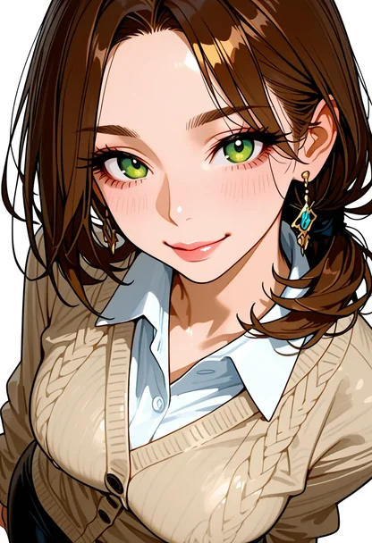<figcaption style="margin:4px 0 0;text-align:center;font-weight:normal;font-size:14px">0.7</figcaption></figure>
<figure style="margin:0;flex:0 1 170px;min-width:0">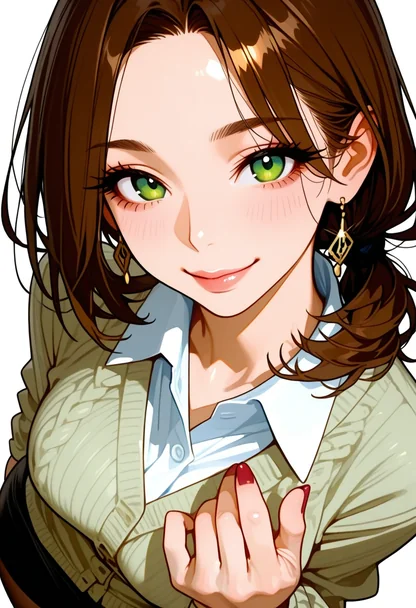<figcaption style="margin:4px 0 0;text-align:center;font-weight:normal;font-size:14px">0.85</figcaption></figure>
</div>

顔・髪・カーディガンの色は、0.5 と 0.7 では基準のままでした（耳飾りは 0.7 で形が少し変わります）。顔のタグの一致は 0.67〜0.89 と、手段の中で最も高い値です。0.85 では、耳飾りの形とカーディガンの色味が変わり、タグの一致も 0.53〜0.64 に下がりました。

その代わり、手を振るポーズは出ません。0.5 と 0.7 では手が描かれず、0.85 でも胸の前に手が出ただけでした。カフェの文面でも、0.85 でカップは手に現れましたが、背景は白いままです。下絵の構図と色の塊は高い denoise でも残るので、今回の denoise の範囲では、img2img は「同じ構図のまま、表情や小物を少し変える」使い方に限られました。

---

### 基準の骨格で縛る（ControlNet）

ControlNet は、骨格や奥行きの画像を形の条件として渡し、ポーズを縛ります（[ControlNet のノート](/notes/generative-ai/controlnet/)）。基準の絵から [DWPose](https://github.com/IDEA-Research/DWPose)（画像から体・手・顔の関節を推定するモデル）で骨格を取り、[ControlNet Union（ProMax）](https://huggingface.co/xinsir/controlnet-union-sdxl-1.0/tree/801a4a3) の openpose（関節を色付きの棒でつないだ骨格の画像）で縛って、seed だけを変えました。

<div style="display:flex;justify-content:center;gap:8px;margin:1rem 0">
<figure style="margin:0;flex:0 1 170px;min-width:0"><figcaption style="margin:4px 0 0;text-align:center;font-weight:normal;font-size:14px">基準</figcaption></figure>
<figure style="margin:0;flex:0 1 170px;min-width:0">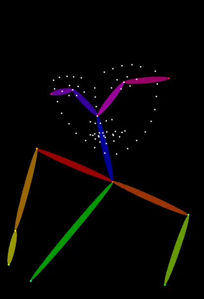<figcaption style="margin:4px 0 0;text-align:center;font-weight:normal;font-size:14px">骨格</figcaption></figure>
<figure style="margin:0;flex:0 1 170px;min-width:0">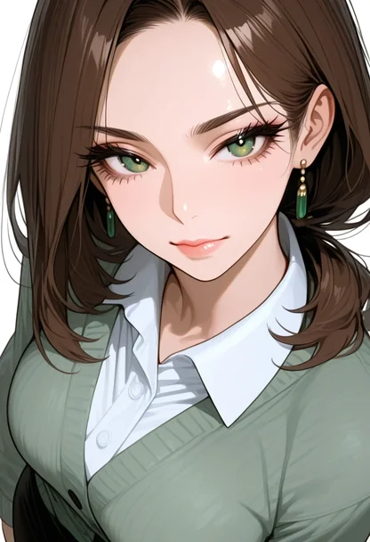<figcaption style="margin:4px 0 0;text-align:center;font-weight:normal;font-size:14px">20261312</figcaption></figure>
<figure style="margin:0;flex:0 1 170px;min-width:0">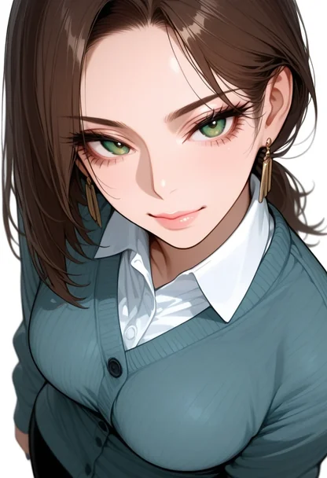<figcaption style="margin:4px 0 0;text-align:center;font-weight:normal;font-size:14px">20261313</figcaption></figure>
</div>

首の傾きと肩の線は基準の通りですが、顔立ちとカーディガンの色は seed ごとに変わりました。顔のタグの一致は 0.62 と 0.44 で、seed を変えただけの絵と同じ範囲です。骨格の画像が持っているのは関節の位置で、目の形や服の色の情報はありません。骨格（openpose）の ControlNet は、ポーズを揃える手段であって、顔を揃える手段ではありません。

---

### 参照画像で寄せる（IP-Adapter）

[IP-Adapter](https://arxiv.org/abs/2308.06721) は、参照画像を CLIP の画像エンコーダーで特徴に変え、文面とは別の cross-attention（画像の特徴を生成の途中へ混ぜる層）から渡す仕組みです。ベースモデルの重みは変えずに、論文の SD1.5 版では 22M のパラメータを足すだけで、画像を文面のように使えます。

今回は、画像を小さな区画に分けた特徴を使う [IP-Adapter Plus の SDXL 版](https://huggingface.co/h94/IP-Adapter/tree/018e402)（`ip-adapter-plus_sdxl_vit-h`）を使いました。

参照画像は基準の絵、文面は笑顔、seed は基準と別の 20261211 で、参照なしの絵と同じです。

<div style="display:flex;justify-content:center;gap:8px;margin:1rem 0">
<figure style="margin:0;flex:0 1 170px;min-width:0">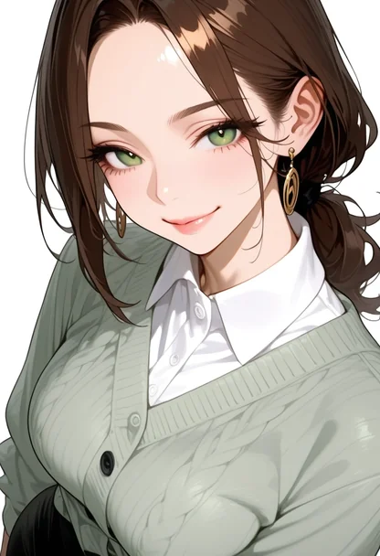<figcaption style="margin:4px 0 0;text-align:center;font-weight:normal;font-size:14px">参照なし</figcaption></figure>
<figure style="margin:0;flex:0 1 170px;min-width:0">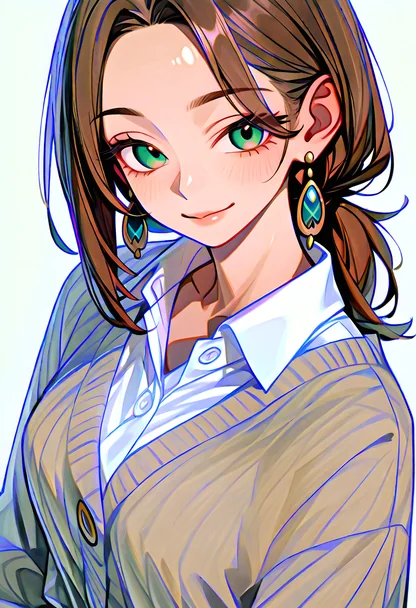<figcaption style="margin:4px 0 0;text-align:center;font-weight:normal;font-size:14px">重み 0.35</figcaption></figure>
<figure style="margin:0;flex:0 1 170px;min-width:0">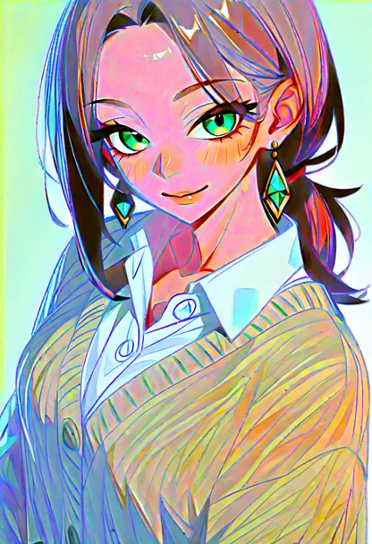<figcaption style="margin:4px 0 0;text-align:center;font-weight:normal;font-size:14px">重み 0.5</figcaption></figure>
<figure style="margin:0;flex:0 1 170px;min-width:0">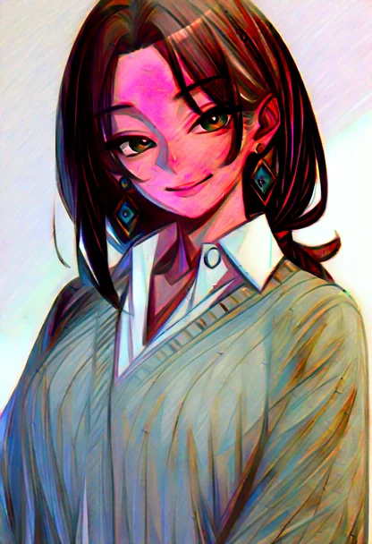<figcaption style="margin:4px 0 0;text-align:center;font-weight:normal;font-size:14px">重み 0.8</figcaption></figure>
</div>

参照画像を使うと、カーディガンはベージュ寄りになり、耳飾りには基準と同じ緑の石が付き、首の傾きも基準に寄りました。一方で、重み 0.35 でも全体の色が青白く転び、0.5 以上では顔が桃色や赤紫になって線が荒れました。後で数値でも比べますが、この色の崩れは顔の近さの指標も大きく下げました。

使い方を 2 通り変えても、同じように色が転びました。1 つは、ノイズの多い最初の 3 割のステップでは参照画像を使わず、残りのステップだけに重み 0.6 で使う方法です。もう 1 つは、参照なしで描いた絵を下絵にして denoise 0.5 の img2img で描き直し、その描き直しにだけ重み 0.7 で参照画像を使う方法です。

IP-Adapter の SDXL のモデルは SDXL 1.0 向けに公開されたもので、今回のベースモデルは SDXL を大きく追加学習した派生モデルです。その差と画風 LoRA の重なりが原因と推測していますが、確認してはいません。公式の README は、同じベースモデルから追加学習したモデルにも IP-Adapter を使える（"IP-Adapter can be generalized not only to other custom models fine-tuned from the same base model"）と書いているので、この推測はその記述と食い違います。少なくともこの組み合わせでは、参照画像は顔を寄せる前に絵を壊しました。参照の背景・使う段・効かせ方を変えて色の転びを切り分けた実験は、[IP-Adapter Color Cast のノート](/notes/generative-ai/ip-adapter-color-cast/)にまとめました。

---

### 揃い具合を数える

以下は、目で見た「似ている」「別人に見える」の差を 2 つの指標で並べたグラフです。各点が 1 枚、縦の線が組の平均、点線が基準の絵（1.0）です。一番上は、金髪・青い目・黒いタートルネックと書いた別人の 2 枚で、物差しの目盛りとして描きました（絵は本文に載せず、数値にだけ使っています）。点の色は、灰色が別人、黄土が文面と seed を変える組、緑が骨格、青が画像を渡す手段です。



<br>

<details>
<summary>metrics.py の出力（抜粋。全 36 枚は lab/output_metrics.txt）</summary>

```text
$ python3 metrics.py tags <PNG のディレクトリ> faces.json metrics.json
other_0         face_clip=0.902 face_tags=0.227 ...
seed_0          face_clip=0.918 face_tags=0.412 ...
fixed_wave      face_clip=0.942 face_tags=0.333 ...
i2i50_smile     face_clip=0.962 face_tags=0.889 ...
ipa80_cafe      face_clip=0.692 face_tags=0.417 ...
```

</details>

<br>

左の CLIP は、物差しとしては目盛りが詰まっていました。髪も目の色も違う別人が 0.90 で、seed を変えた同じ文面の絵（0.92〜0.98）とほとんど差がありません。参照画像（IP-Adapter）の絵は、別人より低い 0.69〜0.88 で、前の節の色の崩れが効いていると見ています。img2img の 0.85 は、タグの一致が下がったのに CLIP では最も高い組の 1 つ（0.98）でした。今回の 36 枚では、CLIP の埋め込みは顔立ちよりも塗り・色・構図の違いに強く反応しているように見えます。

右のタグの一致は、別人を 0.21〜0.23 と低く出し、img2img を 0.67〜0.89 と高く出しました。ただし、タグが数えるのは「緑の目」「茶髪」「耳飾り」のような語で書ける特徴です。冒頭の 4 枚のように、語の上では同じでも顔立ちが違う絵は、別人と判定できません。

どちらの指標も、同じ人物かどうかを直接は測っていません。数値は[外れを先に落とす目安](/notes/generative-ai/image-linting/)に使い、最後は目で比べることになります。

---

### 手段ごとに揃ったもの

以下は、ここまでの結果を基準の絵から何が残ったかでまとめた表です。2026 年 11 月の 1 つのモデルと画風 LoRA での結果です。

| 手段 | 顔立ち | 服・小物の色 | 新しいポーズ・場面 |
|---|---|---|---|
| 文面の語を足す（語を足す実験はしていない） | 揃わない | 語で書いた一部だけ（紺は出ない） | 描ける |
| seed の固定 | 語 1 つの差なら揃う | 変わることがある | 描けるが、構図ごと別の絵になる |
| 画風 LoRA | 揃わない（今回は差が広がった） | 揃わない | 描ける |
| img2img（0.5・0.7） | 揃う | 揃う | 描けない |
| img2img（0.85） | ほぼ揃う | 耳飾りと色味が変わる | 小物が出る程度 |
| ControlNet（骨格） | 揃わない | 揃わない | 骨格の形だけ縛れる |
| IP-Adapter Plus | 目で見ると一部が寄るが、色と塗りが崩れ、タグの一致は参照なしより下がった | 耳飾りとカーディガンは寄る | 描ける |

1 つの手段で、顔・服・新しいポーズの全部を揃えられたものはありませんでした。顔と服を揃える手段（img2img）はポーズを変えられず、ポーズを変える手段（文面・ControlNet）は顔を揃えません。

<br>

著者は、ゲームの立ち絵を作るワークフローで、この壁に当たりました。1 枚の立ち絵を確定させ、そこから表情差分や服・姿勢の違う立ち絵を派生させる流れを組み、表情差分は目と口だけを変える形を目指しています（[2026/11/02 週の weeknotes](/weeknotes/2026-11-02/e2cecb994e2c/)）。目と口の範囲だけを img2img で描き直す方法（inpaint）は、顔と服を基準のまま残す点で、今回の img2img の結果と同じ性質を使っています。

その一方で、同じ仕組みを作った最初の週には「まったく解決できていない課題があり、それは画像間で服が変わることだ」と書いていました（[2026/10/26 週の weeknotes](/weeknotes/2026-10-26/8575939c5076/)）。本記事の冒頭と seed 固定の実験で、紺と書いたカーディガンが灰緑・ベージュ・黄緑に変わったのも同じ現象です。

1 人を何枚も同じに描くための手段には、そのキャラクターの絵を何枚も集めて学習するキャラクター LoRA もあります。画風 LoRA が塗りの傾向を覚えるのと同じ仕組みで、顔と服の傾向を覚えさせます。ただし、学習には同じキャラクターの絵が揃っている必要があり、最初の何枚かは、ここまでの手段を組み合わせて作ることになります。

---

### 揃えにくいケース

- 構図や視点を大きく変える場合。基準の絵からの img2img では新しい構図が出ず、文面で描くと顔が変わる
- 顔立ちが似ていることを数値で保証したい場合。CLIP は別人と同じキャラの差が小さく、タグは語で書けない顔の差を測れない
- 服の色や小物の形が語で縛れない場合。今回の `navy` のように、語が効かずに塗りの傾向に引っ張られる
- 今回の組み合わせのように、参照画像を使うと色と塗りが崩れる場合。顔を寄せる前に使えなくなる

文面・seed・LoRA・img2img・ControlNet・参照画像は、それぞれ揃えるものが違います。何を揃え、何を変えたいかを先に決めて、手段を組み合わせる必要があります。
