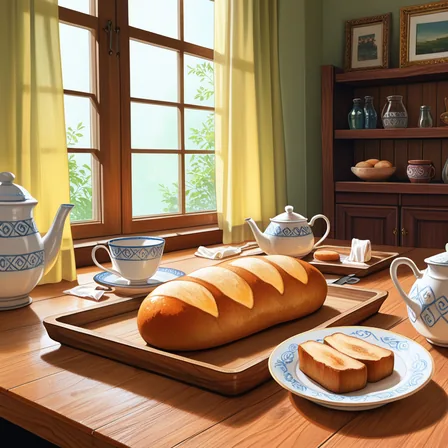

Stable Diffusion 系の画像生成では、text encoder と呼ぶ部品がプロンプト（描きたい絵の内容を語で並べた文面）を数値に変え、その数値を手がかりに絵を作ります。

text encoder には [CLIP](https://arxiv.org/abs/2103.00020)（画像と文章を同じベクトルの空間に対応付けるよう学習したモデル）の文章側が使われていて、一度に 77 トークン（語や語の断片。分け方は [Tokenizer のノート](/notes/generative-ai/tokenizer/)を参照）までしか読めません。

77 トークンのうち 2 個は始まりと終わりの記号に使うので、語に使えるのは 75 トークンです。そこで、長いプロンプトを受け付ける道具は、プロンプトを 75 トークンずつの枠（chunk）に区切って読みます。このため、「75 トークンより後ろ、つまり 2 つ目の枠に書いた語は効かない」と言われることがあります。

しかし、手元の [ComfyUI](https://github.com/Comfy-Org/ComfyUI)（ノードをつないで画像生成の処理を組む OSS）で同じ語を前と後ろに置いて比べると、後ろに置いた語も前に置いた時と同じくらい効きました。

以下は、`red background`（赤い背景）を置く場所だけを変えて生成した絵の、画面の赤い画素（色相が赤の範囲に入る画素）の割合です。seed（初期のノイズを決める乱数の種）を 4 通り変えて生成しています。図の none は `red background` を入れていない基準です。front は 1 つ目の枠（chunk 1）の先頭近く（先頭の 4 語の後）、chunk1_end はその末尾、chunk2_start と chunk2_end は 2 つ目の枠（chunk 2）の先頭と末尾に置いた絵です。



どこに置いても、赤い画素は基準の 5% から 26〜36% に増えました。

<br>

本記事では、ComfyUI の実装と手元の実験から、次の疑問に答えます。

- 長いプロンプトは、どこで区切られ、どう読まれるのか。
- 区切りの後ろの語は、どれだけ効くのか。
- 長いプロンプトのどの語が絵を変えたのか、どう探すのか。

語に重みを付ける `(word:1.3)` の書式と、打ち消し（ネガティブプロンプト）の重みは [Prompt Weighting のノート](/notes/generative-ai/prompt-weighting/)で扱います。実験はすべて 2026 年 11 月 10 日に、ComfyUI v0.35.0 と、SDXL（後述する画像生成モデル）系のモデル 1 つで行いました。数値はこの条件での結果です。

---

### 前提: text encoder の出力の使われ方

画像生成モデルの [SDXL](https://arxiv.org/abs/2307.01952)（Stable Diffusion XL）は、ノイズだけの画像から少しずつノイズを取り除いて絵を作る[拡散モデル](/notes/generative-ai/diffusion-model/)です。各ステップで「どこがノイズか」を予測するネットワークを [UNet](https://arxiv.org/abs/1505.04597) と呼びます。プロンプトは、次の順で UNet に届きます（流れの細部は [Prompt Weighting のノートの前提の節](/notes/generative-ai/prompt-weighting/#前提-プロンプトが-unet-に届くまで)）。

1. tokenizer が、プロンプトをトークンの番号の列に分けます。
2. text encoder が、トークン 1 個につき 1 本のベクトル（埋め込み、embedding）を返します。
3. UNet は、ノイズを予測する各ステップで、画像の各位置からこのベクトルの列を参照します。各位置が、どのトークンをどれだけ参考にするかの割合を決め、その割合でトークンのベクトルを混ぜて取り込む仕組みで、cross-attention と呼びます。

なお、SDXL は text encoder を 2 つ（CLIP の ViT-L と、CLIP を再学習した [OpenCLIP](https://github.com/mlfoundations/open_clip) の ViT-bigG。どちらも CLIP 型で、大きさが違う）持ち、2 つの出力をつないで使います。区切り方は 2 つで同じなので、本記事では 1 つにまとめて描きます。

もう 1 つ、文章全体を 1 本にまとめたベクトルも UNet に渡されます。このベクトルを pooled（プールした出力）と呼びます。以下は、text encoder の出力が UNet に届く 2 つの経路の図です。



トークンごとの埋め込みの列は、上で説明した cross-attention で画像の各位置から参照されます。

SDXL の pooled は ViT-bigG 側から取られ、画像の大きさなどの情報とつなげられ、今が何ステップ目かを表すベクトルに足されて、画像の位置によらず UNet 全体に効きます（[comfy/model_base.py の SDXL.encode_adm](https://github.com/Comfy-Org/ComfyUI/blob/v0.35.0/comfy/model_base.py#L520-L537)）。本記事では、この 2 つの経路で区切りの影響を考えます。

---

### 77 トークンの区切り

冒頭で述べた通り、長いプロンプトを受け付ける道具は、プロンプトを 75 トークンずつ区切って複数回 encoder に通しています。

ComfyUI v0.35.0 の区切り方は、[tokenize_with_weights()](https://github.com/Comfy-Org/ComfyUI/blob/v0.35.0/comfy/sd1_clip.py#L624-L668) の通りです。重みの書式（`(word:1.3)`）を使っていない長いプロンプトは、語の切れ目やカンマの位置に関係なく、75 トークンちょうどで切られます（重みの書式を使った時の区切り方は、本記事では扱いません）。

以下は、150 トークンのプロンプトが区切られて UNet に届くまでの図です。



区切った枠は、それぞれ別に text encoder を通ってから横に連結され、UNet には始まりと終わりの記号を含む 154 トークン（77 × 2）の列として渡ります。ここから、後ろの枠の語が不利になる理由が 2 つ読み取れます。

1 つ目は、枠の間で文脈がつながらないことです。CLIP の text encoder は、各トークンがそれより前のトークンだけを見てベクトルになる作りです（[comfy/clip_model.py](https://github.com/Comfy-Org/ComfyUI/blob/v0.35.0/comfy/clip_model.py#L174) の causal mask。仕組みは [KV キャッシュのノート](/notes/generative-ai/kv-cache/)の前提の節を参照）。UNet の cross-attention とは別の仕組みです。

その上で枠ごとに別々に読むので、以下の図の通り、枠の中では前の語を見られますが、2 つ目の枠の語は 1 つ目の枠に何が書いてあったかを知らずにベクトルになります。2 つ目の枠の先頭の語の前には、始まりの記号 S しかありません。



2 つ目は、pooled のベクトルが 1 つ目の枠からだけ取られることです（[encode_token_weights() の first_pooled](https://github.com/Comfy-Org/ComfyUI/blob/v0.35.0/comfy/sd1_clip.py#L49)）。CLIP の pooled は、終わりの記号の位置の出力です（[comfy/clip_model.py](https://github.com/Comfy-Org/ComfyUI/blob/v0.35.0/comfy/clip_model.py#L186-L189)）。

前のトークンだけを見る作りなので、最後の位置は枠の全てのトークンを見ていて、文章全体のまとめになります。区切りの図の右の pooled（枠 1 の E の位置）がこれで、絵全体に効きます。2 つ目の枠の語は、pooled には入りません。

一方で、UNet の cross-attention は 154 トークンの全てを参照します。そのため、後ろの枠の語も無視されるわけではありません。どれだけ効きが落ちるかは、画像で確認するしかありません。

---

### 実験の条件

手元の ComfyUI（v0.35.0）の API に、ワークフロー（ノードのつながりを書いた JSON）を 1 枚ずつ送りました。変えたのはプロンプトの文字列だけです。

| 項目 | 値 |
|---|---|
| モデル | [WAI-illustrious-SDXL v17.0](https://civitai.com/models/827184?modelVersionId=2883731)（SDXL のアーキテクチャのイラスト向けのモデル）。LoRA は使わない |
| seed | 実験 1 は 201〜204 の 4 個、実験 2 は 301・302 の 2 個 |
| ステップ数・CFG・サンプラー | 24・5.5（CFG はプロンプトに従う強さ）・euler（ノイズを取り除く計算の手順。scheduler は normal） |
| 解像度・CLIP | 1024 × 1024・最後から 2 番目の層の出力（clip skip 2） |
| 題材 | 机の上のティーポット・レモンなどの静物（イラスト向けのモデルは人物を描きやすいので、`no humans` を入れ、打ち消しに人物の語を入れる） |

同じ seed と同じ設定なら、同じ絵が出ます。全ての生成を終えた後に、実験 2 の 1 条件を同じ設定でもう一度生成すると、画素が完全に一致しました。以下の差は、生成のたびに出るぶれではなく、文字列を変えた結果です。

画像の色は、全画素を HSV（色相・彩度・明度）に変換し、赤・黄などの色相に入る画素の割合として数えました。画素の差（`diff`）は、同じ seed の基準の画像との、RGB（赤・緑・青）の値の差の絶対値の平均（0〜255）です。しきい値は [analyze.py](https://github.com/nao1215/debimate/blob/main/content/notes/generative-ai/prompt-weighting/lab/analyze.py) にあります。

---

### 実験 1: 同じ語を区切りの前と後ろに置く

静物の語を並べて 146 トークンにしたプロンプト（基準）に、`red background` を以下の 4 か所のどれかに入れて比べました。`red background ,` は 3 トークンなので、入れた後は 149 トークン（75 + 74）で、2 つの枠に分かれます。



プロンプトのどこで区切られるかは、上記の区切り方を写した [token_chunks.py](https://github.com/nao1215/debimate/blob/main/content/notes/generative-ai/prompt-weighting/lab/token_chunks.py) で確認できます。以下は、2 つ目の枠の先頭に入れた時の区切りを表示した結果です（各枠の 2 行目以降は、トークンを文字に戻したもの）。

```text
chunk 1: 75 tokens, weights [1.0]
  masterpiece , best quality , no humans , still life , white ceramic teapot , lemons ,
  glass bottle , ... , balanced composition , calm atmosphere , quiet mood ,
chunk 2: 74 tokens, weights [1.0]
  red background , simple arrangement , cup , spoon , saucer , ... , quiet , still
```

`weights` は枠の中で使われている重みの値で、重みの書式を使っていないので 1.0 だけです。

以下は seed 201 の 5 枚です。左端は `red background` を入れていない基準です。

<div class="pw-strip" style="display:flex;flex-wrap:wrap;justify-content:center;gap:8px;margin:1.5rem 0">
<figure style="margin:0;flex:1 1 100px;max-width:130px;min-width:0">

<figcaption style="margin:4px 0 0;text-align:center;font-weight:normal;font-size:14px">なし</figcaption></figure>
<figure style="margin:0;flex:1 1 100px;max-width:130px;min-width:0">

<figcaption style="margin:4px 0 0;text-align:center;font-weight:normal;font-size:14px">front</figcaption></figure>
<figure style="margin:0;flex:1 1 100px;max-width:130px;min-width:0">

<figcaption style="margin:4px 0 0;text-align:center;font-weight:normal;font-size:14px">chunk1_end</figcaption></figure>
<figure style="margin:0;flex:1 1 100px;max-width:130px;min-width:0">

<figcaption style="margin:4px 0 0;text-align:center;font-weight:normal;font-size:14px">chunk2_start</figcaption></figure>
<figure style="margin:0;flex:1 1 100px;max-width:130px;min-width:0">

<figcaption style="margin:4px 0 0;text-align:center;font-weight:normal;font-size:14px">chunk2_end</figcaption></figure>
</div>

どこに置いても、壁は赤くなりました。以下は、基準の絵との画素の差（diff）です。



差は 4 か所とも 43〜53 で、どこに置いても絵は同じくらい変わっています。

赤い画素で見ると、2 つ目の枠の先頭（chunk2_start）が 4 seed の平均では一番弱い 26.1% でした。しかし、冒頭のグラフの通り seed ごとの値は他の場所と重なっていて、4 枚では差があるとまでは言えません。2 つ目の枠の末尾は、1 つ目の枠の先頭近く（front）と同じくらい効いています。seed ごとの値は [result_position.json](https://github.com/nao1215/debimate/blob/main/content/notes/generative-ai/prompt-weighting/lab/result_position.json) にあります。

つまり、ComfyUI v0.35.0 では、75 トークンを超えた語も cross-attention を通して効きます。区切りの節で挙げた 2 つの不利な理由は、この条件では効きを大きく落としませんでした。

pooled に入らない 2 つ目の枠の語も、トークンごとの参照だけで同じくらい効いています。枠をまたいで文脈が切れる 2 つ目の枠の先頭（chunk2_start）も、差は seed のばらつきの範囲でした。pooled だけの効きは測っていません。

---

### 実験 2: 語を 1 つずつ外して原因を探す

後ろの語も効くということは、長いプロンプトでは、どこに書いた語も絵に関わるということです。すると、例えば「絵が赤すぎる」のような困った症状が出た時、原因の語は 150 トークンのどこにあってもおかしくありません。しかも、1 つの語が他の語の描く物まで巻き込んで変えるので、プロンプトを眺めても分かりません（[Prompt Weighting のノート](/notes/generative-ai/prompt-weighting/#実験-1-色の語に重みを付ける)）。

本記事では、このように 1 つの語が他の語の描く物を減らしたり置き換えたりすることを競合と呼びます。

そこで、同じ seed のまま語を 1 つずつ外して、外す前の絵と比べる切り分けを試しました。これが本記事の題の後半、効いている語の探し方で、手順は以下の通りです。



この切り分けは、区切りの有無に関係なく使えます。ここでは結果を見やすくするため、1 つの枠に収まる 47 トークンの短いプロンプトで試しました。症状は「赤い物が多い」「黄色い物が多い」を仮に置き、赤い画素と黄色い画素の割合で比べます。

題材は、白いポットのある机に 8 個の品（`lemons, glass bottle, red apple, candle, books, potted plant, silver spoon, blue cup`）を並べたプロンプトです。seed 301 と 302 で、品を 1 つずつ外した 8 通りと外さない 1 通りの絵を生成しました。以下は seed 301 の 6 枚です。

<div class="pw-strip" style="display:flex;flex-wrap:wrap;justify-content:center;gap:8px;margin:1.5rem 0">
<figure style="margin:0;flex:1 1 100px;max-width:130px;min-width:0">

<figcaption style="margin:4px 0 0;text-align:center;font-weight:normal;font-size:14px">全部</figcaption></figure>
<figure style="margin:0;flex:1 1 100px;max-width:130px;min-width:0">

<figcaption style="margin:4px 0 0;text-align:center;font-weight:normal;font-size:14px">− silver spoon</figcaption></figure>
<figure style="margin:0;flex:1 1 100px;max-width:130px;min-width:0">

<figcaption style="margin:4px 0 0;text-align:center;font-weight:normal;font-size:14px">− blue cup</figcaption></figure>
<figure style="margin:0;flex:1 1 100px;max-width:130px;min-width:0">

<figcaption style="margin:4px 0 0;text-align:center;font-weight:normal;font-size:14px">− red apple</figcaption></figure>
<figure style="margin:0;flex:1 1 100px;max-width:130px;min-width:0">

<figcaption style="margin:4px 0 0;text-align:center;font-weight:normal;font-size:14px">− lemons</figcaption></figure>
<figure style="margin:0;flex:1 1 100px;max-width:130px;min-width:0">

<figcaption style="margin:4px 0 0;text-align:center;font-weight:normal;font-size:14px">− potted plant</figcaption></figure>
</div>

画像の並びではレモンが目立ちませんが、seed 301 の全部の語の絵ではレモンが小さく、黄色い画素は 2.5% です（seed 302 では 7.4%）。

どの語を外しても、物の位置や数が変わりました。外す前の絵との画素の差は、2 つの seed の平均で 21.7〜40.6 です。

以下は、外した語ごとの画素の差と、症状の指標（赤い画素・黄色い画素）です。



そのため、画素の差が一番大きい語（この題材では `potted plant`）を原因と決めることはできません。1 語を外すだけで、構図ごと描き直されるからです。

原因を探す時に比べるのは、画素の差ではなく、困っている症状の指標です。赤い画素の割合（2 seed の平均）は、全部の語で 3.8% のところ、`red apple` を外した時だけ 0.6% に下がり、他の 7 通りは 3.0〜5.1% でした。黄色い画素も、`lemons` を外した時に 4.9% から 1.3% に下がります。

<br>

<details>
<summary>表の抜粋（2 seed の平均）と補足</summary>

```text
condition          red  yellow   blue   diff   (2 seeds の平均)
full             0.038   0.049  0.001    0.0
no_red_apple     0.006   0.061  0.000   34.2
no_lemons        0.051   0.013  0.002   27.8
no_silver_spoon  0.042   0.035  0.006   30.4
no_blue_cup      0.049   0.036  0.000   21.7
no_potted_plant  0.030   0.031  0.002   40.6
```

なお、`silver spoon` を外すと、2 つの seed の両方で、スプーンを挿していた瓶が青い水の瓶に変わりました（青い画素は 0.1% から 0.6%）。プロンプトに残る `blue cup` の青が、スプーンの消えた所に移ったように見えますが、画像から読んだ推測です。

9 通り全ての値は [lab/output_ablation.txt](https://github.com/nao1215/debimate/blob/main/content/notes/generative-ai/prompt-weighting/lab/output_ablation.txt) にあります。

</details>

<br>

---

### 後ろの語が効かない時に疑うこと

実験 1 の通り、区切りの後ろの語も効きます。「後ろに書いた語が効かない」と感じる場合は、区切りそのものより先に、次の 2 つを疑います。

1 つ目は、道具が上限を超えた語を捨てている場合です。区切って読む ComfyUI と違い、77 トークンで切り捨てる道具もあります。例えば [diffusers](https://github.com/huggingface/diffusers)（Hugging Face の拡散モデルのライブラリ）の SDXL のパイプラインは、77 トークンを超えた分を切り捨て、警告を出します（[pipeline_stable_diffusion_xl.py](https://github.com/huggingface/diffusers/blob/v0.31.0/src/diffusers/pipelines/stable_diffusion_xl/pipeline_stable_diffusion_xl.py#L388-L408)、v0.31.0）。

2 つ目は、後ろの語が他の語と競合している場合です。この時は、実験 2 のように同じ seed で 1 語ずつ外し、困っている症状の指標で比べると、原因の語を絞れます。実験 2 は区切りの無い短いプロンプトで試したので、長いプロンプトの後ろの語でも同じように絞れるかは、本記事では確認していません。

まとめると、ComfyUI では 75 トークンの区切りの後ろの語も効きます。後ろの語が効かないと感じたら、区切りより先に、切り捨てと競合を疑います。どちらも、同じ seed で 1 か所ずつ変えて比べれば確認できます。
