ControlNet は、学習済みの画像生成モデルに、骨格・奥行き・輪郭などの画像を形の条件として渡す仕組みです。[ControlNet の論文](https://arxiv.org/abs/2302.05543)（2023 年）で提案され、論文の著者による実装は [lllyasviel/ControlNet](https://github.com/lllyasviel/ControlNet) で公開されています。文面（プロンプト）だけでは決まらない人物の姿勢や構図も、画像で指定できます。

人物の姿勢を指定する時は、関節を点と棒で描いた [OpenPose](https://github.com/CMU-Perceptual-Computing-Lab/openpose) の骨格を渡す使い方がよく知られています。骨格を渡せば、手足も手に持つ物も骨格の通りに描かれると思うかもしれません。しかし、本記事の実験では、骨格を渡すと脚の開きと腕の向きは揃いましたが、両手で前に突き出したはずの棒は縦に立ちました。同じ姿勢の 3D の人形から作った奥行きを渡すと、棒も前を向きます。



骨格の画像には、関節の点しか描かれていません。棒の向き、体の厚み、腕が体の手前か奥かは骨格から読めないので、モデルが文面と学習した絵から補います。

<br>

本記事では、画像生成を使い始めたエンジニアに向けて、ControlNet の仕組みと、条件の画像の種類によって縛れるものの違いを説明します。3D の人形の 3 つの姿勢から骨格と奥行きを作り、同じ文面と seed で描いた絵ごとに、姿勢の検出器で関節の位置を数えて比べます。扱う疑問は次の通りです。

- 文面だけでは、なぜ姿勢が決まらないのか。
- ControlNet は、学習済みのモデルに何を足しているのか。
- 骨格と奥行きでは、縛れるものがどう違うのか。
- 強さ（strength）と終了の位置（end_percent）を変えると、何が変わるのか。

ControlNet を自分で学習する手順、複数の ControlNet を重ねる使い方、参照画像で見た目を寄せる [IP-Adapter](https://github.com/tencent-ailab/IP-Adapter) は扱いません。

---

### 前提: 文面だけではポーズが決まらない理由

SDXL 系の画像生成モデルは、ノイズだけの画像から少しずつノイズを取り除いて絵を作ります（段の列の詳細は [Diffusion Model のノート](/notes/generative-ai/diffusion-model/)と [img2img Denoise のノート](/notes/generative-ai/img2img-denoise/)）。ノイズを取り除く本体は [U-Net](https://arxiv.org/abs/1505.04597) と呼ばれるネットワークで、文面はその途中の cross-attention から入ります（経路は [Attribute Binding のノート](/notes/generative-ai/attribute-binding/)の前提の節）。

文面から届くのは「何を描くか」の手掛かりで、画面のどの座標に何を置くかを指定する入力はありません。`raising staff overhead` と書いても、右腕を画面のどこまで上げるか、棒をどの角度に傾けるかは、学習した絵の中で多かった形にモデルが寄せます。

後の実験 1 でも、文面に `lunging forward, thrusting staff forward with both hands` と書いた絵は、2 つの seed とも前屈みになり、棒の先を足元に向けた姿になりました。文面が「突き」と伝えても、どの関節をどこへ置くかは伝わっていません。

---

### ControlNet の仕組み

ControlNet は、学習済みのモデルの重みを書き換えずに、条件の画像を読む経路を横に足します。[論文](https://arxiv.org/abs/2302.05543)の 3.2 節では、Stable Diffusion の U-Net のうち、画像を縮めていく 12 個の段（encoder）と中央の 1 段を複製し、複製だけを学習します。元の U-Net は固定（locked）のままです。



上記の図の下段が、学習するコピー（trainable copy）です。コピーには、ノイズを含む潜在と、条件の画像が入ります。論文では、条件の画像を 4 層の小さな畳み込みネットワークで潜在と同じ縦横の大きさに縮めてから足します。コピーの各段の出力は、元の U-Net の skip connection（縮める段から広げる段へ直接渡す線）と中央の段に足されます。

<br>

#### ゼロ畳み込み

コピーと元の U-Net の間には、重みとバイアスを 0 で初期化した 1×1 の畳み込みを挟みます。論文ではゼロ畳み込み（zero convolution）と呼んでいます。学習の始めは出力が全部 0 なので、ControlNet を付けても元のモデルと同じ絵が出ます。[lllyasviel/ControlNet](https://github.com/lllyasviel/ControlNet) の README も、学習前のゼロ畳み込みは 0 を出力し、絵を歪めないと説明しています。

学習では、元のモデルを壊さずに、コピーが条件の画像の読み方を少しずつ覚えます。論文の 3.3 節では、学習データの文面の 50% を空にしています。文面が無くても条件の画像だけから意味を読み取らせるためです。

<br>

#### 条件の画像の種類

論文は [Canny エッジ](https://docs.opencv.org/4.x/da/d22/tutorial_py_canny.html)（明るさの勾配から取り出した輪郭）、奥行き（depth）、[OpenPose](https://github.com/CMU-Perceptual-Computing-Lab/openpose) の骨格など、条件ごとに別の ControlNet を学習しています。

本記事で使う [xinsir/controlnet-union-sdxl-1.0](https://huggingface.co/xinsir/controlnet-union-sdxl-1.0)（ControlNet++）は、1 つのモデルで 10 種類以上の条件を扱う SDXL 向けのモデルです（2024 年 7 月更新の model card の記述）。ComfyUI では [`SetUnionControlNetType`](https://github.com/Comfy-Org/ComfyUI/blob/v0.35.0/comfy_extras/nodes_controlnet.py#L7-L33) ノードで、どの種類の画像を渡すかを指定します。

渡す画像は、画面の座標ごとに何を決めるかが違います。

| 種類 | 画像の中身 | 画面に残る情報 |
|---|---|---|
| OpenPose（骨格） | 黒地に、関節の 18 点と、それを結ぶ色付きの棒 | 関節の位置。体の太さ、前後の重なり、手に持つ物は無い |
| depth（奥行き） | 手前ほど明るい白黒の画像 | 体と物の外形、前後の重なり |
| canny / lineart（輪郭） | 黒地に白い線 | 線の位置。線の内側の手前と奥は無い |

骨格は、手に持つ棒を表せません。OpenPose の 18 点は鼻・首・肩・肘・手首・腰・膝・足首・目・耳だけで（[OpenPose の出力形式](https://github.com/CMU-Perceptual-Computing-Lab/openpose/blob/master/doc/02_output.md#pose-output-format-coco)）、物の点はありません。

---

### ComfyUI での強さと終了の位置

[ComfyUI](https://github.com/Comfy-Org/ComfyUI)（ノードをつないで画像生成の処理を組む OSS）では、[`ControlNetApplyAdvanced`](https://github.com/Comfy-Org/ComfyUI/blob/v0.35.0/nodes.py#L932-L980) ノードに `strength`（強さ）、`start_percent`、`end_percent` の 3 つの値を渡します。

強さは、コピーの出力に掛ける倍率です。[comfy/controlnet.py の control_merge](https://github.com/Comfy-Org/ComfyUI/blob/v0.35.0/comfy/controlnet.py#L190-L205) で、各段の出力に `x *= self.strength` を掛けてから元の U-Net に足します。

`start_percent` と `end_percent` は、ノイズを取り除く段の列のどこで ControlNet を呼ぶかを決めます。以下は、v0.35.0 の [get_control](https://github.com/Comfy-Org/ComfyUI/blob/v0.35.0/comfy/controlnet.py#L253-L263) の先頭です。

```python
def get_control(self, x_noisy, t, cond, batched_number, transformer_options):
    control_prev = None
    if self.previous_controlnet is not None:
        control_prev = self.previous_controlnet.get_control(x_noisy, t, cond, batched_number, transformer_options)

    if self.timestep_range is not None:
        if t[0] > self.timestep_range[0] or t[0] < self.timestep_range[1]:
            if control_prev is not None:
                return control_prev
            else:
                return None
```

`t[0]` は、そのステップのノイズの大きさ（sigma）です。`timestep_range` は、[percent_to_sigma](https://github.com/Comfy-Org/ComfyUI/blob/v0.35.0/comfy/model_sampling.py#L211-L217) で `start_percent` と `end_percent` を sigma に変えた範囲で、範囲の外のステップでは ControlNet を呼びません。

`percent_to_sigma` は、学習の時の 1000 段のノイズの列で、`(1 - percent) × 999` 段目の sigma を返します。scheduler が `normal` の時は、28 ステップの sigma もこの列を等間隔に選ぶので、`end_percent` はほぼステップ数の割合になります。[lab/control_steps.py](https://github.com/nao1215/debimate/blob/main/content/notes/generative-ai/controlnet/lab/control_steps.py) で、28 ステップのうち何ステップで ControlNet を呼ぶかを数えました。

```text
$ python3 control_steps.py
end_percent  sigma_end  active_steps  (start_percent=0)
        0.2     5.0924   6 / 28  (step 1..6)
        0.4     2.2797  11 / 28  (step 1..11)
        0.6     1.1629  17 / 28  (step 1..17)
        0.8     0.5712  22 / 28  (step 1..22)
        1.0     0.0000  28 / 28  (step 1..28)
```

`end_percent` 0.6 なら、前の 17 ステップだけ形を縛り、後の 11 ステップは文面とモデルだけで描きます。後の実験 2 では、前の 6 ステップだけ縛っても、姿勢は最後まで残りました。

---

### 実験の条件

骨格と奥行きで縛れるものの違いを確認するために、2026 年 11 月 11 日に、同じ姿勢から作った骨格と奥行きを渡して描き比べました。条件の画像を手で描くと、骨格と奥行きで姿勢がずれます。そこで、3D の人形に姿勢を付け、同じカメラから両方を書き出しました。

人形は、3D の制作ツール [Blender](https://www.blender.org/) 4.5 と、人体と骨組みを作るアドオン [MPFB](https://extensions.blender.org/add-ons/mpfb/) 2.0.18 で作った成人男性の体です。手足は、手先と足先の行き先を置くと肘と膝の曲がりが決まる IK（Inverse Kinematics）で動かし、右手に長さ 1.5 m の棒を持たせました。服の厚みの分だけ、体の表面を少し膨らませています。

<br>

[lab/render_poses.py](https://github.com/nao1215/debimate/blob/main/content/notes/generative-ai/controlnet/lab/render_poses.py) は、姿勢ごとに次の 2 つを書き出します。

- 奥行きの画像。カメラは平行投影で、手前ほど明るい
- OpenPose の 18 点の画面上の座標。MPFB の [rig.openpose.json](https://github.com/makehumancommunity/mpfb2/blob/v2.0.18/src/mpfb/data/rigs/standard/rig.openpose.json) が決める頂点や関節の位置は、姿勢を付けた後の体で計算する。鼻・目・耳は、体に隠れる時は書き出さない

骨格の画像は、18 点から [lab/draw_openpose.py](https://github.com/nao1215/debimate/blob/main/content/notes/generative-ai/controlnet/lab/draw_openpose.py) で描きました。色と棒の組は [comfyui_controlnet_aux](https://github.com/Fannovel16/comfyui_controlnet_aux) の描き方と同じで、太さは [xinsir/controlnet-openpose-sdxl-1.0](https://huggingface.co/xinsir/controlnet-openpose-sdxl-1.0) の model card が勧める太い線（長辺 1,000〜2,000 px なら 3 倍）に合わせています。model card は、学習の骨格を太い線で描いたので、細い線では結果が不安定になると説明しています。

姿勢は次の 3 つです。文面の後半も、姿勢ごとに同じ内容を英語で書いています。

- 腕を上げる（raise）: 斜め前から。右手で棒を頭上に上げ、左手を腰に当てる
- 突き（lunge）: 横から。脚を前後に大きく開き、両手で棒を前へ突き出す
- 振り返る（lookback）: 斜め後ろから。右手で棒を肩に担ぎ、肩越しに振り返る

ベースモデルは [WAI-illustrious-SDXL の v17.0](https://civitai.com/models/827184?modelVersionId=2883731)（Illustrious 系のイラスト向けのモデル。アーキテクチャは SDXL）で、[LoRA](/notes/generative-ai/lora/) は使っていません。ライセンスは [Fair AI Public License 1.0-SD](https://freedevproject.org/faipl-1.0-sd/) で、生成した画像はライセンスの対象外です。ControlNet は、xinsir/controlnet-union-sdxl-1.0 の promax 版（Apache License 2.0）です。

| 項目 | 値 |
|---|---|
| 解像度・ステップ数・CFG（文面に従わせる強さ） | 832 × 1216・28・5.5 |
| seed | 20261111 / 20261112 |
| サンプラー | euler_ancestral、scheduler は normal |
| 文面（共通） | 1boy, solo, adult man, short black hair, white shirt, navy jacket, black trousers, brown boots, holding a long wooden staff, full body, simple background, white background ほか |
| 文面（姿勢ごと） | 例: lunging forward, thrusting staff forward with both hands, from side |
| 骨格 | union の openpose、strength 1.0、end_percent 1.0 |
| 奥行き | union の depth、strength 0.7、end_percent 0.6 |

強さと終了の位置は、骨格が最も強く効く設定にし、奥行きは弱めにしています。文面の全体と打ち消しは [lab/README.txt](https://github.com/nao1215/debimate/blob/main/content/notes/generative-ai/controlnet/lab/README.txt) にあります。以下は、送信に使った [lab/run_controlnet.py](https://github.com/nao1215/debimate/blob/main/content/notes/generative-ai/controlnet/lab/run_controlnet.py) の、ControlNet をつなぐ部分の抜粋です。`wf` は txt2img のワークフロー（`KSampler` がノード 6）を表す dict です。

```python
# lab/run_controlnet.py の workflow() から抜粋
if control:
    wf["10"] = {"class_type": "LoadImage", "inputs": {"image": control["image"]}}
    wf["11"] = {"class_type": "ControlNetLoader", "inputs": {"control_net_name": control["model"]}}
    cn = ["11", 0]
    if control["model"] == UNION:  # union は 1 つのモデルで種類を切り替える
        wf["12"] = {"class_type": "SetUnionControlNetType",
                    "inputs": {"control_net": ["11", 0], "type": control["type"]}}
        cn = ["12", 0]
    wf["13"] = {"class_type": "ControlNetApplyAdvanced", "inputs": {
        "positive": ["3", 0], "negative": ["4", 0], "control_net": cn, "image": ["10", 0],
        "strength": control["strength"], "start_percent": control["start"], "end_percent": control["end"],
        "vae": ["1", 2]}}
    wf["6"]["inputs"]["positive"], wf["6"]["inputs"]["negative"] = ["13", 0], ["13", 1]
```

文面と seed は同じで、変えたのは ControlNet の有無と条件の画像だけです。

---

### 実験 1: 文面だけ・骨格・奥行き

以下が、3 つの姿勢それぞれで、渡した条件の画像と、描いた絵です。1 段目が条件の画像、2 段目が seed 20261111、3 段目が seed 20261112 で、左から文面だけ・骨格・奥行きの順に並べています。

<br>

#### 腕を上げる

<div style="display:flex;justify-content:center;gap:6px;margin:1rem 0">
<figure style="margin:0;flex:0 1 150px;min-width:0">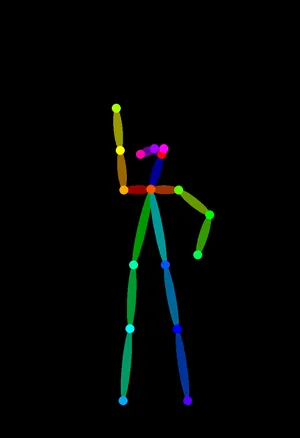<figcaption style="margin:4px 0 0;text-align:center;font-weight:normal;font-size:14px">骨格</figcaption></figure>
<figure style="margin:0;flex:0 1 150px;min-width:0">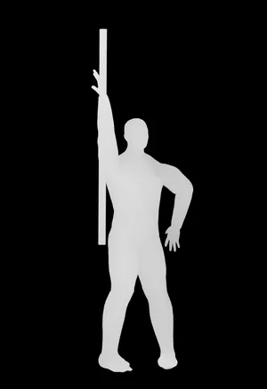<figcaption style="margin:4px 0 0;text-align:center;font-weight:normal;font-size:14px">奥行き</figcaption></figure>
</div>

<div style="display:flex;justify-content:center;gap:6px;margin:1rem 0">
<figure style="margin:0;flex:0 1 150px;min-width:0">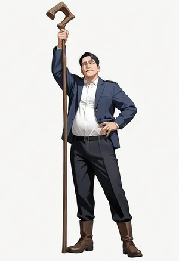<figcaption style="margin:4px 0 0;text-align:center;font-weight:normal;font-size:14px">文面だけ・seed 1</figcaption></figure>
<figure style="margin:0;flex:0 1 150px;min-width:0">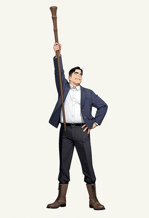<figcaption style="margin:4px 0 0;text-align:center;font-weight:normal;font-size:14px">骨格・seed 1</figcaption></figure>
<figure style="margin:0;flex:0 1 150px;min-width:0">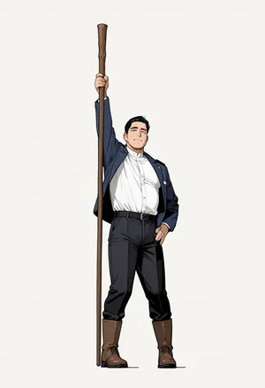<figcaption style="margin:4px 0 0;text-align:center;font-weight:normal;font-size:14px">奥行き・seed 1</figcaption></figure>
</div>

<div style="display:flex;justify-content:center;gap:6px;margin:1rem 0">
<figure style="margin:0;flex:0 1 150px;min-width:0">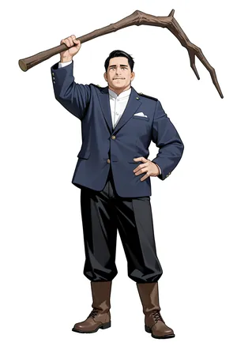<figcaption style="margin:4px 0 0;text-align:center;font-weight:normal;font-size:14px">文面だけ・seed 2</figcaption></figure>
<figure style="margin:0;flex:0 1 150px;min-width:0">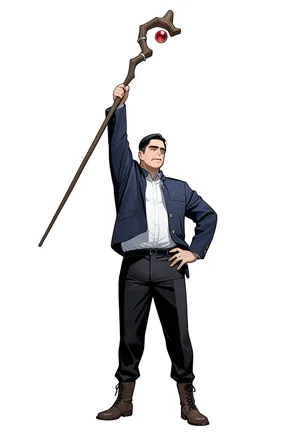<figcaption style="margin:4px 0 0;text-align:center;font-weight:normal;font-size:14px">骨格・seed 2</figcaption></figure>
<figure style="margin:0;flex:0 1 150px;min-width:0">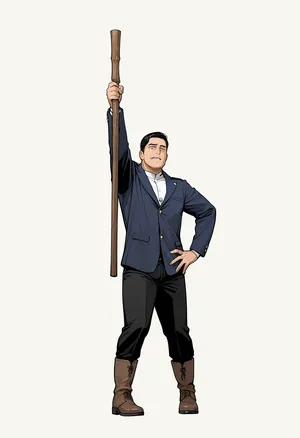<figcaption style="margin:4px 0 0;text-align:center;font-weight:normal;font-size:14px">奥行き・seed 2</figcaption></figure>
</div>

文面だけでも、右手を上げて左手を腰に当てる姿にはなりました。ただし、人物は画面いっぱいに大きく描かれ、棒は seed ごとに杖や木の枝に変わります。骨格は人物の位置と大きさを人形に揃えましたが、seed 2 の棒は斜めに傾きました。奥行きは、2 つの seed とも棒まで人形と同じ縦の向きです。

<br>

#### 突き

<div style="display:flex;justify-content:center;gap:6px;margin:1rem 0">
<figure style="margin:0;flex:0 1 150px;min-width:0">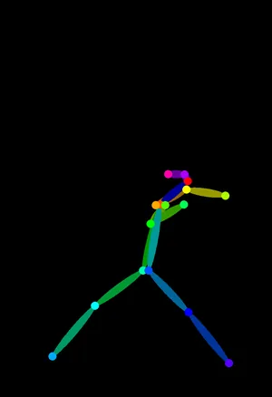<figcaption style="margin:4px 0 0;text-align:center;font-weight:normal;font-size:14px">骨格</figcaption></figure>
<figure style="margin:0;flex:0 1 150px;min-width:0">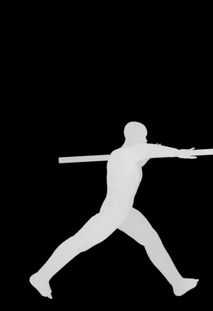<figcaption style="margin:4px 0 0;text-align:center;font-weight:normal;font-size:14px">奥行き</figcaption></figure>
</div>

<div style="display:flex;justify-content:center;gap:6px;margin:1rem 0">
<figure style="margin:0;flex:0 1 150px;min-width:0">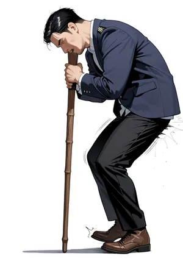<figcaption style="margin:4px 0 0;text-align:center;font-weight:normal;font-size:14px">文面だけ・seed 1</figcaption></figure>
<figure style="margin:0;flex:0 1 150px;min-width:0">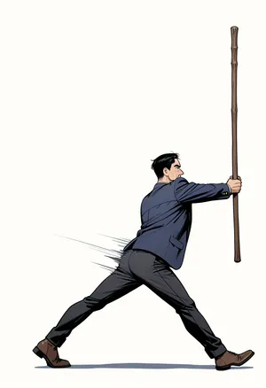<figcaption style="margin:4px 0 0;text-align:center;font-weight:normal;font-size:14px">骨格・seed 1</figcaption></figure>
<figure style="margin:0;flex:0 1 150px;min-width:0"><figcaption style="margin:4px 0 0;text-align:center;font-weight:normal;font-size:14px">奥行き・seed 1</figcaption></figure>
</div>

<div style="display:flex;justify-content:center;gap:6px;margin:1rem 0">
<figure style="margin:0;flex:0 1 150px;min-width:0">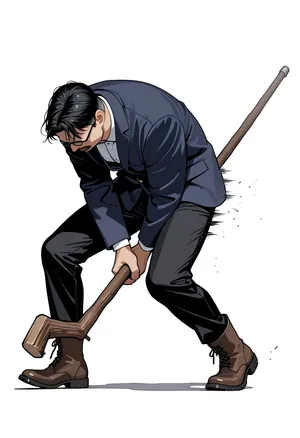<figcaption style="margin:4px 0 0;text-align:center;font-weight:normal;font-size:14px">文面だけ・seed 2</figcaption></figure>
<figure style="margin:0;flex:0 1 150px;min-width:0">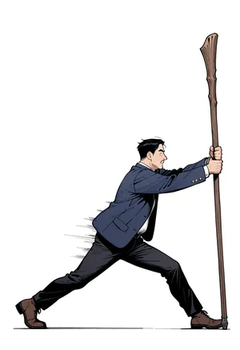<figcaption style="margin:4px 0 0;text-align:center;font-weight:normal;font-size:14px">骨格・seed 2</figcaption></figure>
<figure style="margin:0;flex:0 1 150px;min-width:0">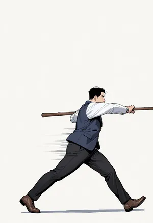<figcaption style="margin:4px 0 0;text-align:center;font-weight:normal;font-size:14px">奥行き・seed 2</figcaption></figure>
</div>

冒頭の図の組です。骨格を渡すと、脚の開きと上体の向きは人形に揃いました。しかし、棒は 2 つの seed とも縦に握られています。骨格には棒が描かれていないので、モデルは、`thrusting staff forward` という文面と腕を前へ伸ばした骨格の両方に、「棒を立てて握る」形で応えました。奥行きは、棒の外形も渡すので、前へ水平に突き出す形になります。

<br>

#### 振り返る

<div style="display:flex;justify-content:center;gap:6px;margin:1rem 0">
<figure style="margin:0;flex:0 1 150px;min-width:0">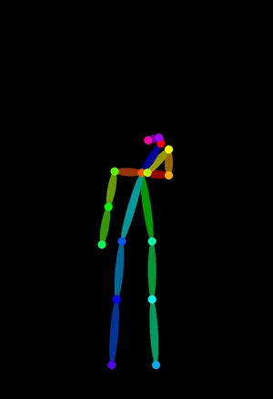<figcaption style="margin:4px 0 0;text-align:center;font-weight:normal;font-size:14px">骨格</figcaption></figure>
<figure style="margin:0;flex:0 1 150px;min-width:0">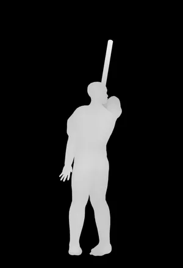<figcaption style="margin:4px 0 0;text-align:center;font-weight:normal;font-size:14px">奥行き</figcaption></figure>
</div>

<div style="display:flex;justify-content:center;gap:6px;margin:1rem 0">
<figure style="margin:0;flex:0 1 150px;min-width:0">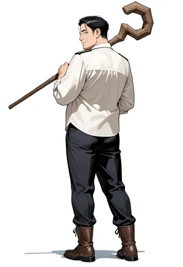<figcaption style="margin:4px 0 0;text-align:center;font-weight:normal;font-size:14px">文面だけ・seed 1</figcaption></figure>
<figure style="margin:0;flex:0 1 150px;min-width:0">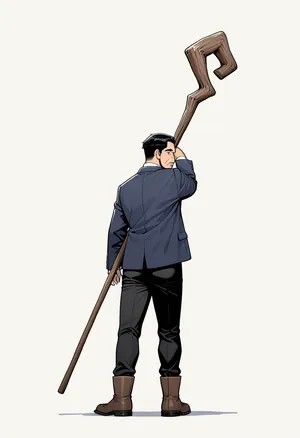<figcaption style="margin:4px 0 0;text-align:center;font-weight:normal;font-size:14px">骨格・seed 1</figcaption></figure>
<figure style="margin:0;flex:0 1 150px;min-width:0">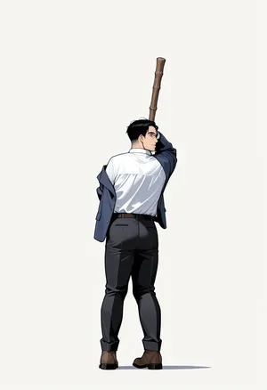<figcaption style="margin:4px 0 0;text-align:center;font-weight:normal;font-size:14px">奥行き・seed 1</figcaption></figure>
</div>

<div style="display:flex;justify-content:center;gap:6px;margin:1rem 0">
<figure style="margin:0;flex:0 1 150px;min-width:0">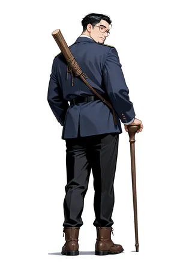<figcaption style="margin:4px 0 0;text-align:center;font-weight:normal;font-size:14px">文面だけ・seed 2</figcaption></figure>
<figure style="margin:0;flex:0 1 150px;min-width:0">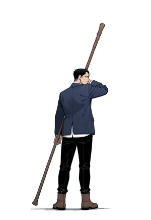<figcaption style="margin:4px 0 0;text-align:center;font-weight:normal;font-size:14px">骨格・seed 2</figcaption></figure>
<figure style="margin:0;flex:0 1 150px;min-width:0">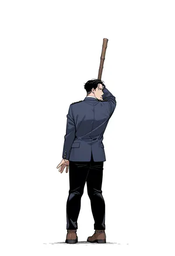<figcaption style="margin:4px 0 0;text-align:center;font-weight:normal;font-size:14px">奥行き・seed 2</figcaption></figure>
</div>

文面だけの絵も後ろ姿にはなりましたが、人物の大きさと棒の担ぎ方が人形と違います。骨格の絵は 2 つとも、棒が肩から足元へ斜めに伸びました。人形の棒は肩から上へ立っていて、奥行きの 2 枚はその向きです。奥行きの seed 1 では、下ろした左手が体に隠れて描かれていません。

---

### 関節の位置を数える

目で見た「揃った」を確認するために、[lab/pose_metrics.py](https://github.com/nao1215/debimate/blob/main/content/notes/generative-ai/controlnet/lab/pose_metrics.py) で絵から姿勢を検出し、人形の関節とのずれを数えました。検出には、[ONNX](https://onnx.ai/) 形式の姿勢推定モデルを動かす [rtmlib](https://github.com/Tau-J/rtmlib) 0.0.13 を使っています。人物の検出は、イラストなどの描かれた人物を含む [Human-Art](https://github.com/IDEA-Research/HumanArt) で学習した [YOLOX](https://github.com/Megvii-BaseDetection/YOLOX)-x、関節の推定は [RTMPose](https://github.com/open-mmlab/mmpose/tree/main/projects/rtmpose)-x です。

比べたのは肩・肘・手首・腰・膝・足首の 12 点です。ずれは、2 点の距離を人形の背丈（首から両足首の中点まで）で割った % で、左右の取り違えは問いません。棒の向きは、この 12 点には入っていません。

検出器自体も、横や後ろから見た腕を見落とします。そこで、人形の奥行きの画像そのものも同じ方法で数え、目安にしました。以下のグラフの破線が、その値です。



<br>

<details>
<summary>pose_metrics.py の出力（実験 1〜3 の 32 枚と、人形の奥行きの画像そのもの *_mannequin の 3 枚）</summary>

```text
$ python3 pose_metrics.py <keypoints.json> <PNG のディレクトリ> pose_metrics.json
lookback_canny_20261111            arms   5.5  legs   2.5  torso   3.7  people 1
lookback_depth_20261111            arms  14.6  legs   2.6  torso   2.4  people 1
lookback_depth_20261112            arms   6.5  legs   2.5  torso   4.1  people 1
lookback_mannequin                 arms  22.6  legs   1.6  torso   9.1  people 1
lookback_openpose_20261111         arms   8.0  legs   2.1  torso   4.0  people 1
lookback_openpose_20261112         arms   8.0  legs   2.0  torso   3.8  people 1
lookback_openposeded_20261111      arms  10.1  legs   3.7  torso   3.3  people 1
lookback_text_20261111             arms  29.4  legs  12.4  torso  31.1  people 1
lookback_text_20261112             arms  23.9  legs   5.6  torso  34.1  people 1
lunge_canny_20261111               arms  12.4  legs   4.4  torso   9.1  people 1
lunge_depth_20261111               arms  15.6  legs   4.7  torso   7.6  people 1
lunge_depth_20261112               arms  12.2  legs   4.6  torso   8.2  people 1
lunge_depth_s030_e060_20261111     arms  63.6  legs  48.8  torso  83.2  people 1
lunge_depth_s050_e060_20261111     arms  15.1  legs   5.0  torso   7.9  people 1
lunge_depth_s070_e020_20261111     arms  15.5  legs   5.5  torso   8.1  people 1
lunge_depth_s070_e040_20261111     arms  15.5  legs   4.8  torso   7.9  people 1
lunge_depth_s070_e100_20261111     arms   8.1  legs   4.5  torso   7.7  people 1
lunge_depth_s100_e060_20261111     arms  12.0  legs   4.4  torso   7.4  people 1
lunge_mannequin                    arms  14.7  legs   3.7  torso   7.6  people 1
lunge_openpose_20261111            arms  27.8  legs   2.3  torso   6.9  people 1
lunge_openpose_20261112            arms  22.6  legs   8.4  torso   6.9  people 1
lunge_openposeded_20261111         arms  31.6  legs   3.2  torso   9.9  people 1
lunge_openposethin_20261111        arms  47.0  legs   3.0  torso  11.1  people 1
lunge_text_20261111                arms  62.7  legs  52.0  torso  84.8  people 1
lunge_text_20261112                arms  52.1  legs  38.1  torso  68.6  people 1
raise_canny_20261111               arms   2.7  legs   2.8  torso   4.4  people 1
raise_depth_20261111               arms   4.9  legs   2.6  torso   3.3  people 1
raise_depth_20261112               arms   1.9  legs   3.1  torso   3.7  people 1
raise_mannequin                    arms   1.5  legs   2.4  torso   3.1  people 1
raise_openpose_20261111            arms   2.2  legs   2.3  torso   3.4  people 1
raise_openpose_20261112            arms   2.3  legs   2.2  torso   3.8  people 1
raise_openposeded_20261111         arms   2.3  legs   4.6  torso   3.5  people 1
raise_openposethin_20261111        arms   2.8  legs   2.4  torso   3.5  people 1
raise_text_20261111                arms  18.4  legs   9.2  torso  13.7  people 1
raise_text_20261112                arms  20.5  legs   3.1  torso  19.4  people 1
```

</details>

<br>

脚のずれは、骨格でも奥行きでも 2.0〜8.4% に収まりました。文面だけの突きの 38〜52% と比べると、どちらも脚の位置を十分に縛っています。

腕は、姿勢で分かれました。腕を上げる姿勢では、骨格の 2.2〜2.3% は奥行きの 1.9〜4.9% と同じ水準です。突きでは、骨格の 22.6〜27.8% に対して、奥行きは 12.2〜15.6% で、人形そのものの 14.7% と並びました。

突きの差の多くは肘と体の奥側の左手首で、棒を握る右手首は、骨格でも人形から 2.3〜4.9% しか離れていません（関節ごとの値は [lab/pose_metrics.json](https://github.com/nao1215/debimate/blob/main/content/notes/generative-ai/controlnet/lab/pose_metrics.json) の `joints`）。右手の位置が合っていても、棒の向きは決まらなかったことになります。

振り返る姿勢の腕は、人形そのものが 22.6% で、検出器が後ろから見た腕を正しく拾えていません。この姿勢の腕の値は比べられないので、目で見た棒の向きで判断しています。

<br>

まとめると、骨格は関節の点を縛り、点の無いものはモデルに任せます。腕を上げるような、点だけで形が決まる姿勢では骨格で十分です。棒を突き出すような、手に持つ物の向きが姿勢の一部になる絵では、物の外形まで渡す奥行きの方が狙い通りになりました。

---

### 実験 2: 強さと終了の位置

強さと `end_percent` で何が変わるかを見るために、突きの奥行き（seed 20261111）で、片方ずつ値を変えました。1 段目は `end_percent` 0.6 のまま強さを 0.3〜1.0 に、2 段目は強さ 0.7 のまま `end_percent` を 0.2〜1.0 にしています。括弧の中は、ControlNet を呼ぶステップ数です。

<div style="display:flex;justify-content:center;gap:6px;margin:1rem 0">
<figure style="margin:0;flex:0 1 150px;min-width:0">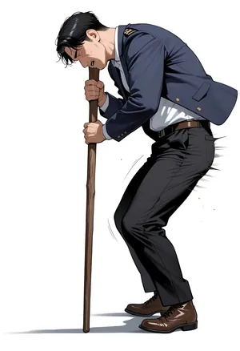<figcaption style="margin:4px 0 0;text-align:center;font-weight:normal;font-size:14px">0.3</figcaption></figure>
<figure style="margin:0;flex:0 1 150px;min-width:0">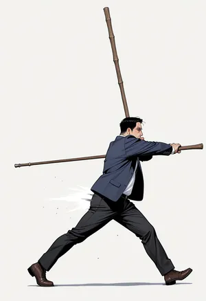<figcaption style="margin:4px 0 0;text-align:center;font-weight:normal;font-size:14px">0.5</figcaption></figure>
<figure style="margin:0;flex:0 1 150px;min-width:0"><figcaption style="margin:4px 0 0;text-align:center;font-weight:normal;font-size:14px">0.7</figcaption></figure>
<figure style="margin:0;flex:0 1 150px;min-width:0">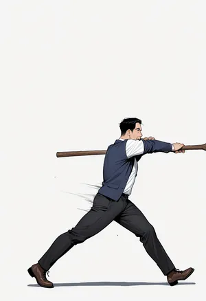<figcaption style="margin:4px 0 0;text-align:center;font-weight:normal;font-size:14px">1.0</figcaption></figure>
</div>

<div style="display:flex;justify-content:center;gap:6px;margin:1rem 0">
<figure style="margin:0;flex:0 1 150px;min-width:0">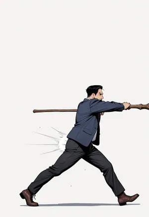<figcaption style="margin:4px 0 0;text-align:center;font-weight:normal;font-size:14px">0.2（6 ステップ）</figcaption></figure>
<figure style="margin:0;flex:0 1 150px;min-width:0"><figcaption style="margin:4px 0 0;text-align:center;font-weight:normal;font-size:14px">0.4（11）</figcaption></figure>
<figure style="margin:0;flex:0 1 150px;min-width:0"><figcaption style="margin:4px 0 0;text-align:center;font-weight:normal;font-size:14px">0.6（17）</figcaption></figure>
<figure style="margin:0;flex:0 1 150px;min-width:0">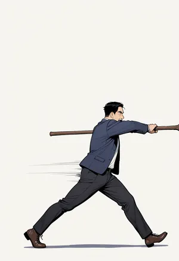<figcaption style="margin:4px 0 0;text-align:center;font-weight:normal;font-size:14px">1.0（28）</figcaption></figure>
</div>

強さ 0.3 の絵は、文面だけの絵とほぼ同じ前屈みの姿で、奥行きは効いていません。0.5 で脚と棒の形は人形に寄りましたが、文面の `holding a long wooden staff` から来たと思われる縦の棒がもう 1 本描かれました。0.7 と 1.0 は、どちらも人形の通りです。

<br>

`end_percent` は、0.2 でも 0.6 や 1.0 とほぼ同じ絵になりました。0.2 は 28 ステップのうち前の 6 ステップだけで、残りの 22 ステップは ControlNet を呼んでいません。姿勢と棒の向きは、最初の 6 ステップで決まったことになります。後のステップで ControlNet を外しても、形は崩れませんでした。

このため、形だけを縛りたい時は `end_percent` を下げ、後のステップを文面とモデルに任せられます。ControlNet を呼ばないステップはコピーの計算が要りません。この実験の 1 枚の実行時間は、0.2 と 0.4 で 29.92〜31.95 秒、1.0 で 36.45 秒でした。ただし、ComfyUI を他の作業と共有していたので、秒数は目安です。

---

### 実験 3: 骨格の太さ・専用モデル・輪郭

実験 1 の骨格で棒が縦に立ったのは、骨格の描き方や union のモデルのせいかもしれません。そこで、突きの骨格を [comfyui_controlnet_aux](https://github.com/Fannovel16/comfyui_controlnet_aux) の既定の細さ（棒の太さ約 8 px、点の半径 4 px）で描き直したもの、太い骨格を骨格の専用モデル xinsir/controlnet-openpose-sdxl-1.0（Apache License 2.0）に渡したものも描きました（seed 20261111、強さ 1.0、`end_percent` 1.0）。

<div style="display:flex;justify-content:center;gap:6px;margin:1rem 0">
<figure style="margin:0;flex:0 1 150px;min-width:0">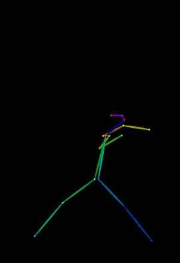<figcaption style="margin:4px 0 0;text-align:center;font-weight:normal;font-size:14px">細い骨格</figcaption></figure>
<figure style="margin:0;flex:0 1 150px;min-width:0">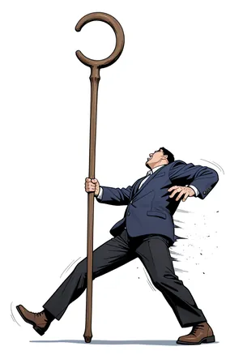<figcaption style="margin:4px 0 0;text-align:center;font-weight:normal;font-size:14px">細い骨格・union</figcaption></figure>
<figure style="margin:0;flex:0 1 150px;min-width:0"><figcaption style="margin:4px 0 0;text-align:center;font-weight:normal;font-size:14px">太い骨格・union</figcaption></figure>
<figure style="margin:0;flex:0 1 150px;min-width:0">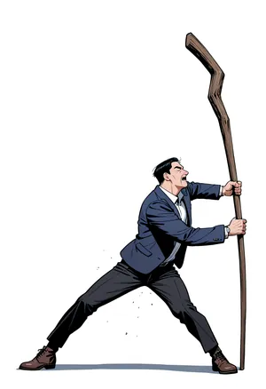<figcaption style="margin:4px 0 0;text-align:center;font-weight:normal;font-size:14px">太い骨格・専用</figcaption></figure>
</div>

細い骨格では、脚は開いたものの上体が後ろへ反り、腕のずれは 47.0% と太い骨格の 27.8% より大きくなりました。model card が太い線を勧める通りです。専用モデルは太い骨格の union とほぼ同じ姿勢（腕のずれ 31.6%）で、棒はやはり縦です。棒が立つのは、骨格に棒が無いからで、モデルの種類のせいではないと考えられます。

<br>

輪郭は、人形の奥行きの画像から [OpenCV](https://github.com/opencv/opencv) の Canny で取り出しました（[lab/make_canny.py](https://github.com/nao1215/debimate/blob/main/content/notes/generative-ai/controlnet/lab/make_canny.py)）。union の canny で、強さと `end_percent` は奥行きと同じ 0.7 と 0.6 です。

<div style="display:flex;justify-content:center;gap:6px;margin:1rem 0">
<figure style="margin:0;flex:0 1 150px;min-width:0">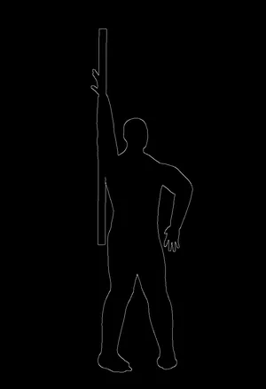<figcaption style="margin:4px 0 0;text-align:center;font-weight:normal;font-size:14px">輪郭</figcaption></figure>
<figure style="margin:0;flex:0 1 150px;min-width:0">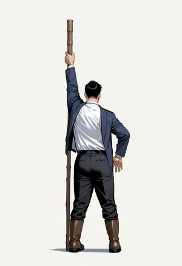<figcaption style="margin:4px 0 0;text-align:center;font-weight:normal;font-size:14px">腕を上げる</figcaption></figure>
<figure style="margin:0;flex:0 1 150px;min-width:0">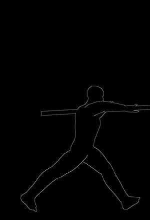<figcaption style="margin:4px 0 0;text-align:center;font-weight:normal;font-size:14px">輪郭</figcaption></figure>
<figure style="margin:0;flex:0 1 150px;min-width:0">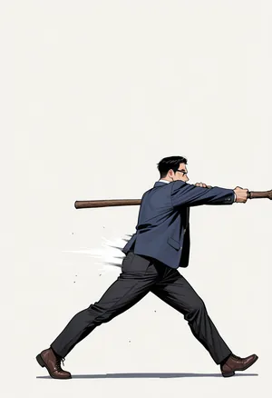<figcaption style="margin:4px 0 0;text-align:center;font-weight:normal;font-size:14px">突き</figcaption></figure>
</div>

輪郭でも、突きの棒は前へ水平に描かれました。外形の線に棒が含まれているからです。一方で、腕を上げる姿勢は、外形は人形の通りなのに後ろ姿になりました。文面に後ろ向きの語は無く、奥行きと骨格では 4 枚とも正面を向いています。輪郭の線は外形だけで、線の内側が手前に膨らんでいるのか奥へへこんでいるのかを伝えないので、正面と後ろ姿を区別できなかったと考えられます。

---

### ControlNet の利点

- 学習済みのモデルを固定したまま、画像で形を指定できる。同じ ControlNet は、同じアーキテクチャ（本記事では SDXL）の別のモデルにも当てられる
- 文面では伝わらない関節の位置や物の向きも、画面の座標で渡せる。実験 1 の突きは、文面だけでは一度も出なかった
- 3D の人形と固定したカメラから条件の画像を作れば、人物の位置と大きさを毎回同じにできる
- 強さと `end_percent` で、どこまで縛り、どこからモデルに任せるかを調整できる

---

### ControlNet の欠点

条件の画像は、学習した種類の画像の決まりに従って描く必要があります。骨格なら色と棒の組、奥行きなら手前ほど明るいことなどです。手で描いた画像や、検出器が間違えた骨格を渡すと、その誤りも形として縛られると考えられます。

- 骨格は、関節の点しか伝えない。手に持つ物の向き、体の厚み、腕が体の手前か奥かはモデルが決める
- 奥行きと輪郭は、外形まで縛る。絵の体型は、条件の画像の体型に寄る
- 輪郭は、線の内側の凹凸を伝えない。実験 3 では、正面を向いた人形の輪郭から後ろ姿が描かれた
- 生成が遅くなる。ControlNet を呼ぶステップでは、元の U-Net に加えてコピーの段も計算する。実験 1 の 1 枚は、文面だけの 25.56〜27.48 秒に対して、骨格（全 28 ステップ）は 39.45〜41.52 秒、奥行き（前の 17 ステップ）は 32.54〜35.94 秒だった（他の作業と共有した ComfyUI での目安）

---

### 適さないケース

- 条件の画像を用意できない場合。目的の姿勢の写真や 3D の人形が無ければ、手で描くことになり、骨格の決まりや奥行きの明暗を外しやすい
- 体型や服の形をモデルに自由に決めさせたい場合。奥行きや輪郭は外形まで縛るので、条件の画像の体型が絵に残る
- 1 枚の絵の見た目（顔・服の色）を[別の絵と揃えたい](../character-consistency/)場合。ControlNet が渡すのは形で、見た目は渡さない
