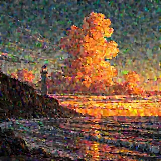
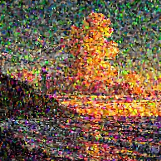
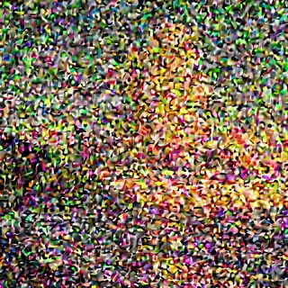
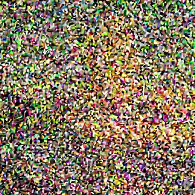
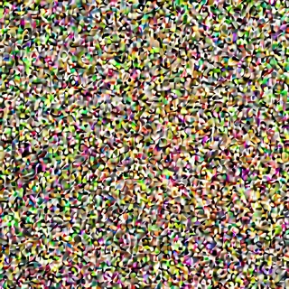
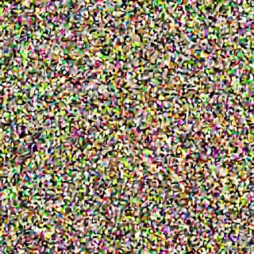

拡散モデル（diffusion model）は、画像に少しずつノイズを足していく過程を、逆向きにたどるように学習したモデルです。生成の時は、ノイズだけの状態から少しずつノイズを取り除いて画像を作ります。[DDPM の論文](https://arxiv.org/abs/2006.11239)（Denoising Diffusion Probabilistic Models、2020 年）がこの方法で高い品質の画像を示し、[SDXL](https://arxiv.org/abs/2307.01952)（Stable Diffusion XL）もこの仕組みで動いています。

[ComfyUI](https://github.com/Comfy-Org/ComfyUI)（ノードをつないで画像生成の処理を組む OSS）のプレビューを見ていると、拡散モデルは下書きに少しずつ絵を描き足しているように見えます。しかし、モデルが各ステップで出しているのは「今の状態に含まれるノイズはこれだ」という予測です。サンプラーがその予測を使ってノイズを引き、次のステップの状態を作ります。以下は、28 ステップの生成を途中で止めた状態（上段）と、そのステップでモデルの予測から計算した完成図（下段）を、画像に戻して並べたものです。



上段は 14 ステップ目でも粒が大半で、20 ステップ目でようやく雲と崖が粒の中に見えますが、下段は 2 ステップ目で既に夕焼けの空と水平線の配置が出ています。モデルは毎回、完成図の全体を予測し直していて、ステップが進むほどその予測がはっきりしていきます。

<br>

本記事では、画像生成を使っていても中身を知らないエンジニアに向けて、SDXL と ComfyUI を例に拡散モデルの基本を説明します。ComfyUI のソースと手元で生成した画像から、次の疑問を順に確かめます。

- ノイズを足すと、潜在の中身はどう変わるのか。
- モデルは何を予測し、サンプラーはその予測をどう使うのか。
- sigma の列とステップ数は、何を決めているのか。
- VAE とプロンプトは、どこで効くのか。

学習の手順の細部、UNet の内部構造、ControlNet のような追加の条件は説明しません。img2img の denoise、LoRA、プロンプトの重み付けは、それぞれ [img2img Denoise](/notes/generative-ai/img2img-denoise/)、[LoRA](/notes/generative-ai/lora/)、[Prompt Weighting](/notes/generative-ai/prompt-weighting/) のノートで扱っています。

---

### 全体の流れ

SDXL で 1 枚を描く時に使う部品と、データの流れは次の通りです。



SDXL は [Latent Diffusion Model](https://arxiv.org/abs/2112.10752)（LDM）の構成で、画素の上ではなく、[VAE](https://arxiv.org/abs/1312.6114)（Variational Autoencoder）で画像を縮めた潜在（latent）の上でノイズを取り除きます。1024 × 1024 の画像の潜在は、128 × 128 × 4 の数の配列です。

text encoder はプロンプトを語ごとのベクトルに変え、ノイズを予測する [UNet](https://arxiv.org/abs/1505.04597) が各ステップでそれを参照します。最後に VAE の decoder が潜在を画像に戻します。ComfyUI の `CheckpointLoaderSimple` が読むチェックポイントのファイルには、UNet・text encoder 2 つ・VAE の重みが全て入っています。

---

### ノイズを足す過程

拡散モデルの学習では、まず正解の画像にノイズを足します。DDPM の論文の式 (4) では、ノイズを足す段を `t`（SDXL では 0〜999 の 1000 段）として、`t` 段目の状態を次の 1 回の計算で作れます。

```text
x_t = sqrt(abar_t) × x_0 + sqrt(1 − abar_t) × eps
```

`x_0` は正解の画像、`eps` は標準正規分布のノイズ、`abar_t`（論文の ᾱ_t）は `t` が進むほど 0 に近づく係数です。

ComfyUI は、この式を [Karras 氏らの論文](https://arxiv.org/abs/2206.00364)（EDM、2022 年）の書き方に直して扱います。`x_t` を `sqrt(abar_t)` で割った `x` は `x = x_0 + σ × eps` になり、`σ = sqrt((1 − abar_t) / abar_t)` がノイズの大きさを表します（[comfy/model_sampling.py の 180 行目](https://github.com/Comfy-Org/ComfyUI/blob/v0.35.0/comfy/model_sampling.py#L180)）。SDXL の σ は、`t = 0` で 0.0292、`t = 999` で 14.6146 です。

モデルに渡す直前には、[calculate_input](https://github.com/Comfy-Org/ComfyUI/blob/v0.35.0/comfy/model_sampling.py#L31-L33) が `x` を `sqrt(1 + σ²)` で割り、DDPM の式の大きさに戻します。この時、正解の画像に掛かる係数は `1 / sqrt(1 + σ²)` です。

<br>

ノイズを足すと何が残るのかを確かめるために、28 ステップで描き終えた潜在に、σ を変えてノイズを足し、`1 / sqrt(1 + σ²)` を掛けてから VAE で画像に戻しました。サンプラーに長さ 1 の σ の列を渡すと、モデルを 1 回も呼ばずに、ノイズを足す処理（[noise_scaling](https://github.com/Comfy-Org/ComfyUI/blob/v0.35.0/comfy/model_sampling.py#L39-L47)）の結果だけが返ります。

<div style="display:flex;justify-content:center;gap:6px;margin:1.5rem 0">
<figure style="margin:0;flex:0 1 120px;min-width:0"><figcaption style="margin:4px 0 0;text-align:center;font-weight:normal;font-size:14px">元の画像</figcaption></figure>
<figure style="margin:0;flex:0 1 120px;min-width:0"><figcaption style="margin:4px 0 0;text-align:center;font-weight:normal;font-size:14px">σ 0.03</figcaption></figure>
<figure style="margin:0;flex:0 1 120px;min-width:0"><figcaption style="margin:4px 0 0;text-align:center;font-weight:normal;font-size:14px">σ 0.37</figcaption></figure>
<figure style="margin:0;flex:0 1 120px;min-width:0"><figcaption style="margin:4px 0 0;text-align:center;font-weight:normal;font-size:14px">σ 0.72</figcaption></figure>
<figure style="margin:0;flex:0 1 120px;min-width:0"><figcaption style="margin:4px 0 0;text-align:center;font-weight:normal;font-size:14px">σ 1.52</figcaption></figure>
<figure style="margin:0;flex:0 1 120px;min-width:0"><figcaption style="margin:4px 0 0;text-align:center;font-weight:normal;font-size:14px">σ 2.54</figcaption></figure>
<figure style="margin:0;flex:0 1 120px;min-width:0"><figcaption style="margin:4px 0 0;text-align:center;font-weight:normal;font-size:14px">σ 6.51</figcaption></figure>
<figure style="margin:0;flex:0 1 120px;min-width:0"><figcaption style="margin:4px 0 0;text-align:center;font-weight:normal;font-size:14px">σ 11.74</figcaption></figure>
</div>

先に消えるのは灯台の窓や波の筋のような細部で、雲と崖の大きな塊は σ 1.52（画像に掛かる係数 0.55）でもまだ見えます。σ 6.51（係数 0.15）では、目で分かる形は残っていません。冒頭の図の上段を逆から見ると、この順番をたどっていることが分かります。

---

### モデルはノイズを予測する

学習では、ランダムに選んだ段 `t` で正解の画像にノイズ `eps` を足し、できた `x_t` から、足した `eps` を当てさせます（DDPM の論文の Algorithm 1）。予測と本当のノイズの差の 2 乗を小さくするように重みを更新するので、モデルの出力は「この中のノイズの推定値 `eps_hat`」です。この形を eps 予測と呼びます。手元のチェックポイントは、ComfyUI が v 予測（ノイズではなく別の量を当てる形）と判定する鍵を持たず、eps 予測として読み込まれます（[supported_models.py の SDXL.model_type](https://github.com/Comfy-Org/ComfyUI/blob/v0.35.0/comfy/supported_models.py#L216-L233)）。

ノイズの推定値が分かれば、完成図の推定値も計算できます。ComfyUI の [EPS.calculate_denoised](https://github.com/Comfy-Org/ComfyUI/blob/v0.35.0/comfy/model_sampling.py#L35-L37) は、`x0_hat = x − σ × eps_hat` を返します。冒頭の図の下段は、この `x0_hat` です。

<br>

ノイズが大きい段の `x0_hat` がぼやけるのは、モデルの性能が低いからだけではありません。理想的な予測でもぼやけます。ノイズが大きいと、今の `x` と矛盾しない完成図の候補がたくさんあります。2 乗の誤差を最小にする予測は、それらの候補の平均に近づくので、細部が消えた絵になります。EDM の論文の Figure 1 も、ノイズが大きいほど、2 乗の誤差を最小にするノイズ除去の結果が学習データ全体の平均に近づくことを示しています。

---

### サンプラーが少しずつ引く

モデルが 1 回で完成図を予測できるなら、最初のステップで `x0_hat` を答えにすればよいと思うかもしれません。しかし、σ の大きい段の `x0_hat` は、冒頭の図の下段の 2 ステップ目（σ 11.7 の段での予測）のように、ぼやけた平均の絵です。そこで、サンプラーは少しだけノイズを引いて、小さくなった σ の段で予測し直します。

以下は、ComfyUI の [euler サンプラー](https://github.com/Comfy-Org/ComfyUI/blob/v0.35.0/comfy/k_diffusion/sampling.py#L190-L212)の抜粋です（ノイズを足し直す `s_churn` の分岐は既定で使わないので省きました）。

```python
# comfy/k_diffusion/sampling.py の sample_euler から抜粋（v0.35.0）
for i in trange(len(sigmas) - 1, disable=disable):
    sigma_hat = sigmas[i]
    denoised = model(x, sigma_hat * s_in, **extra_args)   # x0_hat = x − σ × eps_hat
    d = to_d(x, sigma_hat, denoised)                      # (x − x0_hat) / σ、つまり eps_hat
    dt = sigmas[i + 1] - sigma_hat
    x = x + d * dt
```

`x − x0_hat` は `σ × eps_hat` なので、`d` はノイズの推定値 `eps_hat` と同じです。代入すると、次の状態は `x0_hat + σ_{i+1} × eps_hat` になります。予測した完成図に、予測したノイズを次の段の大きさまで縮めて乗せ直した状態です。次の σ を 0 にすれば、1 回で `x0_hat` に飛ぶことになります。EDM の論文も、0 まで 1 回の Euler のステップを踏むと、ノイズ除去の出力と一致すると述べています。

<br>

冒頭の図は、このループを途中で止めて作りました。ComfyUI の `SplitSigmas` で 28 ステップの σ の列の先頭 `k + 1` 個だけを切り出し、`SamplerCustom` に渡しています。`SamplerCustom` の 2 つ目の出力は、最後のステップの `x0_hat` です。以下は、送ったワークフローを組み立てる [lab/wf.py](https://github.com/nao1215/debimate/blob/main/content/notes/generative-ai/diffusion-model/lab/wf.py) の抜粋です。

```python
# lab/wf.py の partial() から抜粋。1〜5 はモデル・プロンプト・空の潜在のノード
wf["10"] = {"class_type": "KSamplerSelect", "inputs": {"sampler_name": "euler"}}
wf["11"] = {"class_type": "BasicScheduler", "inputs": {
    "model": ["1", 0], "scheduler": "normal", "steps": steps, "denoise": 1.0}}   # steps = 28
wf["12"] = {"class_type": "SplitSigmas", "inputs": {"sigmas": ["11", 0], "step": k}}
wf["13"] = {"class_type": "SamplerCustom", "inputs": {
    "model": ["1", 0], "add_noise": True, "noise_seed": SEED, "cfg": CFG,
    "positive": ["3", 0], "negative": ["4", 0], "sampler": ["10", 0],
    "sigmas": ["12", 0], "latent_image": ["5", 0]}}
# 出力 0 の x_k は 1/sqrt(1 + σ_k²) を掛けてから、出力 1 の x0_hat はそのまま VAEDecode に渡す
wf["14"] = {"class_type": "LatentMultiply", "inputs": {"samples": ["13", 0], "multiplier": scale}}
```

ComfyUI でプレビューを有効にした時（起動オプションの `--preview-method` か、画面の設定）に出るのも、`x` ではなくこの `x0_hat` です（[samplers.py の 1003 行目](https://github.com/Comfy-Org/ComfyUI/blob/v0.35.0/comfy/samplers.py#L1003)でコールバックに `denoised` を渡しています）。プレビューが「ぼやけた下書きが少しずつ締まる」ように見えるのは、予測がはっきりしていく様子を見ているからです。

---

### sigma の列とステップ数

28 ステップで生成する時に使う 29 個の σ の並び（末尾は 0）を決めるのが、スケジューラーです。本記事の実験で使った `normal` は、[normal_scheduler](https://github.com/Comfy-Org/ComfyUI/blob/v0.35.0/comfy/samplers.py#L671-L693) で、段 `t` を 999 から 0 まで等間隔に取り、それぞれの σ を並べます。`karras` は、EDM の論文の式 (5)（ρ = 7）で、σ の小さい側に段を多く配ります（[get_sigmas_karras](https://github.com/Comfy-Org/ComfyUI/blob/v0.35.0/comfy/k_diffusion/sampling.py#L23-L29)）。

以下は、Python の数値計算ライブラリ [NumPy](https://numpy.org/) でこの 2 つを写した [lab/schedule.py](https://github.com/nao1215/debimate/blob/main/content/notes/generative-ai/diffusion-model/lab/schedule.py) の中心部分です。

```python
# lab/schedule.py から抜粋。ModelSamplingDiscrete と同じ 1000 段の sigma
betas = np.linspace(0.00085 ** 0.5, 0.012 ** 0.5, 1000, dtype=np.float64) ** 2
alphas_cumprod = np.cumprod(1.0 - betas)
SIGMAS = ((1 - alphas_cumprod) / alphas_cumprod) ** 0.5

def normal(steps):       # 段 999 から 0 を等間隔に取り、log sigma を補間する。末尾に 0
    ts = np.linspace(999, 0, steps, dtype=np.float32).astype(np.float64)
    return np.append(sigma(ts), 0.0)

def karras(steps, rho=7.0):
    ramp = np.linspace(0, 1, steps)
    lo, hi = SIGMA_MIN ** (1 / rho), SIGMA_MAX ** (1 / rho)
    return np.append((hi + ramp * (lo - hi)) ** rho, 0.0)
```

この値が ComfyUI 自身の `calculate_sigmas` と小数 4 桁まで一致することは、ComfyUI のコードを CPU で呼ぶ [lab/check_schedule_comfy.py](https://github.com/nao1215/debimate/blob/main/content/notes/generative-ai/diffusion-model/lab/check_schedule_comfy.py) で確かめました。



どちらの列も、前半で σ を大きく下げ、後半は小さな σ の間を細かく刻みます。右のグラフの係数で見ると、`normal` では 14 ステップ目で 0.55 です。冒頭の図で 10〜14 ステップ目から下段の配置がほとんど変わらないのは、この辺りで大きな形が決まっているためだと考えられます。

<br>

#### ステップ数を変える

ステップ数は、この列の長さです。ステップ数を増やすと、同じ σ の範囲をより細かく刻みます。seed・プロンプト・サンプラー（euler）・スケジューラー（normal）を固定し、ステップ数だけを変えて生成しました。

<div style="display:flex;justify-content:center;gap:8px;margin:1.5rem 0">
<figure style="margin:0;flex:0 1 180px;min-width:0"><figcaption style="margin:4px 0 0;text-align:center;font-weight:normal;font-size:14px">8 ステップ・8.5 秒</figcaption></figure>
<figure style="margin:0;flex:0 1 180px;min-width:0"><figcaption style="margin:4px 0 0;text-align:center;font-weight:normal;font-size:14px">16 ステップ・15.6 秒</figcaption></figure>
<figure style="margin:0;flex:0 1 180px;min-width:0"><figcaption style="margin:4px 0 0;text-align:center;font-weight:normal;font-size:14px">28 ステップ・26.7 秒</figcaption></figure>
<figure style="margin:0;flex:0 1 180px;min-width:0"><figcaption style="margin:4px 0 0;text-align:center;font-weight:normal;font-size:14px">50 ステップ・46.4 秒</figcaption></figure>
</div>

8 ステップでも、灯台・雲・崖の配置は 28 ステップとほぼ同じでした。変わったのは崖の輪郭や波の形のような細部で、50 ステップでは沖に小さな岩が増えています。この実験では、ステップを増やしても絵が「より完成に近づく」わけではなく、同じ出発点のノイズからの道筋を細かく刻み直した結果、細部が少し違う絵になります。

時間は、ステップ数にほぼ比例しました。UNet を呼ぶ回数がステップ数と同じだからです（後で説明する CFG があると、1 ステップで 2 つの予測を計算します）。実行時間は ComfyUI が記録した `execution_start` から `execution_success` までで、同じ ComfyUI に別の作業の依頼も入っていました。

<details>
<summary>全ての依頼の実行時間（lab/output_runs.txt。右端は送る直前の GPU 使用率と load average）</summary>

```text
$ python3 summarize.py
experiment  condition                        seconds  load_before(gpu%, load1m)
trajectory  k= 0 sigma=14.6146               1.65  99, 8.35
trajectory  k= 2 sigma= 9.5436               4.66  31, 10.76
trajectory  k= 4 sigma= 6.5064               5.65  20, 12.7
trajectory  k= 7 sigma= 3.9291               8.51  52, 12.0
trajectory  k=10 sigma= 2.5388              11.16  93, 13.28
trajectory  k=14 sigma= 1.5192              15.10  55, 12.16
trajectory  k=20 sigma= 0.7194              20.50  20, 14.34
trajectory  k=28 sigma= 0.0000              27.58  53, 9.38
steps       steps_08                           8.50  14, 6.68
steps       steps_16                          15.56  90, 6.93
steps       steps_28                          26.72  58, 7.37
steps       steps_50                          46.43  15, 7.07
samplers    sampler_euler_ancestral           26.59  74, 6.59
samplers    sampler_dpmpp_2m_karras           26.44  15, 8.26
cfg         cfg_1.0                           13.53  21, 10.1
cfg         cfg_9.0                           26.08  60, 6.32
rerun       rerun_steps_28                    26.17  14, 6.73  identical_to_steps_28=True identical_to_trajectory_x_28=True
```

</details>

<br>

#### サンプラーを変える

サンプラーは、予測をどう使って次の状態を作るかの規則です。同じ 28 ステップでも、サンプラーを変えると絵が変わります。

<div style="display:flex;justify-content:center;gap:8px;margin:1.5rem 0">
<figure style="margin:0;flex:0 1 200px;min-width:0"><figcaption style="margin:4px 0 0;text-align:center;font-weight:normal;font-size:14px">euler・normal</figcaption></figure>
<figure style="margin:0;flex:0 1 200px;min-width:0"><figcaption style="margin:4px 0 0;text-align:center;font-weight:normal;font-size:14px">euler_ancestral・normal</figcaption></figure>
<figure style="margin:0;flex:0 1 200px;min-width:0"><figcaption style="margin:4px 0 0;text-align:center;font-weight:normal;font-size:14px">dpmpp_2m・karras</figcaption></figure>
</div>

`dpmpp_2m`（[DPM-Solver++](https://arxiv.org/abs/2211.01095) の 2 次の多段法）は、前のステップの予測も使って次の状態を計算します。σ の列を `karras` に変えても、配置は euler とほぼ同じでした。出発点のノイズが同じで、どちらも途中でノイズを足さないためと考えられます。一方で、`euler_ancestral` は、各ステップで σ を少し下げすぎてから、新しいノイズを足して戻します（[get_ancestral_step](https://github.com/Comfy-Org/ComfyUI/blob/v0.35.0/comfy/k_diffusion/sampling.py#L68-L75)）。途中で足すノイズの分だけ道筋が変わるので、seed が同じでも崖の形から別の絵になりました。

---

### 潜在と VAE

ここまでの `x` は全て潜在です。SDXL の VAE の encoder は、画像の縦横を 3 回半分にして 8 分の 1 にし（手元のチェックポイントの encoder にも縮小の層が 3 つあります）、各位置を 4 つの数で表します。1024 × 1024 の画像の 3,145,728 個の値が、65,536 個になり、48 分の 1 です。UNet は全てのステップでこの小さな配列を扱うので、画素の上で同じ処理をするより計算が軽くなります。これが LDM の論文の狙いです。

潜在は数の配列ですが、中身は小さな画像に近いものです。28 ステップで描き終えた潜在を ComfyUI の `SaveLatent` で保存し、ComfyUI がプレビューに使う一次式（[latent_formats.py の SDXL の latent_rgb_factors](https://github.com/Comfy-Org/ComfyUI/blob/v0.35.0/comfy/latent_formats.py#L37-L48)）で 4 つの数を RGB に直しました（[lab/latent_preview.py](https://github.com/nao1215/debimate/blob/main/content/notes/generative-ai/diffusion-model/lab/latent_preview.py)）。

```python
# lab/latent_preview.py から抜粋。lat は保存した潜在 [4, 128, 128]
x = lat * 0.13025                                  # SDXL.scale_factor。モデルが扱う単位に揃える
rgb = np.einsum("chw,cr->hwr", x, RGB) + BIAS      # 4 つの数に 4 × 3 の係数を掛けて RGB にする
img = (np.clip((rgb + 1) / 2, 0, 1) * 255).astype(np.uint8)
```

```text
$ python3 latent_preview.py final.latent latent_rgb.png
shape [4, 128, 128] values 65536 vs pixels 3145728 ratio 48
```

<div style="display:flex;justify-content:center;gap:8px;margin:1.5rem 0">
<figure style="margin:0;flex:0 1 256px;min-width:0"><figcaption style="margin:4px 0 0;text-align:center;font-weight:normal;font-size:14px">潜在を一次式で RGB に（128 × 128）</figcaption></figure>
<figure style="margin:0;flex:0 1 256px;min-width:0"><figcaption style="margin:4px 0 0;text-align:center;font-weight:normal;font-size:14px">VAE decoder で戻した画像</figcaption></figure>
</div>

4 つの数を足し引きしただけで、灯台・雲・崖の配置と色まで分かります。構図と色は拡散モデルが潜在の上で決めていて、VAE の decoder は 8 倍の解像度の細部を描き起こす役割と言えます。[LDM の論文](https://arxiv.org/abs/2112.10752)も、意味の情報は潜在に残し、知覚上の細部の圧縮を autoencoder に任せる分け方を取っています。

なお、`0.13025` は、VAE の出力をサンプラーに渡す前に掛ける係数です（[samplers.py の 1224 行目](https://github.com/Comfy-Org/ComfyUI/blob/v0.35.0/comfy/samplers.py#L1224)の `process_latent_in`）。`SaveLatent` は掛ける前の値を保存するので、ここで掛け直しています。

---

### プロンプトと CFG

プロンプトは、ノイズの予測に条件として渡ります。SDXL は、[CLIP](https://arxiv.org/abs/2103.00020)（画像と文章を同じベクトルの空間に対応付けるよう学習したモデル）型の text encoder を 2 つ（CLIP ViT-L と OpenCLIP ViT-bigG）使い、語ごとのベクトルの列を作ります。UNet は各ステップで、画像の各位置からこの列を参照します（cross-attention）。流れの細部は [Prompt Weighting のノート](/notes/generative-ai/prompt-weighting/#前提-プロンプトが-unet-に届くまで)で説明しています。

プロンプトを条件にするだけでは、絵は文面に強く従いません。そこで使うのが CFG（[Classifier-Free Guidance](https://arxiv.org/abs/2207.12598)）です。1 ステップごとに、プロンプトありと打ち消し（ネガティブプロンプト）ありの 2 つの予測を計算し、その差を CFG の値の倍率で伸ばします（[samplers.py の 598 行目](https://github.com/Comfy-Org/ComfyUI/blob/v0.35.0/comfy/samplers.py#L598)）。論文では打ち消しの代わりに条件なしの予測を使い、ComfyUI の CFG の値は論文の `1 + w` に当たります。

```text
予測 = 打ち消しでの予測 + cfg × (プロンプトでの予測 − 打ち消しでの予測)
```

CFG が 1.0 の時は打ち消し側の予測が式から消えるので、ComfyUI はその計算を省きます（[samplers.py の 610〜611 行目](https://github.com/Comfy-Org/ComfyUI/blob/v0.35.0/comfy/samplers.py#L610-L611)）。以下は、euler・28 ステップで CFG だけを変えた結果です。

<div style="display:flex;justify-content:center;gap:8px;margin:1.5rem 0">
<figure style="margin:0;flex:0 1 200px;min-width:0"><figcaption style="margin:4px 0 0;text-align:center;font-weight:normal;font-size:14px">CFG 1.0・13.5 秒</figcaption></figure>
<figure style="margin:0;flex:0 1 200px;min-width:0"><figcaption style="margin:4px 0 0;text-align:center;font-weight:normal;font-size:14px">CFG 5.5・26.7 秒</figcaption></figure>
<figure style="margin:0;flex:0 1 200px;min-width:0"><figcaption style="margin:4px 0 0;text-align:center;font-weight:normal;font-size:14px">CFG 9.0・26.1 秒</figcaption></figure>
</div>

CFG 1.0 は、時間がほぼ半分でした。一方で、夕焼けの色は薄く、灯台は遠くの小島に小さく描かれ、文面の lighthouse や orange sky の効きが弱く見えます。CFG 9.0 は 5.5 と同じ配置のまま、橙色が濃くなりました。打ち消しの重みが CFG の式を通して色を崩す例は、Prompt Weighting のノートで扱っています。

---

### 同じ seed で同じ画像になる理由

seed は、最初のノイズを決める値です。ComfyUI は、seed で初期化した CPU の乱数からノイズを作ります（[comfy/sample.py の prepare_noise](https://github.com/Comfy-Org/ComfyUI/blob/v0.35.0/comfy/sample.py#L22-L27) と、[11 行目](https://github.com/Comfy-Org/ComfyUI/blob/v0.35.0/comfy/sample.py#L11) の `device="cpu"`）。euler は、その後に乱数を使いません。

同じ設定の 28 ステップを、間に別の依頼を挟んでもう一度送ると、PNG の画素は完全に一致しました。`KSampler` で描いた画像と、冒頭の図を作った `SamplerCustom` の 28 ステップ目も一致しています（[lab/run.py](https://github.com/nao1215/debimate/blob/main/content/notes/generative-ai/diffusion-model/lab/run.py) の `rerun`）。

```text
$ python3 run.py rerun <PNG の保存先>      # 実行時間をまとめた output_runs.txt の該当行
rerun       rerun_steps_28                    26.17  14, 6.73  identical_to_steps_28=True identical_to_trajectory_x_28=True
```

ただし、一致したのはこの環境の中での話です。GPU・ドライバ・[PyTorch](https://pytorch.org/) のバージョンが違うと、UNet の計算の細かな誤差が変わり、同じ seed でも画素が一致するとは限りません。

---

### 拡散モデルの特徴と限界

拡散モデルは、ノイズの予測と引き算を繰り返して画像を作ります。この作りから、次の性質が出ます。

- 各ステップで完成図の全体を予測し直すので、大きな配置が先に決まり、細部は後で決まる。[img2img](/notes/generative-ai/img2img-denoise/) は、この列の途中から始める使い方
- 途中の状態はノイズと予測の和なので、σ の列を切ったり、途中で別の条件に替えたりする操作がしやすい
- UNet をステップ数の回数だけ呼ぶ（CFG ありならステップごとに 2 つの予測を計算する）ので、時間はステップ数にほぼ比例する
- ステップ数・サンプラー・CFG を変えると、同じ seed でも絵が変わる。設定を変えて比べる時は、変えた値以外を全て固定する必要がある
