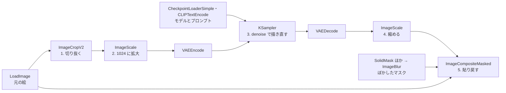

人物の全身を 1 枚の絵（立ち絵）として描くと、顔は画面の小さな一部になります。画像生成の分野では、顔だけを切り抜いて拡大し、描き直してから元の絵へ貼り戻す仕上げがよく使われます。[Stable Diffusion web UI](https://github.com/AUTOMATIC1111/stable-diffusion-webui) に足す拡張の [ADetailer](https://github.com/Bing-su/adetailer) は、この手順を自動で行う道具です。ノードと呼ぶ処理の箱をつないで画像生成の手順を組むツール [ComfyUI](https://github.com/comfyanonymous/ComfyUI) にも、同じ働きの拡張があります。以下は、832 x 1216 画素で描いた全身の立ち絵と、その顔だけを描き直した結果です。



描いたままの顔では、見る側から左の目が橙、右の目が灰緑と、左右で目の色が違いました。顔だけ描き直すと、両目とも茶色になり、まつ毛も描き込まれました。一方で、口の形と頬の塗りも変わっています。直したかった目だけでなく、顔の表情まで描き直されたわけです。

<br>

本記事では、全身の立ち絵を画像生成で作ろうとしているエンジニアに向けて、顔だけを描き直す仕上げで何が起きるか手元の実験で検証します。扱う疑問は次の通りです。

- 全身の絵で、顔は何画素で描かれているのか。
- 顔だけを描き直すには、どんな手順を踏むのか。
- 描き直す顔は、どうやって見つけるのか。
- 描き直すと、顔の何が変わるのか。
- 絵の全体を大きく描き直す方法と比べて、何が違うのか。

手の描き直し、写真の顔、画風を足す [LoRA](../lora/) は扱いません。

---

### 前提: 潜在表現と img2img

今回使った、[Stable Diffusion XL](https://huggingface.co/stabilityai/stable-diffusion-xl-base-1.0)（SDXL）を元にしたモデルは、画素の上ではなく、画像を縮めた数の配列（潜在表現）の上で絵を描きます。

画像と潜在表現の間は、VAE（Variational Autoencoder）という部品が変換します。VAE は画像を縦横 8 分の 1 に縮めて潜在表現にし、描き終えた潜在表現を画像に戻します。潜在表現の 1 マスは、画素の 8 x 8 に当たります。この流れは [Diffusion Model のノート](../diffusion-model/)で説明しました。

プロンプトだけから描く時は、乱数で作ったノイズから始めて、少しずつノイズを取り除いて絵にします。ノイズを作る乱数の値を seed（シード値）と呼び、同じ設定と同じ seed なら同じ絵になります。

[img2img](../img2img-denoise/) は、元の絵を VAE で潜在表現にし、ノイズを混ぜてから取り除いて描き直す使い方です。どれだけ描き直すかは denoise（0〜1）で決めます。0 に近いほど元の絵が残り、1 に近いほど元の絵から離れます。ComfyUI では、denoise を下げてもステップの回数は変わりません。ノイズを除く段の列のうち、後ろの段を指定した回数だけ回します（[samplers.py](https://github.com/comfyanonymous/ComfyUI/blob/v0.35.0/comfy/samplers.py#L1431-L1441)）。

なお、小さく描いた絵の全体を拡大し、低い denoise の img2img で描き直す 2 段の生成を [hires fix](https://github.com/AUTOMATIC1111/stable-diffusion-webui/wiki/Features/fbff21b0d67505cc760904cfab80bc2acfba76b1#hires-fix) と呼びます。Stable Diffusion web UI の画面では「Hires. fix」と書かれています。

---

### 実験の作り方

SDXL を元にした [WAI-illustrious-SDXL](https://civitai.com/models/827184?modelVersionId=2883731) v17.0（LoRA なし）で、茶髪で成人の女性が全身で写る絵を 832 x 1216 で 5 枚描きました（seed は 20261118〜20261122）。プロンプトには brown eyes（茶色の目）を入れています。

5 枚の立ち姿は、同じ形に揃えました。[Depth Body Shape のノート](../depth-body-shape/)で作った人体の 3D モデルから奥行きの画像（深度マップ）を書き出し、これを [ControlNet](../controlnet/) という仕組みで、形の条件として渡しています。

この 5 枚に、次の 4 つの方法を当てて比べました。

| 方法 | 内容 |
|---|---|
| 描いたまま | 832 x 1216 で描いた絵 |
| 顔だけ描き直す | 次の節で示す手順。6 条件 |
| 全体を 2 倍で描き直す | hires fix。1664 x 2432 に拡大し、denoise 0.45 |
| 最初から 2 倍で描く | 1664 x 2432 の大きさで最初から描く |

顔だけ描き直す 6 条件は、全身と同じプロンプトで denoise 0.3・0.45・0.6 の 3 つ、顔用のプロンプトで 0.45・0.6 の 2 つ、切り抜く大きさを半分にした 0.45 の 1 つです。最後の条件は、線の太さは 3 倍で切り抜いた 0.45 とほぼ同じで、元の絵と比べた差は少し小さくなりました。本文では触れず、数値は lab に置きました。

以降、832 x 1216 画素の絵を画面に出す時の大きさを「表示する大きさ」と呼びます。2 倍で描いた絵は、表示する大きさへ縮めてから比べます。

---

### 全身の絵で顔は何画素か

顔を探すモデル（顔検出）は、顔を囲む矩形で顔の位置を返します。物体検出の分野では、この矩形をバウンディングボックス（bounding box）と呼びます。5 枚のバウンディングボックスは、幅が 75〜81 画素、高さが 82〜93 画素でした。潜在表現では、顔は 10 x 11 マスほどしかありません。以下は、顔に 8 画素ごとの線を重ねた図です。



目は、横 2〜3 マス・縦 1〜2 マスに収まります。左右で目の色や形を描き分ける余地が小さいので、片方の目だけ色が違う、線が粗いといった崩れが出ます。5 枚のうち 2 枚は、片方の目が灰緑でした。

---

### 顔だけを描き直す手順

顔だけを描き直す時は、大きさの違う 3 つの四角を使います。以下は、表紙に使った絵（seed 20261120）で、頭に 3 つを重ねた図です。



切り抜く正方形は、バウンディングボックスの長い辺の 3 倍を一辺にします。肩や髪まで入れて、描き直す時に顔の向きや周りが分かるようにするためです。描き直した後に元の絵へ戻すのは、内側のマスクで囲んだ所だけです。手順は次の 5 つです。

1. 青の正方形を切り抜く。
2. 切り抜いた絵を 1024 x 1024 に拡大する。
3. 拡大した絵を img2img で描き直す。
4. 描き直した絵を切り抜いた大きさへ縮める。
5. オレンジのマスクは縁をぼかし、その所だけを元の絵へ貼り戻す。

1024 x 1024 は SDXL が学習した大きさに近く、顔は約 4 倍に拡大されます。以下は、各手順の出力です。括弧の数は、絵の一辺が何画素かを表します。



ADetailer の既定は denoise 0.4 です（[args.py](https://github.com/Bing-su/adetailer/blob/3a599f5d4607d8f9d8b9fc5a15526197418dae1a/adetailer/args.py#L72)）。ComfyUI の拡張 [Impact Pack](https://github.com/ltdrdata/ComfyUI-Impact-Pack) が持つ FaceDetailer の既定は denoise 0.5 で、切り抜く大きさはバウンディングボックスの 3 倍です（[impact_pack.py](https://github.com/ltdrdata/ComfyUI-Impact-Pack/blob/ed1bd80650a1d9c9f5d17d6411455e65ad43b58b/modules/impact/impact_pack.py#L753-L760)）。今回は拡張を入れず、ComfyUI 0.35.0 の本体が持つノードだけで同じ流れの手順を組みました。拡大する大きさやマスクのぼかしなどの値は、どちらの拡張の既定とも違います。ノードのつながりは次の通りです。



このつながりは、ComfyUI のサーバーが持つ HTTP API（`/prompt`）へ JSON で送ります。各ノードに番号を付け、`["10", 0]` は「10 番のノードが出す 1 つ目の出力」を指します。以下は、組み立ての抜粋です。

```python
# lab/run.py の face_workflow から抜粋。x, y, side は切り抜く正方形、out は描き直した 1024 x 1024 の絵
wf.update({
    "10": {"class_type": "LoadImage", "inputs": {"image": image}},
    "11": {"class_type": "ImageCropV2", "inputs": {
        "image": ["10", 0], "crop_region": {"x": x, "y": y, "width": side, "height": side}}},
    "12": {"class_type": "ImageScale", "inputs": {
        "image": ["11", 0], "upscale_method": "lanczos", "width": 1024, "height": 1024, "crop": "disabled"}},
})
out = img2img(wf, ["12", 0], seed, denoise)  # VAEEncode → KSampler（denoise）→ VAEDecode
wf.update({
    "30": {"class_type": "ImageScale", "inputs": {
        "image": out, "upscale_method": "area", "width": side, "height": side, "crop": "disabled"}},
    # 31〜36: バウンディングボックスを 1.3 倍にした矩形のマスクを作り、ImageBlur でぼかす
    "37": {"class_type": "ImageCompositeMasked", "inputs": {
        "destination": ["10", 0], "source": ["30", 0], "x": x, "y": y, "resize_source": False,
        "mask": ["36", 0]}},
})
```

全体は [lab/run.py](https://github.com/nao1215/debimate/blob/main/content/notes/generative-ai/face-redraw/lab/run.py) にあります。

---

### 顔の見つけ方

手順 1 で使うバウンディングボックスは、顔検出のモデルで見つけます。ComfyUI 0.35.0 の本体には、Google が公開する [MediaPipe](https://github.com/google-ai-edge/mediapipe) で顔を検出するノード（MediaPipeFaceLandmarker）があります。このノードの検出器は 2 種類あり、既定の short は近くの大きな顔向け、full は遠くの小さな顔向けです。両方を回して多く見つけた方を採る both もあります（[nodes_mediapipe.py](https://github.com/comfyanonymous/ComfyUI/blob/v0.35.0/comfy_extras/nodes_mediapipe.py#L244-L248) の説明）。

検出器は顔らしさの確信度も返し、しきい値より低い候補は捨てます。

MediaPipe は実写の顔で使われてきたモデルなので、アニメ調の顔を拾えるかが気になります。そこで、全身の立ち絵 23 枚で、顔のバウンディングボックスを返した枚数を数えました。face_yolov8n の枠と半分近く以上重なる（IoU 0.3 以上）ものを「顔に当たった」と数えています。23 枚は、本記事の 5 枚と、[Background Removal のノート](../background-removal/)で描いた 18 枚です。比べに、ADetailer が既定で使う、アニメ調の顔も学習した [face_yolov8n](https://huggingface.co/Bingsu/adetailer) も通しています。

| 検出器（しきい値） | 枠を返した | そのうち顔に当たった |
|---|---|---|
| MediaPipe の short（0.5、ノードの既定） | 6 枚 | 0 枚 |
| MediaPipe の full（0.5） | 20 枚 | 20 枚 |
| MediaPipe の full（0.1） | 23 枚 | 22 枚 |
| face_yolov8n（0.3、ADetailer の既定） | 23 枚 | 23 枚 |

既定の short は、23 枚の顔を 1 枚も拾えず、6 枚では腰のあたりを顔として返しました。



しかし、アニメ調の画風が原因ではありませんでした。同じ 23 枚を顔の周りで切り抜き、顔の幅が、切り抜いた絵の幅に対して 2〜5 割になるようにすると、short でも 23 枚とも顔を拾いました（[lab/detect_crop.py](https://github.com/nao1215/debimate/blob/main/content/notes/generative-ai/face-redraw/lab/detect_crop.py)）。つまり、全身の絵では顔が小さすぎるわけです。

そのため、全身の絵には full を使うか、アニメ調の顔も学習した検出器を使います。本記事の実験では、MediaPipe の full（0.5）でバウンディングボックスを決めました。本記事の 5 枚は、5 枚とも full（0.5）で顔に当たる枠が返りました。

---

### 左右で違った目の色が揃う

以下は、5 枚の両目を表示する大きさ（832 x 1216）から切り出して並べた図です。左右は、見る側から見た向きで書きます。



描いたままでは、20261119 と 20261120 で右の目が灰緑でした。20261118 と 20261121 も、左右で茶の色味が違います。顔だけ描き直すと、denoise 0.3 でも 5 枚とも両目が同じ茶色になりました。目は約 4 倍に拡大されてから描かれるので、左右の目を描き分ける余地が増えたためと考えています。

一方で、描き直した後の目は、5 枚とも形とまつ毛の描き方がよく似ています。seed ごとに違っていた目つきが、1 つの描き方に寄りました。全体を 2 倍で描き直した後も、両目はほぼ茶色に揃いました。

---

### 低い denoise でも表情が変わる

目の色を直すためだけなら、denoise は低いほど元の顔が残るはずです。以下は、denoise とプロンプトを変えて、20261119 の顔を描き直した結果です。



denoise 0.3 でも、開いていた口が閉じ気味になりました。前の図で口の形が変わったと目で分かる 0.3 の顔が、下の表で 12 前後です。バウンディングボックスの中で元の絵と比べた RGB の差を平均（0〜255）すると、5 枚で次の通りです。

| denoise | バウンディングボックスの中で比べた差 |
|---|---|
| 0.3 | 11.8〜12.3 |
| 0.45 | 14.5〜16.1 |
| 0.6 | 17.9〜20.9 |

全体を 2 倍で描き直した場合（denoise 0.45）は、表示する大きさへ縮めてから比べると、バウンディングボックスの中で比べた差が 18.1〜20.4 でした。顔だけ描き直す 0.6 と同じくらい、顔が変わっています。

<br>

#### 顔用のプロンプト

ADetailer は、顔用のプロンプトを空にすると、全身を描いた時のプロンプトを使います（[README](https://github.com/Bing-su/adetailer/blob/3a599f5d4607d8f9d8b9fc5a15526197418dae1a/README.md)）。全身と同じプロンプトには full body（全身）が入っているので、切り抜いた顔の中に体を描こうとするかもしれません。そこで、構図の語と、下半身に着る服の語を外して portrait, close-up, face を足した顔用のプロンプトとも比べました。

結果は、前の図で上下の行が示すように、ほとんど同じ顔でした。バウンディングボックスの中で比べた差も、denoise 0.45 で 14.9〜15.9 と、全身と同じプロンプトの 14.5〜16.1 と重なっています。今回は、切り抜く正方形に肩まで写っていたので、顔の中に体が出ることはありませんでした。

<br>

#### 貼り戻した境目

貼り戻すマスクの外は、5 枚 × 6 条件とも、元の絵と画素の値が完全に同じでした。

マスクの縁は、半径 10〜11 画素でぼかしました。半分の大きさで切り抜いた条件だけは 5 画素です。このぼかしの帯では、描き直した絵と元の絵で色の差（[CIE76](https://en.wikipedia.org/wiki/Color_difference#CIE76) の ΔE の平均）が 5.4〜10.0 ありました。人が並べて見分けられる差の目安は ΔE 2.3 なので、2 枚を並べれば違いが分かる大きさです。それでも、ぼかしで少しずつ混ぜたので、表示する大きさで見て境目は分かりませんでした。前に示した手順の図では、5 番が貼り戻した後の絵です。

---

### 全体を大きく描き直す方法と比べる

顔だけでなく、絵の全体を大きく描き直す方法もあります。時間と、表示する大きさでの線の太さを比べました。

線の太さは、周りより暗い細い線を取り出し、線の画素数を線の長さで割って求めました。線の長さは、線を 1 画素の幅に細めた時の画素数です。範囲は、バウンディングボックスの 3 倍の正方形で囲んだ頭の周りです。縮めた絵で直に数えると、2 画素より細い線はぼけて 2 画素前後に見えます。そこで、描いた解像度で数えてから、表示する大きさに換算しました。

| 方法 | 1 枚の時間 | 表示する大きさでの線の太さ |
|---|---|---|
| 描いたまま | 39〜49 秒 | 2.1〜2.5 画素 |
| 顔だけ描き直す（0.45） | 29〜40 秒 | 描き直した所が 1.7〜2.0 画素 |
| 全体を 2 倍で描き直す（0.45） | 146〜179 秒 | 1.7〜2.0 画素 |
| 最初から 2 倍で描く | 198〜219 秒 | 人物が増えたので数えていない |

時間は、ComfyUI が記録した実行の開始から終了までです。顔だけ描き直す方法と、全体を 2 倍で描き直す方法は、描いたままの絵を作る時間に足して掛かります。他の作業と GPU を分け合っていたので、秒数は参考です。

顔だけ描き直す 1 枚が、描いたままの 1 枚より短いのは、どちらも 28 ステップを回すうえで、描き直しには ControlNet を掛けていないためと考えています。描く画素数は、1024 x 1024 と 832 x 1216 でほぼ同じです。

<br>

#### 線の太さ

以下は、あごの輪郭を表示する大きさで切り出して拡大した図です。各列の上に書いた括弧の数は、頭の周りで測った線の太さ（画素）です。



顔だけ描き直した顔は、1024 x 1024 の絵では線が 6.4〜7.8 画素ありました。元の 2.1〜2.5 画素の線を約 4 倍に拡大すると 8〜9 画素なので、描き直しで線は拡大した時より細く描かれ、それでも太さの多くを引き継いでいます。

元の大きさへ縮めると 1.7〜2.0 画素になり、描いたままの 2.1〜2.5 画素より 1〜2.5 割細くなりました。denoise 0.6 では 1.4〜1.8 画素と、さらに細くなります。

マスクから外れた髪や体は描き直さないので、線の太さは元のままです。全体を 2 倍で描き直した絵は、頭の周りで線が 1.7〜2.0 画素あり、描き直していない所が無いので太さが揃います。ただし、図のあごの下のように、元の濃い線が残る所もあります。また、図の右端では口が大きく開いた形に変わっています。全体の描き直しも、顔の表情を変えます。

<br>

#### 最初から 2 倍で描くと人物が増える

最初から 1664 x 2432 で描くと、5 枚とも人物が 2 人以上になりました。プロンプトには solo（1 人）を入れ、深度マップで 1 人の立ち姿も渡しています。



SDXL は、学習を締めくくる段で、画素数が 1024 x 1024 前後の画像を使っています（[SDXL の論文](https://arxiv.org/abs/2307.01952)、2.3 節・2.5 節）。今回の 5 枚では、それより大きく描くと、空いた所に人物をもう 1 人描きました。Stable Diffusion web UI の説明でも、高い解像度では絵が崩れるので、小さく描いた絵の構図を使うのが hires fix だとしています。

---

### 顔だけ描き直す前に決めること

全身の立ち絵で目の色や形が崩れた時は、顔だけ描き直すのが速い方法でした。1 枚 30 秒ほどで、denoise 0.3 でも 5 枚とも左右で目の色が揃いました。ただし、目だけでなく表情も描き直されます。使う前に、次の 3 つを決めておきます。

<br>

#### 検出器の設定

ComfyUI が持つ MediaPipe のノードは、既定の short のままでは全身の絵から顔を拾えません。full に切り替えるか、アニメ調の顔も学習した検出器を使います。検出の後は、枠が顔に当たっているかを絵に重ねて確認します。

<br>

#### denoise

目の色を揃えるだけなら、0.3 で足ります。ただし 0.3 でも口の形が変わり、seed ごとの目つきの違いも 1 つの描き方に寄ります。値を上げるほど、元の顔と比べた差は大きくなります。同じ人物で表情だけを変えた絵（表情差分）のように、顔を何枚も揃えたい時は、低い値から試します。

<br>

#### 線の太さを揃えるか

顔だけ描き直すと、顔の線だけが周りより細くなります。並べて気になる時は、全体を 2 倍で描き直す方法を選びます。描き直しの時間は、顔だけの 30 秒ほどに対して 146〜179 秒です。最初から大きく描く方法は、人物が増えるので使えません。

<br>

<details>
<summary>条件とファイル</summary>

- 生成: ComfyUI 0.35.0、WAI-illustrious-SDXL v17.0（LoRA なし）、xinsir の union ControlNet（depth、強さ 0.7、end 0.6）、steps 28、CFG 5.5、euler_ancestral、832 x 1216。
- 顔の描き直し: バウンディングボックス（MediaPipe の full、0.5）の 3 倍の正方形、1024 x 1024 に拡大、同じ seed で img2img、枠を 1.3 倍に広げてぼかしたマスクで貼り戻し。ControlNet は掛けない。枠の 1.5 倍で切り抜いた条件も [lab/metrics.json](https://github.com/nao1215/debimate/blob/main/content/notes/generative-ai/face-redraw/lab/metrics.json) にある。
- 顔検出の重み: Comfy-Org/mediapipe の mediapipe_face_fp32.safetensors（Apache License 2.0）、Bingsu/adetailer の face_yolov8n.pt。face_yolov8n を動かす ultralytics は AGPL-3.0 なので、ComfyUI に入れず一時環境で動かした。
- プロンプト・ネガティブプロンプト・seed・モデルの入手先は [lab/README.txt](https://github.com/nao1215/debimate/blob/main/content/notes/generative-ai/face-redraw/lab/README.txt) に書いた。
- 図は [figures.py](https://github.com/nao1215/debimate/blob/main/content/notes/generative-ai/face-redraw/figures.py) で作った。

</details>

<br>
