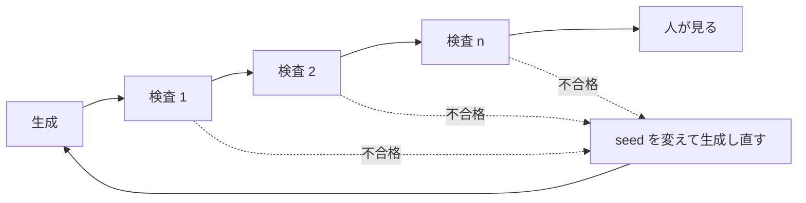
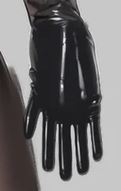

生成した画像を自動で検品する時、検査の段を足すほど、人の所に届く絵の品質は上がると考えがちです。しかし、どの検査も一定の割合で正しい絵を誤って落とします。段を重ねると、この誤りは掛け算で積み上がります。以下は、正しい絵を 5% だけ誤って落とす検査を 5 段重ねた時に、正しい絵がどれだけ残るかを描いた図です。



Image Linting（本記事での呼び名）は、生成した画像を人が見る前に、機械の検査で合格と不合格に振り分ける工程です。コードの Linter が人のレビューの前に決まった誤りを止めるのと同じく、タグ付けのモデル・物体の検出器・色の統計で、人数・露出・服・色などの決まった観点を確かめます。

<br>

本記事では、検査ごとの 2 種類の誤りから、生成画像の自動検品を説明します。人物の立ち絵を 72 枚生成して目で合否を付け、7 つの検査の結果と比べる実験を通して、次の疑問に答えます。

- なぜ人や LLM ではなく、決まった検査で先に振り分けるのか。
- 検査が役に立っているかは、何を数えれば分かるのか。
- 検査を直列に重ねると、正しい絵はどれだけ残るのか。
- 人数・露出・服・色の検査は、それぞれ何を止めて何を見逃すのか。
- 「同じ人物か」は、CLIP の近さとタグの近さのどちらで見分けられるのか。

画像生成の仕組みは [LoRA のノート](/notes/generative-ai/lora/) を参照してください。失敗を減らすプロンプトの書き方は説明しません。

---

### 人が見る前に機械で振り分ける理由

画像生成は、同じプロンプトでも seed（乱数の種）を変えるたびに別の絵を返します。人数が増える、手が崩れる、服の色が別の部位に移る、といった失敗は一定の割合で混ざるので、使える 1 枚を得るには数枚から数十枚を生成して選びます。

人が全部を見る方法は、枚数が増えると続きません。LLM（大規模言語モデル）に画像を見せる方法もありますが、見落としがあり、高い解像度の画像ではトークンの消費が大きくなります（[weeknotes 2026/10/26 週](/weeknotes/2026-10-26/8575939c5076/)）。そこで、決まった観点だけを CPU で動く小さなモデルと計算で確かめ、残った絵だけを人が見ます。



不合格の絵は、seed を変えて生成し直します。同じ seed とワークフローで生成し直すと、同じ環境では同じ絵が出るからです。後の実験の環境で 2 枚を生成し直すと、2 枚とも 1 画素も違いませんでした（[lab/check_same.py](https://github.com/nao1215/debimate/blob/main/content/notes/generative-ai/image-linting/lab/check_same.py)）。

---

### 誤った合格と誤った棄却

検査は、絵を見て合格か不合格を返す関数です。人の判断を正解とすると、検査の誤りは次の 2 種類に分かれます。

| 検査＼人 | 人が合格 | 人が不合格 |
|---|---|---|
| 検査が合格 | 正しく通した | 誤った合格（false accept） |
| 検査が不合格 | 誤った棄却（false reject） | 正しく止めた |

誤った合格は、壊れた絵が人の所まで届くことです。届いた絵は人が見るので、いずれ気づきます。誤った棄却は、使える絵を捨てることです。捨てた絵は誰の目にも触れないので、検査を作った側は気づきません。

そのため、検査が役に立っているかを知るには、「何枚止めたか」だけでは足りません。人が合否を付けた絵に検査を当て、止めた不合格の数と、捨てた合格の数の両方を数える必要があります。2 つの誤りは、閾値を動かすと片方が減って片方が増える関係にあります。

<br>

検査を直列に並べると、絵は全ての段に合格した時だけ人の所に届きます。正しい絵を誤って棄却する割合が `p` の検査を `n` 段並べ、各段の誤りが互いに独立だとすると、正しい絵が全段を通る割合は次の式になります。

```text
正しい絵が全段を通る割合 = (1 - p)^n

p = 0.05, n = 5 の時:  0.95^5  = 0.774
p = 0.05, n = 10 の時: 0.95^10 = 0.599
```

1 段あたり 5% の誤りでも、5 段で正しい絵の約 23% を捨てます。著者は、自作の検品の仕組みについて、この計算をweeknotes に書いています。

> 各検証それぞれで正常画像を誤って5%棄却すると、すべての検品を通過する確率は約77%となる。各検証が品質に寄与していれば問題ないが、現在は統計情報を見る限りエンジニアの自己満足みたいな状況だ。
>
> （[weeknotes 2026/10/26 週「AI 画像生成の面倒臭さと、ワークフローコマンドで立ち向かう話」](/weeknotes/2026-10-26/8575939c5076/)）

式は、各段の誤りが独立である時の値です。例えば、2 つの検査が同じ「人物が小さく描かれた絵」で揃って誤るなら、誤りは重なり、通過率は式より高くなります。段を 1 つ足す価値は、その段が他の段の見逃した不合格をどれだけ止めるかと、正しい絵をどれだけ捨てるかの比べ合いで決まります。

---

### 実験の条件

手元の [ComfyUI](https://github.com/Comfy-Org/ComfyUI)（ノードをつないで画像生成の処理を組む OSS。v0.35.0、GPU は AMD Radeon 8060S）の [API](https://docs.comfy.org/development/comfyui-server/comms_routes) に、1 枚ずつ依頼を送って立ち絵を生成しました。

ベースモデルは [WAI-illustrious-SDXL v17.0](https://civitai.com/models/827184?modelVersionId=2883731)（Civitai で配布されている、[SDXL](https://arxiv.org/abs/2307.01952) のアーキテクチャのイラスト向けのモデル。ライセンスは [Fair AI Public License 1.0-SD](https://freedevproject.org/faipl-1.0-sd/)）で、検査の誤りを数えた 72 枚には LoRA を使っていません。

人物は、架空の成人 4 人（服装 A〜D）です。服装ごとに条件を 3 つ用意し、seed を 6 つずつ変えました。基準の絵は、条件 plain・seed 20261100 で服装ごとに 1 枚生成し、評価からは外しています。

| 項目 | 値 |
|---|---|
| 服装 A | long black hair, red jacket, white shirt, blue jeans, brown boots（女性） |
| 服装 B | long blonde hair, green sweater, black long skirt, black shoes（女性） |
| 服装 C | brown hair, navy blue suit, white shirt, red necktie, black shoes（男性） |
| 服装 D | silver hair, ponytail, yellow raincoat, grey pants, white sneakers（女性） |
| 共通の語 | masterpiece, best quality, general, solo, adult, standing, full body, looking at viewer, white background, simple background |
| 条件 plain | daylight |
| 条件 neon | night, neon lights, dramatic lighting |
| 条件 pose | daylight, walking, holding smartphone, waving, from side, wide shot |
| seed・解像度 | 20261110〜20261115・832 × 1216 |
| ステップ数・[CFG](https://arxiv.org/abs/2207.12598)（プロンプトに従わせる強さ）・サンプラー | 28・5.5・[euler_ancestral](https://github.com/Comfy-Org/ComfyUI/blob/v0.35.0/comfy/k_diffusion/sampling.py#L216) |

条件 neon と pose は、照明の語や動きの語が混ざった時の失敗を再現するために足しました。どちらも、白い背景の立ち絵という仕様と食い違う語を含みます。照明の語が画面全体の色を動かす現象は、[Prompt Weighting のノート](/notes/generative-ai/prompt-weighting/) でも扱っています。

<br>

検査の誤りを数えるには、正解の合否が必要です。72 枚の合否は、本記事の執筆時に、全身の画像と顔から手までの拡大を 1 枚ずつ見て付けました。

人物が 1 人ではない、露出がある、髪・服・靴が基準の絵と違う、顔・手・持ち物が崩れている、背景が白ではない、文字が描かれている、のどれか 1 つにでも当たれば不合格です。ラベルは 1 人の判断で、別の人が付ければ変わり得ます。合否と理由は [lab/labels.json](https://github.com/nao1215/debimate/blob/main/content/notes/generative-ai/image-linting/lab/labels.json) に置きました。

| 条件 | 合格 | 不合格（理由） |
|---|---|---|
| plain | 23 | 1（形の崩れた持ち物） |
| neon | 0 | 24（夜の路地の背景と看板の文字） |
| pose | 22 | 2（灰色の背景、手とスマートフォンの崩れ） |

---

### 7 つの検査

検査に使った道具は、3 つのタイプに分かれます。

- タグ付けのモデル: 画像に付く語（タグ）ごとの確率を返します。[WD ViT Tagger v3](https://huggingface.co/SmilingWolf/wd-vit-tagger-v3)（イラストの投稿サイト Danbooru の画像で学習したモデル。[Apache License 2.0](https://www.apache.org/licenses/LICENSE-2.0)）は、`1girl`（女性 1 人）や `red_jacket` のような人数・服・髪のタグと、`general` から `explicit` までの 4 段階のレーティングを返してくれます
- 検出器: 画像の中の顔や人物を矩形で囲み、その数を返します。deepghs の [anime_face_detection](https://huggingface.co/deepghs/anime_face_detection)（v1.4_s）と [anime_person_detection](https://huggingface.co/deepghs/anime_person_detection)（v1.3_s）を使いました。どちらも物体検出のモデルの系統である [YOLOv8](https://docs.ultralytics.com/models/yolov8/) を元にしたもので、[MIT License](https://opensource.org/license/mit) です
- 統計と埋め込み: 画素の色を数える計算と、画像を 1 本のベクトル（埋め込み）に変える [CLIP](https://github.com/openai/CLIP)（OpenAI が公開した、画像と文章を同じ空間に置くモデル。MIT License）です。2 枚の埋め込みの cos（向きの近さ。1 に近いほど似ている）で、基準の絵との近さを測ります

重みはどれも [ONNX](https://onnx.ai/) 形式（モデルの計算をフレームワークに依存せず保存する形式）で、[ONNX Runtime](https://onnxruntime.ai/) 1.31.1 の CPU 実行で動かしました。

CLIP は、[openai/clip-vit-base-patch32](https://huggingface.co/openai/clip-vit-base-patch32) を ONNX に変換した [Xenova/clip-vit-base-patch32](https://huggingface.co/Xenova/clip-vit-base-patch32) の画像側だけを使っています。CLIP のモデルカードは、研究以外の実運用での利用を想定外としています。重みは 2026 年 11 月 10 日に取得したバージョンで、バージョンが変わるとタグの確率も変わります。

これらから、次の 7 つの検査を作りました。タグは確率 0.35 以上を「出ている」とみなします。閾値と必須のタグは、合否のラベルを付ける前に決め、その後は動かしていません。

| 検査 | 不合格にする条件 |
|---|---|
| 人数（タグ） | `multiple_girls`・`2girls`・`multiple_views` などが出ている。または、`1girl`（服装 C は `1boy`）が出ていない |
| 人数（検出器） | 人物か顔の検出数が 1 ではない |
| 崩れ・文字（タグ） | `bad_hands`・`bad_anatomy`・`extra_arms`・`text`・`watermark` などが出ている |
| 露出（レーティング） | 4 段階のうち、`general` の確率が一番高くない |
| 服（タグ） | 服装ごとに決めた 3 つのタグのどれかが出ていない（A なら `red_jacket`・`black_hair`・`denim` か `jeans`） |
| 色（統計） | 左右の端（背景のはずの所）の平均色が、白から RGB の距離で 30 以上離れている。または、彩度と明るさがともに 0.85 を超える画素が 2% を超える |
| 基準の絵との近さ（CLIP） | 基準の絵との cos が 0.80 未満 |

以下は、7 つの検査を定義した部分です（[lab/evaluate.py](https://github.com/nao1215/debimate/blob/main/content/notes/generative-ai/image-linting/lab/evaluate.py) から抜粋）。`r` は 1 枚分の検査の値（タグの確率・検出結果・色の統計・CLIP の cos）、`d` は服装の記号です。タグの確率と検出結果は、[lab/lint_features.py](https://github.com/nao1215/debimate/blob/main/content/notes/generative-ai/image-linting/lab/lint_features.py) が先に計算しておきます。

```python
# lab/evaluate.py の make_checks() から抜粋。p(r, tag) はタグの確率を返す
return [
    ("人数（タグ）", crowd_tags),
    ("人数（検出器）", lambda r, d: len(r["people"]) == 1 and len(r["faces"]) == 1),
    ("崩れ・文字（タグ）", lambda r, d: all(p(r, t) < TAG for t in BROKEN)),
    ("露出（レーティング）",
     lambda r, d: max(RATINGS, key=lambda t: p(r, t)) == "general"),
    ("服（タグ）", lambda r, d: all(any_of(r, a) for a in OUTFIT[d])),
    ("色（統計）", lambda r, d: r["color"]["border_dist_from_white"] <= BORDER_MAX
     and r["color"]["neon_ratio"] <= NEON_MAX),
    ("基準の絵との近さ（CLIP）", lambda r, d: r["clip_to_ref"] >= CLIP_MIN),
]
```

<details>
<summary>evaluate.py の全体</summary>

```python
"""features.json（lint_features.py）と labels.json（目で付けた合否）から、
検査ごとの誤った棄却・誤った合格と、検査を直列に重ねた時の通過率を数える。
最後に、顔の切り抜きで「同じ服装か」を CLIP とタグの cos で比べる。

閾値と必須のタグは、合否のラベルを付ける前に決めて、この下の定数に書いた値のまま動かしていない。

使い方:
    python3 evaluate.py <features.json> <labels.json> [結果の JSON]
"""
import itertools
import json
import math
import sys

import numpy as np

TAG = 0.35                       # タグが「出ている」とみなす確率
CLIP_MIN = 0.80                  # 基準の絵との CLIP の cos の下限
BORDER_MAX = 30.0                # 左右の端の平均色と白の距離（RGB、0〜441）の上限
NEON_MAX = 0.02                  # 彩度も明るさも高い画素の割合の上限

OUTFIT = {                       # 服装ごとに必須のタグ（| はどれか 1 つ）
    "A": ["red_jacket", "black_hair", "denim|jeans"],
    "B": ["green_sweater", "blonde_hair", "black_skirt"],
    "C": ["brown_hair", "suit|blue_suit", "red_necktie"],
    "D": ["grey_hair|white_hair", "raincoat|yellow_raincoat", "grey_pants"],
}
SUBJECT = {"A": "1girl", "B": "1girl", "C": "1boy", "D": "1girl"}
CROWD = ["multiple_girls", "2girls", "3girls", "multiple_boys", "2boys", "3boys",
         "multiple_views", "1girl", "1boy"]          # 自分の SUBJECT は後で外す
BROKEN = ["bad_hands", "bad_anatomy", "extra_arms", "extra_digits", "bad_feet",
          "text", "english_text", "watermark", "signature"]
RATINGS = ["general", "sensitive", "questionable", "explicit"]


def make_checks(names):
    ix = {n: i for i, n in enumerate(names)}

    def p(rec, tag):
        return rec["tags"][ix[tag]] if tag in ix else 0.0

    def any_of(rec, alt):
        return max(p(rec, t) for t in alt.split("|")) >= TAG

    def crowd_tags(rec, d):
        bad = [t for t in CROWD if t != SUBJECT[d] and p(rec, t) >= TAG]
        return not bad and p(rec, SUBJECT[d]) >= TAG

    return [
        ("人数（タグ）", crowd_tags),
        ("人数（検出器）", lambda r, d: len(r["people"]) == 1 and len(r["faces"]) == 1),
        ("崩れ・文字（タグ）", lambda r, d: all(p(r, t) < TAG for t in BROKEN)),
        ("露出（レーティング）",
         lambda r, d: max(RATINGS, key=lambda t: p(r, t)) == "general"),
        ("服（タグ）", lambda r, d: all(any_of(r, a) for a in OUTFIT[d])),
        ("色（統計）", lambda r, d: r["color"]["border_dist_from_white"] <= BORDER_MAX
         and r["color"]["neon_ratio"] <= NEON_MAX),
        ("基準の絵との近さ（CLIP）", lambda r, d: r["clip_to_ref"] >= CLIP_MIN),
    ]


def cos(a, b):
    a, b = np.asarray(a), np.asarray(b)
    return float(a @ b / (np.linalg.norm(a) * np.linalg.norm(b)))


# 顔の切り抜きのタグの cos から外す語（表情・視線・構図・背景・人数・レーティング）
STOP = {"solo", "1girl", "1boy", "portrait", "looking_at_viewer", "closed_mouth",
        "open_mouth", "parted_lips", "smile", "expressionless", "blush", "upper_body",
        "white_background", "simple_background", "transparent_background",
        "grey_background", "close-up", "light_smile", "male_focus", "general",
        "sensitive", "questionable", "explicit"}


def main():
    feats = json.load(open(sys.argv[1]))
    labels = json.load(open(sys.argv[2]))
    out_path = sys.argv[3] if len(sys.argv) > 3 else None
    names, imgs = feats["tag_names"], feats["images"]
    for name, rec in imgs.items():
        ref = imgs[f"{name[0]}_ref_20261100"]
        rec["clip_to_ref"] = cos(rec["clip"], ref["clip"])
    checks = make_checks(names)
    vocab = set(names)
    used = set(CROWD + BROKEN + RATINGS) | {t for v in OUTFIT.values() for a in v
                                            for t in a.split("|")}
    print("タグ付けのモデルの語彙に無いタグ（確率は常に 0 として扱われる）:",
          sorted(used - vocab))

    targets = sorted(n for n in imgs if "_ref_" not in n)
    good = [n for n in targets if labels[n]["ok"]]
    bad = [n for n in targets if not labels[n]["ok"]]
    print(f"評価する画像 {len(targets)} 枚（目で見て合格 {len(good)}、不合格 {len(bad)}）")
    print("基準の絵 4 枚の合否:",
          {n: all(f(imgs[n], n[0]) for _, f in checks) for n in sorted(imgs) if "_ref_" in n})

    passed = {c: {n: f(imgs[n], n[0]) for n in targets} for c, f in checks}
    rows = []
    print(f"\n{'検査':<22}{'誤った棄却':>10}{'誤った合格':>10}{'単独で止めた不合格':>12}")
    for c, _ in checks:
        fr = [n for n in good if not passed[c][n]]
        fa = [n for n in bad if passed[c][n]]
        only = [n for n in bad if not passed[c][n]
                and all(passed[o][n] for o, _ in checks if o != c)]
        rows.append({"check": c, "false_reject": len(fr), "false_accept": len(fa),
                     "caught_bad": len(bad) - len(fa), "only_this": len(only),
                     "false_reject_names": fr})
        print(f"{c:<22}{len(fr):>4} / {len(good):<4}{len(fa):>5} / {len(bad):<4}{len(only):>8}")

    # 直列に重ねた時、合格の絵が全部を通る割合（実測）と、独立を仮定した積
    print("\n段数  実測（合格の絵が全部を通る）  各段の通過率の積  (1-p)^n（p は各段の平均）")
    stages = []
    for k in range(1, len(checks) + 1):
        cs = [c for c, _ in checks[:k]]
        all_pass = sum(all(passed[c][n] for c in cs) for n in good) / len(good)
        rates = [sum(passed[c][n] for n in good) / len(good) for c in cs]
        prod = math.prod(rates)
        pbar = 1 - sum(rates) / len(rates)
        stages.append({"n": k, "measured": all_pass, "product": prod,
                       "mean_p": pbar, "formula": (1 - pbar) ** k})
        print(f"{k:>3}   {all_pass:>8.3f}                     {prod:>8.3f}        "
              f"{(1 - pbar) ** k:>8.3f}  (p={pbar:.3f})")
    caught = sum(any(not passed[c][n] for c, _ in checks) for n in bad)
    print(f"\n7 段全部で止めた不合格: {caught} / {len(bad)}")
    print(f"5% の誤りを 5 段: (1-0.05)^5 = {0.95 ** 5:.3f}")

    # 顔の切り抜きで、同じ服装か別の服装かを見分けられるか（neon 以外で合格の絵と基準の絵）
    keep = [i for i, n in enumerate(names) if n not in STOP and feats.get("tag_categories",
            [0] * len(names))[i] == 0]
    faces = sorted(n for n in imgs if "_neon_" not in n and "face_clip" in imgs[n]
                   and labels.get(n, {"ok": True})["ok"])
    same, diff = {"clip": [], "tag": []}, {"clip": [], "tag": []}
    for a, b in itertools.combinations(faces, 2):
        ta = [imgs[a]["face_tags"][i] for i in keep]
        tb = [imgs[b]["face_tags"][i] for i in keep]
        bucket = same if a[0] == b[0] else diff
        bucket["clip"].append(cos(imgs[a]["face_clip"], imgs[b]["face_clip"]))
        bucket["tag"].append(cos(ta, tb))
    print(f"\n顔の切り抜き {len(faces)} 枚（neon 以外で目で見て合格の絵と、基準の絵）")
    for k in ("clip", "tag"):
        print(f"  {k:<4} 同じ服装 {len(same[k])} 組 {min(same[k]):.2f}〜{max(same[k]):.2f}"
              f"（中央値 {np.median(same[k]):.2f}） / 別の服装 {len(diff[k])} 組 "
              f"{min(diff[k]):.2f}〜{max(diff[k]):.2f}（中央値 {np.median(diff[k]):.2f}）")

    if out_path:
        json.dump({"n_good": len(good), "n_bad": len(bad), "checks": rows,
                   "stages": stages, "identity": {"same": same, "diff": diff}},
                  open(out_path, "w"), ensure_ascii=False, indent=1)


if __name__ == "__main__":
    main()
```

</details>

<details>
<summary>lint_features.py の全体（タグ・検出・CLIP・色の統計を計算する）</summary>

```python
"""生成した PNG から、検品に使う値を計算して features.json に書く。

使うモデル（全て ONNX、CPU で動かす）:
  WD ViT Tagger v3          : タグの確率（人数・露出・服・崩れ）
  CLIP ViT-B/32（画像側）   : 画像の埋め込み（基準の絵との近さ）
  anime_face_detection v1.4_s / anime_person_detection v1.3_s : 顔と人物の数
色の統計は NumPy だけで計算する。

使い方:
    python3 lint_features.py <PNG のディレクトリ> <モデルのディレクトリ> <出力 JSON>
"""
import json
import os
import sys

import numpy as np
import onnxruntime as ort
from PIL import Image

OPTS = ort.SessionOptions()
OPTS.intra_op_num_threads = 8


def session(path):
    return ort.InferenceSession(path, OPTS, providers=["CPUExecutionProvider"])


# ---- WD tagger -------------------------------------------------------------
def load_tagger(d):
    import csv
    with open(os.path.join(d, "selected_tags.csv")) as f:
        rows = list(csv.DictReader(f))
    return session(os.path.join(d, "model.onnx")), [r["name"] for r in rows], \
        [int(r["category"]) for r in rows]


def tag_probs(sess, img):
    """白で正方形に埋めて 448 に縮め、BGR・0〜255 の float で渡す（モデルの前処理）。"""
    w, h = img.size
    s = max(w, h)
    canvas = Image.new("RGB", (s, s), (255, 255, 255))
    canvas.paste(img, ((s - w) // 2, (s - h) // 2))
    x = np.asarray(canvas.resize((448, 448), Image.BICUBIC), dtype=np.float32)[:, :, ::-1]
    return sess.run(None, {"input": x[None].copy()})[0][0]


# ---- CLIP ------------------------------------------------------------------
MEAN = np.array([0.48145466, 0.4578275, 0.40821073], dtype=np.float32)
STD = np.array([0.26862954, 0.26130258, 0.27577711], dtype=np.float32)


def clip_embed(sess, img):
    """短い辺を 224 に縮めて中央を切り抜く（preprocessor_config.json と同じ）。"""
    w, h = img.size
    r = 224 / min(w, h)
    img = img.resize((round(w * r), round(h * r)), Image.BICUBIC)
    w, h = img.size
    l, t = (w - 224) // 2, (h - 224) // 2
    x = np.asarray(img.crop((l, t, l + 224, t + 224)), dtype=np.float32) / 255.0
    x = ((x - MEAN) / STD).transpose(2, 0, 1)[None]
    e = sess.run(None, {"pixel_values": x})[0][0]
    return e / np.linalg.norm(e)


# ---- YOLO 系の検出器（顔・人物） -------------------------------------------
def detect(sess, img, thr, size=640, iou=0.7):
    w, h = img.size
    r = size / max(w, h)
    nw, nh = round(w * r), round(h * r)
    canvas = Image.new("RGB", (size, size), (114, 114, 114))
    canvas.paste(img.resize((nw, nh), Image.BILINEAR), (0, 0))
    x = (np.asarray(canvas, dtype=np.float32) / 255.0).transpose(2, 0, 1)[None]
    out = sess.run(None, {"images": x})[0][0]           # [4 + クラス数, 候補数]
    if out.shape[0] > out.shape[1]:
        out = out.T
    boxes, scores = out[:4].T, out[4:].max(axis=0)
    keep = scores >= thr
    boxes, scores = boxes[keep], scores[keep]
    xyxy = np.stack([boxes[:, 0] - boxes[:, 2] / 2, boxes[:, 1] - boxes[:, 3] / 2,
                     boxes[:, 0] + boxes[:, 2] / 2, boxes[:, 1] + boxes[:, 3] / 2], 1) / r
    order, picked = scores.argsort()[::-1], []
    while order.size:                                    # 重なった候補を 1 つにまとめる（NMS）
        i = order[0]
        picked.append(i)
        a = xyxy[i]
        b = xyxy[order[1:]]
        inter = (np.clip(np.minimum(a[2], b[:, 2]) - np.maximum(a[0], b[:, 0]), 0, None) *
                 np.clip(np.minimum(a[3], b[:, 3]) - np.maximum(a[1], b[:, 1]), 0, None))
        area = lambda z: (z[..., 2] - z[..., 0]) * (z[..., 3] - z[..., 1])
        order = order[1:][inter / (area(a) + area(b) - inter + 1e-9) < iou]
    return [[float(v) for v in xyxy[i]] + [float(scores[i])] for i in picked]


# ---- 色の統計 ---------------------------------------------------------------
def color_stats(img):
    x = np.asarray(img, dtype=np.float32) / 255.0
    h, w, _ = x.shape
    m = max(4, w // 20)                                  # 左右の端の帯（背景のはずの所）
    border = np.concatenate([x[:, :m].reshape(-1, 3), x[:, -m:].reshape(-1, 3)])
    mx, mn = x.max(axis=2), x.min(axis=2)
    sat = np.where(mx > 0, (mx - mn) / np.maximum(mx, 1e-6), 0)
    neon = float(((sat > 0.85) & (mx > 0.85)).mean())   # 彩度も明るさも高い画素の割合
    return {
        "border_rgb": [float(v) for v in border.mean(axis=0) * 255],
        "border_dist_from_white": float(np.linalg.norm((1 - border.mean(axis=0)) * 255)),
        "neon_ratio": neon,
        "mean_saturation": float(sat.mean()),
    }


def main():
    png_dir, model_dir, out_path = sys.argv[1:4]
    tagger, names, cats = load_tagger(os.path.join(model_dir, "wd-vit-tagger-v3"))
    clip = session(os.path.join(model_dir, "clip-vit-base-patch32-onnx", "vision_model.onnx"))
    dets = {}
    for key, d in [("face", "face_detect_v1.4_s"), ("person", "person_detect_v1.3_s")]:
        with open(os.path.join(model_dir, d, "threshold.json")) as f:
            dets[key] = (session(os.path.join(model_dir, d, "model.onnx")),
                         json.load(f)["threshold"])

    result = {"tag_names": names, "tag_categories": cats, "images": {}}
    for fn in sorted(os.listdir(png_dir)):
        if not fn.endswith(".png"):
            continue
        img = Image.open(os.path.join(png_dir, fn)).convert("RGB")
        p = tag_probs(tagger, img)
        faces = detect(dets["face"][0], img, dets["face"][1])
        people = detect(dets["person"][0], img, dets["person"][1])
        rec = {
            "tags": [round(float(v), 4) for v in p],
            "clip": [round(float(v), 6) for v in clip_embed(clip, img)],
            "faces": faces, "people": people, "color": color_stats(img),
        }
        if faces:                                         # 一番確からしい顔の切り抜き
            x0, y0, x1, y1, _ = max(faces, key=lambda b: b[4])
            pad = 0.25 * (x1 - x0)
            crop = img.crop((max(0, x0 - pad), max(0, y0 - pad),
                             min(img.width, x1 + pad), min(img.height, y1 + pad)))
            rec["face_tags"] = [round(float(v), 4) for v in tag_probs(tagger, crop)]
            rec["face_clip"] = [round(float(v), 6) for v in clip_embed(clip, crop)]
        result["images"][fn[:-4]] = rec
        print(f"{fn}: faces={len(faces)} people={len(people)} "
              f"border={rec['color']['border_dist_from_white']:.1f} "
              f"neon={rec['color']['neon_ratio']:.3f}", flush=True)
    with open(out_path, "w") as f:
        json.dump(result, f)


if __name__ == "__main__":
    main()
```

</details>

---

### 検査ごとの誤り

以下が評価の実行結果です。「単独で止めた不合格」は、他の 6 つの検査が全て通した不合格の絵のうち、その検査が止めた枚数です。

```text
$ python3 evaluate.py features.json labels.json result.json
タグ付けのモデルの語彙に無いタグ（確率は常に 0 として扱われる）: ['extra_digits', 'text']
評価する画像 72 枚（目で見て合格 45、不合格 27）
基準の絵 4 枚の合否: {'A_ref_20261100': True, 'B_ref_20261100': True, 'C_ref_20261100': True, 'D_ref_20261100': True}

検査                         誤った棄却     誤った合格   単独で止めた不合格
人数（タグ）                   0 / 45     27 / 27         0
人数（検出器）                  0 / 45     27 / 27         0
崩れ・文字（タグ）                0 / 45     27 / 27         0
露出（レーティング）               0 / 45     27 / 27         0
服（タグ）                    3 / 45     24 / 27         0
色（統計）                   13 / 45      2 / 27        13
基準の絵との近さ（CLIP）           0 / 45     16 / 27         1
```

段数ごとの通過率と顔の切り抜きの cos を含む出力の全体は、[lab/output_evaluate.txt](https://github.com/nao1215/debimate/blob/main/content/notes/generative-ai/image-linting/lab/output_evaluate.txt) にあります。上の表を割合にした図が以下です。左が誤った棄却、右が誤った合格の割合です。



人数・崩れ・露出の 4 つは、合格の絵を 1 枚も捨てていません。その代わりに、不合格の絵も 1 枚も止めていません。72 枚の中に、人数が増えた絵や露出のある絵が無かったからです。この 4 つは、このデータでは何の役にも立たずに処理時間だけを使っていました。ただし、失敗が出た時の保険として残す判断はあり得ます。

服の検査は、不合格 27 枚のうち 24 枚を通しました。neon の 24 枚は、夜の路地に看板が並ぶ絵ですが、服と髪の色は基準の絵と同じだからです。服の色とタグだけを見る検査では、背景も文字も見ません。立ち絵を大量に作っていた時に、服の色だけを見て合格にした約 120 枚が人の見直しで外されたのも、同じ形の誤った合格です。

<br>

色の検査は、不合格 27 枚のうち 25 枚を止め、13 枚は他のどの検査も止めていませんでした。一方で、合格の絵を 13 枚捨てています。12 枚は服装 D（黄色のレインコート）の plain と pose で、鮮やかな黄色の服が「蛍光色の画素が多い」と判定されました。以下は、捨てた 13 枚と服装 D の基準の絵で、この画素の割合を閾値と並べた図です。



基準の絵では 0.0004 だった割合が、seed を変えた服装 D の 12 枚では 0.051〜0.105 になりました。残る 1 枚は、赤い上着が朱色寄りに明るく描かれた服装 A の絵です。照明による色かぶりを止めるための規則が、設定通りの明るい服を捨てていたわけです。

7 つ全てを通った不合格は、1 枚（服装 C が形の崩れた板を持った絵）でした。持ち物の崩れは、どのタグにも色にも出ませんでした。

<br>

実行結果の 1 行目にも、見落としやすい誤りが出ています。崩れ・文字の検査に入れた `text` と `extra_digits` は、WD ViT Tagger v3 の語彙に無いタグでした。語彙に無いタグの確率を 0 として扱う作りだったので、この 2 つの条件は、どんな絵でも黙って合格を返します。

neon の絵の看板の文字も、この検査は 1 枚も止めていません（語彙にある `english_text` の確率も、最大 0.05 でした）。検査の作り手は、条件が一度も当たらない状態を「失敗が無かった」と区別できません。

---

### 実際に外した絵と止めるべき検査

72 枚では、人数・崩れ・露出の検査が止める絵は 1 枚もありませんでした。これらの検査が何のためにあるかは、実際に外した絵と並べると分かります。

以下は、著者が以前に画風 LoRA で作った立ち絵の検品で外した絵で、[weeknotes 2026/10/26 週](/weeknotes/2026-10-26/8575939c5076/) と [weeknotes 2026/11/02 週](/weeknotes/2026-11-02/e2cecb994e2c/) に載せた画像を再掲しています。本記事の lab では再現できない画像です。画像を押すと、元の解像度で開きます。

<div style="display:flex;justify-content:center;align-items:flex-end;gap:8px;margin:1.5rem 0">
<figure style="margin:0;flex:0 1 115px;min-width:0"><a href="images/lint_ng_six_fingers.webp"></a><figcaption style="margin:4px 0 0;text-align:center;font-weight:normal;font-size:14px">指が 6 本（崩れ）</figcaption></figure>
<figure style="margin:0;flex:0 1 434px;min-width:0"><a href="images/lint_ng_no_hand.webp"></a><figcaption style="margin:4px 0 0;text-align:center;font-weight:normal;font-size:14px">腕の先に手が無い（崩れ）</figcaption></figure>
</div>

指や手の崩れを止めるのは、崩れ（タグ）の検査です。しかし、72 枚では `bad_hands` の確率は全ての絵で 0.001 未満で、手とスマートフォンが崩れた絵でも上がりませんでした。止めるには、手や指を数える検出器が別に必要になります。

<div style="display:flex;justify-content:center;align-items:flex-end;gap:8px;margin:1.5rem 0">
<figure style="margin:0;flex:0 1 229px;min-width:0"><a href="images/lint_ng_clothes_ref.webp"></a><figcaption style="margin:4px 0 0;text-align:center;font-weight:normal;font-size:14px">基準の立ち絵（えんじの服）</figcaption></figure>
<figure style="margin:0;flex:0 1 230px;min-width:0"><a href="images/lint_ng_clothes_ng.webp"></a><figcaption style="margin:4px 0 0;text-align:center;font-weight:normal;font-size:14px">別の場面で緑の服になった（服）</figcaption></figure>
</div>

場面ごとに服の色が変わった絵は、服（タグ）と基準の絵との近さ（CLIP）の検査で止めます。服のタグは、色の名前まで書けば止められます。ただし、服以外の違いは見ません。



同じ人物が奥にもう 1 人いる絵は、人数（タグ）と人数（検出器）の検査で止めます。72 枚には該当する絵が無く、止めた実績は測れていません。



顔が緑や黄に染まった絵は、色（統計）の検査で止めます。72 枚では、夜の路地の背景は止めましたが、明るい黄色の服も捨てました。

<br>

つまり、72 枚で 0 件だった検査も、別の題材や画風では必要になります。ただし、必要かどうかは、その題材で失敗が出る割合と、検査の誤った棄却の割合を比べて決めます。72 枚のように該当する失敗が出ない題材では、検査は時間だけを使います。

---

### 重ねた時の通過率

7 つの検査を表の順に 1 段ずつ足し、合格 45 枚のうち全段を通った割合を数えました。比べるために、各段の通過率の積（独立を仮定した値）と、`0.95^n` を並べています。



7 段の全てを通った合格の絵は 32 枚で、45 枚の 71.1% でした。5 段目までで 93.3% 残っていた合格の絵が、6 段目の色の検査で 71.1% まで減っています。誤りは段ごとに均等には散らばらず、1 つの検査に集まっていました。

独立を仮定した積は 66.4% で、実測の 71.1% より低い値です。服の検査が捨てた 3 枚は全て服装 D で、3 枚とも色の検査も捨てていました。同じ絵を 2 つの検査が揃って捨てると、捨てた枚数は足し算より少なくなります。`(1 - p)^n` は、誤りが均等で独立な時の目安で、実際の通過率は、ラベルを付けた絵に検査を当てて数えるしかありません。

---

### 同じ人物かを見分ける近さ

立ち絵を何枚も作る時は、「基準の絵と同じ人物か」も確かめたくなります。その候補が、CLIP の埋め込みの cos と、タグの確率を並べたベクトルの cos です。顔の検出器で切り抜いた顔に両方を当て、同じ服装どうしの組と、別の服装どうしの組で値を比べました。対象は neon 以外で合格だった 45 枚と基準の絵 4 枚で、タグからは表情・視線・構図・背景・人数・レーティングの語を外しています。



| 指標 | 同じ服装（277 組） | 別の服装（899 組） |
|---|---|---|
| CLIP の cos | 0.88〜0.99（中央値 0.96） | 0.72〜0.94（中央値 0.84） |
| タグの cos | 0.57〜0.99（中央値 0.84） | 0.02〜0.59（中央値 0.16） |

CLIP は、別の人物どうしでも 0.94 まで高くなり、同じ人物の範囲と重なりました。CLIP の埋め込みは「白い背景に立つアニメ調の人物の顔」という共通点を強く拾うので、髪の色や髪型の違いが cos に出にくいと考えられます（推測です）。タグの cos は、髪の色・目の色・髪型のタグが人物ごとに入れ替わるので、0.57〜0.59 の狭い範囲を除いて分かれました。

著者が別の画風のキャラクターで測った時も、顔の切り抜きの CLIP の cos は別人どうしで 0.77〜0.92 と高く、タグの cos は同一人物で 0.55〜0.88、別人で 0.11〜0.36 に分かれていました。手元の 4 人でも、同じ傾向が出ています。

---

### 利点

- 人が見る前に、人数・露出・背景・文字のような決まった観点の失敗を CPU で止められる
- LLM を使わないので、枚数が増えてもトークンのコストが掛からない
- 検査ごとに不合格の理由が残り、どの語や条件が失敗を増やしたかを数えられる
- 閾値と必須のタグをコードに書けば、同じ基準を何千枚にも同じように当てられる

---

### 欠点

自動検品は、人の判断の一部を測れる量に置き換えて、人より先に当てます。その代わりに、次の制約があります。

- 測れるものしか見ない。持ち物の崩れや構図の良し悪しは、タグにも色にも出なかった
- 段を重ねるほど、正しい絵を捨てる割合が積み上がる
- 誤った棄却は人の目に触れないので、落とした絵を見直す仕組みが無いと気づけない
- 合否のラベルが無いと、検査が役に立っているかを数えられない
- タグの名前を誤っても、検査は黙って合格を返し続ける
- タグ付けのモデルや検出器のバージョンが変わると、同じ閾値でも結果が変わる

---

### 適さないケース

- 生成する枚数が少なく、人が全部を見ても負担にならない場合
- 合否の基準が「好みに合うか」で、言葉やタグにできない場合
- 合否のラベルを付けて誤りを数える手間を掛けられない場合
- 写真のように、タグ付けのモデルが学習した画像（本記事ならイラスト）と傾向の違う画像を検品する場合
