[img2img](https://github.com/CompVis/stable-diffusion/blob/21f890f9da3cfbeaba8e2ac3c425ee9e998d5229/README.md#image-modification-with-stable-diffusion)（image-to-image）は、文字のプロンプトだけでなく、下絵の画像も入力にして絵を描かせる画像生成の使い方です。下絵にノイズを足してから取り除く仕組みは、[SDEdit の論文](https://arxiv.org/abs/2108.01073)が示した手法に基づいています。下絵をどれだけ描き直すかを 0〜1 の値で指定し、この値を denoise（ノイズ除去の強さ、[Stable Diffusion web UI](https://github.com/AUTOMATIC1111/stable-diffusion-webui) では denoising strength）と呼びます。0 に近いほど下絵のまま、1 に近いほど下絵から離れた絵になります。

この値の名前から、denoise 0.6 は「絵の 6 割を描き直す」、1.0 は「下絵を捨てて描く」と読めるかもしれません。しかし、立った姿の下絵から座った絵を描かせると、0.8〜0.9 でも立った姿のまま残ります。逆に、仕上げのつもりで全体を 0.6 で描き直すと、小物の金貨が別の物体に化けることがあります。以下は、denoise が 0.6 の時に、生成の途中のどこから描き始めるかを描いた図です。



denoise は「何割を描き直すか」の割合ではなく、ノイズを取り除いていく段の列の「どこから始めるか」を指す値です。0.6 で始まる段にも、まだ多くのノイズが残っています。

<br>

本記事では、画像生成の内部を知らないエンジニアに向けて、denoise の仕組みを説明します。ComfyUI のソースで denoise が開始の段に変わる所を確認し、単純な図形の下絵から denoise を変えて描かせた結果を数値で比べます。扱う疑問は次の通りです。

- denoise を変えると、内部で何が変わるのか。
- denoise を上げると、下絵の形と色はどの順に消えるのか。
- 下絵をぼかす、色を抜くと、何が変わるのか。
- 全体を描き直すと、なぜ小物が別のものに化けるのか。
- 拡大してから弱く描き直す [hires fix](https://github.com/AUTOMATIC1111/stable-diffusion-webui/wiki/Features/fbff21b0d67505cc760904cfab80bc2acfba76b1#hires-fix) は、時間に見合うのか。

部分だけを描き直す [inpaint](https://comfyanonymous.github.io/ComfyUI_examples/inpaint/) と、[ControlNet](https://arxiv.org/abs/2302.05543)（輪郭や姿勢を別の画像で条件として渡す仕組み）のように[形を別の経路で渡す方法](../controlnet/)は説明しません。

---

### 前提: ノイズから絵を作る段の列

[Stable Diffusion XL](https://huggingface.co/stabilityai/stable-diffusion-xl-base-1.0)（SDXL）系の画像生成モデルは、ノイズだけの画像から、少しずつノイズを取り除いて絵を作る[拡散モデル](../diffusion-model/)です。1 回の除去をステップと呼び、例えば 28 ステップなら 28 回除去します。各ステップでノイズがどれだけ残っているかは、スケジューラーが決める数の列（sigma の列）で与えます。sigma はノイズの大きさで、列の先頭が最大、末尾が 0 です。

SDXL は画素の上ではなく、[VAE](https://arxiv.org/abs/1312.6114)（Variational Autoencoder）で画素を縦横 8 分の 1 に縮めた潜在表現（latent）と呼ばれる数の配列の上でノイズを取り除きます。プロンプトだけから描く txt2img（text-to-image）は、空の潜在表現に最大のノイズを掛けて列の先頭から始めます。img2img は、下絵を VAE で潜在表現に変え、列の途中の大きさのノイズを足して、その段から始めます。

つまり、denoise が決めるのは、この開始の段です。開始の段のノイズが大きいほど、下絵の情報はノイズに埋もれ、モデルがプロンプトに従って描き直す余地が増えます。

---

### denoise が開始の段を決める

[ComfyUI](https://github.com/Comfy-Org/ComfyUI)（ノードをつないで画像生成の処理を組む OSS）では、[`KSampler`](https://docs.comfy.org/built-in-nodes/sampling/ksampler) ノードの `denoise` が、次の [comfy/samplers.py の set_steps](https://github.com/Comfy-Org/ComfyUI/blob/v0.35.0/comfy/samplers.py#L1431-L1441) で sigma の列に変わります。以下は v0.35.0 のタグのコードです（手元の ComfyUI は v0.35.0 より後のコミット `19e1058` ですが、このファイルはタグと同じでした）。

```python
def set_steps(self, steps, denoise=None):
    self.steps = steps
    if denoise is None or denoise > 0.9999:
        self.sigmas = self.calculate_sigmas(steps).to(self.device)
    else:
        if denoise <= 0.0:
            self.sigmas = torch.FloatTensor([])
        else:
            new_steps = int(steps/denoise)
            sigmas = self.calculate_sigmas(new_steps).to(self.device)
            self.sigmas = sigmas[-(steps + 1):]
```

denoise が 1 未満の時は、`steps / denoise` 段の長い列を作り、その末尾の `steps + 1` 個だけを使います。例えば 28 ステップで denoise 0.6 なら、`int(28 / 0.6) = 46` 段の列を作り、先頭の 18 段を飛ばします。冒頭の図は、この 46 段です。

開始の段のノイズを下絵に足すのは、[comfy/samplers.py の 993 行目](https://github.com/Comfy-Org/ComfyUI/blob/v0.35.0/comfy/samplers.py#L993)から呼ばれる [noise_scaling](https://github.com/Comfy-Org/ComfyUI/blob/v0.35.0/comfy/model_sampling.py#L39-L47) です。SDXL のようなノイズを予測するモデル（EPS）では、`下絵の潜在表現 + sigma × ノイズ` を作ります。開始の sigma が列の最大値の時（denoise 1.0。28 ステップなら `int(28 / d)` が 28 になる 0.97 以上も同じ）だけは `sqrt(1 + sigma²) × ノイズ` を足しますが、下絵の潜在表現を消す処理はありません。

<br>

ここから、開始の段で下絵がどれだけ残るかを計算できます。モデルの入力は `sqrt(sigma² + 1)` で割ってから渡すので（[EPS の calculate_input](https://github.com/Comfy-Org/ComfyUI/blob/v0.35.0/comfy/model_sampling.py#L31-L33)）、下絵の潜在表現に掛かる係数は `1 / sqrt(1 + sigma²)` になります。ここでの潜在表現は、VAE の出力に SDXL の係数 0.13025 を掛けて、分散をほぼ 1 に揃えたものです（[samplers.py の 1224 行目](https://github.com/Comfy-Org/ComfyUI/blob/v0.35.0/comfy/samplers.py#L1224)の `process_latent_in`）。

Python の数値計算ライブラリ [NumPy](https://numpy.org/) で ComfyUI の SDXL の sigma の列（scheduler は `normal`）を写した [lab/schedule.py](https://github.com/nao1215/debimate/blob/main/content/notes/generative-ai/img2img-denoise/lab/schedule.py) で、denoise ごとにこの係数を数えました。



<br>

<details>
<summary>schedule.py の出力（列の長さ・飛ばす段・開始の sigma・係数 keep）</summary>

```text
$ python3 schedule.py 28 schedule.json
sigma_max=14.6146 sigma_min=0.0292
denoise  long_schedule  skipped  sigma_start  keep(1/sqrt(1+s^2))
   0.30             93       65       0.8132     0.776
   0.45             62       34       1.3369     0.599
   0.50             56       28       1.5674     0.538
   0.60             46       18       2.2797     0.402
   0.75             37        9       4.0861     0.238
   0.86             32        4       7.1547     0.138
   0.95             29        1      11.8332     0.084
   1.00             28        0      14.6146     0.068
```

</details>

<br>

上記の図の通り、係数は denoise 0.86 でも 0.138、1.0 でも 0.068 です。係数が小さくても、下絵の大まかな明暗と色の配置は、最初の数ステップで画面の構図を決める時の手掛かりになると考えられます。この残り方が絵にどう出るかは、次の実験で確認します。

ステップ数の扱いは、ツールによって違います。ComfyUI（v0.35.0）は、denoise を下げても `steps` 回の除去を全部行うので、時間はほとんど変わりません。

後の実験 1 でも、blurred と gray の 14 枚は、denoise 0.3〜1.0 のどれも 1 枚 23.3〜23.9 秒でした。先に送った crisp の 7 枚は 23.5〜30.6 秒とばらつきましたが、同じ crisp の 0.6 を後で描き直すと 23.5 秒（元は 30.6 秒）だったので、ばらつきは denoise ではなく環境の負荷によるものです。

<br>

一方で、[Stable Diffusion web UI](https://github.com/AUTOMATIC1111/stable-diffusion-webui)（AUTOMATIC1111）の v1.10.1 は、既定の設定では [`steps` 段の列の途中から始め](https://github.com/AUTOMATIC1111/stable-diffusion-webui/blob/v1.10.1/modules/sd_samplers_common.py#L22-L31)、[残りの段だけを除去します](https://github.com/AUTOMATIC1111/stable-diffusion-webui/blob/v1.10.1/modules/sd_samplers_kdiffusion.py#L134-L138)。同じ「denoise 0.3・28 ステップ」でも、前者は 28 回、後者は 9 回です。

後者でも、設定の「With img2img, do exactly the amount of steps the slider specifies」（img2img でもスライダーで指定したステップ数をそのまま実行する）を有効にすると、ComfyUI と同じく長い列を作って `steps` 回除去します。

---

### 実験 1: 単純な下絵から denoise を変えて描く

denoise を上げた分だけ絵が下絵から離れるのかを確認するために、2026 年 11 月に、手元の ComfyUI（v0.35.0 のタグより後のコミット `19e1058`、GPU は AMD Radeon 8060S）の API に、下絵と denoise だけを変えたワークフローを 1 枚ずつ送りました。下絵は、[lab/make_sketches.py](https://github.com/nao1215/debimate/blob/main/content/notes/generative-ai/img2img-denoise/lab/make_sketches.py) で、Python の画像ライブラリ [Pillow](https://python-pillow.github.io/) を使って描いた静物の配置図です。壁と机の 2 色の上に、青い長方形（本）、赤い円（りんご）、黄色の楕円（レモン）を置きました。この下絵を 3 種類用意しています。

| 名前 | 下絵 |
|---|---|
| crisp | 原色の図形をくっきり塗っただけ |
| blurred | crisp を Pillow の GaussianBlur（radius 24）でぼかしたもの |
| gray | blurred から色を抜いたもの（明るさは同じ） |

ベースモデルは [WAI-illustrious-SDXL の v17.0](https://civitai.com/models/827184?modelVersionId=2883731)（Civitai で配布されている Illustrious 系のイラスト向けのモデル。アーキテクチャは SDXL）で、[LoRA](/notes/generative-ai/lora/) は使っていません。ライセンスは [Fair AI Public License 1.0-SD](https://freedevproject.org/faipl-1.0-sd/) で、生成した画像はライセンスの対象外です。

| 項目 | 値 |
|---|---|
| 解像度 | 1024 × 1024 |
| seed・ステップ数・CFG（プロンプトに従わせる強さ） | 20261110・28・5.5 |
| サンプラー | [euler_ancestral](https://github.com/Comfy-Org/ComfyUI/blob/v0.35.0/comfy/k_diffusion/sampling.py#L216)（ステップごとにノイズを足し直すサンプラー）、scheduler は normal |
| denoise | 0.3 / 0.45 / 0.6 / 0.75 / 0.86 / 0.95 / 1.0 |
| プロンプト | masterpiece, best quality, no humans, still life, red apple, blue book, lemon, wooden table, plain wall, indoors |
| ネガティブ | lowres, worst quality, bad quality, low quality, jpeg artifacts, blurry, text, signature, watermark, logo, 1girl, 1boy, person |

ワークフローは、`LoadImage` で読んだ下絵を `VAEEncode` で潜在表現に変え、`KSampler` に渡すだけです（[lab/workflow_img2img.json](https://github.com/nao1215/debimate/blob/main/content/notes/generative-ai/img2img-denoise/lab/workflow_img2img.json)）。以下は、送信に使った [lab/run_sweep.py](https://github.com/nao1215/debimate/blob/main/content/notes/generative-ai/img2img-denoise/lab/run_sweep.py) から、denoise を書き換えて 1 枚ずつ送る部分の抜粋です。`comfy.run()` は、`/prompt` に送った自分の `prompt_id` だけを `/history` で待ち、画像を取り出す関数です（[lab/comfy.py](https://github.com/nao1215/debimate/blob/main/content/notes/generative-ai/img2img-denoise/lab/comfy.py)）。

```python
# lab/run_sweep.py の main() から抜粋
DENOISES = [0.3, 0.45, 0.6, 0.75, 0.86, 0.95, 1.0]

for name in names:                                  # crisp / blurred / gray
    image = comfy.upload(os.path.join(sketch_dir, f"sketch_{name}.png"))
    for d in DENOISES:
        wf = copy.deepcopy(workflow)                # workflow_img2img.json を読んだ dict
        wf["5"]["inputs"]["image"] = image          # LoadImage の下絵
        wf["7"]["inputs"]["denoise"] = d            # KSampler の denoise
        png = os.path.join(out, f"{name}_{int(round(d * 100)):03d}.png")
        r = comfy.run(wf, png, "9")                 # 1 枚送り、終わるまで待つ
```

この環境では、同じ設定でもう一度生成すると、画素まで完全に一致しました（crisp の 0.6 と実験 3 の 1 枚で確認。[lab/determinism.py](https://github.com/nao1215/debimate/blob/main/content/notes/generative-ai/img2img-denoise/lab/determinism.py)）。GPU・ドライバ・[PyTorch](https://pytorch.org/)（ComfyUI が使う深層学習のライブラリ）のバージョンが違うと、同じ seed でも一致するとは限りません。

---

### 下絵ごとの変わり方

以下が、下絵ごとに denoise を変えた 7 枚です。1 段目が crisp、2 段目が blurred、3 段目が gray で、左端が渡した下絵です。

<div class="denoise-strip" style="display:grid;grid-template-columns:repeat(auto-fit,minmax(min(96px,100%),1fr));gap:6px;margin:1.5rem 0">
<figure style="margin:0"><figcaption style="margin:4px 0 0;text-align:center;font-weight:normal;font-size:14px">下絵</figcaption></figure>
<figure style="margin:0">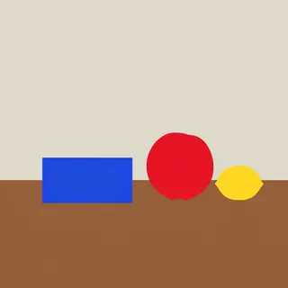<figcaption style="margin:4px 0 0;text-align:center;font-weight:normal;font-size:14px">0.3</figcaption></figure>
<figure style="margin:0"><figcaption style="margin:4px 0 0;text-align:center;font-weight:normal;font-size:14px">0.45</figcaption></figure>
<figure style="margin:0"><figcaption style="margin:4px 0 0;text-align:center;font-weight:normal;font-size:14px">0.6</figcaption></figure>
<figure style="margin:0">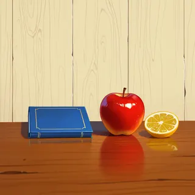<figcaption style="margin:4px 0 0;text-align:center;font-weight:normal;font-size:14px">0.75</figcaption></figure>
<figure style="margin:0">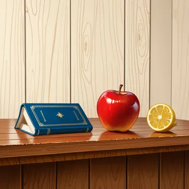<figcaption style="margin:4px 0 0;text-align:center;font-weight:normal;font-size:14px">0.86</figcaption></figure>
<figure style="margin:0">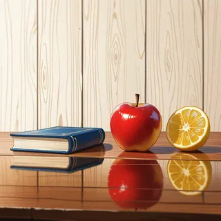<figcaption style="margin:4px 0 0;text-align:center;font-weight:normal;font-size:14px">0.95</figcaption></figure>
<figure style="margin:0">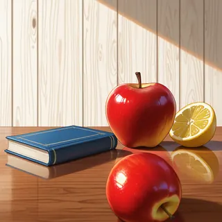<figcaption style="margin:4px 0 0;text-align:center;font-weight:normal;font-size:14px">1.0</figcaption></figure>
</div>

<div class="denoise-strip" style="display:grid;grid-template-columns:repeat(auto-fit,minmax(min(96px,100%),1fr));gap:6px;margin:1.5rem 0">
<figure style="margin:0">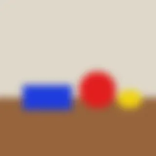<figcaption style="margin:4px 0 0;text-align:center;font-weight:normal;font-size:14px">下絵</figcaption></figure>
<figure style="margin:0">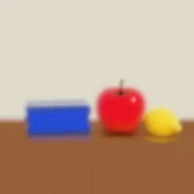<figcaption style="margin:4px 0 0;text-align:center;font-weight:normal;font-size:14px">0.3</figcaption></figure>
<figure style="margin:0">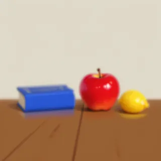<figcaption style="margin:4px 0 0;text-align:center;font-weight:normal;font-size:14px">0.45</figcaption></figure>
<figure style="margin:0">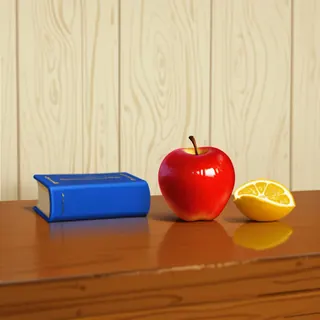<figcaption style="margin:4px 0 0;text-align:center;font-weight:normal;font-size:14px">0.6</figcaption></figure>
<figure style="margin:0">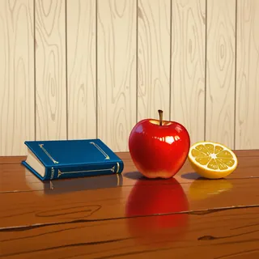<figcaption style="margin:4px 0 0;text-align:center;font-weight:normal;font-size:14px">0.75</figcaption></figure>
<figure style="margin:0">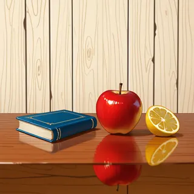<figcaption style="margin:4px 0 0;text-align:center;font-weight:normal;font-size:14px">0.86</figcaption></figure>
<figure style="margin:0">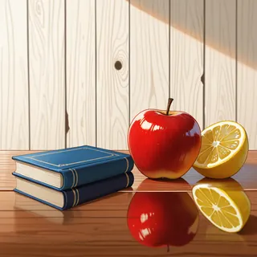<figcaption style="margin:4px 0 0;text-align:center;font-weight:normal;font-size:14px">0.95</figcaption></figure>
<figure style="margin:0">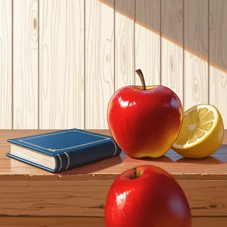<figcaption style="margin:4px 0 0;text-align:center;font-weight:normal;font-size:14px">1.0</figcaption></figure>
</div>

<div class="denoise-strip" style="display:grid;grid-template-columns:repeat(auto-fit,minmax(min(96px,100%),1fr));gap:6px;margin:1.5rem 0">
<figure style="margin:0">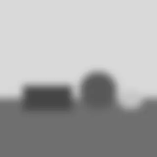<figcaption style="margin:4px 0 0;text-align:center;font-weight:normal;font-size:14px">下絵</figcaption></figure>
<figure style="margin:0">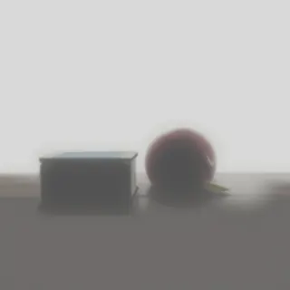<figcaption style="margin:4px 0 0;text-align:center;font-weight:normal;font-size:14px">0.3</figcaption></figure>
<figure style="margin:0">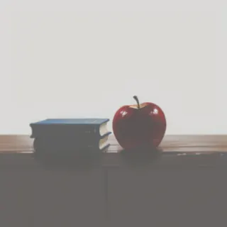<figcaption style="margin:4px 0 0;text-align:center;font-weight:normal;font-size:14px">0.45</figcaption></figure>
<figure style="margin:0">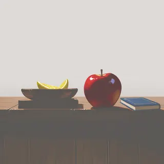<figcaption style="margin:4px 0 0;text-align:center;font-weight:normal;font-size:14px">0.6</figcaption></figure>
<figure style="margin:0">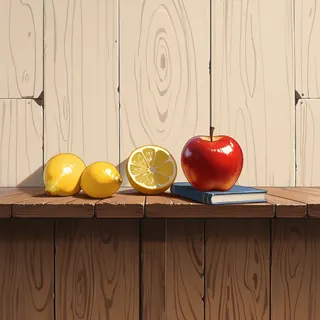<figcaption style="margin:4px 0 0;text-align:center;font-weight:normal;font-size:14px">0.75</figcaption></figure>
<figure style="margin:0">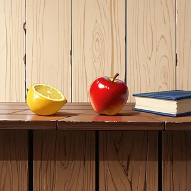<figcaption style="margin:4px 0 0;text-align:center;font-weight:normal;font-size:14px">0.86</figcaption></figure>
<figure style="margin:0">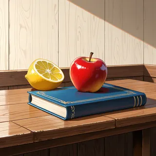<figcaption style="margin:4px 0 0;text-align:center;font-weight:normal;font-size:14px">0.95</figcaption></figure>
<figure style="margin:0">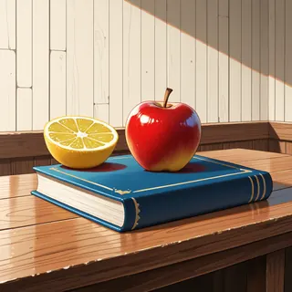<figcaption style="margin:4px 0 0;text-align:center;font-weight:normal;font-size:14px">1.0</figcaption></figure>
</div>

crisp は、0.6 まで平らな図形のままでした。0.6 ではりんごに光沢が付きましたが、青い長方形は角の丸い平らな板で、本には見えません。0.75 で急に、木の壁と机の上に本・りんご・レモンが並ぶ絵に変わりました。

blurred は、0.45 で既に厚みのある本とりんごになっています。gray は、0.6 まで机と壁が灰色のままで、0.6 以上では本が器に変わったり、本と果物の位置が入れ替わったりしました。

<br>

denoise を 1.0 まで上げれば下絵から自由になる、と思うかもしれません。しかし、色の付いた下絵は 1.0 でも消えませんでした。crisp と blurred の 1.0 は、左に本、右に果物という下絵の並びのままです。前の節の通り、ComfyUI の denoise 1.0 は下絵の潜在表現を消さず、係数 0.068 で残すからです。

比べるために、同じ seed とプロンプトで、下絵を使わない txt2img（`EmptyLatentImage` から描く）も 1 枚描きました。

<figure style="margin:1.5rem auto;max-width:320px">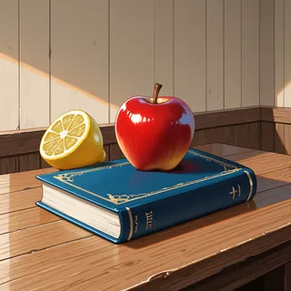<figcaption style="margin:4px 0 0;text-align:center;font-weight:normal;font-size:14px">下絵なし（txt2img）</figcaption></figure>

下絵なしの絵は、手前の大きな本の上にりんごが乗る構図で、crisp と blurred の 1.0 とは別の配置です。一方で、gray の 0.95 と 1.0 は、この下絵なしの絵とほぼ同じ構図でした。色を抜いた下絵は、1.0 に近づくと配置の手掛かりとしてほとんど効かなくなっています。

---

### 下絵との近さを数える

画像を目で並べるだけでは、どこで変わったかの判断がぶれます。そこで、[lab/metrics.py](https://github.com/nao1215/debimate/blob/main/content/notes/generative-ai/img2img-denoise/lab/metrics.py) で、下絵と出力の近さを 3 つの指標で数えました。

| 指標 | 数え方 | 見るもの |
|---|---|---|
| SSIM | 下絵と出力を灰色にし、256 × 256 に縮めて [SSIM](https://scikit-image.org/docs/0.26.x/api/skimage.metrics.html#skimage.metrics.structural_similarity)（Structural Similarity、明るさ・コントラスト・構造の近さ。1 が同一）を計算 | 明暗の配置が下絵に近いか |
| 輪郭の一致 | crisp の図形の縁と机の線を正解とし、出力の [Canny エッジ](https://scikit-image.org/docs/0.26.x/api/skimage.feature.html#skimage.feature.canny)（明るさの勾配から検出した輪郭）との一致を 256 × 256 上で 4 px の許容で数えた [F1](/ml/ml/confusion-matrix/)（再現率と適合率の調和平均） | 下絵の輪郭が残り、余計な模様が増えていないか |
| 彩度 | 出力を CIELAB に変換し、`a*` と `b*` の長さ（色の鮮やかさ）を平均 | 色がくすんでいないか |

以下は、3 つの指標を下絵ごとに denoise に対して並べたグラフです。



<br>

<details>
<summary>metrics.py の出力（全 21 枚と下絵なしの 1 枚。dE と flat を含む）</summary>

```text
$ python3 metrics.py <下絵のディレクトリ> <PNG のディレクトリ> metrics.json
crisp    sketch : chroma= 25.4 flat=  0.0
crisp    d=0.30: ssim=0.992 edge_f1=0.964 dE=  2.5 chroma= 25.7 flat=  0.6
crisp    d=0.45: ssim=0.986 edge_f1=0.844 dE=  3.0 chroma= 26.0 flat=  0.7
crisp    d=0.60: ssim=0.964 edge_f1=0.752 dE=  3.2 chroma= 24.5 flat=  6.7
crisp    d=0.75: ssim=0.703 edge_f1=0.569 dE= 10.3 chroma= 35.9 flat= 27.2
crisp    d=0.86: ssim=0.443 edge_f1=0.323 dE= 12.0 chroma= 24.4 flat= 32.7
crisp    d=0.95: ssim=0.403 edge_f1=0.287 dE= 11.6 chroma= 22.7 flat= 46.8
crisp    d=1.00: ssim=0.403 edge_f1=0.187 dE= 13.4 chroma= 25.8 flat= 35.7
blurred  sketch : chroma= 24.2 flat=  6.7
blurred  d=0.30: ssim=0.961 edge_f1=0.677 dE=  1.7 chroma= 24.8 flat=  6.7
blurred  d=0.45: ssim=0.895 edge_f1=0.709 dE=  2.9 chroma= 25.4 flat= 19.2
blurred  d=0.60: ssim=0.625 edge_f1=0.480 dE=  8.8 chroma= 33.8 flat= 30.5
blurred  d=0.75: ssim=0.494 edge_f1=0.305 dE= 10.9 chroma= 32.9 flat= 34.3
blurred  d=0.86: ssim=0.420 edge_f1=0.279 dE= 11.3 chroma= 29.5 flat= 41.3
blurred  d=0.95: ssim=0.405 edge_f1=0.182 dE= 12.1 chroma= 23.9 flat= 42.5
blurred  d=1.00: ssim=0.404 edge_f1=0.202 dE= 13.2 chroma= 26.5 flat= 32.6
gray     sketch : chroma=  0.0 flat=  6.4
gray     d=0.30: ssim=0.965 edge_f1=0.677 dE= 13.2 chroma=  1.0 flat=  4.5
gray     d=0.45: ssim=0.917 edge_f1=0.562 dE= 12.4 chroma=  2.3 flat=  6.1
gray     d=0.60: ssim=0.887 edge_f1=0.577 dE= 12.4 chroma=  4.6 flat= 15.5
gray     d=0.75: ssim=0.484 edge_f1=0.310 dE= 15.0 chroma= 20.3 flat= 54.6
gray     d=0.86: ssim=0.388 edge_f1=0.245 dE= 18.2 chroma= 22.2 flat= 45.4
gray     d=0.95: ssim=0.400 edge_f1=0.203 dE= 22.5 chroma= 20.5 flat= 40.8
gray     d=1.00: ssim=0.328 edge_f1=0.199 dE= 21.8 chroma= 21.0 flat= 39.6
txt2img (no sketch) vs crisp: ssim=0.400 edge_f1=0.232 dE= 27.4 chroma= 23.4 flat= 35.1
```

</details>

<br>

出力には、ほかに 2 つの値も出しています。`dE` は、色の付いた下絵（blurred）と出力を 32 × 32 に縮めた時の色差（[CIEDE2000](https://scikit-image.org/docs/0.26.x/api/skimage.color.html#skimage.color.deltaE_ciede2000)）の平均で、gray から描いた絵も同じ色の配置と比べています。`flat` は、図形の内側の明るさの[標準偏差](/ml/math/stddev/)で、0 に近いほど平らな板です。

3 つの指標は、同じ順に下がりませんでした。crisp の SSIM は 0.6 まで 0.96 以上で、0.75 で 0.70、0.86 で 0.44 まで一気に下がっています。0.95 以上の 0.40 は、下絵なしの txt2img（0.400）と同じ水準です。輪郭の一致も、0.95 以上で 0.18〜0.29 と、txt2img（0.232）に近い値になりました。明暗と輪郭で見る限り、下絵の細部は 0.95 でほぼ消えています。

しかし、色の配置は 1.0 でも残りました。下絵なしの txt2img の `dE` は 27.4 ですが、crisp と blurred の 1.0 は 13.2〜13.4 で、半分以下です。開始の段で係数 0.068 しか残らない下絵でも、大まかな色の塊は最後まで構図を引っ張ったことになります。

冒頭の、立った姿の下絵から 0.8〜0.9 でも座った絵にならない現象も、立ち姿の色の塊が最後まで残り、座った姿の構図を選ばせないと考えると説明できます。ここは推測で、人物の下絵で同じ数え方はしていません。

<br>

物体の位置が同じでも、下絵の作り方の違いは 2 点に出ました。

1 つ目は、くっきりした図形が平らな塗りのまま残りやすいことです。crisp の図形の内側の `flat` は 0.6 で 6.7 と、ほぼ平らなままでした。blurred は 0.45 で 19.2、0.6 で 30.5 と、陰影と質感が付いています。

境目のはっきりした単色の面は、潜在空間でも「平らな面」という強い手掛かりになり、低い denoise ではモデルがそれを写し直すと考えられます。人物の絵でも、原色の図形を置いた下絵は半透明の板のように描かれ、下絵をぼかすと解消しました。

2 つ目は、灰色の下絵では色が付かないことです。gray の彩度は 0.6 まで 1.0〜4.6 で、色の付いた下絵（24〜34）の 5 分の 1 以下でした。プロンプトに red apple や blue book と書いても、灰色の明暗が強く残る段からは色が出ません。

0.75 以上で色は付きましたが、今度はものの位置が下絵から外れ、`dE` も 15〜23 と大きくなっています。色は、どの塊が何かを伝える手掛かりでもあるので、抜くと配置が崩れます。

このように、下絵からの img2img では、描かせたいものの色を下絵にも置き、境目をぼかすと、低めの denoise でも形と色を両方保てます。どの値で何が変わるかは下絵とモデルで違うので、この実験の 0.6 や 0.75 という境目は、そのまま他の絵の基準になりません。

---

### 実験 2: 全体の描き直しで小物が化ける

仕上げの描き直しは、絵を拡大してから全体を中くらいの denoise で描き直す工程です。構図が残る値でも、プロンプトに書いていない小物は別の物体に変わります。キャラクターの絵を 1.5 倍・0.6 で描き直した時は、小物の金貨が花やパイに変わり、0.5 に下げると金貨は残った代わりに、0.45 では元の淡い塗りが直りませんでした。

同じ状況を静物で作りました。1 枚目は、宝箱と金貨を書いたプロンプトで txt2img から描いた 1024 × 1024 の絵です。これを lanczos で 1536 × 1536 に拡大し、金貨を書かないプロンプト（masterpiece, best quality, no humans, still life, wooden table, indoors）で、denoise だけを変えて描き直しました。0.6 だけは、1 枚目と同じ金貨を書いたプロンプトでも描いています。seed はどれも 20261110 です（[lab/run_extra.py](https://github.com/nao1215/debimate/blob/main/content/notes/generative-ai/img2img-denoise/lab/run_extra.py) の `morph`）。

<div class="denoise-strip" style="display:grid;grid-template-columns:repeat(auto-fit,minmax(min(110px,100%),1fr));gap:6px;margin:1.5rem 0">
<figure style="margin:0"><figcaption style="margin:4px 0 0;text-align:center;font-weight:normal;font-size:14px">1 枚目</figcaption></figure>
<figure style="margin:0"><figcaption style="margin:4px 0 0;text-align:center;font-weight:normal;font-size:14px">0.3</figcaption></figure>
<figure style="margin:0"><figcaption style="margin:4px 0 0;text-align:center;font-weight:normal;font-size:14px">0.45</figcaption></figure>
<figure style="margin:0"><figcaption style="margin:4px 0 0;text-align:center;font-weight:normal;font-size:14px">0.5</figcaption></figure>
<figure style="margin:0"><figcaption style="margin:4px 0 0;text-align:center;font-weight:normal;font-size:14px">0.6</figcaption></figure>
<figure style="margin:0">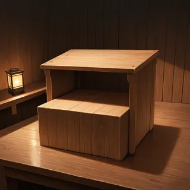<figcaption style="margin:4px 0 0;text-align:center;font-weight:normal;font-size:14px">0.75</figcaption></figure>
<figure style="margin:0"><figcaption style="margin:4px 0 0;text-align:center;font-weight:normal;font-size:14px">0.6（金貨あり）</figcaption></figure>
</div>

0.45 から 0.6 まで、宝箱・ろうそく・石の壁の構図は 1 枚目のままです。変わったのは、宝箱の中と周りの金貨だけでした。以下は、宝箱の口の部分を拡大したものです。

<div class="denoise-strip" style="display:grid;grid-template-columns:repeat(auto-fit,minmax(min(150px,100%),1fr));gap:6px;margin:1.5rem 0">
<figure style="margin:0"><figcaption style="margin:4px 0 0;text-align:center;font-weight:normal;font-size:14px">1 枚目</figcaption></figure>
<figure style="margin:0"><figcaption style="margin:4px 0 0;text-align:center;font-weight:normal;font-size:14px">0.3</figcaption></figure>
<figure style="margin:0"><figcaption style="margin:4px 0 0;text-align:center;font-weight:normal;font-size:14px">0.45</figcaption></figure>
<figure style="margin:0">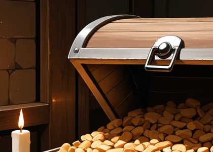<figcaption style="margin:4px 0 0;text-align:center;font-weight:normal;font-size:14px">0.5</figcaption></figure>
<figure style="margin:0">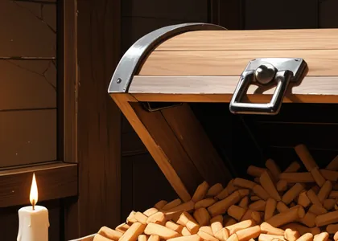<figcaption style="margin:4px 0 0;text-align:center;font-weight:normal;font-size:14px">0.6</figcaption></figure>
<figure style="margin:0"><figcaption style="margin:4px 0 0;text-align:center;font-weight:normal;font-size:14px">0.6（金貨あり）</figcaption></figure>
</div>

化けたかどうかは、拡大した画像を目で見て判定しました（正解のラベルは自分で付けています）。0.3 は金貨のままで、0.45 で金属の光沢が消えて茶色の丸い粒に、0.5 で角ばった塊に、0.6 で木の棒になりました。

判定の補助として、明るい金色の画素（HSV で色相 35〜60 度、彩度 0.5 以上、明度 0.75 以上）の割合と、1 枚目との SSIM を [lab/coins_metrics.py](https://github.com/nao1215/debimate/blob/main/content/notes/generative-ai/img2img-denoise/lab/coins_metrics.py) で数えました。



<br>

<details>
<summary>coins_metrics.py の出力</summary>

```text
$ python3 coins_metrics.py <PNG のディレクトリ> coins_metrics.json
coins_base   gold= 3.03%  ssim_vs_base=1.000
coins_g_030  gold= 2.16%  ssim_vs_base=0.850
coins_g_045  gold= 1.26%  ssim_vs_base=0.740
coins_g_050  gold= 0.43%  ssim_vs_base=0.689
coins_g_060  gold= 0.07%  ssim_vs_base=0.611
coins_g_075  gold= 0.08%  ssim_vs_base=0.406
coins_c_060  gold= 1.86%  ssim_vs_base=0.620
```

</details>

<br>

金色の画素は、0.3 で 2.16%、0.45 で 1.26%、0.6 で 0.07% と減りました。一方で、金貨を書いたプロンプトの 0.6 は 1.86% で、0.3 に近い値です。SSIM は 0.611 と 0.620 でほとんど同じなので、構図の崩れ方は同じで、金貨かどうかだけがプロンプトで分かれています。

<br>

化ける理由は、仕組みの節の係数から次のように考えられます。0.6 の開始の段では、下絵の潜在表現に掛かる係数は 0.402 です。金貨のような小さなものが並ぶ所は、細かい明暗の模様としてしか残らず、ノイズと区別しにくくなるのだと考えられます。その模様を何として描くかは、残りの 28 ステップで、プロンプトと周りの絵を手掛かりにモデルが選びます。

プロンプトに金貨が無ければ、宝箱と机に合いそうな別のもの（この実験では木の棒）が選ばれ、プロンプトに書けば金貨に戻ります。この実験では 0.45 で既に化けていて、前述のキャラクターの絵の 0.6 より低い値でした。プロンプトと絵が違うので、境目は絵ごとに確認する必要があります。

0.3 は 1 枚目との SSIM が 0.850 で、描き直す範囲も小さくなります。しかし、崩れた所や淡い塗りを直したい描き直しで denoise を下げると、直したい所も元のままになります。化けない値と、直したい所が直る値の間に、使える幅があるとは限りません。その場合は、化けるものをプロンプトに書くか、描き直す範囲を inpaint で限ります。

---

### 実験 3: hires fix の時間と効果

hires fix は、小さめの解像度で描いた絵を拡大し、低い denoise の img2img で細部を描き直す 2 段の生成です。ComfyUI の [2 Pass Txt2Img の例](https://comfyanonymous.github.io/ComfyUI_examples/2_pass_txt2img/)でも、hires fix は「低い解像度で描き、拡大して img2img に通すこと」と説明されています。

SDXL は学習の最後の段で 1024 × 1024 前後の画素数の画像を使っているので（[SDXL の論文](https://arxiv.org/abs/2307.01952)の 2.3 節・2.5 節）、それより大きく描く場合は、構図を決める 1 段目を学習に近い大きさで描き、拡大した後の描き込みだけを img2img に任せます。

denoise が低い 2 段目は、仕上げの軽い処理に見えるかもしれません。しかし、2 段目は 1 段目より大きな画像を描くので、時間は 1 段目より長く掛かります。同じ環境の別の設定（896 × 1120 を 1.3 倍）でも、1 枚が約 28 秒から約 70 秒に延びています（[2026/10/26 週の weeknotes](/weeknotes/2026-10-26/8575939c5076/)）。また、1.3 倍・denoise 0.4 で描き直す別の設定では、顔が小さい絵の描き込みは増えず、白い服がクリーム色に黄ばむ問題も直りませんでした。

時間と効果を測るために、成人の女性の全身（1 色の黒髪、白いブラウスまたは黒い服に白い袖口、ワイドパンツ、灰色の背景）を描きました。人物の例は、本記事の説明用に用意した独自の画風 LoRA を強さ 1.0 で当てています（[LoRA](/notes/generative-ai/lora/) は、学習済みモデルに画風の差分を足すファイルです）。

1 段目は 768 × 1344 で 28 ステップ描き、lanczos で 1.5 倍（1152 × 2016）に拡大して、20 ステップ・denoise 0.45 で描き直しました。ネガティブには nsfw・nude・cleavage・child などを入れ、載せる絵は全て目で確認しています。プロンプトと、候補から外した絵の枚数と理由は [lab/README.txt](https://github.com/nao1215/debimate/blob/main/content/notes/generative-ai/img2img-denoise/lab/README.txt) にあります。

| 依頼 | seed | 実行時間 | 送る直前の負荷 |
|---|---|---|---|
| 1 段目だけ | 20261190 / 20261193 | 24.38 秒 / 24.41 秒 | GPU 98% / 54%、load average 5.0 / 2.7 |
| 2 段目まで通し | 20261190 / 20261193 / 20261190（2 回目） | 67.17 秒 / 67.24 秒 / 67.44 秒 | GPU 65〜75%、load average 3.5〜3.7 |

実行時間は、ComfyUI が記録した `execution_start` から `execution_success` までです。モデルの読み込み（ノード 1）はどの依頼でもキャッシュから出ているので、時間に入っていません。他の作業の依頼も同じ ComfyUI に入っていましたが、ComfyUI は依頼を 1 件ずつ実行するので、待ち時間は実行時間に入りません。GPU の使用率は送る直前の値で、多くは他の依頼の実行中でした。

2 段目を足すと 2.8 倍になり、weeknotes の 2.5 倍と近い値でした。2 段目は画素数が 2.25 倍の画像を 20 ステップ描くので、1 段目の 28 ステップより時間が掛かります。

以下は、seed 20261193 の 1 段目と hires fix の後です。画像をクリックすると、元の解像度で開きます。

<div class="denoise-strip" style="display:grid;grid-template-columns:repeat(2,minmax(0,1fr));gap:8px;margin:1.5rem auto;max-width:760px">
<figure style="margin:0"><a href="images/person_20261193_1x.webp">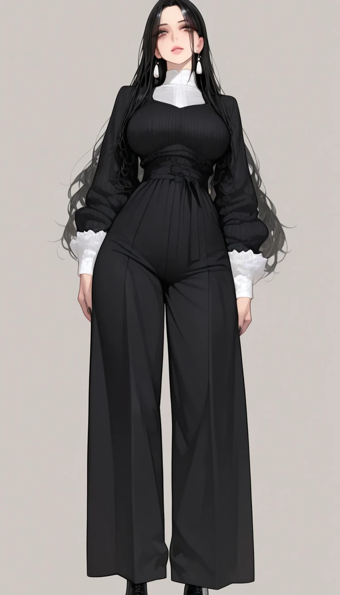</a><figcaption style="margin:4px 0 0;text-align:center;font-weight:normal;font-size:14px">1 段目（768 × 1344）</figcaption></figure>
<figure style="margin:0"><a href="images/person_20261193_hires.webp">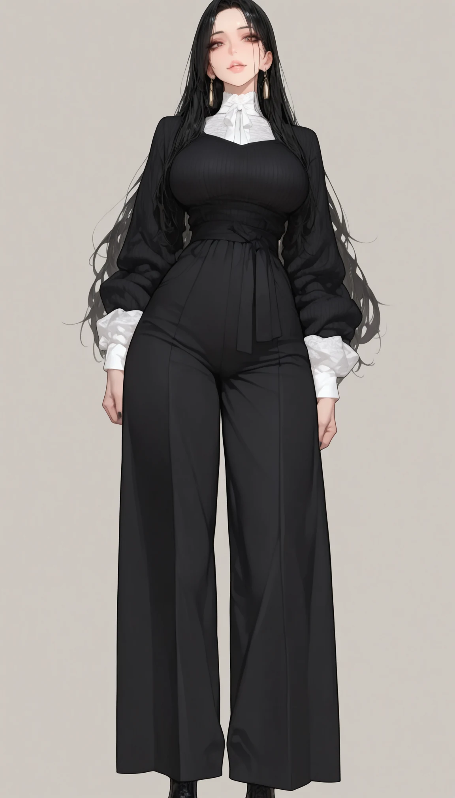</a><figcaption style="margin:4px 0 0;text-align:center;font-weight:normal;font-size:14px">hires fix の後（1152 × 2016）</figcaption></figure>
</div>

画面全体では、姿勢・服・背景は変わらず、髪と服の線と陰影が細かくなりました。顔は、違いがはっきり出ます。以下は、hires fix の後の画像と、1 段目を lanczos で同じ 1.5 倍に拡大した画像から、同じ範囲を縮小せずに切り抜いたものです。

<div style="display:flex;justify-content:center;gap:8px;margin:1rem 0">
<figure style="margin:0;flex:0 1 285px;min-width:0">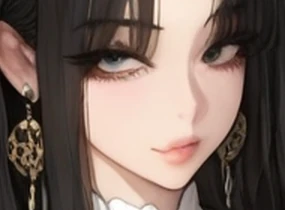<figcaption style="margin:4px 0 0;text-align:center;font-weight:normal;font-size:14px">20261190・1 段目</figcaption></figure>
<figure style="margin:0;flex:0 1 285px;min-width:0">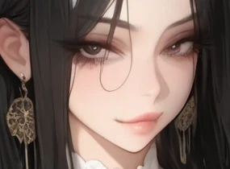<figcaption style="margin:4px 0 0;text-align:center;font-weight:normal;font-size:14px">20261190・hires fix</figcaption></figure>
</div>

<div style="display:flex;justify-content:center;gap:8px;margin:1rem 0">
<figure style="margin:0;flex:0 1 210px;min-width:0">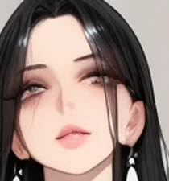<figcaption style="margin:4px 0 0;text-align:center;font-weight:normal;font-size:14px">20261193・1 段目</figcaption></figure>
<figure style="margin:0;flex:0 1 210px;min-width:0">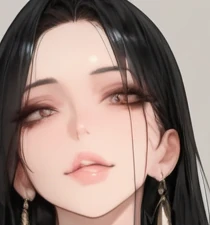<figcaption style="margin:4px 0 0;text-align:center;font-weight:normal;font-size:14px">20261193・hires fix</figcaption></figure>
</div>

[lab/hires_metrics.py](https://github.com/nao1215/debimate/blob/main/content/notes/generative-ai/img2img-denoise/lab/hires_metrics.py) で、細かさ（明るさのラプラシアンの分散）と、白い服の黄み（CIELAB の `b*`）を数えた結果が以下です。顔と白い服の範囲は、1 段目の絵を目で見て矩形で付けました。

```text
$ python3 hires_metrics.py <PNG のディレクトリ> hires_metrics.json
seed 20261190: white b* +1.25 -> +0.76 (47000 px)  sharpness 46.6 -> 118.7  face(140 px) 183.1 -> 332.6  face diff 17.45
seed 20261193: white b* -1.99 -> -0.67 (5768 px)  sharpness 57.4 -> 116.3  face(150 px) 342.2 -> 628.7  face diff 17.27
```

細かさは、画面全体で 2.0〜2.5 倍、顔で 1.8 倍になりました。顔の高さは 1 段目で 140〜150 px で、この大きさでは hires fix の描き込みが効いています。

しかし、seed 20261190 では目の色が青みがかった灰色から茶色に変わり、顔に髪の毛の線も足されました（顔の範囲の画素の差は平均 17.5）。denoise 0.45 は低い値に見えるかもしれませんが、小さな所は「細部の描き込み」ではなく描き直しになります。顔だけを拡大して描き直す方法と、hires fix を同じ絵で比べた結果は [Face Redraw のノート](../face-redraw/)にあります。

黄みを測った範囲は、2 枚で違います。seed 20261190 は白いブラウスの左袖のあたり（47,000 px）、seed 20261193 は服が黒いので白い袖口だけ（5,768 px）です。`b*` は、seed 20261190 では +1.25 から +0.76 と少し青に寄り、seed 20261193 では -1.99 から -0.67 と少し黄に寄りました。

袖口は範囲が狭く、レースの陰影で値が動きやすいので、この 2 枚からは、hires fix で白が黄ばむとも黄ばまないとも言えません。並べて見ても、黄ばみは分かりませんでした。

白い服がクリーム色に黄ばんだのは、倍率 1.3 倍・denoise 0.4 で描き直した別の設定です。顔が小さい絵で描き込みが増えなかったのも、顔が約 100 px と、この実験より小さい場合でした。どちらも同じ条件では試していません。

---

### img2img の利点

- プロンプトではなく下絵で、構図・配置・色を指定できる。プロンプトで書きにくい物体の位置や大きさも渡せる
- denoise 1 つで、下絵をどこまで残すかを連続的に変えられる
- 描き上がった絵を元に、拡大（hires fix）や仕上げの描き直しができる
- 下絵は、図形を塗っただけの単純なものでも効く。実験 1 の下絵は、Pillow で長方形と楕円を塗っただけ

---

### img2img の欠点

img2img は、下絵の潜在表現にノイズを足して、途中の段から描きます。下絵をノイズで薄めるだけなので、次の制約があります。

- 「何割描き直すか」を直接は指定できない。実験 1 では、0.6 と 0.75 の間で平らな図形から写実的な絵に急に変わった
- 下絵は 1.0 でも消えない（ComfyUI v0.35.0 で確認）。色の塊は残り、下絵と違う姿勢や配置にしにくい
- プロンプトに無い小さなものは、高い denoise で別のものに化ける。下げると、直したい所も直らない
- 下絵の作り方に左右される。くっきりした単色の図形は平らな板のまま残り、灰色の下絵では色が付かない
- hires fix の 2 段目は、1 段目より時間が掛かる。実験 3 では 1 枚が 2.8 倍になった

---

### 適さないケース

- 姿勢や物体の配置を下絵から大きく変えたい場合。下絵の色の塊が残るので、目的の姿勢や配置の下絵を描き直すか、下絵を使わない
- 下絵の一部だけを直したい場合。全体の img2img では、直さなくて良い所まで描き直され、小物が化ける。範囲を限る inpaint の方が向く
- 形だけを渡して、色はモデルに任せたい場合。灰色の下絵では、色が出ないか、出る値では配置が崩れた
