```text
masterpiece, best quality, no humans, still life, (blue ceramic teapot:1.4), lemons, glass bottle
```

上記は、画像生成のプロンプトの 1 行です。`(blue ceramic teapot:1.4)` の括弧と数字が、Prompt Weighting（プロンプトの重み付け）の書式で、括弧で囲んだ語の効き具合を 1.4 倍に強める、という意味で書きます。描きたくないものを並べる打ち消し（ネガティブプロンプト）にも、同じ書式で重みを付けられます。

この書式は「その語を 1.4 倍しっかり描け」という指示に見えます。しかし、重みが動かすのは指定した語だけではありません。本記事の実験では、ポットの重みを 2.0 にするとポットの数が増え、重みを付けていないレモンが画面から消えました。打ち消しの 12 語に 1.8 の重みを付けると、「赤」とは一言も書いていないのに、壁とテーブルクロスが赤く焼けました。

理由は、重みの計算にあります。以下は、重みと、長いプロンプトの読まれ方を描いた図です。



重みは、空のプロンプトの埋め込みから語の埋め込み（語を表す数値のベクトル）までの差を w 倍に引き伸ばす計算です。1 を超えると、ベクトルは語の位置を通り越した先、つまり普通の文章からは作られない位置に置かれます。また、長いプロンプトは 75 トークンずつ別々に読まれます。

<br>

本記事では、[ComfyUI](https://github.com/Comfy-Org/ComfyUI)（ノードをつないで画像生成の処理を組む OSS）の実装と、手元で生成した画像の色の統計から、次の疑問に答えます。

- 重みの数字は、内部で何を何倍にしているのか。
- 打ち消しの重みを上げると、なぜ色が崩れるのか。
- 長いプロンプトの 75 トークンより後ろに書いた語は、効かないのか。
- 照明の語は、打ち消しの重みとどう組み合わさるのか。
- 1 語で絵全体が変わった時、原因の語をどう探すのか。

実験はすべて 2026 年 11 月 10 日に、ComfyUI v0.35.0 と SDXL 系のモデル 1 つで行いました。数値はこのバージョン・この条件での結果です。

---

### 前提: プロンプトが UNet に届くまで

画像生成モデルの [SDXL](https://arxiv.org/abs/2307.01952)（Stable Diffusion XL）は、ノイズだけの画像から少しずつノイズを取り除いて絵を作る拡散モデルです。各ステップで「どこがノイズか」を予測するネットワークを [UNet](https://arxiv.org/abs/1505.04597)（もとは医用画像の領域分割のために提案された構造）、プロンプトの文字列を UNet が使える数値に変える部品を text encoder と呼びます（部品の大きさは [LoRA のノート](/notes/generative-ai/lora/)で数えています）。

text encoder には [CLIP](https://arxiv.org/abs/2103.00020)（画像と文章を同じベクトルの空間に対応付けるよう学習したモデル）の文章側が使われています。SDXL は CLIP ViT-L と、[OpenCLIP](https://github.com/mlfoundations/open_clip)（CLIP を再実装・再学習した OSS）の ViT-bigG の 2 つを持ち、処理は次の順に進みます。

1. tokenizer が、プロンプトをトークン（語や語の断片）の番号の列に分けます（分け方は [Tokenizer のノート](/notes/generative-ai/tokenizer/)を参照）。
2. text encoder が、トークン 1 個につき 1 本のベクトルを返します。SDXL では 2 つの encoder の出力をつないだ 2,048 次元です。
3. UNet は、ノイズを予測する各ステップで、画像の各位置からこのベクトルの列を参照します。この参照を cross-attention と呼びます。

もう 1 つ、文章全体を 1 本にまとめたベクトル（pooled）も、画像の大きさなどの情報と一緒に UNet に渡されます。

<br>

#### 打ち消しは CFG の引き算に入る

打ち消しは「この語を消せ」という命令ではありません。CFG（[Classifier-Free Guidance](https://arxiv.org/abs/2207.12598)）という仕組みで、引き算される方に入るプロンプトです。CFG は、各ステップで UNet に 2 回予測させ、次の式で混ぜます。

```text
予測 = 打ち消しでの予測 + cfg × (プロンプトでの予測 − 打ち消しでの予測)
```

`cfg` は生成の設定の CFG の値（本記事の実験では 5.5）です。ComfyUI v0.35.0 では [comfy/samplers.py の cfg_function](https://github.com/Comfy-Org/ComfyUI/blob/v0.35.0/comfy/samplers.py#L598) がこの式です。打ち消しの文が強くなるほど、画像は「打ち消しの文から遠ざかる」方向に 5.5 倍で押されます。

---

### 重み付けの計算

書式は [ComfyUI の CLIP Text Encode ノードのドキュメント](https://docs.comfy.org/built-in-nodes/ClipTextEncode)にも書かれています。ComfyUI v0.35.0 の重み付けの実装は、[comfy/sd1_clip.py](https://github.com/Comfy-Org/ComfyUI/blob/v0.35.0/comfy/sd1_clip.py) の 2 か所にあります。1 つ目の [token_weights()](https://github.com/Comfy-Org/ComfyUI/blob/v0.35.0/comfy/sd1_clip.py#L348-L366) は、括弧を読んでトークンごとの重みを決めます。

- `(word:1.3)` は、重みを 1.3 に置き換えます。掛け算ではないので、`((word:1.3))` も 1.3 です。
- `(word)` のように数字が無い時は、外側の重みの 1.1 倍です。`((word))` は 1.21 になります。

2 つ目の [encode_token_weights()](https://github.com/Comfy-Org/ComfyUI/blob/v0.35.0/comfy/sd1_clip.py#L28-L78) が、text encoder の出力に重みを掛けます。重みが 1 でないトークンが 1 つでもあると、空のプロンプトも一緒に encoder に通し、トークンの位置ごとに次の計算をします（変数名は実装の通りです）。

```python
# comfy/sd1_clip.py（v0.35.0）の encode_token_weights() から抜粋
z_empty = out[-1]                      # 空のプロンプトの出力
for j in range(len(z[i])):             # トークンの位置ごと
    weight = token_weight_pairs[k][j][1]
    if weight != 1.0:
        z[i][j] = (z[i][j] - z_empty[j]) * weight + z_empty[j]
```

`z - z_empty` は「空のプロンプトと比べて、この語が足した分」で、重みはその差を w 倍します。冒頭の図の左側がこの式です。重みが 1 を超えたベクトルは、普通の文章を encoder に通した結果から、さらに先へ延ばした外挿です。モデルがそうした入力に慣れているとは限りません。

なお、同じ書式は [AUTOMATIC1111 の stable-diffusion-webui](https://github.com/AUTOMATIC1111/stable-diffusion-webui/wiki/Features#attentionemphasis)（ブラウザから Stable Diffusion を操作する OSS）でも使えますが、計算は実装ごとに違います。

webui の既定（Original）は、出力のベクトルをそのまま w 倍してから、全体の平均を元に戻します（[modules/sd_emphasis.py](https://github.com/AUTOMATIC1111/stable-diffusion-webui/blob/82a973c04367123ae98bd9abdf80d9eda9b910e2/modules/sd_emphasis.py#L36-L46)、2024 年 7 月のコミット）。同じ `(word:1.3)` でも、道具を変えると効き方が変わります。

---

### 実験の条件

手元の ComfyUI（v0.35.0、GPU は AMD Radeon 8060S）の API に、ワークフローを 1 枚ずつ送りました。変えたのはプロンプトと打ち消しの文字列だけで、それ以外は全ての実験で同じです。

| 項目 | 値 |
|---|---|
| モデル | [WAI-illustrious-SDXL v17.0](https://civitai.com/models/827184?modelVersionId=2883731)（SDXL のアーキテクチャのイラスト向けのモデル）。LoRA は使わない |
| seed | 条件ごとに 3〜4 個（実験 4 は 2 個）。seed は毎回明示する |
| ステップ数・CFG・サンプラー | 24・5.5・euler（scheduler は normal） |
| 解像度・CLIP | 1024 × 1024・最後から 2 番目の層の出力（clip skip 2） |
| 題材 | 机の上のティーポット・レモンなどの静物（`no humans` を入れ、打ち消しに人物の語を入れる） |

全ての生成を終えた後に、実験 1・2・4 から 1 条件ずつを同じ設定でもう一度生成すると、3 枚とも画素が完全に一致しました。つまり、以下の差は生成のたびに出るぶれではなく、文字列を変えた結果です。

画像の色は、全画素（1024 × 1024）を HSV（色相・彩度・明度）に変換し、青・黄・赤などの色相に入る画素の割合として数えました。基準との差（`diff`）は、同じ seed の基準の画像との、RGB（赤・緑・青）の値の差の絶対値の平均（0〜255）です。指標の定義は [lab/analyze.py](https://github.com/nao1215/debimate/blob/main/content/notes/generative-ai/prompt-weighting/lab/analyze.py) にあります。

---

### 実験 1: 色の語に重みを付ける

プロンプトの `blue ceramic teapot` に、1.0 から 2.0 までの重みを付けました。以下が seed 101 の 6 枚です。画像の下の数字が重みです。

<div class="pw-strip" style="display:flex;flex-wrap:wrap;justify-content:center;gap:8px;margin:1.5rem 0">
<figure style="margin:0;flex:1 1 100px;max-width:130px;min-width:0">
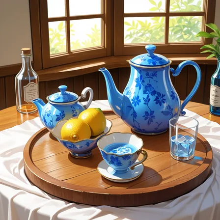
<figcaption style="margin:4px 0 0;text-align:center;font-weight:normal;font-size:14px">1.0</figcaption></figure>
<figure style="margin:0;flex:1 1 100px;max-width:130px;min-width:0">
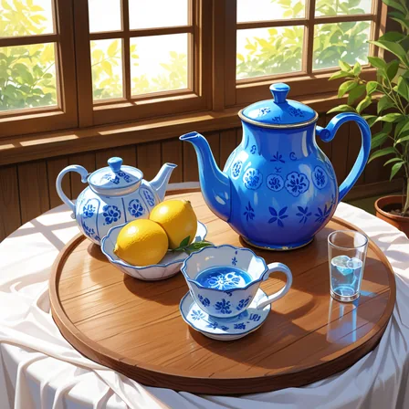
<figcaption style="margin:4px 0 0;text-align:center;font-weight:normal;font-size:14px">1.2</figcaption></figure>
<figure style="margin:0;flex:1 1 100px;max-width:130px;min-width:0">
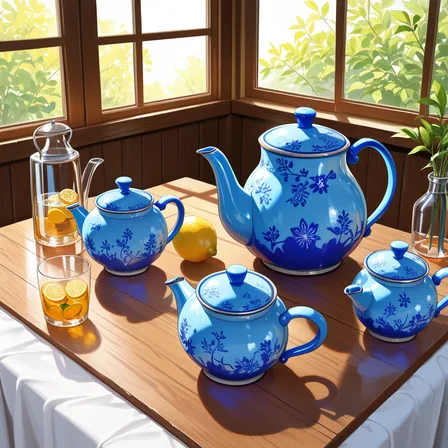
<figcaption style="margin:4px 0 0;text-align:center;font-weight:normal;font-size:14px">1.4</figcaption></figure>
<figure style="margin:0;flex:1 1 100px;max-width:130px;min-width:0">
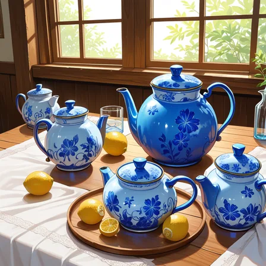
<figcaption style="margin:4px 0 0;text-align:center;font-weight:normal;font-size:14px">1.6</figcaption></figure>
<figure style="margin:0;flex:1 1 100px;max-width:130px;min-width:0">
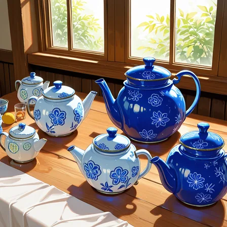
<figcaption style="margin:4px 0 0;text-align:center;font-weight:normal;font-size:14px">1.8</figcaption></figure>
<figure style="margin:0;flex:1 1 100px;max-width:130px;min-width:0">
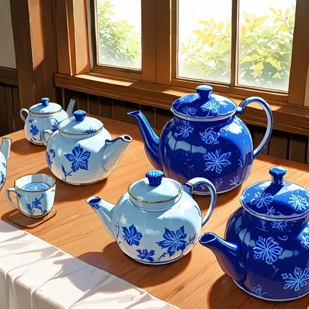
<figcaption style="margin:4px 0 0;text-align:center;font-weight:normal;font-size:14px">2.0</figcaption></figure>
</div>

重みを上げるほど、青は濃くなり、ポットの数が増えました。一方で、重みを付けていないレモンとガラス瓶は小さくなり、2.0 では消えています。3 つの seed で平均すると、青い画素は 11.4% から 18.1% に増え、レモンの黄色い画素は 1.9% から 0.3% に減りました。



<details>
<summary>基準との画素の差を含む表（3 seed の平均）</summary>

```text
condition      blue  yellow   diff   (3 seeds の平均)
w1.0          0.114   0.019    0.0
w1.2          0.125   0.022   28.1
w1.4          0.159   0.021   37.3
w1.6          0.174   0.017   47.8
w1.8          0.174   0.007   54.3
w2.0          0.181   0.003   56.0
```

</details>

重みは、指定した語を強めると同時に、他の語の取り分を減らします。重みを付けた語が 1 つでも、画面の配分は全体で変わるわけです。なお、彩度の平均は 0.485〜0.504 で、正の重み 2.0 までは画面全体の色は崩れませんでした。

ちなみに、重み 1.0 の絵でも、カップのお茶とグラスの水が青く塗られています。色の語が、修飾した名詞とは別の対象に移る現象です（[Attribute Binding のノート](/notes/generative-ai/attribute-binding/)で詳しく扱っています）。

### 実験 2: 打ち消しに重みを付ける

次は打ち消しです。題材の白いポットとレモンは変えず、打ち消しに次の 12 語を並べました。よく使われる品質の語と、白黒の絵を避ける 2 語です。この後ろに、人物を避ける `1girl, 1boy, person` を重みなしで足しています。

```text
lowres, worst quality, bad quality, low quality, jpeg artifacts, blurry,
text, signature, watermark, logo, monochrome, greyscale
```

先頭から k 語（k = 1, 6, 12）に、1.2〜1.8 の重みを付けました。例えば k = 6、重み 1.3 なら `(lowres:1.3), ..., (blurry:1.3), text, ...` です。

12 語の全てに重みを付けて色が崩れた後、白黒の 2 語（`monochrome`, `greyscale`）だけに付ける場合と、その 2 語を除いた 10 語に付ける場合も追加しました。以下は seed 101 の 6 枚で、画像の下が重みを付けた語と重みです。

<div class="pw-strip" style="display:flex;flex-wrap:wrap;justify-content:center;gap:8px;margin:1.5rem 0">
<figure style="margin:0;flex:1 1 100px;max-width:130px;min-width:0">
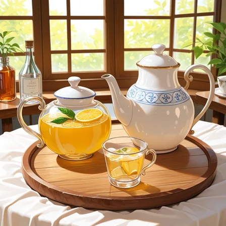
<figcaption style="margin:4px 0 0;text-align:center;font-weight:normal;font-size:14px">重みなし</figcaption></figure>
<figure style="margin:0;flex:1 1 100px;max-width:130px;min-width:0">
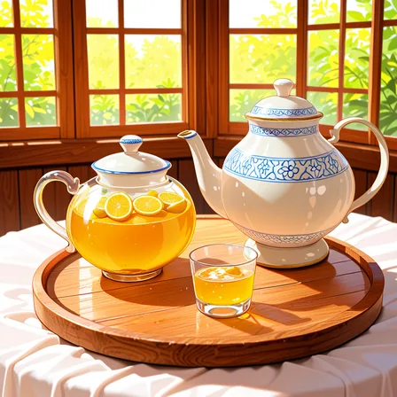
<figcaption style="margin:4px 0 0;text-align:center;font-weight:normal;font-size:14px">12 語 × 1.5</figcaption></figure>
<figure style="margin:0;flex:1 1 100px;max-width:130px;min-width:0">
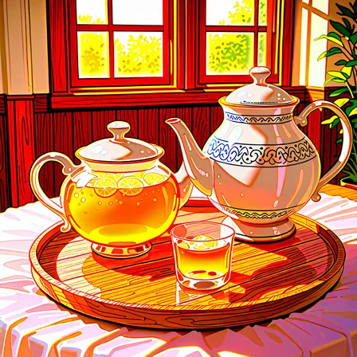
<figcaption style="margin:4px 0 0;text-align:center;font-weight:normal;font-size:14px">12 語 × 1.8</figcaption></figure>
<figure style="margin:0;flex:1 1 100px;max-width:130px;min-width:0">
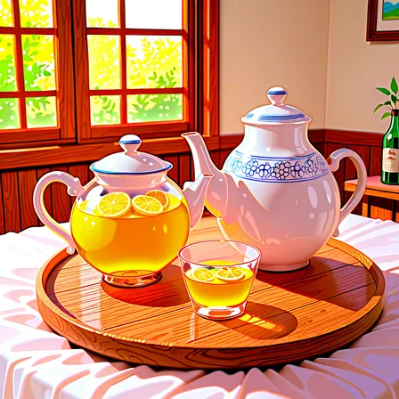
<figcaption style="margin:4px 0 0;text-align:center;font-weight:normal;font-size:14px">白黒の 2 語 × 1.8</figcaption></figure>
<figure style="margin:0;flex:1 1 100px;max-width:130px;min-width:0">
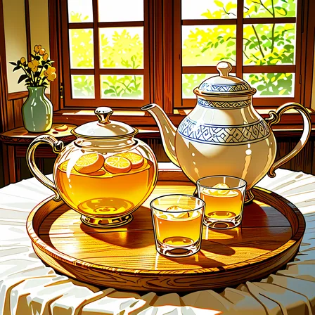
<figcaption style="margin:4px 0 0;text-align:center;font-weight:normal;font-size:14px">残りの 10 語 × 1.8</figcaption></figure>
<figure style="margin:0;flex:1 1 100px;max-width:130px;min-width:0">
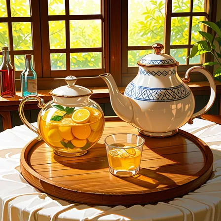
<figcaption style="margin:4px 0 0;text-align:center;font-weight:normal;font-size:14px">lowres × 1.8</figcaption></figure>
</div>

12 語 × 1.8 では、壁が赤く、テーブルクロスが桃色に焼けました。打ち消しには「赤くしろ」とは一言も書いていません。以下は、3 つの seed で平均した彩度と、赤い画素の割合です。



赤への崩れは、ほぼ白黒の 2 語だけで起きています。2 語 × 1.8 の赤い画素は 27.3% で、12 語 × 1.8 の 27.5% と変わりません。前提の節の CFG の式に当てはめると、打ち消しの「白黒」を強めるほど、画像は「白黒から遠い」方向、つまり彩度の高い方向に押されると考えられます。この条件で崩れを決めたのは、語の数より、打ち消した語の意味と重みでした。

一方で、品質の語にも別の崩れ方があります。白黒の 2 語を除いた 10 語 × 1.8 では、赤は 6.8% に留まる代わりに、黄色い画素が 7.4% から 26.5% に増え、黒に近い画素も 5.4% から 13.1% に増えました。画面全体が黄色に寄り、線と影が強くなっています。`lowres` 1 語 × 1.8 でも、黒に近い画素は 15.4% まで増えました。

<details>
<summary>彩度・赤・黄・黒に近い画素と、基準との差の表（3 seed の平均）</summary>

```text
condition       sat    red  yellow   dark   diff   (3 seeds の平均)
w1.0          0.471  0.001   0.074  0.054    0.0
k1_w1.8       0.646  0.053   0.085  0.154   36.3
k12_w1.3      0.533  0.011   0.109  0.033   25.9
k12_w1.8      0.680  0.275   0.159  0.082   58.3
mono_w1.8     0.621  0.273   0.086  0.042   44.2
k10_w1.8      0.620  0.068   0.265  0.131   47.8
```

</details>

なお、蛍光色に寄った画素（色相が黄〜緑〜青〜紫で、彩度と明度がともに高い画素。著者が生成した絵の色の検品に使っている境目と同じ。検品の仕組みは [Image Linting のノート](/notes/generative-ai/image-linting/)）の割合は、最大でも 12 語 × 1.8 の 6.0% でした。本記事の条件では、色は蛍光の緑ではなく赤と黄に崩れています。どちらの色に転ぶかは、打ち消した語と題材で変わると考えられます。

---

### 77 トークンの区切り

CLIP の text encoder は、一度に 77 トークンまでしか読めません。77 個のうち先頭と末尾は始まりと終わりの記号なので、語に使えるのは 75 トークンです。これより長いプロンプトを受け付ける道具は、プロンプトを区切って複数回 encoder に通しています。

ComfyUI v0.35.0 の区切り方は、[tokenize_with_weights()](https://github.com/Comfy-Org/ComfyUI/blob/v0.35.0/comfy/sd1_clip.py#L624-L668) の通りです。括弧で分けた塊（重みの付いた部分と付いていない部分）を順に 75 トークンの枠に詰め、収まらない時は次の枠を始めます。8 トークン以上の塊は枠の途中で割り、8 トークン未満の塊は割らずに丸ごと次の枠に送ります。

重みの無い長いプロンプトは 1 つの大きな塊なので、カンマの位置に関係なく 75 トークンちょうどで切られます。

区切った枠は、それぞれ別に encoder を通ってから横に連結され、UNet には 154 トークン（77 × 2）の列として渡ります。ここから、後ろの枠の語が不利になる理由が 2 つ読み取れます。

- 枠の間で文脈がつながりません。CLIP の text encoder は、各トークンがそれより前のトークンだけを参照する作りです（[comfy/clip_model.py](https://github.com/Comfy-Org/ComfyUI/blob/v0.35.0/comfy/clip_model.py#L174) の causal mask。仕組みは [KV キャッシュのノート](/notes/generative-ai/kv-cache/)の前提の節を参照）。2 つ目の枠の先頭の語は、1 つ目の枠に何が書いてあったかを知らずにベクトルになります。
- 文章全体をまとめた pooled のベクトルは、1 つ目の枠からだけ取られます（[encode_token_weights() の first_pooled](https://github.com/Comfy-Org/ComfyUI/blob/v0.35.0/comfy/sd1_clip.py#L49)）。2 つ目の枠の語は、pooled には入りません。

一方で、UNet の cross-attention は 154 トークンの全てを参照します。そのため、後ろの枠の語も無視されるわけではありません。どれだけ効きが落ちるかは、画像で確かめるしかありません。

プロンプトのどこで区切られるかは、上記の詰め方を写した [lab/token_chunks.py](https://github.com/nao1215/debimate/blob/main/content/notes/generative-ai/prompt-weighting/lab/token_chunks.py) で確かめられます。

### 実験 3: 同じ語を区切りの前と後ろに置く

75 トークンを超えた語は効かない、と思うかもしれません。そこで、静物の語を足して 146 トークンにしたプロンプト（基準）に、`red background` を 4 か所のどれかに入れて比べました。入れる場所は、1 つ目の枠の先頭近く（front）、1 つ目の枠の末尾（chunk1_end）、2 つ目の枠の先頭（chunk2_start）、2 つ目の枠の末尾（chunk2_end）です。

以下は、2 つ目の枠の先頭に入れた時の区切りを token_chunks.py で表示した結果です（各行の 2 行目は、トークンを文字に戻したもの）。

```text
chunk 1: 75 tokens, weights [1.0]
  masterpiece , best quality , no humans , still life , white ceramic teapot , lemons ,
  glass bottle , ... , balanced composition , calm atmosphere , quiet mood ,
chunk 2: 74 tokens, weights [1.0]
  red background , simple arrangement , cup , spoon , saucer , ... , quiet , still
```

以下は seed 201 の 5 枚です。左端は `red background` を入れていない基準です。

<div class="pw-strip" style="display:flex;flex-wrap:wrap;justify-content:center;gap:8px;margin:1.5rem 0">
<figure style="margin:0;flex:1 1 100px;max-width:130px;min-width:0">
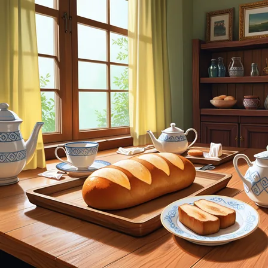
<figcaption style="margin:4px 0 0;text-align:center;font-weight:normal;font-size:14px">なし</figcaption></figure>
<figure style="margin:0;flex:1 1 100px;max-width:130px;min-width:0">
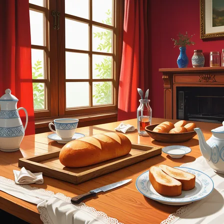
<figcaption style="margin:4px 0 0;text-align:center;font-weight:normal;font-size:14px">front</figcaption></figure>
<figure style="margin:0;flex:1 1 100px;max-width:130px;min-width:0">
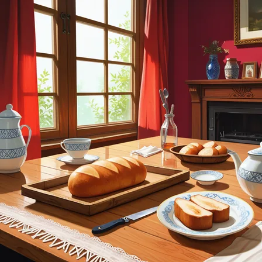
<figcaption style="margin:4px 0 0;text-align:center;font-weight:normal;font-size:14px">chunk1_end</figcaption></figure>
<figure style="margin:0;flex:1 1 100px;max-width:130px;min-width:0">
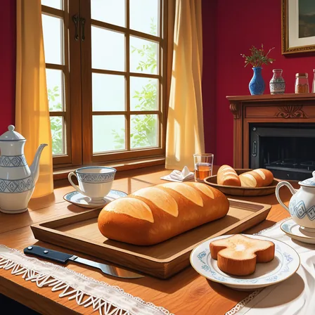
<figcaption style="margin:4px 0 0;text-align:center;font-weight:normal;font-size:14px">chunk2_start</figcaption></figure>
<figure style="margin:0;flex:1 1 100px;max-width:130px;min-width:0">
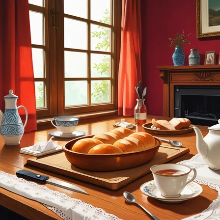
<figcaption style="margin:4px 0 0;text-align:center;font-weight:normal;font-size:14px">chunk2_end</figcaption></figure>
</div>

どこに置いても、壁は赤くなりました。4 つの seed の平均で、赤い画素の割合は次の通りです。

| 置いた場所 | 赤い画素（4 seed の平均） | seed ごとの範囲 |
|---|---|---|
| なし | 5.1% | 1.7〜10.3% |
| front（1 つ目の枠の先頭） | 36.4% | 27.0〜41.6% |
| chunk1_end（1 つ目の枠の末尾） | 30.3% | 24.7〜37.2% |
| chunk2_start（2 つ目の枠の先頭） | 26.1% | 14.5〜37.3% |
| chunk2_end（2 つ目の枠の末尾） | 35.6% | 26.6〜42.5% |

2 つ目の枠の先頭は、平均では一番弱く、seed 201 では 14.5% でした。前の枠の文脈を持たずにベクトルになる位置なので、仕組みとも合います。しかし、seed ごとの範囲は他の場所と重なっていて、4 枚では差があるとまでは言えません。2 つ目の枠の末尾は、先頭に置いた時と同じくらい効いています。

つまり、ComfyUI v0.35.0 では、75 トークンを超えた語も cross-attention を通して効きます。「後ろに書いた語が効かない」と感じる場合、原因は区切りそのものより、道具が上限を超えた語を捨てている、他の語と競合している、のどちらかを先に疑う方が良いでしょう。後で取り上げる著者の事故も、前者でした。

---

### 実験 4: 語を 1 つずつ外して原因を探す

絵全体の色や構図が変わった時、どの語が原因かは、プロンプトを眺めても分かりません。実験 1 のように、重みを付けていない語まで巻き込んで変わるからです。そこで、同じ seed のまま語を 1 つずつ外して、外す前の絵と比べる切り分けを試しました。

題材は、白いポットのある机に 8 個の品（`lemons, glass bottle, red apple, candle, books, potted plant, silver spoon, blue cup`）を並べたプロンプトです。seed 301 と 302 で、品を 1 つずつ外した 8 通りと外さない 1 通りの絵を生成しました。以下は seed 301 の 6 枚です。

<div class="pw-strip" style="display:flex;flex-wrap:wrap;justify-content:center;gap:8px;margin:1.5rem 0">
<figure style="margin:0;flex:1 1 100px;max-width:130px;min-width:0">
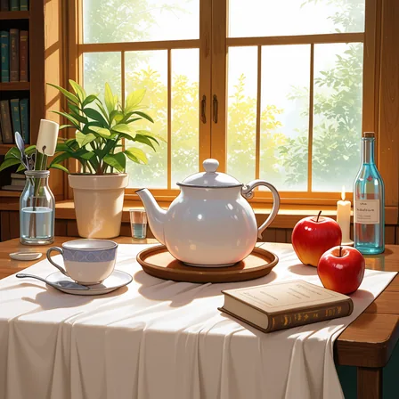
<figcaption style="margin:4px 0 0;text-align:center;font-weight:normal;font-size:14px">全部</figcaption></figure>
<figure style="margin:0;flex:1 1 100px;max-width:130px;min-width:0">
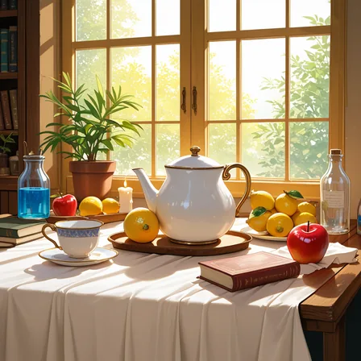
<figcaption style="margin:4px 0 0;text-align:center;font-weight:normal;font-size:14px">− silver spoon</figcaption></figure>
<figure style="margin:0;flex:1 1 100px;max-width:130px;min-width:0">
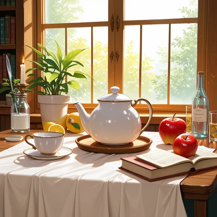
<figcaption style="margin:4px 0 0;text-align:center;font-weight:normal;font-size:14px">− blue cup</figcaption></figure>
<figure style="margin:0;flex:1 1 100px;max-width:130px;min-width:0">
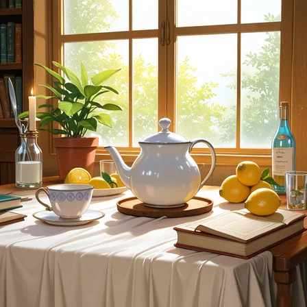
<figcaption style="margin:4px 0 0;text-align:center;font-weight:normal;font-size:14px">− red apple</figcaption></figure>
<figure style="margin:0;flex:1 1 100px;max-width:130px;min-width:0">
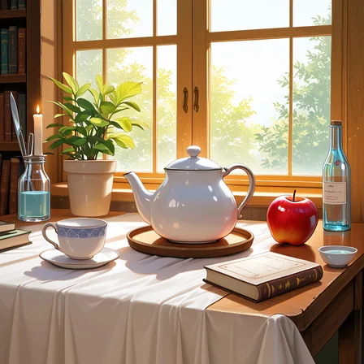
<figcaption style="margin:4px 0 0;text-align:center;font-weight:normal;font-size:14px">− lemons</figcaption></figure>
<figure style="margin:0;flex:1 1 100px;max-width:130px;min-width:0">
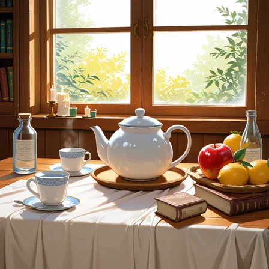
<figcaption style="margin:4px 0 0;text-align:center;font-weight:normal;font-size:14px">− potted plant</figcaption></figure>
</div>

どの語を外しても、物の位置や数が変わりました。外す前の絵との画素の差は、2 つの seed の平均で 21.7〜40.6 です。そのため、画素の差が一番大きい語（この題材では `potted plant`）を原因と決めることはできません。1 語を外すだけで、構図ごと描き直されるからです。

原因を探す時に比べるのは、画素の差ではなく、困っている症状の指標です。例えば、赤い画素の割合（2 seed の平均）は、全部の語で 3.8% のところ、`red apple` を外した時だけ 0.6% に下がり、他の 7 通りは 3.0〜5.1% でした。黄色い画素も、`lemons` を外した時に 4.9% から 1.3% に下がります。



<details>
<summary>表の抜粋（2 seed の平均）</summary>

```text
condition          red  yellow   blue   diff   (2 seeds の平均)
full             0.038   0.049  0.001    0.0
no_red_apple     0.006   0.061  0.000   34.2
no_lemons        0.051   0.013  0.002   27.8
no_silver_spoon  0.042   0.035  0.006   30.4
no_blue_cup      0.049   0.036  0.000   21.7
no_potted_plant  0.030   0.031  0.002   40.6
```

9 通り全ての値は [lab/output_ablation.txt](https://github.com/nao1215/debimate/blob/main/content/notes/generative-ai/prompt-weighting/lab/output_ablation.txt) にあります。

</details>

予想していなかったのは `silver spoon` です。外すと、2 つの seed の両方で、青い水の入った瓶やグラスが描かれました。青い画素は 0.1% から 0.6% に増えています。外した語とは関係の無い `blue cup` の青が、空いた所に移ったように見えます。ここは画像から読んだ推測で、cross-attention の中までは調べていません。

著者がキャラクターの立ち絵を作っていた時にも、同じ切り分けが効きました。小物の語を 1 つ足しただけで 6 枚全部の服の色が変わり、品を 1 つずつ外して同じ seed で比べることで、原因の語を見つけています。逆に、服の品を足すほど絵が崩れた時は、2 品を外すと同じ seed で元の絵に戻りました。

---

### 実験 5: 照明の語と打ち消しの重みを組み合わせる

実験 2 では、12 語 × 1.3 の打ち消しでは色がほとんど崩れませんでした。一方で、著者の文面には夜や照明の語が入っていました。照明の語だけで色が動くのか、重みと組み合わせた時に崩れるのかを切り分けるために、実験 2 と同じ題材・seed（101〜103）で、次の 2 つを掛け合わせました。

- 照明の語（プロンプトの末尾に 1 語足す）: なし、`night`、`neon light`、`sunset`、`dramatic lighting`。前の 3 つは、著者の文面と検査の記録に出てきた語です。
- 打ち消しの 12 語の重み: なし、1.2、1.3

照明の語が無い 3 通りは、実験 2 と同じ文面なので、実験 2 の画像を使いました。以下は seed 101 で、打ち消しに重みを付けていない 5 枚と、`sunset` に 12 語 × 1.3 を足した 1 枚です。

<div class="pw-strip" style="display:flex;flex-wrap:wrap;justify-content:center;gap:8px;margin:1.5rem 0">
<figure style="margin:0;flex:1 1 100px;max-width:130px;min-width:0">

<figcaption style="margin:4px 0 0;text-align:center;font-weight:normal;font-size:14px">なし</figcaption></figure>
<figure style="margin:0;flex:1 1 100px;max-width:130px;min-width:0">
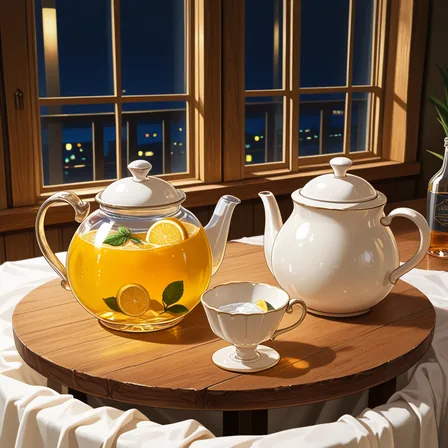
<figcaption style="margin:4px 0 0;text-align:center;font-weight:normal;font-size:14px">night</figcaption></figure>
<figure style="margin:0;flex:1 1 100px;max-width:130px;min-width:0">
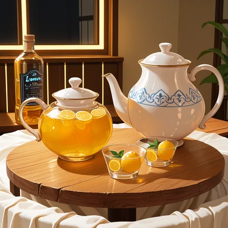
<figcaption style="margin:4px 0 0;text-align:center;font-weight:normal;font-size:14px">neon light</figcaption></figure>
<figure style="margin:0;flex:1 1 100px;max-width:130px;min-width:0">
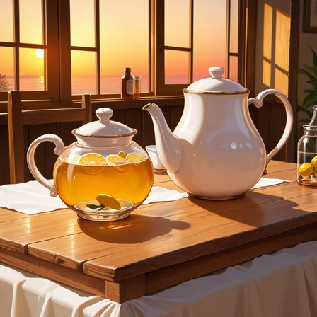
<figcaption style="margin:4px 0 0;text-align:center;font-weight:normal;font-size:14px">sunset</figcaption></figure>
<figure style="margin:0;flex:1 1 100px;max-width:130px;min-width:0">
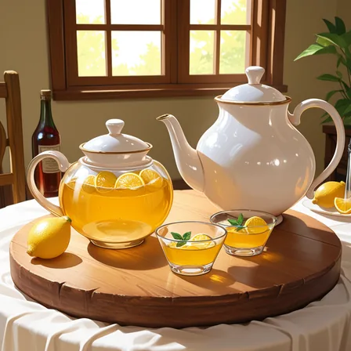
<figcaption style="margin:4px 0 0;text-align:center;font-weight:normal;font-size:14px">dramatic lighting</figcaption></figure>
<figure style="margin:0;flex:1 1 100px;max-width:130px;min-width:0">
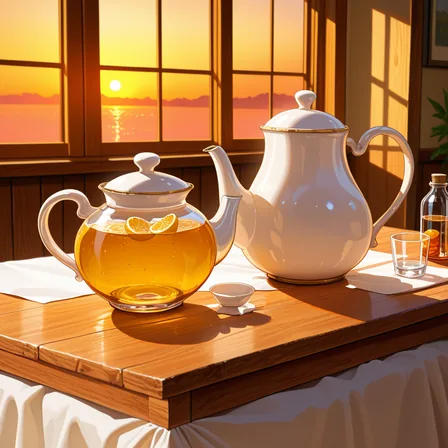
<figcaption style="margin:4px 0 0;text-align:center;font-weight:normal;font-size:14px">sunset + 12 語 × 1.3</figcaption></figure>
</div>

照明の語を 1 語足すだけで、窓の外と部屋全体の色が変わりました。`sunset` では、白いポットやテーブルクロスに橙色がかかっています。以下は、3 つの seed で平均した白い画素の割合と彩度です。



照明の語の効き目は、打ち消しの重みより大きく出ました。基準の絵との画素の差で比べると、打ち消しの重みだけを 1.3 にした時は 25.9 でしたが、照明の語を足すと、重みなしでも 34.1（`dramatic lighting`）〜67.6（`night`）でした。

白い画素は、照明の語が無い時の 16.8% から、`sunset` で 4.4%、`neon light` で 7.0% まで減っています。白い対象が光の色に染まる、色かぶりです。

<details>
<summary>彩度・蛍光色・白・黒に近い画素と、基準との差の表（3 seed の平均）</summary>

```text
condition                  sat   neon  white   dark   diff   (3 seeds の平均)
none_neg1.0              0.471  0.000  0.168  0.054    0.0
none_neg1.3              0.533  0.000  0.155  0.033   25.9
night_neg1.0             0.521  0.019  0.113  0.202   67.6
night_neg1.3             0.593  0.020  0.090  0.233   72.3
neon_light_neg1.0        0.574  0.000  0.070  0.155   51.9
neon_light_neg1.3        0.593  0.000  0.071  0.155   56.9
sunset_neg1.0            0.599  0.000  0.044  0.099   47.4
sunset_neg1.3            0.665  0.001  0.041  0.057   51.1
dramatic_lighting_neg1.0 0.524  0.000  0.139  0.098   34.1
dramatic_lighting_neg1.3 0.588  0.000  0.120  0.079   38.0
```

</details>

打ち消しの重みは、どの照明の語でも彩度を少しずつ押し上げました。重み 1.0 から 1.3 で 0.02〜0.07 です。しかし、1.2 から 1.3 で急に崩れる境目は、照明の語があっても現れませんでした。

蛍光色の割合が 0 を超えたのは `night` だけ（約 2%）で、これは seed 103 の窓の外の青い夜空の分です。重みを 1.0 から 1.3 に上げても、0.019 から 0.020 とほぼ動いていません。

つまり、この条件では「照明の語が悪さをする」は色かぶりとして再現し、効き目は打ち消しの重みより大きく出ました。一方で、「1.2 から 1.3 で蛍光色に転ぶ」は、照明の語と組み合わせても再現しませんでした。著者の当時の文面には、画風 LoRA、人物、重み付きの語が他にも多く入っていたので、それらとの組み合わせで境目が下がった可能性があります。ここは推測で、本記事では確かめていません。

---

### 運用で決めた上限

本記事の実験は、モデル 1 つと静物の題材での結果です。著者がキャラクターの立ち絵を大量に作っていた時（画風 LoRA を当てた WAI-illustrious-SDXL v17.0）には、もっと低い重みで色が崩れました。

- 打ち消しの 1 語の重みを 1.2 から 1.3 に上げただけで、以降の絵が緑や黄の蛍光色に転びました。同じ seed で前後を比べて、重みが原因だと確かめています。ここから、重み 1.3 以上の打ち消しが 7 個以上ある文面は、生成の前の検査で止める決まりにしました。
- その後も、重み付きの語と打ち消しを積んでは色が崩れる、を 5 回繰り返しました。5 回目は 1 回で色の不合格が 11 枚出ています。人が評価した 526 枚を集計すると、重み付きの打ち消しが 6 語以上の絵は 20 枚中 13 枚が色か画風の不合格で、2 語以下では 5% でした。最後は「足す語は重みの無い短い語を数語まで」をコードとテストで固定しています。
- 打ち消しを語の数で上限まで詰める仕組みで、画風の語を先に詰めた時は、当時の上限 40 語を画風の 38 語で使い切りました。場面とキャラクターの打ち消しは、5,275 通りの組み合わせの全てで捨てられていました。実験 3 で見た通り、75 トークンの区切りより、こうした切り捨ての方が効きを直接消します。
- 夜・照明・きらびやかさの語も、色を崩しました。重みを付けていなくても、肌や髪が光の色に染まりました。そこで、照明の語は文面に書かない（打ち消しに書くのは良い）という検査を入れ、明るさは何も書かない既定に任せています。実験 5 で、白いポットやテーブルクロスに光の色がかかったのと同じ現象です。

以下は、著者が以前の生成で、色の理由で外した顔です（[2026/11/02 週の weeknotes](/weeknotes/2026-11-02/e2cecb994e2c/)に掲載）。緑や黄に色がかぶった顔と、白く色が抜けた顔が並んでいます。



本記事の実験 2 と実験 5 では、照明の語の有無にかかわらず、12 語 × 1.3 の打ち消しで蛍光色には転びませんでした。崩れる境目は、題材・モデル・LoRA・他の語の重みの合計で変わると考えられます。ここは推測で、境目を条件ごとに測ったわけではありません。

<br>

どの条件でも言えるのは、照明の語は重みより先に色を動かすこと、重みは 1 語ずつ同じ seed で前後を比べてから上げること、の 2 つです。

---

### 重み付けの使いどころと限界

重み付けは、語を書き足さずに効き具合だけを変えられる手軽な道具です。しかし、ここまでの実験の通り、効くのは指定した語だけではありません。

| したいこと | 重みで起きること | 先に試すこと |
|---|---|---|
| 1 つの対象を目立たせる | その対象が増え、他の語が描く対象が減る（実験 1） | 重み 1.1〜1.2 から、同じ seed で比べながら上げる |
| 色を確実に付ける | 色が他の対象に移る（実験 1 のお茶） | 重みを上げず、足りない分は画像処理で塗り替える（色が移る仕組みは [Attribute Binding のノート](/notes/generative-ai/attribute-binding/)） |
| 描きたくないものを消す | 重みを上げると色が崩れる。白黒の語は赤に、品質の語は黄と強い影に寄る（実験 2） | 打ち消しは重みを付けずに必要な数語だけ書く |
| 照明や時間帯で雰囲気を出す | 重みが無くても、白い対象が光の色に染まる（実験 5） | 照明の語を書かず、雰囲気は壁や小物の色で出す |
| 長いプロンプトの後ろの語を効かせる | 区切りの後ろでも効く（実験 3）。道具の上限で捨てられると効かない | 道具の上限と切り捨ての順序を確かめ、同じ意味の語をまとめる |

重みの計算は、ComfyUI と AUTOMATIC1111 の webui の既定で異なります。同じ数字でも道具を変えると効き方が変わるので、ワークフローを移したら重みも測り直す必要があります。
